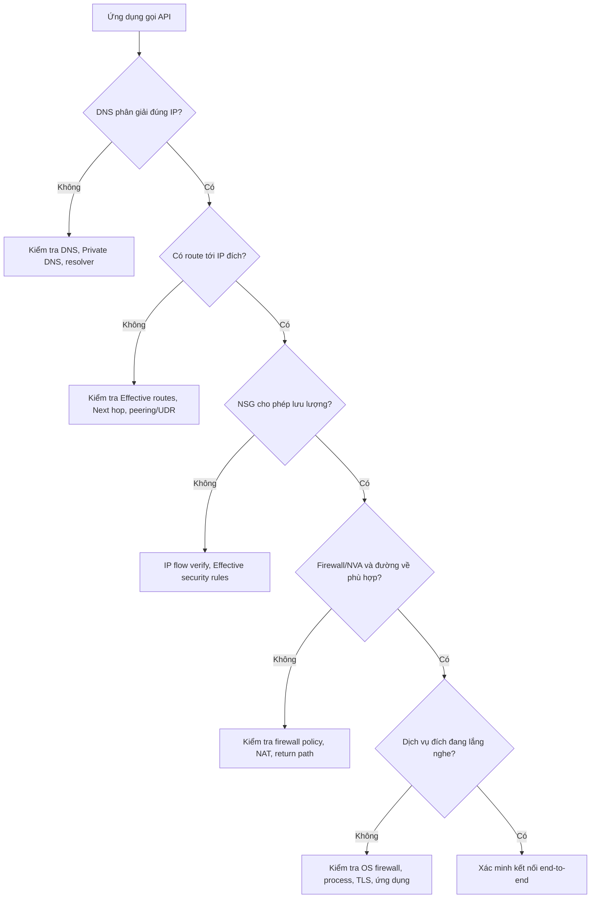
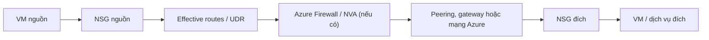
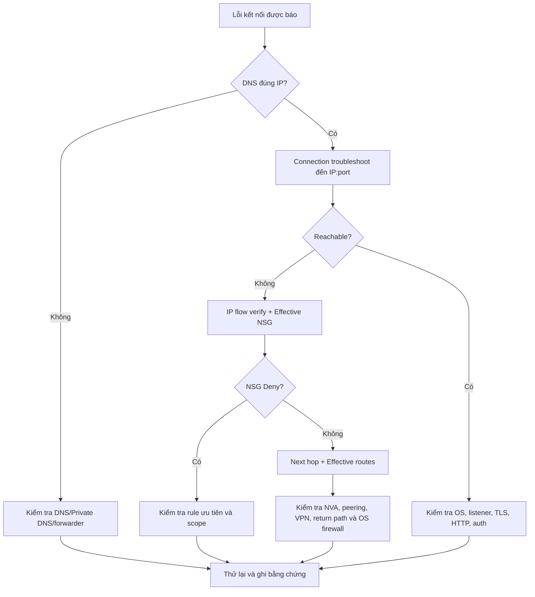

# Kiểm tra kết nối bằng Network Watcher

Một ứng dụng chạy trên Microsoft Azure có thể triển khai thành công nhưng vẫn không kết nối được từ máy chủ web đến API nội bộ, từ máy ảo đến cơ sở dữ liệu, hoặc từ mạng công ty đến dịch vụ trong virtual network. Khi đó, câu hỏi quan trọng không chỉ là **“có ping được không?”**, mà còn là: **tên miền đã phân giải đúng chưa, lưu lượng đi theo tuyến nào, Network Security Group (NSG) cho phép hay chặn, có firewall hoặc thiết bị mạng trung gian không, và dịch vụ đích có thực sự lắng nghe ở cổng cần thiết không?**

**Azure Network Watcher** cung cấp các công cụ chẩn đoán ở tầng mạng để trả lời những câu hỏi đó. Bài học thuộc chương **Mạng ảo và phân giải tên** của module `CLOUD_PROVIDERS_AZURE`. Trong quá trình học hệ sinh thái Azure từ subscription, resource group, Entra ID tới mạng ảo, compute, lưu trữ và dữ liệu, Network Watcher là công cụ thực tế để kiểm tra kết nối, điều tra sự cố triển khai, hỗ trợ vận hành an toàn và kiểm soát chi phí giám sát.

## Mục tiêu học tập

Sau bài học, bạn có thể:

- Xác định đúng vấn đề cần kiểm tra bằng **Connection troubleshoot**, **IP flow verify**, **Next hop**, **Effective security rules** và **Effective routes**.
- Chuẩn bị subscription, resource, quyền truy cập, cấu hình Network Watcher theo vùng và agent/extension cần thiết cho một phép kiểm tra.
- Dùng Azure Portal hoặc Azure CLI để kiểm tra đường kết nối từ một Azure VM đến địa chỉ đích và cổng TCP.
- Phân biệt lỗi **DNS**, **NSG**, **UDR/route**, **Azure Firewall/NVA**, **peering**, **VPN/ExpressRoute** và **dịch vụ đích**.
- Hiểu giới hạn của mỗi công cụ và không kết luận “ứng dụng hoạt động” chỉ dựa vào việc lưu lượng mạng được cho phép.
- Xây dựng quy trình khắc phục sự cố có bằng chứng, ít tác động đến môi trường production và có phương án giám sát lâu dài.

## 1. Mô hình kết nối trước khi mở Network Watcher

Giả sử một ứng dụng có máy ảo `vm-web` nằm trong subnet `snet-web` và API nội bộ nằm trên `vm-api` trong subnet `snet-api`. API phục vụ HTTPS tại cổng `443`. Từ máy web, người dùng nhận thông báo `Connection timed out` khi truy cập `https://api.internal.example`.

Muốn điều tra chính xác, trước hết hãy mô tả một **luồng kết nối** bằng tối thiểu sáu thông tin:

| Thành phần | Ví dụ | Ý nghĩa khi điều tra |
|---|---|---|
| Nguồn (*source*) | `vm-web` / IP `10.10.1.4` | Nơi khởi tạo kết nối |
| Đích (*destination*) | `vm-api` / IP `10.20.2.4` | Nơi nhận kết nối |
| Tên đích | `api.internal.example` | Phải được phân giải ra địa chỉ IP mong đợi |
| Giao thức | TCP | Phân biệt với UDP/ICMP và kiểm tra ứng dụng |
| Cổng đích | `443` | Dịch vụ có lắng nghe cổng này không? |
| Đường đi mong đợi | VNet peering hoặc route nội bộ | Lưu lượng thực tế có đi đúng tuyến không? |

Một kết nối có thể thất bại ở nhiều lớp:



Sơ đồ này là một **phương pháp suy luận**. Một số lỗi có thể xuất hiện đồng thời; ví dụ DNS trỏ sai IP và NSG chặn lưu lượng ở cổng đích. Không nên chỉ thay đổi một rule NSG rồi xem sự cố đã được chẩn đoán đầy đủ.

### Đường đi của một gói tin trong Azure

Trong một thiết kế có nhiều tầng, đường đi có thể đi qua các thành phần:



Không phải mọi đường đi đều có đầy đủ các thành phần trên. Một VNet duy nhất không cần peering; một luồng trong cùng subnet có thể không qua NVA; một private endpoint có mô hình xử lý khác VM truyền thống. Network Watcher giúp kiểm tra từng phần có thể quan sát được của tuyến kết nối.

## 2. Network Watcher là gì và hỗ trợ những gì?

Network Watcher là dịch vụ giám sát/chẩn đoán mạng của Azure, tích hợp với các tài nguyên như virtual network, VM và network interface. Nhiều khả năng được cung cấp trực tiếp qua Azure Portal và Azure CLI; một số chức năng yêu cầu **Network Watcher agent/extension** trên VM, quyền truy cập tài nguyên, hay tài nguyên lưu kết quả.

Các nhóm công cụ quan trọng:

| Công cụ | Trả lời câu hỏi nào? | Giá trị/giới hạn chính |
|---|---|---|
| **Connection troubleshoot** | Từ nguồn có kết nối được đến host/IP/cổng đích không? | Kiểm tra theo yêu cầu, trả trạng thái và dữ liệu chẩn đoán tùy nguồn/đích |
| **IP flow verify** | NSG có cho phép một luồng IP cụ thể vào/ra VM không? | Xác định `Allow`/`Deny` và rule liên quan; **không** chứng minh dịch vụ đang mở cổng |
| **Effective security rules** | Sau khi tổng hợp NSG subnet/NIC, rule nào thực sự có hiệu lực? | Hiểu thứ tự ưu tiên và các rule áp dụng cho NIC |
| **Next hop** | Gói từ VM tới IP đích được định tuyến đến loại next hop nào? | Tìm sai UDR, đường qua NVA hoặc gateway, nhưng chưa xác nhận ứng dụng thành công |
| **Effective routes** | NIC đang có những route nào và nguồn từ đâu? | Hiểu system routes, peering và user-defined routes |
| **Connection Monitor** | Một đường kết nối có liên tục đáp ứng yêu cầu về reachability/latency không? | Giám sát định kỳ, theo dõi xu hướng và cảnh báo; có chi phí theo tính năng |
| **Packet capture** | Gói tin thực tế đến/đi từ VM như thế nào? | Phân tích sâu, cần lưu trữ và kiểm soát dữ liệu bắt gói |
| **Flow logs/traffic analysis** | Lưu lượng ở phạm vi mạng diễn ra theo mẫu nào? | Phân tích lịch sử, phụ thuộc loại log được hỗ trợ và cấu hình thu thập |
| **Topology** | Tài nguyên mạng liên quan với nhau ra sao? | Giúp nhìn kiến trúc, nhưng bản đồ topology không tự chứng minh reachability |

Tính năng, giao diện và nguồn/đích được hỗ trợ có thể khác nhau theo vùng Azure, loại tài nguyên và phiên bản công cụ. Ví dụ, không phải mọi tính năng Network Watcher đều kiểm tra được trực tiếp từ một PaaS service như thể nó là Azure VM.

### Network Watcher theo khu vực

Network Watcher được quản lý theo **region** trong subscription. Trước khi chẩn đoán VM, cần xác minh Network Watcher đã được bật cho **region của VM nguồn**. Tài nguyên Network Watcher thường được Azure đặt trong một resource group mặc định theo quy trình bật dịch vụ, trừ khi tổ chức sử dụng cách quản lý khác.

Việc bật Network Watcher không tự mở NSG rule, không tạo kết nối giữa các VNet và không sửa DNS của ứng dụng. Đây là công cụ quan sát, kiểm tra và giám sát; nó không thay thế thiết kế mạng.

## 3. Chuẩn bị một phép kiểm tra

Trước khi chọn công cụ, thu thập:

1. **Subscription, tenant và region:** chắc chắn đang quan sát đúng môi trường, nhất là khi tổ chức có nhiều subscription.
2. **VM/source resource:** tên, resource group, resource ID, hệ điều hành và địa chỉ IP nguồn dùng để chẩn đoán.
3. **Destination:** FQDN hoặc IP, địa chỉ private/public mong đợi, port và protocol (TCP/UDP/ICMP) của luồng thực tế.
4. **VNet/subnet/NIC:** địa chỉ dải mạng, route table, NSG gắn subnet/NIC, peering, firewall/NVA và gateway liên quan.
5. **Thông tin thời điểm:** lỗi xuất hiện từ khi nào, có thay đổi deployment/NSG/DNS/route không, triệu chứng xảy ra liên tục hay ngắt quãng.
6. **Quyền:** quyền đọc cấu hình mạng và chạy công cụ chẩn đoán; một số thao tác yêu cầu quyền bổ sung với VM, extension hoặc tài nguyên lưu log.

Ở Azure Portal, truy cập **Network Watcher**, chọn region và công cụ tương ứng. Nếu bài kiểm tra yêu cầu VM agent/extension, cần xác nhận VM đang chạy và extension có trạng thái phù hợp. Với một số nguồn khác VM, tính năng có thể sử dụng cơ chế kiểm tra hoặc giới hạn riêng.

**Lưu ý:** Trạng thái `Running` của VM, NSG được khai báo đúng, hay VNet peering báo `Connected` đều chưa đủ để kết luận cổng ứng dụng đang thông. Chúng chỉ là những dữ kiện cần kết hợp.

## 4. Connection troubleshoot: kiểm tra từ nguồn đến đích

**Connection troubleshoot** là điểm xuất phát phù hợp khi biết rõ “nguồn A không kết nối được đích B ở cổng P”. Công cụ kiểm tra reachability từ nguồn được hỗ trợ và có thể đưa ra thông tin độ trễ, các hop hoặc lý do thất bại tùy kịch bản.

### Kiểm tra bằng Azure Portal

1. Mở **Network Watcher → Connection troubleshoot**.
2. Chọn subscription/resource group và **source** phù hợp, ví dụ VM `vm-web`.
3. Khai báo **destination**: một resource được hỗ trợ, địa chỉ IP hoặc FQDN.
4. Chọn cổng/giao thức kiểm tra phù hợp với mục tiêu; ví dụ TCP/443 cho HTTPS.
5. Chạy phép kiểm tra, sau đó ghi lại trạng thái, IP đích, kết quả probe, latency và những hop/thông báo lỗi được trả về.
6. Nếu kết nối thất bại, chuyển sang **IP flow verify** và **Next hop** để xác định lớp NSG và routing.

Không nên thay thế một phép kiểm tra HTTPS tại cổng 443 bằng ICMP ping rồi suy diễn. Có hệ thống **chặn ICMP** nhưng vẫn phục vụ TCP/443 bình thường, hoặc cho phép ICMP nhưng ứng dụng TLS/HTTP vẫn thất bại.

### Kiểm tra bằng Azure CLI

Đăng nhập và chọn đúng subscription:

```bash
az login
az account set --subscription "<subscription-id>"

az account show \
  --query "{subscription:id,tenantId:tenantId,name:name}" \
  --output json
```

Lấy resource ID của VM nguồn:

```bash
SOURCE_VM_ID=$(az vm show \
  --resource-group "rg-app-lab" \
  --name "vm-web" \
  --query id \
  --output tsv)
```

Chạy chẩn đoán đến địa chỉ riêng của API tại cổng TCP/443:

```bash
az network watcher test-connectivity \
  --source-resource "$SOURCE_VM_ID" \
  --dest-address "10.20.2.4" \
  --dest-port 443 \
  --output json
```

Đây là cú pháp ví dụ cho nguồn là Azure VM. Thay `rg-app-lab`, `vm-web` và IP bằng môi trường được cấp quyền. Tùy tính năng đang dùng, CLI có thể yêu cầu agent/extension hoặc một số tùy chọn nguồn, đích khác. Chạy `az network watcher test-connectivity -h` để kiểm tra tham số cho bản Azure CLI được cài đặt.

Kết quả có thể có các trường như:

```json
{
  "connectionStatus": "Unreachable",
  "avgLatencyInMs": null,
  "probesSent": 10,
  "probesFailed": 10,
  "hops": []
}
```

JSON trên chỉ **minh họa các trường ý nghĩa**, không phải cam kết output cố định của Azure. Số probe, dữ liệu hop và trường latency phụ thuộc loại kiểm tra và thực tế kết nối.

### Đọc kết quả

- `Reachable`: phép probe đã kết nối thành công theo phương pháp kiểm tra. Cần tiếp tục xác nhận TLS, HTTP status, authentication và nghiệp vụ nếu ứng dụng vẫn báo lỗi.
- `Unreachable`: nguồn không kết nối được đích theo phép đo; cần điều tra DNS, NSG, route, firewall, đích không lắng nghe hoặc nguồn kiểm tra không phù hợp.
- Latency tăng: có thể có đường đi vòng qua firewall/NVA, gateway, mạng WAN hoặc tải lớn, nhưng cần đối chiếu các phép đo khác; không kết luận nguyên nhân chỉ từ một số liệu.
- Hop/diagnostic detail: gợi ý nơi lưu lượng có vấn đề, nhưng không nhất thiết phản ánh toàn bộ đường truyền end-to-end như packet trace đầy đủ.

Nếu dùng FQDN, cần xác định **FQDN đã được phân giải ra IP nào từ bối cảnh của nguồn**. Một kết quả kết nối thành công đến IP công cộng có thể vẫn sai mục tiêu nếu ứng dụng yêu cầu đi qua private endpoint.

## 5. IP flow verify: NSG nào cho phép hoặc chặn gói tin?

**IP flow verify** phân tích tác động của các Network Security Group đối với một luồng IP liên quan đến Azure VM. Bạn cung cấp:

- VM được kiểm tra.
- Hướng `Inbound` hoặc `Outbound` từ góc nhìn VM đó.
- Giao thức, IP và cổng **local** (phía VM).
- IP và cổng **remote** (đầu bên kia).

Kết quả thường cho biết **Allow/Deny** và rule NSG được khớp. Công cụ này rất hữu ích khi hai nơi cùng có NSG: subnet và NIC, hoặc nhiều rule có thứ tự ưu tiên khác nhau.

### Ví dụ: kiểm tra lưu lượng vào VM API

VM API có IP `10.20.2.4`, cổng đích là TCP/443. VM web có IP `10.10.1.4`, sử dụng một cổng nguồn tạm thời `55000`.

```bash
TARGET_VM_ID=$(az vm show \
  --resource-group "rg-api-lab" \
  --name "vm-api" \
  --query id \
  --output tsv)

az network watcher test-ip-flow \
  --vm "$TARGET_VM_ID" \
  --direction Inbound \
  --protocol TCP \
  --local "10.20.2.4:443" \
  --remote "10.10.1.4:55000" \
  --output json
```

Kết quả minh họa:

```json
{
  "access": "Deny",
  "ruleName": "UserRule_DenyHttpsFromWeb"
}
```

Đối với luồng phản hồi hoặc lưu lượng đi ra, hướng và local/remote cần được đặt theo **VM đang kiểm tra**, không theo cảm nhận “ứng dụng đang gọi API” một cách mơ hồ. Cổng nguồn `55000` chỉ là ví dụ; kết nối thực tế có thể dùng một ephemeral port khác.

### Diễn giải kết quả đúng phạm vi

Nếu `Deny`, kiểm tra NSG rule mà Azure báo và thay đổi theo quy trình: source/destination prefix, application security group, protocol, port, priority và rule mặc định.

Nếu `Allow`, chỉ có thể kết luận **NSG được kiểm tra không chặn luồng mô phỏng theo thông số đó**. Kết quả **không** chứng minh:

- Route đến đích là đúng.
- Azure Firewall hoặc network virtual appliance (NVA) cho phép traffic.
- Tường lửa trong hệ điều hành đích cho phép.
- Process API đang lắng nghe TCP/443 và có chứng chỉ TLS hợp lệ.
- DNS đã phân giải đúng.

Ngoài ra, cần lưu ý **NSG là stateful**: khi một luồng được thiết lập hợp lệ, các gói phản hồi thuộc cùng kết nối thường được xử lý theo trạng thái; không nên tự động tạo rule mở cổng ephemeral chiều ngược chỉ vì thấy cổng nguồn ngẫu nhiên.

## 6. Effective security rules: tìm luật NSG thực sự có hiệu lực

Một network interface có thể chịu tác động của NSG gắn trực tiếp vào NIC và NSG gắn vào subnet. Các rule do người dùng tạo cùng các rule mặc định được đánh giá theo thứ tự và phạm vi tương ứng.

**Effective security rules** giúp quan sát các rule đã được tính cho NIC. Trong Azure Portal, có thể mở NIC hoặc VM → Networking → **Effective security rules** (vị trí menu có thể thay đổi theo giao diện).

Qua Azure CLI, truy vấn NIC:

```bash
az network nic list-effective-nsg \
  --resource-group "rg-api-lab" \
  --name "nic-api" \
  --output json
```

Các điểm cần kiểm tra:

1. Rule nào khớp chiều **Inbound/Outbound**, protocol, source/destination và destination port?
2. Có NSG ở cả **subnet** và **NIC** không? Cho phép ở một nơi không có nghĩa nơi còn lại cũng cho phép.
3. Rule có ưu tiên phù hợp không? Trong một NSG, **priority thấp hơn có mức ưu tiên cao hơn**.
4. Các rule mặc định như `DenyAllInBound`, `AllowVnetInBound` hoặc `AllowInternetOutBound` có đang ảnh hưởng đến trường hợp cụ thể không?
5. Dùng **service tag** hoặc **application security group** có tương ứng chính xác với nguồn/đích thực tế hay không?

Ví dụ: NSG tại subnet cho phép `10.10.1.0/24 → TCP/443`, nhưng NSG tại NIC đích có rule ưu tiên cao hơn chặn TCP/443. Khi đó việc chỉ xem NSG subnet rất dễ đưa đến kết luận sai.

**Lưu ý thiết kế:** Thay đổi NSG rule ở production có thể ảnh hưởng đến nhiều VM và dịch vụ dùng chung subnet. Nên chỉ sửa rule đã chứng minh là nguyên nhân, giới hạn source/destination/port, đánh giá tác động và lưu bằng chứng trước/sau.

## 7. Next hop và Effective routes: gói tin được gửi đi đâu?

Khi NSG báo `Allow` nhưng Connection troubleshoot vẫn thất bại, bước kế tiếp thường là **routing**.

Azure tạo **system routes** cho nhiều tuyến cơ bản. Doanh nghiệp có thể thêm **user-defined routes (UDR)** để điều hướng lưu lượng qua Azure Firewall, NVA hoặc gateway. VNet peering và các đường kết nối hybrid còn tạo ra những tuyến có tính chất riêng.

### Next hop: tuyến quyết định cho một cặp IP

**Next hop** kiểm tra từ VM nguồn đến một IP đích cụ thể, xác định loại hop kế tiếp mà Azure chọn.

```bash
az network watcher show-next-hop \
  --vm "$SOURCE_VM_ID" \
  --source-ip "10.10.1.4" \
  --dest-ip "10.20.2.4" \
  --output json
```

Kết quả thường có `nextHopType`, có thể có `nextHopIpAddress` và thông tin route tùy trường hợp. Một số loại next hop cần biết:

| Loại next hop | Cách hiểu |
|---|---|
| `VirtualNetwork` | Azure định tuyến trong phạm vi mạng ảo theo system route phù hợp |
| `VirtualNetworkPeering` | Tuyến đến VNet được peering |
| `VirtualAppliance` | Route yêu cầu chuyển lưu lượng qua NVA, chẳng hạn firewall |
| `VirtualNetworkGateway` | Route qua virtual network gateway trong trường hợp hỗ trợ |
| `Internet` | Route hướng đến Internet theo cấu hình mạng |
| `None` | Lưu lượng bị loại bỏ/không có next hop thích hợp theo tuyến được chọn |

Một kết quả `VirtualAppliance` không tự cho biết NVA đã chấp nhận hoặc chuyển tiếp gói; cần kiểm tra firewall policy, IP forwarding, NAT và đường quay về. Nếu mong đợi traffic đi qua VNet peering mà lại thấy `Internet` hoặc `None`, có thể có lỗi peering, route hoặc địa chỉ đích ngoài dải dự kiến.

### Effective routes: toàn bộ bảng route của NIC

```bash
az network nic show-effective-route-table \
  --resource-group "rg-app-lab" \
  --name "nic-web" \
  --output json
```

Đối chiếu các trường như address prefix, next-hop type, next-hop IP, trạng thái và nguồn tuyến. Kiểm tra:

- UDR nào đang gắn subnet nguồn.
- Dải đích `10.20.2.0/24` có trùng route mong đợi không.
- Route nào có prefix cụ thể hơn và được chọn theo nguyên tắc **longest prefix match**, sau đó xét quy tắc ưu tiên tuyến khi cần.
- UDR `0.0.0.0/0` có đẩy traffic về firewall/NVA không.
- Khi qua NVA, đường phản hồi có đối xứng và NVA có bật forward IP không.
- Nếu đi hybrid, quảng bá route từ VPN/ExpressRoute và dải địa chỉ hai bên có bị trùng không.

Lệnh xem effective routes giúp thấy **bảng định tuyến đang áp dụng**, không phải sơ đồ lý tưởng ghi trong tài liệu hạ tầng.

## 8. DNS và Private DNS: kết nối đúng địa chỉ trước

Network Watcher không thay thế toàn bộ công cụ chẩn đoán DNS. Một kết nối bằng IP thành công nhưng bằng FQDN thất bại là dấu hiệu cần kiểm tra quá trình phân giải tên, cấu hình DNS server và bản ghi.

### Kiểm tra từ chính VM nguồn

Trên Linux:

```bash
nslookup api.internal.example

# Ví dụ kiểm tra kết nối tới API sau khi phân giải tên
curl -vk --connect-timeout 5 https://api.internal.example/
```

Trên Windows PowerShell:

```powershell
Resolve-DnsName api.internal.example
Test-NetConnection api.internal.example -Port 443
```

`curl -k` trong ví dụ chỉ nhằm **bỏ qua kiểm tra chứng chỉ khi quan sát lỗi kết nối trong lab**, không dùng làm cấu hình ứng dụng hoặc phép xác nhận TLS an toàn ở production. Khi kiểm thử thật, nên giữ xác minh chứng chỉ và kiểm tra SAN/hostname, chuỗi tin cậy và phiên bản TLS.

Hãy phân biệt ba loại kết quả:

- FQDN phân giải ra **IP sai**: điều tra DNS/Private DNS, forwarding, DNS server tùy chỉnh và cache.
- FQDN phân giải đúng, **TCP timeout**: kiểm tra route/NSG/firewall/OS/service.
- TCP được mở, nhưng **TLS hoặc HTTP lỗi**: chuyển sang chứng chỉ, SNI, application gateway, backend health, auth hoặc application logs.

### Trường hợp Private Endpoint

Nếu một Azure PaaS service truy cập qua **Private Endpoint**, tên miền của dịch vụ phải được phân giải về **private IP** của private endpoint từ đúng mạng và DNS context. Cần kiểm tra:

1. Private endpoint đã được duyệt/kết nối chưa, IP riêng đang là gì.
2. Private DNS zone liên quan đã có bản ghi chính xác và liên kết với VNet nguồn chưa.
3. DNS server tùy chỉnh hoặc DNS forwarding từ on-premises có trả đúng private IP không.
4. Route và chính sách mạng dành cho private endpoint có áp dụng phù hợp không; một số kiểm soát NSG/UDR trên subnet private endpoint phụ thuộc cấu hình hỗ trợ.
5. Có vô tình truy cập endpoint **public** dù thiết kế yêu cầu private path không.

Không thể kết luận “private endpoint hoạt động” chỉ từ việc DNS trả về một địa chỉ private. Cần xác nhận tiếp kết nối TCP, cơ chế xác thực dịch vụ và quy tắc truy cập dữ liệu.

## 9. Connection Monitor: khi cần quan sát liên tục

**Connection troubleshoot** kiểm tra theo yêu cầu ở một thời điểm. **Connection Monitor** dùng các bài kiểm tra định kỳ theo cấu hình, giúp đánh giá chất lượng và độ sẵn sàng của một đường kết nối theo thời gian.

Các yếu tố thường cấu hình cho Connection Monitor:

- **Nguồn và đích** được hỗ trợ: Azure resources, địa chỉ Internet hoặc điểm giám sát bên ngoài tùy tính năng.
- **Test configuration**: protocol và thông số kiểm tra, cổng, tần suất, giới hạn đo.
- **Test group**: nhóm hóa source, destination và test configuration.
- **Workspace / monitoring**: nơi lưu kết quả theo khả năng tích hợp, tạo cảnh báo và dashboard.

Ví dụ, nhóm vận hành có thể tạo bài kiểm tra định kỳ từ `vm-web` đến `vm-api:443` và theo dõi:

- Phần trăm phép đo thành công.
- Độ trễ và mức biến động so với thông thường.
- Mốc thời gian kết nối ngắt quãng trùng với thay đổi route/NSG hoặc bảo trì.
- Cảnh báo khi nhiều phép đo liên tiếp thất bại.

Giá trị của Connection Monitor nằm ở **lịch sử** và **tín hiệu xu hướng**, đặc biệt với sự cố chỉ xuất hiện vài lần mỗi ngày. Cần cân nhắc lượng test, vị trí nguồn/đích và thời gian lưu kết quả vì các thành phần giám sát/lưu trữ có thể phát sinh chi phí.

## 10. Packet capture và flow logs: khi cần thêm bằng chứng

Khi Connection troubleshoot, IP flow verify và routing chưa đủ giải thích, cần thu thêm bằng chứng từ gói tin hoặc log lưu lượng.

### Packet capture

Network Watcher có thể thực hiện **packet capture** với nguồn được hỗ trợ, thường là Azure VM đã đáp ứng yêu cầu agent/extension và điều kiện cấu hình. Việc bắt gói có thể được lọc theo:

- IP nguồn/đích.
- Giao thức và cổng.
- Thời gian, kích thước hoặc giới hạn dung lượng capture.

Trường hợp sử dụng: xác định có gói SYN được gửi ra không, có nhận SYN-ACK không, có RST/TCP retransmission hay traffic một chiều không. Tuy nhiên, dữ liệu capture có thể chứa metadata nhạy cảm và thậm chí payload không được mã hóa; phải giới hạn đối tượng, thời gian và nơi lưu theo chính sách bảo mật.

### Flow logs

Flow logs giúp xem mẫu lưu lượng theo thời gian và hỗ trợ phân tích lịch sử. Azure có các cơ chế flow logging phụ thuộc tính năng mạng và thế hệ dịch vụ. Khi thiết kế mới, nên **kiểm tra hướng dẫn hiện hành cho Virtual Network flow logs và vòng đời của NSG flow logs**, tránh lựa chọn một tính năng cũ đang được thay thế.

Flow logs không thay thế packet capture đầy đủ; bản ghi lưu lượng thường không chứa toàn bộ nội dung gói tin. Log cũng không đảm bảo đủ thông tin để giải thích lỗi ứng dụng HTTP hoặc TLS.

## 11. Quy trình chẩn đoán có hệ thống

Khi có ticket “web không gọi được API”, thực hiện theo trình tự dưới đây để tối thiểu hóa việc sửa cấu hình khi chưa có bằng chứng.

### Giai đoạn A — Xác nhận triệu chứng

1. Ghi lại nguồn/đích, FQDN, IP, port, thời điểm lỗi và thông báo ứng dụng.
2. Chạy truy vấn DNS từ nguồn; ghi nhận IP được phân giải.
3. Kiểm tra nhanh cổng bằng `curl`/`Test-NetConnection` nếu có quyền truy cập máy; xác định timeout, reset, DNS error hay lỗi HTTP/TLS.
4. Đảm bảo môi trường và subscription đang kiểm tra đúng với ticket.

### Giai đoạn B — Kiểm tra đường mạng

1. Chạy **Connection troubleshoot** giữa nguồn và đích đúng IP/cổng.
2. Nếu không thông, dùng **IP flow verify** cho các VM liên quan theo đúng inbound/outbound để tìm rule NSG chặn.
3. Xem **Effective security rules** để đối chiếu NSG subnet và NIC.
4. Chạy **Next hop** và xem **Effective routes** từ phía nguồn; điều tra UDR, NVA, peering và hybrid route.
5. Kiểm tra firewall/NVA, Azure Firewall policy, mạng on-premises và **return path** nếu có thiết bị trung gian.

### Giai đoạn C — Kiểm tra đích và khắc phục

1. Xác nhận VM đích đang chạy và hệ điều hành có lắng nghe TCP/443.
2. Kiểm tra host firewall, chứng chỉ TLS, backend service và application logs.
3. Chọn thay đổi nhỏ nhất phù hợp với nguyên nhân đã xác minh; ghi lại rule/route trước thay đổi.
4. Chạy lại phép thử giống ban đầu cùng kiểm tra nghiệp vụ thật; so sánh kết quả trước/sau.
5. Nếu lỗi tái diễn theo thời gian, dùng Connection Monitor và cảnh báo phù hợp.



## 12. Bài thực hành: VM web không truy cập được VM API

Đây là bài thực hành mô phỏng giúp hình thành kỹ năng chẩn đoán. Mọi địa chỉ, tên VM và resource group là **ví dụ**, không phải tài nguyên có sẵn trong subscription.

### Topology

| Thành phần | Giá trị minh họa |
|---|---|
| Resource group nguồn | `rg-app-lab` |
| VM nguồn | `vm-web` |
| Subnet nguồn | `snet-web`, CIDR `10.10.1.0/24` |
| IP riêng nguồn | `10.10.1.4` |
| Resource group đích | `rg-api-lab` |
| VM đích | `vm-api` |
| Subnet đích | `snet-api`, CIDR `10.20.2.0/24` |
| IP riêng đích | `10.20.2.4` |
| Endpoint kiểm tra | TCP/443 |
| Kết nối giữa hai VNet | Peering theo thiết kế lab |

**Giả thuyết ban đầu:** máy nguồn không kết nối được API vì NSG đích có rule chặn TCP/443. Tuy nhiên, người thực hành phải **kiểm tra** giả thuyết bằng công cụ, không sửa rule dựa trên suy đoán.

### Bước 1. Xác minh tên và IP

Nếu có FQDN, truy vấn từ `vm-web` bằng `nslookup` và xác nhận IP nhận được là `10.20.2.4`. Nếu trả IP khác, chưa nên chuyển sang đổi NSG; điều tra DNS trước.

### Bước 2. Chạy Connection troubleshoot

Từ `vm-web` đến `10.20.2.4:443`, ghi lại:

- Thời điểm chạy.
- `connectionStatus` và thông báo đi kèm.
- Các dấu hiệu về hop, latency hoặc nguyên nhân được trả.

Ví dụ kết quả `Unreachable` cho thấy cần kiểm tra thêm, chưa chỉ ra duy nhất lỗi NSG.

### Bước 3. Chạy IP flow verify

Tại `vm-api`, kiểm tra một gói inbound TCP với:

```text
Direction: Inbound
Protocol:  TCP
Local:     10.20.2.4:443
Remote:    10.10.1.4:55000
```

Nếu kết quả `Deny` kèm tên rule, tìm rule đó trong effective NSG. Xác minh lại có phải rule tạo chủ đích để chặn hay không, nó gắn ở subnet/NIC nào và có phải cần thay đổi cho yêu cầu nghiệp vụ không.

### Bước 4. Chạy Next hop từ VM nguồn

Với source `10.10.1.4`, destination `10.20.2.4`, xem có tuyến peering mong đợi hay không. Nếu kết quả không tương ứng, kiểm tra peering state, address space, route table, UDR, firewall/NVA.

### Bước 5. Khắc phục có kiểm soát

Nếu xác nhận chỉ có NSG đích chặn TCP/443 và chính sách mạng cho phép, có thể xây dựng thay đổi **chỉ cho phép nguồn/cidr được phê duyệt đến destination TCP/443**, ưu tiên/độ ưu tiên theo quy hoạch NSG của hệ thống. Tránh mở `Any → Any` hoặc `0.0.0.0/0` vào subnet chỉ để vượt lỗi.

Nếu Next hop báo sai tuyến hoặc Firewall deny, sửa đúng thành phần đó trước. Nếu Network Watcher cho biết kết nối mạng đã mở nhưng API không phục vụ, kiểm tra process, OS firewall, TLS và ứng dụng; không tiếp tục nới NSG.

### Bước 6. Xác nhận sau thay đổi

Chạy lại cùng phép kiểm tra. Tiếp theo, thử gọi ứng dụng bằng HTTPS với xác thực chứng chỉ và tài khoản kiểm thử hợp lệ. Ghi nhận `Connection troubleshoot`, `IP flow verify`, thay đổi rule/route và kết quả HTTP. Đây là bằng chứng giúp đồng nghiệp kiểm tra và giúp phát hiện sự cố quay lại.

## 13. Những lỗi thường gặp và dấu hiệu nhận biết

| Triệu chứng | Khả năng cần kiểm tra | Công cụ ưu tiên |
|---|---|---|
| `nslookup` trả IP công cộng thay vì private endpoint | Private DNS zone/record, VNet link, DNS forwarding | DNS từ VM nguồn, cấu hình Private DNS |
| IP flow verify trả `Deny` | NSG gắn NIC/subnet, rule ưu tiên, source/port không khớp | IP flow verify, Effective security rules |
| IP flow verify trả `Allow`, Connection troubleshoot thất bại | UDR, next hop, firewall/NVA, OS firewall, listener | Next hop, Effective routes, app logs |
| Route hiện `VirtualAppliance` nhưng timeout | NVA không forward, firewall policy/NAT, return route | Next hop, NVA logs, packet capture |
| Peering `Connected` nhưng không vào được API | NSG, route, forwarded traffic setting, đích không lắng nghe | Effective routes, IP flow verify, Connection troubleshoot |
| TCP/443 mở nhưng HTTPS báo lỗi | TLS certificate, hostname/SNI, reverse proxy, HTTP/application auth | `curl`, TLS diagnostics, application logs |
| Chỉ một số thời điểm bị timeout | Tải, DNS cache, route/NSG thay đổi, giới hạn tài nguyên, sự cố mạng không ổn định | Connection Monitor, metrics, logs |
| Kết nối từ on-premises thất bại | VPN/ExpressRoute, BGP/route advertisement, NSG, return path, DNS hybrid | Effective routes, gateway logs, DNS từ on-prem |
| Công cụ Network Watcher không chạy được | Region chưa enable, quyền, VM/agent/extension, loại source không được hỗ trợ | Azure Portal/CLI, resource/extension status |

### Phân biệt lỗi mạng và lỗi ứng dụng

- `Name or service not known` / `NXDOMAIN`: trước tiên là vấn đề phân giải tên.
- `Connection timed out`: có thể bị lọc, sai route hoặc đích không phản hồi; không mặc định là NSG.
- `Connection refused` / TCP RST: phía đích hoặc thiết bị trung gian chủ động từ chối; kiểm tra listener/firewall.
- `HTTP 401/403`: TCP/TLS có thể đã thông; cần kiểm tra auth/authorization ở ứng dụng hoặc dịch vụ.
- `HTTP 502/503`: thường liên quan proxy, backend health hoặc dịch vụ đích; vẫn cần đối chiếu mạng nếu upstream không thông.

Không nên gán mã lỗi cho một nguyên nhân duy nhất trước khi đọc log và đối chiếu context.

## 14. Quyền truy cập, bảo mật và chi phí khi dùng công cụ

**Quyền:** Người vận hành cần quyền thích hợp để đọc VM, NIC, NSG, route và thực hiện hành động Network Watcher. Quyền đọc cấu hình và quyền thực hiện các phép thử hoặc cài extension không phải lúc nào cũng giống nhau. Nên cấp vai trò phù hợp với trách nhiệm, giới hạn theo subscription/resource group, dùng Microsoft Entra ID và ghi nhận thay đổi.

**Bảo mật:** Packet capture và flow logs có thể tiết lộ IP, tên dịch vụ, thời điểm kết nối và thông tin khác. Giới hạn người được xem, nơi lưu, retention và các kênh xuất dữ liệu. Không công khai thông tin topology, credentials hoặc payload từ capture trong ticket truy cập rộng.

**An toàn vận hành:** Chẩn đoán thường là thao tác quan sát, nhưng sửa NSG/route, cài agent hoặc bắt gói có thể ảnh hưởng tài nguyên production. Đặt ngưỡng, giới hạn thời gian, kiểm tra phê duyệt thay đổi và bảo đảm có kế hoạch hoàn nguyên.

**Chi phí:** Việc bật Network Watcher và từng tính năng có mô hình chi phí khác nhau. Connection Monitor, packet capture storage, flow logs, Log Analytics và retention có thể phát sinh phí. Trước khi bật giám sát định kỳ diện rộng, xác định số điểm đo, tần suất, nơi lưu log, thời gian giữ và nhu cầu cảnh báo.

**Kiểm soát sau thực hành:** Dừng và xóa các cấu hình capture/monitor/log thử nghiệm không còn cần thiết theo quy trình, xóa rule mạng tạm thời đã được phê duyệt để hoàn nguyên, rà soát chi phí phát sinh và giữ lại bằng chứng chẩn đoán ở vị trí được quản lý.

## 15. Câu hỏi tự kiểm tra

**Câu 1.** Connection troubleshoot trả `Unreachable`. Có thể kết luận NSG đang chặn không?

**Đáp án:** Chưa. Có thể sai DNS, route, firewall/NVA, host firewall, đích không lắng nghe hoặc nguồn kiểm tra không phù hợp. Dùng IP flow verify và routing diagnostics để khoanh vùng.

**Câu 2.** IP flow verify trả `Allow`. Có nghĩa HTTPS chắc chắn hoạt động không?

**Đáp án:** Không. Công cụ kiểm tra quyết định NSG đối với luồng IP đã khai báo, không kiểm thử đầy đủ route, firewall trung gian, TCP listener, TLS, HTTP hay xác thực.

**Câu 3.** Khi một VM có NSG trên cả NIC và subnet, nên dùng công cụ nào xem các rule đang áp dụng?

**Đáp án:** Effective security rules; kết hợp IP flow verify để xác định rule cho một luồng cụ thể.

**Câu 4.** Muốn biết một IP đích từ VM nguồn đi qua NVA hay peering, dùng công cụ gì?

**Đáp án:** Next hop cho một cặp IP cụ thể, kết hợp Effective routes để xem các tuyến có hiệu lực.

**Câu 5.** Vì sao truy cập private endpoint bằng FQDN có thể thất bại dù kết nối tới private IP hoạt động?

**Đáp án:** FQDN có thể được phân giải sang IP công cộng hoặc IP sai vì Private DNS zone, VNet link, forwarding hoặc DNS server chưa đúng. Cần kiểm tra phân giải tên từ nguồn.

**Câu 6.** Khi nào nên dùng Connection Monitor thay cho việc chỉ chạy Connection troubleshoot?

**Đáp án:** Khi muốn theo dõi định kỳ, thu thập lịch sử reachability/latency và phát hiện sự cố ngắt quãng hoặc cần cảnh báo.

**Câu 7.** Sửa NSG mở `Any/Any` để thử kết nối có phù hợp không?

**Đáp án:** Không nên. Thay đổi như vậy làm tăng phạm vi truy cập và có thể ảnh hưởng hệ thống khác. Cần xác minh nguyên nhân, chọn rule tối thiểu và kiểm thử có kiểm soát.

**Câu 8.** Nếu TCP/443 đã thông nhưng ứng dụng vẫn báo `HTTP 403`, bước tiếp theo là gì?

**Đáp án:** Kiểm tra authentication, authorization và chính sách của ứng dụng/API; đối chiếu log và token/quyền tương ứng, thay vì tự động nới NSG.

## Tổng kết

Network Watcher giúp chuyển việc xử lý sự cố mạng Azure từ phỏng đoán sang **chẩn đoán có bằng chứng**. Với một luồng kết nối cụ thể, hãy bắt đầu từ nguồn, đích và IP/cổng mong đợi; kiểm tra DNS, chạy Connection troubleshoot, xem IP flow verify và effective NSG, xác minh Next hop/effective routes, rồi tiếp tục tới firewall, hệ điều hành và ứng dụng nếu cần.

Kết quả của một công cụ chỉ phản ánh phạm vi kiểm tra của chính công cụ đó. Khi kết hợp các công cụ theo đúng thứ tự, đội vận hành có thể khắc phục đúng lớp sự cố, bảo toàn kiểm soát bảo mật, theo dõi được các kết nối trọng yếu và vận hành ứng dụng trên Azure ổn định hơn.
