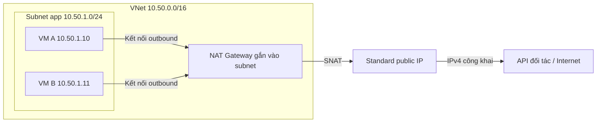
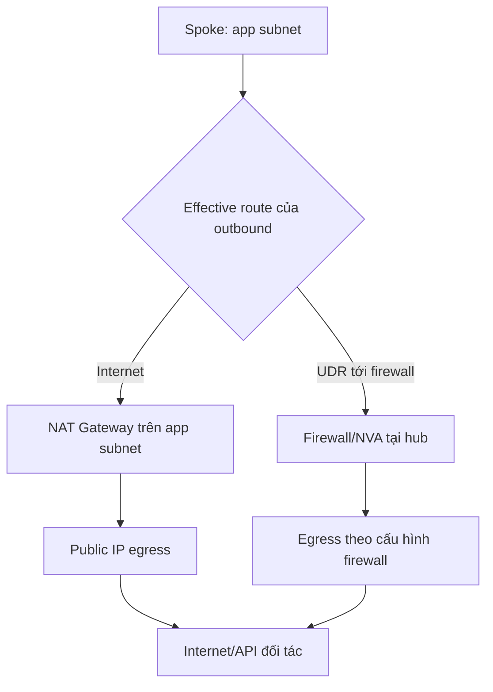

# Kiểm soát lưu lượng ra Internet bằng NAT Gateway

Một ứng dụng chạy trong Azure thường phải **chủ động kết nối ra ngoài** để gọi API của đối tác, tải bản cập nhật, truy cập dịch vụ SaaS hoặc gửi dữ liệu đến một hệ thống có địa chỉ công khai. Nếu địa chỉ IP nguồn thay đổi ngoài dự kiến, đối tác có thể chặn yêu cầu; nếu mọi máy ảo đều được gắn public IP riêng, việc kiểm soát bề mặt tiếp xúc Internet sẽ phức tạp hơn.

**Azure NAT Gateway** là dịch vụ mạng được quản lý giúp các tài nguyên trong subnet **khởi tạo kết nối outbound IPv4 ra Internet** thông qua một hoặc nhiều public IP được chỉ định. Các workload không cần gắn public IP lên từng NIC để sử dụng cơ chế này. NAT Gateway tạo ánh xạ địa chỉ và cổng nguồn (SNAT) cho kết nối đi ra, đồng thời cho phép gói phản hồi của kết nối đã được thiết lập quay về đúng nguồn.

Trong module **CLOUD_PROVIDERS_AZURE**, bài học thuộc chương **Kết nối và bảo vệ mạng**. Kiến thức NAT Gateway kết nối trực tiếp với việc thiết kế VNet/subnet, triển khai ứng dụng, cấp quyền truy cập đối tác, giám sát sự cố, bảo vệ mạng và tối ưu chi phí vận hành trên Azure.

## 1. Mục tiêu học tập

Sau bài học, bạn có thể:

1. Giải thích NAT, SNAT, public IP và vì sao workload private vẫn có thể kết nối Internet.
2. Xác định NAT Gateway hoạt động ở cấp subnet, xử lý outbound và không cung cấp đường truy cập inbound tùy ý.
3. Phân biệt NAT Gateway với Network Security Group (NSG), Azure Firewall, Load Balancer, Public IP trên NIC và Private Endpoint.
4. Tạo NAT Gateway, liên kết public IP rồi gán vào subnet bằng Azure CLI.
5. Kiểm chứng địa chỉ egress, lập danh sách IP để đối tác allowlist và phân tích các vấn đề về route, port, DNS.
6. Lập kế hoạch giới hạn lưu lượng, theo dõi khả năng hoạt động, dung lượng SNAT và chi phí.

## 2. Từ private IP đến địa chỉ nguồn công khai

Xét một VM ứng dụng có private IPv4 `10.50.1.10`. VM cần gọi HTTPS đến một API Internet. Private IP này không phải địa chỉ được Internet định tuyến trực tiếp. Nếu subnet được gán NAT Gateway có public IP `203.0.113.20` (địa chỉ tài liệu, chỉ dùng để minh họa), Azure có thể ánh xạ kết nối ra ngoài như sau:

```text
Trước SNAT, trong mạng Azure:
  10.50.1.10:50120   -> 198.51.100.30:443

Sau SNAT, khi ra Internet:
  203.0.113.20:62001 -> 198.51.100.30:443

Gói phản hồi của kết nối:
  198.51.100.30:443 -> 203.0.113.20:62001

Azure NAT Gateway tra ánh xạ và chuyển phản hồi về:
  198.51.100.30:443 -> 10.50.1.10:50120
```

Các địa chỉ `203.0.113.0/24` và `198.51.100.0/24` ở ví dụ là dải dành cho tài liệu, không phải địa chỉ thực để triển khai.

**SNAT (Source Network Address Translation)** thay địa chỉ IP và có thể thay cổng nguồn của kết nối. Azure quản lý các ánh xạ theo luồng lưu lượng, nhờ đó nhiều VM và container instance có thể sử dụng chung tập địa chỉ public IP của NAT Gateway mà vẫn nhận đúng các gói phản hồi.

NAT Gateway thực hiện thao tác chuyển đổi này cho **kết nối do workload khởi tạo**. Một máy ngoài Internet không thể tự mở phiên kết nối mới đến VM chỉ vì public IP đó đang gắn với NAT Gateway.

### Mô hình tổng thể



Sơ đồ nhấn mạnh **mối liên kết logic** giữa subnet và NAT Gateway. NAT Gateway là dịch vụ nền tảng của Azure; nó không phải một VM router mà bạn cần cấu hình IP nội bộ, cài phần mềm hoặc vận hành một NIC riêng.

## 3. Các thành phần và phạm vi của NAT Gateway

| Thành phần | Vai trò |
|---|---|
| **VNet** | Mạng ảo chứa subnet của workload |
| **Subnet** | Phạm vi được gán NAT Gateway; các workload phù hợp trong subnet dùng cơ chế egress này |
| **NAT Gateway** | Tài nguyên Azure cung cấp SNAT cho lưu lượng outbound Internet phù hợp |
| **Standard public IP** | Địa chỉ IPv4 công khai dùng làm IP nguồn sau SNAT |
| **Public IP prefix** | Dải địa chỉ public IP liền kề, giúp quản lý nhiều IP dùng cho egress |
| **NIC / workload** | Nguồn phát lưu lượng; thường chỉ cần private IP trên subnet |
| **NSG / route table** | Các lớp chính sách và định tuyến vẫn có hiệu lực, NAT Gateway không thay thế chúng |

Một NAT Gateway có thể liên kết với **nhiều subnet thuộc cùng một VNet** trong phạm vi cấu hình được Azure hỗ trợ. Một subnet được liên kết với tối đa **một NAT Gateway** tại cùng thời điểm. NAT Gateway không tự trở thành dịch vụ outbound chung cho mọi subnet khác hoặc mọi VNet được peering.

NAT Gateway, public IP và VNet cần được tạo ở vùng địa lý và phạm vi tương thích theo quy tắc của Azure. Khi có yêu cầu về availability zone, phải xem xét cấu hình zone của NAT Gateway và public IP cùng kiến trúc dự phòng; không mặc định một địa chỉ egress được bảo vệ khỏi mọi sự cố vùng.

### Workload nào được hưởng lợi?

Ví dụ điển hình là VM, VM Scale Sets và các workload nối vào subnet có hỗ trợ mô hình outbound thông qua NAT Gateway. Với dịch vụ PaaS, hành vi phụ thuộc cơ chế tích hợp VNet của từng dịch vụ. Không giả định rằng chỉ cần tạo NAT Gateway trong VNet là mọi Azure App Service, Function, database hoặc dịch vụ được quản lý sẽ tự đi qua nó.

## 4. NAT Gateway xử lý những gì và không xử lý những gì?

### Những việc NAT Gateway làm

- Cung cấp **địa chỉ nguồn public IPv4 dự kiến** cho kết nối outbound Internet phù hợp từ subnet.
- Cho phép nhiều workload dùng chung tập public IP và cổng SNAT.
- Quản lý ánh xạ SNAT và gói phản hồi của các kết nối đã khởi tạo.
- Hỗ trợ tăng dung lượng egress bằng cách cấu hình thêm public IP hoặc public IP prefix theo giới hạn được Azure hỗ trợ.
- Giúp workload private có cơ chế outbound tường minh, giảm nhu cầu gắn public IP trực tiếp cho từng máy.

### Những việc NAT Gateway không làm

- **Không cấp cổng inbound** cho người dùng Internet truy cập tùy ý vào VM.
- **Không thay thế firewall** để lọc website, domain, nội dung HTTP hoặc phát hiện mối đe dọa.
- **Không thay thế NSG** để quyết định ai được phép giao tiếp qua cổng/giao thức nào.
- **Không phải route next hop**: bạn không đặt UDR trỏ tới NAT Gateway như trỏ tới một network virtual appliance.
- **Không phải proxy ứng dụng** và không giải mã HTTPS.
- **Không làm private IP thành public IP** gắn trực tiếp trên VM.
- **Không tự khắc phục DNS**, chứng chỉ TLS, lỗi xác thực của API hay quyền truy cập ứng dụng.

Gói phản hồi cho phiên outbound được phép quay lại qua ánh xạ SNAT; điều đó khác với việc chấp nhận **kết nối inbound mới**. Nếu hệ thống cần truy cập inbound từ Internet, phải thiết kế ingress riêng bằng Application Gateway, Load Balancer, public endpoint hoặc giải pháp được phê duyệt.

### So sánh nhanh các giải pháp

| Giải pháp | Mục đích chính | Cách dùng |
|---|---|---|
| **NAT Gateway** | Egress IPv4 ổn định, SNAT outbound ở subnet | Workload private cần gọi API Internet hoặc đối tác allowlist IP |
| **Public IP gắn NIC** | Endpoint công khai gắn với cấu hình IP cụ thể | VM có yêu cầu truy cập công khai trực tiếp, kiểm soát inbound chặt chẽ |
| **Azure Load Balancer** | Phân phối lưu lượng và frontend ở tầng 4 | Cân bằng tải cho nhiều instance; thiết kế outbound có cơ chế riêng khi cần |
| **Azure Firewall** | Chính sách bảo vệ và lọc lưu lượng tập trung | Kiểm soát điểm đến, dịch vụ, FQDN phù hợp, logging và egress qua firewall |
| **NSG** | Cho phép/từ chối luồng mạng theo rule | Điều khiển cổng, giao thức, địa chỉ nguồn/đích ở subnet hoặc NIC |
| **Private Endpoint** | Truy cập dịch vụ được hỗ trợ qua địa chỉ riêng | Kết nối PaaS qua mạng private, không cần đi Internet công khai tới đích đó |

**Chọn theo mục tiêu:** nếu doanh nghiệp muốn một tập IP outbound cố định để gửi cho đối tác, NAT Gateway thường phù hợp. Nếu phải chặn truy cập đến những tên miền không được phê duyệt hoặc kiểm soát ứng dụng ở tầng cao hơn, cần bổ sung Azure Firewall, proxy hoặc dịch vụ bảo mật tương ứng.

## 5. NAT Gateway và quy tắc định tuyến

NAT Gateway áp dụng cho lưu lượng outbound Internet phù hợp từ subnet mà nó được liên kết. Tuy nhiên, luồng traffic còn phụ thuộc vào **effective route**.

### Khi next hop là Internet

Với tuyến outbound Internet phù hợp, Azure có thể áp dụng NAT Gateway để ánh xạ địa chỉ nguồn trước khi lưu lượng đi ra ngoài. NAT Gateway không yêu cầu người dùng gắn public IP vào mỗi NIC hoặc tạo route thủ công tới NAT Gateway.

### Khi route bị chuyển sang firewall hoặc NVA

Nếu subnet có user-defined route, chẳng hạn `0.0.0.0/0` với next hop là virtual appliance/Azure Firewall, lưu lượng có thể được chuyển tới thiết bị đó theo route. Trong trường hợp này, không nên kỳ vọng NAT Gateway gắn trên subnet workload trực tiếp quyết định public IP egress. Cấu hình của firewall, next hop và đường đi sau đó mới xác định cách traffic ra Internet.

Một thiết kế dùng Azure Firewall có thể có cơ chế outbound riêng hoặc tích hợp với NAT Gateway theo cấu hình và khả năng hỗ trợ. Phải kiểm tra **effective routes** và quan sát địa chỉ egress thực tế thay vì chỉ xem NAT Gateway đã được tạo hay chưa.

### Khi truy cập đích qua đường riêng

Traffic đi qua Private Endpoint, VNet peering, kết nối VPN, ExpressRoute hoặc những tuyến riêng khác không mặc nhiên trở thành luồng Internet cần SNAT qua NAT Gateway. Tương tự, service endpoint có đường định tuyến và cơ chế riêng cho dịch vụ được hỗ trợ.

### Trường hợp workload có public IP hoặc cơ chế outbound cũ

Khi NAT Gateway được cấu hình cho subnet và tuyến Internet phù hợp, các **kết nối outbound mới** thường sử dụng NAT Gateway thay vì phương án outbound mặc định hay SNAT khác của workload. Tuy nhiên, kết nối đã tồn tại và luồng phản hồi của phiên inbound có thể có đường xử lý khác. Nếu VM vẫn có public IP riêng, public IP đó có thể còn phục vụ inbound theo thiết kế, không bị NAT Gateway tự động loại bỏ.

Vì vậy, khi chuyển egress từ cơ chế cũ sang NAT Gateway, cần kiểm tra:

1. Địa chỉ nguồn của kết nối outbound **mới**.
2. Hành vi của kết nối đang mở.
3. Các allowlist bên ngoài đang dùng IP nào.
4. Rule NSG, route table và cấu hình firewall.
5. Ứng dụng có cơ chế retry, reconnect và timeout phù hợp không.

## 6. NAT Gateway là một phần của chính sách egress, không phải toàn bộ chính sách

Một công ty có thể muốn workload chỉ gọi ba API đối tác, ví dụ `api.partner-a.example`, `api.partner-b.example` và hệ thống cập nhật được phê duyệt. NAT Gateway cung cấp IP nguồn ổn định, nhưng **không tự giới hạn danh sách domain đích**.

Các lớp kiểm soát thường phối hợp như sau:

| Lớp | Quyết định |
|---|---|
| Danh tính ứng dụng và token | Workload nào được quyền gọi API hoặc dịch vụ |
| NSG | Flow TCP/UDP nào được phép theo nguồn, đích, port, protocol và hướng |
| UDR / Firewall / Proxy | Traffic đi qua đâu và có thể bị kiểm tra theo chính sách nào |
| DNS | Tên đích được phân giải ra địa chỉ nào |
| NAT Gateway | Địa chỉ public nguồn và cổng SNAT dùng cho outbound phù hợp |
| Hệ thống đối tác | Có chấp nhận IP egress, token, mTLS và yêu cầu API hay không |

Ví dụ, quy tắc NSG chỉ cho phép outbound TCP/443 không đồng nghĩa workload chỉ có thể gọi các domain đã phê duyệt: nhiều website cũng dùng TCP/443. Nếu cần chính sách theo FQDN, chứng chỉ hoặc danh mục ứng dụng, phải sử dụng lớp bảo mật có khả năng kiểm tra phù hợp.

Đối với kết nối tới Azure Storage, Azure SQL hoặc các dịch vụ PaaS có Private Endpoint, hãy đánh giá phương án đi qua mạng riêng thay vì mặc định bắt mọi traffic tới Azure đi ra Internet qua NAT.

## 7. Public IP và danh sách allowlist của đối tác

Một nhu cầu phổ biến: đối tác chỉ nhận API request từ một tập public IP đã đăng ký. NAT Gateway giúp thống nhất đầu ra của nhiều workload tại một hoặc nhiều public IP.

Quy trình phối hợp:

1. Tạo Standard public IP hoặc public IP prefix cho NAT Gateway.
2. Liên kết NAT Gateway với subnet chứa workload.
3. Kiểm tra effective route và NSG để bảo đảm kết nối thực sự đi theo nhánh egress dự kiến.
4. Từ workload, gửi request ra một dịch vụ kiểm tra IP nguồn được tổ chức cho phép.
5. So sánh địa chỉ quan sát với tập public IP đang gắn NAT Gateway.
6. Gửi **toàn bộ** public IP có thể được sử dụng tới đối tác để thiết lập allowlist.
7. Thực hiện kiểm thử nghiệp vụ và ghi nhận owner của danh sách allowlist.
8. Khi thay public IP, phối hợp cập nhật allowlist trước khi cắt chuyển để tránh ngắt API.

Nếu NAT Gateway được cấu hình nhiều public IP, một workload có thể sử dụng các địa chỉ nguồn khác nhau trong tập đó cho các kết nối khác nhau. **Không giả định mỗi VM có một IP egress cố định riêng** hoặc tất cả request luôn dùng public IP đầu tiên.

Trong các tích hợp cần một IP duy nhất, phải thiết kế số lượng public IP và sức chứa SNAT tương ứng, đồng thời chấp nhận giới hạn quy mô và yêu cầu dự phòng. Đôi khi nhu cầu tăng kết nối buộc phải bổ sung IP và cập nhật allowlist đối tác.

## 8. SNAT ports, kết nối đồng thời và giới hạn dung lượng

Một public IPv4 chỉ có một không gian cổng hữu hạn. Azure NAT Gateway dùng **SNAT ports** để phân biệt nhiều phiên kết nối cùng sử dụng public IP. Với NAT Gateway tiêu chuẩn, một public IPv4 cung cấp một tập cổng SNAT lớn (thường được mô tả là **64.512 cổng**); số lượng cổng sử dụng hiệu quả phụ thuộc giao thức, đích đến và cách Azure cấp phát, tái sử dụng.

Khác với cấu hình gán số cổng cố định cho từng VM, NAT Gateway quản lý tài nguyên SNAT cho nhiều workload trên subnet. Nhu cầu phụ thuộc vào:

- Số lượng workload và tốc độ tạo kết nối.
- Số kết nối đồng thời, đặc biệt đến cùng một địa chỉ/cổng đích.
- Thời gian kết nối tồn tại và thời gian chờ giải phóng ánh xạ.
- Cách SDK, HTTP client và ứng dụng sử dụng connection pooling hoặc keep-alive.
- Số public IP được gắn vào NAT Gateway.
- Các giới hạn hiện hành của dịch vụ, subscription và region.

### Ví dụ về áp lực SNAT

Giả sử 200 instance cùng liên tục mở kết nối HTTPS ngắn đến một API đối tác, nhưng mỗi request lại tạo một TCP connection mới. Dù dung lượng dữ liệu không lớn, số kết nối mới trên giây và ánh xạ cổng chưa được giải phóng có thể gây áp lực lên tập SNAT.

Cách cải thiện:

1. Sử dụng **HTTP keep-alive** và connection pooling có giới hạn hợp lý.
2. Giảm hành vi mở/đóng TCP quá nhanh hoặc retry không kiểm soát.
3. Áp dụng exponential backoff khi lỗi tạm thời.
4. Thêm public IP/prefix khi thật sự cần tăng dung lượng SNAT và bảo đảm đối tác đã allowlist.
5. Theo dõi các chỉ số kết nối, gói bị drop và tình trạng ứng dụng.

### TCP idle timeout

Một số kết nối TCP có thể nhàn rỗi trong thời gian dài. NAT Gateway có cấu hình **TCP idle timeout** với các giá trị được dịch vụ hỗ trợ. Khi ánh xạ của một kết nối không còn hoạt động đủ lâu, nó có thể bị giải phóng.

Nếu ứng dụng giữ kết nối lâu nhưng không có traffic, kết nối có thể bị mất khi sử dụng lại. Cần phối hợp timeout của NAT Gateway, HTTP client, connection pool, proxy, API đích và cơ chế TCP keepalive. Đặt idle timeout dài hơn không phải luôn giải quyết được mọi lỗi, và có thể khiến tài nguyên kết nối được giữ lâu hơn.

**SNAT port exhaustion** và lỗi DNS/TLS có triệu chứng khác nhau. Khi điều tra, hãy xem thời điểm lỗi, số lượng kết nối, đích đến, retry, route, metric mạng và log ứng dụng thay vì kết luận từ một timeout duy nhất.

## 9. Hướng dẫn thực hành bằng Azure CLI

Ví dụ tạo một VNet thử nghiệm với subnet ứng dụng, Standard public IP và NAT Gateway. Các lệnh dành cho **Bash/Azure Cloud Shell (Bash)**. Chỉ thực hiện trong subscription được phép, vì tài nguyên có thể phát sinh chi phí.

### Chuẩn bị và xác nhận subscription

```bash
az login

az account show \
  --query "{subscription:name, id:id, tenant:tenantId}" \
  --output table
```

Nếu đang làm việc với nhiều subscription, chọn đúng subscription trước khi tạo tài nguyên:

```bash
az account set --subscription "<SUBSCRIPTION_ID>"
az account show --query "{id:id, name:name}" --output table
```

Khai báo các tên trong ví dụ:

```bash
RG="rg-nat-lab"
LOC="southeastasia"
VNET="vnet-nat-lab"
SUBNET="snet-app"
PIP="pip-egress-lab"
NAT="nat-egress-lab"
```

Các tên chỉ dành cho môi trường thử nghiệm. Tài nguyên và hỗ trợ vùng triển khai cần được kiểm tra theo subscription thực tế.

### Bước 1 — Tạo resource group

```bash
az group create \
  --name "$RG" \
  --location "$LOC"
```

### Bước 2 — Tạo VNet và subnet

```bash
az network vnet create \
  --resource-group "$RG" \
  --name "$VNET" \
  --location "$LOC" \
  --address-prefixes "10.50.0.0/16" \
  --subnet-name "$SUBNET" \
  --subnet-prefixes "10.50.1.0/24"
```

Trong ví dụ, workload sẽ sử dụng private IPv4 của subnet `10.50.1.0/24`. Không tạo dải địa chỉ mới chồng lấn với kết nối hybrid hoặc VNet hiện hữu.

### Bước 3 — Tạo Standard public IP

```bash
az network public-ip create \
  --resource-group "$RG" \
  --name "$PIP" \
  --location "$LOC" \
  --sku Standard \
  --allocation-method Static
```

Xem địa chỉ được Azure cấp:

```bash
az network public-ip show \
  --resource-group "$RG" \
  --name "$PIP" \
  --query "{address:ipAddress, sku:sku.name, allocation:publicIPAllocationMethod}" \
  --output json
```

Địa chỉ trả về là địa chỉ public thực, không phải các địa chỉ tài liệu đã minh họa ở đầu bài. Hãy lưu IP và quản lý quyền truy cập/thay đổi của tài nguyên.

### Bước 4 — Tạo NAT Gateway

```bash
az network nat gateway create \
  --resource-group "$RG" \
  --name "$NAT" \
  --location "$LOC" \
  --public-ip-addresses "$PIP" \
  --idle-timeout 10
```

Lệnh gán public IP hiện có và đặt thời gian idle timeout TCP theo cấu hình ví dụ. Có thể dùng public IP prefix khi thiết kế cần tập địa chỉ lớn hơn và dịch vụ hỗ trợ cấu hình đó. Chỉ số, giới hạn tài nguyên, số IP và khả năng theo zone cần được xem xét theo vùng/SKU sử dụng.

### Bước 5 — Gán NAT Gateway vào subnet

```bash
az network vnet subnet update \
  --resource-group "$RG" \
  --vnet-name "$VNET" \
  --name "$SUBNET" \
  --nat-gateway "$NAT"
```

Xác minh association:

```bash
az network vnet subnet show \
  --resource-group "$RG" \
  --vnet-name "$VNET" \
  --name "$SUBNET" \
  --query "{subnet:name, natGateway:natGateway.id, prefix:addressPrefix}" \
  --output json
```

Xác minh cấu hình NAT Gateway:

```bash
az network nat gateway show \
  --resource-group "$RG" \
  --name "$NAT" \
  --query "{name:name, state:provisioningState, idleTimeout:idleTimeoutInMinutes, publicIps:publicIpAddresses[].id}" \
  --output json
```

Sau bước này, cấu hình egress đã sẵn sàng ở cấp subnet. **Vẫn cần một workload trong subnet, route Internet phù hợp và NSG cho phép outbound** để kiểm chứng kết nối thực tế.

### Bước 6 — Kiểm tra IP egress từ trong workload

Đăng nhập vào VM thử nghiệm nằm trên subnet qua phương án quản trị an toàn, ví dụ Azure Bastion hoặc đường private đã được cấp quyền. Từ shell bên trong VM, gọi một **dịch vụ phản hồi địa chỉ IP nguồn được tổ chức cho phép**:

```bash
curl -4 --fail --silent --show-error https://api.ipify.org
```

Lệnh chỉ là ví dụ với dịch vụ IP echo công khai; nếu doanh nghiệp có endpoint kiểm tra riêng, hãy thay bằng endpoint đó. Giá trị trả về phải thuộc tập public IP đang gắn NAT Gateway khi các điều kiện định tuyến đã đúng.

Đối chiếu với:

```bash
az network public-ip show \
  --resource-group "$RG" \
  --name "$PIP" \
  --query "ipAddress" \
  --output tsv
```

Lưu ý: lệnh `az network public-ip show` đọc cấu hình Azure, còn lệnh `curl` chạy **bên trong VM** mới cho thấy IP nguồn thực tế mà Internet quan sát. Nếu chạy `curl` trên máy cá nhân hoặc Cloud Shell, bạn sẽ kiểm tra IP của môi trường đó, không phải IP egress của VM.

### Bước 7 — Kiểm thử ứng dụng và allowlist

- Xác minh workload có thể gọi API đối tác bằng HTTPS/TLS.
- Kiểm tra log của đối tác hoặc cơ chế quan sát được cấp quyền để xác minh địa chỉ nguồn.
- Gửi public IP hiện dùng cho bên quản lý allowlist.
- Thử lại một request mới sau khi thay đổi cấu hình, đồng thời kiểm tra các kết nối cũ còn mở.
- Xác nhận tác vụ nền và job ít chạy cũng truy cập được.

## 10. Thay đổi NAT Gateway trên subnet đang vận hành

Gán NAT Gateway vào subnet production có thể làm **địa chỉ nguồn public của các kết nối outbound mới thay đổi**. Những tích hợp phụ thuộc IP nguồn, session dài, connection pool hoặc firewall bên ngoài có thể bị ảnh hưởng.

Quy trình thay đổi nên có:

1. **Kiểm kê đích**: API đối tác, SFTP, dịch vụ SaaS, kho gói và hệ thống dùng IP allowlist.
2. **Xác định đường egress đang dùng**: instance public IP, Load Balancer outbound, firewall, proxy hay cách khác.
3. **Chuẩn bị public IP mới**: đăng ký allowlist và kiểm tra dịch vụ đích chấp thuận.
4. **Đánh giá route**: nhất là UDR tới firewall/NVA và các kết nối private.
5. **Chọn thời điểm triển khai**: có phương án rollback và người theo dõi.
6. **Gán NAT Gateway** vào subnet; kiểm thử những kết nối outbound mới.
7. **Theo dõi lỗi**: HTTP 401/403/429, TCP timeout, connection reset, TLS, DNS, số lượng kết nối và packet drop.
8. **Xác nhận các workload phụ thuộc**: tiến trình liên tục, background jobs và mọi instance.
9. **Cập nhật tài liệu egress và chi phí**; chỉ gỡ phương án cũ sau khi xác nhận.

Không nên gỡ public IP hoặc cơ chế outbound hiện tại trước khi xác định chắc chắn workload mới đã đi qua NAT Gateway. Với các phiên đã tồn tại, đường đi hoặc trạng thái SNAT có thể khác các phiên được tạo sau thay đổi; ứng dụng cần có reconnect và retry phù hợp.

## 11. NAT Gateway với kiến trúc hub–spoke và nhiều subnet

Một thiết kế enterprise thường gồm:

- **Hub VNet**: chứa firewall, DNS resolver hoặc kết nối on-premises.
- **Spoke VNets**: chứa ứng dụng ở các môi trường khác nhau.
- **Subnet ứng dụng**: cần outbound để gọi API công khai.
- **Subnet dữ liệu**: ưu tiên truy cập private, hạn chế egress tùy yêu cầu.

NAT Gateway được liên kết vào subnet, **không tự được chia sẻ xuyên peering** như một thiết bị mạng trong hub. Nếu từng spoke cần egress trực tiếp và ổn định, có thể thiết kế NAT Gateway tại các subnet/VNet tương ứng. Nếu chính sách buộc mọi luồng ra Internet đi qua firewall ở hub, route, firewall và cơ chế SNAT sau firewall phải được thiết kế đồng bộ.

Ví dụ:



Hai nhánh minh họa các **phương án định tuyến**, không biểu thị một kết nối đồng thời được xử lý qua cả NAT Gateway tại spoke lẫn firewall tại hub. Việc đặt NAT Gateway ở nơi nào phải bám theo đường đi thực tế và khả năng hỗ trợ dịch vụ.

## 12. Monitoring, logging và điều tra sự cố

Để vận hành bền vững, cần theo dõi cả tài nguyên NAT Gateway lẫn workload sử dụng nó.

### Dữ liệu nên theo dõi

| Nguồn | Tín hiệu |
|---|---|
| Azure Monitor cho NAT Gateway | Lưu lượng, số kết nối SNAT, packet drop và khả năng datapath theo metric được dịch vụ cung cấp |
| Azure Monitor / Network Watcher | Thông tin kết nối, effective routes, các kiểm tra kết nối và luồng mạng khi cấu hình phù hợp |
| NSG và VNet flow logging | Lưu lượng theo nguồn/đích/cổng ở phạm vi mạng được hỗ trợ và đã cấu hình |
| Firewall hoặc proxy | Luồng bị từ chối và các sự kiện bảo mật; chi tiết phụ thuộc dịch vụ |
| Workload/application logs | Timeout, DNS failure, TLS error, HTTP status và lượng kết nối mở mới |
| API đối tác | Địa chỉ IP nguồn được quan sát và nguyên nhân từ chối allowlist |

Không mặc định NAT Gateway cung cấp log ứng dụng chi tiết từng URL hoặc nội dung request. Nếu cần audit theo domain hay application layer, thiết kế logging ở firewall, proxy, API gateway hoặc ứng dụng phù hợp.

### Phân biệt lỗi theo dấu hiệu

**Trường hợp A: không truy cập được mọi đích Internet.**

Kiểm tra trạng thái VM, DNS, effective route, NSG outbound, firewall, UDR và NAT Gateway association. Nếu route gửi traffic tới firewall thay vì Internet, sự tồn tại của NAT Gateway trên subnet không bảo đảm lưu lượng đi qua nó.

**Trường hợp B: Internet dùng được nhưng đối tác chặn.**

Kiểm tra public IP nguồn bằng một endpoint quan sát độc lập, sau đó so sánh allowlist và log đối tác. Lỗi HTTP 403 cũng có thể đến từ token hoặc quyền ứng dụng; không tự kết luận là lỗi NAT.

**Trường hợp C: chỉ thất bại khi tải cao.**

Xem metric SNAT, số kết nối đồng thời, tốc độ mở kết nối, retry và thời gian connection idle. Kiểm tra connection pooling, thêm public IP khi cần và xác minh đối tác chấp nhận tập IP mới.

**Trường hợp D: kết nối dài bị rớt sau thời gian nhàn rỗi.**

So sánh idle timeout NAT Gateway với timeout proxy, máy chủ đích, TCP keepalive và cơ chế retry của client. Lỗi do idle không nhất thiết là thiếu cổng SNAT.

**Trường hợp E: tên miền không phân giải.**

Kiểm tra DNS resolver, bản ghi và truy cập DNS trước. NAT Gateway không tự sửa lỗi DNS và không thay thế thiết kế private DNS.

### Checklist điều tra nhanh

```text
[ ] Đang ở đúng subscription, VNet và subnet?
[ ] Subnet có liên kết đúng NAT Gateway?
[ ] NAT Gateway có public IP hợp lệ, trạng thái provisioning thành công?
[ ] Effective route cho đích Internet có next hop phù hợp?
[ ] NSG và firewall có cho phép luồng cần thiết?
[ ] DNS và TLS của workload hoạt động?
[ ] Endpoint kiểm tra egress trả về public IP mong đợi?
[ ] Bên đối tác đã allowlist tất cả IP có thể được sử dụng?
[ ] Có tăng bất thường về kết nối, retry, timeout hoặc packet drop?
```

## 13. Hiệu năng, độ sẵn sàng và vận hành an toàn

### Năng lực và mở rộng

NAT Gateway được Azure quản lý; bạn không phải duy trì máy chủ NAT, nhưng tài nguyên vẫn có giới hạn về **thông lượng, số public IP/prefix và số SNAT port**. Trước khi triển khai môi trường có tải cao, cần kiểm tra giới hạn hiện hành của SKU và region, dự báo peak connections và thiết kế load test đại diện.

Chỉ dựa vào tổng băng thông không đủ để ước lượng nguy cơ port exhaustion. Một hệ thống có băng thông thấp nhưng tạo số lượng kết nối ngắn cực lớn vẫn có thể gây áp lực SNAT.

### Độ sẵn sàng và zone

Kiểm tra khả năng hỗ trợ availability zone và cách cấu hình NAT Gateway cùng public IP trong region được dùng. Với yêu cầu sẵn sàng rất cao, đánh giá kịch bản lỗi zone, phụ thuộc egress, retry của ứng dụng và chiến lược dịch vụ ở nhiều zone hoặc region. NAT Gateway không thay thế kiến trúc dự phòng của toàn ứng dụng.

### IPv6

Các ví dụ và lệnh trong bài tập trung **outbound IPv4**. Nếu workload cần truy cập Internet qua IPv6 hoặc dual-stack, phải kiểm tra khả năng hỗ trợ của dịch vụ, SKU, vùng và phương án egress tương ứng; không mặc định NAT IPv4 sẽ chuyển đổi được lưu lượng IPv6.

### Kiểm soát thay đổi

Không ghi secret, token hoặc thông tin xác thực của API đối tác vào script mạng. Public IP và tên subnet có thể được ghi vào IaC, nhưng quyền thay đổi NAT Gateway, subnet association, route và NSG vẫn phải theo RBAC tối thiểu, review thay đổi và audit thích hợp.

## 14. Chi phí và dọn dẹp tài nguyên thực hành

NAT Gateway là tài nguyên có tính phí. Chi phí vận hành thường liên quan đến thời gian NAT Gateway được cấp phát và lượng dữ liệu được xử lý; public IP hoặc public IP prefix có thể có phí riêng. Chi phí thực tế phụ thuộc region, SKU và biểu giá tại thời điểm sử dụng.

Khi đánh giá thiết kế, lưu ý:

- NAT Gateway có thể phát sinh phí ngay cả khi không có lưu lượng đáng kể.
- Nhiều public IP làm tăng tài nguyên phải quản lý và có thể ảnh hưởng chi phí.
- Dữ liệu truyền, dịch vụ firewall, monitoring và lưu trữ log có thể tính phí riêng.
- Tập trung egress có thể giảm số public IP gắn trên từng VM nhưng không bảo đảm tổng chi phí luôn thấp hơn trong mọi kiến trúc.
- Thiết lập budget và cost alerts cho môi trường thử nghiệm nếu cần.

Sau bài lab, chỉ xóa **resource group chuyên dùng cho bài lab** khi đã chắc chắn không có tài nguyên dùng chung và được phép xóa. Đối với môi trường không dành riêng cho lab, gỡ NAT Gateway khỏi subnet trước, sau đó rà soát public IP và các tài nguyên phụ thuộc, xóa theo quy trình của tổ chức.

Không xóa vội resource group nếu còn VM, VNet, Key Vault, tài nguyên dữ liệu hoặc cấu hình dùng chung của người khác.

## 15. Ví dụ thiết kế: API đối tác chỉ chấp nhận một danh sách public IP

Một doanh nghiệp có ba VM ứng dụng `app-01`, `app-02` và `app-03` trong subnet `snet-app`. Các VM cần gọi API thanh toán bên ngoài qua HTTPS. Đối tác yêu cầu allowlist địa chỉ nguồn, còn doanh nghiệp không muốn mở inbound Internet vào VM.

### Thiết kế được đề xuất

1. Đặt ba VM trong subnet ứng dụng với private IP.
2. Tạo NAT Gateway với Standard public IP đã được phê duyệt và gắn vào `snet-app`.
3. Định tuyến outbound Internet phù hợp để các kết nối API mới sử dụng NAT Gateway.
4. Cấu hình NSG chỉ cho các kết nối cần thiết; nếu cần kiểm soát domain, bổ sung firewall/proxy phù hợp.
5. Đăng ký toàn bộ public IP egress của NAT Gateway với API đối tác.
6. Kiểm tra IP nguồn thực tế từ mỗi VM và thử API bằng token hợp lệ.
7. Theo dõi tỷ lệ thành công, latency, retry và kết nối SNAT trong giờ cao điểm.
8. Ghi kế hoạch khi thay public IP hoặc tăng số địa chỉ egress.

**Kết quả mong đợi:** các VM vẫn chỉ có private IP, API đối tác quan sát địa chỉ nguồn thuộc tập public IP đã allowlist, ứng dụng có cơ chế retry khi kết nối tạm thời thất bại và không có cổng inbound được NAT Gateway tự tạo ra.

**Giới hạn thiết kế:** nếu yêu cầu bảo mật đòi lọc FQDN, DLP, TLS inspection hoặc ghi log truy cập chi tiết, chỉ dùng NAT Gateway là chưa đủ. Cần thêm lớp bảo mật mạng phù hợp.

## 16. Bài thực hành

### Tình huống

Bạn có subscription thử nghiệm với subnet `10.50.1.0/24`. Hai VM trong subnet chỉ có private IP; chúng cần truy cập một API SaaS công khai qua HTTPS. Bên SaaS yêu cầu public IP nguồn được đăng ký trước.

Thực hiện:

1. Vẽ luồng outbound trước và sau khi gán NAT Gateway, chỉ rõ IP nguồn quan sát tại SaaS.
2. Tạo resource group, VNet/subnet thử nghiệm, Standard public IP và NAT Gateway bằng Azure CLI theo các bước của bài.
3. Gán NAT Gateway vào subnet rồi xác nhận `natGateway.id` trong thông tin subnet.
4. Kiểm tra trạng thái public IP và tham chiếu public IP trên NAT Gateway.
5. Từ một VM được phép trong subnet, kiểm tra public IP egress bằng endpoint được tổ chức cho phép; so sánh với IP trên Azure.
6. Mô tả cách kiểm tra NSG và route nếu VM có DNS đúng nhưng không thể tạo kết nối TCP/443 ra Internet.
7. Giải thích vì sao NAT Gateway không giúp người dùng Internet SSH trực tiếp vào VM.
8. Giả định ứng dụng tạo quá nhiều kết nối ngắn; đề xuất phương án xử lý trước khi tăng số public IP.
9. Viết kế hoạch thay IP egress mà không làm đối tác chặn API.
10. Xác định các tài nguyên tính phí cần dọn sau bài lab.

### Câu hỏi tự kiểm tra

**Câu 1.** Public IP gắn vào NAT Gateway có được gán đồng thời cho NIC VM không? Vì sao phải tách mục đích của chúng?

**Câu 2.** Nếu subnet có UDR `0.0.0.0/0` đi qua Azure Firewall, lưu lượng Internet có nhất định sử dụng NAT Gateway đang gắn trên subnet đó không?

**Câu 3.** NSG chỉ cho outbound TCP/443 có đảm bảo VM chỉ gọi được ba domain được phê duyệt không?

**Câu 4.** Tại sao cần cung cấp tất cả public IP liên kết NAT Gateway cho đối tác khi thiết kế dùng nhiều IP?

**Câu 5.** Một API thường timeout sau khi tăng số lượng instance, nhưng DNS vẫn hoạt động và request đơn lẻ thành công. Bạn sẽ kiểm tra metric, số kết nối và chiến lược HTTP client như thế nào?

**Tiêu chí hoàn thành:** bạn giải thích đúng outbound SNAT, tạo và liên kết NAT Gateway tại cấp subnet, kiểm tra IP egress từ trong workload, phân biệt routing/firewall với NAT và lập được kế hoạch triển khai an toàn cho tích hợp có IP allowlist.

## Kết luận

Azure NAT Gateway giúp workload có private IP sử dụng **kết nối outbound IPv4 với địa chỉ nguồn công khai được quản lý**. Đây là giải pháp hữu ích khi ứng dụng phải gọi Internet hoặc đối tác yêu cầu IP allowlist, đồng thời không cần gắn public IP trực tiếp trên từng VM.

Thiết kế thực tế cần xét cùng **subnet, effective routes, NSG, firewall, DNS, SNAT ports, khả năng dự phòng và chi phí**. NAT Gateway giải quyết bài toán ánh xạ địa chỉ nguồn cho lưu lượng outbound; việc cho phép truy cập, bảo vệ ứng dụng và giám sát bảo mật vẫn cần các lớp kiểm soát khác trong kiến trúc Azure.

