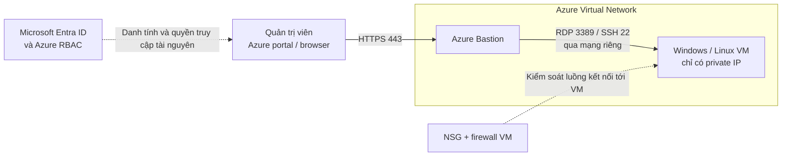

# Truy cập quản trị máy ảo bằng Azure Bastion

Khi quản trị máy ảo trên Azure, kỹ sư thường cần đăng nhập Windows bằng Remote Desktop Protocol (RDP) hoặc Linux bằng Secure Shell (SSH). Cách kết nối trực tiếp từ Internet tới IP công cộng của máy ảo rất dễ triển khai thử nghiệm, nhưng cũng khiến cổng quản trị trở thành mục tiêu dò quét và tấn công. Trong kiến trúc production, máy ảo nên có địa chỉ IP riêng và chỉ nhận kết nối quản trị từ những đường truy cập đã được kiểm soát.

**Azure Bastion** là dịch vụ quản trị kết nối do Azure vận hành, cho phép người có quyền mở phiên RDP hoặc SSH tới máy ảo qua cổng truy cập Bastion mà không cần gán public IP cho máy ảo đích. Trong nhiều cấu hình, quản trị viên sử dụng ngay trình duyệt tại Azure portal; các hình thức kết nối khác phụ thuộc SKU và tính năng được bật.

Trong module **CLOUD_PROVIDERS_AZURE**, bạn tìm hiểu subscription, resource group, Microsoft Entra ID, mạng ảo, compute, storage, dữ liệu, triển khai, giám sát, bảo vệ và kiểm soát chi phí ứng dụng trên Azure. Bài thuộc chương **Kết nối và bảo vệ mạng**, tập trung vào thiết kế, triển khai và vận hành **Azure Bastion** để truy cập quản trị máy ảo an toàn.

## 1. Mục tiêu học tập

Sau bài học, bạn có thể:

- Mô tả đường đi kết nối giữa máy quản trị, Azure Bastion và máy ảo.
- Giải thích vì sao máy ảo đích không cần public IP và không cần mở RDP/SSH trực tiếp từ Internet.
- Chuẩn bị virtual network (VNet), subnet dành riêng cho Bastion, public IP của Bastion khi cần, NSG và quyền truy cập.
- Triển khai Azure Bastion bằng portal, kiểm tra tài nguyên bằng Azure CLI.
- Dùng Bastion để mở phiên RDP tới Windows VM hoặc SSH tới Linux VM.
- Phân biệt quyền Azure RBAC với tài khoản đăng nhập trong hệ điều hành máy ảo.
- Xử lý lỗi kết nối, lựa chọn SKU phù hợp và đánh giá tác động bảo mật, vận hành và chi phí.

## 2. Azure Bastion hoạt động như thế nào?

**Azure Bastion** là một dịch vụ PaaS được triển khai trong mạng Azure của bạn theo mô hình được SKU hỗ trợ. Bastion làm điểm trung gian cho kết nối quản trị; máy ảo được truy cập qua **địa chỉ IP riêng** trong VNet hoặc mạng có kết nối được hỗ trợ.

Với cách dùng phổ biến qua Azure portal:

1. Quản trị viên xác thực vào Azure portal bằng danh tính Microsoft Entra ID và phải có quyền xem/truy cập các tài nguyên liên quan.
2. Trình duyệt mở phiên bảo mật bằng HTTPS/TLS tới endpoint của Azure Bastion.
3. Bastion thiết lập kết nối quản trị tới địa chỉ IP riêng của máy ảo qua mạng Azure.
4. Quản trị viên xác thực với **hệ điều hành máy ảo** bằng thông tin đăng nhập hoặc phương thức được kịch bản/SKU hỗ trợ.
5. RDP hoặc SSH được thực hiện qua đường kết nối Bastion thay vì công bố cổng 3389/22 của VM ra Internet.



Sơ đồ minh họa mô hình Bastion có endpoint truy cập từ Internet. **Endpoint công khai của Bastion khác với public IP của máy ảo**: trong mô hình này, máy ảo đích vẫn không có public IP. Với phương án *private-only deployment* được SKU/tính năng hỗ trợ, Bastion có thể được thiết kế theo mô hình endpoint truy cập riêng; yêu cầu kết nối và phương án truy cập sẽ khác.

### Azure Bastion không làm gì?

- Bastion **không thay thế** quyền đăng nhập vào hệ điều hành Windows/Linux. Azure RBAC cho phép thao tác tài nguyên không tự cấp mật khẩu hoặc SSH key hợp lệ.
- Bastion **không tự sửa** NSG, firewall trong VM hoặc định tuyến bị chặn: lưu lượng Bastion đến VM vẫn phải thông suốt.
- Bastion **không phải** VPN cho toàn bộ ứng dụng hoặc một reverse proxy để phục vụ website công cộng.
- Bastion **không tự vá** máy ảo, quản lý bản vá, thay đổi credential hoặc phát hiện mọi hoạt động độc hại.
- Bastion giảm nhu cầu công bố RDP/SSH trên VM, nhưng không đồng nghĩa máy ảo hoặc quyền quản trị đã hoàn toàn an toàn.

## 3. So sánh Bastion với các cách truy cập VM khác

| Phương án | Cách truy cập | Điểm cần cân nhắc |
|---|---|---|
| Gán public IP cho VM, mở 22/3389 | Client kết nối trực tiếp VM từ Internet | Dễ bị dò quét cổng quản trị; cần bảo vệ đặc biệt chặt |
| Azure Bastion | Trình duyệt hoặc client được hỗ trợ kết nối tới Bastion, sau đó vào VM bằng private IP | Giảm bề mặt phơi lộ VM; có chi phí và các điều kiện mạng, SKU |
| VPN / ExpressRoute | Thiết bị quản trị có đường mạng riêng tới Azure | Phù hợp nhiều luồng quản trị/nội bộ, cần quản lý kết nối và định tuyến |
| Jump box VM | Đăng nhập một VM trung gian do đội vận hành tự quản lý | Phải vá, giám sát, gia cố và bảo vệ chính jump box |
| Just-in-Time (JIT) VM access | Chỉ mở cổng quản trị theo yêu cầu trong khoảng thời gian giới hạn | Là cơ chế giảm thời gian mở cổng, có thể dùng bổ trợ cho chiến lược truy cập |

Với nhu cầu đăng nhập RDP/SSH thường xuyên cho nhiều VM trong mạng Azure, Bastion là lựa chọn đáng cân nhắc vì Azure vận hành thành phần trung gian. Tuy nhiên, cần tính cả SKU, số lượng phiên, mạng liên kết và chi phí thay vì mặc định một cách kết nối phù hợp với mọi workload.

## 4. Các thành phần cần chuẩn bị

Giả sử bạn có ứng dụng chạy tại VNet `vnet-app-prod`, trong resource group `rg-app-prod` và muốn quản trị hai máy ảo:

```text
Subscription: sub-prod
Resource group: rg-app-prod
VNet:           vnet-app-prod       10.20.0.0/16
App subnet:     snet-app            10.20.1.0/24
Windows VM:     vm-win-prod         10.20.1.10 (minh họa)
Linux VM:       vm-linux-prod       10.20.1.11 (minh họa)
Bastion subnet: AzureBastionSubnet  10.20.254.0/26
Bastion host:   bas-app-prod
```

Các IP là ví dụ cho thiết kế; IP thực tế phải lấy từ cấu hình VM/NIC và không được trùng phạm vi đang sử dụng.

### 4.1. VNet và subnet riêng có tên chính xác

Với triển khai Bastion dùng dedicated subnet, bạn cần tạo một subnet tên **`AzureBastionSubnet`** trong VNet. Đây là tên bắt buộc, phân biệt với subnet chứa VM. Hãy dự trù subnet **/26 hoặc rộng hơn** theo yêu cầu triển khai hiện hành; không đặt VM hay workload khác vào subnet chuyên dụng này.

Địa chỉ `10.20.254.0/26` trong ví dụ không chồng lấn với `10.20.1.0/24`. Chọn địa chỉ dựa trên toàn bộ không gian IP đang cấp cho VNet, các subnet khác và kế hoạch mở rộng về sau. Subnet chuyên dụng quá nhỏ, bị chiếm bởi tài nguyên khác hoặc có định tuyến/NSG không phù hợp sẽ khiến Bastion không triển khai hoặc không hoạt động đúng.

**Ngoại lệ theo SKU:** Một số lựa chọn như **Developer** sử dụng mô hình triển khai khác và không yêu cầu cùng tập tài nguyên như Bastion chuyên dụng. Vì vậy, các bước tạo `AzureBastionSubnet` trong bài áp dụng cho mô hình Bastion chuyên dụng, thường dùng để quản trị môi trường có yêu cầu vận hành nghiêm túc.

### 4.2. Public IP thuộc Bastion, không thuộc VM

Với triển khai Bastion chuyên dụng theo mô hình endpoint công khai, thông thường cần một **Standard SKU public IP** với cấp phát **Static** dành cho Bastion. IP này là điểm truy cập dịch vụ Bastion; VM Windows/Linux vẫn chỉ cần private IP.

Một số cấu hình cao hơn hỗ trợ **private-only Bastion**, không dùng public IP như mô hình trên; cần kiểm tra điều kiện của SKU, tính năng và region trước khi thiết kế. Không chọn phương án private-only chỉ bằng cách bỏ public IP khỏi các bước triển khai thông thường.

### 4.3. VM, NSG và dịch vụ quản trị trong hệ điều hành

Đối với **Windows VM**, dịch vụ RDP thường sử dụng cổng TCP **3389**. Đối với **Linux VM**, SSH thường sử dụng TCP **22**. Các cổng này phải được cho phép **từ Bastion tới VM qua mạng riêng**, bao gồm NSG ở subnet hoặc NIC và firewall bên trong hệ điều hành nếu có.

Không cần tạo rule cho `0.0.0.0/0` truy cập trực tiếp cổng 3389/22 của VM. Một NSG bảo vệ VM có thể chỉ cho phép các cổng quản trị từ **dải địa chỉ AzureBastionSubnet** và những nguồn nội bộ cần thiết khác.

Nếu bạn gắn NSG vào chính `AzureBastionSubnet`, cần giữ **các luồng bắt buộc của dịch vụ Bastion** như HTTPS và giao tiếp nội bộ/quản trị của hạ tầng Azure theo tài liệu của SKU đang dùng. Chặn toàn bộ lưu lượng và chỉ mở một rule 443 có thể khiến Bastion gặp lỗi. Route table hoặc firewall trung gian cũng không được chặn đường Bastion đến VM.

### 4.4. Danh tính và quyền

Ít nhất hai lớp quyền cần được kiểm tra:

1. **Azure RBAC:** người dùng có quyền cần thiết để xem VM, NIC, Bastion và truy cập chức năng kết nối trong portal. Với các thao tác tạo/sửa Bastion, cần quyền quản lý tài nguyên tương ứng.
2. **Xác thực hệ điều hành:** có tài khoản Windows/Linux hợp lệ, SSH key hoặc phương thức đăng nhập Entra ID được VM và chế độ Bastion đang dùng hỗ trợ.

Khi dùng Bastion trên portal, tài khoản thường cần quyền **Reader** với **VM đích**, **NIC của VM** và **Bastion resource**; tùy chức năng hoặc cấu hình còn cần quyền trên tài nguyên mạng liên quan. Reader chỉ hỗ trợ xem/quy trình kết nối, **không có nghĩa** người dùng đã có quyền Administrator trong Windows hoặc `sudo` trên Linux.

## 5. SKU và tính năng cần cân nhắc

Azure Bastion có các tùy chọn SKU với khả năng và chi phí khác nhau. Tên/tính năng phổ biến gồm **Developer**, **Basic**, **Standard** và **Premium**, nhưng mức hỗ trợ và vùng triển khai phải kiểm tra theo tài liệu và portal hiện hành.

| Nhu cầu | Điểm cần đối chiếu khi chọn SKU |
|---|---|
| Thử đăng nhập VM trong môi trường đơn giản | Kiểm tra khả năng và giới hạn của Developer/Basic tại region đang dùng |
| RDP/SSH qua Azure portal | Chọn SKU hỗ trợ browser-based connection |
| Kết nối qua native SSH/RDP client hoặc tunneling | Kiểm tra hỗ trợ native client của SKU, thường ở các lựa chọn cao hơn Basic |
| Quản trị quy mô lớn hơn với nhiều phiên | Đánh giá số lượng instance, tính năng scale và giới hạn của SKU |
| Ghi hình phiên quản trị hoặc private-only deployment | Đối chiếu tính năng cao cấp, yêu cầu cấu hình và chi phí của Premium |
| Truy cập VM qua VNet peering | Kiểm tra tính năng, định tuyến, NSG và loại kết nối được SKU hỗ trợ |

Đừng dựa vào một bảng giá hoặc ảnh màn hình cũ để suy ra mọi tính năng có sẵn. Hãy mở trang **Bastions** trong Azure portal hoặc tài liệu chính thức và xác minh đúng **subscription, region, SKU, hình thức kết nối** trước khi triển khai.

## 6. Triển khai Azure Bastion qua Azure portal

Ví dụ này sử dụng **Bastion chuyên dụng có public endpoint** và máy ảo chỉ có private IP. Các tên và dải địa chỉ chỉ mang tính minh họa; thực hành trên subscription được phép quản trị.

### Bước 1: Kiểm tra VM và địa chỉ IP

1. Mở [Azure portal](https://portal.azure.com/), xác nhận tenant và subscription.
2. Vào **Virtual machines**, chọn VM cần quản trị.
3. Kiểm tra **Networking**: VM được kết nối tới `vnet-app-prod`, có private IP và không cần public IP riêng.
4. Ghi nhận resource group, region, VNet/subnet của VM và NSG liên quan.
5. Xác nhận VM đang chạy, RDP/SSH được bật và bạn có thông tin đăng nhập phù hợp.

### Bước 2: Tạo AzureBastionSubnet

1. Mở **Virtual networks** và chọn `vnet-app-prod`.
2. Vào phần **Subnets**, chọn thêm subnet.
3. Nhập tên **`AzureBastionSubnet`** đúng chính tả.
4. Chọn dải không trùng với subnet khác, ví dụ `10.20.254.0/26`.
5. Lưu và xác minh subnet đã được tạo. Nếu dùng NSG hoặc UDR, rà soát các yêu cầu dành riêng cho Bastion.

### Bước 3: Tạo Bastion host

1. Tìm **Bastions** và chọn **Create**.
2. Chọn subscription/resource group và tên host, ví dụ `bas-app-prod`.
3. Chọn region phù hợp với VNet và SKU đáp ứng nhu cầu kết nối.
4. Chọn VNet và `AzureBastionSubnet`.
5. Với mô hình public endpoint, chọn hoặc tạo **Standard Static public IP** cho Bastion.
6. Xem các tùy chọn phù hợp với SKU, rà soát chi phí và cấu hình rồi tạo host.
7. Đợi trạng thái **Succeeded** trước khi thử mở kết nối.

Ở một số màn hình Azure portal, bạn có thể khởi tạo triển khai Bastion từ mục **Connect → Bastion** của VM; các bước lựa chọn, tên trường và SKU có thể khác. Sau khi tạo, nên mở trực tiếp tài nguyên Bastion để xác nhận VNet, subnet, cấu hình endpoint và trạng thái.

### Bước 4: Cho phép đúng lưu lượng từ Bastion tới VM

Trên NSG của VM (subnet hoặc NIC), kiểm tra đường vào từ `AzureBastionSubnet`:

| Nguồn | Đích | Giao thức / cổng | Mục đích |
|---|---|---|---|
| Dải IP của AzureBastionSubnet | Windows VM private IP | TCP 3389 | RDP |
| Dải IP của AzureBastionSubnet | Linux VM private IP | TCP 22 | SSH |

Đây là **luồng từ Bastion tới VM**, không phải hướng kết nối trình duyệt tới Bastion. NSG là stateful; ngoài inbound rule tại VM, cần kiểm tra route, firewall và những rule ở subnet Bastion có ảnh hưởng đến outbound.

### Bước 5: Kết nối VM Windows bằng RDP

1. Trong portal, mở **Virtual machines** → Windows VM.
2. Chọn **Connect → Bastion**.
3. Chọn Bastion host phù hợp nếu có nhiều host khả dụng.
4. Chọn phương thức xác thực được hỗ trợ, nhập tài khoản Windows đúng với cấu hình VM.
5. Chọn **Connect** để mở phiên RDP trên tab hoặc cửa sổ trình duyệt theo giao diện hiện hành.
6. Đăng xuất hoặc ngắt phiên sau khi hoàn thành công việc quản trị.

Nếu dùng tài khoản miền hoặc Entra ID để đăng nhập Windows, VM phải được cấu hình hỗ trợ hình thức xác thực đó; không thể giả định mọi máy Windows đều chấp nhận cùng một dạng tài khoản chỉ vì người dùng đã đăng nhập Azure portal.

### Bước 6: Kết nối Linux bằng SSH

1. Mở **Virtual machines** → Linux VM → **Connect → Bastion**.
2. Chọn host và phương thức xác thực SSH mà SKU/giao diện hỗ trợ, chẳng hạn username với password hoặc SSH private key.
3. Cung cấp thông tin đăng nhập Linux hợp lệ; key phải tương ứng với public key đã được cấu hình trên VM.
4. Mở phiên terminal, chạy một lệnh đọc thông tin như `whoami` hoặc `hostname` để xác nhận máy đích.
5. Đóng phiên SSH khi hoàn tất; không lưu SSH private key hoặc mật khẩu trong tài liệu dùng chung.

Các khả năng upload key, dùng Azure Key Vault, copy/paste hoặc chuyển file có thể phụ thuộc SKU, cấu hình và chính sách bảo mật của tổ chức. Kiểm tra chúng trước khi đưa vào quy trình vận hành.

## 7. Kiểm tra hạ tầng Bastion bằng Azure CLI

Azure CLI giúp kiểm tra nhanh Bastion host, subnet và private IP của VM. Ví dụ dùng trong Bash hoặc Azure Cloud Shell. Thay placeholder bằng resource name thật; các lệnh dưới đây **chỉ đọc thông tin**.

```bash
# Đăng nhập và xác minh subscription
az login
az account set --subscription "<subscription-id>"
az account show --query "{subscription:id,tenant:tenantId}" --output table

# Liệt kê Bastion host trong resource group
az network bastion list \
  --resource-group rg-app-prod \
  --output table

# Xem SKU và trạng thái triển khai của Bastion
az network bastion show \
  --name bas-app-prod \
  --resource-group rg-app-prod \
  --query "{name:name,sku:sku.name,state:provisioningState}" \
  --output json

# Kiểm tra AzureBastionSubnet và address prefix của nó
az network vnet subnet show \
  --resource-group rg-app-prod \
  --vnet-name vnet-app-prod \
  --name AzureBastionSubnet \
  --query "{name:name,addressPrefix:addressPrefix}" \
  --output json

# Kiểm tra private/public IP gắn với VM
az vm list-ip-addresses \
  --resource-group rg-app-prod \
  --name vm-linux-prod \
  --output json
```

Nếu Azure CLI hoặc extension của môi trường chưa hỗ trợ một tham số/tính năng, xem trợ giúp bằng `az network bastion --help` và cập nhật CLI theo quy trình của tổ chức. Đừng dùng lệnh tạo/xóa trực tiếp trên production khi chưa xác nhận subscription và resource group.

### Ví dụ khai báo hạ tầng bằng Azure CLI

Khi tạo Bastion chuyên dụng từ CLI, cần chuẩn bị VNet, subnet và public IP đúng trước. Ví dụ dưới đây minh họa các bước chính và **chỉ dùng sau khi đã đối chiếu địa chỉ đang trống**:

```bash
# VNet vnet-app-prod đã tồn tại và có khoảng IP chưa dùng.
az network vnet subnet create \
  --resource-group rg-app-prod \
  --vnet-name vnet-app-prod \
  --name AzureBastionSubnet \
  --address-prefixes 10.20.254.0/26

# Public IP này dành cho Bastion, không dành cho VM đích.
az network public-ip create \
  --resource-group rg-app-prod \
  --name pip-bastion-prod \
  --sku Standard \
  --allocation-method Static

az network bastion create \
  --resource-group rg-app-prod \
  --name bas-app-prod \
  --vnet-name vnet-app-prod \
  --public-ip-address pip-bastion-prod \
  --location southeastasia \
  --sku Standard
```

Lệnh tạo Bastion có thể có tham số bổ sung hoặc giới hạn khác nhau theo phiên bản CLI, SKU và cấu hình. Mẫu này **không thay thế bước kiểm tra quyền, VNet/subnet, NSG, quota, giá và tính khả dụng theo region**. Không chạy tạo lại những tài nguyên đã tồn tại nếu chưa kiểm tra tác động của việc cập nhật.

## 8. VNet peering và kiến trúc nhiều môi trường

Một công ty có thể vận hành hai subscription: `sub-shared` chứa hạ tầng quản trị mạng và `sub-app-prod` chứa VM production. Mục tiêu là sử dụng một Bastion ở VNet quản trị để truy cập các VM ở VNet khác có kết nối hỗ trợ.

```text
sub-shared
  vnet-hub
    AzureBastionSubnet
    Bastion host
         |
         | VNet peering / private routing được hỗ trợ
         v
sub-app-prod
  vnet-spoke
    snet-app
      vm-prod-01 (private IP)
      vm-prod-02 (private IP)
```

Thiết kế này cần kiểm tra:

- VNet và region/subscription có đáp ứng điều kiện của Bastion, SKU và loại kết nối không.
- Peering, route table, NSG, firewall có cho phép traffic Bastion tới VM đích không.
- Dải IP giữa hub và spoke không chồng lấn; nếu có hub/spoke nhiều tầng, không giả định peering có tính bắc cầu (transitive).
- Azure RBAC và quyền đăng nhập guest của quản trị viên đủ trên VM ở subscription đích.
- Đội vận hành đã thử kết nối cả chiều định tuyến cần thiết bằng địa chỉ IP riêng.

Việc có thể nhìn thấy VM trong portal **không chứng minh** Bastion đã có đường mạng đến nó. Ngược lại, có route thông suốt **không tự cấp** quyền đăng nhập hệ điều hành.

## 9. Phân quyền và các lớp bảo vệ

Bastion nên là một phần của mô hình bảo mật nhiều lớp. Thiết kế cần bao gồm danh tính người quản trị, quyền tài nguyên Azure, mạng riêng và hệ điều hành VM.

### Azure RBAC và quyền trong hệ điều hành

| Việc cần làm | Quyền cần kiểm tra |
|---|---|
| Xem Bastion, VM và NIC để chọn kết nối | Azure RBAC ở đúng scope, thường từ Reader theo yêu cầu giao diện |
| Triển khai hoặc thay đổi Bastion host | Azure RBAC cho Microsoft.Network, VNet/subnet và public IP liên quan |
| Mở phiên RDP tới Windows | Tài khoản Windows được phép đăng nhập qua RDP; cấu hình VM/guest cho phép |
| Mở phiên SSH tới Linux | Tài khoản Linux và phương thức xác thực SSH được cấp phép |
| Đăng nhập bằng Microsoft Entra ID vào guest OS | VM phải có thiết lập/extension/role và hình thức kết nối tương thích |
| Thay đổi NSG hoặc route table | Azure RBAC của tài nguyên mạng; thay đổi cần được phê duyệt |

**Microsoft Entra ID quản lý danh tính và quyền truy cập Azure; hệ điều hành VM có lớp xác thực/phân quyền riêng.** Một người có Azure RBAC Reader hoặc Contributor trên VM không vì thế tự biết mật khẩu Windows hoặc có private key SSH.

### Những nguyên tắc nên áp dụng

- **Không gán public IP cho VM quản trị nếu kiến trúc không cần.** Sau khi xác minh Bastion hoạt động, rà soát việc loại bỏ public IP và rule RDP/SSH truy cập trực tiếp từ Internet còn sót.
- **Giảm quyền:** cấp role ở scope đủ hẹp, dùng nhóm Entra và PIM cho quyền đặc quyền khi khả thi.
- **Bảo vệ đăng nhập:** dùng MFA/Conditional Access cho Azure portal; quản lý credential guest OS theo chính sách bảo mật riêng, hạn chế tài khoản dùng chung.
- **Giới hạn mạng:** chỉ cho phép cổng quản trị đến VM từ Bastion subnet hoặc nguồn quản trị nội bộ hợp lệ; kiểm tra NSG ở cả subnet và NIC.
- **Bảo vệ máy trạm quản trị:** tránh để file SSH key, mật khẩu, token bị lưu vào clipboard/ổ đĩa không an toàn.
- **Theo dõi thay đổi:** bật giám sát và log liên quan đến Bastion, VM, NSG, RBAC, network flows theo khả năng dịch vụ.
- **Dùng tính năng nâng cao có chủ đích:** native client, tunneling, file transfer hay session recording (nếu có) phải được đánh giá với chính sách của tổ chức.

## 10. Giám sát, phiên truy cập và chi phí

Một kết nối quản trị là thao tác nhạy cảm. Cần biết ai có thể truy cập VM, khi nào hạ tầng Bastion thay đổi và có dấu hiệu bất thường nào xảy ra.

**Nguồn quan sát hữu ích:**

1. **Azure Activity Log:** các thao tác quản lý như tạo, thay đổi, xóa Bastion/NSG hoặc thay đổi role assignment.
2. **Microsoft Entra sign-in/audit logs:** việc đăng nhập và thao tác danh tính liên quan đến quản trị Azure.
3. **Guest OS logs:** ví dụ Windows Event Logs hoặc Linux SSH/auth logs cho hành vi đăng nhập thực tế trên VM.
4. **Azure Monitor, metrics và diagnostics:** quan sát tài nguyên, trạng thái và thông số được SKU/dịch vụ cung cấp.
5. **Session recording nếu SKU hỗ trợ:** chỉ bật sau khi đánh giá quyền xem bản ghi, phạm vi ghi, nơi lưu và thời hạn lưu giữ.

Đừng mặc định Activity Log đã chứa toàn bộ nội dung bàn phím, màn hình hoặc lệnh trong phiên quản trị. Khả năng ghi phiên và lưu chứng cứ phụ thuộc tính năng Bastion, cấu hình logging cũng như chính sách trên hệ điều hành VM.

**Chi phí:** Bastion có thể phát sinh phí theo SKU, thời gian dịch vụ được triển khai và các thành phần lưu lượng/tính năng liên quan; một Bastion chuyên dụng tồn tại nhưng không có phiên người dùng vẫn có thể phát sinh chi phí. Public IP và lưu trữ log cũng có thể có chi phí riêng. Hãy kiểm tra biểu giá hiện hành, đặt Azure Budget và rà soát tài nguyên lab sau thực hành. Khi xóa Bastion lab, kiểm tra xem public IP, NSG và subnet có còn được dùng bởi tài nguyên khác trước khi dọn dẹp.

## 11. Khắc phục sự cố kết nối Bastion

Phân tích theo trình tự **tài nguyên → quyền → đường mạng → hệ điều hành → xác thực** thay vì vội mở thêm cổng từ Internet.

| Triệu chứng | Nguyên nhân có thể | Kiểm tra và xử lý |
|---|---|---|
| Không tạo được Bastion | Thiếu `AzureBastionSubnet`, CIDR quá nhỏ hoặc chồng lấn, quyền/quota/SKU-region không phù hợp | Kiểm tra tên subnet, prefix, region, SKU, lỗi deployment |
| Không thấy tùy chọn Bastion hoặc không chọn được VM | Thiếu Bastion tương thích, RBAC Reader, VNet/kết nối chưa được hỗ trợ | Kiểm tra Bastion resource, IAM trên VM/NIC/Bastion, cấu hình kết nối |
| Bastion provisioning chưa thành công | NSG/route không phù hợp, subnet hoặc public IP sai, vấn đề dịch vụ | Xem deployment operations, trạng thái host, subnet và các rule bắt buộc |
| Mở được cửa sổ nhưng kết nối RDP/SSH timeout | NSG, firewall/UDR chặn, VM tắt, service RDP/SSH không chạy | Kiểm tra VM private IP, hiệu lực NSG, đường định tuyến, port/service trong guest |
| RDP báo sai credential | Sai tài khoản, mật khẩu hoặc chính sách quyền RDP trong Windows | Kiểm tra user format, quyền `Remote Desktop Users`, trạng thái tài khoản |
| SSH báo `Permission denied` | Sai username, SSH key hoặc cấu hình `sshd` | Kiểm tra phương thức auth, public key trong VM và guest logs |
| Kết nối tới VM peered VNet thất bại | Peering/route/NSG không thông hoặc kiểu kết nối/SKU chưa hỗ trợ | Kiểm tra kết nối hai VNet, địa chỉ private, scope, tính năng hỗ trợ |
| Portal vào được, RDP/SSH vẫn thất bại | Đăng nhập Azure không thay thế quyền guest OS | Xác minh thông tin và quyền trong Windows/Linux |
| Kết nối chậm hoặc bị ngắt | Chất lượng mạng người dùng, phiên/giới hạn SKU, VM tải cao, chính sách trình duyệt | Đo trạng thái VM, trình duyệt, metrics; đối chiếu giới hạn SKU |

### Quy trình kiểm tra thực tế

1. **Bastion:** xác minh provisioning state đã `Succeeded` và đang chọn đúng host/SKU/VNet.
2. **Máy ảo:** kiểm tra VM đang chạy, private IP, NIC và subnet thực tế.
3. **Quyền:** kiểm tra Azure RBAC tại VM/NIC/Bastion và role có hiệu lực, không nhầm với quyền guest OS.
4. **Đường mạng:** kiểm tra effective NSG rules và effective routes của NIC, firewall trong VM; RDP 3389/SSH 22 chỉ cần cho phép nguồn phù hợp từ Bastion.
5. **Dịch vụ trên VM:** kiểm tra Windows Remote Desktop/SSH daemon đang chạy, cổng lắng nghe và tài khoản không bị khóa.
6. **Nhật ký:** xem thông báo kết nối, Activity Log, guest OS logs và thông số giám sát hỗ trợ.
7. **Khắc phục:** sửa nguyên nhân cụ thể và thử lại; tránh giải pháp tạm mở `3389/22` ra toàn Internet vì có thể tạo rủi ro mới.

Nếu đang dùng private-only Bastion hoặc tính năng native client, đường đi khác với sơ đồ browser-based điển hình. Hãy đối chiếu đúng chế độ đang vận hành trước khi phân tích luồng kết nối.

## 12. Tình huống áp dụng: đội vận hành quản trị ứng dụng nhiều tầng

Một hệ thống thương mại điện tử có hai Linux VM chạy API, một Windows VM hỗ trợ tác vụ quản trị và một database riêng. Các VM nằm trong subnet ứng dụng, chỉ có private IP. Đội vận hành cần truy cập SSH và RDP khi xử lý sự cố, đồng thời kiểm soát chi phí và tránh công bố cổng quản trị.

**Thiết kế đề xuất:**

1. Dùng một VNet hoặc topology hub/spoke được hỗ trợ; dự trù `AzureBastionSubnet` đủ địa chỉ cho Bastion chuyên dụng.
2. Triển khai Bastion trong VNet quản trị, chọn SKU theo nhu cầu browser-based SSH/RDP, số lượng phiên, native client và tính năng audit cần thiết.
3. Giữ các VM ở subnet workload với private IP. NSG của VM chỉ cho phép SSH/RDP từ Bastion subnet và các nguồn quản trị nội bộ được chấp thuận.
4. Cấp Azure RBAC ở scope cần thiết cho đội vận hành; quản lý tài khoản Windows/Linux và SSH key độc lập, không chia sẻ credential.
5. Ghi nhật ký các thao tác quản trị, kiểm thử kết nối trong quá trình triển khai và lập quy trình ngắt phiên.
6. Định kỳ rà soát Bastion SKU, số phiên đồng thời, điều kiện kết nối từ các VNet khác, chi phí và cấu hình bảo mật.

Mỗi công đoạn giải quyết một lớp khác nhau. **Bastion** cung cấp đường truy cập; **NSG và routing** quyết định lưu lượng tới VM; **Azure RBAC** quyết định ai được thao tác tài nguyên; **hệ điều hành VM** quyết định ai đăng nhập và được chạy lệnh nào.

## 13. Bài tập thực hành

### Bài tập A: Triển khai và kết nối

Trên môi trường lab được phép quản trị:

1. Tạo một VNet và một VM Linux chỉ có private IP. Xác nhận VM không có public IP.
2. Tạo `AzureBastionSubnet` với CIDR phù hợp, rồi tạo Bastion host chuyên dụng theo SKU được cấp phép.
3. Đảm bảo NSG chỉ cho phép SSH từ dải Bastion subnet đến VM và luồng quản trị Bastion được hỗ trợ.
4. Từ portal, mở phiên SSH qua Bastion, chạy `whoami` và `hostname` để xác minh máy đích.
5. Đóng phiên, xem Activity Log và guest auth log, ghi lại nguồn log ghi nhận những thao tác nào.
6. Sau lab, dọn dẹp **chỉ những tài nguyên do bài thực hành tạo ra**, theo thứ tự phụ thuộc và chính sách môi trường.

### Bài tập B: Xử lý lỗi

Bạn thấy Bastion host `Succeeded` nhưng SSH tới Linux VM luôn timeout. VM đang chạy, có private IP và SSH key hợp lệ. Hãy liệt kê bốn nơi cần kiểm tra trước khi đổi credential.

**Gợi ý:** NSG trên NIC/subnet VM, route/peering, firewall trong Linux, trạng thái `sshd` và cổng 22. Timeout khác với lỗi `Permission denied`; hãy kiểm tra đường mạng trước.

### Bài tập C: Phân biệt quyền

Một kỹ sư có Azure RBAC Reader trên VM, NIC và Bastion, mở được form kết nối trong portal nhưng đăng nhập Windows báo sai quyền. Người đó yêu cầu cấp Owner trên subscription. Điều gì cần kiểm tra?

**Gợi ý:** Quyền đăng nhập Windows/RDP trong guest OS, định dạng username và chính sách xác thực. Owner trên subscription không tự cấp tài khoản Windows hợp lệ.

## 14. Checklist trước khi dùng trên production

- [ ] VM đích có private IP; không công bố RDP/SSH trực tiếp từ Internet nếu không có yêu cầu đặc biệt đã phê duyệt.
- [ ] SKU và region của Bastion được xác minh với tính năng thực sự cần dùng.
- [ ] `AzureBastionSubnet` được tạo đúng tên và CIDR cho mô hình triển khai chuyên dụng.
- [ ] Public IP của Bastion (nếu dùng) có SKU/kiểu cấp phát được hỗ trợ; không gắn nhầm cho VM.
- [ ] NSG và route cho phép các luồng Bastion bắt buộc, đồng thời hạn chế RDP/SSH từ nguồn không tin cậy.
- [ ] Đã kiểm tra Azure RBAC trên Bastion, VM, NIC và quyền đăng nhập hệ điều hành.
- [ ] Đã thử cả Linux SSH, Windows RDP hoặc kiểu kết nối thực tế của workload.
- [ ] Nếu dùng VNet peering, đã kiểm tra khả năng hỗ trợ, IP, routing và policy giữa hai mạng.
- [ ] Đã cấu hình giám sát, nhật ký, quy trình phản ứng sự cố và cách kết thúc phiên quản trị.
- [ ] Có người chịu trách nhiệm Bastion host, tài liệu cấu hình, dự báo chi phí và lịch rà soát.

## Kết luận

Azure Bastion cung cấp một đường truy cập RDP/SSH được quản lý để đội vận hành kết nối tới VM qua **private IP**, giảm nhu cầu công bố cổng quản trị của VM ra Internet. Để triển khai đúng, cần chuẩn bị subnet chuyên dụng, SKU và endpoint phù hợp, kiểm soát NSG/routing, phân quyền Azure RBAC và xác thực trong hệ điều hành máy ảo. Sau khi đưa vào sử dụng, tiếp tục giám sát phiên truy cập, kiểm tra quyền tối thiểu, xử lý lỗi theo từng lớp và theo dõi chi phí của Bastion trong kiến trúc Azure.
