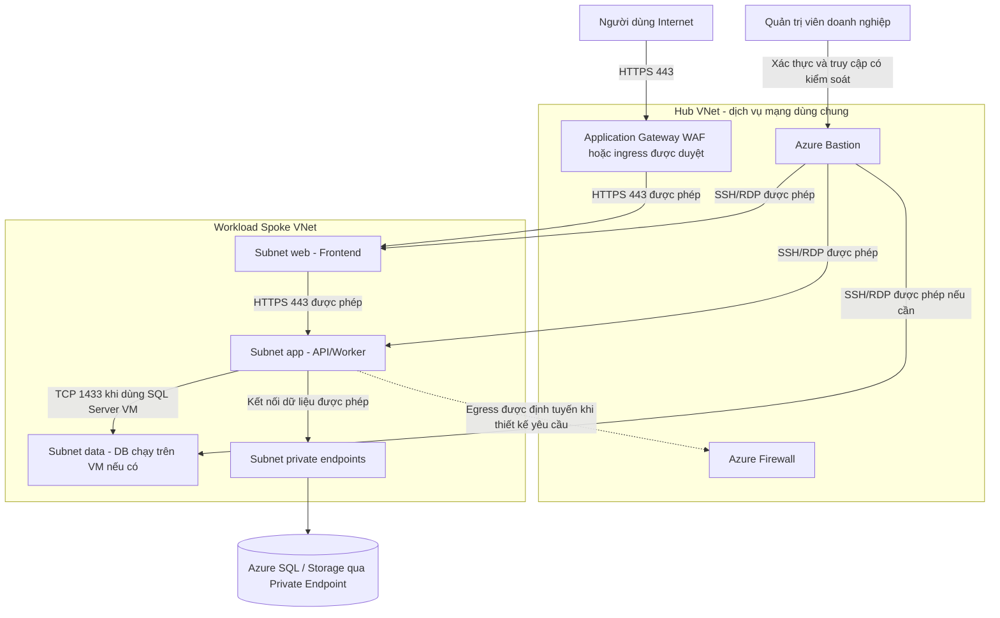

# Tách mạng quản trị, ứng dụng và dữ liệu

Trong Microsoft Azure, một ứng dụng có thể có cổng web phục vụ người dùng, API xử lý nghiệp vụ, cơ sở dữ liệu và hệ thống quản trị. Nếu tất cả nằm trên cùng một mạng có thể kết nối tự do với nhau, một máy web bị xâm nhập có thể trở thành điểm xuất phát để truy cập máy quản trị, database hoặc dịch vụ khác. Vì thế, **phân đoạn mạng (network segmentation)** là một phần quan trọng của kiến trúc bảo mật.

Tách mạng quản trị, ứng dụng và dữ liệu nghĩa là thiết kế các **vùng tin cậy khác nhau**, xác định rõ luồng kết nối cần thiết giữa chúng, rồi sử dụng các lớp kiểm soát Azure để cho phép đúng luồng và từ chối phần còn lại. Cách tổ chức này giúp giảm khả năng di chuyển ngang (*lateral movement*), giảm bề mặt tấn công và hỗ trợ giám sát, khắc phục sự cố.

Bài học thuộc chương **Kết nối và bảo vệ mạng** trong module Microsoft Azure, sử dụng kiến thức về subscription, resource group, Microsoft Entra ID, mạng ảo, dịch vụ tính toán, lưu trữ và dữ liệu. Bài học triển khai một thiết kế nhiều tầng, từ VNet và subnet tới Network Security Group (NSG), Azure Firewall, Azure Bastion, Private Endpoint, DNS và quyền quản trị.

## Mục tiêu học tập

Sau khi hoàn thành, bạn có thể:

- Giải thích mục tiêu của phân đoạn mạng và phân biệt ranh giới mạng với ranh giới danh tính hoặc tài khoản.
- Thiết kế các vùng **ingress, web, ứng dụng, dữ liệu và quản trị** bằng VNet/subnet hoặc nhiều VNet.
- Tạo **ma trận kết nối** quy định nguồn, đích, cổng, giao thức và lý do nghiệp vụ.
- Hiểu quy tắc NSG, độ ưu tiên và lý do cần kiểm soát traffic giữa các subnet.
- So sánh tách mạng bằng subnet với kiến trúc **hub-and-spoke**, Azure Firewall và user-defined route (UDR).
- Giải thích cách dùng Azure Bastion, Private Endpoint và private DNS để giảm phơi bày cổng quản trị và dịch vụ dữ liệu.
- Thực hành cấu hình NSG cho mạng nhiều tầng bằng Azure CLI, kiểm tra kết quả và xử lý các lỗi thường gặp.

## 1. Vì sao cần tách các lớp mạng?

Hãy xét một ứng dụng quản lý đơn hàng gồm bốn thành phần:

1. **Web frontend:** nhận HTTPS từ người dùng.
2. **API/application server:** xử lý nghiệp vụ và gọi dịch vụ bên ngoài.
3. **Database hoặc storage:** lưu thông tin đơn hàng, hóa đơn và tệp đính kèm.
4. **Công cụ quản trị:** SSH/RDP, giám sát, cập nhật bản vá, triển khai hoặc khôi phục sự cố.

Nếu mỗi thành phần được phép kết nối tới mọi thành phần còn lại, quyền di chuyển trong hệ thống có thể quá rộng. Ví dụ, một lỗ hổng trên frontend có thể cho kẻ tấn công thử kết nối tới cổng database, dịch vụ quản trị hoặc các máy khác.

Phân đoạn mạng nhằm giới hạn đường đi có thể sử dụng:

- Người dùng Internet chỉ truy cập **điểm vào công khai đã định nghĩa**, ví dụ Application Gateway/WAF.
- Web frontend chỉ được kết nối tới API qua cổng ứng dụng cho phép.
- API chỉ kết nối tới database hoặc dịch vụ dữ liệu cần thiết bằng giao thức quy định.
- Database không có lý do tự nhận kết nối từ Internet hoặc subnet web.
- Quản trị viên truy cập hệ thống qua kênh quản trị được kiểm soát, thay vì mở SSH/RDP công khai trên từng máy.

**Mục tiêu không chỉ là chia địa chỉ IP thành nhiều subnet.** Các subnet trong cùng VNet của Azure có thể kết nối với nhau theo route mặc định. Nếu không cấu hình luật NSG, firewall hoặc cơ chế kiểm soát tương đương, việc đặt máy ở các subnet riêng chưa tạo ra ranh giới bảo mật như kỳ vọng.

## 2. Phân biệt các ranh giới cần bảo vệ

| Ranh giới | Cơ chế Azure thường dùng | Công dụng | Điều không tự bảo đảm |
|---|---|---|---|
| **Subscription / resource group** | Azure RBAC, Azure Policy, locks | Phân quyền quản trị, áp chính sách và tổ chức tài nguyên | Không tự chặn kết nối IP giữa hai VM |
| **VNet** | Address space, peering, VPN/ExpressRoute | Tổ chức không gian mạng và kết nối | Không tự kiểm soát mọi traffic giữa các subnet |
| **Subnet** | Phân dải IP, NSG, UDR, khả năng delegation | Chia lớp ứng dụng và áp network control | Không tự chặn lưu lượng chỉ vì khác tên subnet |
| **NSG** | Quy tắc inbound/outbound theo IP, port, protocol, service tag, ASG | Cho phép hoặc từ chối traffic ở lớp mạng | Không tự xác minh danh tính người dùng ứng dụng |
| **Firewall / NVA** | Azure Firewall, Firewall Policy, UDR | Kiểm tra và kiểm soát traffic theo đường đi | Cần cấu hình định tuyến đúng để traffic thực sự đi qua |
| **Private Endpoint** | Private Link, private IP, private DNS | Cung cấp đường truy cập riêng tới dịch vụ PaaS | Không thay thế quyền dữ liệu hoặc xác thực |
| **Danh tính** | Microsoft Entra ID, MFA, Conditional Access, Azure RBAC | Bảo vệ đăng nhập và quyền thao tác | Không tự thực thi segmentation của các gói tin IP |

Trong kiến trúc tốt, **kiểm soát mạng** và **kiểm soát danh tính** bổ trợ nhau. Một kết nối từ subnet hợp lệ có thể vẫn bị database từ chối nếu tài khoản ứng dụng không có quyền. Ngược lại, một danh tính có quyền dữ liệu cũng không nhất thiết vượt được firewall mạng.

## 3. Ba mạng chính: quản trị, ứng dụng và dữ liệu

### Mạng quản trị

Mạng quản trị phục vụ các tác vụ như đăng nhập máy ảo, cập nhật hệ điều hành, giám sát, triển khai và khôi phục. Chỉ thiết bị, danh tính và đường kết nối quản trị được phê duyệt mới nên sử dụng vùng này.

Biện pháp thường dùng:

- **Azure Bastion** giúp quản trị VM qua kết nối SSH/RDP mà không cần gán public IP trực tiếp cho từng máy.
- Kết nối VPN hoặc ExpressRoute có thể cung cấp đường kết nối riêng từ mạng doanh nghiệp.
- Microsoft Entra ID, MFA/Conditional Access, Azure RBAC hoặc PIM giảm rủi ro do tài khoản có quyền cao.
- NSG giới hạn nguồn kết nối tới cổng quản trị của VM. Nếu dùng Bastion, cần cho phép những luồng cần thiết từ subnet Bastion tới VM theo cấu hình dịch vụ.

Mạng quản trị **không đồng nhất với Azure management plane**. API của Azure Resource Manager, Azure Portal và quyền sửa cấu hình subscription được quản lý chủ yếu bằng danh tính và Azure RBAC. Một VM ở subnet quản trị không tự động có quyền quản lý mọi tài nguyên; một người dùng có quyền RBAC cũng không tự động đi qua NSG để đăng nhập VM.

### Mạng ứng dụng

Mạng ứng dụng gồm web frontend, API, worker và các thành phần xử lý nghiệp vụ. Có thể tách tiếp thành **web tier** và **app tier**:

- Web tier nhận traffic chỉ từ thành phần ingress, ví dụ Application Gateway.
- App tier nhận traffic từ web tier hoặc dịch vụ gọi hợp lệ.
- App tier chủ động gọi data tier trên những cổng đã công bố trong ma trận.
- Đường ra Internet của ứng dụng nên được đánh giá, giới hạn và quan sát, đặc biệt với workload xử lý dữ liệu quan trọng.

Tách web và app làm giảm hậu quả khi frontend bị khai thác. Web server không cần có quyền mở kết nối trực tiếp tới mọi database hoặc hệ thống quản trị.

### Mạng dữ liệu

Mạng dữ liệu chứa database chạy trên VM, cache, hệ thống lưu trữ nội bộ hoặc subnet dành cho Private Endpoint tới dịch vụ PaaS.

Nguyên tắc cơ bản:

- Chỉ app tier hoặc workload được phê duyệt có thể kết nối trên cổng dữ liệu cần thiết.
- Không mở cổng database trực tiếp từ Internet.
- Không cấp quyền truy cập dữ liệu cho toàn bộ subnet web khi chỉ API cần dùng.
- Hạn chế lưu lượng outbound của data tier, có ngoại lệ được tài liệu hóa cho backup, monitoring, cập nhật hoặc phụ thuộc dịch vụ.

Nếu dùng **Azure SQL Database, Azure Storage, Key Vault** hoặc dịch vụ PaaS khác, hãy đánh giá **Private Endpoint** và cấu hình tắt hoặc giới hạn public network access theo khả năng dịch vụ. Một subnet dành cho Private Endpoint cần được thiết kế riêng để quản lý DNS và network policy theo yêu cầu.

## 4. Kiến trúc tham chiếu cho ứng dụng nhiều tầng

Giả sử tổ chức có một VNet trung tâm chứa dịch vụ mạng dùng chung (*hub*) và một VNet chứa ứng dụng (*spoke*). Ví dụ dưới đây minh họa luồng kết nối; không phải sơ đồ cấu hình chi tiết cho mọi SKU/dịch vụ.



Trong triển khai thật, **Application Gateway** dùng subnet riêng theo yêu cầu dịch vụ; **Azure Firewall** dùng subnet chuyên dụng; **Azure Bastion** dùng subnet có tên và kích thước bắt buộc. Đặt những thành phần trong hub chỉ khi thiết kế routing, peering, DNS và tính năng sản phẩm đáp ứng yêu cầu.

Một công ty có quy mô nhỏ có thể bắt đầu bằng **một VNet với nhiều subnet và NSG**. Khi nhiều ứng dụng dùng chung kênh quản trị, kiểm tra egress hoặc kết nối on-premises, mô hình **hub-and-spoke** thường giúp tập trung dịch vụ mạng và tách phạm vi từng ứng dụng.

## 5. Thiết kế địa chỉ IP và subnet

Để tránh chồng lấn CIDR khi mở rộng, hãy lập kế hoạch address space trước khi tạo resource.

| Thành phần | CIDR minh họa | Chức năng |
|---|---|---|
| Hub VNet | `10.10.0.0/16` | Vùng dịch vụ mạng dùng chung |
| AzureFirewallSubnet | `10.10.0.0/26` | Subnet chuyên dụng của Azure Firewall |
| AzureBastionSubnet | `10.10.1.0/26` | Subnet chuyên dụng của Azure Bastion |
| Spoke VNet | `10.20.0.0/16` | Ứng dụng đơn hàng |
| snet-ingress | `10.20.1.0/24` | Ingress hoặc Application Gateway nếu đặt ở spoke |
| snet-web | `10.20.10.0/24` | Frontend |
| snet-app | `10.20.20.0/24` | API và worker |
| snet-data | `10.20.30.0/24` | Database trên VM hoặc dịch vụ tự quản lý |
| snet-private-endpoints | `10.20.40.0/24` | Private Endpoint cho Azure SQL/Storage/Key Vault |
| snet-mgmt | `10.20.50.0/24` | Công cụ quản trị nội bộ nếu thực sự cần |

Các prefix là **ví dụ**; cần đảm bảo không xung đột với mạng on-premises, các VNet đã peering hoặc dải IP dự phòng. Azure dành một số địa chỉ ở mỗi subnet, vì thế không nên chia subnet quá nhỏ khi dịch vụ cần số lượng IP tăng theo scale.

Các subnet chuyên dụng như `AzureFirewallSubnet` và `AzureBastionSubnet` có yêu cầu đặt tên, kích thước và cấu hình do từng sản phẩm quy định. Trong ví dụ, hai subnet được cấp `/26` để có không gian phù hợp cho các cấu hình hiện đại. Không tái sử dụng chúng để chạy VM ứng dụng.

Tách subnet tạo điểm gắn NSG, UDR và quy tắc dịch vụ. Tuy nhiên, nếu môi trường có yêu cầu cách ly mạnh giữa production và development, việc sử dụng **VNet, subscription và quyền quản trị riêng** có thể tạo ranh giới rõ ràng hơn so với chỉ phân subnet trong cùng một VNet.

## 6. Xác định luồng truy cập bằng ma trận

Trước khi tạo NSG, nhóm phát triển và bảo mật cần thống nhất **ai được kết nối tới đâu và vì sao**.

| Nguồn | Đích | Giao thức/cổng | Mục đích | Quyết định |
|---|---|---|---|---|
| Internet | Điểm ingress/WAF | TCP 443 | Người dùng truy cập HTTPS | Allow có kiểm soát |
| Ingress/WAF | Web tier | TCP 443 | Chuyển tiếp yêu cầu hợp lệ | Allow |
| Web tier | App tier | TCP 443 | Gọi API nội bộ | Allow |
| App tier | Database SQL trên VM | TCP 1433 | Truy vấn dữ liệu | Allow nếu đúng loại DB/cổng |
| App tier | Private Endpoint của Storage | TCP 443 | Đọc/ghi object storage qua HTTPS | Allow |
| Bastion | VM quản trị được phê duyệt | TCP 22 hoặc 3389 | SSH/RDP | Allow giới hạn |
| Web tier | Database trực tiếp | Bất kỳ | Không có nhu cầu | Deny |
| Internet | App/Data VM | SSH/RDP/DB | Không có nhu cầu | Deny |
| Subnet không được phê duyệt | Data tier | Bất kỳ | Không có nhu cầu | Deny |
| App/Data | Internet | Theo danh sách | Update, API phụ thuộc hoặc telemetry | Chỉ Allow khi có nhu cầu |

**Cổng trên chỉ là minh họa.** PostgreSQL thường dùng TCP 5432; MySQL thường dùng TCP 3306. Khi dùng PaaS, kết nối và điều kiện mạng có thể khác. Không lấy cổng ví dụ để suy ra mọi dịch vụ dữ liệu đều dùng TCP 1433.

Một ma trận tốt còn có chủ sở hữu, ticket phê duyệt, thời hạn, cách giám sát và ngày rà soát. Khi API thay đổi hoặc xuất hiện service mới, cập nhật ma trận trước khi mở cổng.

## 7. NSG: lớp kiểm soát đầu tiên giữa các subnet

**Network Security Group (NSG)** gồm các quy tắc cho phép hoặc từ chối inbound và outbound ở mức IP, port, protocol. NSG có thể gắn với subnet hoặc NIC của VM.

### Cách xử lý quy tắc

Một quy tắc NSG thường có:

- **Priority:** số từ 100 đến 4096; số nhỏ hơn được đánh giá trước.
- **Direction:** Inbound hoặc Outbound.
- **Source/Destination:** địa chỉ IP, CIDR, service tag hoặc Application Security Group (ASG), tùy trường hợp.
- **Protocol/Port:** TCP, UDP, các cổng cụ thể hoặc wildcard.
- **Action:** Allow hoặc Deny.

NSG là **stateful**: với traffic được phép bắt đầu một kết nối, traffic phản hồi thuộc kết nối đó được xử lý theo trạng thái. Không cần mở một rule inbound riêng chỉ để cho phép response của kết nối outbound đã được cho phép.

### Vì sao NSG mặc định chưa đủ?

Azure tạo các quy tắc NSG mặc định, trong đó có **AllowVNetInBound** (ưu tiên 65000) và **AllowVNetOutBound** (ưu tiên 65000). Các quy tắc này cho phép traffic giữa các địa chỉ nằm trong phạm vi service tag `VirtualNetwork` theo cách Azure xác định.

Vì vậy, **có hai subnet riêng không đồng nghĩa chúng bị chặn kết nối**. Với traffic nội bộ cần giới hạn, hãy tạo các rule cho phép cần thiết trước, sau đó tạo rule **Deny** có priority cao hơn default Allow.

Ví dụ trên NSG của subnet app:

1. Allow từ `10.20.10.0/24` (web) tới TCP 443 của app.
2. Nếu cần, Allow luồng quản trị được phê duyệt từ subnet Bastion qua TCP 22/3389.
3. Deny những kết nối `VirtualNetwork` inbound khác đến app bằng rule sau các Allow cụ thể.

Do `VirtualNetwork` có thể bao gồm các dải có thể kết nối qua peering hoặc gateway tùy topology, phải kiểm tra phạm vi thực tế. Nếu chỉ muốn chặn một CIDR xác định, có thể dùng CIDR cụ thể; chọn cách nào phải dựa trên topology và ma trận.

### Application Security Group

**ASG** cho phép tổ chức nhóm các NIC/VM theo vai trò ứng dụng, ví dụ `asg-web` và `asg-api`, để rule NSG dùng ASG thay vì CIDR cố định. Điều này hữu ích khi VM tăng giảm số lượng. ASG không thay thế subnet segmentation hoặc quy tắc luồng kết nối; khả năng và phạm vi sử dụng phải tuân thủ điều kiện Azure.

### Cẩn trọng với NSG ở cả subnet và NIC

Khi VM có NSG ở subnet lẫn NIC, các quy tắc áp dụng theo cả hai cấp. Một traffic cần được phép qua các NSG liên quan; một Deny ở một cấp vẫn có thể chặn luồng dù cấp kia Allow. Nên chọn quy ước quản lý nhất quán để tránh xung đột khó chẩn đoán.

## 8. Hub-and-spoke: tách ứng dụng với dịch vụ mạng dùng chung

Ở kiến trúc **hub-and-spoke**:

- **Hub VNet** tập trung firewall, Bastion, DNS resolver và kết nối tới datacenter khi cần.
- **Spoke VNet** chứa ứng dụng hoặc một nhóm ứng dụng, với subnet web/app/data riêng.
- **VNet peering** hoặc cơ chế kết nối khác tạo đường mạng giữa hub và các spoke được phép.

### Peering không phải firewall

VNet peering cung cấp kết nối có hiệu quả qua hạ tầng Azure. **Peering không mặc định là bộ lọc ứng dụng.** Khi hai VNet đã kết nối, phải kết hợp NSG, UDR, firewall và quyền quản trị để giới hạn các luồng.

Peering **không tự có tính bắc cầu (non-transitive)**: nếu Spoke A peering với Hub và Spoke B cũng peering với Hub, điều đó không tự bảo đảm A đi tới B qua Hub. Muốn định tuyến qua firewall/NVA trung gian, cần thiết kế peering, **allow forwarded traffic**, UDR và đường trả về phù hợp.

### Khi nào cần Azure Firewall?

NSG phù hợp để cho phép/từ chối theo subnet, địa chỉ và cổng. Khi cần kiểm tra và tập trung các luồng đi giữa vùng mạng hoặc ra Internet, **Azure Firewall** có thể bổ sung:

- Chính sách kiểm soát network/application traffic tùy loại rule.
- Kiểm soát egress tới dịch vụ hoặc địa chỉ được phê duyệt, bao gồm FQDN khi loại rule hỗ trợ.
- Lưu log tập trung để hỗ trợ điều tra và giám sát.
- Một điểm kiểm soát luồng giữa mạng ứng dụng và những mạng khác nếu route được thiết kế để đi qua firewall.

Azure Firewall có chi phí chạy và xử lý dữ liệu, cùng các yêu cầu về subnet, route, DNS và high availability. Vì vậy, trong workload đơn giản, NSG kết hợp private access có thể đủ; với hệ thống nhiều ứng dụng cần quan sát tập trung, hub-and-spoke với firewall là phương án cần cân nhắc.

## 9. UDR: muốn đi qua firewall thì phải định tuyến đúng

Một lỗi kiến trúc thường gặp là đặt Azure Firewall trong Hub rồi cho rằng **mọi traffic giữa các subnet tự động đi qua firewall**. Trong thực tế, Azure dùng system routes và chỉ gửi traffic tới firewall khi route có hiệu lực phù hợp.

**User-defined route (UDR)** trong route table giúp chỉ định next hop, ví dụ một **virtual appliance** tại IP riêng của firewall.

Ví dụ ý tưởng:

```text
Subnet ứng dụng
  -> Route table có tuyến tới mạng đích qua Azure Firewall
  -> Azure Firewall kiểm tra theo policy
  -> Route hợp lệ đến subnet dữ liệu hoặc mạng khác
  -> Trả về qua đường phù hợp để không tạo bất đối xứng
```

Các điểm cần đánh giá:

- **Effective routes:** tuyến thực sự áp dụng cho NIC/subnet, bao gồm system route và UDR.
- **Chiều đi và chiều về:** thiết kế sao cho traffic không bị định tuyến bất đối xứng qua thiết bị stateful.
- **Peering và forwarded traffic:** cho phép cấu hình cần thiết nếu firewall chuyển tiếp traffic giữa VNets.
- **Subnet đặc biệt:** tránh áp UDR tùy tiện lên subnet chứa Azure Firewall, Bastion, Application Gateway hoặc dịch vụ có hướng dẫn routing riêng.
- **Private Endpoint:** khi cần áp NSG/route policy cho traffic đến private endpoint, phải kiểm tra trạng thái private endpoint network policies và điều kiện Azure hỗ trợ.
- **Truy cập dịch vụ Azure:** một số đường ra hoặc service endpoint có cách chọn route đặc biệt; luôn kiểm tra tài liệu dịch vụ và effective routes sau khi thay đổi.

UDR không tự cấp phép truy cập; router chỉ chọn đường đi. **Firewall/NSG và quyền của ứng dụng** mới quyết định yêu cầu được thông qua ở các lớp tương ứng.

## 10. Quản trị máy ảo an toàn với Azure Bastion

Mục tiêu của mạng quản trị là tránh đưa cổng SSH/RDP của VM lên Internet và giới hạn ai có thể thực hiện phiên quản trị.

### Mô hình quản trị

1. Quản trị viên đăng nhập bằng danh tính riêng, dùng MFA/Conditional Access theo chính sách.
2. Quản trị viên được Azure RBAC cấp quyền phù hợp trên VM và Bastion, trong phạm vi tối thiểu.
3. Azure Bastion cung cấp phiên kết nối SSH/RDP tới VM qua mạng Azure theo khả năng và cấu hình dịch vụ.
4. NSG ở subnet đích cho phép những luồng cần thiết từ nguồn Bastion, đồng thời chặn truy cập SSH/RDP không được duyệt.
5. Lưu log sự kiện quản trị và giám sát thay đổi để hỗ trợ kiểm toán.

Bastion cần subnet chuyên dụng **`AzureBastionSubnet`** với prefix đáp ứng yêu cầu SKU/kích thước hiện hành; thiết kế mới thường dùng **/26 hoặc lớn hơn**. Đường mạng giữa Bastion và VM đích phải được định tuyến, peering và NSG cho phép. Việc đặt Bastion trong Hub có thể hỗ trợ quản trị VM ở VNet peered khi thỏa điều kiện sản phẩm.

Không gán public IP cho mọi VM chỉ để thuận tiện thao tác. Nếu tổ chức cần jump host trong subnet quản trị, hãy bảo vệ theo nguyên tắc tương tự, nhưng cân nhắc chi phí vận hành, bản vá và bề mặt tấn công của máy nhảy.

### Quyền quản trị cloud khác quyền đăng nhập OS

Một người có quyền thao tác máy ảo ở Azure RBAC chưa chắc đã có quyền đăng nhập Linux/Windows bằng tài khoản hệ điều hành. Với giải pháp đăng nhập dựa trên Microsoft Entra ID, có thể cần vai trò đăng nhập VM phù hợp. Nên kiểm tra cả **quyền Azure control plane**, **quyền OS/data plane** và **đường kết nối mạng**.

## 11. Bảo vệ data tier bằng Private Endpoint và DNS

Một cách tiếp cận phổ biến với Azure SQL Database, Azure Storage hoặc Key Vault là tạo **Private Endpoint** cho dịch vụ đích và giới hạn đường truy cập công cộng khi dịch vụ hỗ trợ.

### Private Endpoint hoạt động ra sao?

Private Endpoint tạo giao diện mạng với **địa chỉ IP riêng trong VNet** để truy cập một dịch vụ qua Azure Private Link. Ví dụ, ứng dụng kết nối Azure SQL Database bằng hostname của dịch vụ nhưng DNS trong VNet phân giải tên theo chuỗi CNAME/record riêng tới địa chỉ private IP.

Đối với Azure SQL Database, private DNS zone thường là **`privatelink.database.windows.net`**. Với Azure Storage Blob, private DNS zone thường là **`privatelink.blob.core.windows.net`**. Tên zone thực tế phải khớp **subresource** và hướng dẫn của dịch vụ đang dùng.

### Những lớp cần thiết

- **Private Endpoint:** tạo đường kết nối private IP đến dịch vụ.
- **Private DNS:** bảo đảm máy ứng dụng phân giải hostname đúng tới private IP ở đúng mạng.
- **Public network access:** tắt hoặc giới hạn ở dịch vụ đích theo yêu cầu và khả năng sản phẩm.
- **NSG/route policy của subnet Private Endpoint:** cần kiểm tra và bật **private endpoint network policies** khi muốn áp dụng NSG/UDR cho private endpoint theo các điều kiện Azure hỗ trợ.
- **Identity/data roles:** ứng dụng vẫn phải xác thực và có quyền trên SQL/Blob/Key Vault.

Không được mặc định tạo Private Endpoint là mọi đường public đã bị chặn. Cần đọc lại cấu hình public network access của tài nguyên đích. Tương tự, nếu hostname vẫn phân giải ra public IP ở VM ứng dụng, cần điều tra DNS thay vì chỉ sửa NSG.

### Data tier chạy trên VM khác PaaS như thế nào?

Nếu database là SQL Server trên **VM trong `snet-data`**, có thể dùng NSG trực tiếp trên subnet/NIC để cho phép TCP 1433 từ app tier; không có Private Endpoint PaaS bắt buộc cho kết nối đó.

Nếu database là **Azure SQL Database PaaS**, endpoint riêng nằm tại subnet chứa Private Endpoint và quyền truy cập mạng có thể được quản lý ở phía dịch vụ, private endpoint subnet và DNS. Không nên cố áp dụng nguyên xi mô hình NSG của DB VM cho mọi dịch vụ PaaS.

## 12. Áp dụng segmentation cho App Service, AKS và dịch vụ khác

Kiến trúc VNet/subnet của VM là điểm khởi đầu, nhưng mỗi dịch vụ managed có cách tích hợp mạng khác nhau.

| Workload | Điều cần lưu ý khi tách mạng |
|---|---|
| **Azure VM / VM Scale Sets** | NIC nằm trong subnet; NSG/UDR là công cụ trực tiếp để kiểm soát traffic |
| **Azure App Service** | VNet Integration thường phục vụ luồng outbound; inbound có thể dùng Private Endpoint hoặc access restrictions tùy thiết kế |
| **Azure Functions** | Tính năng networking phụ thuộc hosting plan; cần kiểm tra VNet Integration, private access và khả năng hỗ trợ |
| **Azure Kubernetes Service (AKS)** | Node, pod, service và ingress có mô hình địa chỉ/route riêng; cần xem network policy cho traffic nội bộ cluster |
| **Azure Container Apps** | Môi trường managed có điều kiện networking, subnet và ingress riêng; cần dùng đúng tính năng hỗ trợ |
| **Azure SQL/Storage/Key Vault** | Kết hợp private endpoint, DNS, firewall dịch vụ và role dữ liệu |

Với Kubernetes, tách namespace **không đồng nghĩa với tách network traffic**. Nếu muốn các pod không kết nối tự do với nhau, phải dùng network policy hoặc biện pháp hỗ trợ tương ứng của nền tảng. Tách cả cluster hoặc VNet có thể phù hợp hơn trong những môi trường có mức tin cậy khác nhau.

## 13. Thực hành Azure CLI: tách web, app và data bằng NSG

Ví dụ này tạo **một VNet dùng cho lab** với ba subnet web, app và data; gán NSG cho app và data để cho phép một số traffic nội bộ cụ thể. Không tạo VM, database, firewall hay public endpoint. Tất cả lệnh cấu hình là ví dụ dành cho subscription thử nghiệm được phép sử dụng.

**Ngữ cảnh:** chạy trong **Bash của Azure Cloud Shell** với tài khoản có quyền quản lý network và resource group ở subscription đã chọn. Các CIDR phải không trùng với mạng hiện hữu.

### Bước 1: Xác nhận subscription

```bash
az account show --output table
az account list --output table

az account set --subscription "<SUBSCRIPTION_ID>"
az account show --output table
```

Không bỏ qua bước xác nhận subscription trước khi tạo tài nguyên. Thay placeholder bằng ID thật của subscription lab.

### Bước 2: Tạo resource group và VNet

```bash
RG="rg-segmentation-lab"
REGION="southeastasia"
VNET="vnet-seg-lab"

az group create --name "$RG" --location "$REGION"

az network vnet create \
  --resource-group "$RG" \
  --name "$VNET" \
  --location "$REGION" \
  --address-prefixes 10.20.0.0/16 \
  --subnet-name snet-web \
  --subnet-prefixes 10.20.10.0/24
```

Tạo hai subnet bổ sung:

```bash
az network vnet subnet create \
  --resource-group "$RG" \
  --vnet-name "$VNET" \
  --name snet-app \
  --address-prefixes 10.20.20.0/24

az network vnet subnet create \
  --resource-group "$RG" \
  --vnet-name "$VNET" \
  --name snet-data \
  --address-prefixes 10.20.30.0/24
```

### Bước 3: Tạo NSG cho từng tier

```bash
az network nsg create --resource-group "$RG" --name nsg-app
az network nsg create --resource-group "$RG" --name nsg-data
```

Một phương án cho lab là gắn NSG tại **subnet**, để các NIC trong subnet chịu chính sách cùng lớp. Khi dùng mô hình kết hợp subnet và NIC NSG ở hệ thống thực, cần kiểm tra cả hai.

### Bước 4: Cho phép web gọi app trên TCP 443

```bash
az network nsg rule create \
  --resource-group "$RG" \
  --nsg-name nsg-app \
  --name allow-web-to-app-443 \
  --priority 100 \
  --direction Inbound \
  --access Allow \
  --protocol Tcp \
  --source-address-prefixes 10.20.10.0/24 \
  --source-port-ranges "*" \
  --destination-address-prefixes 10.20.20.0/24 \
  --destination-port-ranges 443
```

Rule này cho phép web subnet kết nối app subnet trên TCP 443. Cần cấu hình web/app thực sự nghe và sử dụng TLS đúng cách; NSG không tự cung cấp HTTPS.

Thêm rule để các nguồn khác thuộc phạm vi `VirtualNetwork` không tự được phép kết nối app qua default Allow:

```bash
az network nsg rule create \
  --resource-group "$RG" \
  --nsg-name nsg-app \
  --name deny-other-vnet-inbound \
  --priority 4000 \
  --direction Inbound \
  --access Deny \
  --protocol "*" \
  --source-address-prefixes VirtualNetwork \
  --source-port-ranges "*" \
  --destination-address-prefixes "*" \
  --destination-port-ranges "*"
```

Số 4000 được đánh giá sau priority 100, nhưng **trước** default `AllowVNetInBound` priority 65000. Nếu cần truy cập quản trị từ Bastion hoặc monitoring cụ thể, phải thiết kế các Allow bổ sung có priority phù hợp trước Deny, không được mở bừa mọi nguồn.

### Bước 5: Cho phép app kết nối data trên TCP 1433

Ví dụ `snet-data` lưu SQL Server trên VM, chấp nhận app tier trên TCP 1433:

```bash
az network nsg rule create \
  --resource-group "$RG" \
  --nsg-name nsg-data \
  --name allow-app-to-sql-1433 \
  --priority 100 \
  --direction Inbound \
  --access Allow \
  --protocol Tcp \
  --source-address-prefixes 10.20.20.0/24 \
  --source-port-ranges "*" \
  --destination-address-prefixes 10.20.30.0/24 \
  --destination-port-ranges 1433

az network nsg rule create \
  --resource-group "$RG" \
  --nsg-name nsg-data \
  --name deny-other-vnet-inbound \
  --priority 4000 \
  --direction Inbound \
  --access Deny \
  --protocol "*" \
  --source-address-prefixes VirtualNetwork \
  --source-port-ranges "*" \
  --destination-address-prefixes "*" \
  --destination-port-ranges "*"
```

Quy tắc ở đây chỉ mô tả **inbound**. Chúng không tự tạo firewall chặn tất cả outbound hoặc thiết kế hệ thống database hoàn chỉnh. Khi triển khai VM thật, còn phải bảo vệ hệ điều hành, database account, TLS và các luồng update/backup/monitoring.

### Bước 6: Gắn NSG vào subnet

```bash
az network vnet subnet update \
  --resource-group "$RG" \
  --vnet-name "$VNET" \
  --name snet-app \
  --network-security-group nsg-app

az network vnet subnet update \
  --resource-group "$RG" \
  --vnet-name "$VNET" \
  --name snet-data \
  --network-security-group nsg-data
```

**Đọc kỹ trước khi áp lên production:** subnet có thể có cấu hình khác như delegation, service endpoints, route table và private endpoint network policies. Bài lab chỉ thêm NSG vào subnet mới; khi chỉnh subnet đã chạy, phải bảo toàn các thiết lập hiện hữu.

### Bước 7: Xác minh cấu hình đã lưu

```bash
az network vnet subnet show \
  --resource-group "$RG" \
  --vnet-name "$VNET" \
  --name snet-app \
  --query "{name:name,prefix:addressPrefix,nsg:networkSecurityGroup.id}" \
  --output json

az network vnet subnet show \
  --resource-group "$RG" \
  --vnet-name "$VNET" \
  --name snet-data \
  --query "{name:name,prefix:addressPrefix,nsg:networkSecurityGroup.id}" \
  --output json
```

Xem danh sách rule:

```bash
az network nsg rule list \
  --resource-group "$RG" \
  --nsg-name nsg-app \
  --output table

az network nsg rule list \
  --resource-group "$RG" \
  --nsg-name nsg-data \
  --output table
```

Kỳ vọng: NSG gắn đúng subnet, có **Allow** cụ thể priority 100 và **Deny** priority 4000. Không được coi việc tạo rule thành công là đã chứng minh kết nối ứng dụng thành công: muốn kiểm thử luồng thực cần có nguồn, đích và ứng dụng tương ứng.

### Bước 8: Dọn dẹp môi trường lab

Nếu resource group này chỉ chứa tài nguyên được tạo cho bài thực hành và không còn cần lưu:

```bash
az group delete --name "$RG" --yes --no-wait
```

Lệnh xóa cả tài nguyên thuộc resource group đó. Phải xác nhận subscription, tên group và toàn bộ tài nguyên trước khi chạy; với nhóm dùng chung hoặc production, tuân thủ quy trình thay đổi và phê duyệt của tổ chức.

## 14. Kiểm thử segmentation sau khi triển khai

Mục tiêu kiểm thử là **chứng minh luồng cần thiết hoạt động và luồng không được phép bị chặn**.

| Kịch bản | Nguồn | Đích | Kết quả kỳ vọng |
|---|---|---|---|
| Web gọi API | VM ở snet-web | App VM TCP 443 | Allow nếu app đang lắng nghe và OS firewall cho phép |
| Web truy cập SQL trực tiếp | VM ở snet-web | Data VM TCP 1433 | Deny |
| App truy cập SQL | App VM | Data VM TCP 1433 | Allow nếu database và OS firewall hỗ trợ |
| App thử cổng khác | App VM | Data VM TCP 3389 | Deny theo rule minh họa |
| Mạng nội bộ không hợp lệ gọi app | VM ở subnet khác | App VM TCP 443 | Deny trừ khi có allow/exception phù hợp |
| Internet SSH vào data VM | Nguồn Internet | Data VM TCP 22 | Không có đường public mong muốn; bị chặn |
| Bastion quản trị VM | Azure Bastion đã cấu hình | VM đích TCP 22/3389 | Allow nếu có rule quản trị và quyền phù hợp |

Để xác minh thực tế, triển khai các VM thử nghiệm ở đúng subnet, cấu hình ứng dụng lắng nghe đúng cổng, xác nhận NSG và OS firewall, rồi kiểm tra bằng công cụ TCP/HTTPS phù hợp. Không chỉ dùng `ping`: ICMP không chứng minh TCP 443 hoặc TCP 1433 hoạt động.

### Công cụ Azure để điều tra

- **Effective security rules** của NIC: xem tổng hợp NSG ở subnet và NIC.
- **Effective routes** của NIC: kiểm tra system routes, UDR và next hop.
- **Network Watcher – IP flow verify**: thử đánh giá Allow/Deny của NSG cho luồng IP cụ thể.
- **Network Watcher – Connection troubleshoot**: hỗ trợ kiểm tra khả năng kết nối và đường đi giữa các điểm.
- **Azure Monitor / Virtual Network flow logs** (nếu có cấu hình): hỗ trợ phân tích lưu lượng và kiểm toán.
- **Azure Firewall logs / Application Gateway WAF logs**: hữu ích khi traffic đi qua các thành phần này.

Lệnh xem effective NSG trên NIC của VM đã có:

```bash
az network nic list-effective-nsg \
  --resource-group "<VM_RESOURCE_GROUP>" \
  --name "<NIC_NAME>" \
  --output json
```

Dữ liệu effective NSG đòi hỏi NIC gắn với VM phù hợp và quyền truy cập cần thiết. Bài lab ở phần trước chỉ tạo VNet/subnet/NSG, nên **chưa có NIC/VM để chạy lệnh này**. Không nên giả định kết quả kiểm thử nếu chưa triển khai workload và sinh traffic thực.

## 15. Các lỗi thường gặp

| Hiện tượng | Nguyên nhân khả dĩ | Hướng kiểm tra |
|---|---|---|
| Tách web và app thành hai subnet nhưng vẫn truy cập tự do | NSG default AllowVNetInBound hoặc chưa áp quy tắc Deny phù hợp | Xem NSG được gắn ở đâu, priority và effective rules |
| Rule Allow TCP 443 nhưng kết nối vẫn lỗi | Rule Deny trước đó, NSG ở NIC, OS firewall, app không lắng nghe hoặc route không đúng | Đọc effective NSG, route, trạng thái port và ứng dụng |
| Đã tạo Azure Firewall nhưng traffic không xuất hiện trong log | Route không đưa traffic qua firewall, peering/forwarding sai | Kiểm tra UDR, effective routes, chiều đi/về |
| Sau khi bật UDR, một chiều kết nối hoạt động và chiều khác thất bại | Đường đi bất đối xứng hoặc route thiếu | Kiểm tra next hop hai chiều và trạng thái firewall |
| Bastion không thể kết nối SSH/RDP đến VM | NSG chặn port, peering/route sai, VM/OS firewall hoặc quyền đăng nhập thiếu | Kiểm tra đường từ AzureBastionSubnet, port, cấu hình Bastion và OS |
| Ứng dụng không kết nối được Azure SQL sau khi tạo Private Endpoint | Private DNS chưa đúng, mạng/route chặn hoặc quyền SQL thiếu | Kiểm tra DNS private IP, endpoint status, policy và xác thực |
| Chặn outbound làm app không cập nhật hoặc gửi log | Thiếu allowlist cho endpoint phụ thuộc | Lập danh sách dịch vụ cần thiết, thêm ngoại lệ có kiểm soát |
| Web App Service không chịu rule NSG như VM | App Service dùng networking model khác | Kiểm tra VNet Integration, inbound private endpoint và access restrictions |
| Dev và prod chia resource group nhưng vẫn chung mạng/quyền | Resource group chỉ là nhóm quản trị, không phải firewall | Tách VNet/subnet và quyền, xác nhận policy và luồng kết nối |
| Dữ liệu vẫn bị xuất ra ngoài dù inbound chặn tốt | Không kiểm soát egress, private service hoặc tài khoản dịch vụ ngoài | Rà soát outbound NSG/firewall, endpoint policy và quyền dữ liệu |

Khi chẩn đoán, nên theo thứ tự **DNS → effective routes → NSG/firewall → trạng thái dịch vụ/OS → danh tính và quyền ứng dụng**. Một lỗi kết nối có thể xảy ra ở nhiều lớp, nên không nên mở rộng quyền hoặc tắt NSG toàn bộ trước khi tìm nguyên nhân.

## 16. Vận hành, giám sát và quản trị thay đổi

Phân đoạn mạng chỉ phát huy hiệu quả lâu dài nếu có quy trình duy trì:

1. **Sở hữu:** mỗi subnet, NSG, firewall policy và route table có người phụ trách.
2. **Tài liệu:** lưu ma trận luồng kết nối, sơ đồ VNet, CIDR, DNS, ứng dụng và lý do ngoại lệ.
3. **Phê duyệt:** mở cổng hoặc thay route cần ticket có phạm vi, lý do, thời hạn và kế hoạch rollback.
4. **Infrastructure as Code:** dùng Bicep, ARM template hoặc Terraform để quản lý các cấu hình có thể tái lập và rà soát thay đổi.
5. **Giám sát:** dùng log từ dịch vụ mạng thích hợp và cảnh báo với những thay đổi trọng yếu.
6. **Đánh giá định kỳ:** tìm rule quá rộng như nguồn `*`, đích `*`, cổng `*` không có lý do rõ ràng hoặc NSG không còn gắn.
7. **Ứng phó sự cố:** biết subnet, danh tính, route và logging nào cần khoanh vùng khi phát hiện traffic bất thường.

Azure Policy có thể hỗ trợ đánh giá việc mở public IP, gắn NSG, cấu hình resource hoặc các điều kiện được hỗ trợ. Tuy nhiên, một policy đơn lẻ không hiểu đầy đủ mọi luồng ứng dụng; cần kết hợp kiểm thử thực tế và rà soát ma trận.

### Chi phí của phân đoạn mạng

Việc chia subnet và dùng NSG thường không có phí trực tiếp riêng như một dịch vụ kiểm tra traffic chuyên dụng. Tuy nhiên, các thành phần có tính phí như **Azure Firewall, Bastion, Application Gateway/WAF, Private Endpoint, peering data transfer, Azure Monitor logs và các kết nối mạng** cần được lập ngân sách theo biểu giá và mức sử dụng thực tế.

Không nên thêm dịch vụ mạng đắt tiền chỉ vì muốn nhiều lớp bảo vệ. Hãy xuất phát từ yêu cầu lưu lượng, mức rủi ro, khả năng vận hành, tuân thủ và mục tiêu khôi phục, rồi chọn thành phần phù hợp.

## 17. Tình huống thiết kế: cô lập môi trường production

Một nhóm phát triển có hệ thống gồm web frontend, API, PostgreSQL và công cụ CI/CD. Môi trường development đã dùng chung một VNet, còn production cần bảo vệ chặt hơn.

### Các yêu cầu

- Người dùng chỉ truy cập HTTPS qua WAF/ingress.
- Web frontend không được truy cập trực tiếp PostgreSQL.
- Chỉ API production được kết nối DB production trên cổng phù hợp.
- Không mở SSH/RDP từ Internet tới VM production.
- Hệ thống CI/CD chỉ triển khai qua kênh và quyền được phê duyệt.
- Tài khoản developer không được tự tạo NSG rule mở toàn mạng production.

### Hướng thiết kế

**Bước 1:** Chọn VNet production riêng, với subnet ingress, web, app và data hoặc Private Endpoint. Xác định address space không trùng mạng doanh nghiệp.

**Bước 2:** Dùng WAF hoặc dịch vụ ingress được duyệt làm điểm vào công khai; không cấp public IP trực tiếp cho DB và VM nội bộ.

**Bước 3:** Tạo NSG với các Allow theo ma trận, kết hợp rule Deny phù hợp để chặn kết nối east-west không được phê duyệt.

**Bước 4:** Nếu DB là PostgreSQL PaaS, chọn cấu hình mạng riêng được dịch vụ hỗ trợ, kiểm tra private DNS và quyền dữ liệu. Nếu DB chạy trên VM, giới hạn nguồn vào cổng PostgreSQL thường là TCP 5432.

**Bước 5:** Tập trung quản trị VM qua Bastion hoặc kết nối riêng có kiểm soát. Kết hợp MFA, PIM và Azure RBAC cho quyền thay đổi cấu hình.

**Bước 6:** Chọn điểm kiểm tra egress và route khi yêu cầu bảo mật cần ghi log hoặc giới hạn đích ra ngoài; xác minh traffic thực sự đi qua thiết bị kiểm tra.

**Bước 7:** Chạy bài thử Allow/Deny, lưu log/bằng chứng và chỉ triển khai production sau khi các luồng cần thiết hoạt động.

### Bảng quyết định

| Rủi ro | Kiểm soát được đề xuất | Bằng chứng kiểm tra |
|---|---|---|
| Frontend bị xâm nhập rồi đọc DB | Không có luồng web → data trực tiếp; chỉ app → data | Kết quả kiểm thử TCP và effective NSG |
| SSH/RDP lộ ra Internet | Không có public IP cho VM nội bộ; quản trị qua Bastion | Inventory public IP, NSG, kết nối Bastion |
| API gửi dữ liệu ra nguồn không được duyệt | Egress control và kiểm soát danh tính, service endpoint/private access khi thích hợp | Firewall logs, policy, ma trận outbound |
| Developer sửa rule production ngoài quy trình | Azure RBAC tối thiểu, PIM/approval, Azure Policy và IaC review | Role assignments, Activity Log, lịch sử thay đổi |
| Private Endpoint phân giải sai | Cấu hình private DNS zone và liên kết VNet phù hợp | DNS lookup từ VM/app ở đúng mạng |
| Dev và prod kết nối trái phép | Mạng tách biệt, peering/route hạn chế, NSG và firewall | Peering inventory, route table, thử kết nối |

## 18. Checklist triển khai production

- [ ] Đã lập ma trận nguồn–đích–cổng–giao thức theo từng ứng dụng và có chủ sở hữu phê duyệt.
- [ ] Đã phân vùng riêng mạng quản trị, web, app và data theo mức tin cậy.
- [ ] Đã kiểm tra CIDR và tránh chồng lấn với mạng đã peering/on-premises.
- [ ] Đã áp NSG hoặc network control khác; kiểm tra default Allow giữa các subnet.
- [ ] Đã giới hạn SSH/RDP, không mở cổng quản trị VM công khai nếu không có nhu cầu đặc biệt được duyệt.
- [ ] Đã xem đường quản trị Azure RBAC, MFA, Conditional Access và quyền OS.
- [ ] Đã kiểm tra WAF/ingress, backend pool, health probe và đường vào ứng dụng.
- [ ] Đã kiểm tra UDR, peering, forwarded traffic, effective routes và đường trả về.
- [ ] Đã dùng Private Endpoint hoặc cách bảo vệ tương đương cho data PaaS khi yêu cầu.
- [ ] Đã kiểm tra private DNS, public network access và data-plane permissions.
- [ ] Đã thực hiện kiểm thử luồng được phép và luồng bị chặn từ vị trí thật.
- [ ] Đã bật giám sát phù hợp và có quy trình cập nhật, rollback, thu hồi ngoại lệ.
- [ ] Đã rà soát chi phí firewall, Bastion, Private Endpoint, log và traffic liên vùng.

## 19. Câu hỏi tự kiểm tra

1. Vì sao chỉ tạo các subnet `snet-web`, `snet-app` và `snet-data` chưa đủ để cách ly chúng?
2. Rule NSG nào mặc định có thể khiến traffic giữa các subnet trong VNet được cho phép?
3. Vì sao thứ tự priority của Allow và Deny quyết định kết quả?
4. Khi một VM gắn NSG ở subnet và NIC, cần kiểm tra những lớp nào?
5. VNet peering có tự động chuyển lưu lượng giữa hai spoke qua hub không?
6. Đặt Azure Firewall trong hub có tự bảo đảm mọi traffic east-west đi qua firewall không? Cần thêm gì?
7. Azure Bastion giúp giảm rủi ro nào và khác Azure RBAC ở điểm nào?
8. Nếu Azure SQL dùng Private Endpoint nhưng DNS vẫn trả public IP cho ứng dụng, bước điều tra quan trọng là gì?
9. Tại sao phải phân biệt DB chạy trên VM với cơ sở dữ liệu PaaS khi thiết kế data subnet?
10. NSG có thể thay thế authentication và quyền truy cập dữ liệu ở database không?
11. Làm thế nào để kiểm thử luồng web → app được phép và web → data bị chặn?
12. Vì sao cần ghi nhận thay đổi NSG/UDR và rà soát exception định kỳ?

## Kết luận

Tách mạng quản trị, ứng dụng và dữ liệu là phương pháp giới hạn khả năng kết nối theo **vai trò và mức độ tin cậy của từng thành phần**. Trong Azure, VNet/subnet giúp tổ chức địa chỉ và phạm vi, **NSG** kiểm soát luồng cơ bản, **UDR và Azure Firewall** hỗ trợ kiểm tra traffic theo đường định tuyến, **Azure Bastion** bảo vệ đường quản trị VM, còn **Private Endpoint cùng DNS** hỗ trợ kết nối riêng tới dịch vụ dữ liệu PaaS.

Bảo vệ hiệu quả cần xuất phát từ ma trận luồng kết nối rõ ràng, tạo Allow cần thiết và Deny các luồng không có lý do, sau đó xác minh bằng **effective rules, effective routes và kiểm thử ứng dụng thực tế**. Kết hợp segmentation với Microsoft Entra ID, Azure RBAC, giám sát và kiểm soát thay đổi giúp kiến trúc Azure giảm rủi ro di chuyển ngang mà vẫn vận hành, mở rộng và kiểm soát chi phí được.
