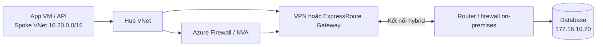
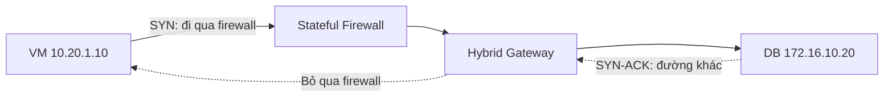
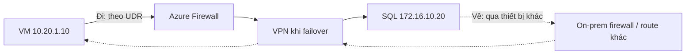

# Chẩn đoán lỗi kết nối hybrid và định tuyến bất đối xứng

Một ứng dụng đặt hàng chạy trong Azure có thể truy cập cơ sở dữ liệu tại trung tâm dữ liệu của doanh nghiệp qua VPN hoặc ExpressRoute. Khi kết nối gặp lỗi, người vận hành thường thấy những biểu hiện khó giải thích: ping thành công nhưng ứng dụng không kết nối được, gói TCP SYN đi khỏi Azure nhưng không nhận được SYN-ACK, hoặc hệ thống chỉ lỗi sau khi chuyển tuyến dự phòng. Một nguyên nhân quan trọng là **định tuyến bất đối xứng (asymmetric routing)**: gói đi và gói trả về của cùng một phiên sử dụng những đường mạng khác nhau, đặc biệt khi có firewall hoặc thiết bị mạng theo dõi trạng thái phiên ở giữa.

Bài học thuộc chương **Kết nối và bảo vệ mạng** của module **CLOUD_PROVIDERS_AZURE**. Module khám phá hệ sinh thái Microsoft Azure từ subscription, resource group và Microsoft Entra ID đến mạng ảo, tính toán, lưu trữ, dữ liệu; đồng thời hướng dẫn triển khai, giám sát, bảo vệ và kiểm soát chi phí kiến trúc ứng dụng. Bài học tập trung vào kết nối hybrid giữa Azure và mạng on-premises, cách đọc đường đi thực tế và quy trình chẩn đoán có bằng chứng trước khi sửa cấu hình.

Sau bài học, bạn có thể:

- Xác định thành phần và đường đi của lưu lượng qua VPN Gateway, ExpressRoute, hub-spoke, Azure Firewall và network virtual appliance (NVA).
- Phân biệt mất kết nối do DNS, routing, firewall, NAT, lỗi phiên TCP hoặc bản thân ứng dụng.
- Giải thích vì sao đường đi và đường về không đối xứng có thể khiến stateful firewall từ chối gói.
- Đọc route table hiệu lực của NIC, BGP learned routes và next hop từ những công cụ Azure phù hợp.
- Thiết lập phương án sửa lỗi định tuyến, kiểm thử cả hai chiều và kiểm chứng sau failover.

## 1. Kiến trúc hybrid gồm những gì?

**Hybrid connectivity** là khả năng liên lạc giữa hạ tầng Azure với mạng bên ngoài Azure, thường là trung tâm dữ liệu, văn phòng hoặc mạng của nhà cung cấp. Những thành phần hay xuất hiện gồm:

| Thành phần | Vai trò trong luồng lưu lượng |
|---|---|
| Azure Virtual Network (VNet), subnet | Không gian địa chỉ IP riêng của workload Azure |
| Site-to-site VPN và Azure VPN Gateway | Kết nối mạng on-premises với VNet qua đường hầm IPsec/IKE |
| Azure ExpressRoute và gateway phù hợp | Kết nối riêng qua nhà cung cấp kết nối; dùng BGP để trao đổi các prefix theo cấu hình |
| Local Network Gateway / thiết bị VPN on-premises | Đại diện hoặc quảng bá các prefix của phía ngoài Azure, tùy mô hình VPN/BGP |
| Hub VNet và spoke VNet | Tập trung kết nối, firewall và dịch vụ mạng dùng chung cho các workload |
| Azure Firewall hoặc NVA | Kiểm tra/lọc lưu lượng; thường theo dõi trạng thái phiên |
| User-defined route (UDR) | Điều hướng lưu lượng từ subnet tới virtual appliance, gateway hoặc next hop được hỗ trợ |
| BGP | Trao đổi thông tin prefix và tuyến động giữa các thiết bị/gateway |
| NSG và firewall policy | Kiểm soát luồng được phép; không quyết định đầy đủ toàn bộ đường về |
| DNS | Chuyển hostname thành IP; một kết quả DNS sai có thể khiến client thử một đường mạng khác |

Ví dụ hub-spoke:



Sơ đồ thể hiện các thành phần có thể có, **không khẳng định lưu lượng luôn qua firewall**. Việc gói thật sự đến next hop nào phụ thuộc kết quả chọn route, cấu hình peering, BGP, UDR, chính sách mạng và thiết bị ở cả hai phía. Trong nhiều lỗi, đường đi thực tế khác với đường mà kiến trúc sư dự kiến.

## 2. Định tuyến bất đối xứng là gì?

Với một kết nối TCP từ ứng dụng Azure `10.20.1.10:52000` đến database on-premises `172.16.10.20:1433`, ta có hai hướng:

- **Forward path:** `10.20.1.10 → 172.16.10.20`, mang gói TCP SYN đầu tiên và dữ liệu request.
- **Return path:** `172.16.10.20 → 10.20.1.10`, mang SYN-ACK và dữ liệu response.

Một tuyến **đối xứng** theo nghĩa vận hành firewall là các gói hai chiều của cùng một phiên đều đi qua thiết bị kiểm tra trạng thái cần thấy chúng. Định tuyến IP **không bắt buộc** hai chiều phải đi qua cùng tuyến vật lý để kết nối hoạt động: bất đối xứng có thể hợp lệ nếu các thành phần trung gian hỗ trợ. Vấn đề thường xuất hiện khi một firewall/NVA **stateful** chỉ nhìn thấy một phía hoặc khi NAT cần giữ trạng thái phiên.

### 2.1. Tình huống điển hình: thiết bị chỉ thấy gói trả về

Giả sử thiết kế dự kiến mọi traffic từ spoke tới on-premises đi qua Azure Firewall ở hub. Nhưng đường về từ on-premises đến VM lại đi qua VPN Gateway và VNet peering theo một đường không gặp firewall.



Một phiên như vậy có thể vẫn hoạt động trong một số kiến trúc nếu không có thiết bị bắt buộc kiểm tra cả hai chiều trên đường thực tế. Nhưng nếu đường **trả về** đi qua một thiết bị stateful khác mà thiết bị này **không nhìn thấy SYN đầu tiên**, nó có thể xem SYN-ACK là gói không thuộc phiên hợp lệ và loại bỏ.

Tình huống ngược lại cũng gặp: gói từ on-premises đi thẳng tới spoke, còn gói trả về từ spoke bị UDR đưa qua một Azure Firewall chưa thấy gói mở phiên. Firewall có thể loại gói hoặc phiên bị phá vỡ bởi NAT.

**Cần phân biệt:** “đường khác nhau” là dấu hiệu cần điều tra, chưa phải bằng chứng duy nhất cho nguyên nhân gốc. Hãy dùng flow log, bộ đếm drop, next hop và packet capture để chứng minh **gói nào** không đến đích.

### 2.2. NAT làm chẩn đoán phức tạp hơn

Thiết bị mạng có thể áp dụng source NAT (SNAT) hoặc destination NAT (DNAT). Khi đó phía nhận thấy một IP/port khác với IP/port ứng dụng ban đầu. Nếu gói trả về không đi qua chính thành phần lưu trạng thái NAT, nó có thể không được dịch ngược và không tới đúng client.

Ví dụ: NVA SNAT nguồn `10.20.1.10` thành `10.0.2.5` khi gửi tới mạng on-premises. Máy chủ trả lời về `10.0.2.5`; muốn khôi phục địa chỉ `10.20.1.10`, response phải được xử lý bởi thiết bị/cụm NAT có state phù hợp. Không nên khắc phục bằng một route “quay lại client” mà bỏ qua trạng thái NAT.

## 3. Đường đi được chọn như thế nào?

Azure xác định next hop cho lưu lượng dựa trên các route hiệu lực tại ngữ cảnh nguồn. Những nguồn route thường gặp:

1. **System routes:** tuyến mặc định do Azure tạo cho VNet, mạng kết nối và các trường hợp được hỗ trợ.
2. **BGP propagated routes:** tuyến học qua virtual network gateway hoặc nguồn BGP được hỗ trợ.
3. **User-defined routes (UDR):** route do người quản trị gắn với route table của subnet.

### 3.1. Longest prefix match trước, sau đó mới đến nguồn route

Azure ưu tiên route có **tiền tố cụ thể nhất** khớp với địa chỉ đích (longest prefix match). Khi có các route cùng độ dài prefix, quy tắc ưu tiên thường là **UDR > BGP > system route**.

Ví dụ minh họa cho đích `172.16.10.20`:

| Prefix | Nguồn | Next hop | Kết quả |
|---|---|---|---|
| `0.0.0.0/0` | UDR | Azure Firewall `10.0.1.4` | Ít cụ thể nhất |
| `172.16.0.0/16` | BGP | Virtual network gateway | Cụ thể hơn route mặc định |
| `172.16.10.0/24` | UDR | NVA `10.0.2.4` | Route cụ thể nhất được chọn |

Vì thế, một UDR `0.0.0.0/0` chưa chắc buộc traffic đến prefix on-premises phải đi qua firewall nếu VNet vẫn học route BGP cụ thể hơn. Muốn hiểu traffic, phải xem **effective routes**, không suy từ một route table đơn lẻ.

Các điều kiện khác cũng ảnh hưởng: trạng thái route, khả năng dùng next hop, BGP propagation của subnet, VNet peering, gateway transit, cấu hình NVA hoặc Azure Route Server, và chính sách định tuyến của thiết bị on-premises.

### 3.2. VNet peering không tự tạo mọi tuyến chuyển tiếp

Peering cho phép các VNet trao đổi lưu lượng trong phạm vi tính năng và cấu hình, nhưng kết nối `spoke A ↔ hub` và `hub ↔ spoke B` không tự động khiến hub trở thành router trung chuyển cho mọi lưu lượng. Với hub-spoke hybrid, cần kiểm tra:

- Hub có gateway và thiết kế **gateway transit / use remote gateways** phù hợp không?
- Cấu hình peering có cho phép **forwarded traffic** theo thiết kế không?
- Các route của spoke có hướng tới đúng gateway/NVA/Firewall không?
- Thiết bị trung chuyển có route quay về đúng spoke và on-premises không?
- NSG, Firewall Policy, Azure Route Server hoặc BGP propagation có ảnh hưởng tới đường đi không?

Không thêm route vào **GatewaySubnet** hoặc thay đổi các cấu hình đặc biệt của gateway chỉ để “ép đường về” mà chưa xác minh hạn chế hỗ trợ của Azure VPN/ExpressRoute Gateway. Một số kiểu UDR hoặc NSG tại GatewaySubnet có thể không được hỗ trợ hoặc làm gián đoạn gateway.

### 3.3. VPN, ExpressRoute và BGP failover

Khi tổ chức có hai đường hybrid (chẳng hạn ExpressRoute chính và VPN dự phòng), router có thể nhận cùng prefix qua nhiều đường. Lựa chọn tuyến phụ thuộc độ cụ thể của prefix, chính sách BGP, các thuộc tính route, cấu hình Azure và thiết bị nhà mạng. Không nên giả định chỉ cần “ER chính, VPN phụ” là mọi chiều tự động đối xứng.

Khi mất kết nối hoặc xảy ra failover:

- Một phía có thể hội tụ BGP trước phía còn lại.
- Một prefix cụ thể hơn có thể tiếp tục hút traffic vào đường không mong muốn.
- Azure VM và on-premises router có thể cùng có route hợp lệ nhưng lựa chọn **hai thiết bị firewall khác nhau**.
- Đường chính khôi phục có thể khiến return path thay đổi trong khi phiên cũ chưa hết trạng thái.

Phải kiểm tra **hai chiều**, tại cùng thời điểm, cho đúng source/destination IP; chỉ thấy BGP peering `Connected` chưa đủ chứng minh ứng dụng hoạt động.

## 4. Triệu chứng nào gợi ý lỗi gì?

| Triệu chứng | Nhóm nguyên nhân cần ưu tiên kiểm tra | Bằng chứng hữu ích |
|---|---|---|
| Chỉ một subnet Azure không đến được on-premises | UDR/route table, NSG hoặc peering của subnet đó | Effective routes/NSG theo NIC |
| Azure → on-premises được, chiều ngược lại thất bại | Route return path, firewall policy hoặc NAT | Route table router on-premises và Azure, packet capture hai đầu |
| SYN đi, SYN-ACK không tới client | Firewall state, NAT, route về, server không nghe port | TCP capture, firewall deny log, next hop |
| Ping được nhưng TCP 1433/443 thất bại | Port/service, firewall theo giao thức, MTU hoặc app | TCP test đúng port, service logs, capture |
| Chỉ lỗi khi chuyển từ ExpressRoute sang VPN | BGP convergence, quảng bá prefix, NAT/firewall khác nhau | BGP peers/routes trước và sau failover |
| DNS trả sai IP hoặc public IP ngoài dự kiến | Split-horizon DNS, conditional forwarder, Private DNS zone | `nslookup` / `Resolve-DnsName` tại nguồn |
| Luồng nhỏ chạy, truyền dữ liệu lớn bị treo | MTU/PMTUD, fragmentation, firewall, retransmission | Packet capture, TCP retransmissions, ICMP feedback |
| Một máy trong cùng subnet hoạt động, máy khác lỗi | NIC/OS firewall, agent, DNS cache, service route/NSG khác | So sánh NIC route/NSG và TCP test từ từng máy |
| Lỗi chỉ xuất hiện với một IP nguồn | On-prem ACL, NAT policy, prefix quảng bá hoặc quyền ứng dụng | 5-tuple, thiết bị firewall và log dịch vụ |

Một số thiết bị hoặc hop Azure không trả lời ICMP/traceroute, vì thế **traceroute không hiện đầy đủ không đồng nghĩa route đã bị mất**. Kết hợp nhiều nguồn quan sát và kiểm tra TCP/UDP đúng giao thức ứng dụng.

## 5. Chuẩn hóa thông tin trước khi chẩn đoán

Ghi lại một ca kết nối cụ thể thay vì bắt đầu bằng thay đổi routing:

```text
Môi trường: sub-orders-prod / rg-orders-app-prod
Nguồn: VM app01, 10.20.1.10
Đích: on-premises SQL, 172.16.10.20:1433/TCP
Thời gian lỗi: 10:05-10:15 UTC
DNS đích: sql.corp.example -> 172.16.10.20
Kết nối dự kiến: Spoke -> Azure Firewall -> ExpressRoute -> on-prem firewall
Kết quả: SYN retransmit; không hoàn tất TCP handshake
Tình trạng gần đây: vừa chuyển route ưu tiên sang VPN dự phòng
```

Các trường phải có:

- **5-tuple:** source IP, source port, destination IP, destination port, protocol. Nếu có NAT, bổ sung tuple **trước và sau NAT**.
- **Thời gian có múi giờ:** để liên hệ với BGP events, Activity Log và firewall log.
- **Điểm đo:** client, NIC, Azure Firewall/NVA, VPN/ExpressRoute Gateway, router on-premises, server.
- **Hành vi mong đợi và thực tế:** timeout, connection refused, TLS failure, HTTP 403 hoặc kết quả truy vấn.
- **Thay đổi gần đây:** cập nhật UDR, NSG, Firewall Policy, peering, VPN/ER, cấu hình DNS hoặc deploy workload.

Không đưa secret, connection string đầy đủ, token hay dữ liệu khách hàng vào ticket chẩn đoán. IP minh họa trong bài được dùng để học cách suy luận; phải thay bằng giá trị thực ở môi trường triển khai.

## 6. Quy trình chẩn đoán từ ứng dụng đến tuyến mạng

### Bước 1: Xác minh ứng dụng và DNS

Trên chính máy hoặc workload xảy ra lỗi:

```powershell
Resolve-DnsName sql.corp.example
Test-NetConnection sql.corp.example -Port 1433 -InformationLevel Detailed
```

Với Linux:

```bash
getent hosts sql.corp.example
nc -vz -w 5 sql.corp.example 1433
```

Kết quả DNS đúng chỉ cho biết hostname được phân giải ra IP dự kiến, **không chứng minh đường mạng hoạt động**. Khi IP đích sai, giải quyết DNS trước; nếu IP đúng nhưng TCP timeout, tiếp tục kiểm tra route và firewall. Nếu TCP kết nối được nhưng xác thực SQL/TLS lỗi, tập trung vào tầng ứng dụng và chứng chỉ thay vì vội sửa UDR.

### Bước 2: Xác định route outbound trong Azure

Từ NIC của VM hoặc tài nguyên có khả năng quan sát route hiệu lực, tìm prefix bao phủ `172.16.10.20` và next hop được chọn. Hãy ghi lại cả các route cạnh tranh: UDR, BGP, system và route mặc định.

Đặc biệt chú ý:

- Route cụ thể hơn có “vượt” UDR mặc định không?
- BGP route tới on-premises đã được propagate đến subnet nguồn chưa?
- UDR được gắn vào **đúng subnet** hay vào subnet khác?
- Next hop `VirtualAppliance` có trỏ đến đúng private IP của firewall/NVA không?
- Tuyến được chọn có trạng thái hợp lệ và next hop có khả năng forward không?

Nếu ứng dụng nằm trên App Service/Functions/AKS thay vì VM, công cụ quan sát route có thể khác. Cần xác định thực tế network interface/node/VNet integration có liên quan, không giả định một lệnh cho VM sẽ thấy đầy đủ mọi route của PaaS.

### Bước 3: Xem hướng return path từ on-premises

Trên router/firewall on-premises, tra route của đích **IP nguồn Azure** `10.20.1.10`. Kiểm tra:

1. Prefix `10.20.0.0/16` có được Azure quảng bá/học đúng hay không?
2. Next hop được chọn là ExpressRoute, VPN hay NVA khác?
3. Prefix dài hơn có đẩy return traffic sang một tuyến bất ngờ không?
4. Có NAT đổi source/destination IP trước khi route lookup không?
5. Firewall có state cho phiên hai chiều hay đang drop một nửa phiên không?

Đây là phần **không thể kết luận chỉ từ effective routes của NIC Azure**. Route table của Azure mô tả một phía; đường về phải được xác minh ở router/thiết bị thực sự xử lý response.

### Bước 4: Đối chiếu hai chiều và các điểm kiểm tra trạng thái

Vẽ hai mũi tên riêng cho forward và return path. Ví dụ:

```text
Forward: VM -> UDR -> Azure Firewall A -> ExpressRoute -> Router/DC -> SQL
Return:  SQL -> Router/DC -> VPN -> Gateway -> Spoke -> VM
```

Nếu một stateful firewall nằm trên một chiều mà không thấy chiều còn lại, hãy tìm **drop log hoặc state-table evidence**. Khi có hai firewall/NVA hoạt động theo cụm, kiểm tra cơ chế chia sẻ trạng thái và khả năng route theo cặp thiết bị. Khi có SNAT, kiểm tra response quay về địa chỉ đã NAT và đi qua thiết bị có bảng NAT tương ứng.

### Bước 5: Kiểm tra security controls và ứng dụng

Ngay cả khi đường hai chiều đã đúng, kết nối vẫn có thể bị chặn vì:

- NSG ở NIC/subnet, Azure Firewall Policy, NVA ACL hoặc on-premises firewall rule.
- Server không lắng nghe đúng cổng; host firewall chặn kết nối.
- Nguồn IP sau NAT khác với nguồn IP được phép trong database/firewall.
- Timeout, idle connection tracking, giới hạn số phiên hoặc chứng chỉ/TLS sai.
- PMTUD/MTU bị ảnh hưởng trên VPN; ICMP cần thiết bị chặn khiến phiên lớn gặp lỗi.

Mỗi bước nên ghi bằng chứng với timestamp và điểm quan sát; không quy mọi lỗi `timeout` cho định tuyến bất đối xứng.

### Bước 6: Sửa từng nguyên nhân và kiểm thử lại

Ưu tiên sửa **route/peering/BGP/next hop đã được chứng minh là sai**, kiểm thử ngay một kết nối đại diện, sau đó mở rộng kiểm thử theo subnet và workload. Cập nhật sơ đồ để đường đi dự kiến giống đường đi thực tế sau thay đổi.

## 7. Các lệnh Azure CLI hỗ trợ thu thập bằng chứng

Các lệnh trong phần này chỉ xem cấu hình hoặc sử dụng chức năng chẩn đoán; chúng **không thay route hay firewall policy**. Các truy vấn Network Watcher có thể yêu cầu quyền, Network Watcher được bật ở region phù hợp hoặc tài nguyên hỗ trợ. Ví dụ dùng Azure CLI đã đăng nhập và đặt đúng subscription.

### 7.1. Xác nhận context và các route của NIC VM

```bash
az account show --query "{subscription:name,id:id,tenant:tenantId}" -o table

az network nic show-effective-route-table \
  --resource-group <vm-resource-group> \
  --name <vm-nic-name> \
  -o table
```

Kết quả hiển thị các route hiệu lực có liên quan đến NIC; chú ý `Address Prefix`, `Next Hop Type`, `Next Hop IP Address`, `Source` và trạng thái nếu có. Chọn route cho IP đích dựa trên **prefix cụ thể nhất**, sau đó áp dụng ưu tiên nguồn route khi cần. Một route có mặt nhưng `Invalid`/không hoạt động không nên được coi là đường đi hiệu lực.

### 7.2. Kiểm tra UDR và NSG

```bash
az network route-table route list \
  --resource-group <route-table-resource-group> \
  --route-table-name <route-table-name> \
  -o table

az network nic list-effective-nsg \
  --resource-group <vm-resource-group> \
  --name <vm-nic-name> \
  -o json
```

Danh sách UDR chỉ phản ánh các route tự định nghĩa trong **một route table**, không phải mọi route cuối cùng trên NIC. Effective NSG hỗ trợ kiểm tra các quy tắc ở NIC và subnet; nó không thay thế việc xem Azure Firewall/NVA hoặc host firewall.

### 7.3. Hỏi next hop từ Azure Network Watcher

```bash
az network watcher show-next-hop \
  --resource-group <vm-resource-group> \
  --vm <vm-name> \
  --source-ip 10.20.1.10 \
  --dest-ip 172.16.10.20 \
  -o json
```

Đầu ra có thể cho biết `nextHopType`, `nextHopIpAddress` và route được chọn tại nguồn VM. Công cụ này giúp xác minh **hướng đi từ Azure VM tới đích**, không xác minh hướng trả về từ router on-premises, và không chứng minh ứng dụng được phép qua firewall.

### 7.4. Kiểm tra BGP và gateway

Với một **virtual network gateway** phù hợp và BGP đã được cấu hình:

```bash
az network vnet-gateway list-bgp-peer-status \
  --resource-group <gateway-resource-group> \
  --name <gateway-name> \
  -o table

az network vnet-gateway list-learned-routes \
  --resource-group <gateway-resource-group> \
  --name <gateway-name> \
  -o table
```

Kiểm tra peer có ở trạng thái mong đợi và prefix on-premises có được học đúng hay không. Không phải gateway/kiểu kết nối nào cũng có BGP route để liệt kê; nếu cấu hình dùng static prefix, cần kiểm tra thông tin network gateway và route table phía router.

Với ExpressRoute, còn cần kiểm tra trạng thái circuit/peering và BGP trên thiết bị edge của nhà cung cấp. Kết quả ở circuit không thay cho việc kiểm tra **NIC effective route** và thiết bị đầu xa.

### 7.5. Chủ động thử kết nối

Azure Network Watcher **Connection troubleshoot** có thể kiểm thử một đường kết nối (nếu nguồn đích và gói tính năng được hỗ trợ). Đây là thao tác sinh traffic kiểm tra; kết quả cần đặt cạnh route, firewall và application logs. Với workload trên VM, cũng có thể chạy `Test-NetConnection` hoặc `nc` đến đúng IP/cổng khi tổ chức cho phép.

Khi cần xác định nơi mất gói, thu thập packet capture hoặc flow logs theo chính sách bảo mật và khả năng công cụ: chụp ở cả nguồn, điểm kiểm tra stateful và server đích; dùng bộ lọc source/destination IP, port, protocol và timestamp. Tránh lưu payload/credential nhạy cảm trong báo cáo.

## 8. Case study: ExpressRoute chính, VPN dự phòng và Azure Firewall

Doanh nghiệp có:

- **Spoke ứng dụng:** `10.20.0.0/16`, VM `10.20.1.10`.
- **Hub:** Azure Firewall `10.0.1.4` và hybrid gateway.
- **Mạng on-premises:** `172.16.0.0/16`, SQL `172.16.10.20`.
- **Đường hybrid:** ExpressRoute dùng thường xuyên, site-to-site VPN làm dự phòng.
- **Yêu cầu:** mọi truy cập từ Azure đến SQL và chiều trả về phải đi qua chuỗi kiểm soát firewall/NAT theo thiết kế đã thống nhất.

**Biểu hiện:** Khi ExpressRoute mất kết nối, BGP chuyển sang VPN; các kết nối TCP mới từ VM đến SQL bị timeout dù VPN tunnel được báo là hoạt động.

### 8.1. Thu thập bằng chứng

| Điểm đo | Quan sát minh họa | Ý nghĩa |
|---|---|---|
| VM Azure | DNS đúng `172.16.10.20`; SYN lặp lại | Client chưa hoàn tất TCP handshake |
| Effective route của NIC | `172.16.0.0/16` đi qua Azure Firewall | Forward path có điểm kiểm tra stateful |
| Azure Firewall | Nhìn thấy SYN outbound nhưng không thấy response | Return traffic có thể chọn tuyến khác hoặc bị chặn phía sau |
| Router on-premises | Route `10.20.0.0/16` qua VPN | Xác nhận đường hybrid đang dùng trong failover |
| Thiết bị firewall thứ hai | Thấy SYN-ACK nhưng không có state SYN tương ứng | Dấu hiệu bất đối xứng/state mismatch |

Những quan sát trên chỉ là **một kịch bản giả định**. Trong môi trường thật, nếu firewall không thấy response thì còn có thể do server, ACL, NAT hoặc route trên thiết bị đầu xa; phải chụp luồng/tra log để phân biệt.

### 8.2. Sơ đồ hóa đường dự kiến và đường phát hiện



Khi xác định một thiết bị stateful ở đường trả về không có state của gói đi, nhóm mạng cần điều chỉnh **cả chuỗi định tuyến và phân phối trạng thái**, thay vì chỉ sửa một firewall rule cho phép TCP 1433.

### 8.3. Phương án xử lý

Các lựa chọn phụ thuộc kiến trúc thực tế:

1. Điều chỉnh UDR và route advertisement để hai chiều của phiên đi qua đúng firewall/NVA theo thiết kế; kiểm tra **longest prefix match** ở từng hop.
2. Sửa chính sách BGP trên các router được tổ chức quản lý để tránh các prefix khiến forward/return đi qua những kết nối khác nhau ngoài dự kiến.
3. Nếu có cụm NVA, sử dụng mô hình HA/state synchronization phù hợp để hai hướng của phiên được xử lý nhất quán.
4. Đánh giá NAT/SNAT khi thiết kế yêu cầu ép return path qua thiết bị có state; cân nhắc ảnh hưởng tới địa chỉ nguồn nhìn thấy, log, ACL và khối lượng phiên. Không xem SNAT là giải pháp mặc định cho mọi lỗi.
5. Xác minh gateway transit, forwarding và các giới hạn của Azure trước khi chỉnh route tại hub/GatewaySubnet.

**Kết quả cần chứng minh:** mở TCP 1433 thành công với kết nối mới; hai chiều được quan sát trên đúng thiết bị; NAT dịch ngược đúng; lỗi không tái diễn trong bài kiểm thử failover và failback có kiểm soát.

## 9. Phân biệt bất đối xứng với những vấn đề hybrid khác

### 9.1. Prefix bị chồng lấn

Nếu VNet `10.20.0.0/16` và on-premises cùng dùng một phần dải `10.20.0.0/16`, client có thể xem đích là mạng local hoặc gặp route xung đột. Chồng lấn CIDR có thể khiến định tuyến hybrid không hoạt động dù VPN tunnel vẫn lên. Cần thiết kế address plan không chồng lấn hoặc áp dụng NAT được hỗ trợ theo kiến trúc cụ thể.

### 9.2. DNS và Private Endpoint

Ứng dụng on-premises gọi một Storage Account qua hostname chuẩn nhưng DNS trả public IP thay vì private IP của Private Endpoint. Ứng dụng có thể gặp `403` khi public network access bị tắt. Đây trước tiên là vấn đề **đường phân giải DNS và quyền/network access**, chưa chắc là asymmetric routing.

Trong hybrid, kiểm tra on-prem DNS forwarder, Azure DNS Private Resolver inbound endpoint hoặc DNS server trong hub, Private DNS zone link và routing đến private IP. Private endpoint vẫn cần authorization data plane.

### 9.3. MTU và Path MTU Discovery

IPsec encapsulation làm thay đổi overhead trên đường VPN. Nếu PMTUD bị chặn hoặc kích thước gói vượt MTU hữu dụng, kết nối có thể mở được TCP nhưng treo khi truyền payload lớn. Dấu hiệu này khác với stateful firewall làm rơi SYN-ACK ngay từ handshake.

Kiểm tra retransmission, ICMP cần thiết, kích thước gói và cấu hình MSS/MTU theo thiết bị, không tự ý giảm MTU cho toàn mạng khi chưa có bằng chứng.

### 9.4. Health probe, load balancer và timeout

Một backend không healthy hoặc load balancer không có rule phù hợp cũng có thể gây timeout. Kết quả kiểm thử TCP giữa các IP không phải lúc nào đại diện cho đường ứng dụng qua gateway hoặc load balancer. Đối chiếu backend health, port, listener, TLS và firewall policy theo flow thật.

## 10. Cách phòng ngừa lỗi định tuyến bất đối xứng

- **Ghi lại IP plan và hướng lưu lượng:** sơ đồ hub-spoke, prefix on-premises, gateway, NVA, Azure Firewall, DNS và đường dự phòng.
- **Chỉ định nơi kiểm soát phiên:** xác định rõ firewall nào bắt buộc phải thấy cả hai chiều; nếu có NAT, chỉ rõ thiết bị giữ state.
- **Quản lý UDR và BGP cùng nhau:** kiểm tra ảnh hưởng của route cụ thể hơn, BGP propagation, quảng bá/thu hồi prefix và thay đổi route khi failover.
- **Kiểm thử từ hai phía:** Azure → on-premises và on-premises → Azure, từ nhiều subnet quan trọng và đến đúng port dịch vụ.
- **Tập diễn tập failover/failback:** xác định SLA hội tụ BGP, trạng thái phiên cũ/mới, logging và phương án khôi phục.
- **Giám sát gateway và firewall:** theo dõi BGP peer status, tunnel health, drop log, flow log, bandwidth, lỗi DNS và độ trễ ứng dụng.
- **Phân quyền tối thiểu:** giới hạn ai được đổi route table, Firewall Policy, gateway và network peering; ghi nhận thay đổi trong Azure Activity Log và quy trình change management.
- **Cân nhắc chi phí và hiệu năng:** ExpressRoute, VPN Gateway, Azure Firewall, NVA, packet processing và dữ liệu qua các vùng/kết nối có giới hạn/phí; chọn đường tránh vòng lặp và hairpin không cần thiết.

## 11. Bài tập vận dụng

1. **Lựa chọn route.** Một NIC có UDR `0.0.0.0/0` qua firewall và route BGP `172.16.10.0/24` qua gateway. Với đích `172.16.10.20`, route nào được chọn theo longest prefix match? Vì sao?
2. **Kiểm tra đường về.** Azure effective route cho biết VM đi tới SQL qua NVA. Bạn cần lấy thêm bằng chứng nào từ on-premises để kết luận lưu lượng hai chiều đi qua đúng NVA?
3. **Stateful firewall.** Thiết bị B chỉ thấy SYN-ACK, không thấy SYN. Tại sao thiết bị B có thể drop gói? Nêu ít nhất hai phương án sửa có thể áp dụng theo thiết kế mạng.
4. **Failover.** Kết nối chạy qua ExpressRoute bình thường nhưng lỗi sau khi chuyển sang VPN. Liệt kê dữ liệu BGP, UDR và firewall cần so sánh trước/sau failover.
5. **DNS hay routing?** Client on-premises gọi Storage qua Private Endpoint nhưng DNS trả public IP. Bạn nên kiểm tra thành phần nào trước? Vì sao không thể kết luận đây là bất đối xứng?
6. **Giới hạn công cụ.** Network Watcher cho biết next hop từ VM đúng như dự kiến. Kết quả này có chứng minh return path hoặc quyền SQL hợp lệ không?
7. **Lớp vận chuyển.** TCP handshake thành công nhưng truyền file lớn bị treo sau khi đi qua IPsec VPN. Bạn kiểm tra MTU/PMTUD, retransmission và policy như thế nào?

## Kết luận

Chẩn đoán kết nối hybrid đòi hỏi quan sát **cả hai chiều của cùng một luồng**: DNS chọn địa chỉ đích, Azure effective routes/UDR/BGP chọn next hop outbound, router on-premises quyết định return path, còn firewall/NAT có thể cần thấy đủ trạng thái của phiên. Định tuyến bất đối xứng không phải lúc nào cũng là lỗi, nhưng có thể làm hỏng phiên TCP khi đường đi và đường về qua những thiết bị stateful khác nhau. Hãy bắt đầu từ 5-tuple và thời gian lỗi, kiểm tra DNS và kết nối thực tế, đối chiếu route hai phía, tìm bằng chứng drop/state mismatch, sau đó chỉnh cấu hình theo kế hoạch và kiểm thử failover/failback. Cách tiếp cận dựa trên bằng chứng giúp bảo vệ ứng dụng Azure và tránh những thay đổi route gây gián đoạn ngoài ý muốn.
