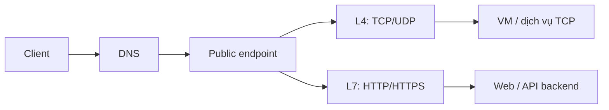
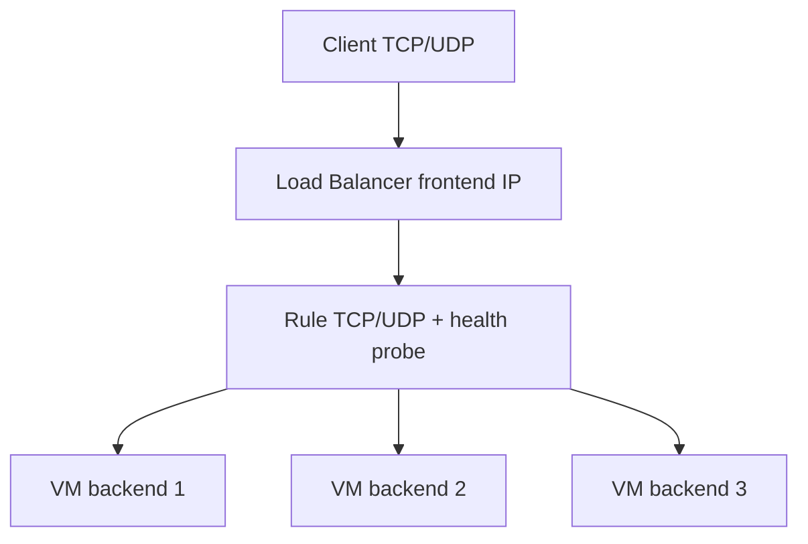
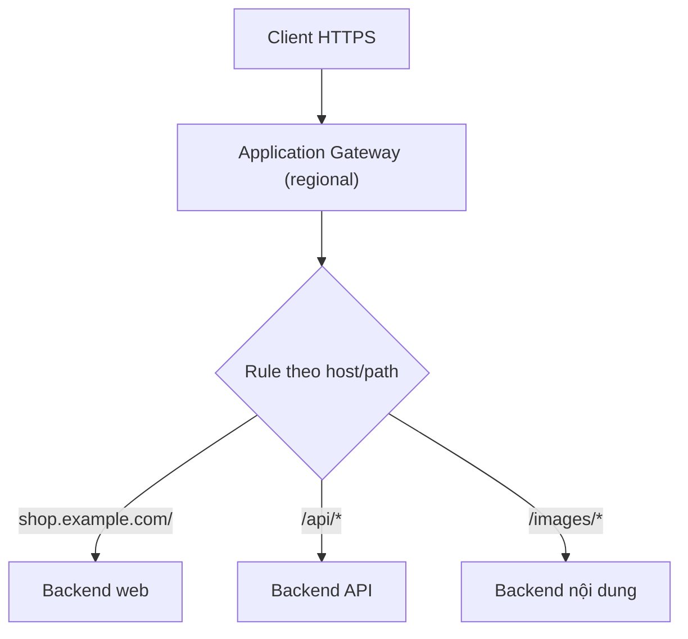
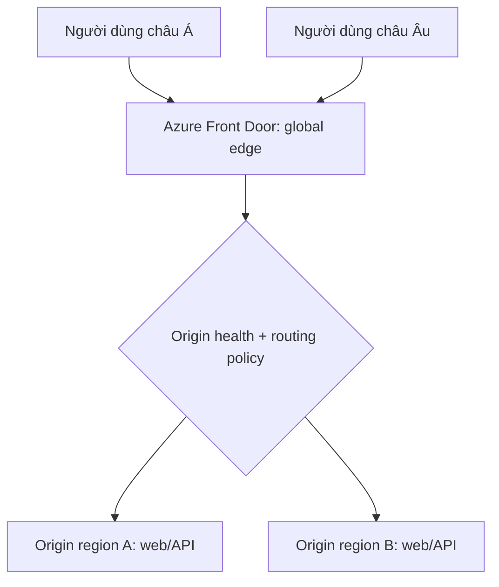
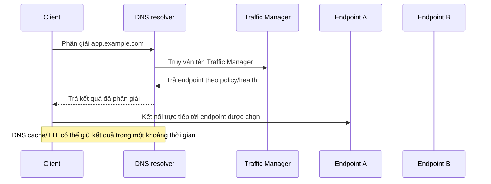
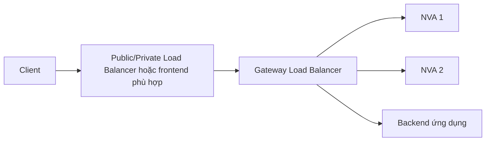
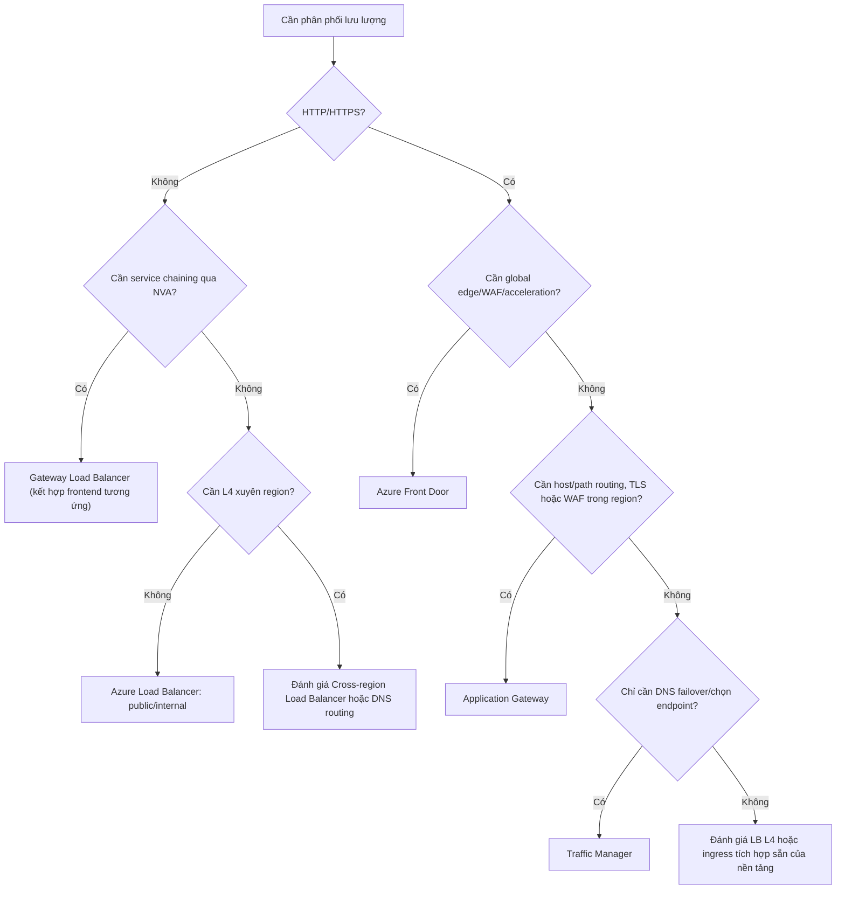
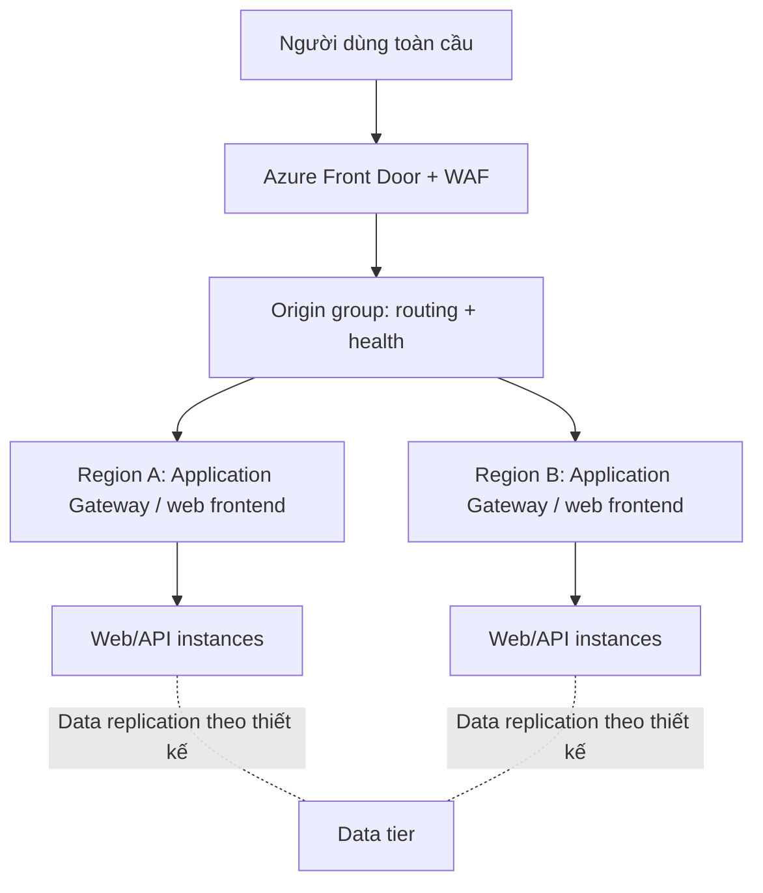
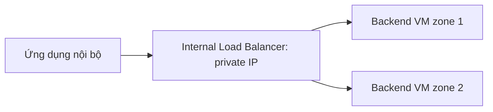
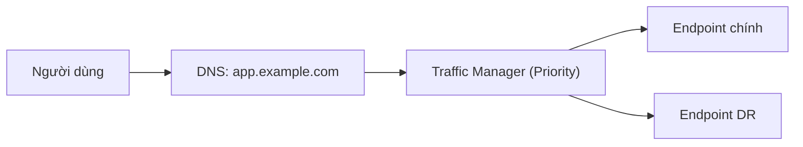

# Lựa chọn dịch vụ phân phối lưu lượng trên Azure

Một ứng dụng có thể cần nhận hàng triệu yêu cầu HTTP từ nhiều quốc gia, một hệ thống nội bộ cần chia kết nối TCP đến các máy chủ trong virtual network, còn nền tảng SaaS cần chuyển người dùng sang khu vực dự phòng khi một region gặp sự cố. Những yêu cầu này đều liên quan đến **phân phối lưu lượng**, nhưng không nên giải quyết bằng cùng một dịch vụ.

Microsoft Azure cung cấp nhiều lựa chọn như **Azure Load Balancer**, **Azure Application Gateway**, **Azure Front Door**, **Azure Traffic Manager** và **Azure Gateway Load Balancer**. Mỗi dịch vụ xử lý lưu lượng ở lớp giao thức, phạm vi địa lý và vị trí trên đường truyền khác nhau. Bài học này giúp lựa chọn đúng công cụ trước khi bắt tay triển khai.

Nội dung thuộc chương **Cân bằng tải và phân phối ứng dụng** trong module `CLOUD_PROVIDERS_AZURE`. Trong hệ sinh thái Azure từ subscription, resource group, Microsoft Entra ID đến mạng ảo, compute, lưu trữ và dữ liệu, quyết định phân phối lưu lượng ảnh hưởng trực tiếp đến khả năng mở rộng, tính sẵn sàng, bảo mật, giám sát và chi phí của toàn bộ kiến trúc ứng dụng.

## Mục tiêu học tập

Sau bài học, bạn có thể:

- Phân biệt phân phối lưu lượng ở **Layer 4**, **Layer 7** và **lớp DNS**, cũng như phân biệt dịch vụ **regional** với **global**.
- Chọn giữa Azure Load Balancer, Application Gateway, Front Door, Traffic Manager và Gateway Load Balancer theo một yêu cầu cụ thể.
- Giải thích vai trò của frontend, backend/origin, listener, routing rule, health probe, failover và TLS/WAF.
- Thiết kế kiến trúc kết hợp nhiều lớp phân phối lưu lượng mà không đặt thừa thành phần.
- Xác định các rủi ro thường gặp như DNS caching, lỗi health probe, route sai, public origin bị truy cập trực tiếp và session state.
- Lập danh sách kiểm thử, giám sát, yêu cầu bảo mật và chi phí trước khi đưa vào production.

## 1. Cùng là phân phối lưu lượng, nhưng ở những lớp khác nhau

Trong mô hình TCP/IP, có nhiều cách quyết định yêu cầu sẽ đi tới đích nào:

- **DNS-based routing:** dịch vụ DNS trả về địa chỉ hoặc tên endpoint thích hợp khi client phân giải tên miền. DNS không trực tiếp nhận và chuyển tiếp từng gói ứng dụng.
- **Layer 4 (L4):** quyết định phân phối dựa trên thông tin mạng/vận chuyển, thường gồm IP, giao thức và cổng TCP/UDP. L4 không cần hiểu URL, HTTP host hay cookie.
- **Layer 7 (L7):** xử lý ở tầng ứng dụng HTTP/HTTPS, có thể xét hostname, path, header hoặc các thuộc tính HTTP; một số dịch vụ còn hỗ trợ TLS termination và Web Application Firewall (WAF).

### Ví dụ trực quan

Giả sử cùng có ba backend phục vụ những nhu cầu khác nhau:

| Yêu cầu đến | Thông tin cần đọc để ra quyết định | Lớp phù hợp |
|---|---|---|
| TCP tới `10.1.2.10:1433` cần chia tải giữa các VM | IP, TCP port, tình trạng backend | L4 |
| `https://shop.example.com/cart` tới dịch vụ giỏ hàng, `/images` tới dịch vụ nội dung | Host, path, HTTPS | L7 |
| Người dùng châu Âu chọn endpoint gần hoặc còn hoạt động | Chính sách chọn endpoint khi phân giải DNS | DNS hoặc global L7, tùy yêu cầu |
| HTTP toàn cầu cần WAF và phản hồi nhanh từ edge | HTTP/TLS, route, origin health, edge acceleration | Global L7 |

**Câu hỏi đầu tiên không phải “dịch vụ nào mạnh nhất?”, mà là “ở lớp nào cần đưa ra quyết định?”** Chẳng hạn, nếu ứng dụng dùng một giao thức TCP tùy chỉnh, dịch vụ chỉ hiểu HTTP không thể thay thế load balancer L4.



Trong thực tế, nhiều lớp có thể được kết hợp. Ví dụ Front Door chọn khu vực ở edge, còn Application Gateway của từng khu vực định tuyến tiếp đến nhóm dịch vụ web.

## 2. Các tiêu chí phải làm rõ trước khi chọn dịch vụ

Trước khi thiết kế, hãy xác nhận sáu nhóm yêu cầu:

1. **Giao thức:** TCP, UDP hay HTTP/HTTPS? Có WebSocket hoặc yêu cầu gắn với kết nối dài không? Có cần xử lý host/path, cookie, header hoặc redirect?
2. **Phạm vi:** chỉ một VNet, một Azure region, nhiều region hay người dùng toàn cầu? Cần tăng tốc tại edge hay chỉ cần failover?
3. **Điểm truy cập:** backend nhận lưu lượng công khai trên Internet hay phải nằm trong mạng riêng? Cần IP frontend nội bộ hay FQDN công khai?
4. **Bảo mật:** cần TLS termination, WAF, DDoS protection, mạng riêng, chứng chỉ tự quản lý hay chính sách giới hạn truy cập vào origin?
5. **Độ sẵn sàng:** cần phân phối đồng thời (active-active), chuyển đổi dự phòng (active-passive), health probing, zone redundancy và mục tiêu khôi phục (RTO/RPO) nào?
6. **Vận hành và chi phí:** mức tải/throughput, lượng kết nối, bandwidth, số rule/route, telemetry, yêu cầu autoscale và chi phí chuyển dữ liệu là bao nhiêu?

Một yêu cầu chưa rõ về giao thức hoặc điểm truy cập dễ dẫn tới lựa chọn sai hơn một khác biệt nhỏ về hiệu năng hay giá.

## 3. Bảng so sánh những dịch vụ cốt lõi

| Dịch vụ | Phạm vi / lớp chính | Điểm nổi bật | Tình huống điển hình |
|---|---|---|---|
| **Azure Load Balancer** | L4 TCP/UDP; thường dùng trong region | Public hoặc internal frontend, phân phối đến backend, health probes | VM/VM Scale Sets, dịch vụ TCP/UDP, cân bằng tải nội bộ |
| **Azure Application Gateway** | Regional L7 HTTP/HTTPS | Listener, host/path routing, TLS termination hoặc end-to-end TLS, WAF tùy SKU | Ứng dụng web/API trong một region cần chính sách HTTP, WAF |
| **Azure Front Door** | Global L7 HTTP/HTTPS tại edge | Global routing, health-based failover, edge acceleration, TLS, CDN/WAF theo cấu hình/tier | Website/API phục vụ nhiều quốc gia hoặc nhiều Azure region |
| **Azure Traffic Manager** | Global DNS-based routing | Chọn endpoint theo priority, performance, weighted và các chính sách khác; DNS failover | Active-passive hoặc lựa chọn endpoint toàn cầu mà không cần proxy HTTP |
| **Azure Gateway Load Balancer** | L3/L4 service chaining | Chèn transparent network virtual appliance vào luồng | Kiến trúc có firewall/NVA/thiết bị kiểm tra lưu lượng |

Không có sản phẩm nào trong bảng tự thay thế tất cả các sản phẩm còn lại. Chẳng hạn, **Load Balancer** có thể là thành phần cần thiết để đưa traffic tới các VM backend, trong khi **Front Door** quyết định người dùng HTTP toàn cầu đi tới region nào.

Một số lựa chọn liên quan:

- **Cross-region Load Balancer** là biến thể cân bằng tải công khai xuyên region ở lớp 4 cho những kịch bản và khu vực được hỗ trợ. Phải kiểm tra yêu cầu về backend, hỗ trợ khu vực và giới hạn tính năng; nó không biến Load Balancer thường thành reverse proxy HTTP toàn cầu.
- **Application Gateway for Containers** là sản phẩm hướng tới cân bằng tải HTTP cho workload container/Kubernetes, với các kiểu tích hợp ingress hoặc Gateway API được hỗ trợ; cần đánh giá riêng khi thiết kế AKS.
- **Azure API Management** giải quyết quản trị API như xác thực, subscription, policies, transformations, rate limiting và developer portal; nó có thể đứng cùng tầng L7 nhưng không phải giải pháp thay thế mặc định cho load balancer.
- **Azure NAT Gateway** thường giải quyết outbound Internet connectivity/SNAT của subnet; nó không phải công cụ phân phối inbound request tới nhóm backend.
- **Azure DNS** lưu trữ và phân giải bản ghi DNS; không đồng nghĩa với các chính sách health-based routing của Traffic Manager.

## 4. Azure Load Balancer: lựa chọn L4 cho TCP và UDP

**Azure Load Balancer** nhận lưu lượng tới frontend IP và phân phối tới các backend khỏe mạnh trong backend pool theo cấu hình rule. Đây là thành phần phù hợp khi lưu lượng không cần hiểu cấu trúc HTTP.

### Thành phần chính

- **Frontend IP configuration:** địa chỉ IP công khai (public Load Balancer) hoặc IP riêng thuộc VNet (internal Load Balancer).
- **Backend pool:** các backend được liên kết theo mô hình hỗ trợ, chẳng hạn NIC hoặc IP backend phù hợp.
- **Load-balancing rule:** ánh xạ frontend protocol/port tới backend protocol/port.
- **Health probe:** kiểm tra một dịch vụ hoặc cổng trên backend; backend không khỏe sẽ không được chọn cho những luồng mới theo cơ chế dịch vụ.
- **Inbound NAT rule:** khi cần chuyển kết nối quản trị hoặc kết nối cụ thể tới một backend, có mục đích khác với quy tắc chia tải chung.
- **Outbound connectivity:** cần thiết kế SNAT/egress rõ ràng; không nên giả định cứ có public load balancer là mọi backend luôn có đường outbound mặc định đáp ứng yêu cầu.



Ví dụ, ba VM nhận TCP/443 có thể được đặt sau public hoặc internal Load Balancer. Load Balancer có thể phân phối lưu lượng TCP nhưng **không** tự đọc đường dẫn `/api`, không làm WAF HTTP và không tự chấm dứt TLS như reverse proxy L7.

### Cách phân phối và giới hạn

Các quy tắc L4 thường dùng thông tin của luồng mạng để xác định backend. Vì một kết nối TCP phải duy trì nhất quán tới backend của nó, việc bổ sung hoặc loại một backend không đồng nghĩa các kết nối đang sống được di chuyển vô gián đoạn. Health probe chỉ đánh giá tiêu chí đã cấu hình, không đảm bảo toàn bộ nghiệp vụ ứng dụng khỏe mạnh.

**Khi chọn Load Balancer:** ứng dụng cần cân bằng tải TCP/UDP, frontend IP ổn định, backends là VM/VMSS hoặc workload được hỗ trợ, và không yêu cầu L7 path routing/WAF tại chính tầng này.

**Khi không đủ:** website cần điều hướng theo host/path, bảo vệ WAF, cache tại edge hoặc routing HTTP đa vùng. Có thể bổ sung Application Gateway/Front Door tùy thiết kế.

### Public hay internal?

| Thiết kế | Trường hợp sử dụng | Lưu ý |
|---|---|---|
| **Public Load Balancer** | Dịch vụ cần frontend IP công khai; client từ Internet kết nối TCP/UDP | NSG, DDoS, TLS tại backend, quy tắc inbound và public exposure |
| **Internal Load Balancer** | Dịch vụ giữa các subnet/VNet hoặc qua kết nối hybrid | Frontend private IP, route và DNS nội bộ; không tự công bố endpoint ra Internet |

Với traffic nội bộ, thường nên bắt đầu từ **internal Load Balancer** để tránh tăng bề mặt public exposure không cần thiết.

## 5. Azure Application Gateway: phân phối web ở cấp region

**Application Gateway** là L7 reverse proxy cho HTTP/HTTPS. Nó phù hợp khi ứng dụng web được tổ chức thành nhiều backend và cần điều hướng theo quy tắc HTTP.

### Những khả năng quan trọng

- **Listener và routing rule:** xác định hostname, protocol, port, kết hợp basic hoặc path-based routing.
- **Backend pool:** nhóm đích ứng dụng được hỗ trợ, như VM, IP/FQDN, dịch vụ web hoặc backend kết nối được.
- **Backend HTTP settings:** quy định cách Application Gateway kết nối tiếp đến backend, bao gồm protocol, port và các cài đặt liên quan.
- **TLS:** có thể kết thúc HTTPS ở gateway và kết nối lại đến backend qua HTTP/HTTPS theo thiết kế; dùng end-to-end TLS khi cần mã hóa cả hai chặng.
- **Web Application Firewall:** với SKU/cấu hình WAF thích hợp, hỗ trợ kiểm tra lưu lượng HTTP theo quy tắc ứng dụng web.
- **Health probes:** có thể kiểm tra HTTP/HTTPS endpoint cụ thể, nhất là `/health` hoặc `/ready` và hostname phù hợp.
- **Host/path routing:** đưa `api.example.com` sang API, `shop.example.com` sang web frontend; hoặc `/api/*` và `/static/*` sang backend khác nhau.



Ứng dụng có thể sử dụng **frontend public hoặc private** tùy SKU, thiết kế và khả năng hỗ trợ. Gateway thường được triển khai vào subnet riêng theo yêu cầu dịch vụ; cần quy hoạch IP, route và NSG để không chặn hoạt động của gateway.

### Health probe và lỗi 502

Một lỗi thường gặp là backend chạy ổn khi gọi trực tiếp nhưng gateway báo unhealthy hoặc trả HTTP `502 Bad Gateway`. Nguyên nhân có thể gồm:

- Probe tới sai path hoặc backend trả status không được coi là healthy.
- HTTP host header hoặc SNI không khớp với cấu hình backend.
- Gateway không kết nối được đến backend do NSG, route, DNS hoặc tường lửa.
- Chứng chỉ của backend không hợp lệ cho cấu hình HTTPS end-to-end.
- Ứng dụng đã chạy process nhưng endpoint readiness chưa sẵn sàng.

Khi dùng nhiều site, phải đồng bộ **hostname, certificate, backend protocol/port và custom probe**. Một rule L7 đúng đường dẫn chưa đủ nếu probe đánh giá sai trạng thái ứng dụng.

### Application Gateway so với Load Balancer

Application Gateway phù hợp với HTTP/HTTPS cần route theo nội dung, WAF và TLS. Azure Load Balancer phù hợp với TCP/UDP và frontend IP đơn giản. Một nền tảng có cả web và dịch vụ TCP nội bộ có thể dùng **cả hai** ở các nhánh lưu lượng khác nhau.

## 6. Azure Front Door: phân phối web toàn cầu tại edge

**Azure Front Door** là dịch vụ phân phối ứng dụng HTTP/HTTPS toàn cầu, nhận yêu cầu tại mạng edge của Microsoft và định tuyến về các **origin** theo cấu hình routing/health. Đây là ứng viên chủ đạo khi sản phẩm phục vụ nhiều khu vực địa lý và cần cải thiện độ trễ, khả năng phục hồi hoặc bảo vệ ứng dụng ở gần người dùng.

### Thành phần thường gặp

- **Endpoint và custom domain:** tên miền mà client truy cập; chứng chỉ TLS ở frontend edge.
- **Route:** ánh xạ domain/path/protocol sang origin group và các chính sách giao nhận.
- **Origin group:** nhóm backend/origin, có cấu hình cân bằng tải, ưu tiên, độ trễ và health probe theo khả năng dịch vụ.
- **Origin:** endpoint web/API đặt ở một hoặc nhiều region hay nơi lưu trữ phù hợp.
- **Rules engine/rule sets:** các quyết định điều hướng và xử lý HTTP theo chức năng được hỗ trợ.
- **WAF, CDN/caching và các tính năng bảo mật:** tùy tier, cấu hình và khả năng hỗ trợ cụ thể.



**Front Door là reverse proxy HTTP/HTTPS**, không phải tuyến cân bằng tải cho mọi giao thức TCP hoặc UDP tùy ý. Nếu hệ thống cần raw TCP/UDP xuyên region, phải xem các giải pháp L4 và phạm vi hỗ trợ tương ứng.

### Vì sao Front Door phù hợp ứng dụng toàn cầu?

- Client kết nối đến edge phù hợp, từ đó traffic được chuyển qua cơ chế mạng của dịch vụ tới origin.
- Có khả năng phân phối giữa nhiều origin và ngừng chọn origin không khỏe theo cấu hình.
- Có thể kết hợp quản trị TLS, WAF và caching/acceleration cho nội dung HTTP theo nhu cầu.
- Có thể thiết kế global entry point nhất quán khi triển khai nhiều region Azure.

**Điểm cần kiểm tra:** các tier (ví dụ Standard/Premium) có khác biệt tính năng, hỗ trợ origin riêng qua **Private Link** cho những kịch bản được hỗ trợ và điều kiện phê duyệt kết nối. Không mặc định rằng Front Door có thể tự kết nối tới mọi private IP trong VNet. Nếu backend phải giữ riêng tư, hãy đối chiếu đúng kiểu origin, tier, tính năng Private Link và mô hình kết nối được dịch vụ hỗ trợ.

### Health và failover

Front Door đánh giá origin thông qua health probe và các tín hiệu chọn route phù hợp. Tuy nhiên, **failover thành công ở tầng edge không tự bảo đảm dữ liệu ứng dụng đã đồng bộ giữa hai region**. Nếu region B không có dữ liệu phiên, database replica còn chậm hoặc môi trường mới chưa được warm up, người dùng vẫn có thể gặp lỗi dù endpoint B được coi là healthy.

Đối với ứng dụng nhiều region, phải thiết kế kèm dữ liệu, state, session, secrets, DNS phụ trợ và khả năng tự mở rộng ở region dự phòng.

## 7. Azure Traffic Manager: chọn endpoint qua DNS

**Azure Traffic Manager** sử dụng DNS để điều hướng client đến endpoint theo phương pháp routing đã cấu hình, ví dụ:

- **Priority:** ưu tiên endpoint chính; chuyển sang endpoint dự phòng khi endpoint chính không đạt điều kiện health.
- **Performance:** chọn endpoint theo dữ liệu/đặc tính mạng mà dịch vụ sử dụng để dự đoán độ trễ; không đảm bảo luôn là địa điểm gần nhất theo địa lý.
- **Weighted:** phân chia xác suất trả về endpoint theo trọng số, hữu ích khi chuyển dịch hoặc phân bổ một phần traffic.
- **Geographic:** phân phối theo phạm vi địa lý được cấu hình.
- Các phương pháp khác như **Subnet** và **Multivalue** tùy loại endpoint và trường hợp sử dụng.

Traffic Manager có thể giám sát endpoint được cấu hình qua health probe theo giao thức hỗ trợ và điều chỉnh câu trả lời DNS. Sau khi client nhận được endpoint, **lưu lượng ứng dụng đi thẳng tới endpoint đó**; Traffic Manager không phải reverse proxy nhận từng HTTP request.



### Ưu và nhược điểm của DNS failover

**Ưu điểm:** không phải nhận và proxy mọi request; có thể điều hướng giữa các endpoint công khai ở Azure hoặc nơi khác theo cơ chế DNS, dùng cho nhiều loại ứng dụng miễn là endpoint và health monitor được hỗ trợ.

**Giới hạn:** DNS resolver và client có thể cache kết quả theo TTL hoặc lâu hơn; chuyển trạng thái endpoint không ép tất cả client đổi đích ngay lập tức. Các kết nối hiện tại không tự di chuyển sang endpoint mới. DNS routing cũng không cung cấp HTTP path routing, WAF hay TLS termination.

Với chính sách performance, thông tin địa chỉ dùng cho quyết định DNS có thể liên quan recursive resolver hoặc các cơ chế hỗ trợ; không nên mặc định lựa chọn chính xác cho vị trí thực của từng thiết bị đầu cuối.

### Khi nào chọn Traffic Manager thay Front Door?

Chọn **Traffic Manager** khi mục tiêu chính là **chọn endpoint qua DNS**, muốn điều hướng những ứng dụng hoặc nền tảng không cần HTTP reverse proxy, hoặc cần phương án routing toàn cầu có backend công khai đa nhà cung cấp. Chọn **Front Door** khi cần **global HTTP reverse proxy**, acceleration tại edge, tích hợp WAF/routing HTTP/caching và một entry point trải nghiệm web.

Đôi khi chúng cùng có thể đáp ứng bài toán multi-region HTTP, nhưng bản chất phân phối và giới hạn failover khác nhau. Không nên đặt cả hai chỉ để “có hai tầng dự phòng” khi chưa có yêu cầu và cách đo hiệu quả rõ ràng.

## 8. Azure Gateway Load Balancer: chèn thiết bị mạng vào luồng

**Azure Gateway Load Balancer** phục vụ kịch bản **service chaining** với network virtual appliances (NVA), ví dụ các thiết bị kiểm tra và xử lý lưu lượng như firewall của nhà cung cấp bên thứ ba. Nó giúp đưa traffic qua các appliance có khả năng mở rộng và vận hành theo thiết kế kết nối được hỗ trợ.



Sơ đồ thể hiện **mục tiêu service chaining**, không phải chi tiết gói tin qua các tunnel hoặc tất cả hình thức triển khai được hỗ trợ. Gateway Load Balancer có các yêu cầu về virtual network, backend NVA và chaining cụ thể.

Không chọn Gateway Load Balancer cho ứng dụng web chỉ cần chia HTTP request giữa các backend. Nếu mục tiêu là bảo vệ OWASP ở lớp ứng dụng web, một gateway/edge có **WAF** thường phù hợp hơn việc đưa một NVA vào sơ đồ mà không có yêu cầu kiểm soát lưu lượng mạng cụ thể.

## 9. Cây quyết định chọn dịch vụ

Bắt đầu từ giao thức, phạm vi và yêu cầu xử lý:



Cây quyết định là khung tham khảo, không phải danh sách quy tắc tuyệt đối. Trong thực tế, **Front Door và Application Gateway có thể kết hợp**, còn **Traffic Manager có thể chọn giữa các frontend đã có sẵn**. Kết quả cuối cùng phải được xác nhận bằng tài liệu tính năng và khả năng hỗ trợ trong vùng/SKU đã chọn.

### Bảng lựa chọn nhanh

| Nếu yêu cầu của bạn là… | Điểm khởi đầu hợp lý | Vì sao |
|---|---|---|
| VM nội bộ phục vụ TCP/1433 qua private IP | **Internal Load Balancer** | L4, private frontend |
| Dịch vụ UDP trên nhiều VM | **Azure Load Balancer** | Hỗ trợ giao thức L4; L7 web gateway không phù hợp |
| Web trong một region có `/api` và `/static` | **Application Gateway** | Routing theo path, TLS và tùy chọn WAF |
| Web toàn cầu, nhiều region, cần WAF tại edge | **Front Door** | Global L7 và origin health/routing |
| Multi-region active-passive chỉ cần DNS endpoint failover | **Traffic Manager** | DNS priority và health monitor |
| Tổ chức phải đưa inbound qua cụm NVA | **Gateway Load Balancer** kết hợp frontend phù hợp | Chaining, bảo toàn mục tiêu kiểm tra lưu lượng |
| AKS cần ingress ở L7 | **Ingress/Gateway API hoặc giải pháp Application Gateway dành cho container**, đánh giá theo mô hình AKS | Tối ưu tích hợp cụ thể với Kubernetes |
| API cần quota, subscription key, product và versioning | **API Management** kết hợp gateway/edge nếu cần | API governance khác load balancing |

## 10. Ba kiến trúc tham chiếu

### Kiến trúc A: trang thương mại điện tử phục vụ nhiều quốc gia

Yêu cầu:

- Khách hàng ở nhiều lục địa, lưu lượng HTTP/HTTPS.
- Cần chống tấn công phổ biến ở lớp web, TLS, domain thống nhất.
- Có hai bản triển khai ứng dụng ở hai region Azure.
- Region dự phòng cần nhận traffic khi origin chính không khỏe.

Kiến trúc:



Front Door là **global entry point**. Mỗi region có thể dùng Application Gateway nếu thật sự cần thêm routing/WAF hoặc lớp quản trị HTTP địa phương; nếu origin web/API đã hỗ trợ đủ chức năng và đáp ứng yêu cầu an toàn, có thể loại bỏ tầng trung gian để giảm độ phức tạp và chi phí.

Phải xác định cách bảo vệ origin: cấu hình private origin/Private Link **khi tier và loại origin hỗ trợ**, hoặc hạn chế tiếp nhận traffic chỉ từ nguồn được phép theo giải pháp phù hợp; không để backend public bỏ qua WAF do vô tình mở trực tiếp.

**Điểm khó nằm ở dữ liệu:** cân bằng tải không tự đồng bộ phiên, giỏ hàng, kho tồn, database hay hàng đợi. Cần thiết kế state và failover cho dữ liệu trước khi coi ứng dụng là multi-region thực sự.

### Kiến trúc B: dịch vụ TCP nội bộ trong một region

Yêu cầu:

- Các backend chạy trên VM trong hai availability zone được hỗ trợ.
- Client là ứng dụng nội bộ trong VNet hoặc qua kết nối hybrid.
- Giao thức TCP, không cần URL path routing hay WAF.



Đây là trường hợp điển hình cho **Internal Load Balancer**. Cần health probes, NSG, private DNS, route phù hợp và kiểm tra ứng dụng không phụ thuộc session chỉ tồn tại trên một VM. Khi cần an toàn outbound, đánh giá NAT Gateway hoặc cơ chế egress riêng; inbound Load Balancer không tự giải quyết mọi yêu cầu outbound.

### Kiến trúc C: failover giữa hai endpoint web do hai nhà cung cấp vận hành

Yêu cầu:

- Website công khai hoạt động ở một endpoint chính và một endpoint DR.
- Hai endpoint có thể nằm trên các nền tảng khác nhau.
- Tổ chức muốn route theo DNS priority; không có yêu cầu WAF/caching ở tầng điều phối.



Traffic Manager phù hợp nếu endpoint và health monitoring tương thích. Phải dự kiến DNS TTL/caching, cấu hình HTTPS/chứng chỉ ở **mỗi endpoint**, duy trì dữ liệu/phiên ở site DR và diễn tập theo mục tiêu RTO. Không hứa chuyển đổi ngay lập tức cho mọi client khi endpoint chính ngừng hoạt động.

## 11. Health probe, khả năng phục hồi và session state

Một load balancer chỉ có thể đưa ra quyết định tốt nếu **tín hiệu sức khỏe của backend phản ánh khả năng phục vụ thực tế**.

### Thiết kế health endpoint

Với web/API, một endpoint như `GET /health/ready` có thể được thiết kế để:

- Trả HTTP `200` khi instance sẵn sàng nhận request.
- Trả HTTP `503` khi instance chưa khởi động hoàn tất hoặc cần tạm rút khỏi pool.
- Phản ánh các dependency quan trọng ở mức cân đối, tránh mỗi probe gây tải lớn lên database.
- Không yêu cầu đăng nhập tương tác, vì health probe thường là yêu cầu từ nền tảng theo cơ chế riêng.
- Không tiết lộ dữ liệu nội bộ, token hoặc thông tin nhạy cảm cho nơi gọi không tin cậy.

```http
GET /health/ready HTTP/1.1
Host: api.example.com

HTTP/1.1 200 OK
Content-Type: application/json

{"status":"ready"}
```

Đây là minh họa giao thức, không phải cấu hình probe mặc định của mọi dịch vụ. **Azure Load Balancer ở L4** có thể dùng TCP hoặc HTTP/HTTPS probe theo khả năng hỗ trợ; **Application Gateway/Front Door** có khả năng probe HTTP/HTTPS với những quy tắc riêng. Hãy khớp path, host, protocol, port, khoảng thời gian và threshold với dịch vụ thực tế.

### Failover không thay thế thiết kế HA/DR

| Yêu cầu | Phân phối lưu lượng có thể giúp gì? | Phần cần giải quyết bổ sung |
|---|---|---|
| Một VM lỗi | Ngừng đưa luồng mới đến backend unhealthy theo health policy | Tăng số instance, autoscaling, state và retry |
| Một availability zone gặp sự cố | Phân phối qua các backend/zone được hỗ trợ | Quy hoạch zone redundancy của frontend, backend và dữ liệu |
| Một region mất khả năng phục vụ | Front Door hoặc Traffic Manager có thể chuyển người dùng theo cơ chế tương ứng | Replication, DB failover, secrets, capacity region dự phòng, RTO/RPO |
| Một phiên người dùng đang xử lý | Affinity có thể giữ một số luồng/phiên theo cơ chế hỗ trợ | Session state bên ngoài instance, idempotency, retry và graceful draining |
| Health probe sai | Có thể loại backend khỏe hoặc nhận backend lỗi | Thiết kế và kiểm thử endpoint readiness |

Không nên kỳ vọng **sticky session/cookie affinity** giải quyết triệt để vấn đề state. Khi backend lỗi hoặc region failover, session tại bộ nhớ cục bộ vẫn có thể mất. Ứng dụng quan trọng nên cân nhắc lưu session/state ở tầng dùng chung hoặc thiết kế stateless.

## 12. Bảo mật khi phân phối lưu lượng

### TLS và chứng chỉ

Với HTTP/HTTPS ở L7, phải biết TLS kết thúc ở đâu:

1. **Client → gateway/edge:** bảo vệ bằng TLS, chọn domain và chứng chỉ hợp lệ.
2. **Gateway/edge → origin/backend:** có thể tiếp tục HTTPS để mã hóa end-to-end, kiểm tra hostname và chứng chỉ theo cài đặt được hỗ trợ.
3. **Backend → dịch vụ khác:** cần TLS/mTLS hoặc cơ chế an toàn riêng; load balancer không tự bảo vệ tất cả các hop.

Ở L4 Load Balancer, TLS thông thường kết thúc tại ứng dụng/backend hoặc thành phần riêng. Không gán khả năng WAF/TLS termination cho L4 chỉ vì nó chuyển TCP/443.

### WAF, DDoS và bảo vệ origin

- **WAF** trên Application Gateway hoặc Front Door (khi cấu hình và tier hỗ trợ) kiểm tra traffic web theo chính sách HTTP. Phải quản lý rule, exceptions, false positives, logs và chế độ Detection/Prevention phù hợp.
- **DDoS protection** ở lớp mạng/edge là lớp phòng thủ khác WAF. Không coi WAF là giải pháp duy nhất cho mọi loại DDoS hoặc cho UDP/TCP volumetric attacks.
- **Origin lockdown**: khi đã dùng gateway/edge làm điểm vào chính thức, giới hạn khả năng truy cập trực tiếp tới backend bằng private connectivity hoặc kiểm soát nguồn/host phù hợp.
- **NSG, firewall và Azure Policy** vẫn cần được áp dụng ở đúng phạm vi; việc có load balancer không tự tạo các quyền truy cập an toàn.
- **Managed identity/Key Vault** hỗ trợ quản lý bí mật và chứng chỉ ở các tích hợp phù hợp; không đưa private key hoặc secret vào template hay log.

### Quyền quản trị

Nhân viên vận hành cần quyền quản trị tài nguyên phân phối lưu lượng ở scope phù hợp. Việc chỉnh một route, WAF rule, TLS certificate hay backend pool có thể làm gián đoạn dịch vụ toàn bộ khách hàng; cần phân tách quyền, ghi audit trail và quản lý thay đổi qua IaC/pipeline theo quy trình tổ chức.

## 13. Quan sát hoạt động và khắc phục sự cố

Mỗi tầng cần telemetry riêng. Nếu chỉ đo CPU của VM thì sẽ khó biết một lỗi đến từ DNS, Front Door, Application Gateway, NSG hay backend.

| Tầng | Tín hiệu cần theo dõi | Câu hỏi cần trả lời khi xảy ra lỗi |
|---|---|---|
| Traffic Manager | Trạng thái endpoint/probe, cấu hình DNS, thời điểm thay đổi | DNS đang chọn endpoint nào? TTL/cache còn giữ kết quả cũ không? |
| Front Door | Request count, latency, response status, origin health, WAF logs | Edge có tiếp cận origin không? Request bị chặn hay origin trả lỗi? |
| Application Gateway | Backend health, failed requests, HTTP status, access/WAF logs | Listener/rule/probe có đúng host, path, cert và port không? |
| Load Balancer | Data path/health probes, metrics liên quan và backend configuration | Backend nào unhealthy? Rule, NSG hay listener có vấn đề? |
| Backend | Readiness, application logs, CPU/memory, dependency health | Ứng dụng có thực sự phục vụ request? |
| Kết nối mạng | DNS, NSG flow/route, firewall logs, Network Watcher | Traffic bị chặn, định tuyến sai hay đích không lắng nghe? |

### Tình huống: trả về HTTP 502 qua Application Gateway

Đừng mặc định rằng gateway có lỗi dịch vụ. Cách điều tra:

1. Kiểm tra **Backend health** xem instance có `Healthy` hay `Unhealthy`.
2. Kiểm tra custom health probe và HTTP backend settings: scheme, port, path, host/SNI và certificate.
3. Kiểm tra DNS, NSG, route từ subnet gateway tới backend.
4. Gọi backend trực tiếp từ môi trường có quyền để xác định application process và response.
5. Đối chiếu access logs với thời gian lỗi; sửa đúng nguyên nhân rồi kiểm tra lại.

### Tình huống: người dùng vẫn vào region lỗi sau khi Traffic Manager failover

Kiểm tra endpoint health và routing policy, sau đó xem DNS TTL, recursive resolver caching và client caching. Một số client có thể tiếp tục dùng IP/địa chỉ đã phân giải trước đó trong thời gian nhất định. Cần diễn tập với DNS thực tế và đo RTO thay vì dựa vào một con số TTL như cam kết chuyển đổi tuyệt đối.

### Tình huống: Front Door healthy nhưng ứng dụng vẫn chậm

Health probe có thể đủ điều kiện thành công trong khi endpoint nghiệp vụ gọi database bị chậm. Đối chiếu latency từng chặng, origin metrics, database performance, caching/rules và tải thực tế. Cần đo **end-to-end latency** thay vì chỉ nhìn trạng thái origin.

## 14. Azure CLI để nhận diện tài nguyên và kiểm tra cấu hình

Các ví dụ dưới đây dùng Azure CLI theo hướng **đọc trạng thái hiện có**. Đăng nhập đúng tenant/subscription và thay tên resource group/tài nguyên; không cần tạo tài nguyên chỉ để xem thông tin.

### Xác nhận subscription

```bash
az login
az account set --subscription "<subscription-id>"
az account show --query "{id:id,name:name,tenant:tenantId}" -o json
```

### Azure Load Balancer

```bash
az network lb list \
  --resource-group "rg-network-prod" \
  --query "[].{name:name,sku:sku.name,location:location}" \
  --output table

az network lb probe list \
  --resource-group "rg-network-prod" \
  --lb-name "lb-internal-prod" \
  --output table

az network lb rule list \
  --resource-group "rg-network-prod" \
  --lb-name "lb-internal-prod" \
  --output table
```

Đối chiếu frontend IP, backend pool, load-balancing rules và health probes. Với internal Load Balancer, kiểm tra frontend private IP và các NSG/route liên quan trước khi kết luận không thể truy cập.

### Application Gateway

```bash
az network application-gateway list \
  --resource-group "rg-network-prod" \
  --query "[].{name:name,location:location,sku:sku.name}" \
  --output table

az network application-gateway show-backend-health \
  --resource-group "rg-network-prod" \
  --name "agw-web-prod" \
  --output json
```

Nếu backend bị đánh dấu unhealthy, so sánh probe/backend settings với endpoint thực tế.

### Azure Front Door Standard/Premium và Traffic Manager

```bash
az afd profile list \
  --resource-group "rg-edge-prod" \
  --output table

az afd endpoint list \
  --resource-group "rg-edge-prod" \
  --profile-name "afd-global-prod" \
  --output table

az network traffic-manager profile list \
  --resource-group "rg-edge-prod" \
  --output table
```

Các nhóm lệnh/tính năng có thể phụ thuộc phiên bản Azure CLI và extension được cài đặt. Azure Front Door có các mô hình tài nguyên/CLI theo thế hệ sản phẩm; dùng đúng nhóm lệnh cho tài nguyên thực tế. Khi cú pháp khác trên môi trường đang dùng, kiểm tra `az afd -h` hoặc trợ giúp của nhóm lệnh tương ứng thay vì tự suy đoán property.

### Minh họa kiểm tra hoạt động từ phía người dùng

```bash
# Kiểm tra HTTP response, certificate và độ trễ tổng thể
curl -I https://app.example.com/

# Kiểm tra tên miền được phân giải ra đâu
nslookup app.example.com
```

Lệnh `curl -I` gửi phương thức HEAD; nếu ứng dụng không hỗ trợ HEAD, hãy dùng yêu cầu GET/health phù hợp. Để chẩn đoán chính xác hơn, ghi lại HTTP status, endpoint, thời điểm và mã lỗi thay vì chỉ nhìn một lần thành công.

## 15. Chọn theo chi phí và độ phức tạp thực tế

Không có bảng giá duy nhất áp dụng cho mọi kiến trúc. Chi phí phụ thuộc SKU/tier, công suất, số request hoặc rule, dữ liệu truyền, region, WAF, logging, caching và các tính năng tích hợp.

| Lựa chọn | Nhóm chi phí cần xem | Rủi ro “chi phí ẩn” |
|---|---|---|
| Load Balancer | Tài nguyên/rule/data processed theo bảng giá hiện hành, public IP và networking liên quan | SNAT/egress, outbound connectivity, VM backend |
| Application Gateway | Capacity/instance, dữ liệu xử lý, WAF và telemetry theo SKU | Autoscaling chưa tối ưu, WAF logs, TLS certificate management |
| Front Door | Request, edge data transfer, routing, WAF/caching/Private Link theo tier | Phí truyền dữ liệu, origin egress, log ingestion, cache miss |
| Traffic Manager | DNS queries, health monitoring/endpoints theo chính sách giá | DNS cache làm failover chậm, phải vận hành hai hạ tầng endpoint |
| Gateway Load Balancer | GWLB và các NVA/compute/license liên quan | NVA throughput, packet processing, vận hành thiết bị |

Ngoài phí dịch vụ phân phối, cần cộng:

- Backend compute, storage, database và replication nhiều region.
- Data transfer giữa region, từ origin ra edge, ra Internet hoặc qua kết nối hybrid.
- Log Analytics/storage retention, metrics, alerting và bảo vệ DDoS/WAF.
- Hạ tầng dự phòng phải duy trì chạy, cold start/warm-up và nhân lực vận hành.

**Quy tắc thực hành:** chọn số lớp ít nhất đáp ứng được yêu cầu đã xác định và vẫn có điểm kiểm soát an toàn. Mỗi proxy/gateway thêm vào đều có cấu hình chứng chỉ, health probe, định tuyến và chi phí riêng cần giám sát.

## 16. Bài thực hành: lập quyết định kiến trúc cho ba workload

Bạn là kiến trúc sư phụ trách một subscription Azure. Hãy dùng bảng sau để chọn tầng phân phối **phù hợp với nhu cầu**, đồng thời ghi nhận điều kiện phải kiểm chứng trước khi triển khai.

| Workload | Yêu cầu | Phương án xuất phát | Điều phải kiểm thử |
|---|---|---|---|
| **A. Dịch vụ TCP nội bộ** | VM ở một region, client chỉ từ VNet, cổng TCP/9092 | Internal Load Balancer | TCP health, NSG/route, lỗi VM backend, session và kết nối dài |
| **B. Web/API đa region** | HTTPS công khai, WAF, phục vụ nhiều quốc gia, failover | Front Door; có thể kết hợp regional gateway nếu cần | TLS, custom domain, origin health, origin lockdown, state/data failover |
| **C. Hai endpoint công khai độc lập** | Active-passive giữa hai nhà cung cấp, routing qua DNS | Traffic Manager Priority | Endpoint monitor, TTL/cache, DNS hostname, chứng chỉ ở cả hai endpoint |

### Các bước thực hành đề xuất

1. **Viết yêu cầu có thể đo:** protocol, frontend public/private, các route, health tiêu chí, RTO/RPO và traffic profile.
2. **Vẽ đường đi client → entry point → backend** với các subnet, firewall/WAF, TLS termination và vùng triển khai.
3. **Liệt kê một phương án thay thế:** ví dụ Front Door so với Traffic Manager ở workload B/C; nêu điểm khác nhau về reverse proxy và DNS.
4. **Xác định health signal:** với API hãy dùng endpoint readiness thích hợp; với TCP hãy kiểm tra listener và logic kiểm tra tương ứng.
5. **Đánh giá rủi ro bảo mật:** public origin có thể bị truy cập trực tiếp không? Frontend TLS được quản lý thế nào? Có cần WAF hay chính sách nội bộ không?
6. **Lập kế hoạch thử nghiệm failover:** rút một backend test khỏi pool hoặc thay đổi trạng thái test endpoint trong môi trường lab, quan sát thời gian phát hiện và phục hồi; không tắt tài nguyên production để thử ngẫu nhiên.
7. **Ước lượng tổng chi phí:** đưa vào backend dự phòng, edge, networking, logging và data transfer.
8. **Ghi nhận quyết định:** dịch vụ được chọn, giả định, phương án bỏ qua, điều kiện chấp nhận và người chịu trách nhiệm vận hành.

Ví dụ mẫu bản ghi quyết định:

```text
Workload: API khách hàng đa region
Giao thức: HTTPS
Frontend: Public custom domain
Nhu cầu: Global routing, WAF, origin failover
Lựa chọn: Azure Front Door
Origin: Region A (active), Region B (standby/active theo SLO)
Health: /health/ready + kiểm tra end-to-end theo lịch
Bảo mật: TLS frontend/backend, WAF policy, hạn chế direct origin access
Phụ thuộc: Data replication, secrets và session strategy
Tiêu chí chấp nhận: Lỗi backend/region được phát hiện và chuyển hướng
                      trong RTO đã kiểm chứng qua diễn tập
Giám sát: Request status/latency, origin health, WAF, backend logs
```

## 17. Các nhầm lẫn dễ gặp

**“Traffic Manager giống Front Door vì đều định tuyến toàn cầu.”** Cả hai có thể chọn vùng/endpoint, nhưng Traffic Manager trả lời DNS, còn Front Door nhận và proxy HTTP/HTTPS ở edge.

**“Load Balancer nhìn thấy TCP/443 nên có thể chọn backend theo URL.”** L4 thấy giao thức/cổng và thông tin luồng, không xử lý đường dẫn HTTP. Muốn định tuyến theo `/api` hay hostname, cần giải pháp L7.

**“Application Gateway đặt trong một region đồng nghĩa có DR toàn cầu.”** Không. Để xử lý sự cố region cần thiết kế entry point đa vùng, backend dự phòng và dữ liệu/phiên tương ứng.

**“Health probe xanh có nghĩa tất cả request chắc chắn thành công.”** Probe chỉ chứng minh điều kiện cụ thể tại một thời điểm. Business transaction vẫn có thể lỗi do auth, database hoặc dependencies khác.

**“Bật WAF là đã an toàn toàn bộ hệ thống.”** WAF xử lý một lớp rủi ro HTTP; còn cần TLS, IAM, NSG, bảo vệ origin, DDoS, vá lỗi và giám sát.

**“Có nhiều gateway hơn luôn tốt hơn.”** Mỗi tầng bổ sung tăng khả năng kiểm soát ở một số khía cạnh nhưng cũng thêm điểm cấu hình, telemetry, latency và chi phí. Chỉ thêm khi có yêu cầu xác định.

**“DNS failover chuyển mọi kết nối đang mở ngay lập tức.”** DNS caching và kết nối đã thiết lập khiến quá trình chuyển đổi có độ trễ và hành vi phụ thuộc client.

## 18. Câu hỏi tự kiểm tra

**Câu 1.** Một ứng dụng nội bộ dùng TCP/9000 trên nhiều VM, không cần đọc URL. Dịch vụ nào phù hợp?

**Đáp án:** Azure Load Balancer dạng internal nếu client chỉ truy cập từ mạng riêng. Thiết kế health probe và NSG/route cho đúng luồng TCP.

**Câu 2.** Website trong một region cần định tuyến `/api/*` và `/assets/*` đến hai backend và có WAF. Chọn gì?

**Đáp án:** Application Gateway với routing theo path và cấu hình WAF/SKU phù hợp. Kiểm tra TLS, host header và health probe.

**Câu 3.** Cần global HTTPS entry point, WAF và origin failover ở edge. Nên bắt đầu từ dịch vụ nào?

**Đáp án:** Azure Front Door, đồng thời đánh giá tier, origin connectivity, bảo vệ origin và thiết kế dữ liệu đa vùng.

**Câu 4.** Vì sao Traffic Manager không có tác dụng của một HTTP reverse proxy?

**Đáp án:** Nó phân phối bằng câu trả lời DNS; client sau đó kết nối trực tiếp tới endpoint. Traffic Manager không xử lý từng HTTP request, không TLS termination và không có path-based routing.

**Câu 5.** Health probe của Load Balancer đánh dấu backend unhealthy. Có thể kết luận ứng dụng đã dừng hoàn toàn không?

**Đáp án:** Chưa. Có thể probe sai cổng/path, bị NSG hoặc firewall chặn, hoặc endpoint probe không phản ánh đầy đủ nghiệp vụ. Cần kiểm tra chính phép probe và log backend.

**Câu 6.** Tại sao Front Door chuyển sang region B mà người dùng vẫn gặp lỗi giỏ hàng?

**Đáp án:** Phân phối lưu lượng không tự đồng bộ session, database hay dependencies. Region B có thể chưa có trạng thái dữ liệu hoặc quyền truy cập cần thiết.

**Câu 7.** Cần chèn cụm NVA để kiểm tra lưu lượng ở lớp mạng. Dịch vụ nào hỗ trợ kiến trúc đó?

**Đáp án:** Gateway Load Balancer với service chaining và NVA hỗ trợ, tích hợp với frontend/tài nguyên theo mô hình được Azure hỗ trợ.

**Câu 8.** WAF trên Front Door hay Application Gateway có thay thế quyền truy cập và firewall của backend không?

**Đáp án:** Không. Phải tiếp tục bảo vệ backend, kiểm soát truy cập trực tiếp tới origin và cấu hình IAM, NSG, TLS cũng như giám sát.

**Câu 9.** Vì sao chọn DNS TTL rất thấp vẫn không đảm bảo mọi client failover tức thì?

**Đáp án:** Resolver và client có thể cache hoặc xử lý TTL khác nhau; kết nối hiện tại cũng không tự chuyển đích khi câu trả lời DNS đổi.

**Câu 10.** Chỉ số nào cần quan sát ngoài trạng thái healthy để đánh giá thực chất trải nghiệm người dùng?

**Đáp án:** End-to-end request success rate, HTTP status, latency, timeout, backend application errors, authentication outcomes và các phụ thuộc dữ liệu.

## Tổng kết

Để lựa chọn dịch vụ phân phối lưu lượng trên Azure, hãy bắt đầu bằng **giao thức, phạm vi địa lý, điểm truy cập public/private, yêu cầu định tuyến và mức kiểm soát bảo mật**. Azure Load Balancer phù hợp với TCP/UDP ở L4; Application Gateway với HTTP/HTTPS L7 trong region; Front Door với ứng dụng web toàn cầu qua edge; Traffic Manager với routing qua DNS; và Gateway Load Balancer với service chaining qua NVA.

Một kiến trúc tốt có thể kết hợp nhiều dịch vụ khi mỗi tầng giải quyết một yêu cầu rõ ràng, nhưng luôn phải kiểm chứng health probes, dữ liệu/phiên, failover, bảo vệ origin, giám sát và tổng chi phí. Khi đó phân phối lưu lượng thực sự phục vụ mục tiêu **khả dụng, hiệu năng, bảo mật và vận hành bền vững** của ứng dụng trên Azure.
