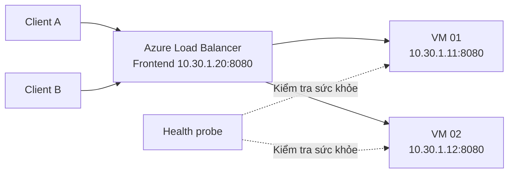
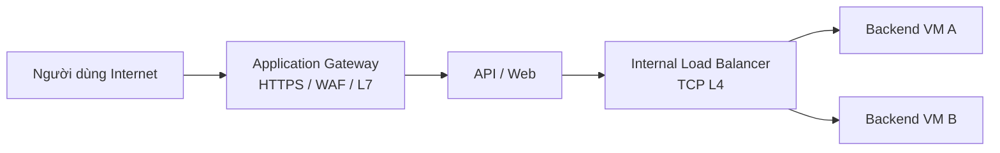
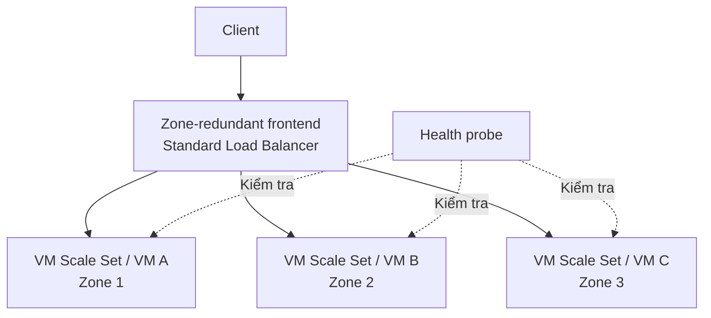

# Cân bằng tải tầng vận chuyển với Azure Load Balancer

Khi một ứng dụng trên Microsoft Azure có nhiều máy chủ xử lý cùng một dịch vụ, hệ thống cần phân phối kết nối tới các máy chủ còn hoạt động để tăng khả năng phục vụ và giảm phụ thuộc vào một máy duy nhất. **Azure Load Balancer** là dịch vụ cân bằng tải **Layer 4 (L4)** do Azure quản lý: định tuyến các luồng **TCP hoặc UDP** dựa trên địa chỉ IP và cổng, không cần đọc nội dung HTTP của ứng dụng.

Trong lộ trình Azure, dịch vụ này liên quan trực tiếp đến virtual network, máy ảo/Virtual Machine Scale Sets, availability zone, Network Security Group (NSG), giám sát và kiểm soát chi phí. Bài học thuộc chương **Cân bằng tải và phân phối ứng dụng**, hướng dẫn từ khái niệm, thành phần, luồng lưu lượng tới cấu hình thực hành, bảo mật và vận hành.

## Mục tiêu học tập

Sau bài học, bạn có thể:

1. Giải thích Load Balancer tầng 4 khác gì cân bằng tải HTTP/HTTPS tầng 7.
2. Phân biệt **Public Load Balancer** và **Internal Load Balancer**.
3. Mô tả **frontend IP**, **backend pool**, **health probe**, **load-balancing rule** và **inbound NAT rule**.
4. Hiểu cơ chế chọn backend theo hash của luồng và các lựa chọn session persistence.
5. Thiết kế cấu hình Standard Load Balancer cho VM hoặc VM Scale Set, kể cả kịch bản nhiều availability zone.
6. Dùng Azure CLI để tạo, kiểm tra một cân bằng tải nội bộ và tìm nguyên nhân lỗi lưu lượng.
7. Nhận biết trách nhiệm riêng của NSG, ứng dụng, outbound connectivity và các dịch vụ Layer 7.

## 1. Vì sao cần cân bằng tải?

Giả sử API đơn hàng chạy trên hai máy ảo `vm-app-01` và `vm-app-02` trong cùng virtual network. Nếu người dùng chỉ kết nối tới IP của `vm-app-01`, máy này có thể quá tải hoặc ngừng phục vụ khi cần cập nhật. Khi đặt một Load Balancer phía trước, client sử dụng **một địa chỉ IP frontend** ổn định; Load Balancer chọn backend còn đáp ứng health probe để xử lý luồng kết nối.



Load Balancer hỗ trợ phân phối lưu lượng và giảm rủi ro khi một backend gặp sự cố. Tuy nhiên, **cân bằng tải không tự tạo ra một hệ thống sẵn sàng cao**. Nếu cả hai VM cùng hết dung lượng, dùng chung một database bị lỗi, hoặc ứng dụng không thể khôi phục trạng thái, Load Balancer không giải quyết được những vấn đề đó.

### 1.1. Tầng 4 là gì?

Mô hình TCP/IP có các lớp với trách nhiệm khác nhau. Ở phạm vi bài học:

- **IP** đưa gói tin tới địa chỉ nguồn/đích.
- **TCP** thiết lập kết nối đáng tin cậy theo cổng; **UDP** truyền datagram không cần thiết lập kết nối tương tự TCP.
- **HTTP, HTTPS, gRPC** và những giao thức ứng dụng khác chạy phía trên giao thức vận chuyển.

Load Balancer L4 ra quyết định dựa trên **luồng IP/port/protocol**; không đưa ra quyết định theo URL `/orders`, HTTP Host, cookie hoặc header `Authorization`. Dịch vụ có thể cân bằng một ứng dụng HTTP qua cổng TCP 80/443, nhưng không vì thế mà trở thành bộ định tuyến HTTP Layer 7.

## 2. Các thành phần của Azure Load Balancer

Một tài nguyên Azure Load Balancer thường được cấu hình bằng các đối tượng sau:

| Thành phần | Nhiệm vụ | Ví dụ |
|---|---|---|
| **Frontend IP configuration** | IP và điểm vào mà client kết nối. | `10.30.1.20` hoặc một Standard Public IP. |
| **Backend pool** | Danh sách endpoint backend có thể nhận lưu lượng. | NIC/IP configuration của `vm-app-01`, `vm-app-02`, hoặc VM Scale Set. |
| **Health probe** | Kiểm tra backend có đủ điều kiện nhận lưu lượng mới. | TCP cổng `8080` hoặc HTTP `GET /healthz`. |
| **Load-balancing rule** | Ánh xạ frontend/protocol/port tới backend pool và cổng backend. | TCP `10.30.1.20:8080` → pool cổng `8080`. |
| **Inbound NAT rule** | Chuyển lưu lượng đến một máy/instance cụ thể, không phải phân phối tới toàn pool. | Một frontend port quản trị được ánh xạ tới cổng của một VM. |
| **Outbound rule** | Cấu hình luồng đi ra ngoài qua frontend IP công khai khi phù hợp. | SNAT traffic từ backend pool qua public frontend. |

Một frontend có thể được các rule khác nhau sử dụng để phục vụ nhiều cổng/giao thức. Một backend có thể tham gia nhiều quy tắc theo khả năng và giới hạn của dịch vụ. Cần kiểm tra tổ hợp frontend, backend, protocol và port để tránh xung đột.

### 2.1. Frontend IP

**Frontend** là địa chỉ mà client dùng để kết nối dịch vụ. Nó có thể là public IP hoặc private IP tùy loại triển khai. Load Balancer không tự bảo đảm client biết tên miền; nếu cần `api.example.com`, bạn phải cấu hình DNS thích hợp trỏ tới frontend IP.

**Public frontend** thường sử dụng tài nguyên Public IP tương thích SKU. **Internal frontend** lấy địa chỉ từ một subnet trong VNet; có thể chọn địa chỉ private IP tĩnh phù hợp để thuận tiện cho DNS và các hệ thống phụ thuộc. Một frontend có thể nằm ở subnet nhưng không đồng nghĩa mọi VM trong subnet đó đều có quyền truy cập ứng dụng: chính sách mạng, route và quyền hệ điều hành vẫn áp dụng.

### 2.2. Backend pool

**Backend pool** cho Load Balancer biết các endpoint ứng dụng có thể xử lý kết nối. Trong triển khai dựa trên NIC, mỗi VM thường có một cấu hình IP của NIC được liên kết với pool. Azure Load Balancer cũng hỗ trợ các mô hình pool dựa trên địa chỉ IP hoặc tích hợp với VM Scale Sets theo tính năng và điều kiện cấu hình tương ứng.

Pool có hai VM không có nghĩa cả hai đang **healthy**. Mỗi rule cần logic kiểm tra sức khỏe phù hợp và ứng dụng phải lắng nghe trên cổng được gửi tới. Nếu backend không được coi là healthy, Load Balancer có thể không chọn backend đó cho các luồng mới.

### 2.3. Load-balancing rule

Rule xác định cặp cổng và giao thức. Ví dụ:

```text
Protocol        TCP
Frontend IP     10.30.1.20
Frontend port   8080
Backend pool    pool-app
Backend port    8080
Health probe    probe-app
```

Khi client gửi TCP tới `10.30.1.20:8080`, Load Balancer dùng rule để xác định pool và chọn backend phù hợp. Frontend port và backend port có thể khác nhau nếu rule cho phép và cấu hình đúng; ví dụ frontend `443` → backend `8443`. Nhưng việc ánh xạ cổng **không phải** TLS termination hay chuyển HTTPS thành HTTP.

## 3. Public Load Balancer và Internal Load Balancer

Phân biệt hai mô hình theo phạm vi kết nối mà frontend cần phục vụ:

| Tiêu chí | Public Load Balancer | Internal Load Balancer |
|---|---|---|
| **Frontend** | Public IP. | Private IP trong VNet. |
| **Client điển hình** | Người dùng Internet hoặc mạng có tuyến hợp lệ đến public IP. | VM trong VNet, VNet được kết nối, mạng on-premises qua VPN/ExpressRoute. |
| **Ứng dụng phù hợp** | TCP/UDP công khai, máy chủ game, dịch vụ chuyên dụng. | API nội bộ, thành phần middleware, database proxy hoặc ứng dụng không cần public exposure. |
| **Bảo mật cần chú ý** | NSG, kiểm soát công khai IP/port, bảo vệ chống tấn công và xác thực ứng dụng. | NSG, route, private DNS và phân quyền nội bộ. |
| **Khả năng đọc HTTP header** | Không. | Không. |

### Ví dụ kiến trúc hai lớp

Một ứng dụng có thể dùng **Application Gateway** ở phía trước để xử lý HTTP/HTTPS, TLS và WAF, còn **Internal Load Balancer** phía sau để phân phối một giao thức TCP nội bộ tới một nhóm VM chuyên dụng.



Không nhất thiết cần cả hai dịch vụ cho mọi ứng dụng. Chọn một hoặc nhiều lớp tùy protocol, yêu cầu bảo vệ và cấu trúc backend. Nếu ứng dụng chỉ cần định tuyến HTTP theo URL, Azure Load Balancer một mình không đáp ứng được yêu cầu đó.

## 4. Standard Load Balancer và những lưu ý về SKU

Với triển khai mới, nên thiết kế dựa trên **Standard Load Balancer**. Basic Load Balancer là SKU cũ đã được Azure đưa vào lộ trình ngừng sử dụng; không xây dựng kiến trúc mới dựa trên giả định Basic vẫn là lựa chọn phù hợp.

Standard Load Balancer cung cấp khả năng cấu hình phục vụ môi trường production, gồm phân phối TCP/UDP, health probes, lựa chọn availability zones khi kết hợp frontend/backend tương thích, chính sách outbound rõ ràng và tích hợp với các tài nguyên networking của Azure.

Một số nguyên tắc quan trọng:

- Khi dùng **public frontend**, tài nguyên Public IP cần có SKU tương thích với Standard Load Balancer; áp dụng IP/zone theo yêu cầu triển khai.
- Standard Load Balancer được thiết kế với cách tiếp cận **đóng đối với lưu lượng inbound nếu chưa có quy tắc NSG cho phép**. Tạo load-balancing rule không đồng nghĩa tự mở toàn bộ firewall cho VM.
- **Inbound** và **outbound** là hai hướng khác nhau. Public frontend để nhận lưu lượng không đồng nghĩa mọi VM trong backend tự động có outbound internet theo cấu hình mong muốn.
- Khả năng xử lý zone, HA ports, Floating IP hoặc networking đặc biệt phụ thuộc vào loại frontend, backend và những điều kiện của dịch vụ. Nên kiểm tra compatibility trước khi đưa vào production.

## 5. Azure Load Balancer chọn backend như thế nào?

### 5.1. Phân phối theo hash của luồng

Azure Load Balancer thường phân phối **luồng mới**, không phải từng HTTP request, bằng phép tính hash trên các thuộc tính như:

```text
Source IP
Source port
Destination IP
Destination port
Protocol
```

Đây là **five-tuple (5-tuple)**. Hai kết nối TCP có source port khác nhau có thể được chọn hai backend khác nhau dù đến từ cùng một người dùng. Nhưng nhiều request HTTP gửi liên tiếp trên **cùng một kết nối TCP** sẽ không được phân phối lại sau từng request theo cơ chế mặc định này.

Ví dụ:

```text
Client 192.0.2.10:51000 -> VIP 203.0.113.10:443 / TCP -> VM A
Client 192.0.2.10:51001 -> VIP 203.0.113.10:443 / TCP -> VM B
```

IP trong ví dụ chỉ minh họa. Không nên hiểu Azure Load Balancer là công cụ bảo đảm chia đều đúng 50% request hoặc dùng round-robin trên từng lần gọi. Phân bố thực tế chịu ảnh hưởng của số luồng, số backend healthy, cách client tái sử dụng kết nối, traffic pattern và cấu hình load distribution.

### 5.2. Session persistence / load distribution

Một số cấu hình rule cho phép thay đổi cách xác định affinity của luồng:

| Chế độ | Cơ sở phân phối điển hình | Ý nghĩa |
|---|---|---|
| **Default** | Five-tuple. | Phù hợp khi backend có thể xử lý các kết nối độc lập. |
| **Client IP (Source IP)** | Hai thuộc tính: source IP, destination IP. | Giúp những luồng từ cùng IP nguồn có xu hướng đi cùng backend. |
| **Client IP and protocol** | Source IP, destination IP, protocol. | Giữ affinity ở mức IP và giao thức theo chế độ hỗ trợ. |

**Source-IP affinity không phải session cookie**. Nhiều người dùng đứng sau cùng một NAT có thể cùng đi tới một backend; ngược lại IP nguồn thay đổi có thể làm affinity thay đổi. Với ứng dụng web cần session bền vững, nên thiết kế session store dùng chung hoặc dịch vụ phù hợp, không dựa hoàn toàn vào LB affinity.

### 5.3. Idle timeout và TCP reset

Kết nối TCP không có hoạt động trong thời gian dài có thể vượt quá **idle timeout** của rule. Hãy chọn giá trị phù hợp với hành vi ứng dụng và xem xét TCP keepalive hoặc cơ chế heartbeat ở mức ứng dụng. Một số cấu hình hỗ trợ TCP reset khi idle timeout xảy ra, giúp client nhận biết kết nối đã bị đóng thay vì chờ đến khi timeout ở ứng dụng.

Thay đổi idle timeout không giải quyết triệt để lỗi ứng dụng giữ kết nối mãi mãi, mất network path hoặc xử lý retry sai. Cần thiết kế client có timeout, backoff và idempotency phù hợp.

## 6. Health probe: chọn máy chủ còn phục vụ được

Health probe là nền tảng để Load Balancer biết backend nào có thể nhận **luồng mới**. Health probe được cấu hình riêng và dùng bởi rule.

### 6.1. TCP probe

**TCP probe** thử thiết lập kết nối TCP tới cổng trên backend. Nếu cổng chấp nhận kết nối theo yêu cầu, probe có thể được xem là thành công. Phương pháp này đơn giản nhưng chỉ xác nhận một phần nhỏ khả năng hoạt động: tiến trình có thể mở cổng nhưng các dependency như database hoặc queue đã lỗi.

### 6.2. HTTP/HTTPS probe

Khi hỗ trợ bởi cấu hình, **HTTP hoặc HTTPS probe** có thể gọi một path như `/healthz` và dựa vào phản hồi được dịch vụ coi là healthy để quyết định. Azure Load Balancer vẫn phân phối traffic theo L4; việc sử dụng probe HTTP **không** biến nó thành ứng dụng routing L7.

Ứng dụng nên cung cấp một endpoint sức khỏe có chủ đích, ví dụ:

```http
GET /healthz HTTP/1.1
Host: api.internal.example

HTTP/1.1 200 OK
Content-Type: text/plain

ok
```

Trong thực tế, cần kiểm tra yêu cầu của Azure Load Balancer đối với mã phản hồi, header, host, TLS và probe path theo phiên bản dịch vụ đang dùng. Endpoint health nên nhanh, không yêu cầu đăng nhập tương tác và không gây tác dụng phụ. Không nên để probe chạy những truy vấn quá tốn kém hoặc lộ thông tin nhạy cảm.

### 6.3. Interval, threshold và trạng thái backend

Probe có khoảng thời gian giữa các lần kiểm tra (**interval**) và số lần liên tiếp không đạt (**threshold**) trước khi đánh dấu backend không khỏe. Việc lựa chọn ảnh hưởng đến thời gian phát hiện lỗi cũng như rủi ro báo lỗi nhầm khi hệ thống chỉ chậm tạm thời.

Ví dụ minh họa:

```text
Probe: TCP 8080
Interval: 5 giây
Unhealthy threshold: 2
```

Đây là **tham số cấu hình minh họa**, không phải cam kết rằng mọi tình huống failover diễn ra chính xác sau 10 giây. Thời gian và hành vi thực tế còn phụ thuộc quy tắc, loại probe, thời điểm lỗi và đặc điểm traffic.

Nếu một backend không còn healthy, Load Balancer dừng chọn nó cho các luồng mới theo cơ chế của dịch vụ. **Kết nối đã thiết lập** có thể chịu ảnh hưởng khác nhau tùy loại lỗi, trạng thái backend và cấu hình; không nên hứa mọi phiên hiện hữu sẽ được chuyển liền mạch sang VM khác. Ứng dụng phải hỗ trợ retry hoặc phục hồi phiên theo yêu cầu kinh doanh.

### 6.4. Health probe và Network Security Group

Azure sử dụng địa chỉ nền tảng như `168.63.129.16` cho một số hoạt động hạ tầng, trong đó có health probes của Load Balancer. Khi cấu hình NSG hoặc firewall, cần cho phép probe từ nguồn phù hợp theo hướng dẫn của dịch vụ (thường được biểu diễn bằng **service tag `AzureLoadBalancer`** trong NSG) tới cổng health probe.

Mặc định NSG có những rule nền tảng liên quan; tuy nhiên, rule deny ưu tiên cao hơn hoặc host firewall có thể chặn probe. Không mở toàn bộ inbound Internet chỉ để probe thành công. Hãy cho phép **lưu lượng ứng dụng** từ những mạng/client được phép và **lưu lượng probe** theo nguồn/port yêu cầu của Azure, như hai nhu cầu khác nhau.

## 7. Load Balancer không thay thế NSG, route và bảo mật ứng dụng

Một yêu cầu tới backend thường phải đi qua nhiều lớp:

```text
Client -> IP/port frontend -> Load-balancing rule -> Backend pool
       -> NSG/route/host firewall -> Tiến trình đang lắng nghe
```

Lỗi ở bất cứ bước nào đều có thể khiến client timeout. Vì vậy, tạo frontend IP và rule đúng chưa đủ:

- **NSG** phải cho phép inbound từ nguồn hợp lệ tới port backend và health probe nếu cần.
- **Guest OS firewall** phải cho phép tiến trình nhận kết nối.
- **Ứng dụng** phải bind đúng IP/interface và cổng, không chỉ lắng nghe `127.0.0.1` khi cần nhận từ mạng.
- **Routing** phải cho phép đường đến/đường trả về giữa client và backend; các user-defined route hoặc network virtual appliance có thể thay đổi đường đi.
- **TLS, authentication và authorization** thuộc ứng dụng hoặc thành phần phù hợp. Load Balancer L4 không tự kiểm tra JWT, không chặn SQL injection và không cung cấp WAF cho HTTP.

Với internal frontend, một VM trong mạng kết nối hợp lệ vẫn có thể bị từ chối bởi NSG hoặc firewall. Với public frontend, không nên gán mở rộng `Any/Any` để kiểm thử rồi quên thu hồi trên production.

## 8. Thiết kế khả dụng cao với Availability Zones

Standard Load Balancer có thể được sử dụng trong kiến trúc nhiều **Availability Zone**, tùy region và các loại tài nguyên hỗ trợ. Mục tiêu là tránh đặt toàn bộ backend trong cùng một miền lỗi.



Một **zone-redundant frontend** và backend ở nhiều zone giúp giảm phụ thuộc vào một zone. Tuy nhiên, chỉ trải VM qua zone mà vẫn dùng chung database một điểm lỗi thì chưa đạt HA đầu cuối. Cần đánh giá cả data tier, lưu trữ, phân giải DNS, secrets, deployment strategy, capacity và ứng dụng.

Phân biệt:

- **Zonal frontend**: gắn với một zone cụ thể theo khả năng của loại IP/region.
- **Zone-redundant frontend**: được Azure bố trí để duy trì khả năng phục vụ qua nhiều zone khả dụng theo thiết kế dịch vụ.
- **Cross-region resilience**: chịu lỗi ở cấp region, cần kiến trúc riêng, ví dụ dịch vụ phân phối toàn cục và backend ở nhiều region; một regional Load Balancer không tự tạo DR liên region.

Để nâng cao tính sẵn sàng, nên kết hợp VM Scale Sets với chính sách scale phù hợp và health probes thực sự phản ánh mức sẵn sàng xử lý. Scale-out có thể tăng số backend, nhưng phải bảo đảm những instance mới đã khởi động ứng dụng, được cấu hình và healthy trước khi nhận traffic.

## 9. Thực hành: tạo Internal Standard Load Balancer bằng Azure CLI

Bài thực hành sử dụng **hai VM đã tồn tại** trong VNet để tập trung vào chức năng cân bằng tải; không cần tạo toàn bộ hạ tầng máy ảo trong bài này. Các tên và IP là ví dụ, phải sửa theo tài nguyên thật của môi trường thử nghiệm.

### 9.1. Điều kiện trước khi chạy

- Có subscription Azure và quyền quản lý Load Balancer, NIC, NSG tại resource group thích hợp.
- Có resource group `rg-lb-lab`, VNet `vnet-app` và subnet `snet-app` trong cùng resource group.
- Hai VM `vm-app-01`, `vm-app-02` có NIC tên `nic-app-01`, `nic-app-02` với IP configuration tên `ipconfig1` nằm trong VNet thích hợp.
- Mỗi VM chạy ứng dụng hoặc HTTP test server trên **TCP 8080** và có thể trả về nội dung khác nhau để nhận biết backend; không bind chỉ trên loopback.
- Địa chỉ `10.30.1.20` còn trống và nằm trong subnet `snet-app`; frontend chỉ dành cho lưu lượng nội bộ.
- NSG/host firewall cho phép TCP 8080 từ nguồn client thử nghiệm và cho phép health probe thích hợp.

Không áp dụng các lệnh này nguyên trạng lên production. Tạo Load Balancer hoặc chỉnh NIC/NSG có thể ảnh hưởng lưu lượng và phát sinh chi phí. Để đơn giản, ví dụ dùng Bash trên môi trường có Azure CLI.

### Bước 1. Chọn subscription và đặt biến

```bash
az login
az account list --output table
az account set --subscription "<subscription-id>"

RG="rg-lb-lab"
LB="lb-app-internal"
VNET="vnet-app"
SUBNET="snet-app"
VIP="10.30.1.20"
```

Kiểm tra subnet và NIC trước khi thay đổi cấu hình:

```bash
az network vnet subnet show \
  --resource-group "$RG" \
  --vnet-name "$VNET" \
  --name "$SUBNET" \
  --query "{name:name,addressPrefix:addressPrefix}" \
  --output json

az network nic list \
  --resource-group "$RG" \
  --query "[].{name:name,privateIp:ipConfigurations[0].privateIPAddress}" \
  --output table
```

Các lệnh trên chỉ đọc thông tin. Nếu tên NIC, IP configuration hoặc địa chỉ subnet khác ví dụ, phải cập nhật biến và tham số ở những bước tiếp theo.

### Bước 2. Tạo Standard Internal Load Balancer

```bash
az network lb create \
  --resource-group "$RG" \
  --name "$LB" \
  --sku Standard \
  --vnet-name "$VNET" \
  --subnet "$SUBNET" \
  --private-ip-address "$VIP" \
  --frontend-ip-name "fe-private" \
  --backend-pool-name "pool-app"
```

Lệnh tạo Load Balancer với frontend private IP và backend pool. Đây chưa phải cấu hình hoàn chỉnh để ứng dụng phục vụ qua VIP: còn phải tạo probe, rule và đưa backend vào pool. Nếu bị từ chối do IP đã dùng hoặc sai subnet, không đổi sang một địa chỉ tùy ý mà chưa kiểm tra IP plan.

### Bước 3. Tạo TCP health probe

```bash
az network lb probe create \
  --resource-group "$RG" \
  --lb-name "$LB" \
  --name "probe-tcp-8080" \
  --protocol Tcp \
  --port 8080 \
  --interval 5 \
  --threshold 2
```

TCP probe giúp kiểm tra cổng TCP 8080 đang nhận kết nối. Trong production, nếu ứng dụng HTTP có endpoint `/healthz` phù hợp, có thể cân nhắc HTTP/HTTPS probe để đo khả năng phục vụ thực tế thay vì chỉ xem cổng TCP có mở.

### Bước 4. Tạo load-balancing rule

```bash
az network lb rule create \
  --resource-group "$RG" \
  --lb-name "$LB" \
  --name "rule-tcp-8080" \
  --protocol Tcp \
  --frontend-ip-name "fe-private" \
  --frontend-port 8080 \
  --backend-pool-name "pool-app" \
  --backend-port 8080 \
  --probe-name "probe-tcp-8080"
```

Rule kết hợp frontend `10.30.1.20:8080` và backend pool `pool-app` qua probe đã tạo.

### Bước 5. Đưa NIC của hai VM vào backend pool

```bash
az network nic ip-config address-pool add \
  --resource-group "$RG" \
  --nic-name "nic-app-01" \
  --ip-config-name "ipconfig1" \
  --lb-name "$LB" \
  --address-pool "pool-app"

az network nic ip-config address-pool add \
  --resource-group "$RG" \
  --nic-name "nic-app-02" \
  --ip-config-name "ipconfig1" \
  --lb-name "$LB" \
  --address-pool "pool-app"
```

Việc thêm NIC IP configuration thay đổi hạ tầng backend, nên cần thực hiện có kiểm soát. Trong VM Scale Sets, quy trình liên kết backend pool có thể khác; thường được định nghĩa trên cấu hình mạng của scale set thay vì sửa từng NIC bằng tay.

### Bước 6. Xác minh NSG, firewall và tiến trình ứng dụng

Đối với NSG gắn vào subnet hoặc NIC backend, phải bảo đảm:

1. Cho phép lưu lượng ứng dụng **TCP 8080** từ subnet hoặc client được ủy quyền.
2. Cho phép health probe từ nguồn Azure Load Balancer theo service tag/quy định của dịch vụ và cổng probe 8080.
3. Không để rule `Deny` có độ ưu tiên cao hơn vô tình chặn traffic hợp lệ.
4. Host firewall của cả hai VM cho phép traffic cần thiết; ứng dụng bind tới địa chỉ có thể truy cập từ mạng.

Kiểm tra các rule hiện có trước khi thêm. Ví dụ lệnh **chỉ đọc**:

```bash
az network nsg rule list \
  --resource-group "$RG" \
  --nsg-name "<nsg-name>" \
  --output table
```

Không nên tự động mở TCP 8080 cho mọi nguồn `*` chỉ để bài lab hoạt động. Hãy sử dụng địa chỉ nguồn thử nghiệm hoặc service tag thích hợp theo chính sách mạng.

### Bước 7. Kiểm thử từ VM client nội bộ

Trên một VM trong VNet hoặc mạng có kết nối tới VIP, chạy:

```bash
curl --connect-timeout 3 --max-time 10 "http://10.30.1.20:8080/"
```

Lặp lại vài lần hoặc tạo nhiều kết nối TCP độc lập. Nếu ứng dụng trả về hostname của backend, có thể quan sát phản hồi từ các VM khác nhau. Tuy nhiên, do hash của luồng, **không được kỳ vọng luân phiên VM A, VM B ở từng lần chạy**. Cũng không nên kiểm thử qua VIP từ máy không có route tới VNet rồi kết luận LB bị lỗi.

### Bước 8. Đọc lại cấu hình và đối chiếu kết quả

```bash
az network lb show \
  --resource-group "$RG" \
  --name "$LB" \
  --query "{name:name,sku:sku.name,frontends:frontendIPConfigurations[].privateIPAddress}" \
  --output json

az network lb probe list \
  --resource-group "$RG" \
  --lb-name "$LB" \
  --output table

az network lb rule list \
  --resource-group "$RG" \
  --lb-name "$LB" \
  --output table

az network lb address-pool list \
  --resource-group "$RG" \
  --lb-name "$LB" \
  --output json
```

Những lệnh này chỉ đọc cấu hình. Để biết backend thật sự healthy và luồng dữ liệu hoạt động, cần kết hợp trạng thái probe, metrics và kiểm thử từ client, không chỉ kiểm tra rằng rule tồn tại.

### Bước 9. Dọn dẹp bài lab

Khi không còn sử dụng, hãy kiểm tra Load Balancer có đang phục vụ workload nào khác hay không. Gỡ những tham chiếu backend pool khỏi NIC theo đúng quy trình rồi xóa **chỉ** tài nguyên lab được xác nhận thuộc về bạn. Không xóa VNet, NIC hoặc VM đang dùng chung chỉ vì tên tương tự. Sau đó kiểm tra trong Azure Cost Management để tránh tài nguyên lab còn phát sinh phí.

## 10. Outbound connectivity và SNAT

Khái niệm **inbound traffic** (client → backend) và **outbound traffic** (backend → dịch vụ bên ngoài) cần được thiết kế riêng. Một internal Load Balancer chỉ cung cấp frontend riêng cho inbound không tự trở thành NAT gateway cho Internet. Ngay cả với public Standard Load Balancer, cần xác định rõ đường outbound và địa chỉ nguồn public của VM trong backend, thay vì trông chờ vào cơ chế outbound ngầm định.

Các cách thiết kế outbound thường gặp:

| Giải pháp | Vai trò | Khi nên cân nhắc |
|---|---|---|
| **NAT Gateway** | Dịch địa chỉ nguồn outbound của subnet qua public IP/prefix được cấu hình. | Workload cần kết nối outbound Internet ổn định, quy mô lớn và quản lý SNAT riêng. |
| **Load Balancer outbound rule** | Dùng public frontend cùng outbound rule của Standard Load Balancer để cấp outbound cho backend pool. | Khi kiến trúc đã dùng public Standard LB và lựa chọn này đáp ứng nhu cầu. |
| **Public IP trên NIC/VM** | VM có public IP riêng theo cấu hình. | Trường hợp cụ thể có yêu cầu rõ ràng; cần cân nhắc bề mặt tấn công và vận hành. |
| **Azure Firewall hoặc NVA** | Kiểm soát, lọc và ghi nhận outbound theo chính sách. | Môi trường cần kiểm soát luồng và logging tập trung. |

### SNAT port exhaustion

Khi nhiều kết nối outbound dùng chung số lượng giới hạn **SNAT ports**, ứng dụng có thể gặp lỗi kết nối mới hoặc timeout dù mạng inbound hoạt động bình thường. Hệ thống tạo hàng nghìn kết nối ngắn tới một dịch vụ ngoài có nguy cơ cao hơn ứng dụng tái sử dụng kết nối hợp lý.

Biện pháp giảm rủi ro gồm **connection pooling**, tái sử dụng HTTP keep-alive, điều chỉnh timeout/retry, tối ưu số kết nối đồng thời và chọn phương án egress phù hợp như NAT Gateway. Theo dõi métrics/log outbound được dịch vụ hỗ trợ; đừng tự suy luận rằng thêm backend VM sẽ giải quyết mọi giới hạn SNAT.

## 11. Inbound NAT rules, HA Ports và Floating IP

Các chức năng này có mục đích khác với quy tắc cân bằng tải TCP/UDP thông thường.

### 11.1. Inbound NAT rule

Một **inbound NAT rule** ánh xạ một frontend IP/port đến cổng của **một** backend cụ thể để quản trị hoặc truy cập instance. Nó **không** tự chia traffic qua toàn backend pool như load-balancing rule. Ví dụ, trong một số thiết kế, frontend port khác nhau được dùng để truy cập RDP/SSH của từng VM.

Tuy nhiên, **Azure Bastion** hoặc giải pháp truy cập quản trị riêng có thể phù hợp hơn việc xuất public SSH/RDP. Không mở cổng quản trị ra Internet nếu không có yêu cầu và kiểm soát bảo mật cụ thể.

### 11.2. HA Ports

**High Availability (HA) Ports** cho phép một quy tắc bao phủ nhiều cổng TCP/UDP theo cấu hình hỗ trợ của Azure Load Balancer, hữu ích với một số kịch bản thiết bị mạng ảo (network virtual appliance). Đây không phải cách mặc định để xây ứng dụng web hai cổng. Phải xem xét routing, Floating IP và hành vi xử lý luồng của NVA trước khi dùng.

### 11.3. Floating IP (Direct Server Return)

**Floating IP** là tùy chọn dùng cho các kịch bản cần địa chỉ frontend được xử lý đặc biệt trong backend, ví dụ một số ứng dụng cluster hoặc mô hình Direct Server Return. Không nên bật vì nghĩ nó sẽ cải thiện tốc độ của mọi web app. Khi dùng Floating IP, cấu hình hệ điều hành/backend có thể cần thay đổi để xử lý đúng địa chỉ frontend; chỉ bật khi kiến trúc yêu cầu và đã thử nghiệm.

## 12. So sánh Azure Load Balancer với các dịch vụ khác

Trong Azure, có nhiều công cụ phân phối lưu lượng ở các lớp khác nhau:

| Dịch vụ | Loại quyết định | Phù hợp với |
|---|---|---|
| **Azure Load Balancer** | L4, TCP/UDP, IP và cổng; thường phục vụ backend trong phạm vi triển khai regional. | Ứng dụng TCP/UDP, cân bằng tải VM/VM Scale Set, internal/public VIP. |
| **Azure Application Gateway** | Layer 7, HTTP/HTTPS, có thể dựa vào URL/host; hỗ trợ WAF ở SKU thích hợp. | Web app cần TLS termination, WAF, routing theo đường dẫn/host. |
| **Azure Front Door** | Phân phối HTTP/HTTPS ở edge toàn cầu với khả năng tăng tốc và bảo vệ ứng dụng. | Web/API có người dùng phân tán địa lý hoặc yêu cầu edge. |
| **Azure Traffic Manager** | DNS-based traffic steering, không proxy luồng TCP của client. | Điều hướng client đến endpoint theo chính sách DNS/health. |
| **Cross-region Load Balancer** | Khả năng phân phối L4 công khai giữa các backend regional được hỗ trợ. | Thiết kế multi-region TCP/UDP theo điều kiện hỗ trợ của dịch vụ. |
| **Gateway Load Balancer** | Tích hợp chuỗi xử lý lưu lượng qua network virtual appliance. | Firewall/IPS hoặc thiết bị mạng ảo, không phải bộ định tuyến HTTP. |

**Câu hỏi lựa chọn nhanh:** Nếu bạn cần nhận TCP/UDP và chuyển tiếp qua một frontend IP theo health probe, Azure Load Balancer phù hợp. Nếu cần `https://example.com/orders` chuyển tới nhóm backend khác với `/users`, hãy xem Application Gateway hoặc Front Door. Nếu muốn DNS quyết định endpoint vùng nào được sử dụng mà không trực tiếp proxy kết nối, xem Traffic Manager.

## 13. Giám sát và khắc phục sự cố

Azure Load Balancer có thể xuất các **Azure Monitor metrics** hữu ích như trạng thái health probe (**Health Probe Status / DipAvailability**) hoặc trạng thái đường dữ liệu (**Data Path Availability / VipAvailability**) theo loại tài nguyên và hỗ trợ hiện hành. Cần kiểm tra dimension, aggregation và ý nghĩa metric khi thiết lập alert. **Azure Activity Log** giúp theo dõi thay đổi cấu hình management plane, không phải bản ghi từng request mà Load Balancer xử lý.

### 13.1. Trình tự chẩn đoán

Nếu client không kết nối tới VIP, kiểm tra theo thứ tự:

1. **Frontend:** IP, loại public/internal, subnet và DNS client đang sử dụng có đúng không?
2. **Rule:** giao thức, frontend/backend port, backend pool và health probe có đúng không?
3. **Backend pool:** có NIC/VMSS/IP được liên kết không? Có bao nhiêu endpoint thực sự healthy?
4. **Health probe:** đúng port/path, firewall và tiến trình backend đang nghe? Probe có nhận kết quả hợp lệ không?
5. **NSG/host firewall:** có rule deny ưu tiên cao hơn hoặc giới hạn source IP không?
6. **Routing:** client có route tới VIP, các NVA/UDR có thay đổi đường đi, có bất đối xứng đường trả về không?
7. **Ứng dụng:** backend có trả response đúng khi gọi **trực tiếp vào private IP** từ nguồn thử nghiệm có quyền không?
8. **Giám sát:** đối chiếu LB metrics, VM/application logs và thay đổi hạ tầng gần thời điểm xảy ra lỗi.

### 13.2. Một số lỗi phổ biến

| Triệu chứng | Nguyên nhân có thể | Cách xác minh |
|---|---|---|
| VIP timeout hoàn toàn | Sai route, frontend IP, NSG hoặc không có backend healthy. | Kiểm tra IP/rule, NSG, probe metric và test từ client có đường mạng. |
| Chỉ một backend nhận nhiều kết nối | Five-tuple hash, connection reuse, Source-IP affinity hoặc số luồng nhỏ. | Tạo nhiều luồng TCP độc lập, đọc chế độ load distribution và logs ứng dụng. |
| Backend có app chạy nhưng health probe fail | App chỉ bind loopback, port/path probe sai hoặc firewall chặn. | Kiểm tra socket listener, thử probe path trực tiếp, xem NSG/host firewall. |
| TCP probe healthy nhưng API trả lỗi | TCP port mở nhưng logic ứng dụng, database hoặc dependency hỏng. | Dùng HTTP health endpoint phù hợp và theo dõi application telemetry. |
| Public frontend tồn tại nhưng Internet không vào được | NSG không cho phép, app không lắng nghe, route hoặc firewall sai. | Kiểm tra IP/SKU, rule inbound và kiểm thử từ ngoài mạng. |
| Inbound hoạt động, outbound Internet lỗi | Chưa có outbound path, thiếu SNAT ports, UDR/firewall chặn. | Kiểm tra NAT Gateway/outbound rule, routing, NSG và SNAT metrics. |
| Mất kết nối khi backend bị loại | Kết nối hiện tại không được di chuyển liền mạch sang VM khác. | Kiểm tra retry, session handling và cơ chế graceful shutdown của ứng dụng. |
| VIP nội bộ không truy cập được từ on-premises | VPN/ExpressRoute, route hoặc DNS chưa đúng. | Kiểm tra từ một VM trong VNet trước, sau đó thử từ mạng tại chỗ. |

### 13.3. Kiểm tra bằng công cụ mạng

Đối với TCP, các lệnh như sau giúp phân tách vấn đề DNS, TCP và ứng dụng:

```bash
# Trên Linux, kiểm tra backend trực tiếp từ nguồn có quyền
curl --connect-timeout 3 --max-time 8 http://10.30.1.11:8080/

# Kiểm tra qua VIP nội bộ
curl --connect-timeout 3 --max-time 8 http://10.30.1.20:8080/
```

Trên Windows:

```powershell
Test-NetConnection -ComputerName 10.30.1.20 -Port 8080
```

Nếu gọi trực tiếp backend thành công nhưng VIP thất bại, trọng tâm là LB frontend/rule/probe/NSG/route. Nếu cả hai thất bại, trước hết kiểm tra ứng dụng, firewall và mạng của VM. `curl` tới HTTP chỉ phù hợp khi backend thật sự phục vụ HTTP trên cổng thử nghiệm; với giao thức TCP riêng, cần công cụ client theo giao thức đó.

## 14. Vận hành và tối ưu chi phí

Trong môi trường production, Load Balancer cần được xem là thành phần của kiến trúc tổng thể, không chỉ là một IP:

- **Capacity:** đo số kết nối, throughput, thời gian phản hồi ứng dụng và mức dùng CPU/RAM của backend; tăng VM dựa trên tải và kiểm tra sức khỏe.
- **Triển khai an toàn:** trước khi cập nhật VM, có chiến lược rolling deployment, readiness/health probe và graceful shutdown; kiểm tra thực tế kết nối đang tồn tại.
- **Bảo mật:** NSG theo nguồn tối thiểu, không công khai cổng quản trị; quản lý khóa/chứng chỉ và quyền danh tính riêng ở ứng dụng.
- **Khả dụng:** backend ở nhiều availability zone khi phù hợp, tránh dùng chung điểm lỗi ở database và dependency.
- **Outbound:** dành riêng kế hoạch NAT/SNAT; quan sát cạn cổng và lưu lượng outbound để tránh lỗi bất ngờ.
- **Chi phí:** đánh giá pricing của Standard Load Balancer, các rule/traffic được tính phí theo cấu hình hiện hành, Public IP, NAT Gateway, băng thông, VM và monitoring. Giá cụ thể thay đổi theo region/SKU, nên xác nhận trên Azure Pricing Calculator và Cost Management.

Không xóa hoặc thay đổi load-balancing rule chỉ vì không thấy traffic tại thời điểm kiểm tra; xác nhận với chủ workload, lịch batch và các khách hàng không hoạt động liên tục. Dùng tags, Azure Policy và quyền Azure RBAC thích hợp để quản lý vòng đời của LB và các tài nguyên liên quan.

## 15. Bài tập tình huống và câu hỏi tự kiểm tra

### Tình huống

Một công ty triển khai dịch vụ giao tiếp TCP trên cổng `9000` với bốn VM: hai VM ở Zone 1 và hai VM ở Zone 2. Client chỉ được truy cập từ mạng văn phòng qua ExpressRoute. Khi một VM khởi động lại, lưu lượng mới cần tiếp tục đến VM còn healthy. Hệ thống cũng phải truy cập một API đối tác trên Internet để cập nhật dữ liệu mỗi giờ.

**Phân tích đề xuất:**

1. Chọn **Internal Standard Load Balancer** vì frontend chỉ dành cho client nội bộ qua kết nối private.
2. Tạo frontend private IP ổn định, backend pool chứa bốn VM và rule TCP `9000 → 9000`.
3. Cấu hình health probe theo đặc tính ứng dụng; nếu chỉ kiểm tra TCP thì hiểu rõ giới hạn của probe.
4. Cấu hình NSG, route ExpressRoute và host firewall chỉ cho phép nguồn hợp lệ tới cổng dịch vụ và probe.
5. Phân bố VM theo availability zone; thử tình huống VM/zone lỗi và đo khả năng đáp ứng.
6. Thiết kế **outbound riêng**, có thể là NAT Gateway hoặc phương án egress đáp ứng chính sách; internal LB không tự cấp SNAT Internet.
7. Theo dõi probe, lỗi kết nối, tính sẵn sàng của ứng dụng và chi phí.

### Câu hỏi kiểm tra

1. Vì sao Azure Load Balancer không thể định tuyến request `/api/orders` theo URL mà không có thành phần Layer 7?
2. Backend có cổng TCP mở nhưng gọi database thất bại: TCP probe có thể báo healthy không? Nên thiết kế health endpoint thế nào?
3. Vì sao hai request HTTP từ một client có thể tới cùng backend dù backend pool có nhiều VM?
4. Khi triển khai Internal Load Balancer, điều gì quyết định client ở on-premises có thể truy cập VIP?
5. Có Public Load Balancer rồi có chắc VM backend sẽ có outbound Internet không? Cần kiểm tra những gì?
6. Bổ sung nhiều availability zone có giúp ứng dụng an toàn nếu mọi VM đều dùng cùng một database một điểm lỗi không?

### Gợi ý đáp án

1. LB L4 chọn backend theo kết nối IP/port/protocol, không đọc URL hoặc host HTTP để định tuyến.
2. Có thể. Nên dùng health probe ứng dụng thể hiện **readiness**, tùy mức độ cần kiểm tra dependency, và tránh kiểm tra quá nặng.
3. Vì cùng kết nối TCP được duy trì trên một backend, hoặc cách hash và affinity chọn backend theo luồng/IP.
4. Route qua ExpressRoute/VPN, NSG/firewall, địa chỉ VIP, quy tắc LB, trạng thái probe và DNS khi dùng hostname.
5. Không. Cần xác định outbound path, NAT Gateway/outbound rule, nguồn IP, route, firewall và SNAT capacity.
6. Không đủ. Cần loại bỏ hoặc giảm thiểu điểm lỗi ở các dependency, storage, database và quy trình phục hồi.

## 16. Checklist trước khi đưa vào production

- [ ] Đã xác định yêu cầu L4 hay L7, giao thức TCP/UDP, frontend internal/public và scope client.
- [ ] Frontend IP, SKU/zone và DNS được cấu hình đúng; public frontend dùng Public IP tương thích.
- [ ] Backend pool gồm đúng VM/NIC/VM Scale Set, có capacity và trải zone khi phù hợp.
- [ ] Health probe kiểm tra đúng cổng và mức readiness; đã thử lỗi của một backend.
- [ ] Load-balancing rule chọn đúng protocol, frontend/backend port, probe và load distribution.
- [ ] NSG, host firewall và route cho phép luồng ứng dụng và health probe từ nguồn phù hợp.
- [ ] Có kế hoạch outbound, NAT/SNAT và giám sát kết nối ra ngoài.
- [ ] Ứng dụng có timeout/retry, xử lý session và graceful shutdown khi backend thay đổi.
- [ ] Đã kiểm thử từ client thật, kiểm tra cả kết nối trực tiếp backend lẫn qua VIP.
- [ ] Đã cấu hình monitoring, alert, owner, tags, tài liệu rollback và quản lý chi phí.
- [ ] Kiến trúc HA đã đánh giá cả database, data tier, mạng và dependency thay vì chỉ LB.

## Kết luận

**Azure Load Balancer** giải quyết bài toán phân phối luồng **TCP/UDP ở tầng vận chuyển** qua frontend IP tới các backend còn đáp ứng health probe. Các thành phần trọng tâm là **frontend**, **backend pool**, **health probe** và **load-balancing rule**, cùng những tùy chọn về session persistence, NAT, outbound và availability zones. Để hệ thống hoạt động ổn định, cần bảo đảm NSG/firewall, route, tiến trình ứng dụng, DNS, khả năng phục hồi phiên và kế hoạch egress đều chính xác. Khi cần điều hướng theo URL, WAF hoặc TLS termination, hãy kết hợp hoặc lựa chọn một dịch vụ Layer 7 phù hợp thay vì kỳ vọng Load Balancer L4 xử lý các chức năng đó.
