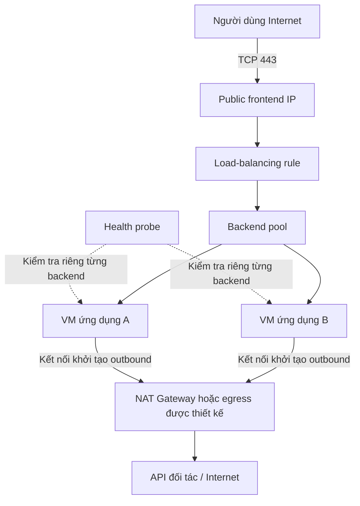
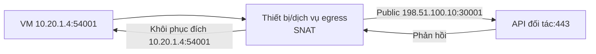
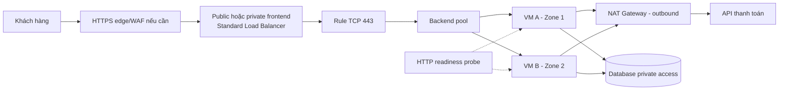

# Health probe, quy tắc cân bằng tải và kết nối ra ngoài

Khi một ứng dụng chạy trên hai hoặc nhiều máy ảo (VM) trong Microsoft Azure, việc đặt các VM vào cùng mạng ảo chưa đủ để biến chúng thành một dịch vụ có khả năng chịu lỗi. Người dùng cần một địa chỉ ổn định để gửi yêu cầu; lưu lượng phải được phân phối đến các máy còn phục vụ được; và các máy phía sau cũng phải kết nối ra Internet hoặc tới hệ thống bên ngoài khi nghiệp vụ yêu cầu. Ba vấn đề này liên quan nhưng **không phải cùng một chức năng**.

Trong chương **Cân bằng tải và phân phối ứng dụng** thuộc module **CLOUD_PROVIDERS_AZURE**, bài học tập trung vào **Azure Standard Load Balancer**: cách **health probe** phát hiện backend đủ điều kiện nhận kết nối, cách **load-balancing rule** ánh xạ lưu lượng từ frontend vào backend pool, và cách thiết kế **outbound connectivity/SNAT** riêng để workload kết nối ra ngoài một cách dự đoán được. Kiến thức gắn với bối cảnh quản lý subscription, resource group, Microsoft Entra ID, mạng ảo, VM, dữ liệu, giám sát, bảo mật và kiểm soát chi phí khi triển khai kiến trúc ứng dụng Azure.

Sau bài học, bạn có thể:

- Giải thích vai trò của frontend IP configuration, backend pool, health probe, load-balancing rule và Network Security Group (NSG).
- Phân biệt TCP, HTTP và HTTPS health probe; thiết kế readiness endpoint phản ánh đúng khả năng phục vụ.
- Dự đoán tác động của probe lỗi, rule sai port, backend không được gắn pool hoặc NSG chặn lưu lượng.
- Phân biệt kết nối **inbound** với kết nối **outbound**; giải thích source network address translation (SNAT).
- Lựa chọn NAT Gateway, outbound rule của public Standard Load Balancer hoặc đường egress qua firewall theo nhu cầu.
- Triển khai bộ khung load balancer bằng Azure CLI và kiểm thử cả chiều vào lẫn chiều ra.

## 1. Đặt vấn đề: ba chức năng độc lập

Giả sử một API bán hàng chạy trên hai VM ở hai Availability Zone. Khách hàng truy cập một tên miền công khai, còn VM cần gọi API đối tác để xác minh thanh toán.

1. **Đường vào (inbound):** khách hàng kết nối đến IP frontend của load balancer; rule chọn backend và cổng đích.
2. **Kiểm tra sức khỏe (health probing):** Azure kiểm tra mỗi backend theo cấu hình; backend không đạt điều kiện sẽ không được lựa chọn cho luồng kết nối mới phù hợp với rule.
3. **Đường ra (outbound):** VM khởi tạo kết nối đến API đối tác. Đường đi, địa chỉ public IP nguồn và số cổng SNAT sẵn có phải được thiết kế riêng.

Một load-balancing rule hoạt động đúng **không chứng minh** workload có outbound Internet. Ngược lại, VM gọi Internet thành công **không chứng minh** public frontend đã được cấu hình đúng hoặc backend vượt qua health probe.

### Sơ đồ tổng quan



Sơ đồ thể hiện quan hệ logic. Probe và luồng người dùng khác nhau về nguồn, giao thức/cổng có thể khác, và chính sách cho phép có thể khác. **Public Load Balancer không tự đóng vai trò NAT Gateway.** Khi ứng dụng dùng Azure Firewall, User-Defined Route (UDR) hoặc mô hình mạng khác, sơ đồ egress phải được điều chỉnh theo tuyến đường thực tế.

## 2. Azure Load Balancer hoạt động ở lớp nào?

**Azure Load Balancer** là dịch vụ cân bằng tải **Layer 4 (TCP/UDP)**. Nó chuyển tiếp các flow dựa trên thông tin kết nối mạng như IP, cổng và giao thức. Nó không phải reverse proxy hiểu toàn bộ HTTP request, không tự route theo URL path và không xử lý chính sách đăng nhập của ứng dụng.

| Dịch vụ | Tầng xử lý chính | Phù hợp khi |
|---|---|---|
| **Azure Standard Load Balancer** | Layer 4 – TCP/UDP | Cân bằng TCP/UDP đến VM, VM Scale Sets hoặc backend được hỗ trợ, public hay private |
| **Azure Application Gateway (có WAF tùy cấu hình)** | Layer 7 – HTTP/HTTPS | Route theo host/path, TLS termination, cookie affinity, bảo vệ HTTP |
| **Azure Front Door** | Lớp ứng dụng tại global edge | Phân phối ứng dụng web đa vùng, tăng tốc, bảo vệ và điều hướng yêu cầu toàn cầu |
| **Azure Traffic Manager** | Điều phối dựa trên DNS | Chọn endpoint theo chính sách DNS, không proxy từng kết nối |

Điểm dễ nhầm: Standard Load Balancer **có thể dùng HTTP/HTTPS probe** để đánh giá backend, nhưng **load-balancing rule vẫn là Layer 4**. Khả năng hỏi một URL sức khỏe không biến Load Balancer thành Application Gateway.

### Public và internal load balancer

- **Public Load Balancer:** frontend dùng public IP; phù hợp khi cần công bố dịch vụ TCP/UDP ra Internet theo thiết kế, kết hợp NSG và bảo vệ lớp ứng dụng thích hợp.
- **Internal Load Balancer:** frontend dùng private IP của VNet; phù hợp cho service-to-service, ứng dụng nội bộ hoặc tầng API/database cần một điểm kết nối riêng.

Một ứng dụng có thể có cả public và internal load balancer. Chọn loại theo người gọi và ranh giới bảo mật, không theo việc ứng dụng chạy bao nhiêu VM. Trong bài này, mọi ví dụ cấu hình dùng **Standard SKU**; không lấy cấu hình của các thế hệ SKU cũ làm chuẩn triển khai mới.

## 3. Những thành phần cần ghép đúng với nhau

Hãy xem một rule đơn giản: người dùng gọi `203.0.113.10:443`, Azure chuyển kết nối đến `10.20.1.4:443` hoặc `10.20.1.5:443`.

| Thành phần | Ý nghĩa | Ví dụ |
|---|---|---|
| **Frontend IP configuration** | IP/điểm tiếp nhận kết nối | Public IP của dịch vụ hoặc IP riêng trong subnet |
| **Backend pool** | Tập hợp địa chỉ/tài nguyên có thể nhận flow | VM-A `10.20.1.4`, VM-B `10.20.1.5` |
| **Health probe** | Kiểm tra từng backend có đủ điều kiện nhận kết nối | HTTP GET `/health/ready` qua cổng 8080 |
| **Load-balancing rule** | Gắn frontend, backend pool, protocol, port và probe | TCP 443 → TCP 443 |
| **NSG và host firewall** | Quyết định lưu lượng nào được phép đi tới backend | Cho phép cổng ứng dụng và probe tương ứng |
| **Route/NAT egress** | Quyết định đường đi cho kết nối do backend khởi tạo | NAT Gateway hoặc firewall trong hub |

**Backend pool rỗng**, hoặc VM có trong pool nhưng probe không đạt, đều có thể khiến frontend không phục vụ được request. **Probe khỏe** cũng không đảm bảo người dùng truy cập thành công, nếu một NSG, tường lửa hệ điều hành hoặc xác thực ứng dụng chặn luồng người dùng.

### Flow được phân phối ra sao?

Standard Load Balancer sử dụng cơ chế ánh xạ flow dựa trên hash của thông tin kết nối. Với mặc định, hash thường dựa trên **5-tuple**: source IP, source port, destination IP, destination port và protocol. Các flow khác nhau có thể rơi vào backend khác nhau; không nên giả định phân phối theo kiểu round-robin từng HTTP request.

Một flow TCP đang tồn tại thường gắn với backend đã được chọn; hai request HTTP trên cùng một kết nối giữ cùng đường kết nối đó. Việc bật tùy chọn **session persistence** theo client IP hoặc client IP + protocol có thể giảm số backend được chọn cho những flow từ cùng nguồn, nhưng không thay thế thiết kế session ứng dụng. Với web app cần chia sẻ trạng thái, ưu tiên lưu session ở tầng phù hợp (ví dụ cache hoặc database) hơn là phụ thuộc hoàn toàn vào tính dính kết nối.

## 4. Health probe: Load Balancer kiểm tra điều gì?

**Health probe** là phép kiểm tra định kỳ của nền tảng Azure tới từng backend. Với rule gắn probe, backend đáp ứng điều kiện sẽ được xem là đủ điều kiện nhận các flow mới; backend không đạt điều kiện sẽ bị loại khỏi tập ứng viên theo cơ chế của dịch vụ. Probe không đọc sức khỏe tổng thể của subscription hay dashboard ứng dụng; nó kiểm tra **giao thức, cổng và đường dẫn** đã khai báo.

### 4.1. Ba loại probe phổ biến

| Loại probe | Kiểm tra cơ bản | Điều chưa được chứng minh |
|---|---|---|
| **TCP** | Backend phản hồi được quá trình thiết lập kết nối TCP trên cổng cấu hình | API có trả kết quả đúng, DB có sẵn sàng hay không |
| **HTTP** | Backend trả HTTP **200 OK** cho yêu cầu GET đến path và cổng quy định | Những endpoint nghiệp vụ khác đều khỏe, người dùng có quyền truy cập |
| **HTTPS** | Thực hiện kiểm tra HTTPS đến endpoint và kỳ vọng phản hồi thành công theo yêu cầu probe | Toàn bộ luồng xác thực, nghiệp vụ hoặc mọi loại client đều hoạt động |

Với HTTP/HTTPS probe của Azure Load Balancer, hãy chuẩn bị endpoint phản hồi **200** khi sẵn sàng. Không dùng redirect `301/302`, yêu cầu đăng nhập `401`, lỗi `500` hoặc một endpoint chỉ phản hồi `204` làm kết quả khỏe nếu dịch vụ probe yêu cầu 200. Không đặt URL có query string/host binding đặc thù mà probe không gửi được; kiểm tra khả năng của loại probe và endpoint thực tế.

Ví dụ health endpoint:

```http
GET /health/ready HTTP/1.1
Host: 10.20.1.4:8080

HTTP/1.1 200 OK
Content-Type: application/json

{"status":"ready"}
```

Đây là minh họa phản hồi của ứng dụng, không phải bản sao byte-for-byte request probe Azure thực gửi. Endpoint cần có khả năng phản hồi theo cách probe hỗ trợ, kể cả khi không có thông tin đăng nhập và tên host của người dùng cuối.

### 4.2. Cấu hình cốt lõi

- **Protocol:** TCP, HTTP hoặc HTTPS.
- **Port:** cổng lắng nghe trên **backend** được probe; có thể giống hoặc khác cổng phục vụ client.
- **Path:** đường dẫn kiểm tra cho HTTP/HTTPS, ví dụ `/health/ready`.
- **Interval:** khoảng thời gian giữa các lần probe.
- **Unhealthy threshold:** số lần probe liên tiếp không đạt để đánh dấu backend không khỏe, theo quy tắc triển khai của dịch vụ.

Interval ngắn có thể phát hiện nhanh hơn nhưng cũng tăng độ nhạy với sự cố chớp nhoáng. Threshold lớn hơn thường giảm dao động do lỗi tạm thời nhưng kéo dài thời gian phát hiện. Chọn giá trị theo SLO, thời gian khởi động ứng dụng, mức tải và kết quả thử nghiệm thực tế. Đừng thay giá trị mặc định mà không đo tác động.

### 4.3. Nguồn probe và Network Security Group

Với health probe IPv4 của Azure Load Balancer, một địa chỉ nền tảng quan trọng là **`168.63.129.16`**. Ở NSG, **service tag `AzureLoadBalancer`** được dùng để nhận biết lưu lượng probe liên quan; rule mặc định của NSG thường cho phép nguồn này, nhưng một rule tùy chỉnh có mức ưu tiên cao hơn có thể chặn nó.

Cần kiểm tra **cả NSG, firewall của hệ điều hành, listener trên VM và cách ứng dụng bind địa chỉ**. Một probe tới cổng 8080 sẽ không vượt qua chỉ nhờ NSG mở cổng 443. Không mở `0.0.0.0/0` tới cổng health nội bộ chỉ để sửa probe: hãy dùng nguồn probe/thông số dịch vụ phù hợp và hạn chế truy cập không cần thiết.

Đường đi của probe khác với đường của client:

```text
Azure Load Balancer health probe  ──>  backend:<probe-port>
Người dùng / nguồn ứng dụng        ──>  frontend:<frontend-port>
                                           │
                                     Load-balancing rule
                                           │
                                           └──> backend:<backend-port>
```

Một dịch vụ có thể chọn probe cổng 8080 trong khi rule nhận TCP 443 rồi chuyển tiếp tới backend TCP 443. Hai luồng phải được kiểm thử và cấp phép độc lập theo yêu cầu.

## 5. Thiết kế health endpoint đúng: liveness không phải readiness

Đừng chỉ đặt `/health` trả 200 vô điều kiện để “xanh dashboard”. Cần quyết định ứng dụng **đang chạy** hay **thực sự sẵn sàng nhận kết nối mới**.

| Kiểu kiểm tra ứng dụng | Câu hỏi | Cách dùng |
|---|---|---|
| **Liveness** | Tiến trình còn hoạt động hay không? | Giúp nền tảng/runtime quyết định khởi động lại hoặc phát hiện crash theo cơ chế tương ứng |
| **Readiness** | Instance có thể xử lý request mới ngay bây giờ hay không? | Phù hợp làm endpoint để load balancer quyết định nhận flow mới |
| **Deep health/diagnostics** | Toàn bộ dependency và nghiệp vụ có khỏe không? | Dùng cho dashboard, cảnh báo và điều tra; không nhất thiết dùng làm probe duy nhất |

Ví dụ một API .NET hoặc Java sau khi deploy cần nạp cấu hình, thiết lập connection pool và khởi tạo cache. Liveness có thể khỏe từ sớm, nhưng readiness chỉ nên trả 200 khi endpoint đã phục vụ được request. Khi instance cần rút khỏi pool để bảo trì, readiness có thể chuyển sang trạng thái không đạt; việc rút kết nối hiện hữu cần có kế hoạch riêng.

**Tránh phụ thuộc quá mức:** nếu readiness bắt buộc gọi đồng bộ năm dịch vụ từ xa, một lỗi tạm thời của một dependency chung có thể làm **mọi** backend bị đánh dấu unhealthy, dù ứng dụng vẫn phục vụ được nhiều chức năng. Phân biệt dependency quan trọng đến mức phải rút instance và dependency chỉ cần cảnh báo. Giữ endpoint nhẹ, nhanh, có timeout, không chứa dữ liệu nhạy cảm và không ghi log ồn ào cho từng probe.

### Tình huống phản hồi

| Kết quả `/health/ready` | Cách hiểu phù hợp |
|---|---|
| 200, trả nhanh | Backend đủ điều kiện theo tiêu chí probe |
| TCP kết nối được nhưng HTTP 500 | TCP probe có thể vẫn cho là khỏe, HTTP probe phát hiện lỗi |
| 301/302 sang trang đăng nhập | Probe HTTP không đáp ứng yêu cầu 200; sửa endpoint |
| 401 vì yêu cầu token | Probe nền tảng không có token người dùng; tách đường readiness không yêu cầu auth |
| Timeout hoặc không có listener | Kiểm tra app, port, NSG/host firewall, route và tải hệ thống |
| Tất cả backend đều unhealthy | Rule không còn backend đủ điều kiện cho flow mới; cần xác định lỗi chung thay vì chỉ tăng số VM |

## 6. Load-balancing rule: nối frontend với backend

Một **load-balancing rule** xác định kết nối nào tới frontend được phân phối vào pool nào. Thành phần cấu hình quan trọng thường gồm:

1. **Frontend IP configuration:** địa chỉ nhận lưu lượng.
2. **Protocol:** TCP hoặc UDP; lựa chọn `All` có thể áp dụng ở một số cấu hình đặc biệt như HA ports của internal load balancer.
3. **Frontend port:** cổng người dùng/gateway kết nối tới.
4. **Backend port:** cổng ứng dụng trên VM đích.
5. **Backend pool:** tập hợp ứng viên được cân bằng tải.
6. **Health probe:** tiêu chí đủ điều kiện của từng backend.
7. **Tùy chọn flow:** session persistence, idle timeout, TCP reset và các thiết lập tương thích khác.

Ví dụ cho ứng dụng nội bộ:

| Rule | Frontend | Backend | Probe |
|---|---|---|---|
| `rule-api` | Private frontend `10.20.0.10:443/TCP` | Pool `api-prod`, port `8443/TCP` | HTTPS `/health/ready` trên 8443 |
| `rule-metrics` (nếu thực sự cần) | Private frontend `10.20.0.10:9090/TCP` | Pool `api-prod`, port `9090/TCP` | Probe phù hợp trên 9090 |

Không phải ứng dụng nào cũng cần công bố cổng metrics qua load balancer. Cổng quản trị, metrics và probe nên nằm trong mạng và phạm vi quyền đủ hẹp.

### 6.1. Cân bằng tải không có nghĩa phân tán đồng đều từng request

Một rule Layer 4 giữ tính nhất quán của flow; nó không đọc cookie hoặc URL. Nhiều kết nối từ cùng một máy NAT có thể tập trung vào một backend tùy cấu hình hash/session persistence. Vì vậy, “hai VM” không đồng nghĩa CPU của hai máy luôn bằng nhau.

Để cải thiện phân phối:

- Đảm bảo backend có cấu hình và khả năng xử lý tương đương.
- Cân nhắc tác động của keep-alive và connection pooling.
- Xem lại session persistence trước khi bật vì nó có thể tạo phân phối không đều.
- Theo dõi lưu lượng, CPU, số kết nối và độ trễ tại **từng** backend.
- Thiết kế ứng dụng stateless hoặc dùng shared state khi có thể.

### 6.2. Idle timeout và TCP reset

**Idle timeout** xác định khoảng không có lưu lượng trước khi một flow nhàn rỗi có thể bị loại khỏi trạng thái theo dõi của load balancer. Tùy chọn **TCP reset** có thể giúp endpoint phát hiện kết nối idle đã bị đóng một cách rõ hơn khi được hỗ trợ. Đừng dùng idle timeout như giải pháp cho readiness lỗi hoặc backend bị quá tải.

Với kết nối lâu dài (WebSocket, ứng dụng giữ TCP session, gRPC), cần kiểm tra keep-alive, timeout ở client/server, hành vi của SDK và nhu cầu kết nối bền vững. Thử nghiệm trên cấu hình thực tế thay vì mặc định mọi kết nối sẽ tồn tại vô hạn.

### 6.3. Floating IP và HA ports

**Floating IP** (Direct Server Return trong một số tình huống) là lựa chọn đặc thù, có tác động đến mô hình địa chỉ/port của backend; không bật cho web app thông thường chỉ vì tên “floating” nghe có vẻ sẵn sàng cao. **HA ports** của internal Standard Load Balancer hữu ích cho các cấu hình cần cân bằng nhiều cổng, thường gặp ở network virtual appliance, nhưng cần thiết kế firewall/routing riêng. Không nhầm HA ports với kiểm tra HTTP path hoặc tính năng sticky session.

## 7. Backend pool, tình trạng lỗi và khả năng chịu sự cố

Backend pool có thể tham chiếu các cấu hình IP của NIC trên VM, backend của VM Scale Sets hoặc các địa chỉ theo cách mà Standard Load Balancer hỗ trợ. Cách gắn thành viên phụ thuộc mô hình pool và loại backend. **Thêm VM vào cùng subnet không tự đưa VM vào backend pool.** Cũng cần kiểm tra backend có listener trên port thực tế và ứng dụng bind đến địa chỉ mà probe tiếp cận được.

### Trường hợp một backend không khỏe

Giả sử pool chứa ba VM:

```text
VM-A   HTTP probe = 200   → đủ điều kiện nhận flow mới
VM-B   HTTP probe = 500   → không đủ điều kiện sau ngưỡng lỗi
VM-C   HTTP probe = 200   → đủ điều kiện nhận flow mới
```

Load Balancer sẽ không tiếp tục chọn VM-B cho các flow mới theo trạng thái probe tương ứng. **Không mặc định mọi kết nối TCP đang tồn tại trên VM-B đều bị cắt ngay lập tức**; hành vi còn phụ thuộc loại flow, thời điểm lỗi và tùy chọn xử lý kết nối. Nếu cần draining phục vụ triển khai không gián đoạn, phải phối hợp readiness, dừng tiếp nhận yêu cầu mới, thời gian xử lý yêu cầu đang chạy, shutdown của ứng dụng và chiến lược rolling update.

Nếu cả A, B và C đều unhealthy, việc thêm load-balancing rule mới không sửa được lỗi. Hãy xác minh có phải tất cả instance cùng mất database, endpoint readiness bị khóa bởi auth, NSG chặn probe hay cấu hình mới triển khai làm listener không hoạt động.

### Availability Zones và scale-out

Standard Load Balancer có thể được dùng trong kiến trúc đa Availability Zone khi region/SKU và cấu hình liên quan hỗ trợ. Tuy nhiên, frontend có khả năng phân vùng hoặc zone-redundant **không tự đảm bảo ứng dụng chịu lỗi vùng** nếu mọi VM, lưu trữ và dependency đều nằm trong một zone. Kiến trúc cần:

- Backend phân bố qua các zone theo yêu cầu độ sẵn sàng.
- SKU frontend IP và load balancer phù hợp với thiết kế zone.
- Health probe phản ánh trạng thái sẵn sàng thật của từng backend.
- Ứng dụng tránh lưu trạng thái quan trọng chỉ trên một VM; dữ liệu và session có phương án phù hợp.
- VM Scale Sets hoặc giải pháp điều phối triển khai/scale theo metric khi yêu cầu tự động mở rộng.
- Diễn tập tình huống mất một backend, một zone và lỗi dependency chung.

**Load balancing không phải auto scaling.** LB chọn nơi chuyển flow trong tập backend hiện có; số VM chỉ tăng/giảm khi một cơ chế khác thực hiện việc mở rộng.

## 8. Outbound connectivity: VM muốn gọi Internet phải đi đường nào?

**Outbound connection** bắt đầu từ backend, ví dụ API xử lý đơn hàng gọi `api.partner.example:443`. Đầu ra cần xác định:

1. **Next hop:** traffic từ subnet đi đâu theo route hiệu lực?
2. **Dịch địa chỉ:** nếu IP riêng `10.20.1.4` kết nối tới Internet, nguồn thường cần được chuyển thành public IP qua một cơ chế SNAT.
3. **Public source IP:** đối tác sẽ thấy IP nào, có thể allowlist ổn định không?
4. **Khả năng mở rộng:** có đủ cổng SNAT khi nhiều instance tạo nhiều kết nối đồng thời?
5. **Chính sách:** có firewall, lọc đích, logging, DNS hoặc ràng buộc compliance không?



Địa chỉ và cổng là dữ liệu minh họa, không phải cấu hình thực của Azure. SNAT ánh xạ một kết nối từ địa chỉ riêng sang public source IP/cổng tương ứng, giúp phản hồi đến đúng flow. Khả năng kết nối nội bộ đến SQL qua Private Endpoint **không đồng nghĩa** có đường ra Internet.

### 8.1. Các lựa chọn kết nối ra ngoài

| Lựa chọn | Cách hoạt động ở mức khái quát | Điểm cần cân nhắc |
|---|---|---|
| **NAT Gateway** | Gắn với subnet, cung cấp SNAT outbound qua public IP/prefix được chỉ định | Phù hợp cho egress rõ ràng, tăng khả năng mở rộng cổng; không mở public inbound tới VM |
| **Public Standard LB outbound rule** | Dùng frontend public IP của Load Balancer và phân bổ SNAT cho backend pool theo rule | Cần cấu hình pool, frontend, cổng, chính sách outbound và theo dõi SNAT |
| **Outbound SNAT qua inbound load-balancing rule** | Một số cấu hình public Load Balancer có thể cung cấp outbound SNAT khi tùy chọn tương ứng được bật | Không nên phụ thuộc ngầm định; có thể thiếu cổng và bị thay đổi khi chỉnh rule |
| **Azure Firewall/NVA** | Traffic được định tuyến tới thiết bị kiểm soát egress và có thể thực hiện NAT | Phù hợp kiểm tra/ghi log/giới hạn đích; cần UDR, policy và thiết kế đường trả lời |
| **Public IP trực tiếp trên VM** | VM có đường truy cập public theo cấu hình và tuyến đường thực tế | Tăng bề mặt phơi lộ và khó tập trung kiểm soát, ít phù hợp quy mô lớn |
| **Default outbound access** | Đường kết nối outbound nền tảng có thể tồn tại với một số cấu hình/môi trường cũ | **Không nên xem là giải pháp production đáng tin cậy**; có thay đổi theo mô hình subnet và chính sách nền tảng |

Đối với subnet workload mới, hãy **thiết kế explicit outbound** ngay từ đầu. Khi cần public IP nguồn cố định và số kết nối lớn, NAT Gateway thường là lựa chọn đơn giản. Khi cần kiểm soát egress theo FQDN/ứng dụng, ghi log an ninh và kiểm tra chính sách tập trung, cân nhắc Azure Firewall theo kiến trúc. Một public LB không bắt buộc nếu ứng dụng chỉ có private inbound nhưng vẫn cần gọi Internet.

### 8.2. NAT Gateway và public Standard Load Balancer cùng tồn tại

Một kiến trúc thường gặp:

```text
Internet client ──> Public Standard LB ──> VM pool (inbound)
VM pool ──> NAT Gateway gắn vào subnet ──> API bên ngoài (outbound)
```

Khi NAT Gateway được cấu hình trên subnet, dịch vụ này được ưu tiên cho **các kết nối outbound mới** trong những trường hợp hỗ trợ; không nên coi outbound rule của Load Balancer là đường mặc định của cùng subnet. Kết nối inbound hiện có qua frontend LB vẫn phục vụ theo cấu hình inbound, tách khỏi kết nối outbound do backend chủ động khởi tạo.

Nên xác định rõ chủ sở hữu và IP dùng cho egress. Khi chuyển từ Load Balancer outbound SNAT sang NAT Gateway, public IP nguồn mà API đối tác thấy có thể thay đổi; cần cập nhật allowlist, kiểm tra DNS, retry logic và monitoring trước cutover.

### 8.3. Outbound rule của Standard Load Balancer

Một **outbound rule** thường gắn:

- Public frontend IP configuration dùng làm nguồn SNAT.
- Backend pool chứa các instance cần đi ra ngoài.
- Protocol và cấu hình thời gian nhàn rỗi phù hợp.
- Cách phân bổ hoặc cấu hình số cổng outbound SNAT trên mỗi backend.

Outbound rule **không phải** inbound NAT rule: inbound NAT rule đưa một kết nối đến một backend/cổng cụ thể, thường phục vụ nhu cầu đặc thù; outbound rule điều khiển cách backend khởi tạo kết nối ra ngoài. Load-balancing rule phân phối kết nối inbound qua pool, còn outbound rule quản lý SNAT outbound. Ba loại rule không nên bị nhầm lẫn.

Nếu sử dụng outbound rule, kiểm tra quan hệ giữa nó với tùy chọn outbound SNAT trên inbound rule để tránh cấu hình SNAT chồng chéo. Đừng bật/tắt `disableOutboundSnat` theo một đoạn hướng dẫn có sẵn mà chưa xác nhận backend đã có phương án egress khác; làm vậy có thể khiến VM ngừng gọi được dịch vụ bên ngoài.

### 8.4. Forced tunneling và đường đi thực tế

Nếu subnet có `0.0.0.0/0` UDR trỏ tới Azure Firewall/NVA hoặc đường hybrid, **route hiệu lực** có thể đưa gói tin theo đường khác với NAT Gateway/LB outbound dự kiến. Việc phối hợp NAT Gateway, UDR, Internet gateway và firewall cần được xét theo quy tắc định tuyến và precedence của từng dịch vụ. Không viết tài liệu thiết kế chỉ với câu “mọi thứ đi qua NAT Gateway” nếu effective route cho thấy một next hop khác.

Khi outbound đi qua on-premises, cần thiết kế NAT ở vị trí thực hiện egress, tuyến về, DNS và băng thông. Với private endpoint của dịch vụ Azure, kết nối nằm trên đường riêng được hỗ trợ và không cần đánh đồng với Internet egress qua public SNAT.

## 9. SNAT port exhaustion: vì sao có IP public nhưng vẫn lỗi?

Một public IP có số lượng port TCP/UDP hữu hạn. Nhiều kết nối outbound đồng thời, đặc biệt tới cùng nhóm đích, có thể tạo áp lực lên cổng SNAT được cấp phát. Khi hết cổng khả dụng, các kết nối mới có thể thất bại hoặc timeout dù VM còn CPU, DNS hoạt động và internet route đúng.

Ví dụ: ba VM xử lý hàng chục nghìn đơn hàng, mỗi request tạo một HTTP client mới đến cùng API đối tác rồi đóng ngay. Ứng dụng tạo nhiều kết nối TCP ngắn, tiêu thụ cổng SNAT nhanh hơn mức dự kiến. Việc scale-out số VM không tự bảo đảm tổng cấu hình SNAT đủ nếu mỗi backend có cấp phát cổng thấp hoặc một public IP/pool đang chịu tải lớn.

### Dấu hiệu nhận biết

- Lỗi `connect timeout` hoặc `socket error` xuất hiện nhiều khi lưu lượng tăng, trong khi CPU và bộ nhớ vẫn ổn.
- Những request mới đến API ngoài thất bại, nhưng luồng nội bộ hoặc kết nối đã tồn tại vẫn xử lý được.
- Telemetry của public Load Balancer/NAT Gateway cho thấy mức dùng cổng SNAT hoặc số kết nối tăng cao (theo metric được hỗ trợ).
- Kết nối tới một đích/giao thức nhất định bị ảnh hưởng nhiều hơn các đích khác.

### Cách giảm rủi ro

1. **Tái sử dụng kết nối:** dùng HTTP keep-alive, connection pooling và các thư viện client quản lý socket đúng cách.
2. **Kiểm soát concurrency:** giới hạn số outbound call đồng thời và áp dụng retry có backoff/jitter để tránh retry storm.
3. **Chọn egress phù hợp:** dùng NAT Gateway khi cần cấp phát SNAT lớn và linh hoạt; dự toán public IP/prefix theo nhu cầu thực tế, không chỉ số VM.
4. **Theo dõi SNAT:** thiết lập dashboard và cảnh báo theo metric khả dụng, phân tích peak load thay vì chỉ giá trị trung bình.
5. **Giảm kết nối không cần thiết:** cache dữ liệu phù hợp, gom request hoặc dùng cơ chế bất đồng bộ khi nghiệp vụ cho phép.
6. **Diễn tập tải:** kiểm thử đồng thời app, LB, DNS, egress và API đối tác; không bỏ qua giới hạn rate/quota của đối tác.

Không chỉ tăng timeout hoặc mở rộng frontend port để “chữa” SNAT exhaustion. Cần xác định loại egress đang được sử dụng và tài nguyên cổng thực tế.

## 10. Bảo mật luồng vào và luồng ra

**Load Balancer không thay thế NSG, TLS, xác thực API hoặc WAF.** Standard Load Balancer phân phối flow mạng theo rule; một request HTTP độc hại vẫn có thể được chuyển đến backend nếu ứng dụng không tự bảo vệ hoặc không có tầng phân tích HTTP phù hợp.

### Inbound

- Với dịch vụ công khai, chỉ mở cổng cần thiết. Dùng TLS và cơ chế xác thực thích hợp trên ứng dụng hoặc điểm vào hỗ trợ.
- Nếu cần WAF, route theo host/path hoặc TLS termination tập trung, xem xét Application Gateway hoặc Front Door thay vì kỳ vọng Load Balancer Layer 4 làm các việc này.
- **NSG ở backend** phải cho phép lưu lượng người dùng trên **backend port**, với nguồn được phép theo kiến trúc. Với public LB, backend có thể nhìn thấy địa chỉ nguồn của client; đừng mặc định nguồn luôn là frontend IP của LB.
- Probe cần được cho phép theo nguồn nền tảng; không mở cổng probe ra Internet nếu không cần.
- Không mở RDP/SSH cho toàn Internet chỉ để sửa lỗi quản trị backend; ưu tiên Azure Bastion, VPN hoặc phương án truy cập đặc quyền được kiểm soát.

### Outbound

- Quyết định API/domain đích được phép truy cập; áp dụng egress firewall/policy khi yêu cầu bảo mật đòi hỏi.
- Chọn public egress IP cố định nếu đối tác dùng allowlist và quản lý thay đổi IP có kế hoạch.
- Dùng managed identity và kiểm tra quyền khi gọi dịch vụ Azure; mạng riêng không thay thế data-plane authorization.
- Giới hạn quyền của automation/deployment identity đối với frontend IP, LB rule, NAT Gateway và route table.
- Bật logging, giám sát và kiểm soát thay đổi để phát hiện hành vi outbound bất thường.

## 11. Ví dụ kiến trúc cho ứng dụng API nhiều VM

Giả sử một doanh nghiệp triển khai ứng dụng xử lý đơn hàng với yêu cầu:

- Người dùng truy cập điểm vào công khai có TLS.
- Hai backend VM nằm trong cùng VNet, triển khai qua những zone được hỗ trợ.
- Nếu một VM khởi động lỗi hoặc ứng dụng không sẵn sàng, nó tạm ngừng nhận kết nối mới.
- Backend gọi API thanh toán bên ngoài qua một địa chỉ nguồn ổn định để đối tác allowlist.
- Database nằm sau private access; không được truy cập tùy tiện từ Internet.
- Nhóm vận hành cần biết lỗi đến từ load balancing, ứng dụng hay outbound networking.

Một phương án:



Nếu điểm vào HTTPS được terminate tại WAF/Application Gateway, thiết kế cổng và TLS giữa gateway → Load Balancer → VM phải được xác định tường minh. **Không cần đồng thời cả WAF và public LB cho mọi hệ thống**; một số kiến trúc có thể dùng internal LB sau gateway, hoặc bỏ LB Layer 4 nếu gateway tự đáp ứng đủ yêu cầu phân phối ứng dụng. Sơ đồ chỉ thể hiện các tùy chọn có thể phối hợp, không yêu cầu triển khai toàn bộ trong mọi trường hợp.

### Ma trận kiểm soát

| Yêu cầu | Cấu hình thiết kế | Bằng chứng |
|---|---|---|
| VM lỗi không nhận flow mới | Probe readiness riêng gắn vào LB rule | Thử làm một VM trả 503 và theo dõi probe |
| User chỉ gọi HTTPS | Điểm vào TLS và NSG/backend port phù hợp | Truy cập endpoint thực, kiểm tra chứng chỉ và HTTP redirect nếu dùng |
| Không để API đối tác thấy IP thay đổi ngẫu nhiên | NAT Gateway/public IP do tổ chức quản lý | Từ backend kiểm tra địa chỉ public egress, đối chiếu allowlist |
| Database không public | Private access/Private Endpoint, DNS, quyền dữ liệu | Kiểm tra tên DNS, route và xác thực bằng danh tính được phép |
| Phát hiện lỗi về một VM | Metric probe, log ứng dụng, cảnh báo riêng | Dashboard hiển thị trạng thái từng backend và lỗi API |
| Chịu lỗi một zone | Backend và dependency phân bố hợp lý, SKU phù hợp | Diễn tập rút một backend/zone theo kế hoạch |

## 12. Thực hành Azure CLI: tạo Standard Load Balancer và health probe

Ví dụ này chỉ tạo các thành phần mạng cơ bản của một **public Standard Load Balancer**, sau đó minh họa cách liên kết VM có sẵn và bổ sung NAT Gateway cho outbound. Nó **không** triển khai VM, database, TLS certificate hay một ứng dụng production. Mục tiêu là hiểu rõ từng đối tượng thay vì chạy một template lớn mà không biết bên trong.

**Điều kiện:** bạn có quyền tạo network resource ở subscription thử nghiệm; Azure CLI đã được cài đặt; resource group/VNet/subnet và các VM thử nghiệm đã tồn tại (hoặc bạn chủ động tạo bằng quy trình lab riêng); cổng backend 8080 có listener trả 200 tại `/health/ready`. Các lệnh có thể phát sinh chi phí khi tạo public IP, load balancer hoặc NAT Gateway. Chỉ chạy trong môi trường được phép và thay các giá trị mẫu bằng tên/ID thực tế.

### 12.1. Chọn subscription và biến môi trường

Ví dụ dùng **Bash/Azure Cloud Shell ở Bash mode**:

```bash
az login

SUBSCRIPTION_ID="<subscription-id-lab>"
RG="rg-lb-demo"
LOCATION="southeastasia"
PIP="pip-web-demo"
LB="lb-web-demo"
FRONTEND="fe-web"
BACKEND="be-web"
PROBE="probe-ready"
RULE="rule-http"

az account set --subscription "$SUBSCRIPTION_ID"
az account show --query "{id:id, tenant:tenantId, name:name}" -o table
```

Tạo resource group nếu chưa có:

```bash
az group create --name "$RG" --location "$LOCATION"
```

Không dùng trực tiếp `<subscription-id-lab>` làm ID thật. Môi trường demo sử dụng HTTP để dễ quan sát mapping cổng; **không dùng HTTP không mã hóa cho dữ liệu nhạy cảm ở production**.

### 12.2. Tạo public IP và Standard Load Balancer

```bash
az network public-ip create \
  --resource-group "$RG" \
  --name "$PIP" \
  --location "$LOCATION" \
  --sku Standard \
  --allocation-method Static

az network lb create \
  --resource-group "$RG" \
  --name "$LB" \
  --location "$LOCATION" \
  --sku Standard \
  --public-ip-address "$PIP" \
  --frontend-ip-name "$FRONTEND" \
  --backend-pool-name "$BACKEND"
```

Khi cần đa zone/zone-redundant, phải chọn cấu hình public IP và tài nguyên phù hợp với region/SKU và yêu cầu sẵn sàng của workload. Demo không giả định region nào cũng cung cấp cùng danh sách Availability Zone.

### 12.3. Tạo HTTP health probe

```bash
az network lb probe create \
  --resource-group "$RG" \
  --lb-name "$LB" \
  --name "$PROBE" \
  --protocol Http \
  --port 8080 \
  --path "/health/ready" \
  --interval 5 \
  --threshold 2
```

Probe gọi trực tiếp backend trên cổng 8080. Ứng dụng cần trả `200 OK` khi sẵn sàng. Nếu cổng 8080 không lắng nghe, NSG/host firewall chặn probe hoặc endpoint yêu cầu đăng nhập, probe sẽ không đạt, dù load balancer đã tạo thành công.

### 12.4. Tạo load-balancing rule

```bash
az network lb rule create \
  --resource-group "$RG" \
  --lb-name "$LB" \
  --name "$RULE" \
  --protocol Tcp \
  --frontend-ip-name "$FRONTEND" \
  --frontend-port 80 \
  --backend-pool-name "$BACKEND" \
  --backend-port 8080 \
  --probe-name "$PROBE"
```

Đường kết nối trong demo là `public-ip:80/TCP → backend-ip:8080/TCP`. Azure LB thực hiện ánh xạ flow TCP; HTTP path chỉ được sử dụng bởi health probe. Nếu backend cần TLS, có thể chọn rule TCP 443 với backend listener TLS 443 và probe thích hợp, sau khi triển khai chứng chỉ và chính sách TLS.

### 12.5. Gắn NIC của các VM có sẵn vào backend pool

Với mô hình backend pool dựa trên NIC/IP configuration, phải gắn từng NIC của VM thử nghiệm vào pool; tên NIC và IP configuration cần được kiểm tra trong resource group thật. Ví dụ:

```bash
NIC_NAME="<existing-vm-nic>"
IPCONFIG_NAME="<existing-ip-configuration>"

az network nic ip-config address-pool add \
  --resource-group "$RG" \
  --nic-name "$NIC_NAME" \
  --ip-config-name "$IPCONFIG_NAME" \
  --lb-name "$LB" \
  --address-pool "$BACKEND"
```

Lệnh minh họa trường hợp NIC và load balancer ở resource group tương ứng với biến. Nếu NIC nằm ở resource group khác, cần dùng cú pháp/phương thức tham chiếu ID thích hợp với API/CLI và quyền thực tế; đừng mặc định tất cả tài nguyên ở cùng nhóm. Với VM Scale Sets hoặc backend pool dạng IP-based, quy trình liên kết khác và cần theo loại pool đã chọn.

Ngoài việc thêm pool, cần cho phép luồng:

- **User traffic:** TCP 8080 từ nguồn người dùng được phép sau ánh xạ của LB.
- **Probe traffic:** TCP 8080 hoặc HTTP 8080 từ nguồn probe Azure theo thiết kế; dùng service tag phù hợp trong NSG.
- **Host firewall:** không được chặn hai loại lưu lượng mà bạn đã chủ động cho phép.

Đây là hai quy tắc cần xem xét độc lập, không nên cho phép mọi nguồn đến mọi cổng chỉ vì “LB không hoạt động”.

### 12.6. Kiểm tra cấu hình

```bash
az network lb probe show \
  --resource-group "$RG" \
  --lb-name "$LB" \
  --name "$PROBE" \
  --output json

az network lb rule show \
  --resource-group "$RG" \
  --lb-name "$LB" \
  --name "$RULE" \
  --output json

az network public-ip show \
  --resource-group "$RG" \
  --name "$PIP" \
  --query "{ip:ipAddress, allocation:publicIPAllocationMethod, sku:sku.name}" \
  --output table
```

Kết quả cấu hình đúng chưa đủ: cần có backend pool thực sự chứa VM, ứng dụng chạy, NSG phù hợp và probe khỏe. Chỉ sau đó mới có thể kiểm thử HTTP tới public IP trong lab.

### 12.7. Outbound rõ ràng với NAT Gateway (bước riêng, có điều kiện)

**Chỉ chạy đoạn này** nếu bạn đã có một VNet/subnet chứa backend VM cần egress, đã kiểm tra route và không có kiến trúc egress khác sẽ xung đột. Nó tạo thêm public IP và NAT Gateway, có thể phát sinh chi phí:

```bash
NAT_PIP="pip-egress-demo"
NAT="nat-web-demo"
VNET="<existing-backend-vnet>"
SUBNET="<existing-backend-subnet>"

az network public-ip create \
  --resource-group "$RG" \
  --name "$NAT_PIP" \
  --location "$LOCATION" \
  --sku Standard \
  --allocation-method Static

az network nat gateway create \
  --resource-group "$RG" \
  --name "$NAT" \
  --location "$LOCATION" \
  --public-ip-addresses "$NAT_PIP"

az network vnet subnet update \
  --resource-group "$RG" \
  --vnet-name "$VNET" \
  --name "$SUBNET" \
  --nat-gateway "$NAT"
```

Với backend ở một resource group khác, cần chỉnh lệnh/phương pháp tham chiếu tài nguyên cho đúng. **Đừng gắn NAT Gateway lên subnet production chỉ để thử**: việc này có thể đổi public egress IP, ảnh hưởng allowlist, flow đang chạy, chính sách firewall và chi phí. Kiểm tra route, dependency và kế hoạch rollback trước khi thay đổi.

### 12.8. Dọn dẹp và kiểm soát chi phí

Nếu resource group `rg-lb-demo` được tạo riêng cho lab và **không chứa tài nguyên ngoài lab**, có thể xem trước danh sách tài nguyên và chỉ xóa sau khi xác nhận:

```bash
az resource list --resource-group "$RG" --output table

# Chỉ sau khi đã xác nhận RG này hoàn toàn dành cho lab:
# az group delete --name "$RG" --yes
```

Xóa resource group là thao tác hủy toàn bộ tài nguyên bên trong; không chạy lệnh xóa trong subscription/nhóm dùng chung. Nếu VNet hoặc VM nằm ngoài RG lab, cần kiểm tra các liên kết và dọn dẹp cẩn thận bằng quy trình được phê duyệt. Đừng quên các tài nguyên tiếp tục tính phí như public IP, NAT Gateway, Load Balancer, VM hoặc đích log còn tồn tại.

## 13. Ma trận kiểm thử bắt buộc trước khi đưa vào production

Đừng dừng ở trạng thái “resource deployment succeeded”. Cần kiểm tra luồng mạng từ đúng nguồn, đích và danh tính.

| Bài kiểm thử | Cách thử | Kỳ vọng |
|---|---|---|
| Frontend có đúng IP và port? | Xem frontend/rule, thực hiện kết nối đến IP/tên DNS tương ứng | Có kết nối đến đúng dịch vụ |
| Mỗi backend khỏe riêng lẻ? | Gọi endpoint readiness trên từng VM; đối chiếu metric probe | VM khỏe đạt 200; VM không khỏe bị phát hiện |
| Một VM chết giữa lúc tải cao? | Ngừng listener hoặc chủ động chuyển readiness thành không khỏe trong môi trường thử nghiệm | Flow mới chuyển sang VM đủ điều kiện; xử lý flow cũ theo thiết kế |
| NSG chặn user nhưng cho phép probe? | Dùng nguồn client bị chặn và xem các rule | Probe có thể khỏe, nhưng client không vào được: xác nhận đúng phân biệt |
| NSG chặn probe nhưng app vẫn chạy? | Thử với thay đổi kiểm soát được trên môi trường lab | Backend bị đánh dấu không khỏe sau ngưỡng, minh họa lỗi probe |
| Rule sai frontend/backend port? | So rule với port listener thực tế | Phát hiện mismatch và sửa trước go-live |
| Outbound từ backend tới API đối tác? | Khởi tạo HTTPS từ VM đến endpoint thử nghiệm được phép | Kết nối thành công, nhận đúng phản hồi |
| Public egress IP ổn định? | Đối chiếu source IP phía đối tác/điểm kiểm thử với thiết kế | Trùng public IP egress được phê duyệt |
| Egress đủ tải cao? | Load test theo lưu lượng dự kiến, theo dõi kết nối mới | Không phát sinh lỗi SNAT bất thường; có ngưỡng cảnh báo |
| Private Endpoint tới database? | Kiểm tra DNS, network path và quyền ứng dụng | Dịch vụ chỉ nhận truy cập hợp lệ theo cấu hình |

**Kết nối thành công từ VM không đủ để kết luận load balancer đúng**: VM có thể gọi backend trực tiếp. Tương tự, frontend trả HTTP 200 một lần không chứng minh tất cả backend đều khỏe hoặc outbound của mọi VM đều hoạt động.

### Trình tự cô lập lỗi bằng câu hỏi

Khi người dùng báo timeout:

1. **Có DNS đúng không?** Tên miền trỏ tới đúng frontend IP hay bị sai record/cache?
2. **Frontend và rule có khớp không?** Protocol/port, pool và probe có đúng?
3. **Có backend trong pool không?** NIC/IP configuration gắn chính xác hay chỉ nằm trong VNet?
4. **Probe đạt không?** Endpoint, cổng, response, NSG, host firewall, thời gian phản hồi?
5. **Lưu lượng user tới backend được phép không?** NSG/backend port, listener, host firewall?
6. **Ứng dụng thực sự khỏe không?** HTTP 500, dependency chậm, connection pool hết, CPU/memory?
7. **Nếu lỗi khi gọi ra ngoài:** route đi đâu, egress IP là gì, SNAT ports có đủ, đối tác có chặn allowlist/rate limit không?
8. **Nếu lỗi lúc triển khai mới:** so sánh thay đổi gần nhất ở LB, NSG, route, NAT, TLS, image và app config.

### Phân biệt lỗi theo triệu chứng

| Triệu chứng | Giả thuyết ban đầu | Dữ liệu cần xem |
|---|---|---|
| Probe không khỏe ở mọi VM | Sai path/cổng chung, redirect/auth, NSG chung hoặc dependency chung | Probe config, response trên từng VM, NSG và app logs |
| Probe khỏe nhưng người dùng timeout | Rule/frontend sai, port user bị chặn, route hoặc listener user khác probe | Load-balancing rule, NSG, firewall, client logs |
| Chỉ một số request lỗi | Một backend lỗi, session state không chia sẻ, flow phân phối không đều | Telemetry từng backend, persistence, ứng dụng và dependency |
| Inbound thành công, outbound timeout | Thiếu SNAT/route, egress firewall chặn, đối tác allowlist sai | Effective route, NAT/LB outbound config, egress IP, logs |
| Outbound chỉ lỗi khi cao điểm | SNAT port pressure, pool kết nối sai, đối tác rate limit | SNAT metrics, số kết nối, HTTP client, đối tác |
| Sau đổi NAT Gateway đối tác từ chối | Public source IP thay đổi | Public IP NAT, allowlist của đối tác, log phía đích |
| Health probe chập chờn | App start/stop, GC pause, timeout ngắn, dependency không ổn định | Probe interval, threshold, latency và runtime metrics |

## 14. Azure Monitor: quan sát sức khỏe và đường đi

Hệ thống cân bằng tải cần giám sát từ ít nhất ba góc nhìn: **nền tảng LB**, **backend application** và **egress path**.

### 14.1. Nguồn telemetry

| Nguồn | Dữ liệu nên theo dõi | Vì sao cần |
|---|---|---|
| Azure Standard Load Balancer metrics | Trạng thái health probe, tính khả dụng đường dữ liệu, thống kê lưu lượng, SNAT metrics khi khả dụng | Biết khi backend/đường LB không đáp ứng |
| Azure NAT Gateway metrics | Lưu lượng và SNAT/connections theo khả năng hiển thị của dịch vụ | Phát hiện giới hạn outbound và bất thường lưu lượng |
| VM/VM Scale Set metrics | CPU, memory nếu có agent, network throughput, số instance, lỗi OS | Phân biệt quá tải máy với lỗi LB |
| Application logs và tracing | HTTP status, p95/p99 latency, request ID, dependency failures, readiness transitions | Xác định lỗi nghiệp vụ và hiệu năng |
| Azure Activity Log | Ai đổi LB rule, frontend, NSG, backend membership, route, NAT | Khoanh vùng sự cố sau thay đổi cấu hình |
| Azure Firewall/network logs | Đích bị chặn, flow ra/vào, quy tắc bị áp dụng | Điều tra route và chính sách egress |

Metric khả dụng, tên metric và khả năng phân tách theo backend/phương thức SNAT phụ thuộc tài nguyên và cấu hình. Đừng giả định “đã tạo Log Analytics workspace” là mọi metric/log được gửi vào đó; cấu hình diagnostic settings, agent hoặc connector phù hợp rồi thử truy vấn và cảnh báo.

### 14.2. Ví dụ cảnh báo có thể hành động

- Health probe của một backend hoặc nhóm backend liên tục không đạt trong thời gian vượt ngưỡng.
- Số instance đủ điều kiện nhận traffic thấp hơn mức tối thiểu dự kiến.
- App p95/p99 latency tăng đồng thời với probe hoặc CPU biến động.
- Tỷ lệ outbound connection failure tăng cùng với chỉ số sử dụng SNAT.
- Public source IP egress thay đổi ngoài kế hoạch.
- Có thay đổi bất thường đối với frontend rule, NSG, NAT Gateway hoặc route table.

Mỗi cảnh báo nên có **owner, mức nghiêm trọng, runbook, dữ liệu hỗ trợ và điều kiện đóng**. Tránh tạo cảnh báo “probe down” không phân biệt lỗi thoáng qua lúc deploy với mất toàn bộ backend. Với workload trọng yếu, nên kết hợp một kiểm tra giao dịch **end-to-end** từ góc nhìn client (synthetic monitoring) vì probe chỉ kiểm tra endpoint sức khỏe cụ thể.

## 15. Vận hành không gián đoạn và thiết kế chống lỗi

### 15.1. Rolling deployment

Để cập nhật ứng dụng trên pool nhiều VM:

1. Đảm bảo các VM còn lại đủ năng lực xử lý tải.
2. Đưa một backend về trạng thái không sẵn sàng theo quy trình deploy; chờ cơ chế probe không còn chọn flow mới.
3. Cho phép hoàn tất request/flow đang chạy theo thời gian draining đã thiết kế; không coi probe fail là lệnh tự đóng mọi kết nối.
4. Cập nhật ứng dụng, kiểm tra readiness và các dependency.
5. Cho backend quay lại pool khi probe ổn định; chỉ chuyển sang VM tiếp theo khi các chỉ số đáp ứng ngưỡng.

Đối với trạng thái ứng dụng lưu cục bộ, cần đồng bộ hóa hoặc đưa state ra kho lưu trữ dùng chung để người dùng không mất phiên khi request đi sang VM khác. Load Balancer Layer 4 không sửa được vấn đề session của ứng dụng.

### 15.2. Dependency chung

Ba VM ở ba zone vẫn có thể cùng ngừng phục vụ nếu tất cả phụ thuộc vào một database/secret store không sẵn sàng. Không cấu hình readiness thành “mọi dependency phải xanh” mà chưa phân tích ảnh hưởng cascading. Có thể tách health của tính năng chính khỏi kiểm tra sâu để tránh rút tất cả VM vì một dependency phụ.

### 15.3. An toàn theo zone và region

Load balancing ở phạm vi regional không tự động giải quyết điều phối lưu lượng giữa nhiều region. Nếu cần failover đa vùng, đánh giá kiến trúc ở tầng DNS/global edge và khả năng phục hồi dữ liệu, chẳng hạn Azure Front Door hoặc Traffic Manager theo đúng loại ứng dụng. Kiểm tra cả sức khỏe nguồn dữ liệu và luồng ghi, không chỉ việc HTTP endpoint có phản hồi.

## 16. Chi phí, giới hạn và quyết định kiến trúc

Chi phí của thiết kế không chỉ là giá VM. Cần dự toán:

| Hạng mục | Vì sao phát sinh chi phí |
|---|---|
| Standard Load Balancer | Phí cấu hình/tài nguyên và xử lý dữ liệu theo mô hình tính phí hiện hành |
| Public IP | Phí địa chỉ IP public và lựa chọn SKU/cấu hình liên quan |
| NAT Gateway | Phí thời gian hoạt động, xử lý dữ liệu và public IP liên quan |
| Azure Firewall hoặc NVA | Phí dịch vụ/compute, xử lý lưu lượng, lưu log và vận hành |
| VM/VMSS, Availability Zones | Compute, lưu trữ, truyền dữ liệu liên vùng/zone theo đường đi thực tế |
| Log Analytics/monitoring | Ingest, lưu giữ dữ liệu, alert và tài nguyên quan sát |
| API đối tác | Chi phí do request/traffic outbound, quota, retry và egress dữ liệu |

Không phải mọi workload đều cần một public Load Balancer **và** Application Gateway **và** NAT Gateway **và** Firewall. Ví dụ:

- Dịch vụ TCP nội bộ đơn giản: **internal Standard LB** + chính sách mạng phù hợp có thể đủ cho inbound.
- Web app cần WAF và path routing: ưu tiên **Application Gateway/Front Door** cho chức năng tầng 7, cân nhắc có cần LB tầng 4 phía sau hay không.
- VM cần gọi dịch vụ Internet với IP nguồn cố định: **NAT Gateway** có thể đáp ứng outbound mà không cần public LB.
- Tổ chức yêu cầu lọc egress theo chính sách chung: **Azure Firewall** theo kiến trúc hub-spoke, kiểm tra route và DNS.

Theo dõi **Azure Cost Management**, đặt tag `application`, `environment`, `owner` và `costCenter`, thiết lập budget alert theo subscription hoặc nhóm chi phí. Budget là cơ chế cảnh báo, **không phải giới hạn chi tiêu cứng**. Trước khi mở rộng, ước lượng throughput, số connection, SNAT ports, yêu cầu sẵn sàng và loại bảo vệ cần thiết.

## 17. Bài thực hành tự đánh giá

**Bối cảnh:** Một API chạy trên ba VM ở hai zone trong Azure, truy cập bằng một IP công khai. API phải gọi cổng thanh toán bên ngoài, đối tác chỉ chấp nhận một danh sách IP nguồn. Một VM vừa deploy phiên bản mới có readiness trả 503, và tại giờ cao điểm một số outbound request bị timeout.

Hãy hoàn thành các yêu cầu:

1. Vẽ luồng **Internet → LB frontend → load-balancing rule → backend pool**, thêm một đường probe riêng cho từng VM.
2. Chọn protocol, frontend port, backend port và health probe cho API chạy TLS ở cổng 443 nhưng readiness HTTP riêng trên cổng 8080. Giải thích vì sao rule vẫn là Layer 4.
3. Mô tả NSG rule cần thiết cho probe và traffic người dùng; không sử dụng cách giải “mở mọi cổng từ mọi nguồn”.
4. Giải thích điều gì xảy ra với **flow mới** khi một VM trả 503 cho probe đủ số lần; đề xuất cách kiểm soát các flow đang chạy lúc rolling update.
5. Chọn giữa NAT Gateway, outbound rule của public LB và Azure Firewall cho egress; nêu lý do theo nhu cầu IP allowlist, lọc đích và số kết nối.
6. Nêu tối thiểu bốn nguyên nhân có thể gây outbound timeout dù inbound vẫn thành công.
7. Lập bảng kiểm thử gồm một kết nối inbound thành công, một probe thất bại, một truy cập backend bị NSG chặn, một kết nối outbound thành công và một thử nghiệm tải cao gây áp lực SNAT.
8. Đề xuất dashboard/cảnh báo có thể giúp nhóm vận hành phân biệt health probe fail với SNAT exhaustion.
9. Liệt kê các bước dọn tài nguyên lab và những khoản chi phí có thể còn phát sinh nếu quên NAT Gateway, public IP hoặc VM.

### Khung kết quả mong đợi

| Quyết định | Cần giải thích |
|---|---|
| Backend pool | Ba VM nào thực sự được gắn pool và có listener? |
| Probe | Vì sao readiness trả 200 khi khỏe; 503 khi instance không thể nhận flow mới? |
| Rule | Client port/backend port khác nhau thế nào; có cần TLS terminate ở backend không? |
| NSG | Vì sao probe khỏe không chứng minh client traffic được phép? |
| Outbound | Thiết bị/tài nguyên nào cung cấp SNAT và public source IP ổn định? |
| Giám sát | Metric/log nào chỉ ra backend unhealthy, rule sai hoặc cổng SNAT đang cạn? |
| Khả năng sẵn sàng | Điều gì xảy ra khi một VM, một zone hoặc một dependency chung gặp lỗi? |

Bài tập đạt yêu cầu khi có thể lần theo **đường đi của một request inbound** và **một connection outbound** từ nguồn đến đích, chỉ ra thành phần quyết định routing, probe, quyền và SNAT ở mỗi bước, đồng thời xác định dữ liệu cần xem khi xảy ra lỗi.

## 18. Ghi nhớ

Với **Azure Standard Load Balancer**, **health probe** xác định backend nào đủ điều kiện, còn **load-balancing rule** xác định flow TCP/UDP tới frontend được ánh xạ vào backend pool như thế nào. Probe khỏe không đảm bảo NSG mở đúng cổng cho người dùng hoặc API đã hoàn thành mọi nghiệp vụ. Khi backend unhealthy, cần hiểu tác động lên flow mới và thiết kế xử lý flow hiện hữu trong quy trình triển khai.

**Outbound connectivity là bài toán riêng.** Một VM nhận traffic từ public Load Balancer không mặc nhiên có phương án egress Internet phù hợp. Cần chủ động chọn NAT Gateway, outbound rule hoặc firewall theo yêu cầu về public IP nguồn, số cổng SNAT, chính sách bảo mật và đường định tuyến. Để vận hành ổn định, hãy đo tình trạng từng backend, kiểm thử end-to-end, theo dõi SNAT/connection metrics và kiểm soát chi phí của cả đường vào lẫn đường ra.


