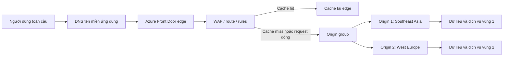
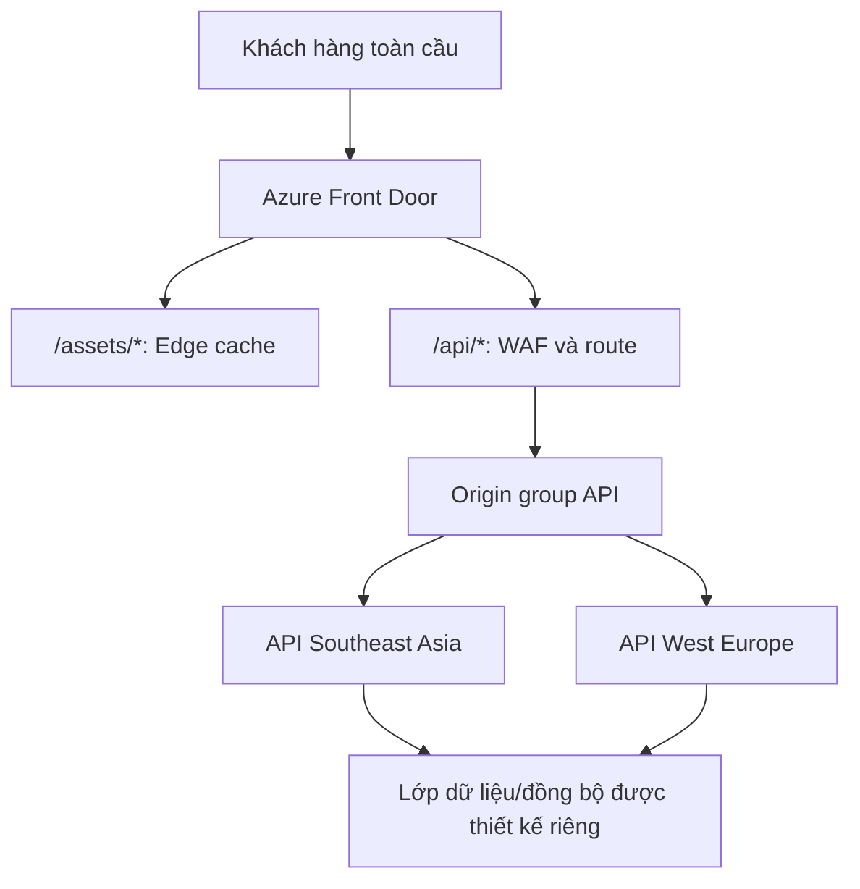

# Phân phối ứng dụng toàn cầu bằng Azure Front Door

Khi một ứng dụng phục vụ người dùng ở nhiều quốc gia, khoảng cách mạng, độ trễ, sự cố tại một vùng triển khai và các đợt truy cập tăng đột biến đều ảnh hưởng tới trải nghiệm. Một web server ở một Azure region có thể hoạt động bình thường nhưng người dùng ở xa vẫn tải trang chậm; nếu region đó gặp sự cố, toàn bộ hệ thống có thể mất khả năng phục vụ.

**Azure Front Door** là dịch vụ phân phối ứng dụng toàn cầu ở tầng HTTP/HTTPS. Dịch vụ sử dụng mạng biên của Microsoft để tiếp nhận yêu cầu gần người dùng, chọn origin (máy chủ hoặc dịch vụ nguồn) phù hợp, hỗ trợ tăng tốc phân phối nội dung, bảo vệ bằng Web Application Firewall (WAF) khi được cấu hình và chuyển lưu lượng sang origin khỏe khi có sự cố.

Bài học thuộc chương **Cân bằng tải và phân phối ứng dụng** của module **CLOUD_PROVIDERS_AZURE**. Kiến thức Azure Front Door liên kết với VNet, dịch vụ tính toán, lưu trữ, DNS, Microsoft Entra ID, giám sát, bảo mật và chi phí khi triển khai kiến trúc ứng dụng trên Azure.

## 1. Mục tiêu học tập

Sau khi học, bạn có thể:

1. Giải thích luồng request từ người dùng qua Front Door edge tới origin.
2. Phân biệt Front Door với Azure Load Balancer, Application Gateway và Traffic Manager.
3. Thiết kế profile, endpoint, origin, origin group, route, custom domain và rule set.
4. Hiểu cách health probe, priority, latency và weight tham gia chọn origin và failover.
5. Cấu hình HTTPS, bảo vệ origin và áp dụng WAF phù hợp.
6. Sử dụng cache để giảm độ trễ, đồng thời tránh lưu cache dữ liệu cá nhân hoặc nội dung động nhạy cảm.
7. Lập kế hoạch kiểm thử, theo dõi vận hành và đánh giá chi phí cho kiến trúc đa vùng.

## 2. Bài toán phân phối ứng dụng toàn cầu

Giả sử một trang thương mại điện tử có khách hàng tại Việt Nam, Singapore và châu Âu. Ứng dụng chạy ở hai Azure region:

- **Southeast Asia**: cụm web API chính.
- **West Europe**: cụm web API dự phòng hoặc phục vụ lưu lượng theo thiết kế.
- Static assets như ảnh, CSS, JavaScript được lưu trong một origin thích hợp.
- Người dùng truy cập qua tên miền thống nhất, ví dụ `www.example.com`.

Nếu trỏ DNS trực tiếp tới một web server, nhóm vận hành phải tự giải quyết nhiều câu hỏi: làm sao thay region khi server lỗi, điều phối request tới backend nào, bảo vệ chống tấn công HTTP, giảm tải khi hàng nghìn người truy cập cùng một ảnh, theo dõi lỗi ở các vùng?

Front Door đặt một **điểm vào HTTP/HTTPS toàn cầu** ở phía trước các origin. Người dùng truy cập cùng hostname; dịch vụ edge tiếp nhận, áp dụng quy tắc, có thể trả nội dung từ cache và chuyển các request chưa được đáp ứng tới origin được chọn.

Front Door không thay thế cơ sở dữ liệu, logic nghiệp vụ hoặc thiết kế nhất quán dữ liệu giữa các vùng. Nếu failover chuyển người dùng tới region thứ hai nhưng database ở đó không thể ghi hoặc chưa đồng bộ, ứng dụng vẫn có thể lỗi. Kiến trúc đa vùng phải giải quyết cả **application state, dữ liệu, session và các dịch vụ phụ thuộc**.

## 3. Front Door hoạt động ở đâu trong luồng truy cập?



Sơ đồ là mô hình logic. Request thực tế đi qua các thành phần phù hợp với profile và route đã cấu hình; không phải mọi request đều được kiểm tra cache và không phải mọi hệ thống đều sử dụng hai region.

**Luồng request điển hình:**

1. Trình duyệt phân giải `www.example.com` để tìm điểm vào Front Door.
2. Kết nối tới một **edge location** của mạng toàn cầu, thường được dẫn tới điểm biên phù hợp nhờ cơ chế định tuyến mạng.
3. Front Door xử lý TLS của kết nối client, đánh giá route, rule set và chính sách bảo vệ được gắn.
4. Nếu route bật caching và nội dung hợp lệ đang có trong cache, edge có thể phản hồi mà không gọi origin.
5. Nếu cần gọi origin, Front Door chọn origin khỏe theo cấu hình của origin group và chuyển request qua mạng tới origin đó.
6. Origin xử lý nghiệp vụ, gửi response về Front Door; Front Door chuyển response cho client và có thể cache nếu cấu hình cho phép.

Có **hai chặng kết nối HTTPS** cần lưu ý: client đến Front Door và Front Door đến origin. HTTPS ở chặng đầu không tự chứng minh rằng chặng sau đã mã hóa đúng; cấu hình forwarding protocol và certificate của origin vẫn phải được kiểm tra.

### Anycast không đồng nghĩa origin gần nhất

Front Door sử dụng hệ thống biên toàn cầu để đưa người dùng tới điểm tiếp nhận phù hợp. **Edge location** là vị trí kết nối của người dùng vào Front Door; **origin** là nơi ứng dụng thật sự chạy.

Một request từ Việt Nam có thể vào edge gần khu vực người dùng nhưng origin được chọn lại nằm tại West Europe vì origin ở Southeast Asia đang lỗi, có priority thấp hơn, hoặc chính sách chọn origin yêu cầu như vậy. Không thể suy ra origin đích chỉ từ vị trí edge.

## 4. Các thành phần của Azure Front Door Standard/Premium

Với các triển khai mới, tìm hiểu mô hình tài nguyên **Azure Front Door Standard/Premium**. Các tài liệu cũ có thể mô tả Front Door (classic) với tên và mô hình cấu hình khác; khi triển khai phải chọn đúng thế hệ dịch vụ mà tổ chức sử dụng.

| Thành phần | Mục đích |
|---|---|
| **Profile** | Phạm vi quản lý Front Door, SKU, endpoint và nhiều cấu hình liên quan |
| **Endpoint** | Điểm vào có hostname do Front Door cấp; có thể có nhiều route |
| **Custom domain** | Tên miền của doanh nghiệp được liên kết với Front Door |
| **Origin** | Một backend HTTP/HTTPS cụ thể, ví dụ App Service, Application Gateway, VM frontend hoặc dịch vụ khác |
| **Origin group** | Nhóm origin và thiết lập chọn origin, health probe, load balancing |
| **Route** | Quy định hostname, đường dẫn, giao thức, origin group, forwarding, caching và rule set liên quan |
| **Rule set / rule** | Thao tác hoặc điều kiện xử lý request/response, ví dụ rewrite, redirect, thay header hoặc cache policy |
| **WAF policy / security policy** | Các quy tắc an ninh HTTP và việc liên kết bảo vệ với domain/path phù hợp |
| **Secret/certificate** | Chứng chỉ và cấu hình TLS cho tên miền tùy phương án triển khai |

**Profile** là nơi nhóm quản trị quản lý sản phẩm Front Door. **Endpoint** là một địa chỉ truy cập cụ thể, còn **route** mới quyết định request với host và path tương ứng sẽ đi tới origin group nào.

### Ví dụ ánh xạ route

| Host và path | Route | Origin group | Gợi ý cache |
|---|---|---|---|
| `www.example.com/` | `web-route` | `og-web` | Bật chọn lọc cho nội dung tĩnh |
| `www.example.com/assets/*` | `assets-route` | `og-static` | Có thể cache phiên bản tĩnh |
| `api.example.com/*` | `api-route` | `og-api` | Thường tắt cache với API có dữ liệu người dùng |
| `www.example.com/admin/*` | Route phù hợp | `og-admin` hoặc backend được bảo vệ | Yêu cầu xác thực/phân quyền, không cache nội dung nhạy cảm |

Khi có nhiều route, cần kiểm tra cách Front Door chọn route theo hostname, pattern và độ cụ thể. Đừng tạo các wildcard path chồng lấn rồi giả định rằng thứ tự hiển thị trong portal chính là thứ tự xử lý.

## 5. Front Door khác các giải pháp cân bằng tải Azure như thế nào?

| Dịch vụ | Tầng và phạm vi nổi bật | Khi thường cân nhắc |
|---|---|---|
| **Azure Front Door** | HTTP/HTTPS toàn cầu ở edge, route theo hostname/path, tăng tốc/caching, WAF | Ứng dụng web/API cho người dùng toàn cầu, nhiều region |
| **Application Gateway** | Reverse proxy/load balancing HTTP(S) trong region/VNet, hỗ trợ WAF tùy SKU | Lưu lượng web nội vùng, định tuyến tới các backend trong kiến trúc VNet |
| **Azure Load Balancer** | Lớp 4, TCP/UDP; frontend và backend theo phạm vi dịch vụ | Cân bằng tải mạng cho VM, VMSS hoặc dịch vụ không cần routing HTTP |
| **Azure Traffic Manager** | Định tuyến ở mức DNS theo phương thức chọn endpoint | Điều phối DNS tới endpoint toàn cầu, kể cả giao thức không do Front Door proxy |
| **Azure NAT Gateway** | SNAT outbound IPv4 ở subnet | Workload private khởi tạo kết nối ra Internet với IP nguồn quản lý được |

Front Door là **reverse proxy HTTP/HTTPS toàn cầu**, không phải bộ cân bằng tải TCP/UDP tổng quát. Nó không dùng để phân phối trực tiếp một giao thức tùy ý như kết nối database TCP chỉ vì hệ thống cần kết nối xuyên lục địa.

Application Gateway và Front Door có thể phối hợp: Front Door cung cấp global entry point; Application Gateway xử lý các chức năng ở region trước khi chuyển tiếp tới workload. Chỉ thêm cả hai khi có lý do kiến trúc rõ ràng để tránh lớp trung gian, cấu hình WAF và chi phí không cần thiết.

## 6. Cách Front Door chọn origin và failover

Một **origin group** có thể gồm nhiều origin cùng phục vụ một route. Front Door sử dụng cấu hình load balancing và trạng thái sức khỏe để chọn origin phù hợp. Các yếu tố quan trọng gồm:

- **Health probe:** kiểm tra endpoint sức khỏe để nhận diện origin không đáp ứng.
- **Priority:** ưu tiên origin theo mức được khai báo; phục vụ phương án active/passive.
- **Latency và additional latency:** giúp xác định nhóm origin đủ điều kiện theo độ trễ đo được trong những tình huống áp dụng.
- **Weight:** phân bổ tương đối giữa các origin còn đủ điều kiện, nhất là trong nhóm cùng priority.
- **Origin enable/disable:** quản trị viên có thể tạm loại origin khỏi lựa chọn.

Không có quy tắc “luôn chọn origin gần người dùng nhất” cho mọi cấu hình. Kết quả còn phụ thuộc priority, health probe, độ trễ quan sát và chính sách phân phối của origin group.

### Thiết kế active/passive

Ví dụ:

| Origin | Priority | Weight | Vai trò |
|---|---:|---:|---|
| `app-sea` | 1 | 1000 | Primary |
| `app-weu` | 2 | 1000 | Standby |

Khi primary còn khỏe và được phép phục vụ, Front Door ưu tiên origin này. Khi primary không còn đạt điều kiện sức khỏe, dịch vụ có thể chuyển các request tiếp theo sang standby. **Failover không bảo đảm không mất request hoặc không gián đoạn phiên.** Các kết nối đang mở, dữ liệu ghi, token, giỏ hàng hoặc trạng thái session phải được ứng dụng xử lý.

### Thiết kế active/active

Hai region cùng phục vụ traffic có thể được đặt cùng priority:

| Origin | Priority | Weight | Vai trò |
|---|---:|---:|---|
| `app-sea` | 1 | 1000 | Active |
| `app-weu` | 1 | 1000 | Active |

Front Door có thể chọn giữa các origin khỏe dựa trên cấu hình latency và weight. **Weight là trọng số tương đối, không phải cam kết phần trăm request tuyệt đối.** Số request thực tế phụ thuộc vị trí client, latency, probe, connection reuse và hành vi của dịch vụ.

Chỉ nên active/active nếu **cả hai region có thể xử lý cùng loại request**, biết cách truy cập dữ liệu cần thiết và có chiến lược nhất quán dữ liệu. Nếu region thứ hai chỉ có bản sao đọc, route các thao tác ghi sang đó có thể gây lỗi nghiệp vụ.

### Vì sao cần endpoint sức khỏe riêng?

Health probe nên gọi một path ổn định như `/healthz`, trả mã HTTP thành công khi origin có thể phục vụ. Không dùng trang yêu cầu đăng nhập tương tác, chuyển hướng qua bên thứ ba, hoặc endpoint rất nặng làm probe.

Có hai mức kiểm tra:

- **Liveness:** tiến trình còn chạy và có thể nhận kết nối.
- **Readiness:** origin thực sự sẵn sàng nhận request theo yêu cầu của hệ thống, có thể cần kiểm tra các phụ thuộc thiết yếu.

Nếu health endpoint luôn trả HTTP 200 dù database không hoạt động, Front Door có thể tiếp tục gửi traffic đến origin không thể xử lý nghiệp vụ. Ngược lại, endpoint probe quá chặt có thể loại origin chỉ vì một phụ thuộc không quan trọng gặp lỗi.

Với health probe, cần xác định path, HTTP/HTTPS, phương thức và tần suất được Front Door hỗ trợ. Một số backend chỉ trả lời HEAD/GET theo cách khác nhau; hãy chọn phương thức khớp ứng dụng để tránh bị đánh giá sai.

## 7. Cấu hình origin và header rất quan trọng

Một origin thường có thông tin hostname/address, HTTP/HTTPS port, trạng thái enabled, priority, weight và **origin host header**.

Ví dụ origin là Azure App Service tại `shop-sea.azurewebsites.net`. Bạn muốn người dùng truy cập `www.example.com`, nhưng App Service chỉ chấp nhận hostname mà nó đã được cấu hình nhận diện. Front Door phải gửi **Host header** phù hợp với cấu hình của origin.

Nếu cấu hình Host không khớp, request có thể bị HTTP 400/404 hoặc đi vào nhầm virtual host dù kết nối TCP và TLS vẫn thành công. Khi sử dụng HTTPS tới origin, cần bảo đảm SNI và việc kiểm tra tên chứng chỉ phù hợp với hostname origin theo cơ chế Front Door hỗ trợ.

**Nguyên tắc cấu hình:**

1. Ưu tiên **HTTPS tới origin**.
2. Dùng hostname origin có chứng chỉ hợp lệ và tên phù hợp.
3. Thiết lập origin host header theo hostname mà ứng dụng/nguồn chấp nhận.
4. Bật kiểm tra tên chứng chỉ origin; chỉ xử lý ngoại lệ trong quy trình được phê duyệt nếu có yêu cầu đặc biệt.
5. Kiểm tra `X-Forwarded-For`, `X-Forwarded-Host` và các header liên quan khi ứng dụng xây dựng URL, ghi log IP client hoặc thực hiện redirect.

Không tin bất kỳ header nào do client tự gửi chỉ vì header đó có tên giống header được proxy thêm. Ứng dụng phải nhận diện chuỗi proxy đáng tin cậy, chuẩn hóa host và xử lý IP nguồn theo cơ chế bảo vệ phù hợp.

## 8. Bảo vệ đường truy cập và origin

Front Door có thể trở thành điểm vào duy nhất cho web app, nhưng **origin vẫn có thể bị truy cập trực tiếp** nếu public endpoint của nó còn mở. Khi đó, attacker có thể bỏ qua WAF hoặc một số rule tại edge bằng cách gọi thẳng origin.

### Các phương án bảo vệ origin

**A. Private Link tới origin hỗ trợ**

Với **Front Door Premium**, một số loại origin được hỗ trợ kết nối qua **Azure Private Link**. Quy trình thường cần tạo cấu hình kết nối ở Front Door và **phê duyệt private endpoint connection** tại dịch vụ origin.

Ưu điểm: giảm nhu cầu để origin lộ công khai; đường Front Door đến origin dùng kết nối riêng theo cơ chế dịch vụ. Giới hạn: hỗ trợ phụ thuộc loại origin, region và tính năng của SKU; không thể suy ra Front Door Standard cũng có khả năng tương tự.

**B. Origin có public endpoint nhưng giới hạn nguồn**

Trong các kịch bản phù hợp, có thể hạn chế origin chỉ chấp nhận lưu lượng từ hạ tầng Front Door bằng service tag như `AzureFrontDoor.Backend`, sau đó kiểm tra header định danh Front Door `X-Azure-FDID` để xác nhận request đến từ profile mong muốn.

Hai kiểm soát có mục đích bổ sung nhau:

- Lọc mạng theo service tag giới hạn đường truy cập từ mạng không được chấp thuận.
- Kiểm tra định danh Front Door giúp phân biệt profile của tổ chức với những profile Front Door khác cùng dùng hạ tầng dịch vụ.

Khi dùng App Service access restrictions hoặc cơ chế tương tự, hãy cấu hình và kiểm thử đúng header filter cùng nguồn traffic được phép. Chỉ kiểm tra một header có thể bị client giả mạo nếu origin vẫn nhận request trực tiếp từ Internet. Cần đồng thời khóa đường mạng, không dựa vào header như lớp bảo mật duy nhất.

### Web Application Firewall

Azure Front Door có thể phối hợp **WAF policy** để kiểm tra, chặn hoặc giám sát những request HTTP có dấu hiệu tấn công. Tùy SKU và khả năng dịch vụ, WAF có thể hỗ trợ:

- Quy tắc tùy chỉnh theo IP, quốc gia/vùng, đường dẫn, header hoặc các điều kiện được hỗ trợ.
- Rate limiting để giảm tác động của những luồng request bất thường.
- Managed rule sets giúp phát hiện một số nhóm tấn công web thường gặp.
- Chế độ quan sát (detection) hoặc ngăn chặn (prevention) để áp dụng theo từng giai đoạn.

Khả năng sử dụng managed rules và các tính năng nâng cao **khác nhau giữa Standard và Premium**. Khi lựa chọn SKU, xác nhận tính năng WAF cụ thể mà tổ chức cần.

WAF không thay thế **xác thực, phân quyền, kiểm soát dữ liệu, sửa lỗ hổng ứng dụng và rate limit nghiệp vụ**. Một request được WAF cho phép vẫn phải vượt qua kiểm tra quyền trong ứng dụng.

### Bảo vệ trước khi bật chặn

Với rule mới, bắt đầu ở chế độ quan sát nếu phù hợp; xem log để tìm false positive rồi mới bật chặn rộng. Khi cần chặn đường login hoặc API quan trọng, kiểm tra tác động tới request hợp lệ, webhook và client không phải trình duyệt.

## 9. Custom domain, DNS và HTTPS

Người dùng thường truy cập tên miền riêng như `www.example.com` thay vì hostname Front Door mặc định. Cấu hình custom domain gồm ba lớp:

1. **Xác nhận quyền sở hữu domain** trong Front Door theo quy trình dịch vụ.
2. **Cấu hình DNS** của domain để traffic đến endpoint Front Door.
3. **Cấu hình TLS/HTTPS** với chứng chỉ được quản lý hoặc chứng chỉ của doanh nghiệp, rồi liên kết domain với route phù hợp.

### Tên miền con

Với `www.example.com`, người quản trị DNS thường cấu hình CNAME từ `www` tới hostname endpoint Front Door. Dịch vụ có thể yêu cầu bản ghi xác minh miền riêng. Các giá trị xác minh do Azure cung cấp phải được lấy trực tiếp trong portal hoặc qua API/CLI, không tự suy từ tên profile.

### Apex/root domain

Tên miền gốc như `example.com` thường không dùng CNAME theo cách thông thường ở zone apex. Tùy nhà cung cấp DNS, có thể dùng alias/ANAME hoặc cơ chế bản ghi được hỗ trợ. Phải kiểm tra khả năng của DNS provider và quy trình xác minh domain trước khi thay đổi production DNS.

### TLS ở hai hướng

- **Client → Front Door:** chứng chỉ phải hợp lệ cho custom domain, ví dụ `www.example.com`.
- **Front Door → Origin:** origin phải phục vụ HTTPS với certificate hợp lệ cho tên được cấu hình và Front Door phải kiểm tra tên chứng chỉ.

Front Door hỗ trợ những phương án chứng chỉ được quản lý theo SKU và tình huống triển khai; một số tổ chức cần mang chứng chỉ riêng qua Azure Key Vault theo cơ chế hỗ trợ. Trong mọi trường hợp, theo dõi trạng thái domain validation, cấp chứng chỉ, gia hạn và cảnh báo hết hạn.

**DNS propagation** và việc cấp chứng chỉ không nhất thiết hoàn thành tức thì. Không cắt DNS sang Front Door trước khi xác minh route, TLS, origin health và WAF ở hostname thử nghiệm.

## 10. Route, rule set, redirect và rewrite

**Route** là quy tắc chính ánh xạ domain và path tới origin group. Ví dụ:

- `/api/*` → origin group của API.
- `/images/*` → origin group chứa nội dung tĩnh.
- `/*` → origin group của ứng dụng web.

Mỗi route có thể xác định protocol được hỗ trợ, HTTPS redirect, forwarding protocol và tùy chọn caching. **Rule set** bổ sung điều kiện và hành động khi cần điều chỉnh yêu cầu hoặc phản hồi.

### Redirect khác rewrite

- **Redirect:** Front Door trả response HTTP 3xx, hướng dẫn trình duyệt gửi request mới tới URL khác. URL hiển thị với người dùng thay đổi.
- **Rewrite:** Front Door có thể điều chỉnh đường dẫn mà nó gửi tới origin nhưng trình duyệt vẫn thấy URL ban đầu, tùy action được cấu hình.

Ví dụ, khi chuyển URL cũ `/products/item-1` sang `/san-pham/item-1`, có thể dùng redirect lâu dài nếu muốn công cụ tìm kiếm và người dùng chuyển sang URL mới. Nếu origin yêu cầu tiền tố path nội bộ, rewrite có thể phù hợp hơn.

### Các lỗi thường gặp ở routing

1. Wildcard `/*` bắt một đường dẫn mà bạn dự tính route khác xử lý.
2. Rewrite tạo thành đường dẫn không tồn tại tại origin.
3. Origin trả redirect ngược về HTTP, gây vòng lặp khi Front Door ép HTTPS.
4. Ứng dụng dùng header Host sai và sinh URL redirect về hostname `azurewebsites.net` thay vì custom domain.
5. Cache lưu bản redirect hoặc response lỗi lâu hơn mong muốn.

Vì thế cần kiểm thử cụ thể từng hostname, path và phương thức HTTP, bao gồm GET, POST, login callback và API webhook.

## 11. Caching và tăng tốc nội dung tĩnh

Front Door có thể cache các response HTTP phù hợp tại mạng edge để giảm request đi xa tới origin. Tác dụng lớn nhất thường đến từ **ảnh, CSS, JavaScript, font và nội dung tĩnh có phiên bản rõ ràng**.

Ví dụ: trang web có ảnh `/assets/banner.abc123.jpg` được nhiều người tải. Khi caching hợp lệ, các request lặp có thể được phục vụ từ edge thay vì luôn truy cập origin.

### Cache hit và cache miss

- **Cache hit:** edge đã có object hợp lệ nên có thể trả response ngay.
- **Cache miss:** edge cần lấy object từ origin, sau đó có thể lưu để phục vụ lần sau.
- **Expired/stale:** object cần được kiểm tra hoặc lấy lại theo chính sách cache.
- **Purge:** thao tác yêu cầu loại bỏ object khỏi cache khi nội dung cần được cập nhật khẩn cấp.

Hiệu quả cache phụ thuộc vào **TTL, response headers, query string behavior, phương thức HTTP, kích thước object và cách route cấu hình**. Đừng giả định mọi GET đều được cache.

### Phân loại nội dung

| Loại nội dung | Gợi ý |
|---|---|
| File CSS/JS có tên chứa hash | Cache dài hạn khi quy trình publish tạo phiên bản mới |
| Ảnh tĩnh công khai | Cache theo TTL được phê duyệt, purge khi cần |
| Trang HTML thay đổi thường xuyên | TTL ngắn hoặc không cache tùy ứng dụng |
| API đơn hàng, thông tin khách hàng | Không cache tại edge nếu nội dung cá nhân/hệ thống xác thực |
| Endpoint `/login`, `/logout`, token/callback | Tránh cache; kiểm tra header nhạy cảm và cookie |
| Health endpoint | Không cần cache; đảm bảo Front Door kiểm tra được trạng thái thực |

**Cảnh báo thực hành:** nếu cache key bỏ qua query string, cookie hoặc một yếu tố phân biệt người dùng, nội dung có thể bị dùng chung ngoài dự kiến. Chỉ bật cache cho dữ liệu được thiết kế để chia sẻ công khai; kiểm thử cẩn thận các header `Cache-Control`, `Set-Cookie`, `Authorization` và các điều kiện cache của dịch vụ.

### Chiến lược versioning

Đối với file tĩnh, cách an toàn là phát hành tên file có hash như `app.7e91a2.js`; khi có bản mới, HTML tham chiếu tên mới. Cách này giúp tránh phải purge toàn bộ cache khi mỗi lần deploy và giảm rủi ro khách hàng tải lẫn phiên bản.

Nếu cần purge khẩn, thực hiện thao tác purge đúng endpoint/path, sau đó kiểm tra kết quả từ nhiều vị trí. Purge có thể cần một khoảng thời gian để lan truyền; không kỳ vọng mọi edge cập nhật đồng thời ngay khi lệnh trả thành công.

## 12. Hướng dẫn triển khai qua Azure Portal

Tình huống: ứng dụng có hai backend HTTPS hợp lệ:

- `shop-sea.azurewebsites.net`: bản triển khai ở Southeast Asia.
- `shop-weu.azurewebsites.net`: bản triển khai ở West Europe.

Cả hai có endpoint `/healthz` công khai cho probe và xử lý được request như nhau trong phạm vi bài lab. Đây là các **tên minh họa**: người học phải thay bằng hostname thật của tài nguyên thử nghiệm được phép quản trị.

### Bước 1 — Chuẩn bị origin

Trước khi tạo Front Door, xác nhận:

- Cả hai origin trả response hợp lệ qua HTTPS.
- `/healthz` trả status thành công khi ứng dụng sẵn sàng.
- Có kế hoạch đồng bộ dữ liệu và session nếu cả hai origin phục vụ traffic.
- Certificate của origin hợp lệ; hostname và Host header phù hợp.
- Có cách hạn chế truy cập trực tiếp tới origin sau khi kiểm thử route.

### Bước 2 — Tạo profile và endpoint

Trong Azure Portal, tìm **Front Door and CDN profiles**, chọn tạo profile thuộc **Azure Front Door Standard/Premium**. Chọn subscription, resource group và SKU phù hợp. Tạo endpoint với tên khả dụng; Azure cung cấp hostname mặc định cho endpoint.

Tên và vị trí các thao tác có thể thay đổi theo giao diện portal. Cần phân biệt profile, endpoint và origin group vì chúng là các tài nguyên khác nhau.

### Bước 3 — Tạo origin group

Tạo origin group `og-shop`, cấu hình health probe trên HTTPS path `/healthz` với tần suất và phương thức phù hợp. Thiết lập latency sensitivity, sample size hoặc tiêu chí sức khỏe theo nhu cầu vận hành được giao diện hỗ trợ.

Thêm hai origin:

- `origin-sea`: hostname SEA, priority 1.
- `origin-weu`: hostname WEU, priority 2 để mô phỏng active/passive.

Kiểm tra origin host header đúng với hostname ứng dụng chấp nhận, bật HTTPS và kiểm tra certificate name. Chỉ bật cả hai origin sau khi đã xác minh endpoint sức khỏe.

### Bước 4 — Tạo route

Tạo route `shop-route`:

- Gắn hostname endpoint mặc định để thử nghiệm ban đầu.
- Pattern `/*`.
- Origin group `og-shop`.
- Chấp nhận HTTP/HTTPS theo thiết kế, bật redirect HTTP → HTTPS.
- Forward traffic tới origin qua HTTPS.
- Giữ **caching tắt** cho ứng dụng động trong giai đoạn kiểm thử ban đầu.

Sau khi route hoạt động, mới thêm route `/assets/*` và cấu hình caching phù hợp cho nội dung công khai.

### Bước 5 — Thử endpoint và chuyển domain

Truy cập hostname endpoint bằng HTTPS; xác minh HTTP status, request path, log của origin và health probe. Thêm custom domain `www.example.com`, xác minh quyền sở hữu, cấu hình DNS và TLS; liên kết domain với route.

Đợi các bước xác thực và cấp chứng chỉ hoàn tất rồi kiểm tra hostname custom domain trước khi chuyển traffic production.

### Bước 6 — Bảo vệ

Gắn WAF/security policy theo SKU, đặt rule ở chế độ quan sát phù hợp trước khi chặn. Giới hạn origin bằng Private Link (nếu dùng Premium và origin được hỗ trợ) hoặc network access restriction kết hợp xác minh định danh Front Door.

### Bước 7 — Test failover

Trong môi trường thử nghiệm, tạm vô hiệu hóa hoặc khiến primary origin không đáp ứng health probe theo cách an toàn. Quan sát trạng thái origin và các request mới chuyển sang standby. Khôi phục primary, quan sát hành vi phân phối khi origin trở lại khỏe; không tự giả định traffic lập tức trở về đúng tỷ lệ hoặc kết nối cũ được di chuyển.

## 13. Azure CLI: kiểm kê và cấu hình nền tảng

Azure CLI có nhóm lệnh **`az afd`** để quản lý Azure Front Door Standard/Premium. Tùy bản cài, một số lệnh cần extension được Azure CLI nhắc cài đặt. Kiểm tra phiên bản và cú pháp bằng `az afd --help` và từng subcommand `--help` trước khi thao tác production.

Các ví dụ dưới đây dùng **Bash hoặc Azure Cloud Shell (Bash)**. Thay placeholder bằng thông tin subscription và resource group được phép sử dụng.

### Xác nhận môi trường

```bash
az account show \
  --query "{subscription:name, subscriptionId:id, tenant:tenantId}" \
  --output table
```

### Tạo profile Standard và endpoint thử nghiệm

```bash
RG="rg-frontdoor-lab"
PROFILE="afd-shop-lab"
ENDPOINT="shop-lab-endpoint"

az afd profile create \
  --resource-group "$RG" \
  --profile-name "$PROFILE" \
  --sku Standard_AzureFrontDoor

az afd endpoint create \
  --resource-group "$RG" \
  --profile-name "$PROFILE" \
  --endpoint-name "$ENDPOINT" \
  --enabled-state Enabled
```

Ví dụ giả định resource group đã tồn tại và endpoint name khả dụng. **Tạo profile và endpoint chưa làm ứng dụng sẵn sàng:** phải cấu hình origin group, origins, route và các quyền/bảo vệ liên quan trước khi có nội dung hợp lệ để phục vụ.

### Kiểm kê cấu hình

```bash
az afd profile list \
  --resource-group "$RG" \
  --output table

az afd endpoint list \
  --resource-group "$RG" \
  --profile-name "$PROFILE" \
  --output table

az afd origin-group list \
  --resource-group "$RG" \
  --profile-name "$PROFILE" \
  --output table

az afd route list \
  --resource-group "$RG" \
  --profile-name "$PROFILE" \
  --endpoint-name "$ENDPOINT" \
  --output table
```

Xem origin của nhóm `og-shop` đã tạo ở Portal hoặc IaC:

```bash
az afd origin list \
  --resource-group "$RG" \
  --profile-name "$PROFILE" \
  --origin-group-name "og-shop" \
  --output table
```

Trong dự án thực tế, nên quản lý cấu hình Front Door bằng **Infrastructure as Code (ARM/Bicep/Terraform)** với thay đổi được review, thay vì phụ thuộc vào hàng loạt thao tác Portal không có lịch sử thay đổi. Mã IaC cần chứa giá trị cấu hình không nhạy cảm; certificate, token và secret phải được quản lý bằng cơ chế bảo vệ phù hợp.

## 14. Kiểm thử end-to-end trước khi đưa vào production

Một deployment báo `Succeeded` chưa đủ để kết luận traffic hoạt động đúng. Cần kiểm tra từ client, qua edge, tới origin và các dịch vụ phụ thuộc.

### Lệnh thử từ máy client

```bash
curl -I https://www.example.com/
curl -I https://www.example.com/assets/app.7e91a2.js
curl -I https://api.example.com/healthz
```

Các tên miền và path là ví dụ; thay bằng domain đã cấu hình. Với API dùng xác thực, dùng credential thử nghiệm phù hợp và **không ghi token ra log hoặc lịch sử lệnh**.

Một số điều cần kiểm tra:

- HTTPS và certificate hợp lệ.
- Không có vòng lặp HTTP ↔ HTTPS hoặc redirect về hostname origin.
- Response status và nội dung đúng cho từng route.
- Header cache và cache behavior khớp với loại dữ liệu.
- API POST/PUT hoạt động, không chỉ trang chủ GET.
- Origin logs nhận request với host và forwarded headers đúng.
- WAF không chặn nhầm các request hợp lệ.
- Khi một origin lỗi, request mới tới origin khỏe trong khoảng thời gian phát hiện và chuyển đổi phù hợp.

### Kiểm tra cache

Thực hiện nhiều request tới một asset tĩnh, theo dõi headers và metrics liên quan tới cache hit/miss. Header cụ thể có thể thay đổi theo cấu hình và phiên bản dịch vụ; kết hợp response headers với log hoặc metric được Front Door cung cấp.

Không coi một kết quả cache hit đơn lẻ là minh chứng mọi khu vực địa lý đều đang có sẵn cùng một object. Edge caches có trạng thái khác nhau theo vị trí và thời điểm.

### Kiểm thử sự cố

Thiết kế tối thiểu các tình huống:

1. Origin primary trả `5xx` hoặc health probe không thành công.
2. Origin chậm, timeout hoặc TLS certificate có vấn đề.
3. Origin trả 200 nhưng dependency nghiệp vụ quan trọng bị lỗi.
4. DNS domain chuyển đổi hoặc chứng chỉ chưa sẵn sàng.
5. Rule WAF mới gây false positive.
6. Asset cũ còn trong cache sau deploy.
7. Region standby không có dữ liệu hoặc cấu hình tương thích.

Với mỗi tình huống, xác định **tín hiệu nhận biết, tác động người dùng, người xử lý và phương án khôi phục**.

## 15. Giám sát, logging và chẩn đoán sự cố

Trong Azure Monitor và khả năng diagnostic settings tương ứng, có thể theo dõi lưu lượng và trạng thái của Azure Front Door. Khi được bật và cấu hình điểm lưu phù hợp, dữ liệu chẩn đoán có thể được gửi về Log Analytics, Storage hoặc đích được hỗ trợ.

### Nhóm tín hiệu quan trọng

| Nhóm | Cần theo dõi |
|---|---|
| Traffic ở edge | Số request, lưu lượng, độ trễ, HTTP status, phân bố client |
| Origin health | Origin nào khỏe hoặc không khỏe, thay đổi trạng thái probe |
| Origin latency và error | Thời gian gọi origin, 4xx/5xx, lỗi kết nối hoặc TLS |
| Cache | Cache hit ratio, tỷ lệ miss, dung lượng dữ liệu xuất từ edge so với origin |
| WAF | Số request bị đánh dấu/chặn, rule ID, false positive, nguồn traffic |
| Domain/TLS | Trạng thái xác thực domain, cấp/gia hạn chứng chỉ, lỗi HTTPS |
| Chi phí | Lưu lượng truyền, số request, phân bố request origin, chi phí WAF và tính năng khác |

### Chẩn đoán theo triệu chứng

**502/503 từ Front Door:** kiểm tra origin health, DNS origin, TLS/certificate, Host header, cổng HTTPS, firewall/access restriction, Private Link approval nếu có, và trạng thái backend. Không chỉ tăng timeout khi nguyên nhân là origin bị chặn.

**404 ở một path:** so route patterns, rewrite rules, Host header và log ứng dụng. Xác nhận request đã vào đúng origin và path origin nhận.

**Redirect loop:** kiểm tra HTTP-to-HTTPS redirect, `X-Forwarded-Proto`, quy tắc redirect tại ứng dụng và domain canonical.

**WAF chặn nhầm:** xem WAF diagnostic logs, rule ID và request pattern; điều chỉnh rule/exclusion có phạm vi nhỏ nhất trước khi tắt bảo vệ rộng.

**Cache phục vụ nội dung cũ:** xem TTL, query string behavior, `Cache-Control`, phiên bản asset và trạng thái purge.

**Failover chậm hoặc không xảy ra:** kiểm tra probe path, ngưỡng health, priority, cả hai origins có thực sự phục vụ được ứng dụng hay không và thời gian phát hiện sự cố. Không suy ra failover chỉ từ một request.

**Người dùng ở một châu lục phản hồi chậm:** phân biệt latency client → edge và edge → origin; đo thêm application processing, DB latency và cache miss. Edge gần người dùng không đảm bảo mọi request động có RTT thấp.

### Correlation

Để điều tra xuyên suốt, nên gắn **request ID** qua các lớp proxy và backend, ghi thông tin có ích như route, origin, status, latency và region ứng dụng. Không ghi token xác thực, cookie phiên hoặc dữ liệu cá nhân nhạy cảm vào log. Thiết kế retention và quyền đọc log theo chính sách tổ chức.

## 16. Chi phí và lựa chọn SKU

Chi phí Azure Front Door phụ thuộc SKU, số lượng request, data transfer, các tính năng như WAF và những thành phần tính phí khác theo biểu giá hiện hành. Chi phí origin, App Service, cơ sở dữ liệu, lưu trữ log, DNS và dịch vụ mạng liên quan vẫn được tính riêng.

Đánh giá chi phí theo các câu hỏi:

- Có cần **Private Link tới origin** hoặc managed WAF rule nâng cao không? Nếu có, kiểm tra tính năng và giá của Premium.
- Dữ liệu tĩnh chiếm bao nhiêu phần trăm tổng traffic? Caching giúp giảm tải origin nhưng bản thân traffic ở edge vẫn có chi phí.
- Có bao nhiêu request nhỏ nhưng tần suất cao? Chi phí có thể chịu tác động bởi số request, không chỉ GB truyền đi.
- Có bao nhiêu domain, rule, origin và profile? Thiết kế quá phân mảnh sẽ tăng công sức vận hành.
- Hai region active/active có làm tăng chi phí compute/database và yêu cầu đồng bộ dữ liệu không?
- Mức độ bảo vệ và logging cần thiết có phát sinh thêm dịch vụ/chi phí không?

Một kiến trúc đơn vùng với Front Door có thể cải thiện điểm vào và caching, nhưng **không tự trở thành ứng dụng đa vùng có HA**. Hai region với database và dữ liệu sẵn sàng failover có chi phí cao hơn; quyết định cần dựa vào RTO, RPO, số lượng người dùng và yêu cầu kinh doanh.

## 17. Ví dụ thiết kế thực tế: web toàn cầu, API vùng và dữ liệu

Giả sử doanh nghiệp có hệ thống đặt hàng cho khách hàng ở Đông Nam Á và châu Âu:

- Frontend: nội dung tĩnh được phát hành theo phiên bản.
- API: hai cụm App Service ở Southeast Asia và West Europe.
- Database: chiến lược ghi/đọc, replication và failover được thiết kế riêng theo loại dữ liệu.
- Security: WAF ở edge, identity và phân quyền trong API, origin chỉ nhận traffic được cho phép.

### Phương án



### Quyết định cần ghi vào tài liệu thiết kế

1. Hostname `www.example.com` và `api.example.com` được xác minh, có TLS và route rõ ràng.
2. Tài nguyên tĩnh có cache key, TTL, versioning và quy trình purge.
3. API xử lý request theo region, có timeout, retry và idempotency phù hợp với thao tác đặt hàng.
4. Origin group được cấu hình active/passive hoặc active/active dựa trên **khả năng ghi dữ liệu** và yêu cầu phục hồi.
5. Health probe phản ánh đúng trạng thái có thể phục vụ request.
6. Origin chỉ cho phép traffic Front Door được phê duyệt; không dễ bị bypass WAF.
7. WAF có managed/custom rules theo SKU, kế hoạch thử ở chế độ quan sát và xử lý false positive.
8. Có dashboard, cảnh báo và runbook cho origin down, TLS lỗi, cache cũ và failover.
9. Có ngân sách và tiêu chí định lượng cho latency, tỷ lệ lỗi, cache hit ratio và khả năng phục hồi.

### Điều không nên bỏ qua

Dịch vụ giao hàng hoặc thanh toán bên ngoài có thể chỉ cho phép IP nguồn egress của backend. Front Door kiểm soát **ingress HTTP/HTTPS tới ứng dụng**, không phải địa chỉ IP outbound khi API backend gọi hệ thống thứ ba. Bài toán egress đó cần giải quyết bằng NAT Gateway, firewall hoặc phương án tương ứng tại subnet/backend.

## 18. Bài thực hành

**Tình huống:** một website chạy trên hai Azure App Service ở hai region. Bạn cần đưa website ra Internet qua `www.example.com`, sử dụng vùng chính và vùng dự phòng, có WAF và cache file `/assets/*` nhưng không cache API người dùng.

### Nhiệm vụ

1. Vẽ luồng request từ client tới Front Door edge và hai origin.
2. Giải thích vì sao origin group cần health probe có path riêng và ý nghĩa của priority 1/2.
3. Tạo một profile Front Door Standard hoặc Premium trong subscription thử nghiệm theo yêu cầu và quyền được cấp.
4. Tạo endpoint, origin group và hai origin; kiểm tra HTTPS và origin host header.
5. Tạo route `/*` tới origin group, bật HTTPS redirect và tạm tắt cache.
6. Kiểm tra HTTP status, chứng chỉ và header phản hồi qua endpoint mặc định.
7. Thêm custom domain nếu quản lý được DNS thử nghiệm; xác minh domain và certificate.
8. Tạo route hoặc quy tắc phù hợp cho `/assets/*`, bật caching có kiểm soát và kiểm tra cache hit/miss.
9. Liên kết WAF và kiểm tra một rule ở chế độ quan sát trước khi bật chặn.
10. Thực hiện bài test primary origin không khỏe, quan sát request mới đi tới origin dự phòng.
11. Mô tả cơ chế không cho client truy cập origin trực tiếp để bypass Front Door.
12. Kiểm tra các metric/log và lập checklist dọn tài nguyên sau bài lab để tránh chi phí phát sinh.

### Câu hỏi tự kiểm tra

**Câu 1.** Edge POP và origin khác nhau ở điểm nào? Vì sao edge gần người dùng không đảm bảo origin cùng region?

**Câu 2.** Active/active khác active/passive thế nào? Có thể bật active/active với database chỉ ghi được ở một region không?

**Câu 3.** Khi origin nhận mã 404 do Host header sai, tăng số origin hay thay health probe có giải quyết được nguyên nhân không?

**Câu 4.** Vì sao không nên cache API trả thông tin cá nhân và endpoint login?

**Câu 5.** Front Door có thể thay NAT Gateway khi backend cần gọi API đối tác với public IP cố định không?

**Câu 6.** Hãy nêu hai lớp kiểm soát để chống truy cập trực tiếp origin, bỏ qua Front Door/WAF.

**Tiêu chí hoàn thành:** bạn phân biệt được endpoint, route, origin và origin group; trình bày được cơ chế failover, bảo vệ HTTPS/WAF và origin; cấu hình và kiểm thử một route đa vùng; đánh giá cache và quan sát được vấn đề vận hành.

## Kết luận

**Azure Front Door** đưa ứng dụng HTTP/HTTPS tới người dùng toàn cầu thông qua mạng edge của Microsoft và cho phép kết hợp **định tuyến thông minh, health-based failover, TLS, WAF và caching** trong một điểm vào thống nhất. Nó đặc biệt hữu ích cho website và API có người dùng ở nhiều khu vực hoặc cần phục hồi khi một origin gặp sự cố.

Thiết kế thành công phụ thuộc vào cả Front Door và hệ thống phía sau: **origin phải khỏe, dữ liệu phải sẵn sàng, route và Host header đúng, TLS hợp lệ, WAF không chặn nhầm và nội dung cache được phân loại an toàn**. Khi những yếu tố này được kiểm thử, giám sát và quản trị chi phí đúng cách, Front Door trở thành một thành phần quan trọng của kiến trúc phân phối ứng dụng toàn cầu trên Microsoft Azure.

