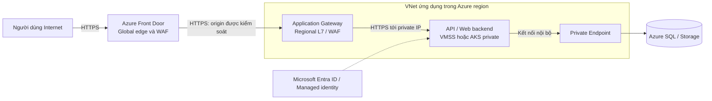
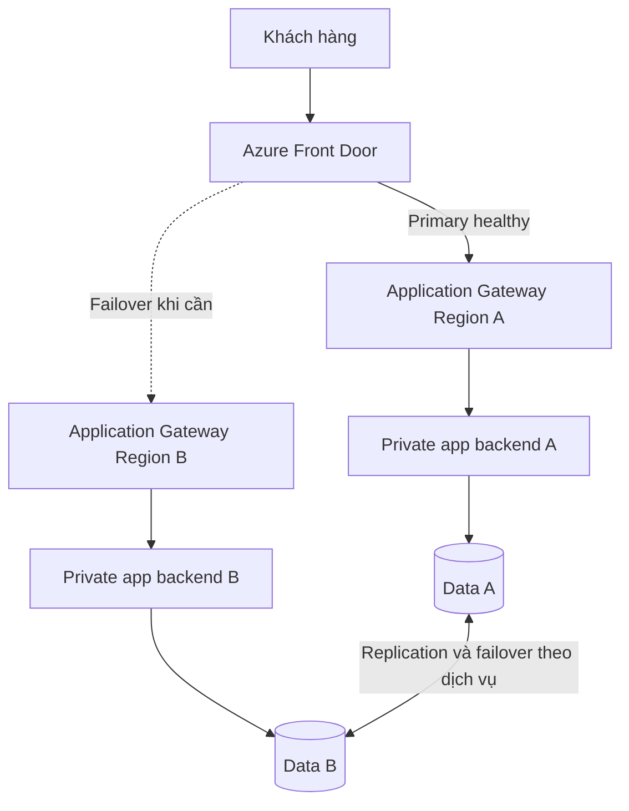

# Kết hợp Front Door, Application Gateway và private backend

Một ứng dụng Azure phục vụ khách hàng ở nhiều địa điểm thường có hai nhu cầu song song: **phân phối truy cập HTTP(S) nhanh và ổn định trên phạm vi toàn cầu** và **giữ máy chủ xử lý nghiệp vụ, API, cơ sở dữ liệu ở mạng riêng**. Nếu đưa toàn bộ máy chủ ra Internet để cân bằng tải, bề mặt tấn công tăng lên; nếu chỉ đặt ứng dụng trong một VNet riêng, người dùng ở ngoài VNet lại không thể truy cập dịch vụ theo cách mong muốn.

Azure cung cấp nhiều thành phần có nhiệm vụ khác nhau. **Azure Front Door** là điểm vào HTTP(S) toàn cầu ở edge, hỗ trợ định tuyến theo ứng dụng, health probe, tối ưu đường truyền và Web Application Firewall (WAF). **Azure Application Gateway** là bộ cân bằng tải lớp 7 theo vùng, nhận request, chọn backend pool và có thể dùng WAF để bảo vệ lưu lượng ứng dụng. **Private backend** là nhóm dịch vụ xử lý nằm sau lớp phân phối, thường không có public IP hoặc được tiếp cận qua **Private Endpoint**, mạng ảo và chính sách truy cập phù hợp.

Bài học thuộc chương **Cân bằng tải và phân phối ứng dụng** của module Microsoft Azure. Nội dung kết nối kiến thức về subscription, resource group, Microsoft Entra ID, VNet, subnet, DNS, dịch vụ tính toán, lưu trữ, giám sát, bảo mật và kiểm soát chi phí để triển khai một luồng truy cập Internet an toàn tới ứng dụng có backend riêng tư.

## Mục tiêu học tập

Sau khi học, bạn có thể:

- Giải thích vị trí và vai trò của Front Door, Application Gateway và private backend trong một kiến trúc HTTP(S).
- Thiết kế tuyến request từ người dùng tới ứng dụng và xác định **từng đoạn kết nối cần bảo vệ**.
- Phân biệt Application Gateway có public frontend được giới hạn nguồn với một private origin sử dụng cơ chế Private Link được hỗ trợ.
- Thiết kế listener, routing rule, origin group, health probe, TLS, backend hostname và private DNS.
- Giới hạn truy cập nguồn gốc bằng service tag, header nhận diện Front Door, WAF, NSG và quyền dữ liệu.
- Lập phương án high availability và failover đa vùng mà không bỏ qua kiểm tra trạng thái dữ liệu.
- Xác minh cấu hình bằng Azure Portal, Azure CLI và các phép thử HTTP(S); biết cách điều tra 403, 502, 503, DNS và health probe.
- Đánh giá chi phí, độ phức tạp và trách nhiệm vận hành trước khi chọn một hay cả hai lớp cân bằng tải.

## 1. Phân biệt các thành phần

| Thành phần | Phạm vi hoạt động | Vai trò chính | Lưu ý |
|---|---|---|---|
| **Azure Front Door Standard/Premium** | Dịch vụ ứng dụng toàn cầu, tại edge | Điểm vào HTTP(S), routing, acceleration, TLS, WAF, quản lý origin group và failover | Không thay thế cấu hình riêng của origin hoặc quyền truy cập dữ liệu |
| **Azure Application Gateway v2** | Thành phần ứng dụng theo Azure region | Listener, HTTP settings, routing theo host/path, health probe và cân bằng tải tới backend; có lựa chọn WAF v2 | Cần subnet, mạng backend, DNS và quy tắc truy cập phù hợp |
| **Private backend trên VM/VMSS/AKS** | Subnet/VNet hoặc mạng có kết nối tới Application Gateway | Chạy web/API/service nội bộ, thường chỉ có private IP | NSG, UDR và hệ điều hành vẫn phải bảo vệ port |
| **Private Endpoint** | NIC/private IP trong VNet | Truy cập riêng đến dịch vụ Azure PaaS qua Private Link | Cần phê duyệt endpoint, private DNS và cấu hình public access đích |
| **Azure SQL/Storage/Key Vault** | Dịch vụ PaaS có cấu hình mạng và quyền dữ liệu riêng | Lưu dữ liệu, bí mật hoặc thông tin trạng thái | Không nên cho Front Door kết nối trực tiếp vào data plane nếu không có nhu cầu |

Hai sản phẩm cân bằng tải ở hai lớp khác nhau trong kiến trúc. Front Door chọn origin/region và áp dụng các kiểm soát ở edge; Application Gateway kiểm soát đường đi HTTP(S) tới các backend trong kiến trúc vùng. Việc đặt cả hai lớp có ý nghĩa khi tổ chức thực sự cần cả **điều phối toàn cầu** lẫn **routing/WAF khu vực**.

### Các khái niệm thường gặp

- **Frontend domain:** tên truy cập của khách, ví dụ `www.example.com`.
- **Front Door endpoint và route:** cấu hình tên miền, giao thức, đường dẫn và liên kết tới origin group.
- **Origin group / origin:** tập máy chủ đích mà Front Door có thể gửi request đến; gồm chính sách health, ưu tiên và trọng số.
- **Application Gateway frontend/listener:** nơi Application Gateway nhận request qua IP, port, protocol, hostname và certificate.
- **Backend pool:** tập địa chỉ IP hoặc FQDN của ứng dụng nội bộ.
- **Backend settings / probe:** thông số giao thức/port, hostname, TLS và kiểm tra sức khỏe từ Application Gateway đến backend.
- **Private network boundary:** giới hạn kết nối dựa vào VNet/subnet, private IP, DNS, firewall và danh tính.

## 2. Luồng cơ bản: Front Door → Application Gateway → private backend

Kiến trúc phổ biến bắt đầu bằng một **Application Gateway có public listener** dành riêng để nhận traffic từ Azure Front Door, trong khi các máy chủ xử lý phía sau chỉ dùng private IP.



Ví dụ: người dùng truy cập `https://www.example.com/orders`. Front Door xử lý hostname và route, lựa chọn origin group. Request được chuyển tới Application Gateway trong region được chọn. Gateway xác định listener/routing rule, kiểm tra health và chuyển request tới backend private IP. Ứng dụng xác thực yêu cầu, sử dụng managed identity để truy cập Azure SQL hoặc Storage qua đường riêng khi được cấu hình.

### Các lớp bảo vệ trên đường đi

1. **Người dùng → Front Door:** xác thực TLS cho tên miền của khách, bảo vệ WAF và các chính sách edge.
2. **Front Door → Application Gateway:** thiết lập TLS tới origin, xác minh hostname/certificate, giới hạn khả năng gọi thẳng origin.
3. **Application Gateway → backend:** chỉ định đúng backend, port, hostname, TLS và probe; cho phép traffic cần thiết bằng NSG hoặc kiểm soát tương đương.
4. **Backend → PaaS data:** dùng Private Endpoint, private DNS, firewall của dịch vụ đích và quyền data-plane.
5. **Quản trị:** dùng Microsoft Entra ID, RBAC, MFA/Conditional Access, logging và quy trình thay đổi được phê duyệt.

**Điều cần phân biệt:** backend riêng tư **không có nghĩa** frontend của Application Gateway luôn riêng tư. Trong mô hình này, Gateway có thể có public IP/listener để Front Door kết nối tới, nhưng **backend không bị xuất bản trực tiếp**.

## 3. Có thể làm cho cả origin của Front Door trở thành private không?

Có những kiến trúc dùng **Azure Front Door Premium với Private Link** để kết nối tới loại origin và đường private connectivity được dịch vụ hỗ trợ. Khi đó, đường từ Front Door tới origin không cần dựa vào public listener mở cho mọi nguồn theo mô hình thông thường.

Tuy nhiên, không được suy ra rằng **Front Door có thể kết nối trực tiếp tới một private IP bất kỳ trong VNet** hoặc rằng mọi Application Gateway SKU/frontend đều có thể làm Private Link origin với cùng cách cấu hình. Tùy thời điểm, loại origin, SKU, region và cơ chế tích hợp, bạn có thể phải cấu hình **Private Link Service**, cơ chế Private Link dành cho Application Gateway được hỗ trợ, hoặc lựa chọn origin khác phù hợp.

### Hai mô hình cần đánh giá tách biệt

| Mô hình | Kết nối Front Door → origin | Kết nối Gateway → backend | Khi phù hợp |
|---|---|---|---|
| **A. Public origin bị giới hạn nghiêm ngặt** | Front Door gửi HTTPS tới public listener của Application Gateway, có rule giới hạn nguồn và kiểm tra danh tính Front Door | Private IP / private backend pool | Muốn triển khai rõ ràng và có thể kiểm soát đường public origin |
| **B. Private origin qua Private Link** | Front Door Premium dùng một đường Private Link **được hỗ trợ và được phê duyệt** đến origin | Tiếp tục dùng private backend nếu origin là Gateway | Muốn giảm bề mặt public origin; đã xác nhận chính xác loại origin, SKU/region và khả năng hỗ trợ |

Không lựa chọn mô hình B chỉ vì thấy có private IP trên Application Gateway. Cần kiểm chứng bằng tài liệu sản phẩm cho **đúng loại cấu hình**, quy trình kết nối/approval và một phép thử end-to-end trước khi thiết kế production.

Nếu giải pháp Private Link tới Gateway không đáp ứng yêu cầu trong phạm vi triển khai, có thể chọn mô hình A với biện pháp khóa public origin chặt chẽ, hoặc thiết kế lại private origin theo một loại dịch vụ được hỗ trợ. Khi triển khai, nên quyết định theo rủi ro, khả năng vận hành và sản phẩm thực sự có sẵn.

## 4. Thiết kế mạng và subnet

Application Gateway v2 được triển khai trong **subnet chuyên dụng**. Backend VM, VMSS hoặc AKS có thể ở các subnet khác trong cùng VNet, VNet được kết nối hoặc mạng tới được qua đường được hỗ trợ. Các thành phần data PaaS có thể truy cập qua Private Endpoint.

Ví dụ địa chỉ dành cho một workload trong region A:

| Thành phần | CIDR minh họa | Vai trò |
|---|---|---|
| VNet ứng dụng | `10.40.0.0/16` | Không gian mạng workload |
| `snet-appgw` | `10.40.1.0/24` | Subnet chuyên dụng của Application Gateway |
| `snet-web` | `10.40.10.0/24` | Web/API backend có private IP |
| `snet-worker` | `10.40.20.0/24` | Worker nội bộ |
| `snet-pe` | `10.40.30.0/24` | Private Endpoint tới SQL/Storage/Key Vault |
| `snet-management` | `10.40.40.0/24` | Công cụ quản trị nội bộ nếu thực sự cần |

Dải IP minh họa phải thay bằng dải không trùng với các VNet đã peering, VPN hay hệ thống on-premises. Các subnet dành cho dịch vụ chuyên dụng và Private Endpoint có yêu cầu riêng về kích thước, delegation, NSG và route. Phải kiểm tra điều kiện sản phẩm trước khi áp cấu hình chung.

### Những luồng mạng cần thiết

| Nguồn | Đích | Giao thức/cổng | Mục tiêu |
|---|---|---|---|
| Trình duyệt | Front Door | HTTPS 443 | Truy cập công khai của người dùng |
| Front Door | Application Gateway origin | HTTPS 443 | Chuyển request tới vùng ứng dụng |
| Application Gateway subnet | Web/API backend | HTTPS 443 hoặc cổng backend thực tế | Routing và health probe |
| Web/API backend | Private Endpoint SQL/Storage | Theo giao thức dịch vụ | Truy cập dữ liệu nội bộ |
| Bastion/kênh quản trị được duyệt | VM backend nếu có | SSH 22 hoặc RDP 3389 | Vận hành có kiểm soát |
| Hệ thống giám sát | Nguồn log/metrics được cấu hình | Theo dịch vụ | Quan sát và điều tra |

**Không mở SSH/RDP hoặc database port công khai** chỉ để kiểm tra kết nối từ Front Door. Front Door cần truy cập **origin HTTP(S)**, còn Application Gateway mới cần tiếp cận backend theo thiết kế.

## 5. Bảo vệ public Application Gateway origin khỏi bị truy cập trực tiếp

Trong mô hình A, một người biết public DNS/IP của Application Gateway có thể cố gắng bỏ qua Front Door và gọi thẳng origin. Điều này có thể vượt qua WAF, rate limiting hoặc routing ở edge nếu không có kiểm soát bổ sung.

Nên kết hợp **giới hạn nguồn ở lớp mạng** và **kiểm tra request đến đúng từ Front Door của tổ chức**:

1. Giới hạn traffic tới Application Gateway frontend theo **service tag `AzureFrontDoor.Backend`** hoặc phương pháp được Microsoft khuyến nghị cho topology thực tế.
2. Kiểm tra header nhận diện Front Door **`X-Azure-FDID`** khớp **Front Door ID** dự kiến; có thể thực hiện bằng WAF custom rule hay cơ chế kiểm tra ở thành phần hỗ trợ.
3. Chỉ mở listener/hostname cần phục vụ và dùng HTTPS, certificate hợp lệ.
4. Giám sát log để phát hiện nguồn gửi request không thuộc luồng thiết kế.
5. Bảo đảm NSG và route vẫn cho phép **luồng quản lý, health probe và yêu cầu hạ tầng bắt buộc của Application Gateway** theo SKU đang dùng.

### Vì sao phải dùng cả nguồn mạng và header?

Service tag `AzureFrontDoor.Backend` bao phủ địa chỉ backend của dịch vụ Front Door, **không chỉ một Front Door instance thuộc tổ chức**. Ngược lại, một header HTTP nếu đứng một mình có thể bị client tự giả mạo trên một public endpoint.

Khi kết hợp lọc nguồn với kiểm tra `X-Azure-FDID`, khả năng gọi trực tiếp từ Internet hoặc từ một Front Door khác giảm đáng kể. Chỉ tin cậy header sau khi đã thiết lập đường nguồn phù hợp; không xem header như một cơ chế xác thực mật mã độc lập.

### Thận trọng với NSG trên subnet Application Gateway

Không đưa một quy tắc “deny all” tùy tiện vào subnet Application Gateway. Một số phiên bản Gateway cần quy tắc inbound/outbound phục vụ hạ tầng, service tag như `GatewayManager`, `AzureLoadBalancer`, các đường kiểm tra sức khỏe và quản lý. Chính xác cổng/phạm vi nào cần mở phụ thuộc SKU, chế độ triển khai và tài liệu hiện hành.

Trước khi thay đổi NSG, hãy kiểm tra **effective security rules**, các quy tắc sản phẩm yêu cầu và thử nghiệm. Nếu Application Gateway mất khả năng hoạt động vì quy tắc quá chặt, toàn bộ origin sẽ không còn khỏe dù backend riêng vẫn chạy.

### Custom header và routing

Application Gateway có thể định tuyến theo hostname hoặc path. Đảm bảo:

- Front Door gửi **origin host header** khớp listener/website mong muốn.
- Listener của Gateway có hostname và certificate phù hợp.
- Quy tắc kiểm tra Front Door ID được áp vào đúng listener/site cần bảo vệ, không vô tình khóa health probe hoặc dịch vụ quản trị.
- Các request không hợp lệ trả mã từ chối phù hợp và được ghi log.

## 6. Front Door: domain, route, origin group và health probe

Trong Azure Front Door Standard/Premium, cấu hình thường có các khối:

- **Profile:** tài nguyên quản lý cấu hình Front Door.
- **Endpoint / custom domain:** điểm truy cập và tên miền công khai, ví dụ `www.example.com`.
- **Route:** ánh xạ hostname, protocol và path patterns tới origin group, cùng các tùy chọn forwarding.
- **Origin group:** tập origin, chính sách health probe và cách cân bằng traffic.
- **Origin:** hostname của Application Gateway hoặc một nguồn khác được hỗ trợ; có thuộc tính ưu tiên, trọng số, enablement và cách kết nối.
- **Security policy/WAF:** liên kết các domain/path với WAF policy theo khả năng sản phẩm.

### Ví dụ route

| Thuộc tính | Giá trị minh họa |
|---|---|
| Custom domain | `www.example.com` |
| Accepted protocols | HTTPS (chuyển HTTP sang HTTPS nếu cần) |
| Patterns to match | `/*` |
| Origin group | `og-shop-primary` |
| Origin hostname | `origin-a.example.net`, trỏ tới listener của Application Gateway A |
| Origin host header | Hostname được Gateway listener và ứng dụng chấp nhận |
| Forwarding protocol | HTTPS |
| Health probe path | `/health/ready` hoặc đường health riêng được phê duyệt |
| WAF | Policy edge theo mức bảo vệ của ứng dụng |

Nếu có region B, có thể bổ sung origin Gateway B trong origin group hoặc thiết kế origin group/route tương ứng. Lựa chọn priority, weight, latency sensitivity và health probe cần nhất quán với mục tiêu phân phối traffic và thời gian phục hồi.

### Front Door health probe kiểm tra điều gì?

Probe từ Front Door kiểm tra **origin ở lớp HTTP(S)** theo path, protocol và điều kiện health được cấu hình. Nếu Application Gateway trả lỗi hoặc probe không nhận phản hồi hợp lệ, Front Door có thể coi origin không khỏe.

Không nên dùng probe path yêu cầu đăng nhập tương tác, captcha hoặc một bước xác thực người dùng. Có thể thiết kế một endpoint `/health/ready` chỉ trả trạng thái tối thiểu và không tiết lộ bí mật.

Health probe của Front Door **không thay thế** probe của Application Gateway. Một origin có thể được Front Door coi khỏe khi Gateway vẫn trả HTTP thành công tại path probe, nhưng một backend pool cụ thể khác đã gặp sự cố. Thiết kế health endpoint phải đại diện cho khả năng phục vụ thực sự của tuyến ứng dụng cần bảo vệ.

### Priority và weight

- **Priority** có thể ưu tiên origin ở một region trong mô hình active-passive.
- **Weight** có thể phân phối tỷ lệ request giữa các origin đủ điều kiện trong thiết kế active-active.
- **Health status** quyết định origin nào còn được chọn theo cấu hình.

Việc traffic chuyển sang origin B khi A gặp sự cố chỉ là **định tuyến HTTP**. Backend B phải có ứng dụng, dữ liệu và những phụ thuộc cần thiết để xử lý request an toàn. Front Door không tự sao chép database hay đồng bộ session.

## 7. Application Gateway: listener, rule, backend pool và probe

Tại mỗi region, Application Gateway chịu trách nhiệm nhận request từ Front Door và định tuyến tới backend riêng.

### Cấu hình khái niệm

| Thành phần Gateway | Ví dụ | Mục đích |
|---|---|---|
| Frontend IP | Public frontend cho mô hình A; private frontend cho topology được hỗ trợ | Điểm nhận request |
| HTTPS listener | `www.example.com:443` | Chọn hostname, cổng và certificate |
| Request routing rule | `/api/*` tới pool API; `/*` tới pool web | Phân phối theo nội dung request |
| Backend pool | Private IP của VMSS hoặc FQDN nội bộ | Danh sách endpoint backend |
| Backend settings | HTTPS, port 443, host name, timeout | Cách Gateway kết nối và xác thực origin nội bộ |
| Health probe | `GET /health/ready` theo host và port đúng | Đánh giá backend member |
| WAF policy | Luật ứng dụng khu vực khi chọn WAF_v2 | Lọc tấn công lớp 7 trước backend |

Nếu chỉ có một ứng dụng, không cần tạo nhiều path-based routing rule. Nếu API và web dùng hostname khác nhau, có thể dùng multi-site listener phù hợp thay vì dồn mọi path vào một quy tắc.

### Backend health hoạt động ra sao?

Application Gateway gửi probe tới từng backend theo thông số đã định. Backend cần trả status được Gateway coi là khỏe. Các lỗi thường gặp:

- Không thể kết nối private IP hoặc FQDN từ subnet Gateway.
- NSG hoặc UDR chặn traffic.
- Cổng backend sai hoặc tiến trình không lắng nghe.
- Probe dùng path/hostname không có trong cấu hình ứng dụng.
- TLS certificate không hợp lệ với hostname hoặc root trust chưa đáp ứng yêu cầu.
- Backend yêu cầu authentication tại path probe.

Một backend bị Gateway đánh dấu Unhealthy có thể làm Gateway trả **502 Bad Gateway** cho request qua tuyến đó. Không nên sửa bằng cách “cho phép mọi mạng”: cần đọc chi tiết báo cáo backend health và log.

## 8. Private backend: ba kiểu thường gặp

### A. VM hoặc VM Scale Sets có private IP

Backend pool tham chiếu private IP/NIC/VMSS phù hợp. Application Gateway truy cập qua VNet hoặc kết nối có route, NSG và DNS nếu dùng FQDN.

Ví dụ: API trên VMSS nghe HTTPS 443 tại `api.internal.example.net`. NSG của subnet API chỉ cho phép traffic cần thiết từ subnet Application Gateway, cùng luồng quản trị được duyệt. VM không cần public IP.

Cần kiểm tra autoscaling, health probe, cập nhật phiên bản không gián đoạn và trạng thái instance trong backend pool.

### B. AKS dùng ingress hoặc endpoint nội bộ

AKS có thể phục vụ backend thông qua **internal load balancer/ingress** theo mô hình networking và sản phẩm được hỗ trợ. Application Gateway kết nối tới endpoint nội bộ đó, hoặc sử dụng giải pháp tích hợp với AKS phù hợp.

Cần phân biệt ba mức:

- Ingress HTTP(S) từ Gateway tới AKS.
- Network policy giữa các pod/service bên trong cluster.
- Quyền của pod/workload khi truy cập Azure SQL, Storage hoặc Key Vault.

Không mặc định private AKS cluster có nghĩa mọi ứng dụng trong cluster chỉ có endpoint private. Phải kiểm tra cấu hình ingress và các LoadBalancer service thực tế.

### C. App Service hoặc dịch vụ PaaS thông qua Private Endpoint

Đối với App Service hỗ trợ Private Endpoint, có thể tạo endpoint trong VNet để Application Gateway truy cập ứng dụng bằng private IP.

**Điểm mấu chốt:** Application Gateway thường cần dùng **FQDN ứng dụng đúng với TLS certificate và Host header**; private DNS phải giúp Gateway resolve hostname đó về private IP của endpoint.

**VNet Integration** của App Service thường giải quyết yêu cầu **outbound từ ứng dụng vào VNet**, không tự biến truy cập inbound từ Gateway thành đường riêng. Muốn inbound riêng, hãy kiểm tra khả năng Private Endpoint/access restrictions của App Service plan và cấu hình thực tế.

Backend là Azure SQL/Storage/Key Vault nên được kết nối từ **ứng dụng** theo luồng dữ liệu; không nên cấu hình Front Door như một client trực tiếp đến database.

## 9. TLS, Host header, SNI và chứng chỉ

Mô hình nhiều tầng có thể có ba phiên HTTPS **tách biệt**:

1. Trình duyệt ↔ Front Door.
2. Front Door ↔ Application Gateway.
3. Application Gateway ↔ backend.

Đây là **TLS được thiết lập lại ở từng chặng** chứ không phải một đường TLS duy nhất xuyên qua tất cả proxy. Mỗi chặng cần hostname, certificate, trust chain và chính sách giao thức phù hợp.

### Ví dụ hostname

| Chặng | Hostname minh họa | Certificate cần phù hợp |
|---|---|---|
| Client → Front Door | `www.example.com` | Certificate cho custom domain trên Front Door |
| Front Door → Gateway | `origin-a.example.net` hoặc hostname listener được thiết kế | Certificate của Application Gateway tương ứng với tên được kiểm tra |
| Gateway → backend | `api.internal.example.net` | Certificate backend có SAN/chain được chấp nhận |

Front Door có thuộc tính origin hostname/origin host header; Gateway có listener hostname và backend host configuration. **Không giả định ba hostname có thể đổi tùy ý**: một sự không khớp có thể làm listener không nhận request, probe fail hoặc TLS xác thực thất bại.

### Host header và SNI

- **Host header** là trường HTTP dùng để ứng dụng biết hostname đích.
- **SNI** là thông tin ở TLS handshake giúp phía nhận chọn certificate phù hợp.
- Certificate phải được xác minh theo tên miền được dùng ở chặng tương ứng.
- Nếu Gateway route theo hostname, Front Door phải gửi giá trị Host phù hợp.
- Nếu backend dùng virtual host, Gateway phải gửi Host/SNI phù hợp với backend settings và probe.

Với App Service, việc đổi Host header có thể làm request không đi tới đúng site hoặc gây lỗi khi hostname chưa được binding. Hãy kiểm tra thiết lập hostname custom và cách dịch vụ xử lý request.

### HTTPS redirect loop

Một cấu hình thường gặp là Front Door bắt buộc HTTPS, còn backend không nhận biết scheme gốc và cứ trả 301/302 sang URL khác, dẫn đến vòng lặp. Ứng dụng có thể cần xử lý đúng **forwarded headers** từ proxy đáng tin cậy như `X-Forwarded-Proto`.

Không tin mọi header `X-Forwarded-*` do client Internet gửi đến; chỉ lấy giá trị từ những proxy thuộc chuỗi đã được giới hạn và cấu hình tin cậy.

## 10. WAF ở edge và ở region: phân công trách nhiệm

Front Door và Application Gateway WAF đều có thể áp dụng chính sách bảo vệ HTTP(S), nhưng đặt hai WAF chỉ có ích khi xác định rõ vai trò của từng lớp.

| Lớp | Trọng tâm thường gặp | Ví dụ |
|---|---|---|
| **Front Door WAF** | Bảo vệ ở edge trước khi traffic tới origin | Managed rules, rate limiting/bot protection theo tính năng SKU, chặn mẫu request không hợp lệ |
| **Application Gateway WAF** | Bảo vệ bổ sung theo ứng dụng hoặc region | Custom rules cho origin, kiểm tra request theo route/site, rule riêng của ứng dụng |
| **Backend application** | Xác thực, authorization, validation dữ liệu và business logic | JWT/OIDC, quyền API, chống truy cập dữ liệu chéo người dùng |

Nếu bật managed rules ở cả hai WAF, cần quản lý false positive và hiệu ứng xử lý trùng lặp. Có thể dành edge cho các quy tắc rộng và regional Gateway cho các điều kiện riêng, hoặc chỉ dùng WAF ở lớp được chọn khi đủ đáp ứng yêu cầu.

**Chặn truy cập thẳng vào origin** quan trọng hơn việc “có hai WAF” trên sơ đồ. Nếu kẻ tấn công gọi trực tiếp Application Gateway qua public IP, họ có thể không đi qua Front Door WAF trừ khi đường origin đã được giới hạn đúng.

### Giữ đúng IP người dùng

Do request qua nhiều reverse proxy, backend thường nhìn thấy IP của proxy ở kết nối TCP. Với log, rate limit và xác minh nguồn, các thành phần có thể dùng header chuyển tiếp như `X-Forwarded-For`.

Không lấy IP từ header do client bất kỳ tự đưa vào để ra quyết định bảo mật nếu chưa xác thực chuỗi proxy. Cần biết proxy nào thêm, ghi đè hoặc chuyển tiếp header và thiết lập danh sách proxy đáng tin cậy ở ứng dụng.

## 11. DNS: công khai ở edge, riêng tư ở backend

Trong kiến trúc hai tầng, DNS có ít nhất hai bài toán khác nhau.

### DNS công khai

CNAME/custom domain của người dùng trỏ tới Front Door theo quy trình cấu hình domain, xác minh sở hữu và certificate. Người dùng chỉ cần biết `www.example.com`.

Nếu dùng public Application Gateway origin, nên đặt hostname riêng như `origin-a.example.net` và **không quảng bá nó như endpoint truy cập của người dùng**. Tuy nhiên, việc không công bố DNS **không thay thế** các kiểm soát mạng và header.

### DNS riêng trong VNet

Application Gateway cần resolve `api.internal.example.net` hoặc tên backend PaaS thành private IP nếu kết nối theo FQDN.

- Có thể dùng Azure Private DNS Zone và VNet link cho backend riêng được quản lý.
- Với App Service Private Endpoint, tên private DNS zone và record phải phù hợp **loại dịch vụ/subresource**.
- Nếu VNet dùng custom DNS, phải có đường forward/resolution đúng từ subnet Gateway.
- Khi chạy active-active nhiều region, cần kiểm tra private DNS mỗi region và tránh trỏ backend của region A nhầm sang vùng B.

### Điều không nên suy ra

Ping hay `nslookup` trả public IP chưa đủ để đánh giá tất cả kết nối; với Private Endpoint, kết quả hostname đích **cần** được kiểm tra theo yêu cầu private DNS. Với Application Gateway backend pool dùng FQDN, sự không khớp DNS có thể khiến probe và traffic thất bại dù NSG đã mở đúng cổng.

## 12. High availability và failover đa region

Để chịu lỗi region, Front Door có thể định tuyến giữa nhiều origin:



Đây là sơ đồ logic. Từng dịch vụ dữ liệu có phương án sao chép, consistency và điều kiện failover riêng; không phải mọi database hỗ trợ hai vùng ghi đồng thời.

### Active-passive

Region A là primary; B dự phòng. Front Door ưu tiên A khi khỏe, chuyển sang B khi A không đáp ứng health policy. Mô hình này có thể giảm xung đột ghi dữ liệu nhưng phải kiểm tra readiness của region B.

### Active-active

Front Door phân phối request tới A và B khi cả hai khỏe. Cần xem:

- Dữ liệu có hỗ trợ ghi/đọc đa region hay không.
- Session có được lưu trong cache/database dùng chung hoặc đồng bộ đúng không.
- Tính nhất quán và idempotency khi request chuyển region.
- Chi phí và đường truyền giữa các vùng.
- Quy định về data residency, backup và location của replica.

### RTO và RPO

- **RTO (Recovery Time Objective):** thời gian tối đa mục tiêu để khôi phục dịch vụ.
- **RPO (Recovery Point Objective):** mức mất dữ liệu tối đa có thể chấp nhận.

Front Door failover có thể hỗ trợ phục hồi truy cập HTTP khi một origin không khỏe. **Nó không đảm bảo RTO/RPO dữ liệu**, không đồng bộ blob/database và không tự hoàn tất quá trình chuyển primary dữ liệu. Cần có runbook DR và kiểm thử định kỳ.

### Health probe có phản ánh “sẵn sàng phục vụ” không?

Một health endpoint chỉ trả 200 vì web process còn chạy có thể là quá nông nếu API không kết nối được data service. Ngược lại, probe quá sâu có thể đánh dấu cả region không khỏe chỉ vì một phụ thuộc không thiết yếu chập chờn.

Hãy tách **liveness** và **readiness**:

- Liveness: process còn sống, phục vụ thao tác điều hành/khởi động lại.
- Readiness: instance hoặc region có thể nhận traffic nghiệp vụ quan trọng.

Dùng readiness phù hợp cho quyết định routing, nhưng tránh biến probe thành thao tác ghi dữ liệu có tác dụng phụ.

## 13. Quy trình triển khai từng bước

Ví dụ triển khai ứng dụng `www.example.com` trên Azure có API riêng tại region A, sau đó mở rộng thêm region B.

### Giai đoạn 1: xác định yêu cầu

1. Chọn **subscription**, resource group, region được phép và người sở hữu tài nguyên.
2. Xác định RTO/RPO, phạm vi dữ liệu, số request dự kiến, budget và yêu cầu bảo mật.
3. Chọn loại backend: VMSS, AKS ingress, App Service Private Endpoint hoặc loại được hỗ trợ khác.
4. Quyết định mô hình **public origin bị khóa chặt** hay **private origin qua Private Link** theo điều kiện SKU/region hiện hành.
5. Lập ma trận traffic nguồn/đích, DNS hostname, certificate, NSG và quyền RBAC.

### Giai đoạn 2: xây dựng backend riêng

1. Tạo VNet và subnet chuyên dụng cho Application Gateway.
2. Tạo subnet backend (hoặc private endpoint) và gán NSG theo luồng cần thiết.
3. Triển khai ứng dụng với private IP/FQDN hoặc Private Endpoint, không gán public IP không cần thiết.
4. Tạo `/health/ready` trả response rõ ràng mà không cần user login.
5. Kiểm tra ứng dụng và TLS từ một client nằm trong VNet, trước khi thêm Gateway.
6. Kết nối ứng dụng đến SQL/Storage/Key Vault bằng managed identity và network control riêng.

### Giai đoạn 3: cấu hình Application Gateway

1. Tạo Application Gateway v2 hoặc WAF v2 đúng SKU, subnet, IP frontend, zone và capacity.
2. Đăng ký backend pool với private IP hoặc FQDN.
3. Cấu hình backend settings cho HTTPS, hostname/SNI, trusted certificates nếu yêu cầu.
4. Tạo custom health probe dùng đúng protocol, host, port và path.
5. Tạo listener HTTPS và routing rule thích hợp.
6. Xem **Backend health** trước khi kết nối Front Door.
7. Với public origin, chuẩn bị giới hạn nguồn và kiểm tra Front Door ID; bảo toàn các luồng hạ tầng bắt buộc.

### Giai đoạn 4: cấu hình Front Door

1. Tạo Front Door Standard/Premium profile và endpoint.
2. Cấu hình origin group, origin hostname, HTTPS, origin host header và health probe.
3. Với private-origin design, thiết lập kết nối Private Link được hỗ trợ và hoàn tất phê duyệt trước khi định tuyến traffic.
4. Cấu hình route cho domain, path, cache/forwarding policy phù hợp.
5. Gắn WAF/security policy và kiểm tra thử các rule.
6. Thêm custom domain, DNS record và TLS certificate khi ready.
7. Thử truy cập theo hostname khách hàng, quan sát log qua từng chặng.

### Giai đoạn 5: kiểm tra và mở rộng

1. Thử URL frontend và các route quan trọng.
2. Kiểm tra request không thể bỏ qua Front Door để gọi thẳng origin trong mô hình A.
3. Xác nhận backend vẫn không có đường truy cập trực tiếp từ Internet.
4. Kiểm tra lỗi/latency và log của cả Front Door lẫn Application Gateway.
5. Nếu có region B, tạo hạ tầng và dữ liệu B, thử failover và rollback có kiểm soát.
6. Ghi nhận các mức chi phí và cập nhật sơ đồ/ma trận kết nối khi thay đổi.

## 14. Thực hành đọc cấu hình bằng Azure CLI

Phần thực hành sau chỉ **đọc** tài nguyên. Bạn cần một subscription và tài nguyên mẫu đã tồn tại; không có lệnh nào thay đổi cấu hình hoặc triển khai mới. Lệnh dùng trong Bash của Azure Cloud Shell.

Các biến chỉ là placeholder:

```bash
SUBSCRIPTION_ID="<SUBSCRIPTION_ID>"
FRONTDOOR_RG="rg-edge"
FRONTDOOR_PROFILE="afd-shop"
AFD_ENDPOINT="shop-edge"
APPGW_RG="rg-app-region-a"
APPGW_NAME="agw-shop-a"
```

### Bước 1: xác minh subscription

```bash
az account show --output table
az account set --subscription "$SUBSCRIPTION_ID"
az account show --query "{name:name,id:id,tenantId:tenantId}" --output table
```

Với môi trường có nhiều subscription/tenant, hãy xác nhận đúng nơi chứa từng tài nguyên. Nếu Front Door và Gateway nằm ở subscription khác nhau, cần dùng subscription ID phù hợp cho từng lệnh và bảo đảm quyền đọc.

### Bước 2: xem Front Door profile và endpoint

```bash
az afd profile show \
  --resource-group "$FRONTDOOR_RG" \
  --profile-name "$FRONTDOOR_PROFILE" \
  --output json

az afd endpoint show \
  --resource-group "$FRONTDOOR_RG" \
  --profile-name "$FRONTDOOR_PROFILE" \
  --endpoint-name "$AFD_ENDPOINT" \
  --output json
```

Đối chiếu SKU, endpoint hostname, trạng thái deployment và các cấu hình có liên quan.

### Bước 3: xem origin group và origin

```bash
az afd origin-group list \
  --resource-group "$FRONTDOOR_RG" \
  --profile-name "$FRONTDOOR_PROFILE" \
  --output table
```

Khi đã biết tên origin group:

```bash
az afd origin list \
  --resource-group "$FRONTDOOR_RG" \
  --profile-name "$FRONTDOOR_PROFILE" \
  --origin-group-name "<ORIGIN_GROUP_NAME>" \
  --output json
```

Kiểm tra origin hostname, origin host header, priority/weight, trạng thái enablement và cấu hình Private Link nếu có. **Không suy ra health thực tế từ việc một origin đang ở trạng thái Enabled**; cần xem diagnostic/metrics và kết quả probe.

### Bước 4: xem route

```bash
az afd route list \
  --resource-group "$FRONTDOOR_RG" \
  --profile-name "$FRONTDOOR_PROFILE" \
  --endpoint-name "$AFD_ENDPOINT" \
  --output json
```

Đối chiếu accepted protocols, forwarding protocol, pattern, origin group và domain liên kết. Một route thiếu custom domain hoặc pattern phù hợp có thể khiến request không đến đúng backend.

### Bước 5: xem Application Gateway

```bash
az network application-gateway show \
  --resource-group "$APPGW_RG" \
  --name "$APPGW_NAME" \
  --query "{name:name,sku:sku,frontendIPConfigurations:frontendIPConfigurations,backendPools:backendAddressPools}" \
  --output json
```

Để xem thông tin sức khỏe backend:

```bash
az network application-gateway show-backend-health \
  --resource-group "$APPGW_RG" \
  --name "$APPGW_NAME" \
  --output json
```

Nếu backend Unhealthy, đọc message và kiểm tra DNS, NSG, route, port, probe, hostname và certificate. Với Azure CLI đã cũ, một số lệnh thuộc nhóm `az afd` có thể cần phiên bản/extension tương thích; hãy kiểm tra `az version` và trợ giúp của lệnh.

### Bước 6: xem Private Endpoint nếu backend là PaaS

```bash
az network private-endpoint list \
  --resource-group "<BACKEND_RESOURCE_GROUP>" \
  --output table
```

Lệnh chỉ liệt kê Private Endpoint tại resource group được chọn. Để xác nhận thực tế, còn cần kiểm tra trạng thái kết nối đã phê duyệt, private IP, private DNS zone group và public network access ở dịch vụ đích.

## 15. Kiểm thử end-to-end bằng HTTP(S)

Bài thử thực tế phải đánh giá ba góc nhìn:

- **Từ Internet:** người dùng chỉ truy cập được hostname public của Front Door.
- **Từ Front Door:** request tới origin hợp lệ, có TLS và đúng host header; direct-origin bypass bị chặn theo mô hình bảo mật.
- **Từ VNet:** Application Gateway truy cập backend bằng private IP/FQDN và backend có quyền dữ liệu cần thiết.

### Những phép thử minh họa

Từ máy khách được phép kiểm thử frontend:

```bash
curl -I https://www.example.com/health/ready
curl -v https://www.example.com/api/status
```

Đọc mã HTTP, chứng chỉ TLS và chuỗi redirect. Đừng giả định mọi đường health đều cần công khai; có thể dùng đường thử chuyên dụng theo chính sách tổ chức.

Từ máy ảo **thực sự nằm trong VNet**, kiểm tra backend FQDN và kết nối:

```bash
nslookup api.internal.example.net
curl -vk https://api.internal.example.net/health/ready
```

Tùy chọn `-k` trong ví dụ chỉ giúp chẩn đoán khi kiểm thử certificate; **không dùng để xác nhận TLS đạt yêu cầu production**. Khi vận hành, cần dùng `curl -v` hoặc công cụ kiểm tra tin cậy certificate không bỏ qua xác minh.

Kiểm tra direct origin trong môi trường được phê duyệt:

```bash
curl -I https://origin-a.example.net/health/ready
```

Kỳ vọng theo mô hình A: request từ máy Internet thông thường **không được ứng dụng phục vụ như một request hợp lệ** qua origin bypass. Mã phản hồi cụ thể (403, timeout, deny) phụ thuộc lớp kiểm soát, DNS và WAF.

### Ma trận thử nghiệm

| Kịch bản | Kỳ vọng |
|---|---|
| Khách truy cập `www.example.com` qua HTTPS | Thành công, Front Door route tới vùng khỏe |
| Request bỏ qua Front Door để gọi public Gateway origin | Bị chặn hoặc từ chối theo chính sách origin |
| Front Door chọn region A và A khỏe | Gateway A chuyển request tới private backend A |
| Backend A bị Unhealthy | Gateway ngừng chọn instance/pool không khỏe theo cấu hình |
| Origin Gateway A mất khỏe hoàn toàn | Front Door có thể chuyển region B nếu group/priority và B được thiết kế phù hợp |
| Client Internet gọi thẳng private backend IP/FQDN | Không có đường public được cho phép |
| Backend kết nối Azure SQL/Storage qua private access | Thành công khi DNS, network và quyền dữ liệu hợp lệ |
| Client thiếu quyền dữ liệu dù ở subnet hợp lệ | Bị từ chối bởi cơ chế xác thực/phân quyền dịch vụ |

Không kết luận chỉ dựa vào một status 200. Cần kiểm tra đúng **origin/region/backend thực sự xử lý request**, thông qua log hoặc dấu nhận diện kiểm thử có kiểm soát.

## 16. Giám sát và tương quan log

Front Door và Application Gateway nằm ở hai lớp khác nhau, vì vậy một request có thể xuất hiện trong nhiều log:

| Nguồn | Thông tin hữu ích | Dùng để xác định |
|---|---|---|
| **Front Door access/health/WAF logs** | Host, route, origin, latency, status, WAF action theo trường được ghi | Request có đến edge và được gửi đến origin nào? |
| **Application Gateway access/WAF logs** | Listener, backend, HTTP status, thời gian xử lý và rule theo loại log | Gateway có nhận request và chuyển tới backend không? |
| **Application Gateway backend health** | Probe status và thông báo lỗi cho backend member | Vì sao Gateway coi backend khỏe/không khỏe? |
| **Backend application logs** | Correlation ID, route, lỗi ứng dụng và truy vấn phụ thuộc | Ứng dụng đã xử lý request đến đâu? |
| **Private DNS / network diagnostics** | Kết quả phân giải, route, kết nối được phép hoặc bị chặn | Có vấn đề ở lớp mạng riêng không? |
| **Azure Monitor metrics / alerts** | Error rate, latency, backend health, capacity theo chỉ số khả dụng | Khi nào hệ thống cần can thiệp? |

Để đối chiếu, ứng dụng có thể sử dụng **correlation ID** qua các lớp proxy và ghi lại trong log, đồng thời che giấu token và dữ liệu nhạy cảm. Cần xác định header nào do proxy đáng tin cậy thêm vào và cách truyền qua backend.

### Hướng điều tra

1. Tìm request theo thời điểm và URL tại Front Door.
2. Xác định route và origin được chọn.
3. Đối chiếu access log của Application Gateway theo thời điểm/correlation.
4. Kiểm tra backend health và probe message.
5. Xem log ứng dụng và phụ thuộc SQL/Storage.
6. Nếu không thấy request ở tầng dưới, quay lại TLS, DNS, firewall, listener và route ở tầng trên.

## 17. Sự cố thường gặp và hướng xử lý

| Hiện tượng | Nguyên nhân có thể | Hướng kiểm tra |
|---|---|---|
| Client truy cập Front Door bị 403 | Front Door WAF, rule access, backend WAF hoặc logic ứng dụng | Xác định tầng trả 403 bằng log; xem WAF policy và request |
| Front Door trả 502/503 | Origin không phản hồi, TLS/hostname sai hoặc origin bị coi unhealthy | Xem origin health, hostname, certificate và probe |
| Application Gateway trả 502 | Backend pool không khỏe, DNS/NSG/port/TLS sai | Mở Backend health, kiểm tra probe và route mạng |
| Gọi Gateway trực tiếp vẫn vào được backend | Public listener còn mở hoặc rule FDID/source chưa có hiệu lực | Kiểm tra service tag, WAF custom rule, direct-origin test |
| Front Door không kết nối được private origin | Loại origin/SKU/region không hỗ trợ, Private Link chưa approved hoặc cấu hình sai | Xác minh đường Private Link hiện được hỗ trợ, approval, DNS/port và health |
| Gateway listener trả sai site | Host header từ Front Door không khớp listener | So sánh origin host header, listener hostname, certificate |
| Redirect loop hoặc URL đổi scheme | Ứng dụng xử lý proxy headers/HTTPS redirect sai | Kiểm tra forwarding protocol, forwarded headers và trusted proxies |
| Backend App Service Private Endpoint không khỏe | FQDN/private DNS hoặc hostname binding sai | Resolve DNS từ VNet, kiểm tra endpoint connection, TLS và probe |
| Region B nhận traffic nhưng thao tác ghi thất bại | Database/replica chưa ở trạng thái ghi được | Xem runbook DR, replication, RPO/RTO và readiness |
| App Gateway thiếu log request | Traffic không tới listener, diagnostic settings chưa bật hoặc route sai | Kiểm tra Front Door log, listener và export logs |
| Tăng đột biến chi phí | Hai lớp WAF, nhiều region, log retention, Private Link và bandwidth | Xem Cost Management theo resource/tag, so sánh thiết kế |
| TLS handshake thất bại | SNI, certificate chain, hostname hoặc phiên bản giao thức không phù hợp | Đọc chi tiết lỗi TLS ở chặng tương ứng, xác minh tên và trust |

**Tránh cách khắc phục tạm** bằng việc mở backend ra Internet, tắt toàn bộ WAF hoặc bỏ kiểm tra TLS trên production. Những thay đổi đó có thể che khuất nguyên nhân và làm mất mục tiêu private backend.

## 18. Khả năng mở rộng và hiệu năng

Thêm cả Front Door và Application Gateway tạo nhiều chức năng nhưng cũng thêm một chặng proxy và các cấu hình cần duy trì.

### Tối ưu ở edge

Front Door phù hợp cho caching nội dung tĩnh khi route và response cho phép. Không cache dữ liệu cá nhân hoặc response có authorization mà không thiết kế cache key/header rõ ràng. Các API tạo đơn hàng, cập nhật hồ sơ hoặc yêu cầu ghi thường cần **forward** tới origin thay vì cache.

### Tối ưu ở region

Application Gateway v2 hỗ trợ khả năng scale theo cấu hình. Backend pool có thể đặt VMSS hoặc cluster giúp ứng dụng scale độc lập với tầng ingress. Cần kiểm tra giới hạn throughput, connection, TLS và health probe theo SKU.

### Session và truy vấn dữ liệu

Nếu backend yêu cầu sticky session, hãy hiểu cách affinity ở mỗi lớp tương tác và cân nhắc chuyển session sang kho chung để tránh một phiên phụ thuộc vào một instance hoặc region. Không sử dụng failover đa vùng mà vẫn giữ toàn bộ session trong bộ nhớ một VM đơn lẻ.

### Tối ưu health probe

Probe quá dày có thể tạo tải đáng kể lên backend; probe quá thưa tăng thời gian nhận diện lỗi. Chọn path nhẹ, kiểm tra đúng khả năng sẵn sàng và điều chỉnh interval/threshold theo mục tiêu availability.

## 19. Chi phí và trách nhiệm vận hành

Các thành phần có thể tạo chi phí riêng:

- **Front Door:** base/edge request, WAF/security, data transfer hoặc các khoản theo SKU và biểu giá áp dụng.
- **Application Gateway v2/WAF v2:** công suất, thời gian hoạt động, capacity unit/traffic tùy SKU.
- **Private Link/Private Endpoint:** các khoản theo endpoint và dữ liệu xử lý khi áp dụng.
- **Backend compute và dữ liệu:** VMSS, AKS, App Service, SQL, Storage và backup.
- **Quan sát:** Azure Monitor/Log Analytics, lưu trữ log, truy vấn và retention.
- **HA/DR:** triển khai nhiều region, sao chép dữ liệu và traffic giữa vùng.

Không nên mặc định hai lớp WAF hoặc hai region là lựa chọn tốt nhất cho mọi ứng dụng. Một ứng dụng chỉ phục vụ một vùng với backend đơn giản có thể dùng Application Gateway đơn lẻ; một ứng dụng cần global routing nhưng backend hỗ trợ origin riêng tư trực tiếp có thể không cần thêm Gateway. Thiết kế dựa trên nhu cầu routing, bảo mật, vận hành, chi phí và khả năng hỗ trợ thực tế.

Với workload production, gắn tag `environment`, `owner`, `service`, dùng Azure Cost Management, ngân sách và cảnh báo phù hợp. **Budget alert không tự ngắt dịch vụ khi vượt ngưỡng**.

## 20. Bài tập tình huống tổng hợp

Một hệ thống thương mại điện tử có:

- Người dùng ở nhiều khu vực, cần truy cập `www.shop.example` qua HTTPS.
- Hai cụm API trong region A và B.
- Mỗi cụm có private backend, không có public IP cho API server.
- Front Door phải chuyển request sang region khỏe khi một region gặp lỗi.
- Backend dùng Azure SQL/Storage với quyền và kết nối mạng được kiểm soát.
- Bộ phận bảo mật yêu cầu **không thể bỏ qua Front Door WAF bằng cách gọi thẳng origin**.

### Thiết kế đề xuất

**Bước 1:** Chọn Front Door Standard/Premium theo tính năng cần có. Nếu yêu cầu private origin qua Private Link, xác minh khả năng hỗ trợ và chọn Premium/loại origin phù hợp.

**Bước 2:** Mỗi region có Application Gateway phục vụ ứng dụng của region đó. Dùng private backend pool và chỉ mở port/giao thức cần thiết từ Gateway tới API.

**Bước 3:** Với mô hình public Gateway origin, giới hạn nguồn tới Gateway theo Front Door backend service tag và kiểm tra `X-Azure-FDID` thuộc Front Door của tổ chức; không phá các luồng quản lý bắt buộc.

**Bước 4:** Cấu hình hostname, listener, certificate và health probe ở Gateway. Xác minh Gateway truy cập backend nội bộ trước khi tạo Front Door route.

**Bước 5:** Tại Front Door, tạo origin group, thêm region A và B với priority/weight theo mô hình active-passive hoặc active-active đã chọn. Thiết lập HTTPS forwarding và probe phản ánh readiness.

**Bước 6:** Cấu hình Azure SQL/Storage theo yêu cầu dữ liệu; kiểm tra replica, failover, backup và data residency, vì chuyển HTTP sang region B không tự bảo đảm backend B có dữ liệu ghi được.

**Bước 7:** Kiểm thử request hợp lệ, request bị WAF chặn, direct-origin bypass, backend unhealthy, origin failover, TLS và DNS. Thu log từ cả ba lớp.

### Phân tích yêu cầu thành kiểm soát

| Yêu cầu | Cơ chế | Bằng chứng |
|---|---|---|
| Global entrypoint | Front Door custom domain + route + origin group | DNS, response từ edge, config route |
| Regional L7 routing | Application Gateway listener/rule | Backend health, access log |
| API không lộ public IP | VMSS/AKS private backend hoặc Private Endpoint | Inventory IP/NIC/endpoint, NSG |
| Chặn bypass edge | Service tag + Front Door ID/WAF hoặc đường Private Link được hỗ trợ | Kiểm thử truy cập origin trực tiếp từ Internet |
| Multi-region continuity | Health probes, origin priority/weight và DR data | Diễn tập failover và log |
| Giới hạn quyền dữ liệu | Managed identity, Azure RBAC/data roles, network policy | Test được phép/bị từ chối, role assignment |
| Vận hành có thể kiểm tra | Diagnostic logs, monitoring, alerts | Dashboard, correlation ID, runbook |

## 21. Checklist trước khi triển khai production

- [ ] Đã xác định business need cho hai tầng Front Door và Application Gateway.
- [ ] Đã chọn SKU, region và **mô hình origin connectivity** phù hợp với tài liệu sản phẩm.
- [ ] Đã quy hoạch VNet/subnet và giới hạn quyền mạng giữa Gateway với backend.
- [ ] Đã ngăn truy cập trực tiếp vào private backend từ Internet.
- [ ] Nếu origin public: đã giới hạn nguồn Front Door, kiểm tra `X-Azure-FDID` và bảo vệ luồng quản lý của Gateway.
- [ ] Nếu origin private: đã xác minh tính năng Private Link, approval, kết nối và health thực tế.
- [ ] Đã định nghĩa hostname, Host header, SNI, certificate và TLS trust cho từng chặng.
- [ ] Đã kiểm tra route, origin group, Gateway listener/rule, backend settings và health probes.
- [ ] Đã cấu hình private DNS/Private Endpoint đúng cho backend PaaS nếu dùng.
- [ ] Đã thiết lập quyền Microsoft Entra ID, managed identity và data-plane roles tối thiểu.
- [ ] Đã kiểm thử ứng dụng từ Internet và từ mạng riêng, bao gồm các đường bị từ chối.
- [ ] Đã kiểm tra các trường hợp 403, 502/503, redirect, backend Unhealthy và failover.
- [ ] Đã bật log/metrics cần thiết, loại bỏ dữ liệu nhạy cảm không cần thiết khỏi log.
- [ ] Đã đánh giá replica, trạng thái dữ liệu và RTO/RPO nếu triển khai nhiều region.
- [ ] Đã ước tính chi phí Front Door, Application Gateway, WAF, Private Link, compute, data và logging.
- [ ] Đã có runbook vận hành, chủ sở hữu, phương án rollback và quy trình phê duyệt thay đổi.

## 22. Câu hỏi tự kiểm tra

1. Front Door và Application Gateway khác nhau ở phạm vi và trách nhiệm gì?
2. Một backend chỉ dùng private IP có đồng nghĩa Application Gateway origin cũng hoàn toàn private không?
3. Vì sao một public Gateway origin cần cả kiểm soát nguồn mạng lẫn header nhận diện Front Door?
4. `AzureFrontDoor.Backend` có đại diện duy nhất cho Front Door instance của doanh nghiệp không?
5. Có thể cấu hình Front Door để kết nối trực tiếp vào một private IP bất kỳ trong VNet mà không cần cơ chế hỗ trợ riêng không?
6. Vì sao health probe của Front Door và Application Gateway phải được cấu hình và quan sát riêng?
7. Nếu Gateway trả 502 nhưng Front Door endpoint vẫn phân giải DNS bình thường, bạn sẽ kiểm tra đâu trước?
8. Vì sao sai Host header, SNI hoặc private DNS có thể làm backend bị đánh dấu Unhealthy?
9. Hai lớp WAF có tự động ngăn mọi request bỏ qua Front Door không?
10. Front Door failover sang region B có đồng nghĩa database B đã sẵn sàng ghi không?
11. Vì sao không nên dùng `curl -k` để đánh giá kết nối TLS đạt yêu cầu production?
12. Nếu cần giảm chi phí, trường hợp nào có thể chỉ cần một lớp cân bằng tải?

## Kết luận

Kết hợp **Azure Front Door**, **Application Gateway** và **private backend** tạo ra kiến trúc phân phối HTTP(S) trong đó edge xử lý truy cập toàn cầu, Gateway điều phối request ở region, còn ứng dụng và dữ liệu được bảo vệ trong mạng riêng. Thiết kế đúng cần chú ý **cách Front Door kết nối tới origin**, giới hạn đường bypass, TLS/hostname ở từng chặng, backend health, private DNS, quyền dữ liệu và khả năng phục hồi nhiều vùng.

Bắt đầu từ yêu cầu nghiệp vụ và ranh giới bảo mật, sau đó triển khai từng chặng, kiểm thử cả đường được phép lẫn đường bị từ chối, giám sát và quản lý chi phí. Khi các lớp được xác minh độc lập và phối hợp nhất quán, kiến trúc sẽ dễ mở rộng, có thể điều tra sự cố và duy trì kiểm soát truy cập từ Internet tới dịch vụ Azure riêng tư.
