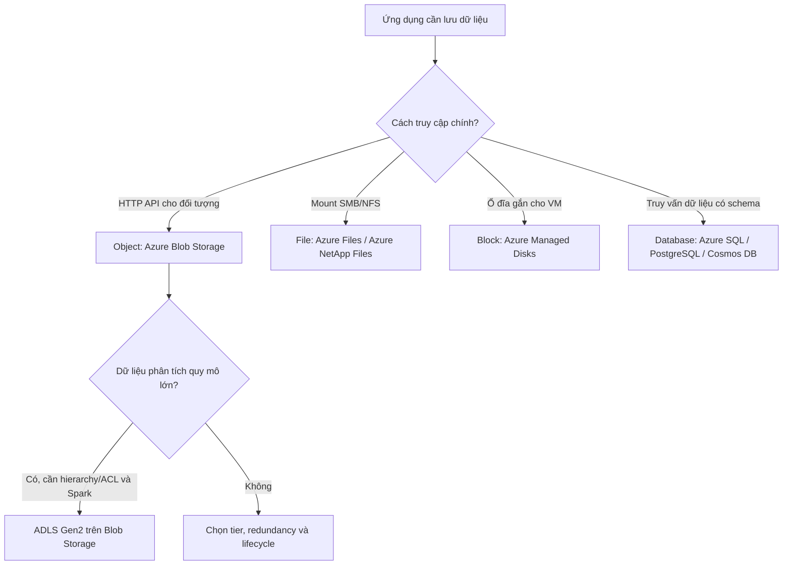
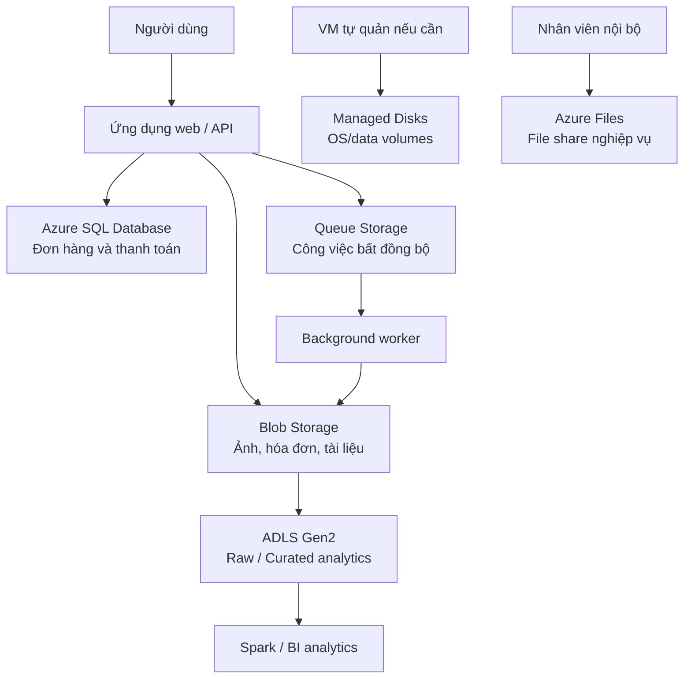

# Lựa chọn dịch vụ lưu trữ theo kiểu dữ liệu và workload

Khi thiết kế ứng dụng trên Microsoft Azure, câu hỏi không chỉ là **lưu dữ liệu ở đâu**, mà còn là **ứng dụng cần truy cập dữ liệu bằng cách nào, với độ trễ nào, mức độ bền vững và yêu cầu bảo mật ra sao**. Một file ảnh người dùng tải lên, ổ đĩa hệ điều hành của máy ảo, thư mục dùng chung cho nhiều nhân viên và tập dữ liệu phân tích hàng terabyte có hình thức lưu trữ, giao thức truy cập và chi phí rất khác nhau. Chọn sai dịch vụ có thể khiến ứng dụng khó mở rộng, chi phí đọc/ghi cao hoặc không đáp ứng được yêu cầu phục hồi khi xảy ra sự cố.

Bài học thuộc chương **Nền tảng Azure Storage** của mô-đun khám phá hệ sinh thái Microsoft Azure. Chúng ta sẽ so sánh **object storage, file storage, block storage và các lựa chọn chuyên dụng cho dữ liệu/analytics**, xây dựng bộ tiêu chí đánh giá workload, minh họa kiến trúc và thực hành kiểm tra một tài khoản Azure Storage. Những quyết định này liên quan tới subscription, resource group, Microsoft Entra ID, virtual network, compute, bảo mật, giám sát và quản lý chi phí của kiến trúc ứng dụng Azure.

## Mục tiêu học tập

Sau bài học, bạn có thể:

1. Phân biệt **object**, **file**, **block** và lưu trữ trong **database** theo cách ứng dụng truy cập dữ liệu.
2. Xác định trường hợp nên dùng Azure Blob Storage, Azure Data Lake Storage Gen2, Azure Files, Azure Managed Disks và Azure NetApp Files.
3. Nhận biết các dịch vụ lân cận như Table Storage, Queue Storage, Azure Elastic SAN và cơ sở dữ liệu Azure, tránh chọn sai vì chúng cùng có chữ “storage”.
4. Đánh giá **latency, IOPS, throughput, concurrency, dung lượng, tuổi dữ liệu, durability, availability, RPO/RTO** trước khi triển khai.
5. Phân biệt **storage tier**, **redundancy** và **backup**, đồng thời lựa chọn cơ chế bảo mật và kiểm soát chi phí.
6. Áp dụng một quy trình quyết định có giải thích cho workload web, VM, chia sẻ file, phân tích dữ liệu và lưu trữ dài hạn.

## 1. Bắt đầu từ yêu cầu của workload, không bắt đầu từ tên dịch vụ

Ví dụ một hệ thống thương mại điện tử có những loại dữ liệu sau:

- **Ảnh sản phẩm:** được tải lên qua API, thường được đọc nhiều lần bởi ứng dụng hoặc CDN; không cần mount thành ổ đĩa.
- **Tệp báo giá dùng chung:** nhân viên cần truy cập qua đường dẫn mạng, thư mục, phân quyền và đôi khi khóa file.
- **Ổ đĩa của VM:** hệ điều hành và phần mềm cần một block device để tạo filesystem, cài ứng dụng, xử lý I/O nhỏ ngẫu nhiên.
- **Đơn hàng:** cần truy vấn theo khách hàng, trạng thái, ngày tạo; cập nhật nhiều bản ghi theo quy tắc nghiệp vụ.
- **Nhật ký sự kiện và dữ liệu clickstream:** được ghi liên tục, xử lý theo lô bằng Spark/SQL engine, lưu lâu với chi phí tối ưu.
- **Bản lưu trữ tuân thủ:** ít được đọc, phải giữ trong nhiều năm, cần chính sách không xóa hoặc thời gian lưu giữ phù hợp.

Nếu gom tất cả vào một loại storage chỉ vì “đều là dữ liệu”, bạn sẽ phải tự xây những chức năng dịch vụ đó vốn không cung cấp: khóa file, truy vấn giao dịch, index, mount block device hoặc xử lý file theo thư mục. **Quy tắc đầu tiên là chọn hình thức truy cập mà workload yêu cầu, sau đó mới chọn tier và tính năng.**

## 2. Ba mô hình lưu trữ cốt lõi: object, file và block

| Tiêu chí | Object storage | File storage | Block storage |
|---|---|---|---|
| Đơn vị quản lý | Object/blob có tên, nội dung, metadata. | File và thư mục trong cây filesystem. | Các block trên volume/đĩa; hệ điều hành tạo filesystem. |
| Cách truy cập | API HTTP(S), SDK, URI, đôi khi giao thức tích hợp bổ sung. | SMB, NFS hoặc giao thức chia sẻ file được hỗ trợ. | Block device gắn vào máy/host, thường qua hạ tầng storage. |
| Workload điển hình | Ảnh, video, tài liệu, backup, dữ liệu phân tích. | File share, ứng dụng legacy, home directory, HPC file workload. | OS disk, database trên VM, file system ứng dụng cần I/O block. |
| Điểm mạnh | Quy mô lớn, API thuận tiện, tier/lifecycle, chi phí theo cách dùng. | Tương thích đường dẫn file và chia sẻ nhiều client. | IOPS/latency và kiểm soát filesystem ở tầng OS. |
| Điều thường **không** phù hợp | Giả lập ổ đĩa POSIX/SMB cho ứng dụng yêu cầu thao tác file native. | Lưu lượng đối tượng HTTP khổng lồ nếu ứng dụng không cần filesystem. | Lưu kho dữ liệu toàn cục với API object độc lập các VM. |

**Object storage** phù hợp khi ứng dụng thao tác với từng đối tượng qua API: tải lên, tải xuống, xóa và đọc metadata. Đường dẫn nhìn giống thư mục không nhất thiết có cùng semantics với một filesystem truyền thống.

**File storage** phù hợp khi chương trình hiện có dùng đường dẫn kiểu `\\server\share\reports` hoặc mount NFS, cần danh sách thư mục, quyền truy cập và chia sẻ giữa nhiều client.

**Block storage** phù hợp khi hệ điều hành cần “một ổ đĩa” để format, mount và quản lý I/O. Không được xem ổ đĩa block là file share cho nhiều máy cùng ghi trừ khi workload và cấu hình cụ thể hỗ trợ shared disk/cluster filesystem; gắn một filesystem không được thiết kế multi-writer cho nhiều VM có thể gây hỏng dữ liệu.



Sơ đồ là điểm khởi đầu, không phải công thức duy nhất: cùng một ứng dụng thường dùng **nhiều** loại lưu trữ. Chẳng hạn Azure SQL lưu giao dịch, Blob chứa file đính kèm và Managed Disk phục vụ VM tự quản.

## 3. Azure Blob Storage: lưu trữ đối tượng cho ứng dụng cloud-native

**Azure Blob Storage** là dịch vụ object storage dành cho dữ liệu phi cấu trúc hoặc dữ liệu được lưu như đối tượng: ảnh, video, tài liệu, package triển khai, log xuất ra file, backup, hồ sơ và data lake. Ứng dụng thường dùng REST API hoặc SDK để đọc/ghi blob trong **container** của một **storage account**.

```text
Subscription
└─ Resource group: rg-store-app
   └─ Storage account: stappdemo123456
      ├─ Container: product-images
      │  ├─ items/101/front.jpg
      │  └─ items/102/front.jpg
      └─ Container: exports
         └─ 2026/11/orders.csv
```

Tên chứa dấu `/` tạo cảm giác giống thư mục; với Blob Storage có namespace phẳng, phần đó là một phần tên blob và client có thể hiển thị thành các thư mục ảo. Nếu bật **hierarchical namespace (HNS)** như khi triển khai Data Lake Storage Gen2, semantics về thư mục sẽ khác; cần chọn mô hình ngay từ lúc thiết kế.

### 3.1. Các loại blob

| Loại | Đặc điểm chính | Ví dụ |
|---|---|---|
| **Block blob** | Tối ưu cho việc tải lên và lưu các đối tượng; có thể upload theo block. | Ảnh, tệp PDF, video, package, file Parquet. |
| **Append blob** | Hỗ trợ thêm dữ liệu theo kiểu append, trong giới hạn của dịch vụ. | Một số kịch bản ghi log theo chuỗi. |
| **Page blob** | Đọc/ghi theo trang, phục vụ những kịch bản truy cập ngẫu nhiên chuyên biệt. | Một số triển khai đĩa ảo hoặc hệ thống cần page blob. |

Đối với ứng dụng web thông thường, **block blob** thường là lựa chọn mặc định cho file tải lên. Chọn Blob không có nghĩa là tự động được truy vấn nội dung JSON hoặc CSV như một database: muốn tìm kiếm, lọc và kết hợp dữ liệu theo nghiệp vụ, cần thiết kế index hoặc dịch vụ truy vấn riêng.

### 3.2. Khi nào nên dùng Blob Storage?

- Lưu **hình ảnh và video** được ứng dụng hoặc CDN phân phối theo URL/SDK.
- Lưu **file đính kèm**, biên lai, tài liệu được xử lý như đối tượng riêng lẻ.
- Lưu **backup, bản xuất dữ liệu hoặc log file** với thời gian lưu giữ và truy cập khác nhau.
- Lưu **file dữ liệu cho analytics** như CSV, JSON, Avro và Parquet khi truy cập qua API/object interface.
- Lưu **nội dung tĩnh**; nếu cần xuất bản website, hãy đánh giá thêm endpoint, CDN/Front Door, xác thực và chính sách public access.

**Không chọn Blob chỉ vì giá lưu dung lượng thấp** khi ứng dụng bắt buộc mount ổ đĩa SMB, dùng file locking theo giao thức chia sẻ, hoặc cần database transaction. Chỉ dùng các driver/gateway chuyển object thành filesystem sau khi đã kiểm chứng semantics, latency, concurrency và yêu cầu hỗ trợ của hệ thống.

## 4. Azure Data Lake Storage Gen2: object storage cho phân tích dữ liệu

**Azure Data Lake Storage Gen2 (ADLS Gen2)** sử dụng nền tảng Blob Storage với **hierarchical namespace** để hỗ trợ những workload phân tích cần thao tác thư mục hiệu quả, mô hình quyền chi tiết và hệ sinh thái xử lý dữ liệu như Spark. Đây không phải một loại đĩa gắn VM và cũng không phải một database quan hệ.

Ví dụ một data lake:

```text
Container: lake
raw/orders/year=2026/month=11/day=20/part-0001.json
raw/events/year=2026/month=11/day=20/part-0001.json
curated/sales/year=2026/month=11/part-0001.parquet
serving/customer_features/part-0001.parquet
```

Trong các hệ thống phân tích, có thể tổ chức vùng **raw → curated → serving**, lưu dữ liệu gốc riêng với dữ liệu đã làm sạch và sẵn sàng cho báo cáo hoặc mô hình ML. ADLS Gen2 hỗ trợ mô hình thư mục thực và thao tác trên hierarchy phù hợp cho các công cụ xử lý dữ liệu; quyền truy cập có thể kết hợp **Azure RBAC** với **access control lists (ACLs)** theo cấu hình.

### Khi chọn ADLS Gen2

Chọn khi cần đồng thời:

1. Lưu lượng lớn dữ liệu dạng file, được ghi theo lô hoặc streaming vào data lake.
2. Phân vùng dữ liệu theo thư mục và thao tác trên hierarchy như rename/move theo tính năng hỗ trợ.
3. Phân quyền ở cấp thư mục/file cho nhóm xử lý dữ liệu.
4. Hệ sinh thái phân tích tích hợp, như Spark và các công cụ hỗ trợ giao thức Data Lake.

**Lưu ý về thiết kế:** bật hierarchical namespace là lựa chọn kiến trúc quan trọng. Khả năng tương thích API, một số tính năng Blob, lifecycle/tier và đường nâng cấp có thể phụ thuộc vào loại storage account và phiên bản hỗ trợ. Hãy kiểm tra các giới hạn liên quan trước khi chuyển một workload Blob đang hoạt động sang mô hình ADLS Gen2. Không mặc định rằng mọi tính năng của Blob Storage đều hoạt động y hệt khi bật HNS.

## 5. Azure Files: file share dùng chung qua SMB hoặc NFS

**Azure Files** cung cấp file share được Azure quản lý, có thể truy cập qua **SMB** hoặc **NFS** ở những loại share/SKU hỗ trợ. Đây là lựa chọn phù hợp khi ứng dụng hiện có cần đường dẫn file, thư mục và giao thức file share thay vì phải viết lại để sử dụng Blob REST API.

Ví dụ:

```text
\\storage-account.file.core.windows.net\team-share
  ├─ reports\
  ├─ templates\
  └─ shared-documents\
```

Windows Server hoặc máy Windows của nhân viên có thể truy cập SMB share nếu cấu hình mạng và danh tính phù hợp. Linux có thể mount một số loại share qua SMB hoặc NFS tùy môi trường và khả năng dịch vụ. Chọn giao thức trước vì yêu cầu về authentication, port, networking, tier và những tính năng như snapshots có thể khác nhau.

### 5.1. Khi nào dùng Azure Files?

- Chuyển một ứng dụng legacy từ file server sang Azure nhưng **giữ đường dẫn SMB**.
- Chia sẻ tài liệu và file cấu hình cho nhiều VM hoặc người dùng được phép.
- Sử dụng **Azure File Sync** để đồng bộ và tổ chức phân tầng một SMB file share với Windows Server tại chỗ trong mô hình hybrid được hỗ trợ.
- Dùng file share cho workload cần mount filesystem chung; với AKS có thể tích hợp qua CSI driver phù hợp.

### 5.2. Những giới hạn cần xem xét

**Azure Files không đồng nghĩa với Azure Blob Storage.** File share có semantics và giao thức riêng. Đối với ứng dụng web chủ yếu tải file lên/xuống bằng API ở quy mô lớn, Blob có thể đơn giản và kinh tế hơn. Đối với workload file đòi hỏi latency rất thấp hoặc hiệu năng NFS/SMB cao, cần so sánh SKU Azure Files được hỗ trợ với Azure NetApp Files.

Chú ý đường mạng cho SMB, đặc biệt **TCP 445** có thể bị chặn trên một số mạng từ người dùng hoặc nhà cung cấp Internet. Cần kiểm tra Private Endpoint, VPN/ExpressRoute và cách kết nối dự kiến. Việc một storage account có file share không có nghĩa máy người dùng ở bất cứ mạng nào đều mount được.

**Danh tính:** SMB shares có thể tích hợp các phương thức xác thực dựa trên danh tính phù hợp, ví dụ AD DS hoặc các phương án Kerberos mà dịch vụ hỗ trợ. Cần phân biệt **quyền truy cập share** với **quyền cấp file/directory**. NFS có mô hình xác thực và phân quyền khác; không sao chép thiết kế SMB identity sang NFS mà không kiểm tra tài liệu sản phẩm.

## 6. Azure Managed Disks: block storage cho máy ảo

**Azure Managed Disks** cung cấp ổ đĩa block do Azure quản lý cho Virtual Machines và những workload compute tương thích. Khi VM cần ổ đĩa hệ điều hành, cài ứng dụng, ghi dữ liệu database tự quản hoặc cần filesystem có I/O ngẫu nhiên, block storage mới là hình thức truy cập phù hợp.

Các nhóm đĩa phổ biến gồm **Standard HDD**, **Standard SSD**, **Premium SSD**, **Premium SSD v2** và **Ultra Disk** theo phạm vi hỗ trợ của VM size, region và loại đĩa. Mức hiệu năng, khả năng điều chỉnh IOPS/throughput, latency, tính năng snapshot và giới hạn thay đổi theo SKU; không nên giả định mọi loại đĩa có cùng hành vi hoặc áp dụng một công thức định giá.

### 6.1. Chọn loại đĩa theo I/O

| Workload trên VM | Hướng lựa chọn | Điều cần đo |
|---|---|---|
| Dev/test, workload ít I/O | Standard HDD/SSD khi đáp ứng yêu cầu. | Độ trễ chấp nhận được và chi phí. |
| Web/application VM có I/O ổn định | Standard SSD hoặc Premium SSD tùy yêu cầu. | IOPS, throughput và tail latency. |
| Database tự quản cần I/O cao | Premium SSD, Premium SSD v2 hoặc Ultra Disk trong kịch bản hỗ trợ. | Read/write IOPS, queue depth, kích thước block và latency thực tế. |
| Xử lý tạm, dữ liệu có thể tái tạo | Đánh giá **temporary/ephemeral storage** của VM nếu phù hợp. | Khả năng mất dữ liệu khi bảo trì, redeploy hoặc vòng đời VM. |

Một đĩa có thông số IOPS cao chưa đủ nếu **VM size có giới hạn tổng IOPS/throughput** thấp hơn. Hãy đo cả giới hạn của VM, filesystem, ứng dụng, caching và network path. Ví dụ workload ghi nhiều khối nhỏ ngẫu nhiên có thể bị giới hạn bởi IOPS, trong khi xử lý video lớn có thể bị giới hạn bởi throughput.

### 6.2. Những điều Managed Disks không thay thế

- **Đĩa không phải dịch vụ database:** SQL Server/PostgreSQL trên VM vẫn cần tự quản lý engine, backup, replication, recovery và patching.
- **Disk snapshot không tự bằng backup có kiểm chứng:** cần chính sách snapshot/backup, retention và thử restore.
- **Đĩa thông thường không phải file share multi-writer:** cần mô hình shared disk và cluster filesystem/ứng dụng hỗ trợ nếu có nhiều máy cùng ghi.
- **Availability zone của VM/đĩa là điều kiện kiến trúc:** chọn kiểu disk và zone tương thích với VM, replication và phương án HA mong muốn.

Với ứng dụng container, **Azure Disk CSI driver** có thể cung cấp persistent volume dựa trên Managed Disk cho pod theo access mode hỗ trợ; nếu nhiều pod/nút cần chia sẻ file cùng lúc, hãy đánh giá Azure Files hoặc các giải pháp file khác thay vì tự ý gắn một filesystem block cho nhiều node.

## 7. Azure NetApp Files: file storage hiệu năng cao

**Azure NetApp Files (ANF)** là dịch vụ lưu trữ file managed hướng tới các workload doanh nghiệp cần **NFS/SMB** với yêu cầu hiệu năng, latency và tính năng file cao hơn. Những kịch bản có thể phù hợp gồm:

- Ứng dụng enterprise dùng NFS/SMB với yêu cầu I/O cao và nhiều client.
- Khối lượng dữ liệu phục vụ SAP, HPC hoặc workload tính toán chuyên dụng khi nằm trong các cấu hình được hỗ trợ.
- Ứng dụng chuyển từ NAS on-premises lên Azure nhưng không muốn tự vận hành NAS VM.

ANF sử dụng mô hình dung lượng/hiệu năng và cấu hình networking riêng; có thể có **capacity pool**, volume và các chính sách bảo vệ dữ liệu tùy tính năng. Đổi lại, chi phí và điều kiện triển khai có thể không phù hợp với một file share nhỏ và ít truy cập. Vì vậy, hãy **đo latency, throughput, số client đồng thời và đặc điểm NFS/SMB** rồi so sánh ANF với Azure Files, thay vì lựa chọn chỉ theo tên dịch vụ.

## 8. Những lựa chọn liên quan nhưng không phải file/object/block thay thế trực tiếp

Azure có nhiều dịch vụ lưu trữ hoặc dữ liệu dùng cho mục đích chuyên biệt. Nhầm lẫn các lớp này có thể dẫn tới thiết kế khó vận hành.

| Dịch vụ | Mô hình truy cập chính | Dùng khi nào? | Không thay thế trực tiếp |
|---|---|---|---|
| **Azure Table Storage** | NoSQL key/attribute với partition key và row key, API bảng. | Tra cứu dữ liệu phi quan hệ đơn giản theo khóa và partition. | Database quan hệ nhiều JOIN/transaction phức tạp. |
| **Azure Queue Storage** | Hàng đợi message đơn giản. | Tách xử lý bất đồng bộ giữa ứng dụng và worker. | Lưu file lớn hoặc event streaming phân tích đầy đủ. |
| **Azure Cosmos DB** | Database NoSQL được quản lý, truy cập theo API/mô hình được chọn. | Dữ liệu ứng dụng cần truy vấn, phân phối đa vùng và khả năng mở rộng database theo tính năng. | Blob Storage cho file giá rẻ dung lượng lớn. |
| **Azure SQL Database / Azure Database for PostgreSQL** | Database quan hệ, câu truy vấn và giao dịch theo engine. | Đơn hàng, thanh toán, dữ liệu có schema và quan hệ. | Object storage cho ảnh, video và backup file. |
| **Azure Elastic SAN** | Lưu trữ block dạng SAN cho workload hỗ trợ iSCSI. | Kịch bản nhiều volume, cần quản lý SAN tập trung. | Azure Files/Blob hoặc một VM disk mặc định trong mọi kiến trúc. |
| **Azure Backup** | Dịch vụ điều phối bảo vệ/khôi phục dữ liệu. | Policy backup và restore cho workload được hỗ trợ. | Thay thế live storage phục vụ I/O ứng dụng. |

**Table Storage** thường có mô hình truy cập theo partition và row key, nên cần thiết kế khóa theo truy vấn; không phải chỉ cần đẩy mọi JSON vào bảng là có đầy đủ tính năng SQL. **Queue Storage** chứa message để xử lý bất đồng bộ, khác với Blob Storage chứa payload file. Nếu ứng dụng cần messaging nâng cao như transaction hoặc publish-subscribe theo nhu cầu, hãy so sánh với Azure Service Bus/Event Hubs thay vì cố biến Queue Storage thành streaming platform.

## 9. Bảng lựa chọn dịch vụ theo kiểu dữ liệu và workload

Đây là bảng tư vấn ban đầu. Quyết định cuối cùng cần xác nhận khả năng hỗ trợ theo region, SKU, hiệu năng và chi phí thực tế.

| Nhu cầu | Lựa chọn ưu tiên để đánh giá | Vì sao? | Câu hỏi trước khi chốt |
|---|---|---|---|
| Lưu ảnh, video, PDF người dùng tải lên | **Blob Storage** | API object, quản lý container, lifecycle và tier. | Số lần đọc, yêu cầu CDN, private access và egress? |
| Website tĩnh hoặc media phân phối rộng | **Blob Storage + Front Door/CDN** khi phù hợp | Tách file tĩnh khỏi ứng dụng, tối ưu phân phối. | Cần auth, caching, custom domain và chính sách public? |
| File share cho ứng dụng Windows/SMB | **Azure Files SMB** | Semantics file share và tích hợp danh tính. | TCP 445, quyền share/ACL, dung lượng và số client? |
| Chia sẻ file NFS có hiệu năng cao | **Azure NetApp Files** hoặc **Azure Files NFS** tùy yêu cầu | Phù hợp workload cần file protocol. | Latency, throughput, POSIX semantics, SKU/region? |
| Ổ đĩa OS hoặc data của VM | **Managed Disks** | Block device tích hợp với Azure VM. | IOPS, throughput, caching, backup và zone? |
| Database tự quản trên VM | **Managed Disks** cho volume + database engine | Cần block I/O cho engine. | Có thể dùng database PaaS để giảm vận hành không? |
| Đơn hàng có JOIN, transaction, schema | **Azure SQL Database/PostgreSQL** | Engine database chuyên dụng. | Consistency, HA, query, migration và license? |
| Tài liệu JSON cần truy vấn/partition | **Azure Cosmos DB** hoặc database phù hợp | Truy vấn và indexing ở cấp database. | Partition key, throughput, consistency, region? |
| Event logs, Parquet và pipeline Spark | **ADLS Gen2** | Hierarchy và tích hợp analytics. | Phân vùng, ACL, số file nhỏ và format? |
| Bản export/backup dạng object | **Blob Storage** | Dễ quản lý tuổi dữ liệu và chi phí lưu. | Tần suất phục hồi, retention, immutable policy? |
| Hồ sơ ít truy cập giữ nhiều năm | **Blob tier phù hợp**, có thể archive | Tối ưu chi phí dung lượng khi ít đọc. | Thời gian rehydrate, phí truy xuất và thời hạn lưu tối thiểu? |
| Message giữa API và worker | **Queue Storage** | Đệm công việc bất đồng bộ. | Cần FIFO nghiêm ngặt, transaction hay pub/sub không? |
| Hệ thống NAS doanh nghiệp | **Azure Files / Azure NetApp Files** | Giữ file protocol, giảm vận hành máy chủ file. | Kiểm thử ACL, lock, số client, latency? |
| Khối lượng SAN đặc thù | **Azure Elastic SAN** nếu hỗ trợ | Quản lý block volumes tập trung. | iSCSI, mạng, tương thích host và HA? |

## 10. Năm nhóm tiêu chí kỹ thuật ảnh hưởng quyết định

### 10.1. Giao thức và semantics truy cập

Hãy hỏi: ứng dụng dùng REST API, SDK, SMB, NFS, block device hay câu truy vấn SQL? Có yêu cầu rename thư mục, file locking, append, random write, POSIX ACL hoặc nhiều tác nhân cùng ghi không?

Đây là **điều kiện loại trừ**: nếu ứng dụng legacy chỉ biết ghi file qua SMB và không được phép sửa code, lựa chọn Blob thường không phù hợp. Ngược lại, nếu ứng dụng serverless lưu file upload qua API, việc tạo file share rồi mount trên mọi instance có thể tăng độ phức tạp không cần thiết.

### 10.2. Độ trễ, IOPS và throughput

Ba thước đo thường bị nhầm:

- **Latency:** thời gian để một thao tác hoàn tất, thường tính bằng ms; cần chú ý cả tail latency, chẳng hạn p95/p99.
- **IOPS:** số thao tác I/O mỗi giây; quan trọng với small random reads/writes của filesystem hoặc database.
- **Throughput:** lượng dữ liệu truyền mỗi giây, thường tính MB/s hoặc Gb/s; quan trọng với file lớn và xử lý phân tích.

Ví dụ, database ghi các trang dữ liệu nhỏ cần IOPS và latency ổn định; pipeline đọc file Parquet lớn có thể ưu tiên throughput và khả năng đọc song song; dịch vụ ảnh cần tối ưu băng thông và caching. Không chọn Premium Disk chỉ vì dung lượng database lớn mà chưa đo I/O thực tế.

### 10.3. Dung lượng và khả năng mở rộng

Đánh giá dung lượng hiện tại, tốc độ tăng trưởng, số lượng object/file, kích thước trung bình, số client đồng thời và giới hạn ở **mức account/share/disk/VM/region**. Một dịch vụ có giới hạn dung lượng lớn không đồng nghĩa mỗi client có thể dùng toàn bộ throughput công bố. Khi thử nghiệm, phải đo ở đúng cỡ dữ liệu, concurrency và khoảng thời gian tương tự production.

### 10.4. Độ bền, tính sẵn sàng và khả năng phục hồi

**Durability** là khả năng giữ dữ liệu trước hỏng hóc, khác với **availability** là khả năng truy cập dịch vụ ngay tại thời điểm cần. **RPO (Recovery Point Objective)** mô tả mức mất dữ liệu tối đa chấp nhận được; **RTO (Recovery Time Objective)** là thời gian mục tiêu để khôi phục dịch vụ.

Redundancy lưu nhiều bản sao giúp chịu lỗi hạ tầng; nó không tự thay thế backup trước lỗi thao tác người dùng, ghi đè hoặc xóa nhầm. Một dữ liệu được sao chép chính xác sang vùng khác sau khi bị xóa nhầm vẫn có thể bị mất theo logic ứng dụng nếu không có versioning/backup/retention thích hợp.

### 10.5. Bảo mật, tuân thủ và vị trí dữ liệu

Kiểm tra danh tính truy cập, yêu cầu mã hóa khi truyền/lưu, vùng lưu trữ, phân tách network, khả năng audit và chính sách không được xóa. **Microsoft Entra ID**, Azure RBAC và quyền data plane của dịch vụ là những phần quan trọng; có quyền xem một storage account trên management plane không đồng nghĩa được đọc toàn bộ blob bên trong.

Đối với dữ liệu nhạy cảm, hãy ưu tiên **managed identity**, xác thực dựa trên Entra ID, scope quyền tối thiểu, Private Endpoint/firewall khi phù hợp, log truy cập và cơ chế ngăn xóa nhầm. Không dùng storage account key chung cho mọi ứng dụng nếu có thể thay thế bằng cơ chế ủy quyền hẹp hơn.

## 11. Storage account, redundancy và lớp truy cập

### 11.1. Storage account là ranh giới cấu hình

Nhiều dịch vụ Azure Storage được tổ chức dưới một **storage account**. Các thuộc tính như region, loại account, một số giới hạn và chính sách network/identity áp dụng ở phạm vi account. Loại **general-purpose v2 (StorageV2)** là lựa chọn phổ biến cho các workload Blob/Files/Queue/Table tương thích; các loại account chuyên biệt hoặc premium có thể cần thiết khi workload yêu cầu hiệu năng và tính năng khác.

**Không bắt buộc dồn mọi workload vào một storage account.** Tách account theo môi trường, dữ liệu nhạy cảm, giới hạn hiệu năng, yêu cầu redundancy hoặc cơ chế kiểm soát quyền có thể giúp giảm blast radius và quản lý chi phí dễ hơn. Tuy vậy, quá nhiều account nhỏ cũng làm tăng công vận hành và quản trị cấu hình.

### 11.2. Các lựa chọn redundancy cơ bản

| Tùy chọn | Cách bảo vệ dữ liệu ở mức khái niệm | Điều cần lưu ý |
|---|---|---|
| **LRS** (Locally Redundant Storage) | Nhiều bản sao trong một địa điểm/đơn vị lưu trữ thuộc region. | Bảo vệ một số lỗi hạ tầng cục bộ, không phải DR liên region. |
| **ZRS** (Zone Redundant Storage) | Sao chép đồng bộ qua nhiều availability zone trong region được hỗ trợ. | Giảm phụ thuộc vào một zone; kiểm tra dịch vụ và region hỗ trợ. |
| **GRS** (Geo Redundant Storage) | Bản sao ở region chính và bản sao bất đồng bộ sang region ghép cặp/secondary. | Có thể mất dữ liệu chưa đồng bộ trong sự cố region; phục hồi và quyền truy cập secondary có điều kiện. |
| **GZRS** (Geo-Zone Redundant Storage) | Kết hợp zone redundancy ở primary với bản sao bất đồng bộ sang secondary. | Khả dụng phụ thuộc region, loại account và workload. |
| **RA-GRS / RA-GZRS** | Biến thể cho phép đọc secondary theo điều kiện. | Không đồng nghĩa secondary luôn cập nhật tức thì hoặc ứng dụng được tự động failover. |

Những tùy chọn này **không hỗ trợ đồng nhất cho mọi loại lưu trữ Azure**. Managed Disks, Azure Files, Blob và Azure NetApp Files có khả năng HA/replication khác nhau. Không áp một bảng redundancy của Blob lên mọi dịch vụ.

### 11.3. Access tier của Blob Storage

Với các loại blob và storage account có hỗ trợ, dữ liệu có thể được đưa vào những lớp truy cập phù hợp:

| Tier | Kiểu truy cập | Mô hình chi phí định tính |
|---|---|---|
| **Hot** | Đọc/ghi thường xuyên. | Phí lưu dung lượng thường cao hơn tier lạnh, phí truy xuất có thể thuận lợi hơn. |
| **Cool** | Ít đọc hơn nhưng vẫn cần online. | Có thể giảm phí dung lượng và tăng chi phí truy xuất/giao dịch. |
| **Cold** | Hiếm đọc, vẫn cần online ở cấu hình hỗ trợ. | Tiếp tục tối ưu chi phí dung lượng, nhưng cần kiểm tra chi phí và thời hạn lưu tối thiểu. |
| **Archive** | Lưu trữ rất ít truy cập, không đọc trực tiếp ngay như tier online. | Chi phí dung lượng thường thấp, nhưng cần **rehydration**, có độ trễ và phí truy xuất. |

**Không chọn archive cho dữ liệu cần truy cập tức thời.** Dữ liệu archive cần được rehydrate theo cơ chế và mức ưu tiên dịch vụ hỗ trợ trước khi đọc; thời gian không giống một request GET thông thường. Với cool/cold/archive, các điều kiện **minimum retention/early deletion** và phí operation/retrieval phải được tính khi ra quyết định. Tier có thể được tự động thay đổi qua **lifecycle management policies** theo điều kiện được hỗ trợ, ví dụ sau một số ngày từ lần tạo hoặc thay đổi/truy cập theo chính sách.

Một cách chọn tier là đo **tần suất truy cập, lượng dữ liệu tải xuống và thời gian cần lấy lại dữ liệu**, rồi tính tổng chi phí chứ không chỉ so giá theo GB/tháng.

## 12. Giá thành thực tế gồm nhiều hơn dung lượng lưu trữ

Một công thức dự toán gần đúng:

```text
Tổng chi phí storage
  ≈ dung lượng lưu trữ theo tier/SKU
  + số lượng thao tác đọc/ghi, giao dịch và truy xuất
  + băng thông/egress ngoài phạm vi miễn phí hoặc nội bộ được áp dụng
  + redundancy/replication và khả năng phục hồi
  + snapshots/backup/retention
  + công cụ bảo mật, network, monitoring và tài nguyên hỗ trợ
```

Công thức chỉ mô tả các loại chi phí; Azure tính phí khác nhau giữa sản phẩm, region, tier và mô hình cấp phát. Ví dụ, Managed Disk có thể được tính theo loại/kích thước hoặc các thông số hiệu năng được cấp phát tùy SKU; Azure NetApp Files có thể theo capacity pool/volume và mức hiệu năng; Blob có thể có phí dung lượng, operations và retrieval. **Không dùng giá Blob theo GB để dự toán SQL Database hoặc Premium SSD.**

### Ví dụ định tính

Hai kho đều lưu 10 TB:

- **Kho A:** ảnh được tải xuống hàng triệu lần mỗi ngày. Phí dung lượng chỉ là một phần; phải tính operations, egress và lợi ích caching/CDN.
- **Kho B:** bản sao lưu giữ nhiều năm, hiếm khi truy xuất. Lớp lạnh/archive có thể kinh tế hơn, nhưng thời gian phục hồi và phí rehydrate phải đáp ứng RTO/RPO của tổ chức.

Azure Pricing Calculator giúp ước lượng trước triển khai; **Azure Cost Management** giúp kiểm chứng chi phí thực tế. Gắn tags phù hợp và có quy trình rà soát tăng trưởng dung lượng, access tier, các bản snapshot cũ, dữ liệu orphan và egress bất thường.

## 13. Bảo mật và quản lý vòng đời dữ liệu

Một thiết kế lưu trữ tốt cần có nhiều lớp bảo vệ:

1. **Authentication:** ưu tiên Microsoft Entra ID/managed identity và hình thức xác thực phù hợp thay vì hard-code account key.
2. **Authorization:** Azure RBAC theo vai trò data-plane, ACL của ADLS Gen2 hoặc quyền SMB/NFS tùy dịch vụ; tách quyền quản trị tài nguyên với quyền đọc dữ liệu.
3. **Networking:** giới hạn public network access khi phù hợp, dùng Private Endpoint, service endpoint hoặc firewall theo kiến trúc thực tế.
4. **Encryption:** HTTPS/TLS khi truyền; server-side encryption khi lưu; chọn customer-managed keys qua Key Vault trong các tình huống hỗ trợ và có yêu cầu kiểm soát khóa.
5. **Data protection:** versioning, soft delete, snapshots, backup và chính sách immutability/legal hold khi dịch vụ và nghĩa vụ tuân thủ yêu cầu.
6. **Monitoring:** audit logs, metrics, cảnh báo về truy cập, lỗi, dung lượng và chi phí; kiểm tra log không làm lộ secrets.
7. **Lifecycle:** chuyển tier hoặc xóa đúng hạn, kiểm soát retention, phân biệt bản sao tạm với dữ liệu có giá trị pháp lý.

### 13.1. Redundancy khác backup và immutability

Ví dụ một lập trình viên vô tình xóa thư mục chứa hóa đơn. ZRS hoặc GRS không nhất thiết giúp lấy lại version trước đó nếu thao tác xóa được đồng bộ. **Soft delete/versioning** hoặc **backup có khả năng restore** bảo vệ khỏi lỗi thao tác và những kiểu mất dữ liệu khác. **Immutability** giúp ngăn thay đổi/xóa trong thời gian yêu cầu với cấu hình đúng. Chúng bổ sung cho nhau, không phải các tên gọi tương đương.

### 13.2. Chia sẻ đối tượng có giới hạn quyền

Khi cần cung cấp link tải file có thời hạn, Blob hỗ trợ cơ chế như **Shared Access Signature (SAS)** ở những kịch bản phù hợp. SAS là một loại thông tin trao quyền truy cập; ai sở hữu URL/token hợp lệ có thể sử dụng quyền trong phạm vi được cấp. Vì thế cần giới hạn permission, thời hạn, phạm vi resource, bảo vệ việc phát tán token và có kế hoạch thu hồi khi thích hợp. Với ứng dụng nội bộ có Entra ID, nên cân nhắc role-based data access trước khi chia sẻ quyền rộng.

## 14. Thiết kế mẫu: ứng dụng thương mại điện tử trên Azure

Kiến trúc tham khảo phân biệt dữ liệu giao dịch, file người dùng, batch analytics và compute:



### Lập luận lựa chọn

- **Azure SQL Database** lưu đơn hàng có trạng thái, khóa dữ liệu và nghiệp vụ cần transaction; không lưu mọi đơn hàng như một tệp JSON riêng lẻ nếu ứng dụng cần query và cập nhật giao dịch.
- **Blob Storage** lưu hóa đơn PDF và ảnh sản phẩm. Database giữ metadata và ID/URI của blob; quyền truy cập file được cấp theo chính sách ứng dụng.
- **Queue Storage** đệm công việc tạo thumbnail hoặc email để API trả lời nhanh, tránh lưu message như file rồi polling toàn bộ Blob.
- **ADLS Gen2** lưu dữ liệu xuất theo batch để Spark/BI xử lý, thường dùng format/partition tối ưu thay vì query trực tiếp toàn bộ giao dịch production.
- **Azure Files** chỉ được đưa vào nếu có workload thật sự cần file share SMB/NFS; không phải mọi ứng dụng web đều cần.
- **Managed Disks** phục vụ VM tự quản nếu có; với compute PaaS/serverless, lựa chọn persistent storage phải theo cách dịch vụ đó hỗ trợ.

Trong sơ đồ, mũi tên từ Blob tới ADLS Gen2 biểu thị **pipeline chuyển/đồng bộ dữ liệu theo thiết kế**, không có nghĩa Azure tự chuyển dữ liệu giữa hai storage account. Có thể dùng chung nền tảng object và tách các account/namespace phù hợp theo bảo mật, hiệu năng và quản trị.

## 15. Thực hành Azure CLI: tạo Blob Storage cho file upload

Mục tiêu là triển khai một ví dụ **an toàn ở mức học tập** rồi kiểm tra cấu hình. Cần có Azure CLI, subscription thử nghiệm, quyền tạo storage account trong resource group và quyền data plane phù hợp nếu định tạo/upload blob. Ví dụ dùng **Bash**, không chạy trên production chưa được phê duyệt.

### Bước 1. Đăng nhập và đặt biến

```bash
az login
az account list --output table
az account set --subscription "<subscription-id>"

RG="rg-storage-lab"
LOCATION="southeastasia"
ACCOUNT="<tenstoragegloballyunique>"
CONTAINER="uploads"
```

Tên storage account phải **duy nhất toàn Azure**, dùng chữ thường và số, độ dài theo giới hạn được dịch vụ quy định. Thay placeholder thành tên hợp lệ và kiểm tra region/SKU hỗ trợ trước khi tạo.

### Bước 2. Tạo resource group và StorageV2 account

```bash
az group create \
  --name "$RG" \
  --location "$LOCATION"

az storage account create \
  --resource-group "$RG" \
  --name "$ACCOUNT" \
  --location "$LOCATION" \
  --sku Standard_LRS \
  --kind StorageV2 \
  --https-only true \
  --min-tls-version TLS1_2 \
  --allow-blob-public-access false
```

Ví dụ chọn **Standard_LRS** để bắt đầu với bài lab tối giản; đây **không phải khuyến nghị mặc định cho production**. Workload production có yêu cầu HA/DR có thể cần ZRS/GRS/GZRS hoặc chiến lược khác theo mục tiêu phục hồi và phạm vi hỗ trợ. Tạo account có thể phát sinh phí; theo dõi chi phí thực tế.

### Bước 3. Kiểm tra cấu hình vừa tạo

```bash
az storage account show \
  --resource-group "$RG" \
  --name "$ACCOUNT" \
  --query "{name:name,kind:kind,sku:sku.name,location:location,httpsOnly:enableHttpsTrafficOnly,minTls:minimumTlsVersion,publicBlob:allowBlobPublicAccess}" \
  --output json
```

Đọc các trường: **kind** cho biết loại account, **sku** biểu thị mức redundancy/tier được cấp, **httpsOnly/minTls** thể hiện cấu hình đường truyền, còn **publicBlob** cho biết chính sách cho phép truy cập blob công khai ở mức account. Tắt anonymous blob public access **không đồng nghĩa** đã chặn network public endpoint; cần kiểm tra firewall/private access riêng.

### Bước 4. Tạo container và upload một file

Sử dụng Entra ID với `--auth-mode login` khi danh tính có role data-plane như **Storage Blob Data Contributor** trên phạm vi phù hợp:

```bash
az storage container create \
  --account-name "$ACCOUNT" \
  --name "$CONTAINER" \
  --auth-mode login

az storage blob upload \
  --account-name "$ACCOUNT" \
  --container-name "$CONTAINER" \
  --name "example.txt" \
  --file "./example.txt" \
  --auth-mode login

az storage blob list \
  --account-name "$ACCOUNT" \
  --container-name "$CONTAINER" \
  --auth-mode login \
  --output table
```

Tạo sẵn một file văn bản nhỏ `example.txt` trong thư mục thao tác của người học trước khi chạy upload. Nếu gặp `AuthorizationPermissionMismatch` hoặc lỗi 403, hãy kiểm tra role data-plane và thời gian lan truyền role assignment, đừng chỉ cấp thêm Contributor ở resource group vì vai trò quản lý không mặc nhiên đủ để upload blob.

### Bước 5. Dọn dẹp theo phạm vi được phép

Nếu resource group chỉ chứa tài nguyên demo mới tạo và bạn đã xác minh không còn dữ liệu cần giữ, có thể xóa tài nguyên lab theo quy trình của tổ chức. **Không xóa cả resource group nếu có tài nguyên dùng chung hoặc dữ liệu khác.** Xác nhận blob, container, storage account và các phụ thuộc trước khi xóa; theo dõi Cost Management sau thực hành.

## 16. Phương pháp ra quyết định: 8 câu hỏi trước khi chọn dịch vụ

Để thiết kế và review có hệ thống, hãy trả lời theo thứ tự:

1. **Kiểu dữ liệu:** tệp media, file share, block I/O, dữ liệu có schema/giao dịch hay log phân tích?
2. **Interface bắt buộc:** REST/SDK, SMB, NFS, POSIX-like hierarchy, database query hay block device?
3. **Hành vi I/O:** kích thước object/file, request rate, concurrency, random/sequential I/O, latency và throughput mục tiêu?
4. **Khả năng mở rộng:** dung lượng hiện tại/tăng trưởng, số đối tượng/file/khóa phân vùng, giới hạn của account/share/VM?
5. **Độ bền & phục hồi:** zone/region failure, RPO/RTO, retention, backup, soft delete, versioning và khả năng restore?
6. **Bảo mật & tuân thủ:** public/private endpoint, Entra ID/RBAC/ACL, encryption, audit, residency và immutability?
7. **Vòng đời dữ liệu:** nóng/lạnh, tần suất truy xuất, thời gian rehydrate được phép, chính sách tiering/xóa?
8. **Tổng chi phí:** dung lượng, operations, retrieval, egress, provisioned performance, backup, mạng và công vận hành?

Nếu câu trả lời chưa rõ, xây dựng một **proof of concept** nhỏ với dữ liệu đại diện. Đo p95/p99 latency, throughput, lỗi, concurrency và chi phí dự kiến; thử cả kịch bản failover/restore. Không dùng benchmark chỉ ghi tuần tự để kết luận một hệ thống phù hợp với random I/O của production.

## 17. Các sai lầm thường gặp

| Sai lầm | Hệ quả | Cách phòng tránh |
|---|---|---|
| Lưu đơn hàng có transaction dưới dạng nhiều blob JSON rời rạc | Khó đảm bảo giao dịch, query và cập nhật dữ liệu | Chọn database với mô hình dữ liệu và consistency phù hợp. |
| Dùng Managed Disk như file share nhiều VM mà không có cluster support | Nguy cơ hỏng filesystem | Dùng Azure Files/ANF hoặc shared disk với cơ chế cluster đúng. |
| Chọn Archive cho file cần tải về trong vài giây | Không đạt RTO, phát sinh rehydration | Dùng tier online và kiểm tra thời gian truy xuất. |
| Coi ZRS/GRS là backup đầy đủ | Không khôi phục được lỗi xóa/ghi đè ở tầng ứng dụng | Dùng versioning, soft delete, backup và test restore. |
| Mua Premium Disk chỉ dựa trên dung lượng | Chi phí cao nhưng không giải quyết bottleneck | Đo IOPS, throughput, tail latency và giới hạn VM. |
| Dùng Blob cho ứng dụng phải mount SMB | Phải viết gateway phức tạp, semantics không tương thích | Chọn Azure Files hoặc ANF khi yêu cầu thật là file share. |
| Đưa dữ liệu bí mật lên storage rồi chỉ ẩn URL | URL không phải cơ chế authorization đầy đủ | Dùng RBAC/data-plane roles, private access và SAS giới hạn khi cần. |
| Chỉ tính phí GB/tháng | Bỏ sót operations, retrieval, egress, snapshot, performance | Dự toán tổng chi phí theo workload và đo thực tế. |
| Bật hierarchical namespace mà chưa kiểm tra compatibility | Một số ứng dụng/tính năng có thể không phù hợp | Kiểm tra HNS, API, ACL và giới hạn theo dịch vụ trước khi chọn. |
| Dồn tất cả dev/prod vào một account và cùng khóa truy cập | Mở rộng phạm vi ảnh hưởng của lỗi/quyền rộng | Tách môi trường, dùng managed identity và quyền tối thiểu. |

## 18. Checklist trước khi đưa vào production

- [ ] Mỗi loại dữ liệu đã được phân loại theo object/file/block/database và giao thức truy cập.
- [ ] Đã chọn dịch vụ theo workload, không chọn chỉ vì tên gọi hoặc chi phí GB thấp.
- [ ] Đã đo IOPS, throughput, latency, concurrency và xác nhận giới hạn theo SKU/region.
- [ ] Đã xác định storage account/share/disk/volume phù hợp với yêu cầu tăng trưởng.
- [ ] Đã lựa chọn redundancy, availability zone/region và kế hoạch backup riêng theo RPO/RTO.
- [ ] Đã kiểm tra khả năng restore, soft delete, versioning và chính sách lưu giữ dữ liệu.
- [ ] Đã triển khai xác thực an toàn, data-plane RBAC/ACL, network restrictions và mã hóa.
- [ ] Đã phân biệt access tier với redundancy và đánh giá đủ chi phí truy xuất/rehydration.
- [ ] Đã xem xét dữ liệu và chi phí tại các vị trí khác: snapshot, backup, log, export, replica.
- [ ] Đã có giám sát, cảnh báo dung lượng/hiệu năng/lỗi, owner và tag tính chi phí.
- [ ] Đã kiểm thử failure modes: lỗi zone, mất quyền, xóa nhầm, full quota, client retry và phục hồi.

## Kết luận

Trong Microsoft Azure, **Blob Storage** phù hợp với object và file truy cập qua API; **ADLS Gen2** phù hợp với data lake và phân tích cần hierarchy/ACL; **Azure Files** và **Azure NetApp Files** phục vụ workload SMB/NFS; **Azure Managed Disks** cung cấp block storage cho VM. Với dữ liệu cần truy vấn và giao dịch, chọn **database** thích hợp thay vì cố dùng object/file storage làm cơ sở dữ liệu. Quyết định đúng phải kết hợp giao thức truy cập, hiệu năng, độ bền, khả năng phục hồi, an toàn dữ liệu và **tổng chi phí vòng đời**, không chỉ số GB lưu trữ. Một ứng dụng Azure thực tế thường thành công nhờ phối hợp nhiều dịch vụ, mỗi dịch vụ giải quyết đúng loại dữ liệu mà nó được thiết kế để phục vụ.
