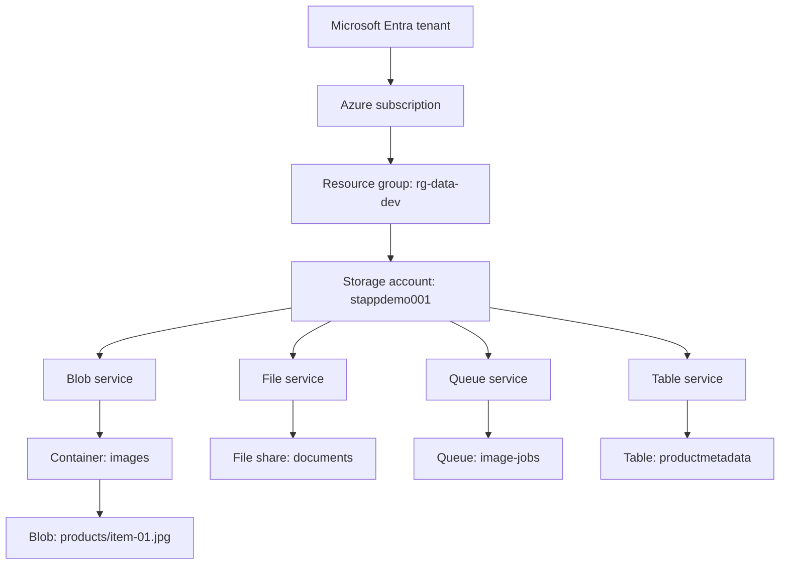
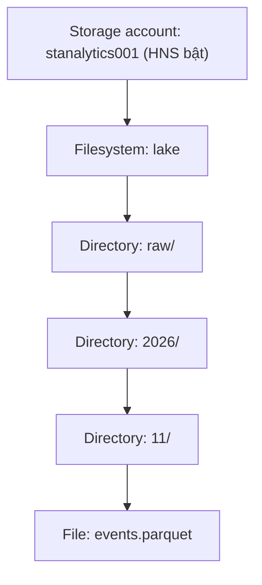
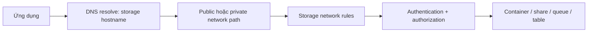
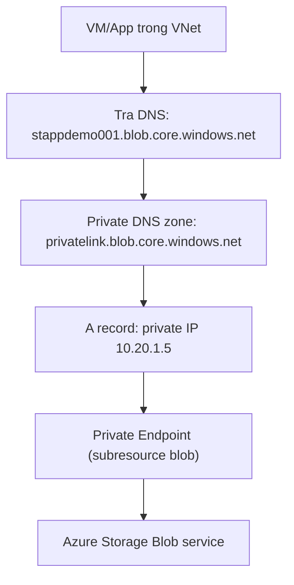
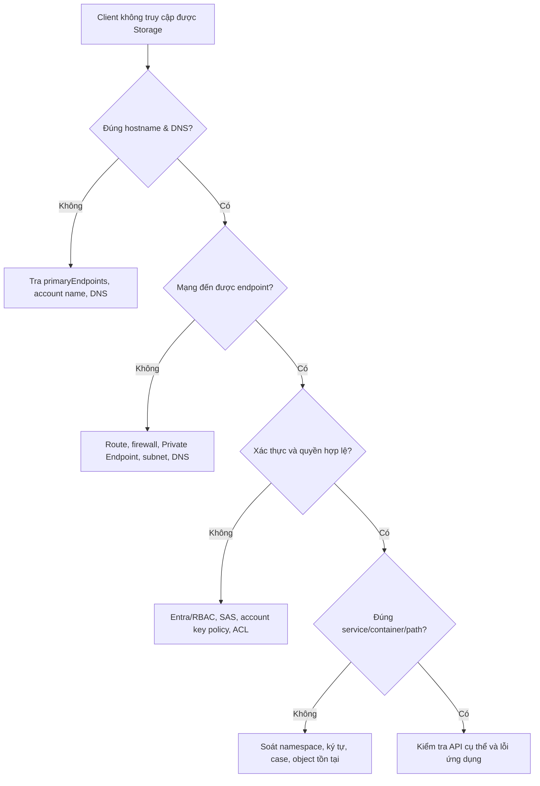

# Storage account, endpoint và namespace

Một nhóm phát triển muốn lưu ảnh sản phẩm, một ứng dụng cần chia sẻ tệp qua SMB, còn nền tảng phân tích phải đọc hàng triệu tệp dữ liệu bằng giao thức dành cho data lake. Cả ba nhu cầu đều có thể sử dụng dịch vụ thuộc **Azure Storage**, nhưng cách tổ chức tài nguyên, địa chỉ truy cập và tên đối tượng khác nhau. Để triển khai đúng, cần hiểu rõ **storage account**, **service endpoint** và **namespace**.

Bài học thuộc chương **Nền tảng Azure Storage** của module `CLOUD_PROVIDERS_AZURE`. Trong hành trình khám phá Azure từ subscription, resource group và Microsoft Entra ID đến mạng ảo, dịch vụ tính toán, lưu trữ, dữ liệu, giám sát, bảo mật và chi phí, ba khái niệm này là nền tảng để chọn nơi lưu dữ liệu, cấu hình ứng dụng và giới hạn quyền truy cập.

## Mục tiêu học tập

Sau bài học, bạn có thể:

- Giải thích storage account là gì và phân biệt tài nguyên quản lý trong Azure Resource Manager với dữ liệu truy cập qua storage endpoint.
- Đọc và phân biệt các endpoint cho **Blob**, **Data Lake Storage Gen2 (DFS)**, **Azure Files**, **Queue**, **Table** và static website khi có hỗ trợ.
- Hiểu tên storage account, phạm vi duy nhất của tên, container, file share, queue, table và blob path.
- Phân biệt **flat namespace** với **hierarchical namespace (HNS)**; biết HNS ảnh hưởng như thế nào đến cách tổ chức thư mục và endpoint.
- Nhận diện public endpoint, private endpoint, DNS riêng, service endpoint và ảnh hưởng của firewall đến kết nối.
- Tra cứu storage account, endpoint, HNS và cấu hình mạng qua Azure Portal hoặc Azure CLI.
- Đặt ra nguyên tắc truy cập an toàn, kiểm tra lỗi thường gặp và dự kiến các thành phần chi phí liên quan.

## 1. Mô hình tổng quan: storage account đứng ở đâu?

**Storage account** là tài nguyên quản lý cấp cao của Azure Storage. Nó cung cấp một **phạm vi quản lý và định danh chung** cho các dịch vụ lưu trữ dữ liệu được tài khoản hỗ trợ, đồng thời chứa các lựa chọn cấu hình như vùng triển khai, loại tài khoản, mức dự phòng, bảo mật và mạng.

Storage account nằm trong một **resource group** thuộc một **subscription**. Trong khi đó, dữ liệu bên trong account (ví dụ blob hoặc file share) được truy cập bằng API/giao thức của dịch vụ lưu trữ tương ứng.



Sơ đồ là mô hình khái niệm: **không phải mọi loại storage account đều hỗ trợ đầy đủ mọi dịch vụ trong hình**. Các tài khoản chuyên dụng có khả năng hỗ trợ và giới hạn riêng. Azure Data Lake Storage Gen2 là khả năng của Blob Storage với **hierarchical namespace** được bật, không phải một storage account độc lập bắt buộc phải tạo bên cạnh Blob.

### Hai lớp thao tác cần phân biệt

| Lớp | Đối tượng chính | Ví dụ tác vụ | Cách quản lý |
|---|---|---|---|
| **Control plane** | Tài nguyên `Microsoft.Storage/storageAccounts` | Tạo account, chọn SKU, cấu hình firewall, bật HNS khi tạo | Azure Resource Manager, Azure Portal, Bicep, ARM REST API |
| **Data plane** | Blob/container, file/share, queue/message, table/entity | Upload blob, đọc tệp, gửi message, truy vấn entity | Endpoint và API/giao thức của dịch vụ Storage |

Một người có quyền `Reader` trên resource group có thể đọc metadata của storage account nhưng **không tự động được đọc nội dung blob**. Cấp quyền xem cấu hình tài nguyên khác với cấp quyền truy cập dữ liệu. Phân biệt control plane và data plane giúp tránh sai sót về bảo mật ngay từ đầu.

## 2. Các thành phần cấu thành một storage account

Khi tạo account, cần đưa ra một số quyết định có ảnh hưởng lâu dài:

| Thuộc tính | Ý nghĩa | Ví dụ / lưu ý |
|---|---|---|
| **Account name** | Tên định danh DNS của storage account | `stappdemo001`, phải tuân thủ quy tắc đặt tên |
| **Subscription và resource group** | Phạm vi quản trị, thanh toán, RBAC, lifecycle | `rg-data-dev` trong subscription ứng dụng |
| **Region** | Vùng chính của dữ liệu/tài nguyên | `southeastasia`; cần cân nhắc độ trễ và vị trí lưu dữ liệu |
| **Kind** | Loại tài khoản, quyết định dịch vụ/tính năng được hỗ trợ | `StorageV2` phổ biến cho workload mới |
| **Performance tier** | Khả năng hiệu năng và mô hình lưu trữ | Standard hoặc loại Premium phù hợp |
| **Redundancy** | Cách Azure duy trì các bản sao dữ liệu | LRS, ZRS, GRS, GZRS và biến thể có đọc vùng phụ |
| **Networking** | Cách client truy cập endpoint | Public endpoint, firewall, private endpoint |
| **Security** | TLS, yêu cầu HTTPS, phân quyền, khóa mã hóa | Microsoft Entra ID, RBAC, encryption at rest |
| **Hierarchical namespace** | Cách tổ chức Blob thành thư mục phân cấp | Cần cân nhắc khi thiết kế ADLS Gen2 |

### Account kind: chọn đúng trước khi tạo

- **General-purpose v2 (`StorageV2`):** lựa chọn thông dụng cho các dịch vụ Blob, Files, Queue và Table cùng nhiều tính năng hiện đại. Dịch vụ/tính năng thực tế còn phụ thuộc SKU, cấu hình và giới hạn từng dịch vụ.
- **Premium block blob account (`BlockBlobStorage`):** hướng tới workload block blob đòi hỏi hiệu năng cao; không thể mặc nhiên dùng thay cho mọi kiểu dịch vụ trong StorageV2.
- **Premium file share account (`FileStorage`):** phục vụ những tình huống Azure Files được hỗ trợ với yêu cầu hiệu năng chuyên biệt.
- **Các loại account đời cũ:** có thể còn tồn tại trong hệ thống cũ nhưng không nên chọn cho workload mới khi không có lý do tương thích rõ ràng.

Không phải mọi thay đổi cấu hình đều có thể đảo ngược dễ dàng. Đặc biệt, quyết định sử dụng **hierarchical namespace** và lựa chọn loại tài khoản cần được xác nhận với workload, tính năng và kế hoạch di chuyển trước khi tạo dữ liệu production.

### Các lựa chọn redundancy

- **LRS:** duy trì nhiều bản sao trong phạm vi một datacenter thuộc region.
- **ZRS:** phân tán bản sao qua các availability zone trong region được hỗ trợ.
- **GRS:** bổ sung bản sao bất đồng bộ sang region thứ cấp theo cặp vùng được hỗ trợ.
- **GZRS:** kết hợp bản sao đa zone ở region chính với bản sao bất đồng bộ ở region thứ cấp.
- **RA-GRS/RA-GZRS:** có khả năng đọc vùng thứ cấp theo chế độ hỗ trợ.

**Redundancy không đồng nghĩa với backup ứng dụng.** Sao chép một blob vừa bị xóa nhầm hoặc ghi đè có thể không cứu được phiên bản mong muốn. Cần đánh giá thêm soft delete, versioning, backup, retention và cách phục hồi phù hợp cho từng dịch vụ.

## 3. Tên storage account và phạm vi namespace

Tên storage account tạo nên một phần địa chỉ của các endpoint. Với account thông dụng trong Azure public cloud, tên phải:

1. Có **3 đến 24 ký tự**.
2. Chỉ gồm **chữ cái Latin thường `a-z` và chữ số `0-9`**.
3. Không có dấu gạch ngang, dấu chấm, khoảng trắng hay chữ hoa.
4. **Duy nhất trong namespace đặt tên của Azure Storage ở cloud tương ứng**, không chỉ duy nhất trong resource group hoặc subscription của bạn.

Ví dụ:

| Tên đề xuất | Hợp lệ về hình thức? | Nhận xét |
|---|---|---|
| `stappdev001` | Có | Dễ dùng làm ví dụ; còn cần kiểm tra khả dụng |
| `storageproddata2026` | Có | Có thể bị tổ chức khác sử dụng |
| `st-app-prod` | Không | Có dấu gạch ngang |
| `StorageProd` | Không | Chứa chữ hoa |
| `sa` | Không | Ngắn hơn 3 ký tự |
| `storage_account` | Không | Có dấu gạch dưới |

Tên **hợp lệ về cú pháp** chưa chắc **còn khả dụng**. Kiểm tra trước khi tạo bằng Azure CLI:

```bash
az storage account check-name \
  --name "stappdemo001" \
  --output json
```

Đọc thuộc tính `nameAvailable` cùng thông tin `reason` hoặc `message` nếu có. Một tên không khả dụng có thể đang thuộc tài khoản khác hoặc bị ràng buộc bởi quy định tái sử dụng tên.

**Tên account duy nhất toàn cục không có nghĩa dữ liệu công khai.** Ai biết địa chỉ endpoint vẫn phải đi qua kiểm soát truy cập mạng và xác thực/ủy quyền để đọc tài nguyên không công khai.

### Namespace của các đối tượng bên trong account

Một storage account có những **không gian tên con** khác nhau theo dịch vụ:

| Đối tượng | Tên được xác định trong phạm vi nào? | Ví dụ |
|---|---|---|
| Storage account | Namespace cấp dịch vụ trong cloud tương ứng | `stappdemo001` |
| Blob container | Blob service của account | `images` |
| Blob name | Bên trong container | `products/2026/item.jpg` |
| File share | File service của account | `documents` |
| Thư mục/tệp Azure Files | Bên trong file share | `reports/november.xlsx` |
| Queue | Queue service của account | `image-jobs` |
| Table | Table service của account | `productmetadata` |
| Table entity | Theo bộ khóa của bảng | `PartitionKey` và `RowKey` |

Quy tắc độ dài, bộ ký tự hợp lệ và phân biệt chữ hoa/chữ thường **không giống nhau giữa mọi loại đối tượng**. Ví dụ, tên container thường phải tuân theo quy ước DNS với chữ thường; tên blob có thể chứa các ký tự và dấu phân cách đường dẫn theo quy định của Blob Storage. Tên blob có phân biệt chữ hoa/chữ thường; không được mặc định `Item.jpg` và `item.jpg` là cùng một blob.

Điều này có ý nghĩa trực tiếp khi thiết kế khóa định danh. Hai container cùng tên có thể tồn tại ở **hai storage account khác nhau**, trong khi cùng một account không thể có hai container trùng tên.

## 4. Endpoint là gì?

**Endpoint** là địa chỉ mà client dùng để giao tiếp với **một dịch vụ Storage** thông qua API hoặc giao thức được hỗ trợ. Một account có thể có nhiều endpoint, mỗi endpoint phục vụ một dịch vụ hay mục đích.

Ví dụ, account `stappdemo001` trong Azure public cloud thường có các endpoint dạng:

| Dịch vụ | Endpoint minh họa | Cách dùng |
|---|---|---|
| **Blob** | `https://stappdemo001.blob.core.windows.net` | Container và đối tượng Blob |
| **Data Lake Storage Gen2 / DFS** | `https://stappdemo001.dfs.core.windows.net` | Thao tác filesystem và thư mục ADLS Gen2 khi HNS bật |
| **Azure Files** | `https://stappdemo001.file.core.windows.net` | Azure Files REST API; SMB dùng cùng host theo giao thức SMB |
| **Queue** | `https://stappdemo001.queue.core.windows.net` | Queue và messages |
| **Table** | `https://stappdemo001.table.core.windows.net` | Table và entities |
| **Static website** | Endpoint `web` do Azure cấp khi tính năng được bật | Phục vụ website tĩnh qua cơ chế static website hosting |

**Đây là mẫu endpoint thông thường, không phải chuỗi nên tự ghép trong mọi trường hợp.** Tên miền có thể khác giữa Azure public cloud và sovereign clouds. Một số tài khoản/tùy chọn DNS hỗ trợ loại endpoint theo DNS zone với hostname khác mẫu trên. Ngoài ra, account kind/tính năng quyết định dịch vụ có endpoint khả dụng hay không.

**Cách đáng tin cậy nhất là đọc các endpoint do Azure trả về** trong mục **Storage account → Endpoints** trên Portal hoặc trong thuộc tính `primaryEndpoints` qua Azure CLI/ARM API.

### Endpoint Blob và URL của một đối tượng

Giả sử có container `images` và blob tên `products/item-01.jpg`:

```text
Blob service endpoint:
https://stappdemo001.blob.core.windows.net

Container:
https://stappdemo001.blob.core.windows.net/images

Blob cụ thể:
https://stappdemo001.blob.core.windows.net/images/products/item-01.jpg
```

Tách thành phần:

- `https://`: giao thức HTTPS.
- `stappdemo001`: tên storage account.
- `blob.core.windows.net`: hostname của Blob service trong mẫu endpoint minh họa.
- `images`: tên container thuộc account.
- `products/item-01.jpg`: tên blob, có thể bao gồm dấu `/` để biểu diễn cấu trúc logic.

URL chỉ là **địa chỉ**. Nếu blob/container riêng tư, truy cập không có token, role hoặc SAS hợp lệ vẫn có thể bị từ chối. Đừng nhầm một URL “đoán được” với tài nguyên “được phép đọc công khai”.

### Các địa chỉ khác không nên nhầm với endpoint dữ liệu

**Resource ID** trong Azure Resource Manager:

```text
/subscriptions/<subscription-id>/resourceGroups/rg-data-dev/providers/Microsoft.Storage/storageAccounts/stappdemo001
```

**Resource ID** dùng để định danh và quản trị account ở control plane. Nó không phải URL dùng để tải blob.

**Connection string** là cấu hình kết nối có thể chứa hostname và thông tin xác thực, ví dụ account key. Nó không đồng nghĩa với endpoint và có thể là **bí mật**. Không đưa connection string chứa khóa vào repository, log, ticket hoặc tài liệu công khai.

**SAS URL** là URL tài nguyên được thêm các query parameters chứa quyền, hạn dùng và chữ ký. Phần chữ ký SAS là thông tin nhạy cảm có thể trao quyền truy cập; không in nguyên URL SAS ra log hoặc chia sẻ như đường dẫn thông thường.

## 5. Phân biệt Blob, Files, Queue và Table bằng endpoint

### Blob Storage: đối tượng và dữ liệu phi cấu trúc

Blob phù hợp với hình ảnh, video, tệp tài liệu, backup, log, dữ liệu phân tích hoặc nội dung ứng dụng. Dữ liệu được lưu thành **blob trong container**. Tên blob có thể chứa tiền tố dạng thư mục:

```text
storage account: stappdemo001
  container: raw-data
    blob: 2026/11/20/events-0001.json
    blob: 2026/11/20/events-0002.json
    blob: 2026/11/21/events-0001.json
```

Các blob này vẫn có thể sử dụng chung một Blob endpoint; container và đường dẫn là thành phần sau hostname.

### Azure Files: file share và giao thức chia sẻ tệp

Azure Files cung cấp file shares được hỗ trợ cho SMB và trong một số kịch bản NFS; khả năng NFS phụ thuộc SKU/loại share và các điều kiện mạng/tính năng cụ thể. Với Azure Files REST:

```text
https://stappdemo001.file.core.windows.net/documents/finance/report.xlsx
```

Với SMB trên Windows, cách viết UNC thường là:

```text
\\stappdemo001.file.core.windows.net\documents
```

Địa chỉ UNC dùng giao thức SMB, **không** được mở như URL HTTP. Đường kết nối SMB thường cần TCP port `445` và cơ chế xác thực phù hợp; firewall doanh nghiệp hoặc ISP có thể chặn port này. Việc dùng private endpoint và DNS đúng vẫn không tự mở được firewall hoặc cấp quyền vào file share.

### Queue Storage: hàng đợi thông điệp

Queue Storage phục vụ việc **gửi và nhận message** cho hệ thống bất đồng bộ đơn giản. Ví dụ service upload ảnh gửi thông điệp vào queue `image-jobs`, worker đọc message rồi xử lý.

```text
https://stappdemo001.queue.core.windows.net/image-jobs
```

Đây là queue endpoint để gọi Queue Storage REST API hoặc SDK, không phải HTTP endpoint cho trình duyệt xem danh sách message công khai. Queue Storage có mô hình lưu, nhận và xóa message riêng; không nên đồng nhất với Azure Service Bus nếu yêu cầu là messaging nâng cao.

### Table Storage: dữ liệu dạng entity

Table Storage cung cấp mô hình NoSQL theo `PartitionKey` và `RowKey`. Một bảng có thể tên `productmetadata` và được truy cập qua:

```text
https://stappdemo001.table.core.windows.net
```

Đây là mô hình dữ liệu và API riêng, không phải SQL Database và không mặc nhiên hỗ trợ SQL joins, schema quan hệ hoặc transactional model của SQL.

### Static website hosting

Một số storage account hỗ trợ lưu tệp website tĩnh trong Blob Storage và xuất bản qua endpoint **static website** (thuộc tính `primaryEndpoints.web`). Tính năng này khác với truy cập container qua Blob endpoint. Nếu website cần custom domain với HTTPS, WAF hoặc phân phối edge, thường cần thêm thành phần phù hợp như Front Door tùy thiết kế; không nên suy ra tất cả tính năng web chuyên dụng được tích hợp ngay trong Storage.

## 6. Flat namespace và hierarchical namespace (HNS)

Hai cách tổ chức dữ liệu quan trọng nhất trong Blob Storage:

### Flat namespace: dấu `/` trong tên blob là tiền tố logic

Với account không bật hierarchical namespace, các “thư mục” thường là **cách diễn giải tên blob** theo prefix/delimiter. Ví dụ:

```text
container: logs
blob name: production/2026/11/20/app.log
```

Không nhất thiết có một **directory object độc lập** tên `production` hay `2026`. SDK và công cụ có thể hiển thị chúng dưới dạng cây thư mục, nhưng đó là cách nhóm đối tượng bằng tên.

Hệ quả: các thao tác như đổi tên thư mục hoặc di chuyển toàn bộ cây dữ liệu không mặc định là thao tác metadata nguyên tử trên một directory thực. Tùy API/SDK, ứng dụng có thể phải thực hiện copy/rename logic và xóa đối tượng theo từng blob.

### Hierarchical namespace: thư mục là thành phần của hệ thống phân cấp

**Azure Data Lake Storage Gen2 (ADLS Gen2)** cho phép bật **hierarchical namespace** trên storage account tương thích. Khi đó dữ liệu được tổ chức qua filesystem (tương ứng container) cùng các đối tượng thư mục/tệp theo cấu trúc phân cấp và hỗ trợ các thao tác quản lý đường dẫn dành cho phân tích dữ liệu.



Lợi ích thường gặp:

- Thao tác thư mục như đổi tên/di chuyển theo cơ chế HNS phù hợp với workload xử lý khối lượng lớn tệp.
- Mô hình quyền theo đường dẫn có thể kết hợp **Azure RBAC** và **POSIX-style ACLs** trên filesystem/thư mục/tệp theo cơ chế ADLS Gen2.
- Công cụ như các dịch vụ phân tích dữ liệu có thể sử dụng **DFS endpoint** và API Data Lake để thao tác filesystem.

**HNS không chỉ thay đổi cách URI trông như thế nào.** Nó ảnh hưởng đến chức năng được hỗ trợ, API và hành vi truy cập dữ liệu. Không nên bật hoặc chuyển đổi account production chỉ dựa trên mong muốn “có thư mục đẹp”; cần đánh giá tương thích Blob API, tính năng storage, giới hạn và kế hoạch migration thực tế.

### Blob endpoint và DFS endpoint dùng cùng dữ liệu như thế nào?

Ví dụ account `stanalytics001` đã bật HNS, filesystem/container `lake`, tệp `raw/2026/11/events.parquet`:

```text
Blob API (tùy thao tác/tính năng được hỗ trợ):
https://stanalytics001.blob.core.windows.net/lake/raw/2026/11/events.parquet

DFS/Data Lake API:
https://stanalytics001.dfs.core.windows.net/lake/raw/2026/11/events.parquet
```

Hai hostname là **hai giao diện dịch vụ tới cùng dữ liệu trong account hỗ trợ HNS**, không có nghĩa Azure tạo hai bản sao tệp độc lập. DFS cung cấp các thao tác hệ thống tệp/phân cấp; Blob API có thể phù hợp để truy cập blob theo các khả năng hỗ trợ.

| Tiêu chí | Flat namespace | Hierarchical namespace |
|---|---|---|
| Tổ chức đối tượng | Blob name với prefix | Filesystem và directory có cấu trúc |
| “Thư mục” | Thường là cách hiển thị dựa trên prefix | Directory object và thao tác đường dẫn |
| Endpoint thường dùng | Blob | Blob và DFS, tùy API |
| Quyền theo đường dẫn | Dùng cơ chế truy cập Blob thích hợp | Có thêm khả năng ACLs kiểu POSIX cho ADLS Gen2 |
| Workload điển hình | Ảnh, tài liệu, file tĩnh, object storage phổ thông | Data lake, pipeline ETL, analytics lớn |
| Điều cần cân nhắc | Rename/move theo cơ chế object | Tương thích tính năng, lựa chọn HNS và điều kiện chuyển đổi |

## 7. DNS và điểm truy cập mạng: endpoint không đồng nghĩa public access

Với public endpoint, tên như `stappdemo001.blob.core.windows.net` thường được phân giải qua DNS công khai đến hạ tầng dịch vụ Azure. Nhưng việc **DNS phân giải được** không nói lên rằng request có được phép truy cập hay không.

Một request có thể trải qua nhiều kiểm soát:

1. Client phân giải hostname thành IP.
2. Thiết bị mạng/firewall cho phép kết nối đến endpoint.
3. Storage account **network rules** quyết định nguồn có được phép đi qua đường truy cập được cấu hình hay không.
4. Dịch vụ xác thực danh tính/token/SAS/key theo cơ chế được hỗ trợ.
5. Dịch vụ kiểm tra quyền đối với container, blob, share, queue hoặc table.



### Public endpoint và firewall

Một account có thể giữ public endpoint nhưng cấu hình **Storage firewall/network rules** để chỉ cho phép các mạng và nguồn phù hợp. Chính sách “selected networks” không biến hostname của dịch vụ thành hostname riêng tư; nó giới hạn **ai được phép truy cập** qua đường mạng.

Các cấu hình khác nhau gồm:

- Bật public network access và cho phép nguồn theo cấu hình.
- Hạn chế public network access bằng network rules.
- Tắt public network access khi thiết kế chỉ cho phép kết nối qua private endpoint phù hợp.

Không nên đánh đồng “tài nguyên có public DNS name” với “nội dung Blob đã được bật anonymous public access”. Kiểm soát mạng, xác thực và chế độ public access của container là các cơ chế khác nhau.

### Service endpoint: VNet đi đến dịch vụ qua public endpoint

**Virtual Network service endpoint** cho phép một subnet Azure được định danh cho mục đích kiểm soát truy cập đến một số dịch vụ Azure được hỗ trợ, trong đó có Storage, thông qua đường mạng dịch vụ của Azure và quy tắc firewall dựa trên VNet. Tên endpoint Storage vẫn là hostname dịch vụ công khai.

Service endpoint **không cấp private IP cho storage account**. Nó khác với Private Endpoint. Các giới hạn về region, subscription, dịch vụ và cách viết network rules phải được xác minh theo tính năng thực tế.

### Private endpoint: truy cập bằng IP riêng trong VNet

**Azure Private Endpoint** tạo một network interface với **private IP** trong subnet được chọn, gắn với một subresource/storage service của account qua Azure Private Link. Ứng dụng trong các mạng có routing và DNS phù hợp có thể truy cập endpoint dữ liệu thông qua private IP.



Trong một cấu hình thông dụng:

- Ứng dụng **tiếp tục dùng hostname gốc** `stappdemo001.blob.core.windows.net` để gọi API và xác thực TLS đúng tên.
- DNS cho mạng nguồn được thiết kế để phân giải request đến **private IP** qua chuỗi bản ghi phù hợp, thường có private DNS zone `privatelink.blob.core.windows.net`.
- DNS public có thể chứa CNAME hướng tới tên `privatelink`, còn **private DNS zone** cung cấp bản ghi A về private IP cho những mạng đã liên kết và được cấu hình resolver/forwarding đúng.
- Client ngoài mạng có thể phân giải khác hoặc bị chặn theo chính sách; cần kiểm tra từ **đúng mạng nguồn**, đặc biệt với on-premises qua VPN/ExpressRoute.

**Không tự sửa URL ứng dụng thành `https://10.20.1.5/...`**. Làm vậy dễ gây lỗi hostname/TLS, giảm khả năng chuyển IP và bỏ qua cơ chế DNS của nền tảng.

### Private endpoint là theo subresource

Một private endpoint cho Blob **không tự bảo đảm** mọi endpoint File, Queue, Table hoặc DFS đều đi qua private IP. Những dịch vụ cần private connectivity riêng thường cần private endpoint phù hợp cho từng **subresource**:

| Subresource | Private DNS zone thông dụng |
|---|---|
| `blob` | `privatelink.blob.core.windows.net` |
| `dfs` | `privatelink.dfs.core.windows.net` |
| `file` | `privatelink.file.core.windows.net` |
| `queue` | `privatelink.queue.core.windows.net` |
| `table` | `privatelink.table.core.windows.net` |

Với **ADLS Gen2**, nhiều quy trình sử dụng cả Blob API và DFS API hoặc liên quan đến redirect giữa các API. Khi cần Private Link, thường phải đánh giá **cả private endpoint `blob` và `dfs`** cùng DNS tương ứng. Thiếu một endpoint có thể làm một số thao tác thành công nhưng thao tác khác thất bại. Không giả định cần đúng một endpoint cho mọi workload.

**Private Link không thay thế RBAC/SAS/ACL.** Client đến được private IP vẫn phải được phép đọc/ghi dữ liệu.

## 8. Namespace và quyền: ai được phép đọc dữ liệu?

Chọn endpoint chỉ giải quyết **địa chỉ và đường đi mạng**. Để đọc dữ liệu, ứng dụng cần phương thức xác thực/ủy quyền tương ứng.

### Microsoft Entra ID và Azure RBAC

Với Blob/ADLS, **Microsoft Entra ID** và **Azure RBAC data-plane roles** là phương pháp nên ưu tiên khi workload và SDK hỗ trợ:

- `Storage Blob Data Reader`: đọc dữ liệu Blob theo phạm vi quyền được gán.
- `Storage Blob Data Contributor`: đọc/ghi Blob trong phạm vi cho phép.
- `Storage Blob Data Owner`: quyền dữ liệu cao hơn theo định nghĩa role; chỉ cấp khi thực sự cần.

Các role có thể gán ở scope subscription, resource group, storage account hoặc container theo cơ chế hỗ trợ. Cấp ở **scope hẹp nhất** đáp ứng nghiệp vụ. Với ADLS Gen2 HNS, **ACLs** có thể bổ sung quyền chi tiết theo đường dẫn; cần xét cả mô hình RBAC và ACL thay vì chỉ kiểm tra một phía.

### Shared Key và SAS

- **Account key / Shared Key:** quyền rộng đối với dịch vụ liên quan trong account; hạn chế dùng trực tiếp trong ứng dụng nếu có cơ chế danh tính tốt hơn.
- **Shared access signature (SAS):** cấp quyền hạn chế theo resource, thao tác, thời gian và các điều kiện được hỗ trợ. SAS là credential nhạy cảm; bảo vệ như secret.
- **User delegation SAS:** với Blob Storage, có thể tạo SAS dựa trên ủy quyền bằng Entra ID trong những trường hợp hỗ trợ, thường là lựa chọn phù hợp hơn so với ký bằng account key.

Chính sách cho phép Shared Key, loại SAS, tuổi thọ token và khả năng vô hiệu hóa shared key cần được đánh giá theo từng dịch vụ/tính năng. Không mặc định mọi Azure Storage service đều có cùng mô hình xác thực.

### Azure Files có yêu cầu riêng

Azure Files qua SMB thường kết hợp quyền share và quyền hệ thống tệp/identity theo phương án xác thực được hỗ trợ, hoặc mô hình account key cho một số nhu cầu. Quyền `Storage Blob Data Contributor` **không** tự cho phép truy cập share SMB. Cần đọc đúng quy trình Azure Files, giao thức SMB/NFS và identity source đã chọn.

### HTTPS không phải lựa chọn tùy ý khi triển khai an toàn

Ưu tiên **HTTPS/TLS** cho REST endpoint. Tài khoản có thiết lập yêu cầu chuyển dữ liệu an toàn và minimum TLS version. Với SMB/NFS, cơ chế bảo mật và hỗ trợ mã hóa đường truyền phụ thuộc giao thức, OS client và khả năng dịch vụ. Không giải quyết lỗi xác thực bằng cách tắt kiểm tra TLS hoặc chia sẻ account key rộng rãi.

## 9. Xem storage account và endpoint bằng Azure CLI

Ví dụ dưới đây giả định bạn đã có quyền truy cập **resource group `rg-data-dev`** và storage account **`stappdemo001`**. Đổi tên theo môi trường thật. Các lệnh trong mục này chủ yếu để **đọc trạng thái**, không tạo mới tài nguyên hoặc truy cập dữ liệu riêng tư khi chưa được cấp quyền.

### 9.1 Xác nhận subscription và liệt kê account

```bash
az login
az account set --subscription "<subscription-id>"

az account show \
  --query "{subscription:id,tenant:tenantId,name:name}" \
  --output json

az storage account list \
  --resource-group "rg-data-dev" \
  --query "[].{name:name,kind:kind,location:location,sku:sku.name}" \
  --output table
```

Nếu chưa tìm thấy account, xác nhận đúng subscription và resource group trước khi tự tạo một account trùng chức năng.

### 9.2 Lấy các endpoint thực tế

```bash
az storage account show \
  --resource-group "rg-data-dev" \
  --name "stappdemo001" \
  --query "{name:name,id:id,kind:kind,location:location,primaryEndpoints:primaryEndpoints}" \
  --output json
```

Có thể chỉ truy vấn endpoint của Blob:

```bash
az storage account show \
  --resource-group "rg-data-dev" \
  --name "stappdemo001" \
  --query "primaryEndpoints.blob" \
  --output tsv
```

Ví dụ cấu trúc đầu ra rút gọn (giá trị minh họa):

```json
{
  "name": "stappdemo001",
  "primaryEndpoints": {
    "blob": "https://stappdemo001.blob.core.windows.net/",
    "dfs": "https://stappdemo001.dfs.core.windows.net/",
    "file": "https://stappdemo001.file.core.windows.net/",
    "queue": "https://stappdemo001.queue.core.windows.net/",
    "table": "https://stappdemo001.table.core.windows.net/"
  }
}
```

**Đây không phải danh sách bắt buộc cho mọi account.** Giá trị null, endpoint không có hoặc hostname khác mẫu đều cần được diễn giải theo account kind, HNS, cloud và tính năng có thực của tài nguyên.

### 9.3 Kiểm tra HNS, an toàn vận chuyển và network settings

```bash
az storage account show \
  --resource-group "rg-data-dev" \
  --name "stappdemo001" \
  --query "{hns:isHnsEnabled,httpsOnly:enableHttpsTrafficOnly,minTls:minimumTlsVersion,publicNetworkAccess:publicNetworkAccess,networkRules:networkRuleSet}" \
  --output json
```

Trường `isHnsEnabled` chỉ ra cấu hình hierarchical namespace theo metadata quản lý. Các trường liên quan mạng cho biết tài khoản có cho public access hay đặt default action/exception nào, nhưng **không tự chứng minh client ở một mạng cụ thể truy cập được**. Cần kết hợp DNS, private endpoint, route và quyền dữ liệu.

### 9.4 Liệt kê container Blob bằng Entra ID

Nếu tài khoản đăng nhập đã được cấp role dữ liệu thích hợp:

```bash
az storage container list \
  --account-name "stappdemo001" \
  --auth-mode login \
  --query "[].name" \
  --output table

az storage blob list \
  --account-name "stappdemo001" \
  --container-name "images" \
  --auth-mode login \
  --query "[].{name:name,size:properties.contentLength}" \
  --output table
```

`--auth-mode login` chỉ định dùng thông tin đăng nhập Entra ID theo cơ chế Azure CLI hỗ trợ. Nếu trả `AuthorizationPermissionMismatch` hoặc lỗi quyền, kiểm tra role data-plane và scope. **Đừng tự chuyển sang account key** chỉ để cho lệnh chạy được.

### 9.5 Kiểm tra filesystem trong account HNS

Với account đã bật HNS và danh tính có quyền phù hợp:

```bash
az storage fs list \
  --account-name "stanalytics001" \
  --auth-mode login \
  --output table
```

Lệnh nhóm `az storage fs` dành cho Data Lake Gen2. Nếu account không bật HNS, kiểm tra lại mô hình dịch vụ trước khi cố thao tác như filesystem. Đối với script production, ưu tiên lấy endpoint thật qua API/SDK và xử lý lỗi rõ ràng thay vì tự ghép hostname.

## 10. Bài thực hành: thiết kế và kiểm tra một account

Giả sử nhóm ứng dụng `inventory-api` cần lưu hình ảnh sản phẩm và log dưới dạng JSON. Nhóm muốn dùng account ở region gần backend, có TLS, quyền truy cập qua managed identity và không bật anonymous blob access. Bài thực hành có hai phần: khảo sát thông tin và, **chỉ trong sandbox có quyền**, tạo tài nguyên thử nghiệm.

### Phần A — Khảo sát trước khi tạo

1. Chọn subscription, resource group và region dự kiến.
2. Đặt tên account hợp lệ, kiểm tra khả dụng bằng `az storage account check-name`.
3. Chọn `StorageV2` cho Blob dữ liệu thông dụng và redundancy theo mức sẵn sàng yêu cầu.
4. Vẽ namespace: `images` và `logs` là hai container; mỗi blob có tên theo ứng dụng và ngày.
5. Xác định ứng dụng truy cập bằng **Blob endpoint**, không phải Table/Queue/File endpoint.
6. Quyết định public endpoint có firewall hay private endpoint, và ghi rõ DNS resolution từ nơi chạy ứng dụng.
7. Xác định role dữ liệu cho managed identity và chính sách quản lý khóa/SAS.

### Phần B — Tạo account thử nghiệm (tùy chọn)

Ví dụ cho người có quyền tạo tài nguyên trong sandbox:

```bash
az group create \
  --name "rg-storage-lab" \
  --location "southeastasia"

az storage account create \
  --resource-group "rg-storage-lab" \
  --name "<unique-lowercase-account-name>" \
  --location "southeastasia" \
  --sku "Standard_LRS" \
  --kind "StorageV2" \
  --https-only true \
  --min-tls-version "TLS1_2" \
  --allow-blob-public-access false
```

Lệnh minh họa thiết lập một số lựa chọn an toàn nhưng **chưa giới hạn public network access** và chưa cấu hình private endpoint, RBAC hoặc chính sách toàn diện. Khi đưa vào môi trường thực, hãy áp dụng chính sách mạng, danh tính và mã hóa theo tổ chức. Việc tạo account/dữ liệu có thể phát sinh chi phí.

Kiểm tra endpoint bằng câu lệnh `az storage account show` ở mục 9.2. Chỉ khi người dùng hoặc workload được cấp **Storage Blob Data Contributor** tại scope phù hợp mới nên tạo container bằng Entra ID:

```bash
az storage container create \
  --account-name "<unique-lowercase-account-name>" \
  --name "images" \
  --auth-mode login \
  --output json
```

Nếu gặp lỗi phân quyền, chờ role assignment có hiệu lực và kiểm tra lại quyền thay vì dán access key vào terminal dùng chung. Khi hoàn tất lab, xác nhận account không còn dữ liệu cần giữ, kiểm tra resource group chỉ chứa tài nguyên thử nghiệm, rồi dọn dẹp theo quy trình; không xóa toàn bộ resource group nếu có tài nguyên của người khác.

### Phần C — Phân tích URL và kiểm soát truy cập

Giả sử blob là `images/products/shoes-001.jpg`. Hãy viết:

```text
Account:   <account-name>
Service:   Blob
Container: images
Blob name: products/shoes-001.jpg
Blob URL:  https://<blob-endpoint-host>/images/products/shoes-001.jpg
```

Sau đó trả lời: hostname dùng ở private network có cần đổi không? Với Private Link thông thường, **ứng dụng vẫn dùng hostname gốc**, còn DNS trong mạng giải quyết hostname tới private IP.

## 11. Tình huống thiết kế thực tế

### A. Ứng dụng web lưu ảnh và tệp xuất báo cáo

**Đề xuất:** account `StorageV2` với Blob service, container tách theo mức dữ liệu và quyền, ví dụ `public-assets` và `private-reports`. Nhưng không nên bật anonymous public access chỉ vì tên container có chữ “public”. Nếu cần phân phối ảnh công khai qua CDN/edge, đánh giá thêm Azure Front Door và chính sách truy cập origin.

**Điểm cần kiểm tra:** blob naming, MIME type, cache-control, CORS nếu trình duyệt gọi trực tiếp, RBAC cho backend, SAS thời hạn ngắn khi cần cấp truy cập tạm thời, lifecycle để di chuyển blob ít dùng sang access tier thích hợp.

### B. Ứng dụng Windows cần dùng thư mục chia sẻ SMB

**Đề xuất:** Azure Files với share phù hợp thay vì xem một Blob container là ổ đĩa SMB. Endpoint dữ liệu có thể là `file.core.windows.net`, còn mount UNC sử dụng SMB.

**Điểm cần kiểm tra:** cổng 445, DNS/private endpoint, quyền share và NTFS khi áp dụng, identity-based authentication và tính năng/giới hạn của loại Azure Files share.

### C. Data lake phân tích với nhiều thư mục và ETL

**Đề xuất:** storage account tương thích **ADLS Gen2, HNS bật** trước khi đưa dữ liệu vào. Sử dụng filesystem `raw`, `curated`, `analytics`; công cụ ETL dùng DFS API và quyền đường dẫn phù hợp.

**Điểm cần kiểm tra:** HNS compatibility, Blob/DFS private endpoints khi dùng Private Link, RBAC và ACLs, đường dẫn phân vùng, khả năng rename, logging và chi phí giao dịch/dữ liệu.

### D. Backend cần queue cho công việc bất đồng bộ

**Đề xuất:** Queue Storage khi nhu cầu là message queue đơn giản và giới hạn dịch vụ đáp ứng. Worker dùng Queue endpoint, không dùng Blob endpoint để gửi message. Nếu yêu cầu giao dịch, ordering, sessions hoặc workflow messaging nâng cao, đánh giá dịch vụ messaging chuyên biệt trước khi chọn.

### E. Hệ thống có yêu cầu mạng riêng nghiêm ngặt

**Đề xuất:** Private Endpoint cho từng subresource mà workload sử dụng, liên kết private DNS zone với VNet, cấu hình resolver/forwarder cho môi trường hybrid và giới hạn public network access theo thiết kế.

**Điểm cần kiểm tra:** DNS được phân giải từ chính môi trường chạy ứng dụng; NSG/route, private endpoint connection state, DNS của `blob` và `dfs` nếu dùng ADLS; đồng thời vẫn cấp quyền data-plane thích hợp.

## 12. Các lỗi thường gặp và cách khoanh vùng

| Triệu chứng | Nguyên nhân có thể | Cách kiểm tra |
|---|---|---|
| Không tạo được account vì `StorageAccountAlreadyTaken` | Tên đã được dùng trong namespace tên account | `az storage account check-name`, đổi tên hợp lệ |
| Hostname không phân giải được | Sai account name, suffix, service endpoint hoặc DNS | Đọc `primaryEndpoints`, kiểm tra `nslookup` |
| FQDN vẫn trả IP công cộng sau khi tạo Private Endpoint | Private DNS zone/A record/VNet link/forwarding chưa đúng | Kiểm tra DNS từ nguồn, trạng thái private endpoint |
| Truy cập được Blob nhưng DFS không hoạt động | Thiếu private endpoint/DNS cho `dfs`, HNS/permission/API không phù hợp | Kiểm tra `isHnsEnabled`, cả `blob` và `dfs` |
| API trả `403` | Sai token/SAS/RBAC/ACL, firewall, hoặc Shared Key bị hạn chế | Kiểm tra mã lỗi Storage cụ thể, quyền và network rules |
| API trả `404` | Sai container, blob path, case hoặc đối tượng không tồn tại | Xác minh đúng account/service/namespace và tên object |
| Azure Files không mount được bằng SMB | TCP 445 bị chặn, DNS sai, auth/share permission không đủ | Kiểm tra TCP 445, UNC, DNS/Private Endpoint và identity |
| Có role Reader nhưng không đọc được blob | Chỉ có quyền control plane | Kiểm tra role `Storage Blob Data Reader` hoặc cao hơn theo nghiệp vụ |
| URI xây bằng mẫu `blob.core.windows.net` không đúng | Account dùng loại DNS endpoint khác hoặc cloud khác | Đọc thuộc tính `primaryEndpoints` từ tài nguyên thật |
| SAS URL hoạt động khi thử nhưng hết hạn trong production | Đồng hồ, expiry, permissions, token scope, key rotation | Kiểm tra token lifecycle và chiến lược identity |

### Quy trình xử lý theo từng lớp



Đọc **HTTP status cùng error code** và request ID trả về từ Azure Storage khi có thể; mã `403` hoặc `404` đơn lẻ chưa đủ để kết luận chính xác. Không sửa quyền rộng hơn hoặc tắt firewall chỉ vì “mất kết nối” trước khi xác định lớp lỗi.

## 13. Bảo mật, giám sát và chi phí

### Danh sách kiểm soát an toàn

1. **Danh tính:** ưu tiên Microsoft Entra ID/managed identity với quyền data plane giới hạn theo tài nguyên và nhiệm vụ.
2. **Mạng:** chỉ mở các đường truy cập cần thiết, dùng private endpoint khi kiến trúc yêu cầu và kiểm tra DNS từ nguồn thực tế.
3. **Dữ liệu:** tránh anonymous public access trừ khi được phê duyệt cho nội dung công khai; mã hóa dữ liệu lưu trữ và luồng truyền theo khả năng dịch vụ.
4. **Secret:** giảm phụ thuộc account key, không log SAS/connection string, có quy trình rotation hoặc thu hồi.
5. **Khả năng phục hồi:** kết hợp redundancy với versioning, soft delete hoặc backup theo tính năng, loại dữ liệu và RPO/RTO.
6. **Quan sát:** theo dõi storage metrics, transaction latency, availability, error codes, capacity và diagnostic logs theo nhu cầu.

### Chi phí chịu ảnh hưởng bởi cấu hình account

Các nguồn chi phí thường gồm:

- Dung lượng đã lưu, dữ liệu tại hot/cool/cold/archive tier theo loại dịch vụ được hỗ trợ.
- Số lượng và loại thao tác đọc/ghi/list, truy vấn hoặc truy xuất dữ liệu.
- Redundancy, access tier và phí truy xuất dữ liệu, đặc biệt với tầng lưu trữ ít truy cập.
- Lưu lượng data transfer qua region, ra Internet hoặc qua dịch vụ phân phối nội dung.
- Private endpoints/Private Link, logging, lưu trữ log và monitoring nếu được cấu hình.
- Snapshot, versioning, soft delete và backup có thể giữ dữ liệu lâu hơn dự kiến.

Không chọn redundancy, tier hoặc HNS chỉ dựa vào giá dung lượng mỗi GB. Một workload có nhiều thao tác nhỏ hoặc phải liên tục truy xuất dữ liệu từ tier ít dùng có thể có chi phí cao hơn dự kiến. Sử dụng Cost Management, metrics và workload profile để ước tính tổng chi phí.

## 14. Câu hỏi tự kiểm tra

**Câu 1.** Storage account là tài nguyên control plane hay một Blob duy nhất?

**Đáp án:** Storage account là tài nguyên quản lý ở control plane, cung cấp phạm vi cấu hình chung cho các storage services được hỗ trợ. Blob là đối tượng dữ liệu thuộc Blob service trong account.

**Câu 2.** Hai account ở hai resource group khác nhau có được cùng tên không?

**Đáp án:** Không nếu chúng thuộc cùng namespace tên storage account của cloud tương ứng. Tên account phải duy nhất, không chỉ duy nhất trong một resource group.

**Câu 3.** Tên `photos/2026/item.jpg` trong flat namespace có nhất thiết chứa các directory object thực không?

**Đáp án:** Không. `/` thường là dấu phân cách trong blob name để trình bày theo prefix. Với HNS, thư mục là thành phần thực trong namespace phân cấp theo cơ chế ADLS Gen2.

**Câu 4.** Một ứng dụng dùng Blob API nên gọi endpoint `file.core.windows.net` hay `blob.core.windows.net`?

**Đáp án:** Dùng Blob endpoint thực tế của account, thường có mẫu `blob.core.windows.net` trong Azure public cloud. File endpoint dành cho Azure Files.

**Câu 5.** Vì sao người dùng vẫn bị `403` dù hostname Blob phân giải ra IP?

**Đáp án:** DNS chỉ xác định đường đến endpoint. Network rules, token, SAS, RBAC, ACLs hoặc chính sách khác có thể từ chối truy cập.

**Câu 6.** Đã tạo private endpoint cho `blob`, có chắc thao tác DFS và SMB cùng đi private không?

**Đáp án:** Không. Private endpoints gắn với subresources được hỗ trợ. DFS và File cần được đánh giá, cấu hình endpoint/DNS riêng theo workload.

**Câu 7.** Role `Reader` trên resource group có cho phép tải nội dung Blob không?

**Đáp án:** Không mặc nhiên. Reader chủ yếu cho quyền control plane; cần quyền dữ liệu tương ứng như `Storage Blob Data Reader` hoặc cơ chế ủy quyền hợp lệ khác.

**Câu 8.** Tại sao nên lấy endpoint từ `primaryEndpoints` thay vì ghép chuỗi?

**Đáp án:** Vì tên miền phụ thuộc cloud, account kind, tính năng và loại DNS endpoint. Azure trả về endpoint thực tế mà ứng dụng nên sử dụng.

**Câu 9.** Khi thiết kế data lake dùng nhiều thao tác thư mục, nên xem xét tính năng gì?

**Đáp án:** ADLS Gen2 với hierarchical namespace, kết hợp DFS API, RBAC và ACLs nếu phù hợp. Phải đánh giá tương thích và giới hạn trước khi quyết định.

**Câu 10.** GRS có thay thế soft delete, backup hoặc versioning không?

**Đáp án:** Không. GRS chủ yếu duy trì bản sao dữ liệu để tăng khả năng phục hồi trước sự cố theo cơ chế dịch vụ; xóa/ghi đè nhầm vẫn cần biện pháp lưu giữ và khôi phục phù hợp.

## Tổng kết

**Storage account** là điểm quản lý cấu hình, danh tính DNS và chính sách lưu trữ ở Azure. **Endpoint** cho biết ứng dụng đang kết nối tới dịch vụ Blob, Files, Queue, Table, DFS hoặc static website; địa chỉ dữ liệu phải được lấy theo cấu hình tài khoản thực tế. **Namespace** xác định cách đặt tên và tổ chức account, container, share, queue, table, blob path hay các thư mục trong ADLS Gen2.

Khi triển khai hệ thống, hãy xác định loại dữ liệu và API cần dùng, lựa chọn account kind/HNS phù hợp, lấy đúng endpoint, kiểm tra DNS và đường mạng, sau đó cấp quyền data plane tối thiểu. Cách tiếp cận này giúp Azure Storage dễ mở rộng, an toàn hơn, dễ chẩn đoán sự cố và thuận tiện theo dõi chi phí trong suốt vòng đời ứng dụng.
