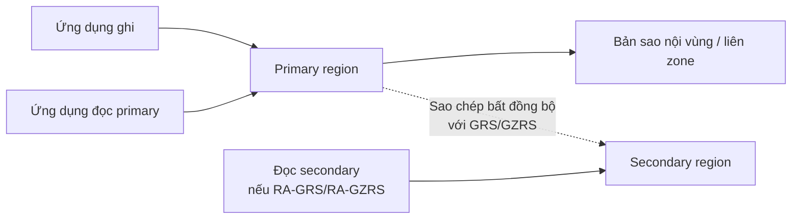
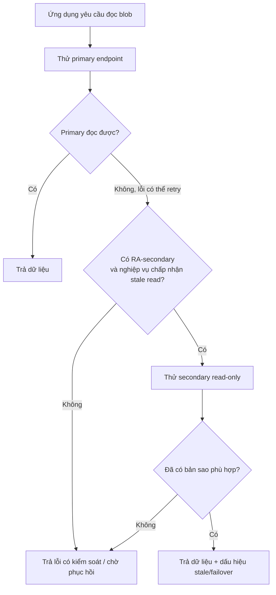
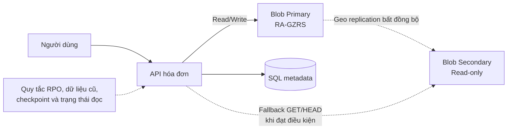
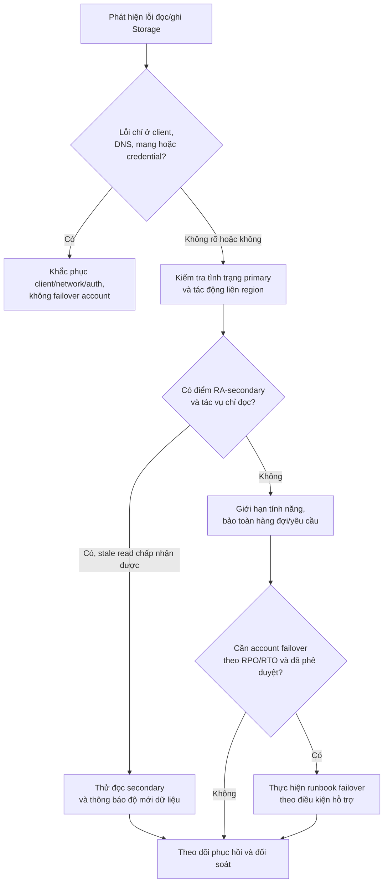

# Thiết kế độ bền dữ liệu và khả năng đọc khi gián đoạn

Khi một ứng dụng thương mại điện tử lưu hóa đơn trên Azure Blob Storage, có ít nhất hai câu hỏi khác nhau: **dữ liệu đã ghi có còn tồn tại sau sự cố không?** và **ứng dụng có thể đọc dữ liệu đó ngay trong lúc dịch vụ gặp gián đoạn không?** Một hệ thống có nhiều bản sao dữ liệu chưa chắc tiếp tục phục vụ request đọc khi cả region gặp sự cố; ngược lại, một điểm đọc dự phòng có thể hoạt động nhưng chưa nhận đủ những bản ghi mới nhất.

Bài học thuộc chương **Nền tảng Azure Storage** của module **CLOUD_PROVIDERS_AZURE**. Module khám phá Microsoft Azure từ subscription, resource group và Entra ID đến mạng ảo, tính toán, lưu trữ, dữ liệu; đồng thời hướng dẫn triển khai, giám sát, bảo vệ và kiểm soát chi phí kiến trúc ứng dụng. Bài học này dùng Azure Storage làm trọng tâm để thiết kế độ bền, tính sẵn sàng và khả năng đọc khi hỏng thành phần, availability zone hoặc cả region.

Sau bài học, bạn có thể:

- Phân biệt độ bền dữ liệu (*durability*), tính sẵn sàng (*availability*), khả năng đọc khi gián đoạn, RPO và RTO.
- Giải thích LRS, ZRS, GRS, RA-GRS, GZRS và RA-GZRS, cùng giới hạn của cơ chế nhân bản đồng bộ/bất đồng bộ.
- Chọn mô hình dự phòng theo phạm vi sự cố và yêu cầu đọc dữ liệu.
- Thiết kế đọc từ secondary endpoint một cách có kiểm soát, chấp nhận eventual consistency khi phù hợp.
- Phân biệt **replication** với **backup, versioning, soft delete và immutability**.
- Xây dựng phương án kiểm tra, chuyển đổi khi xảy ra sự cố và kiểm soát chi phí vận hành.

## 1. Bốn khái niệm cần tách bạch

| Khái niệm | Câu hỏi cần trả lời | Ví dụ với hóa đơn |
|---|---|---|
| **Durability — độ bền dữ liệu** | Dữ liệu đã ghi thành công có được bảo toàn qua hỏng hóc phần cứng/hạ tầng không? | Blob vẫn tồn tại dù một thiết bị lưu trữ hỏng |
| **Availability — tính sẵn sàng** | Dịch vụ có phục vụ được yêu cầu trong khoảng thời gian cần thiết không? | Ứng dụng gọi API đọc Blob Storage có nhận phản hồi không? |
| **RPO — Recovery Point Objective** | Tối đa chấp nhận mất bao nhiêu dữ liệu khi phải phục hồi sau thảm họa? | Doanh nghiệp chấp nhận mất tối đa 15 phút ghi mới |
| **RTO — Recovery Time Objective** | Tối đa chấp nhận gián đoạn bao lâu để khôi phục dịch vụ? | Khôi phục khả năng truy cập trong vòng 60 phút |

RPO và RTO là **mục tiêu do doanh nghiệp đặt ra**, không tự động là mức bảo đảm mà mọi SKU Azure Storage cung cấp. Một dịch vụ có độ bền cao vẫn có thể mất khả năng truy cập trong sự cố mạng hoặc region. Một cấu hình đọc từ secondary có thể cải thiện trải nghiệm đọc trong gián đoạn nhưng không bảo đảm đã có mọi dữ liệu vừa được ghi ở primary.

### 1.1. RPO và RTO trên dòng thời gian

```text
----- dữ liệu ghi thành công -----|---- sự cố ----|----- khôi phục ---->
                                 T0             T1
                       ^
                điểm dữ liệu cuối đã có
                ở bản sao phục hồi

RPO thực tế: T0 - thời điểm dữ liệu cuối có thể phục hồi
RTO thực tế: T1 - T0
```

Ví dụ, nếu region primary bị gián đoạn lúc 10:00, secondary mới có dữ liệu tới 09:54, thì khoảng cách ghi dữ liệu là **6 phút**. Nếu ứng dụng chỉ truy cập được hệ thống thay thế lúc 10:35, gián đoạn kéo dài **35 phút**. Đây là ví dụ giả định để hình dung RPO/RTO, **không phải cam kết của Azure**.

### 1.2. Phân loại sự cố trước khi chọn giải pháp

- **Hỏng thiết bị/nút lưu trữ:** lỗi cục bộ, mong muốn dịch vụ tiếp tục bảo toàn và phục vụ dữ liệu.
- **Sự cố availability zone:** mất một khu vực hạ tầng độc lập trong region; cần thiết kế chịu lỗi zone.
- **Sự cố toàn region:** cần dữ liệu và điểm phục vụ tại region khác, thường có chuyển đổi vận hành.
- **Mất kết nối mạng, DNS hoặc phân quyền:** dữ liệu có thể vẫn bền vững nhưng client không truy cập được.
- **Xóa/sửa nhầm, ransomware, lỗi ứng dụng:** dữ liệu sai có thể được nhân bản sang mọi bản sao; cần lớp phục hồi theo phiên bản/bản sao độc lập.

**Nguyên tắc:** thiết kế storage redundancy theo lỗi hạ tầng, còn phục hồi dữ liệu bị xóa/ghi đè phải có các lớp bảo vệ bổ sung.

## 2. Azure Storage nhân bản dữ liệu như thế nào?

Trong Azure Storage, lựa chọn **redundancy** của storage account quyết định cách dữ liệu được nhân bản giữa các đơn vị hạ tầng, availability zone và/hoặc region. Các lựa chọn phổ biến:

| Loại | Bản sao tại primary region | Bản sao tại secondary region | Đọc từ secondary trước failover? | Đặc điểm chính |
|---|---|---|---|---|
| **LRS** — Locally Redundant Storage | Nhiều bản sao đồng bộ trong một địa điểm lưu trữ của region | Không | Không | Bảo vệ lỗi phần cứng cục bộ; phạm vi chịu lỗi nhỏ nhất |
| **ZRS** — Zone-Redundant Storage | Bản sao đồng bộ qua các availability zone trong region | Không | Không | Bảo vệ sự cố một zone được hỗ trợ |
| **GRS** — Geo-Redundant Storage | Nhân bản cục bộ như LRS | Có; nhân bản bất đồng bộ tới region khác | Không, trừ khi thực hiện failover | Tăng độ bền khi sự cố cấp region nhưng không mở điểm đọc secondary mặc định |
| **RA-GRS** — Read-Access GRS | Như GRS | Có; bất đồng bộ | **Có** | Cho phép đọc bản sao secondary, có khả năng dữ liệu trễ |
| **GZRS** — Geo-Zone-Redundant Storage | Đồng bộ qua nhiều zone như ZRS | Có; bất đồng bộ | Không, trừ khi thực hiện failover | Kết hợp bảo vệ zone tại primary và region dự phòng |
| **RA-GZRS** — Read-Access GZRS | Như GZRS | Có; bất đồng bộ | **Có** | Kết hợp bảo vệ zone, region và điểm đọc secondary |

Với cấu hình geo-redundant, dữ liệu ở primary thường được ghi theo mô hình nhân bản địa phương trước, rồi được sao chép **bất đồng bộ** đến secondary region. Vì thế, dữ liệu được báo ghi thành công ở primary **chưa chắc đã kịp có mặt** ở secondary tại cùng thời điểm.

> Phạm vi dịch vụ, account kind, region và khả năng chuyển đổi giữa các loại redundancy khác nhau có các điều kiện hỗ trợ riêng. Bảng là mô hình nền tảng, đặc biệt hữu ích với Blob Storage; không suy rằng tất cả tính năng hoặc tùy chọn đều sẵn có cho mọi loại tài khoản Azure Files, Queue, Table hoặc các SKU chuyên dụng.

### 2.1. Sơ đồ các bản sao



**LRS/ZRS** không có đường replication geo ở sơ đồ. **GRS/GZRS** có bản sao geo nhưng thường không cho client đọc secondary khi chưa failover. **RA-GRS/RA-GZRS** thêm quyền truy cập read-only vào điểm secondary được hỗ trợ.

### 2.2. Nhân bản đồng bộ và bất đồng bộ

**Nhân bản đồng bộ** trong phạm vi cấu hình LRS/ZRS giúp Azure xác nhận một thao tác ghi sau khi đáp ứng cơ chế duy trì dữ liệu của primary. **Nhân bản bất đồng bộ** từ primary sang secondary giúp giảm phụ thuộc latency giữa hai region, nhưng tạo ra nguy cơ dữ liệu mới chưa được sao chép khi primary bị mất.

Nếu nghiệp vụ yêu cầu **RPO bằng 0 qua mất toàn region**, chỉ chọn GRS/GZRS không đủ để cam kết yêu cầu đó. Cần thiết kế ở tầng ứng dụng/dữ liệu, đồng bộ giao dịch, xác nhận ghi ở nhiều đích hoặc kiến trúc chuyên biệt phù hợp với chi phí và hiệu năng; phải kiểm tra giới hạn thực tế của từng giải pháp.

## 3. Chọn redundancy theo phạm vi sự cố

Hãy chọn từ bài toán kinh doanh thay vì mặc định mọi tài nguyên đều cần SKU cao nhất.

| Yêu cầu nghiệp vụ | Lựa chọn có thể xem xét | Điều chưa được giải quyết |
|---|---|---|
| Dữ liệu tạm, tái tạo dễ; ưu tiên chi phí | LRS | Không chịu được mất zone/region như các lựa chọn cao hơn |
| Ứng dụng cần chịu lỗi availability zone trong một region | ZRS | Sự cố toàn region cần phương án khác |
| Phải lưu bản sao ở một region khác, có thể chấp nhận gián đoạn đến khi failover | GRS hoặc GZRS | Secondary chưa được đọc trực tiếp trước failover |
| Đọc dữ liệu đã sao chép ngay cả khi primary gặp lỗi nghiêm trọng | RA-GRS hoặc RA-GZRS | Secondary có thể trễ; không phục vụ ghi khi chưa chuyển đổi |
| Vừa muốn bảo vệ sự cố zone tại primary, vừa có điểm đọc geo secondary | RA-GZRS | Vẫn có RPO do sao chép bất đồng bộ và quy trình chuyển đổi |
| Cần khôi phục khi người dùng xóa hoặc ghi đè dữ liệu | Soft delete, versioning, backup, immutability | Replication không thay thế biện pháp phục hồi logic |

**Ví dụ chọn phương án:** hệ thống xuất hóa đơn muốn duy trì hoạt động khi một availability zone lỗi và có thể phục vụ các hóa đơn cũ trong lúc một region gặp sự cố. Nếu tài khoản/region hỗ trợ, **RA-GZRS** là lựa chọn đáng cân nhắc. Tuy nhiên, các hóa đơn mới tạo trong vài thời điểm sát sự cố có thể chưa có ở secondary; ứng dụng phải định nghĩa rõ cách xử lý trường hợp đó.

## 4. Đọc dữ liệu từ secondary: điều gì thực sự xảy ra?

Với Blob Storage dùng **RA-GRS** hoặc **RA-GZRS**, Azure cung cấp điểm truy cập secondary có hậu tố `-secondary`. Ví dụ:

```text
Primary:
https://stordersdemo.blob.core.windows.net

Read-only secondary:
https://stordersdemo-secondary.blob.core.windows.net
```

Đây là các endpoint minh họa cho **Blob**. Endpoint của File, Queue, Table hoặc các dịch vụ khác có cách đặt tên, khả năng đọc và giới hạn riêng; phải xác nhận tính năng theo dịch vụ đang sử dụng.

### 4.1. Secondary không phải primary thứ hai

- Secondary là **read-only** trong thời gian hoạt động theo cơ chế RA trước failover; ứng dụng không thể tiếp tục PUT/DELETE tại đó như tại primary.
- Bản sao geo được cập nhật **eventually consistent**, nên có thể chậm hơn primary.
- Một blob vừa ghi thành công tại primary có thể trả `404 Not Found` khi đọc secondary vì chưa kịp nhân bản.
- Một blob đã được cập nhật hoặc xóa có thể vẫn xuất hiện với **phiên bản/trạng thái cũ** trên secondary trong thời gian dữ liệu chưa đồng bộ.
- Điểm đọc secondary không tự động có nghĩa SDK và mọi ứng dụng sẽ chuyển hướng sang nó khi primary lỗi. Cần cấu hình client, thư viện, chính sách retry và cách xử lý nghiệp vụ phù hợp.
- Authentication, network access, firewall và DNS vẫn phải được thiết kế cho đường đọc. Có endpoint không đồng nghĩa principal có quyền đọc.

### 4.2. Đọc mạnh nhất quán hay đọc dữ liệu cũ cũng được?

Hãy phân loại API theo độ mới dữ liệu:

| Tác vụ | Có thể đọc từ secondary trễ dữ liệu? | Lý do |
|---|---|---|
| Xem ảnh giới thiệu, tài liệu đã công bố từ lâu | Thường có thể | Dữ liệu ít thay đổi và không gắn chặt giao dịch tức thời |
| Tải hóa đơn đã phát hành và bất biến từ hôm trước | Có thể, nếu xác minh đã được nhân bản | Giá trị kinh doanh yêu cầu đúng nội dung, không nhất thiết đọc primary liên tục |
| Xem hóa đơn vừa phát hành vài giây trước | Cần kiểm tra | Secondary có thể trả 404 hoặc bản cũ |
| Kiểm tra tồn kho để chốt đơn | Không nên tự ý dùng dữ liệu trễ | Sai lệch có thể gây bán vượt tồn |
| Đọc trạng thái thanh toán trước khi xác nhận giao dịch | Không nên nếu chưa có cơ chế nhất quán nghiệp vụ | Có thể dẫn tới xác nhận sai hoặc xử lý lặp |

**Nguyên tắc quan trọng:** đối với dữ liệu cần đọc nhất quán ngay sau ghi (*read-your-writes*), không âm thầm chuyển sang secondary bất đồng bộ rồi xem kết quả là mới nhất. Nếu primary lỗi, API có thể trả thông báo tạm thời không thể xác nhận trạng thái thay vì hiển thị thông tin sai.

### 4.3. Luồng đọc có dự phòng



Ứng dụng phải phân biệt **lỗi mạng/transient** với **401/403 do quyền**, **404 do chưa đồng bộ** và **lỗi dữ liệu nghiệp vụ**. Không mặc định chuyển secondary cho mọi mã lỗi; 403 không được dùng để lách chính sách bảo mật. Trong nhiều SDK Azure Storage có các cơ chế retry và endpoint phụ được hỗ trợ; cách bật secondary read và điều kiện retry phụ thuộc ngôn ngữ, phiên bản SDK và client options.

### 4.4. Last Sync Time và giới hạn RPO

Azure cung cấp trạng thái **geo-replication** cho các storage account được hỗ trợ, bao gồm **Last Sync Time** khi có thông tin. Đây là chỉ báo về tiến độ sao chép sang secondary, hữu ích trong đánh giá dữ liệu nào có thể đã được nhân bản.

Ví dụ suy luận:

```text
Thời điểm sự cố primary:          16:00 UTC
Last Sync Time được ghi nhận:    15:52 UTC
Khoảng cách tại thời điểm đo:     8 phút
```

Điều này cho thấy có thể có khoảng dữ liệu sau mốc đồng bộ chưa kịp đến secondary. Đây **không phải** bằng chứng mọi blob sau mốc đó đều mất hay dữ liệu sẽ luôn trễ đúng tám phút; muốn ra quyết định giao dịch cần đối chiếu log ghi, ID/ETag, checkpoint ứng dụng và tình trạng sao chép thực tế. Mốc thời gian phải có múi giờ rõ ràng.

Không sử dụng Last Sync Time như cam kết về RPO cố định cho geo replication bất đồng bộ. Đối với khối lượng ghi lớn, sự cố kết nối hoặc mất region, độ trễ có thể biến động.

## 5. Failover vùng và khả năng phục vụ ghi

**Đọc từ secondary trước failover** và **chuyển đổi primary sang region dự phòng** là hai việc khác nhau.

- **Secondary read trên RA-GRS/RA-GZRS:** ứng dụng vẫn chỉ có đường đọc tại secondary, primary là nơi ghi; nội dung đọc có thể trễ.
- **Account failover:** chuyển region secondary thành primary của storage account theo cơ chế Azure hỗ trợ. Sau khi quy trình hoàn tất, endpoint primary logic được điều hướng tới region đã lên vai trò primary và ứng dụng có thể thực hiện ghi theo khả năng dịch vụ.
- **Microsoft-managed failover:** có thể do Microsoft thực hiện trong tình huống thảm họa được xác định; không giả định xảy ra ngay lập tức hoặc mọi sự cố ngắn đều kích hoạt.
- **Customer-managed failover:** người quản trị có thể chủ động yêu cầu khi tài khoản/loại redundancy hỗ trợ, cần đủ thẩm quyền, kiểm tra điều kiện và xác nhận tác động.

### 5.1. Vì sao failover cần quyết định vận hành?

Failover geo có thể gây **mất những lần ghi chưa được nhân bản**. Không coi đây là thao tác không rủi ro chỉ vì đã có GRS. Cần xem:

1. Phạm vi mất kết nối là ứng dụng, DNS, private endpoint, availability zone hay cả region?
2. Secondary hiện có trạng thái replication nào và Last Sync Time ra sao?
3. Mục tiêu RPO/RTO của doanh nghiệp là gì? Có chấp nhận khả năng mất dữ liệu mới nhất không?
4. Những dịch vụ phụ thuộc (Azure SQL, Key Vault, queue, API, Entra ID/network) còn hoạt động và có kế hoạch DR tương thích không?
5. Ứng dụng sau failover đã có quyền, DNS, private connectivity, tường lửa và kiểm soát truy cập ở region mới chưa?
6. Ai phê duyệt, liên lạc với khách hàng và thực hiện đối soát dữ liệu sau phục hồi?

Trong lúc failover, có thể có thời gian chuyển đổi mà endpoint chưa phục vụ như bình thường. Sau failover, mô hình replication của account và cách phục hồi khả năng dự phòng geo cần được kiểm tra lại theo tài liệu/quy trình vận hành; không mặc định cả hai region vẫn có vai trò và mức dự phòng như trước ngay lập tức.

### 5.2. Không đánh đồng failover với backup/restore

Nếu người dùng xóa nhầm blob và thao tác xóa đã được nhân bản, việc chuyển region có thể **không khôi phục** blob đó. Tương tự, dữ liệu bị mã hóa bởi ransomware hoặc ghi đè sai có thể được sao chép sang secondary. Cần quy trình phục hồi ở mức dữ liệu, không chỉ ở mức hạ tầng.

## 6. Bảo vệ trước lỗi logic: soft delete, versioning, immutability

| Cơ chế | Giải quyết chính | Giới hạn hoặc lưu ý |
|---|---|---|
| **Blob soft delete** | Có thể phục hồi blob đã xóa trong retention period | Không thay thế backup độc lập; phải thiết lập retention phù hợp |
| **Container soft delete** | Phục hồi container bị xóa trong khoảng được cấu hình | Khác với blob soft delete; cần bật và kiểm tra riêng |
| **Blob versioning** | Giữ phiên bản trước khi blob bị ghi đè/thay đổi | Có chi phí dung lượng; chỉ hỗ trợ theo điều kiện của loại account và tính năng |
| **Point-in-time restore** | Khôi phục một tập blob về thời điểm trước đó theo điều kiện hỗ trợ | Không phải account nào cũng hỗ trợ; có yêu cầu nền tảng và giới hạn |
| **Immutable storage / WORM** | Ngăn sửa/xóa trong thời hạn lưu giữ, phù hợp nhiều tình huống tuân thủ | Phải thiết kế retention/legal hold và quyền quản trị đúng; có thể không thể xóa sớm |
| **Backup/khôi phục độc lập** | Lấy lại dữ liệu từ bản sao theo chính sách DR/retention | Cần kiểm tra lịch sao lưu, điểm phục hồi, vị trí, quyền và restore test |

Những tính năng này có thể tương tác và có các điều kiện hỗ trợ riêng (ví dụ Blob versioning và một số chức năng restore bị giới hạn với hierarchical namespace hoặc loại account khác). Trước khi bật, kiểm tra tương thích của workload và tác động lưu trữ/chi phí.

### 6.1. Vì sao cần thiết kế nhiều lớp?

Giả sử ứng dụng lưu hợp đồng quan trọng:

- **ZRS hoặc RA-GZRS** bảo vệ trước một số lỗi hạ tầng.
- **Blob versioning** giúp khôi phục nội dung trước khi ghi đè.
- **Soft delete** cho phép khôi phục khi xóa nhầm trong cửa sổ retention.
- **Immutability** giúp ngăn thay đổi trái phép đối với tài liệu bắt buộc giữ nguyên theo quy định.
- **Backup** hoặc bản sao độc lập theo chính sách giúp phục hồi khi rủi ro vượt khỏi cơ chế replication thường xuyên.

Không cần bật mọi tính năng cho mọi container. Hãy phân loại dữ liệu, nêu rõ mục tiêu giữ lại, nhu cầu xóa hợp pháp, thời gian lưu và khả năng khôi phục rồi chọn mức bảo vệ tương ứng.

## 7. Thiết kế tình huống thực tế: nền tảng hóa đơn

Giả định ứng dụng gồm:

- Frontend và API trên App Service tại region chính.
- Blob Storage chứa file PDF hóa đơn.
- Azure SQL lưu metadata hóa đơn, chủ sở hữu và trạng thái thanh toán.
- Managed identity của API đọc/ghi Blob qua Entra ID và Azure RBAC.
- Hệ thống giám sát Application Insights/Log Analytics.

**Yêu cầu nghiệp vụ minh họa:**

- Hóa đơn đã phát hành cần được lưu lâu dài, không bị thay đổi tùy tiện.
- Sự cố một availability zone không được làm mất toàn bộ dữ liệu hóa đơn.
- Khi toàn region chính gián đoạn, khách hàng vẫn có thể tải các hóa đơn **đã hoàn tất nhân bản**, dù chức năng phát hành hóa đơn mới tạm dừng.
- Một hóa đơn vừa phát hành nhưng chưa có ở secondary không được báo là “không tồn tại vĩnh viễn”.

### 7.1. Sơ đồ phương án



Phương án giả sử region và dịch vụ hỗ trợ **RA-GZRS**. Lưu ý Blob Storage và Azure SQL **không tự trở thành một giao dịch đồng bộ xuyên region** vì Blob đã có geo replication. Kế hoạch DR cho SQL, API, secret, DNS và network phải được thiết kế riêng nhưng có thể phối hợp.

### 7.2. Phân loại API đọc

| Endpoint nghiệp vụ | Chính sách khi primary khỏe | Khi primary gián đoạn |
|---|---|---|
| `GET /invoices/{id}/pdf` cho hóa đơn cũ đã xác nhận nhân bản | Đọc Blob primary | Có thể đọc secondary nếu version/checkpoint đáp ứng |
| `GET /invoices/{id}/pdf` cho hóa đơn vừa tạo | Đọc Blob primary | Báo “tạm chưa thể xác minh dữ liệu mới” nếu secondary không có |
| `POST /invoices` tạo hóa đơn mới | Ghi primary + metadata theo luồng nghiệp vụ | Tạm dừng hoặc dùng cơ chế DR ghi riêng đã thiết kế |
| `GET /invoices/{id}/status` | Đọc nguồn trạng thái chính xác của ứng dụng | Không tuyên bố “paid/issued” từ metadata trễ nếu chưa thỏa điều kiện nhất quán |

Nếu chuyển sang secondary, trả trạng thái rõ ràng cho client hoặc ghi dấu trong telemetry rằng dữ liệu có thể trễ, nhất là với UI cần hiển thị “cập nhật lần cuối”. Không làm lộ URL chứa SAS/key khi chuyển nguồn.

### 7.3. Thiết kế cơ chế kiểm chứng tính mới

Đối với tài liệu bất biến đã phát hành, ứng dụng có thể:

1. Sau khi upload thành công, ghi metadata `invoice_id`, `blob_name`, `ETag/version_id` (nếu hỗ trợ) và trạng thái phát hành.
2. Theo dõi tiến độ nhân bản bằng cơ chế/telemetry được hỗ trợ và chỉ cho phép fallback những tài liệu mà doanh nghiệp chấp nhận đọc từ secondary.
3. Khi dùng secondary, kiểm tra rằng blob tìm được có **đúng phiên bản**/đặc tính nghiệp vụ mong đợi; không dùng mỗi mã HTTP 200 làm bằng chứng chắc chắn mọi metadata đã đồng bộ.
4. Nếu trả `404` ở secondary nhưng primary trước đó có dữ liệu, coi là **chưa xác định/đang đồng bộ** khi thích hợp; không tự xóa bản ghi hóa đơn khỏi database.
5. Khi phục hồi, kiểm tra chênh lệch giữa các hệ thống và thực hiện đối soát, tránh phát hành trùng hóa đơn hoặc yêu cầu thanh toán hai lần.

Azure Storage cung cấp ETag/conditional requests để hỗ trợ kiểm tra cập nhật và optimistic concurrency. Cách kết hợp ETag/version ID với replication, SDK và nghiệp vụ phải được kiểm thử; không giả định một thông báo “write succeeded” tại primary đã xác nhận bản sao secondary sẵn sàng.

## 8. Thực hành: kiểm tra cấu hình Azure Storage bằng CLI

Các lệnh sau là **thao tác chỉ đọc**, dùng để lấy bằng chứng về redundancy và cấu hình Blob. Thay tên ví dụ bằng tài khoản thực, đăng nhập bằng Azure CLI với quyền xem tài nguyên. Không thay đổi SKU hay khởi chạy failover trong bài kiểm tra này.

Xác định subscription đang được chọn:

```bash
az account show \
  --query "{subscription:name,subscriptionId:id,tenant:tenantId}" \
  -o table
```

Kiểm tra account kind, SKU, region chính/phụ và trạng thái khu vực:

```bash
RG="rg-orders-prod"
ACCOUNT="stordersdemo"

az storage account show \
  --resource-group "$RG" \
  --name "$ACCOUNT" \
  --query "{name:name,kind:kind,sku:sku.name,primaryLocation:primaryLocation,secondaryLocation:secondaryLocation,primaryStatus:statusOfPrimary,secondaryStatus:statusOfSecondary}" \
  -o json
```

Đọc kết quả `sku.name` để phân biệt `Standard_LRS`, `Standard_ZRS`, `Standard_GRS`, `Standard_RAGRS`, `Standard_GZRS`, `Standard_RAGZRS` nếu SKU tương ứng được hỗ trợ. Nếu `secondaryLocation` không có giá trị, không suy rằng tài khoản đã có bản sao geo.

Với account có geo replication và phiên bản Azure CLI/API hỗ trợ, có thể xem thêm thông tin replication:

```bash
az storage account show \
  --resource-group "$RG" \
  --name "$ACCOUNT" \
  --expand geoReplicationStats \
  --query "geoReplicationStats" \
  -o json
```

Trong phần geo replication statistics, chú ý `status` và `lastSyncTime` khi có. Một số account, SKU, trạng thái hoặc phiên bản API có thể không trả những trường này; không diễn giải thiếu dữ liệu là replication thành công.

Nếu account hỗ trợ Blob service properties, xem các cơ chế bảo vệ logic:

```bash
az storage account blob-service-properties show \
  --resource-group "$RG" \
  --account-name "$ACCOUNT" \
  --query "{deleteRetentionPolicy:deleteRetentionPolicy,containerDeleteRetentionPolicy:containerDeleteRetentionPolicy,isVersioningEnabled:isVersioningEnabled}" \
  -o json
```

Mục tiêu là thu thập **cấu hình**, không phải kiểm chứng khả năng restore. Muốn khẳng định dữ liệu khôi phục được, cần thực hiện diễn tập đọc/restore có phạm vi và quyền được phê duyệt.

### 8.1. Xác minh điểm đọc secondary

Trong tài khoản có RA-geo redundancy, ứng dụng có thể dùng endpoint Blob secondary:

```text
GET https://stordersdemo-secondary.blob.core.windows.net/invoices/invoice-001.pdf
Authorization: Bearer <access-token-danh-cho-Azure-Storage>
```

Ví dụ trên mô tả **yêu cầu HTTP**, không phải lệnh chạy nguyên văn. Azure Storage chỉ trả dữ liệu khi token/credential hợp lệ và quyền truy cập cùng network policy cho phép. Một request có thể nhận `404` nếu blob chưa được nhân bản; một request `403` có thể do quyền, firewall hoặc credential, không nên mặc nhiên coi là dấu hiệu dữ liệu bị mất.

Hãy kiểm thử cả khi primary hoạt động và ở một môi trường mô phỏng lỗi được phê duyệt. Không dùng token thật trong tài liệu, source code, URL chia sẻ công cộng hoặc log.

## 9. Xây dựng runbook ứng phó gián đoạn

### 9.1. Phát hiện và phân loại

Thu thập:

- Alert và thời điểm lỗi ở API/Storage, tỉ lệ 5xx, timeout, latency, lỗi xác thực.
- Tình trạng account, primary/secondary location, trạng thái geo replication và Last Sync Time khi có.
- Lỗi DNS, private endpoint, firewall, managed identity/role assignment.
- Các tác vụ đang thực hiện: upload, delete, job chạy nền, giao dịch metadata SQL.

Đầu tiên phân biệt **mất kết nối của ứng dụng** với **Storage region thực sự không khả dụng**. Failover account trong khi chỉ có một DNS resolver bị lỗi có thể tạo ra hậu quả nghiêm trọng hơn sự cố ban đầu.

### 9.2. Quyết định hướng xử lý



Đối với trường hợp sử dụng **customer-managed failover**, runbook cần có phê duyệt riêng, người chịu trách nhiệm, điều kiện kích hoạt, tác động dữ liệu chưa đồng bộ, hướng dẫn phối hợp các hệ thống khác và cách xác minh. Không coi failover là phương án retry tự động của SDK.

### 9.3. Các bước khôi phục tối thiểu

1. Xác định rõ **sự cố ở đâu**: máy khách, network, zone, primary region hay thành phần khác.
2. Thông báo phạm vi ảnh hưởng: chức năng đọc, ghi, danh sách dữ liệu chưa chắc có ở secondary.
3. Nếu phù hợp, chuyển **các request đọc được phép** sang secondary; không chuyển request ghi sang endpoint chỉ đọc.
4. Nếu cần failover account, kiểm tra RPO/RTO, Last Sync Time, loại tài khoản, điều kiện dịch vụ và quyền phê duyệt.
5. Sau phục hồi, chạy health checks về API, DNS, IAM, private connectivity và chức năng đọc/ghi.
6. Đối soát các invoice ID, metadata, ETag/version và công việc chạy nền; xử lý tài liệu thiếu/trùng theo quy trình nghiệp vụ.
7. Khôi phục redundancy theo thiết kế sau failover, cập nhật dashboard/runbook và thực hiện post-incident review.

## 10. Giám sát và đo lường

| Chỉ số / tín hiệu | Mục đích |
|---|---|
| Availability, success rate, 5xx, latency của Storage/API | Phát hiện suy giảm khả năng truy cập |
| Timeout, retry count, circuit-breaker state | Xem client đang gặp lỗi transient hay lỗi kéo dài |
| Primary/secondary endpoint read success | Kiểm chứng khả năng đọc theo từng điểm |
| Geo-replication status / Last Sync Time khi có | Quan sát nguy cơ độ trễ replica |
| Tỉ lệ `404` trên secondary đối với blob đã tồn tại ở primary | Phát hiện dữ liệu chưa được nhân bản hoặc lỗi tên/đường đọc |
| Blob version, restore test, backup recovery point | Kiểm tra khả năng phục hồi lỗi logic |
| Số lần/frequency chuyển đường đọc, thời gian failover | Đo RTO thực tế và ảnh hưởng trải nghiệm |
| Chi phí lưu trữ, giao dịch, dữ liệu truyền và bản sao | Kiểm soát chi phí của lựa chọn redundancy |

Azure Monitor, Storage metrics, diagnostic logs, Application Insights và hệ thống cảnh báo có thể hỗ trợ theo dõi tùy cấu hình. Đừng chỉ dựa vào trạng thái “Healthy” của một dịch vụ để kết luận người dùng đang đọc được dữ liệu; cần một **synthetic read** có quyền và phạm vi an toàn để xác minh luồng end-to-end.

## 11. Chi phí, bảo mật và giới hạn vận hành

- **Redundancy càng rộng thường càng tốn chi phí lưu trữ.** Đọc từ secondary và giao dịch/dữ liệu ra ngoài có thể tạo chi phí khác; cần tra biểu giá theo region/SKU và workload thực.
- **Lưu nhiều phiên bản và soft delete tăng dung lượng.** Thiết kế retention/lifecycle management phù hợp nghĩa vụ lưu giữ, tránh giữ dữ liệu không cần thiết.
- **Secondary không làm giảm yêu cầu bảo mật.** Dùng HTTPS, Entra ID/data roles, giới hạn Shared Key/SAS, firewall/private connectivity khi được hỗ trợ và giám sát truy cập.
- **Mạng riêng, DNS và identity phải hoạt động ở đường dự phòng.** Sự cố đọc secondary có thể do cấu hình mạng/permission chứ không do replication.
- **Dịch vụ có mức hỗ trợ khác nhau.** Không lấy một bảng Blob Storage để áp đặt nguyên xi lên Azure Files hay Managed Disks. Kiểm tra loại dịch vụ, account kind, region, khả năng geo replication và quy trình failover.
- **Ứng dụng phải hỗ trợ tính nhất quán.** GRS/RA-GRS không mang lại giao dịch phân tán đồng bộ giữa Blob, SQL, Queue và hệ thống thanh toán.

### 11.1. Checklist thiết kế trước production

- [ ] Xác định dữ liệu nào là bất biến, dữ liệu nào phải đọc ngay sau ghi.
- [ ] Ghi rõ các tình huống lỗi: phần cứng, zone, region, xóa nhầm, ghi đè, lỗi mạng.
- [ ] Xác định RPO và RTO của từng luồng nghiệp vụ, không chỉ một con số cho toàn hệ thống.
- [ ] Chọn redundancy mà account/region/dịch vụ thực tế hỗ trợ; kiểm chứng cấu hình.
- [ ] Kiểm tra secondary read có cần thiết và có chấp nhận eventual consistency không.
- [ ] Thiết kế access control, firewall, DNS và private endpoint cho cả đường chính/phụ khi dùng.
- [ ] Bật cơ chế bảo vệ lỗi logic/backup phù hợp; diễn tập restore.
- [ ] Viết runbook: ai quyết định failover, tiêu chí và cách đối soát.
- [ ] Diễn tập failover/failback có kiểm soát và đo RTO/RPO thực tế.
- [ ] Thiết lập cảnh báo, dashboard, owner và dự báo chi phí theo SKU/khối lượng.

## 12. Câu hỏi tự kiểm tra

1. Vì sao một Storage Account có độ bền dữ liệu cao vẫn có thể gặp gián đoạn phục vụ đọc?
2. LRS và ZRS khác nhau ở phạm vi nhân bản nào? Cả hai có mặc nhiên bảo vệ toàn bộ region không?
3. GRS với RA-GRS khác nhau thế nào về khả năng đọc secondary **trước** khi failover?
4. RA-GZRS có bảo đảm bản ghi mới nhất ở primary luôn sẵn sàng tại secondary không? Giải thích nhân bản bất đồng bộ.
5. Một API nhận `404` từ secondary cho một blob vừa ghi thành công tại primary. Có được kết luận blob đã bị xóa hay không?
6. Nếu primary gặp lỗi, tại sao ứng dụng chỉ nên fallback sang secondary cho những endpoint chấp nhận dữ liệu trễ?
7. Phân biệt đọc secondary khi primary không dùng được với account failover để có khả năng ghi tại region dự phòng.
8. Vì sao replication geo không thể thay thế blob versioning, soft delete hoặc backup khi người dùng xóa nhầm dữ liệu?
9. Sau failover, vì sao cần đối soát dữ liệu Blob với metadata của Azure SQL và các thao tác thanh toán?
10. Hãy nêu ba dấu hiệu giúp phân biệt lỗi mạng/DNS/credential với sự cố hạ tầng lưu trữ.

## Kết luận

Thiết kế Azure Storage cần tách **độ bền dữ liệu**, **khả năng truy cập** và **mức độ mới của dữ liệu**. LRS bảo vệ lỗi cục bộ; ZRS trải bản sao theo zone; GRS/GZRS bổ sung bản sao bất đồng bộ tại region khác; RA-GRS/RA-GZRS còn cho phép **đọc secondary** theo giới hạn nhất quán eventual. Điểm đọc secondary không thay cho primary ghi và không đồng nghĩa mọi dữ liệu mới đã được nhân bản. Failover là quyết định phục hồi có rủi ro RPO/RTO cần được phê duyệt và kiểm thử. Kết hợp lựa chọn redundancy với soft delete, versioning, immutability, backup, quyền dữ liệu, kiểm soát mạng và runbook đối soát để hệ thống Azure vừa bền vững vừa có khả năng phục vụ đọc phù hợp khi gián đoạn.
