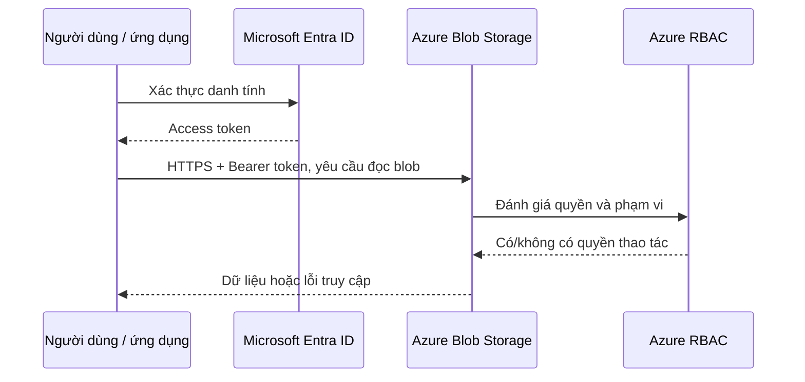

# Phân quyền Azure Storage bằng Microsoft Entra ID

Một ứng dụng trên Azure có thể lưu ảnh vào Blob Storage, đọc thông điệp từ Azure Queue Storage hoặc dùng file share cho các tác vụ nội bộ. Cách đơn giản nhưng rủi ro là đưa **storage account key** vào cấu hình ứng dụng: key thường cho phép truy cập dữ liệu rất rộng và việc chia sẻ key khiến khó phân biệt ai đã thực hiện thao tác. **Microsoft Entra ID** kết hợp **Azure Role-Based Access Control (Azure RBAC)** giúp cấp quyền cho danh tính cụ thể, đúng phạm vi và theo nhu cầu công việc.

Trong module **CLOUD_PROVIDERS_AZURE**, bạn tìm hiểu Microsoft Azure từ subscription, resource group, Microsoft Entra ID đến mạng ảo, tính toán, lưu trữ, dữ liệu, giám sát, bảo mật và chi phí. Bài thuộc chương **Nền tảng Azure Storage**, tập trung vào cách phân quyền truy cập dữ liệu Storage bằng danh tính Microsoft Entra ID, cách triển khai với người dùng và ứng dụng, cùng những giới hạn cần biết khi áp dụng vào production.

## 1. Mục tiêu học tập

Sau bài học, bạn có thể:

- Giải thích sự khác nhau giữa **xác thực bằng Microsoft Entra ID** và **cấp quyền bằng Azure RBAC**.
- Phân biệt **management plane** với **data plane** trong Azure Storage.
- Chọn role truy cập dữ liệu phù hợp cho Azure Blob Storage, Queue Storage, Table Storage và những trường hợp Azure Files.
- Cấp role tại scope đúng: storage account hoặc blob container, đồng thời hiểu quyền kế thừa.
- Kiểm tra truy cập bằng Azure portal và Azure CLI với `--auth-mode login`.
- Dùng **managed identity** và Azure SDK để ứng dụng truy cập blob mà không lưu account key.
- Nhận diện ảnh hưởng của Shared Key, SAS, mạng riêng, ACL và lỗi `401`/`403`.
- Thiết kế phân quyền tối thiểu, kiểm tra quyền hiệu lực và xử lý sự cố truy cập.

## 2. Hai bước riêng: xác thực và cấp quyền

**Authentication (xác thực)** trả lời câu hỏi: *Danh tính đang gửi yêu cầu là ai?* Người dùng hoặc ứng dụng nhận token từ Microsoft Entra ID sau khi xác thực bằng phương thức phù hợp.

**Authorization (phân quyền)** trả lời câu hỏi: *Danh tính đó được phép thực hiện hành động nào trên dữ liệu nào?* Với các Storage service hỗ trợ tích hợp Entra ID, Azure Storage đánh giá thông tin trong token cùng các role assignment và cơ chế kiểm soát áp dụng cho yêu cầu.

Ví dụ: người dùng Lan đã đăng nhập thành công Azure portal. Lan có Azure RBAC **Reader** trên storage account nên xem được thuộc tính account, nhưng việc xem nội dung file trong blob container vẫn có thể bị từ chối vì Lan chưa được cấp role dữ liệu như **Storage Blob Data Reader**.



Sơ đồ biểu diễn quan hệ logic. Dịch vụ có thể sử dụng thông tin quyền đã được đồng bộ hoặc cache thay vì gửi một truy vấn trực tiếp đến hệ thống RBAC cho từng request. **Có token hợp lệ không có nghĩa đã có quyền đọc/ghi mọi dữ liệu Storage**.

### Các danh tính có thể được cấp quyền

| Principal | Ví dụ | Tình huống phù hợp |
|---|---|---|
| User | Nhân viên vận hành đăng nhập Azure portal/CLI | Điều tra sự cố, đọc dữ liệu theo nhiệm vụ |
| Microsoft Entra group | `grp-storage-auditors` | Cấp cùng một role cho nhiều người theo nhóm |
| Service principal | Danh tính của một ứng dụng đã đăng ký | Tích hợp hệ thống hoặc chạy ứng dụng ở môi trường không hỗ trợ managed identity |
| Managed identity | Danh tính được Azure quản lý cho VM, App Service, Functions | Ứng dụng trên Azure truy cập Storage mà không lưu mật khẩu/service principal secret |

Managed identity gồm **system-assigned** (gắn vòng đời với tài nguyên) và **user-assigned** (tài nguyên danh tính riêng có thể gắn vào nhiều workload). Cả hai đều có thể được cấp Azure RBAC tại scope Storage phù hợp. Cấp role cho **principal/object ID của managed identity**, không cấp role dựa vào hostname hoặc IP của ứng dụng.

## 3. Phân biệt management plane và data plane

Azure Storage có hai nhóm hoạt động cần phân quyền khác nhau:

- **Management plane (control plane):** tạo/xóa storage account, xem cấu hình, bật mạng riêng, điều chỉnh redundancy, cấu hình lifecycle hoặc thay đổi thiết lập account qua Azure Resource Manager.
- **Data plane:** đọc/ghi/xóa blob, gửi/nhận queue message, truy vấn Table entities hoặc truy cập nội dung file trong các mô hình được dịch vụ hỗ trợ.

| Nhiệm vụ | Quyền cần xem | Ví dụ role |
|---|---|---|
| Xem thuộc tính storage account | Management plane Azure RBAC | Reader |
| Tạo hoặc thay cấu hình storage account | Management plane Azure RBAC | Contributor trong scope phù hợp |
| Chỉ đọc blob qua Microsoft Entra authorization | Blob data plane Azure RBAC | Storage Blob Data Reader |
| Upload, sửa hoặc xóa blob | Blob data plane Azure RBAC | Storage Blob Data Contributor |
| Gửi queue message | Queue data plane Azure RBAC | Storage Queue Data Message Sender |
| Đọc table entities | Table data plane Azure RBAC | Storage Table Data Reader |

**Các role Azure RBAC phổ thông như Owner, Contributor và Reader trên storage account không tự động cấp `DataActions` cho việc đọc/ghi blob qua Microsoft Entra authorization.** Tuy nhiên, một số role management plane có quyền thực hiện thao tác như `listKeys`. Nếu người dùng lấy được account key và Shared Key còn được cho phép, họ có thể dùng key để truy cập dữ liệu với quyền rộng hơn role dữ liệu đang có. Vì vậy, không nên coi việc không có Blob Data Reader là bằng chứng người dùng hoàn toàn không thể truy cập dữ liệu qua mọi con đường.

### Role definition và ý nghĩa quyền

Azure RBAC role definition có các nhóm hành động:

- `Actions` / `NotActions` cho các thao tác **management plane**.
- `DataActions` / `NotDataActions` cho các thao tác **data plane** được hỗ trợ.

Azure RBAC dùng **role assignment** kết hợp:

1. **Security principal** — ai được cấp quyền.
2. **Role definition** — được làm gì.
3. **Scope** — quyền có hiệu lực ở đâu.

Role tùy chỉnh có thể được tạo khi built-in role không đáp ứng nguyên tắc quyền tối thiểu; cần kiểm tra `DataActions` thực tế thay vì suy ra quyền chỉ từ tên role.

## 4. Role dữ liệu thường dùng cho từng Storage service

### 4.1. Azure Blob Storage

| Role | Quyền dữ liệu tiêu biểu | Tình huống |
|---|---|---|
| **Storage Blob Data Reader** | Đọc/list blob trong phạm vi được cấp | Ứng dụng tải file hoặc nhân viên kiểm tra dữ liệu |
| **Storage Blob Data Contributor** | Đọc, tạo, cập nhật, xóa blob theo quyền role | Ứng dụng xử lý và upload file |
| **Storage Blob Data Owner** | Quyền dữ liệu Blob cao hơn và khả năng quản lý quyền POSIX ACL trong ngữ cảnh hỗ trợ | Quản trị dữ liệu thực sự cần thay đổi ACL |

Tên **Storage Blob Data Owner** không đồng nghĩa **Azure RBAC Owner** của subscription. Role dữ liệu chủ yếu liên quan tới blob và một số tác vụ quản trị ACL; việc **cấp role Azure RBAC cho người khác** vẫn cần quyền quản lý role assignment tương ứng.

### 4.2. Azure Queue Storage

Các role liên quan gồm **Storage Queue Data Reader**, **Storage Queue Data Contributor**, **Storage Queue Data Message Sender** và **Storage Queue Data Message Processor**.

Ví dụ, ứng dụng chỉ cần đưa message vào queue nên xem xét **Storage Queue Data Message Sender**; worker cần nhận và xử lý message nên xem xét **Storage Queue Data Message Processor**. Không cần cấp Contributor trên toàn storage account nếu nhiệm vụ chỉ là thao tác message theo chức năng của role chuyên biệt.

### 4.3. Azure Table Storage

Table Storage có những role như **Storage Table Data Reader** và **Storage Table Data Contributor** để truy cập Table entities theo mô hình Microsoft Entra authorization được hỗ trợ. Kiểm tra tài liệu và SDK/API của Table trước khi lựa chọn cơ chế xác thực và scope thực tế.

### 4.4. Azure Files: một mô hình cần kiểm tra riêng

Với **Azure Files qua SMB**, phân quyền dựa trên danh tính thường cần:

1. Cấu hình **identity-based authentication** được Azure Files hỗ trợ (ví dụ cơ chế Kerberos/nguồn danh tính phù hợp với môi trường).
2. Cấp **share-level permission** bằng role phù hợp, chẳng hạn **Storage File Data SMB Share Reader** hoặc **Storage File Data SMB Share Contributor**.
3. Kiểm tra **NTFS ACL** trên thư mục và file, cùng điều kiện kết nối mạng/SMB.

Chỉ cấp một role Blob Data Reader **không cấp quyền truy cập file share SMB**. Azure Files có những khả năng xác thực khác nhau giữa SMB, REST API và NFS; không nên áp dụng máy móc quy trình Blob OAuth cho mọi protocol.

## 5. Scope: cấp quyền ở đâu và quyền được kế thừa thế nào?

Trong Azure RBAC, quyền được cấp ở scope cha thường áp dụng cho tài nguyên con. Với storage account và blob container, có thể hình dung:

```text
Management group
  └── Subscription
       └── Resource group
            └── Storage account: stordersprod01
                 └── Blob container: invoices
                      └── Blob: 2026/11/receipt.pdf
```

| Scope cấp role | Ảnh hưởng đối với Blob Storage |
|---|---|
| Subscription | Có thể bao phủ các storage account thuộc subscription đó |
| Resource group | Có thể bao phủ mọi storage account trong resource group |
| Storage account | Có thể bao phủ các container và blob trong account |
| Blob container | Quyền dữ liệu áp dụng cho container được chọn |

**Ví dụ:** ứng dụng chỉ cần đọc tài liệu ở container `invoices`. Cấp **Storage Blob Data Reader** tại **container** là lựa chọn có phạm vi nhỏ hơn cấp trên toàn storage account. Cấp role ở subscription có thể vô tình mở quyền đọc dữ liệu ở nhiều tài nguyên không liên quan.

**Điểm quan trọng:** Azure RBAC role assignment Blob thường được cấp ở mức **storage account hoặc container**, không phải cứ chọn từng blob hay từng đường dẫn bên trong container là đã có scope RBAC tương ứng. Nếu cần kiểm soát sâu theo thư mục/file trong Azure Data Lake Storage Gen2, hãy xem **hierarchical namespace và POSIX-style ACL**; ACL có nguyên tắc và điều kiện riêng.

### Khi dùng hierarchical namespace (Azure Data Lake Storage Gen2)

Trên storage account bật **hierarchical namespace (HNS)**, ACL có thể kiểm soát truy cập ở mức thư mục/file khi ứng dụng dùng phương thức xác thực và API được hỗ trợ. Quyền RBAC dữ liệu được áp dụng **trước**; nếu quyền RBAC đã cho phép thao tác, ACL không phải một lớp thu hồi quyền RBAC tương ứng. Nếu RBAC chưa cấp đủ quyền, ACL có thể được đánh giá để quyết định truy cập theo các quy tắc của HNS.

Vì vậy, nếu muốn ACL chi phối việc đọc một thư mục cụ thể, tránh cấp **Storage Blob Data Contributor** quá rộng ở storage account cho chính danh tính đó. Quyền qua ACL cũng thường yêu cầu quyền đi qua các thư mục cha (execute/traverse) theo cấu trúc đường dẫn.

## 6. Thực hành phân quyền Blob bằng Azure portal

**Bối cảnh:** nhân viên kiểm toán cần đọc file PDF trong container `invoices` của storage account `stordersprod01`, nhưng không được upload, thay đổi hoặc xóa các file. Tổ chức đã tạo một nhóm Microsoft Entra `grp-storage-auditors`.

### Bước 1: Chuẩn bị tài nguyên và nhóm

1. Đăng nhập [Azure portal](https://portal.azure.com/) bằng tài khoản có quyền xem tài nguyên.
2. Xác nhận đúng **tenant, subscription và resource group**.
3. Mở storage account `stordersprod01`, vào **Data storage → Containers** và chọn `invoices`.
4. Xác nhận thành viên nhóm `grp-storage-auditors` trong Microsoft Entra ID.
5. Xác nhận người cấp quyền có quyền tạo role assignment tại scope tương ứng, ví dụ **Owner**, **User Access Administrator** hoặc **Role Based Access Control Administrator** theo điều kiện phân quyền của tổ chức.

**Không cấp role bằng tài khoản chỉ có Reader hoặc Contributor mặc định nếu tài khoản đó không có quyền ghi role assignment.** Một người được phép chỉnh cấu hình Storage không nhất thiết được cấp quyền IAM cho người khác.

### Bước 2: Gán role tại container

1. Trong màn hình container `invoices`, mở **Access control (IAM)** (hoặc đi đến IAM của scope được hỗ trợ từ storage account).
2. Chọn **Add role assignment**.
3. Chọn role **Storage Blob Data Reader**.
4. Chọn thành viên là nhóm `grp-storage-auditors`, kiểm tra đúng group object ID nếu có nhiều tên giống nhau.
5. Rà soát **Scope**, **Role**, **Member** và điều kiện áp dụng nếu portal hiển thị.
6. Xác nhận tạo role assignment.

Việc role mới có hiệu lực trên data plane có thể cần thời gian do quá trình đồng bộ và cache. Tránh kết luận thất bại ngay sau khi bấm lưu.

### Bước 3: Kiểm chứng quyền thực tế

1. Dùng tài khoản kiểm thử là thành viên hợp lệ của nhóm, đăng nhập lại hoặc làm mới phiên/token khi cần.
2. Thử **liệt kê và đọc blob** trong `invoices` bằng phương thức Microsoft Entra authorization.
3. Thử upload/xóa trong môi trường kiểm thử nếu được phép; role Reader không nên cho phép các thao tác ghi này.
4. Thử đọc container khác không được cấp role để xác nhận ranh giới quyền, với điều kiện danh tính không có role kế thừa khác.
5. Kiểm tra Access control (IAM) và log liên quan khi kết quả khác dự kiến.

**Lưu ý Azure portal:** để điều hướng từ storage account tới container, người dùng thường cần quyền đọc tài nguyên ở **management plane** như Reader, ngoài role dữ liệu tương ứng. Nếu đã có role data plane nhưng portal không cho duyệt tài nguyên, hãy kiểm tra quyền ARM read và phương thức xác thực dữ liệu đang chọn. Các công cụ gọi trực tiếp endpoint Blob bằng OAuth có thể hoạt động với role data plane phù hợp mà không cần cùng một quyền điều hướng portal.

## 7. Ví dụ Azure CLI: tạo role assignment và đọc blob bằng danh tính

Ví dụ sử dụng **Bash/Azure Cloud Shell**. Các giá trị `<...>` là placeholder; thay bằng thông tin của môi trường bạn quản trị. Lệnh tạo role assignment làm thay đổi quyền trên Azure, vì vậy chỉ chạy khi được ủy quyền.

### Bước 1: Kiểm tra tenant và subscription

```bash
az login
az account set --subscription "<subscription-id>"
az account show --query "{tenant:tenantId,subscription:id}" --output table
```

### Bước 2: Xác định storage account và container scope

```bash
RESOURCE_GROUP="rg-storage-prod"
STORAGE_ACCOUNT="stordersprod01"
CONTAINER="invoices"

# Lấy ID thực tế từ Azure Resource Manager
STORAGE_ID=$(az storage account show \
  --resource-group "$RESOURCE_GROUP" \
  --name "$STORAGE_ACCOUNT" \
  --query id --output tsv)

# Scope quản lý blob container trong Azure RBAC
CONTAINER_SCOPE="$STORAGE_ID/blobServices/default/containers/$CONTAINER"

echo "$CONTAINER_SCOPE"
```

Đường dẫn scope này mô tả resource ID của blob container, **không phải** URL dữ liệu `https://...blob.core.windows.net`. Nếu thiếu quyền xem storage account hoặc tên account/container sai, cần khắc phục trước khi tiếp tục.

### Bước 3: Gán quyền đọc cho nhóm Microsoft Entra

Giả sử bạn có **object ID** của nhóm `grp-storage-auditors`. Dùng object ID giúp tránh nhầm với tên hiển thị trùng nhau:

```bash
GROUP_OBJECT_ID="<entra-group-object-id>"

az role assignment create \
  --assignee-object-id "$GROUP_OBJECT_ID" \
  --assignee-principal-type Group \
  --role "Storage Blob Data Reader" \
  --scope "$CONTAINER_SCOPE"

# Xem role assignment trực tiếp và kế thừa tại scope container
az role assignment list \
  --scope "$CONTAINER_SCOPE" \
  --include-inherited \
  --output table
```

Người chạy `az role assignment create` phải có quyền quản lý role assignment, không chỉ quyền đọc/ghi dữ liệu Blob. Role assignment được tạo cho nhóm; việc nhóm có thành viên nào là trách nhiệm quản lý nhóm trong Microsoft Entra ID.

### Bước 4: Đọc blob bằng Microsoft Entra ID

Đăng nhập CLI bằng tài khoản được cấp quyền, sau đó sử dụng **`--auth-mode login`** để CLI dùng thông tin xác thực Microsoft Entra thay vì tự động lấy account key:

```bash
az login
az account set --subscription "<subscription-id>"

az storage blob list \
  --account-name "stordersprod01" \
  --container-name "invoices" \
  --auth-mode login \
  --output table

# Chỉ chạy khi blob guide.pdf thực sự tồn tại và đã được phép đọc
az storage blob download \
  --account-name "stordersprod01" \
  --container-name "invoices" \
  --name "guide.pdf" \
  --file "./guide.pdf" \
  --auth-mode login
```

Nếu CLI có nhiều tài khoản hoặc tenant, hãy xác minh danh tính đang đăng nhập chính là principal đã được cấp quyền. Một role assignment hợp lệ không giúp ích nếu CLI lấy token của một user khác.

### Bước 5: Kiểm tra quyền ghi nếu cần

Ứng dụng muốn upload file cần role có quyền ghi như **Storage Blob Data Contributor** ở scope thích hợp. Ví dụ dưới đây là thao tác **ghi dữ liệu** chỉ nên chạy ở container lab:

```bash
# Chuẩn bị sẵn file ./sample.txt trên máy chạy lệnh
az storage blob upload \
  --account-name "<storage-account-name>" \
  --container-name "<lab-container-name>" \
  --name "sample.txt" \
  --file "./sample.txt" \
  --auth-mode login \
  --overwrite false
```

Khi kiểm thử *least privilege*, hãy dùng container riêng và file mẫu để không làm thay đổi dữ liệu production.

## 8. Ứng dụng truy cập Blob bằng managed identity

**Vấn đề:** một API chạy trên Azure App Service cần tải ảnh ở container `product-images`. Nếu lưu account key trong app settings, key có thể bị lộ qua log, bản sao cấu hình hoặc pipeline. Khi sử dụng **managed identity**, Azure quản lý danh tính của workload và ứng dụng lấy token mà không tự lưu mật khẩu/service principal secret.

### Quy trình triển khai

1. Bật **System assigned managed identity** cho App Service (hoặc gắn user-assigned managed identity theo thiết kế).
2. Ghi lại **principal/object ID** của managed identity.
3. Tại storage account hoặc container `product-images`, gán role **Storage Blob Data Reader** cho principal đó.
4. Bảo đảm Storage firewall, private endpoint và DNS cho phép App Service kết nối endpoint Blob theo kiến trúc đang dùng.
5. Trong ứng dụng, dùng Azure Identity SDK để lấy token và Storage SDK để đọc blob.
6. Kiểm thử trên môi trường chạy thật vì danh tính cục bộ của lập trình viên khác với managed identity trên Azure.

### Ví dụ Java với Azure SDK

Đoạn code minh họa đọc nội dung blob text với thư viện **`azure-identity`** và **`azure-storage-blob`**. Cần thêm các dependency tương ứng vào build của ứng dụng và chọn phiên bản SDK được tổ chức hỗ trợ.

```java
import com.azure.identity.DefaultAzureCredential;
import com.azure.identity.DefaultAzureCredentialBuilder;
import com.azure.storage.blob.BlobClient;
import com.azure.storage.blob.BlobServiceClient;
import com.azure.storage.blob.BlobServiceClientBuilder;

public class ReadBlobWithEntraId {
    public static void main(String[] args) {
        String storageAccount = "stordersprod01";
        String containerName = "product-images";
        String blobName = "readme.txt";

        DefaultAzureCredential credential =
                new DefaultAzureCredentialBuilder().build();

        BlobServiceClient blobServiceClient = new BlobServiceClientBuilder()
                .endpoint("https://" + storageAccount + ".blob.core.windows.net/")
                .credential(credential)
                .buildClient();

        BlobClient blobClient = blobServiceClient
                .getBlobContainerClient(containerName)
                .getBlobClient(blobName);

        String content = blobClient.downloadContent().toString();
        System.out.println(content);
    }
}
```

**Lưu ý về ví dụ:** file `readme.txt` phải là dữ liệu text có sẵn; đây không phải cách xử lý file ảnh/binary trong production. Đừng in dữ liệu nhạy cảm ra log. `DefaultAzureCredential` có thể dùng danh tính developer khi chạy local và managed identity khi chạy trên Azure; chuỗi nguồn credential phụ thuộc môi trường/SDK, vì vậy cần kiểm chứng đúng principal đang được sử dụng. Với user-assigned managed identity, cấu hình client ID cụ thể theo SDK để tránh chọn nhầm danh tính.

### Tại sao managed identity tốt hơn credential lưu thủ công?

- Không cần đặt storage account key hoặc client secret dài hạn vào source code.
- Có thể cấp đúng role và scope cho từng ứng dụng.
- Danh tính có thể được thu hồi quyền bằng cách gỡ role assignment, quản lý vòng đời phù hợp.
- Dễ kiểm toán hơn vì phân biệt principal của từng workload.

Managed identity **không giải quyết mọi vấn đề bảo mật**: nếu kẻ tấn công chạy được mã trong ứng dụng, họ có thể lợi dụng các quyền của identity đó. Vẫn cần giới hạn quyền, bảo vệ network, cập nhật ứng dụng và giám sát truy cập.

## 9. Các cơ chế truy cập khác: Shared Key, SAS, anonymous access

Microsoft Entra ID không phải con đường duy nhất để đến dữ liệu Azure Storage. Cần hiểu những cơ chế còn tồn tại để đánh giá quyền hiệu lực.

| Cơ chế | Cách xác thực/phân quyền | Rủi ro hoặc giới hạn |
|---|---|---|
| **Microsoft Entra ID + Azure RBAC** | Token OAuth và role data plane tại scope tương ứng | Cần identity, role, mạng và API/SDK hỗ trợ |
| **Shared Key** | Dùng storage account key ký request | Quyền rộng, khó gắn hoạt động với từng người; key cần bảo vệ nghiêm ngặt |
| **Service SAS / Account SAS** | Token SAS được ký bằng account key | Cần quản lý scope, quyền, thời hạn và bảo vệ signing key |
| **User delegation SAS (Blob)** | SAS ký bằng user delegation key được cấp dựa trên Microsoft Entra ID | Có hạn sử dụng, cần quyền xin delegation key và tuân theo giới hạn dịch vụ |
| **Anonymous blob read** | Đọc công khai nếu chính sách account/container cho phép | Không yêu cầu Entra token; cần tắt khi dữ liệu không công khai |

**User delegation SAS** hữu ích khi ứng dụng cần cấp URL truy cập Blob có thời hạn mà không chia sẻ account key. Tuy nhiên, quyền tạo user delegation key có yêu cầu riêng và thường cần xem xét **scope ở cấp storage account**. Quyền tạo SAS, quyền sử dụng SAS và các giới hạn quyền/thời gian của SAS phải được đánh giá riêng.

### Có nên vô hiệu hóa Shared Key?

Với workload Blob/Queue đã chuyển hoàn toàn sang Entra ID và các phương thức tương thích, tổ chức có thể cân nhắc cấu hình **không cho phép Shared Key authorization** trên storage account. Việc này có thể làm hỏng ứng dụng hoặc SAS dựa trên account key hiện có; cần kiểm kê phụ thuộc, thử nghiệm và kế hoạch rollback trước khi áp dụng. Tác động và tính hỗ trợ của cài đặt khác nhau giữa các dịch vụ/protocol; đừng suy rộng mọi hành vi của Blob/Queue sang Azure Files hoặc Table.

**Không lưu account key, SAS URL còn hiệu lực, access token hoặc secret trong Git, log, ảnh chụp màn hình hay ticket công khai.** SAS URL thực chất là một credential trong phạm vi và thời hạn của nó.

## 10. Quyền dữ liệu không thay thế kiểm soát mạng

Ngay cả khi principal có **Storage Blob Data Reader**, yêu cầu vẫn có thể thất bại nếu storage account chặn kết nối từ nguồn hiện tại.

Các lớp cần kiểm tra:

- **Public network access:** storage account cho phép hay chặn truy cập qua public endpoint?
- **Storage firewall/network rules:** nguồn IP, VNet hoặc quy tắc mạng có nằm trong phạm vi được phép không?
- **Private endpoint:** ứng dụng đã đi qua đúng VNet, routing và DNS private zone chưa?
- **DNS:** tên `<account>.blob.core.windows.net` có được phân giải đúng theo mô hình public/private endpoint không?
- **TLS/HTTPS:** client có sử dụng HTTPS/TLS phù hợp không?
- **Role assignment:** principal có quyền đúng `DataActions` và scope container/account không?
- **Loại dữ liệu:** Azure Files SMB và ADLS Gen2 ACL có các điều kiện bổ sung riêng.

Không nên khắc phục lỗi 403 bằng cách lập tức bật **Allow access from all networks** hoặc cấp Owner toàn subscription. Hãy phân biệt lỗi từ **authentication**, **authorization**, **firewall/DNS** và **API operation** trước khi chỉnh cấu hình.

## 11. Xử lý lỗi phổ biến khi dùng Microsoft Entra ID

| Hiện tượng | Nguyên nhân có thể | Cách xử lý |
|---|---|---|
| HTTP `401 Unauthorized` hoặc `AuthenticationFailed` | Token thiếu, sai audience, hết hạn, tenant hoặc danh tính không đúng | Kiểm tra nguồn token, endpoint, tenant, thời hạn và SDK |
| HTTP `403` với `AuthorizationPermissionMismatch` | Role/scope không cho phép hành động dữ liệu | Xem `DataActions` của role, principal, scope và role kế thừa |
| HTTP `403` do firewall hoặc network restriction | Nguồn kết nối không được phép | Kiểm tra public access, private endpoint, DNS, firewall và routing |
| Portal nhìn thấy account nhưng không xem được blob | Có quyền ARM read nhưng chưa có data role; portal chọn cách auth khác | Cấp Blob Data Reader ở scope phù hợp và kiểm tra `Authentication method` |
| CLI bất ngờ yêu cầu account key hoặc lỗi `listKeys` | Không chọn login auth hoặc công cụ rơi về phương thức key | Dùng `--auth-mode login`, xác minh tài khoản đã đăng nhập |
| Mới gán role nhưng vẫn báo 403 | Role assignment chưa kịp propagate hoặc client giữ token/cache cũ | Chờ cập nhật, đăng nhập/làm mới token rồi thử lại |
| Managed identity chạy local được, trên Azure lỗi | Principal local và managed identity khác nhau | Kiểm tra principalId, vai trò cấp cho đúng managed identity và cấu hình SDK |
| ADLS Gen2 bị từ chối ở đường dẫn con | Thiếu ACL/traverse hoặc không có role dữ liệu phù hợp | Kiểm tra RBAC trước, sau đó ACL theo từng cấp thư mục |
| Azure Files SMB bị từ chối | Thiếu share-level RBAC, NTFS ACL, Kerberos hoặc đường kết nối | Kiểm tra mô hình identity của Azure Files và từng lớp quyền |
| Nhận `404 BlobNotFound` | Tên container/blob không tồn tại, sai chữ hoa-thường, hoặc có kiểm soát khác | Kiểm tra chính xác tài nguyên và dùng thông tin lỗi/log trước khi kết luận |

**Quy trình chẩn đoán nên bắt đầu từ bốn câu hỏi:**

1. **Ai?** User/group/service principal/managed identity nào đang thực sự lấy token? Object ID và tenant nào?
2. **Làm gì?** Đọc, list, upload, delete, set ACL hay quản lý account? Hành động thuộc management plane hay data plane?
3. **Ở đâu?** Storage account, container, queue, table, file share hoặc đường dẫn HNS nào? Role được cấp ở scope nào?
4. **Qua đường nào?** Public endpoint, firewall, private endpoint, DNS, SDK/API và cơ chế xác thực nào?

Khi cần hỗ trợ, lưu **UTC timestamp**, status/error code, request ID, endpoint, principal (không kèm credential) và bước tái hiện. Log không nên chứa dữ liệu khách hàng hoặc bearer token.

## 12. Nguyên tắc phân quyền an toàn trong production

**Áp dụng least privilege theo hành động và scope.** Ứng dụng đọc ảnh chỉ cần Storage Blob Data Reader tại container ảnh; ứng dụng nhận message chỉ cần quyền queue tương ứng. Tránh cấp Data Contributor, Data Owner hoặc quyền toàn subscription khi không cần.

**Ưu tiên nhóm và managed identity.** Cấp quyền cho nhóm nhân sự theo nhiệm vụ; cấp quyền cho managed identity của từng workload. Với môi trường prod/dev, sử dụng principal và scope riêng để tránh truy cập chéo.

**Hạn chế quyền cấp role.** Chỉ người được phê duyệt có quyền quản lý role assignment mới được thêm role mới. Role Azure RBAC Owner hoặc quyền tương đương phải được bảo vệ bằng chính sách danh tính và PIM khi khả thi.

**Rà soát key và SAS còn tồn tại.** Những người có `listKeys` hoặc khả năng phát hành SAS rộng có thể tạo một đường truy cập dữ liệu ngoài role trực tiếp. Theo dõi và xoay key theo kế hoạch, không phá ứng dụng đang phụ thuộc key khi chưa đánh giá tác động.

**Bật audit và theo dõi hoạt động.** Azure Activity Log ghi các thay đổi quản lý; các log truy cập dữ liệu cần được cấu hình riêng theo khả năng và chi phí của Storage/Azure Monitor. Không mặc định Activity Log có đầy đủ mọi lệnh đọc blob. Chọn retention, workspace, cảnh báo và quy trình điều tra theo yêu cầu bảo mật.

**Kết hợp các lớp bảo vệ.** Azure RBAC đi cùng network rules, private endpoints, TLS, encryption, backup/soft delete/versioning phù hợp và quản trị dữ liệu. RBAC đúng không thay thế thiết kế chống xóa nhầm hoặc mất dữ liệu.

### Ma trận phân quyền mẫu

Một hệ thống bán hàng có ba workload sử dụng storage account `stordersprod01`:

| Danh tính | Dữ liệu cần dùng | Role và scope đề xuất |
|---|---|---|
| Managed identity của API hóa đơn | Upload và đọc PDF ở `invoices` | Storage Blob Data Contributor tại container `invoices` |
| Managed identity của website | Chỉ đọc ảnh ở `product-images` | Storage Blob Data Reader tại container `product-images` |
| Nhóm kiểm toán | Chỉ đọc PDF hóa đơn | Storage Blob Data Reader tại container `invoices` |
| Worker xử lý thông điệp | Nhận/xử lý message ở `jobs` | Storage Queue Data Message Processor ở scope queue phù hợp |
| Nhóm nền tảng | Quản lý cấu hình storage account | Management-plane role đủ dùng, tách khỏi role truy cập dữ liệu |

Ma trận là điểm khởi đầu. Với từng service và hoạt động (ví dụ upload còn cần list hoặc tạo container), cần thử thực tế để xác minh built-in role và scope có đủ, sau đó giảm hoặc bổ sung quyền có căn cứ.

## 13. Bài tập thực hành

### Bài tập A: Chỉ cấp quyền đọc container

Trên môi trường lab được phép quản trị:

1. Chuẩn bị một storage account, container `training-docs` và vài blob mẫu, không chứa dữ liệu thật.
2. Tạo một nhóm Microsoft Entra hoặc dùng danh tính kiểm thử.
3. Cấp **Storage Blob Data Reader** tại container `training-docs`.
4. Đăng nhập bằng danh tính kiểm thử, dùng `az storage blob list --auth-mode login` để liệt kê dữ liệu.
5. Thử upload một file mẫu vào container lab. Vì sao yêu cầu này phải bị từ chối khi không có quyền ghi khác?
6. Kiểm tra role assignment kế thừa để bảo đảm bạn không vô tình cấp quyền dữ liệu rộng hơn.
7. Thu hồi role assignment sau bài thực hành theo quy trình lab, xác minh quyền không còn có hiệu lực sau thời gian đồng bộ cần thiết.

### Bài tập B: Phân biệt Azure RBAC và Storage account key

Một kỹ sư có role **Contributor** ở resource group chứa storage account, không có **Storage Blob Data Reader**, nhưng vẫn đọc được blob bằng công cụ sử dụng account key. Hãy giải thích vì sao.

**Gợi ý:** role management plane có thể cho phép lấy key. Nếu Shared Key còn được cho phép, key có thể cung cấp quyền truy cập dữ liệu rộng và không phụ thuộc trực tiếp role Blob Data Reader của principal lúc đọc.

### Bài tập C: Managed identity bị lỗi 403

API chạy trên App Service có managed identity và được cấp **Storage Blob Data Reader** tại container ảnh, nhưng request đọc blob vẫn nhận HTTP 403. Hãy lập trình tự kiểm tra.

**Gợi ý:** xác nhận principalId được cấp role, container/scope đúng, token của ứng dụng thuộc identity dự kiến, role đã propagate, URL endpoint đúng, firewall/private endpoint/DNS cho phép kết nối; đối chiếu mã lỗi chi tiết của Storage trước khi thay đổi quyền.

## 14. Checklist trước khi triển khai production

- [ ] Đã chọn phương thức Microsoft Entra authorization được Storage service và API/protocol hỗ trợ.
- [ ] Đã xác nhận user/group/service principal/managed identity cần dùng cùng đúng tenant và object ID.
- [ ] Đã xác định thao tác dữ liệu cụ thể và built-in/custom role có `DataActions` thích hợp.
- [ ] Đã cấp role ở scope tối thiểu: account, container hoặc scope được loại dữ liệu hỗ trợ.
- [ ] Đã phân biệt management-plane Reader/Contributor/Owner với các role dữ liệu Storage.
- [ ] Đã kiểm tra quyền kế thừa, role qua nhóm và quyền quản lý role assignment.
- [ ] Ứng dụng dùng managed identity/SDK khi khả thi, không nhúng account key vào code.
- [ ] Đã rà soát Shared Key, SAS, anonymous access, `listKeys` và các đường truy cập khác.
- [ ] Đã kiểm tra firewall, public network access, private endpoint, DNS và TLS.
- [ ] Nếu dùng ADLS Gen2/Azure Files, đã kiểm tra ACL, share-level quyền và giao thức tương ứng.
- [ ] Đã kiểm thử đọc/ghi/xóa theo quyền mong đợi trong môi trường an toàn.
- [ ] Đã thiết lập log, cảnh báo, lịch rà soát role và quy trình thu hồi quyền khi đổi nhân sự/workload.

## Kết luận

Phân quyền Azure Storage bằng Microsoft Entra ID cho phép tổ chức biết **danh tính nào** đang yêu cầu dữ liệu và kiểm soát **hành động nào được phép** tại **phạm vi nào** thông qua Azure RBAC. Muốn triển khai an toàn, hãy phân biệt quản trị storage account với truy cập dữ liệu, chọn đúng role cho Blob/Queue/Table hoặc mô hình riêng của Azure Files, ưu tiên managed identity, giảm phụ thuộc vào Shared Key và kiểm tra cả mạng lẫn ACL khi cần. Việc phân quyền chỉ hoàn chỉnh khi các quyền được thử nghiệm, giám sát và rà soát trong suốt vòng đời ứng dụng.
