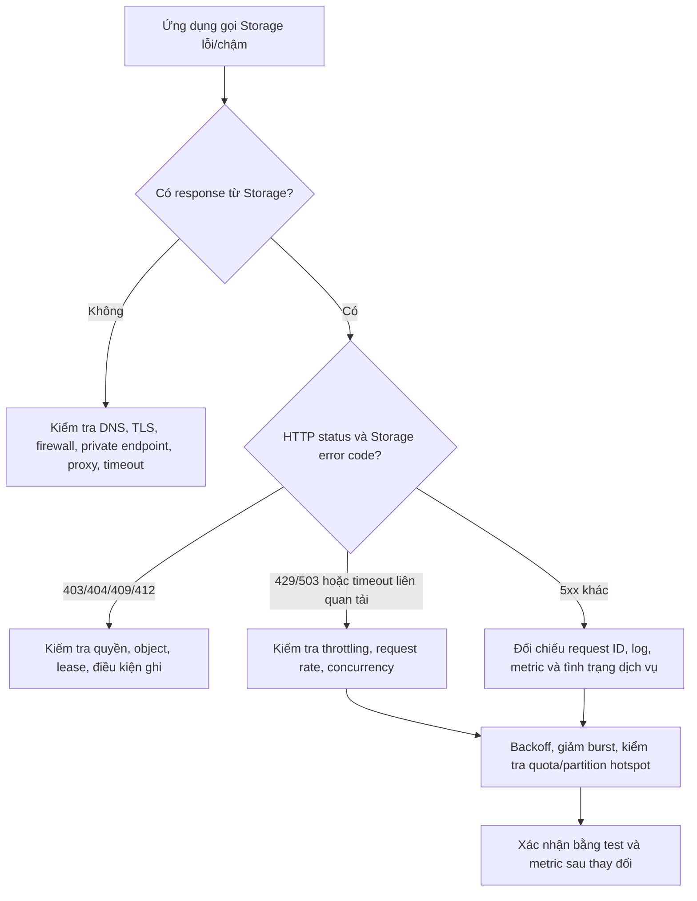

# Theo dõi dung lượng, request và giới hạn thông lượng

Một ứng dụng có thể lưu trữ rất ít dữ liệu nhưng vẫn gặp lỗi do gửi quá nhiều request tới Azure Storage. Ngược lại, một hệ thống có hàng triệu blob có thể xử lý ít request nhưng dung lượng tăng nhanh, kéo theo chi phí và rủi ro vượt kế hoạch. Vì thế, vận hành Storage cần theo dõi **dung lượng (capacity)**, **số request/transaction**, **băng thông dữ liệu (throughput)**, **độ trễ (latency)** và **lỗi/throttling** cùng lúc.

Bài học thuộc chương **Nền tảng Azure Storage** trong module **CLOUD_PROVIDERS_AZURE**. Các nguyên tắc dưới đây phục vụ việc triển khai, giám sát và kiểm soát chi phí ứng dụng trên Azure, tập trung vào Azure Storage account cùng các dịch vụ như **Blob, Azure Files, Queue và Table**. Tên metric, giới hạn và khả năng quan sát có thể khác theo dịch vụ, loại storage account, tier, region và thời điểm triển khai. Azure Managed Disks có hệ thống metric và giới hạn riêng của tài nguyên đĩa/VM; không nên áp dụng nguyên xi bảng metric Storage account cho Managed Disks.

## 1. Mục tiêu học tập

Sau bài học, bạn có thể:

1. Phân biệt dung lượng đang dùng, dung lượng dự báo, request rate, throughput, IOPS và latency.
2. Chọn đúng metric Azure Monitor để theo dõi workload lưu trữ và hiểu phạm vi đo của từng metric.
3. Phân tích lỗi HTTP, throttling và tình trạng tiến gần giới hạn thông lượng.
4. Dùng Azure Portal, Azure CLI và Log Analytics để xem xu hướng request, dữ liệu và lỗi.
5. Thiết kế alert cho dung lượng tăng, request lỗi, độ trễ và hiệu năng suy giảm.
6. Áp dụng retry có backoff, tái sử dụng kết nối, phân phối tải và tối ưu vòng đời dữ liệu.
7. Liên hệ metric kỹ thuật với chi phí lưu trữ và yêu cầu sẵn sàng của ứng dụng.

## 2. Bốn góc nhìn quan trọng về Storage

| Chỉ số | Câu hỏi cần trả lời | Đơn vị thường dùng |
|---|---|---|
| **Capacity** | Đang lưu bao nhiêu dữ liệu? Tăng nhanh đến mức nào? | GiB, TiB, bytes |
| **Request rate / Transactions** | Mỗi giây hoặc phút có bao nhiêu thao tác đọc, ghi, liệt kê, xóa? | requests/s, requests/min |
| **Throughput / Data rate** | Mỗi giây dịch vụ truyền bao nhiêu dữ liệu vào và ra? | MiB/s, MB/s, Gbit/s |
| **Latency và reliability** | Một request mất bao lâu, có bao nhiêu request lỗi hoặc bị giới hạn? | ms, p95/p99, %, số lỗi |

Các chỉ số liên quan nhưng **không thể thay thế cho nhau**:

- Hai ứng dụng cùng xử lý 1.000 request/s có thể dùng băng thông rất khác nhau: một ứng dụng tải các blob vài KiB, ứng dụng kia tải đối tượng vài MiB.
- Một tài khoản có 10 TiB dữ liệu có thể ít request; tài khoản chỉ có 100 GiB vẫn có thể gặp áp lực request rate.
- Thông lượng đo bằng bytes/giây khác số thao tác I/O mỗi giây. Một lần đọc khối lớn có thể tạo nhiều dữ liệu mà chỉ ít request.
- Một đợt tăng độ trễ có thể đến từ network, SDK, DNS, ứng dụng, giới hạn storage hoặc dịch vụ phụ thuộc; chỉ nhìn latency không đủ để kết luận.

### Ví dụ tình huống

Một dịch vụ lưu ảnh có 2 triệu ảnh nhỏ và liên tục gọi `GetBlob` để phục vụ website. Số request có thể rất cao dù dung lượng tổng tương đối nhỏ. Một tác vụ backup lại ghi một vài file rất lớn; request/s có thể thấp hơn, nhưng lượng dữ liệu ghi và băng thông có thể cao.

Vì vậy, dashboard tốt phải thể hiện cả dung lượng, request count, bytes ingress/egress, latency và lỗi.

## 3. Các lớp đo: Storage account, dịch vụ và ứng dụng

Azure Monitor cung cấp metric ở những phạm vi tài nguyên khác nhau.

| Phạm vi | Ví dụ dữ liệu | Dùng để làm gì |
|---|---|---|
| **Storage account** | Used Capacity, tổng hợp request và luồng dữ liệu tại phạm vi được hỗ trợ | Nắm mức sử dụng tài khoản và xu hướng tổng thể |
| **Blob service / File service / Queue service / Table service** | Metric của dịch vụ tương ứng, số request và dung lượng nếu dịch vụ cung cấp | Tìm dịch vụ đóng góp phần lớn tải và chi phí |
| **Client/application** | Thời gian gọi API thực tế, retry count, timeout, p95/p99, lượng request nghiệp vụ | Đo trải nghiệm ứng dụng và xác định lỗi ngoài Storage |
| **Hệ thống vận hành** | Azure Monitor alert, diagnostic logs, ngân sách và hóa đơn | Phát hiện sự cố, điều tra và kiểm soát chi phí |

Không phải metric nào cũng xuất hiện ở mọi cấp. Chẳng hạn, **UsedCapacity** thường được xem ở cấp Storage account, trong khi một số số liệu dung lượng blob được công bố dưới tài nguyên **Blob service**. Hãy xem danh sách metric definitions tại đúng resource ID trước khi xây truy vấn tự động.

**Azure Monitor Metrics** lưu số liệu tổng hợp theo thời gian. **Resource logs** cung cấp sự kiện/metadata request chi tiết hơn khi bạn bật diagnostic settings. **Activity Log** chủ yếu ghi thay đổi tại control plane, như cập nhật cấu hình Storage account; nó không thay thế log cho từng thao tác đọc/ghi blob tại data plane.

## 4. Theo dõi dung lượng: UsedCapacity, BlobCapacity và xu hướng tăng

Dung lượng là lượng dữ liệu được lưu tại một thời điểm. Một số metric cần quan tâm:

- `UsedCapacity`: dung lượng sử dụng ở cấp Storage account theo định nghĩa metric tương ứng.
- `BlobCapacity`: dung lượng blob tại phạm vi Blob service nếu được cung cấp cho tài khoản.
- `BlobCount`: số blob, giúp nhận biết hệ thống có nhiều đối tượng nhỏ hay ít đối tượng lớn.
- Các metric hoặc báo cáo dung lượng dành cho Azure Files, Queue và Table: kiểm tra theo từng dịch vụ, không giả định tên và khả năng hiển thị giống Blob.

Metric dung lượng thường **không cập nhật theo thời gian thực với độ phân giải từng phút**. Dữ liệu capacity có thể được tính và cập nhật ít thường xuyên hơn metric request. Khi cần đối soát dung lượng sau một đợt xóa lớn, hãy xét độ trễ cập nhật và cả dữ liệu được giữ lại bởi các tính năng bảo vệ.

### Dung lượng không chỉ là “file đang nhìn thấy”

Với Blob Storage, các tính năng dưới đây có thể ảnh hưởng lượng dữ liệu được lưu và chi phí:

- Blob hiện hành trong hot, cool, cold hoặc archive tier theo tính năng được hỗ trợ.
- **Blob versioning**: nhiều phiên bản của cùng đối tượng.
- **Snapshots**: bản chụp dữ liệu.
- **Soft delete**: dữ liệu đã xóa logic nhưng còn trong thời gian lưu giữ.
- **Object replication, backup hoặc bản sao khác**: có thể tạo thêm dữ liệu tại tài khoản/đích khác.
- **Metadata và overhead**: cách các hệ thống tính dung lượng hoặc billing không phải lúc nào cũng trùng đúng phép cộng kích thước file hiển thị.

Ví dụ, người vận hành xóa 500 GiB blob nhưng soft delete vẫn giữ chúng trong thời hạn cấu hình. Dung lượng và chi phí có thể chưa giảm như mong đợi ngay sau thao tác. Không nên tăng thêm lệnh xóa khi chưa xác minh trạng thái lưu giữ và metric.

### Tốc độ tăng dung lượng

Có thể ước lượng:

```text
Tăng trưởng trung bình (GiB/ngày)
  = [UsedCapacity cuối kỳ - UsedCapacity đầu kỳ] / số ngày

Số ngày còn lại trước ngưỡng vận hành
  ≈ [ngưỡng theo kế hoạch - dung lượng hiện tại] / tốc độ tăng trung bình
```

Đây là **dự báo đơn giản**, không phải giới hạn kỹ thuật cố định của mọi Storage account. Tốc độ tăng có thể thay đổi theo mùa, lịch backup, vòng đời dữ liệu hoặc chiến dịch sản phẩm. Nếu số liệu tăng trưởng âm hoặc bằng 0, công thức ước lượng ngày còn lại cần được xử lý riêng.

Dùng biểu đồ 7/30/90 ngày để phát hiện tăng trưởng bất thường. Có thể phân tách theo container, prefix, tier, owner hoặc loại dữ liệu bằng báo cáo inventory, ứng dụng hay công cụ phân tích phù hợp; metric tổng của Storage account không tự cho biết đối tượng nào đang chiếm dung lượng.

## 5. Requests, transactions và tần suất thao tác

Metric `Transactions` của Azure Storage đo số thao tác/request theo định nghĩa tài nguyên và dịch vụ. Một request có thể là đọc, ghi, liệt kê, truy vấn metadata, xóa hoặc thao tác khác tùy API và loại dịch vụ.

Khi xem Transactions, nên dùng các dimension có sẵn, chẳng hạn **API name/operation** hoặc **response type**, để tách traffic có ích khỏi request thất bại. Tên dimension và các giá trị chi tiết có thể khác theo metric và dịch vụ.

### Cách tính request rate

Nếu trong khoảng 5 phút metric Transactions có tổng 60.000 request, request rate trung bình là:

```text
60.000 requests / (5 × 60 giây) = 200 requests/s
```

Đây là **trung bình theo cửa sổ 5 phút**. Một đợt burst 5 giây có thể cao hơn nhiều; biểu đồ chỉ lấy trung bình theo 5 hoặc 15 phút có thể che khuất peak. Khi tìm throttling, chọn độ phân giải đủ nhỏ và đối chiếu log ứng dụng.

### Không đồng nhất Transactions với số giao dịch tính phí

Số giao dịch trong metric không nhất thiết trùng hoàn toàn các đơn vị trên hóa đơn. Billing phụ thuộc loại thao tác, tier, loại account, request thành công/thất bại, các quy tắc giá và những dịch vụ được dùng. Dùng **Cost Management** để đối chiếu chi phí thực tế thay vì nhân tùy ý số Transactions với một đơn giá chung.

### Khi request tăng bất thường

Hãy xác định:

1. **API nào tăng?** `GetBlob`, `PutBlob`, `ListBlobs`, thao tác Queue hoặc File?
2. **Workload nào gửi?** Web app, batch job, backup, đồng bộ, crawler?
3. **Tăng request do người dùng thật hay retry loop?**
4. **Địa chỉ nguồn, danh tính và user agent** trong log có hợp lý không?
5. **Response type** có thay đổi sang lỗi/throttling không?
6. Thời điểm tăng có trùng deployment hoặc cấu hình mới không?

Ví dụ, một tiến trình liên tục liệt kê toàn bộ container để kiểm tra một file có tồn tại có thể tạo rất nhiều request không cần thiết. Thiết kế truy vấn đúng đối tượng hoặc duy trì chỉ mục phù hợp có thể giảm số request và chi phí.

## 6. Thông lượng: Ingress, Egress và giới hạn tốc độ

Azure Storage có các metric lượng dữ liệu:

- `Ingress`: dữ liệu đi vào dịch vụ lưu trữ tại phạm vi metric.
- `Egress`: dữ liệu đi ra khỏi dịch vụ lưu trữ tại phạm vi metric.

Metric thường biểu diễn **bytes** tổng hợp trong một khoảng thời gian. Để chuyển sang tốc độ trung bình:

```text
MiB/s = Tổng bytes trong khoảng / 1.048.576 / số giây

Mbit/s = Tổng bytes trong khoảng × 8 / 1.000.000 / số giây
```

**MiB** dùng hệ nhị phân (1 MiB = 1.048.576 bytes), còn **MB** và **Mbit** dùng hệ thập phân. Khi đối chiếu dashboard, tài liệu quota và giá truyền dữ liệu, phải kiểm tra đơn vị.

### Thông lượng đọc và ghi khác nhau

Một pipeline upload dữ liệu chủ yếu làm tăng `Ingress`. Một website tải ảnh cho hàng triệu người có thể làm tăng `Egress` và số request đọc. Với ứng dụng hỗn hợp, cần xem từng hướng riêng vì các giới hạn và chi phí có thể khác nhau.

Đừng nhầm `Egress` trong metric Storage với toàn bộ lượng dữ liệu bị tính phí **Internet egress** trên hóa đơn. Phương thức định tuyến, vùng, cache, Private Endpoint, loại dịch vụ và mô hình tính phí quyết định khoản chi phí thực tế.

### Tại sao bandwidth lớn chưa chắc nhanh?

Hiệu năng ứng dụng phụ thuộc đồng thời:

- Độ trễ mỗi request.
- Khả năng song song (concurrency) của client và server.
- Kích thước object, chunk và request.
- Số kết nối TCP/TLS; cơ chế connection pooling.
- Mạng từ workload đến region Storage, proxy/firewall và độ trễ kết nối.
- Giới hạn của Storage account, dịch vụ, partition, blob/file cụ thể.
- CPU, RAM, I/O và mã xử lý của ứng dụng.

Một client tải từng file tuần tự có thể đạt throughput thấp dù Storage còn nhiều năng lực. Ngược lại, một client tạo quá nhiều request đồng thời có thể đẩy hệ thống đến giới hạn và gây lỗi.

## 7. Độ trễ: Server latency và end-to-end latency

Azure Monitor cung cấp các metric thành công như:

- `SuccessServerLatency`: thời gian dịch vụ Storage xử lý request thành công trong phạm vi đo của server.
- `SuccessE2ELatency`: độ trễ đầu-cuối theo góc nhìn của dịch vụ Storage cho request thành công, có thể bao gồm những thành phần ngoài thời gian xử lý thuần của server.

Các metric này **không đồng nghĩa** với toàn bộ thời gian người dùng đợi trên trình duyệt hoặc thời gian ứng dụng xử lý nghiệp vụ. Client còn có DNS, kết nối TLS, proxy, chờ thread, serialization, retry và tải dữ liệu ở lớp ứng dụng.

### Đọc dấu hiệu

| Hiện tượng | Khả năng cần điều tra |
|---|---|
| Server latency và E2E latency cùng tăng | Áp lực tại dịch vụ, thao tác nặng, throttling hoặc thay đổi workload |
| E2E latency tăng mạnh, server latency ổn định | Network/client, transfer, request queue hoặc yếu tố ngoài thời gian xử lý server |
| Metric trung bình bình thường nhưng người dùng vẫn chậm | Peak ngắn, tail latency, retry hoặc chỉ một vùng/nhóm request bị ảnh hưởng |
| Chỉ một API chậm | Pattern truy cập, kích thước payload, hotspot hoặc thao tác đặc thù |

Metric tổng hợp thường dùng phép **Average**; yêu cầu SLO về p95/p99 nên được đo thêm tại ứng dụng hoặc từ dữ liệu log có độ chi tiết thích hợp. Không gọi Average là p95. Khi so sánh metric, hãy dùng cùng khung thời gian, scope, API và đơn vị.

## 8. Giới hạn thông lượng và quota cần hiểu

Azure Storage có các **scalability targets và service limits**: mục tiêu/giới hạn ở cấp account, từng dịch vụ, object/partition hoặc từng loại tài nguyên. Các con số phụ thuộc:

- Loại Storage account và performance tier (standard/premium).
- Blob, Files, Queue, Table và tính năng cụ thể.
- Region, redundancy, phiên bản dịch vụ và cấu hình tài khoản.
- Pattern request: số thao tác, kích thước, tính song song, hướng đọc/ghi.
- Kích thước file share, loại share, kích thước VM/client và giới hạn mạng nếu sử dụng Azure Files.
- Những giới hạn hoặc hạn mức được phê duyệt riêng cho subscription/tài khoản.

Không có một con số `requests/s` hoặc `MiB/s` áp dụng cho **mọi** Azure Storage account. Khi lập kế hoạch capacity, phải đọc tài liệu scalability targets và quotas tương ứng với dịch vụ đang dùng và kiểm tra các limit có thể yêu cầu tăng quota.

### Ba tầng giới hạn thường gặp

1. **Account/service level:** tổng request rate, băng thông hoặc số lượng tài nguyên của toàn account/dịch vụ.
2. **Object/partition level:** một blob, partition key, file share hoặc đường truy cập bị tập trung quá mức có thể trở thành điểm nóng dù account tổng thể chưa đạt mục tiêu.
3. **Client/network level:** ứng dụng, VM, SDK, đường truyền, proxy hoặc NAT bị giới hạn trước khi Storage đạt giới hạn.

Ví dụ, nhiều worker cùng cập nhật một blob hoặc một partition key có thể gặp cạnh tranh và tăng độ trễ, trong khi metric Transactions toàn tài khoản vẫn không cao. Cần xem request theo API/đối tượng ở log hoặc telemetry ứng dụng để nhận diện **hotspot**.

### Scalability target không phải SLA đảm bảo cho mọi request

Các mức được tài liệu công bố thường là mục tiêu khả năng mở rộng trong điều kiện phù hợp; không đảm bảo mọi request đơn lẻ có độ trễ cố định. Điều kiện tải đột biến, phân bố key bất lợi hoặc network ngoài Storage vẫn có thể gây lỗi. Hãy kiểm thử workload thực tế, lập headroom và theo dõi lỗi khi tiến gần giới hạn.

## 9. Throttling: nhận biết và phân biệt với lỗi khác

Khi traffic vượt quá khả năng phục vụ tại thời điểm đó, Azure Storage có thể giới hạn tốc độ request (**throttling**). Tùy dịch vụ và tình huống, các dấu hiệu có thể là:

- HTTP **503 Service Unavailable**, ví dụ mã lỗi `ServerBusy`.
- HTTP **500**, trong một số tình huống có thông tin `OperationTimeout` liên quan khả năng xử lý tải; 500 không tự chứng minh đã vượt quota.
- HTTP **429 Too Many Requests** ở những dịch vụ/API hỗ trợ cơ chế tương ứng.
- Timeout hoặc độ trễ tăng tại client khi quá nhiều request được gửi đồng thời.

Cần kiểm tra **HTTP status, Storage error code, message, thời điểm và request ID**. Không quy mọi 4xx, 5xx về throttling:

| Kết quả | Ý nghĩa cần xác minh |
|---|---|
| `403` | Thường là thiếu quyền, sai SAS/credential, policy mạng hoặc chặn truy cập |
| `404` | Object không tồn tại, sai container/path hoặc điều kiện truy cập |
| `409` | Xung đột trạng thái/thao tác, lease hoặc điều kiện dịch vụ |
| `412` | Điều kiện ETag hoặc precondition không thỏa |
| `429` / `503` | Có thể liên quan rate limiting hoặc service busy; đọc error code |
| `500` | Lỗi server/timeout; phân tích thêm logs và pattern request |

Trong log và phản hồi Storage REST, `x-ms-request-id` giúp liên hệ với yêu cầu tại dịch vụ; `x-ms-client-request-id` có thể được ứng dụng tự gắn để tìm cùng request ở nhiều lớp. Không ghi shared key, SAS token hoặc authorization header vào log khi thực hiện điều tra.

### Throttling khác exhausted capacity

Dung lượng tăng không tự gây throttling nếu vẫn trong giới hạn và mô hình sử dụng hợp lệ. Một tài khoản còn rất nhiều dung lượng vẫn có thể bị giới hạn do tạo nhiều request vào cùng điểm nóng. Ngược lại, khi tài khoản hoặc dịch vụ đạt giới hạn dung lượng/quota, lỗi ghi có thể xảy ra theo cơ chế khác với giới hạn thông lượng. Đọc đúng error code để xử lý đúng nguyên nhân.

## 10. Kiểm tra nhanh bằng Azure Portal

Trong **Azure Portal**, mở Storage account cần giám sát:

1. Chọn **Monitoring > Metrics** hoặc phần Metrics tương ứng trong giao diện.
2. Chọn đúng **scope**: Storage account hoặc service con như Blob service khi metric cần xem tồn tại ở đó.
3. Chọn metric `UsedCapacity`, `Transactions`, `Ingress`, `Egress`, `SuccessE2ELatency` hoặc `SuccessServerLatency` khi được hỗ trợ.
4. Chỉnh **time range**, **time granularity** và **aggregation** phù hợp. Với Transactions và bytes theo khoảng, tổng (Total) thường hữu ích; với latency, xem Average và kết hợp dữ liệu ứng dụng cho percentiles.
5. Dùng **Split by dimension** nếu metric có `ResponseType`, `ApiName` hoặc dimension phù hợp.
6. So sánh cùng khoảng thời gian trước/sau deployment, backup hoặc chiến dịch truy cập.
7. Lưu biểu đồ vào dashboard và cấu hình alert cho chỉ số cần giám sát liên tục.

Ngoài Metrics, Azure Portal có thể có mục **Insights** hỗ trợ quan sát Storage. Tên menu và phạm vi metric thay đổi theo trải nghiệm portal và dịch vụ. Nếu thiếu metric, trước hết kiểm tra đúng resource scope, loại account và đơn vị metric; không vội kết luận rằng Storage không hoạt động.

### Gợi ý dashboard tối thiểu

| Biểu đồ | Khoảng xem | Điều cần tìm |
|---|---|---|
| UsedCapacity / BlobCapacity | 30–90 ngày | Dung lượng và tốc độ tăng |
| Transactions theo API/ResponseType | 1 giờ, 24 giờ, 7 ngày | Peak và request thất bại |
| Ingress/Egress | 1 giờ và 24 giờ | Burst băng thông, xu hướng tải |
| SuccessServerLatency và SuccessE2ELatency | 1–24 giờ | Tăng độ trễ bất thường |
| Availability / lỗi dịch vụ | 1–24 giờ | Mức độ đáp ứng, xu hướng 5xx |
| Ứng dụng: p95/p99, retry, timeout | 1–24 giờ | Ảnh hưởng thực tế tới workload |

Không chỉ theo dõi trung bình ngày; cần có biểu đồ theo phút hoặc cửa sổ ngắn hơn khi điều tra burst/throttling.

## 11. Truy vấn metric bằng Azure CLI

Azure CLI phù hợp cho việc kiểm kê tài nguyên, xem metric và tích hợp vào script vận hành. Ví dụ dưới đây dành cho **Bash/Azure Cloud Shell (Bash)**, sử dụng placeholder. Các lệnh đọc không thay đổi Storage account.

### Bước 1 — Xác nhận môi trường

~~~bash
az account show \
  --query "{subscription:name, id:id, tenant:tenantId}" \
  --output table
~~~

Khi cần chọn subscription:

~~~bash
az account set --subscription "<SUBSCRIPTION_ID>"
~~~

Khai báo tài nguyên thử nghiệm:

~~~bash
RG="rg-storage-lab"
ACCOUNT="storagelabexample"

STORAGE_ID=$(az storage account show \
  --resource-group "$RG" \
  --name "$ACCOUNT" \
  --query id \
  --output tsv)
~~~

Tên account phải là tên thực tế trong subscription được cấp quyền. Lệnh `az storage account show` yêu cầu quyền đọc management plane; việc xem metric còn cần quyền Azure Monitor phù hợp.

### Bước 2 — Xem metric definitions

~~~bash
az monitor metrics list-definitions \
  --resource "$STORAGE_ID" \
  --output table
~~~

Bước này giúp xác định tên metric, đơn vị, aggregation, time grain và dimensions được hỗ trợ tại **đúng phạm vi**. Nếu cần metric ở Blob service, hãy kiểm tra định nghĩa tại resource ID của dịch vụ con:

~~~bash
BLOB_SERVICE_ID="$STORAGE_ID/blobServices/default"

az monitor metrics list-definitions \
  --resource "$BLOB_SERVICE_ID" \
  --output table
~~~

Các metric dung lượng hoặc phạm vi dịch vụ khác có thể chỉ xuất hiện ở resource con. Không dùng một tên metric không tồn tại ở scope rồi suy rằng dữ liệu bằng 0.

### Bước 3 — Xem Transactions

~~~bash
az monitor metrics list \
  --resource "$STORAGE_ID" \
  --metric "Transactions" \
  --interval PT1M \
  --aggregation Total \
  --output json
~~~

Đây là ví dụ query metric tổng hợp tại phạm vi được hỗ trợ. Nếu metric hoặc time grain không được trả về cho loại tài khoản đang dùng, chọn giá trị có trong metric definitions. Khoảng thời gian mặc định và dữ liệu trả về có thể thay đổi theo lệnh/cấu hình; khi phân tích xu hướng nên cung cấp `--start-time` và `--end-time` rõ ràng ở định dạng thời gian được Azure Monitor hỗ trợ.

### Bước 4 — Xem Ingress/Egress và dung lượng

~~~bash
az monitor metrics list \
  --resource "$STORAGE_ID" \
  --metric "Ingress,Egress" \
  --aggregation Total \
  --output json
~~~

Dung lượng cần query theo scope và aggregation mà metric definitions chỉ ra; ví dụ:

~~~bash
az monitor metrics list \
  --resource "$STORAGE_ID" \
  --metric "UsedCapacity" \
  --output json
~~~

Trong một số phiên bản Azure CLI và loại tài nguyên, danh sách nhiều metric cần được truyền theo cú pháp danh sách do lệnh hỗ trợ. Nếu truy vấn nhiều metric không hoạt động, gọi mỗi metric riêng và đọc `az monitor metrics list --help`.

### Đọc kết quả đúng cách

JSON thường có thông tin metric name, unit, time series, timestamp và các phép tổng hợp được yêu cầu. Với `Transactions`, mỗi điểm Total theo phút là tổng số request trong phút đó, **không phải requests/s**. Chia cho số giây của khoảng đo nếu cần request rate.

Không in shared key hoặc SAS token khi kiểm tra metric. Azure Monitor là management/monitoring plane; không cần truyền connection string chứa bí mật để đọc metric nếu tài khoản Azure của người vận hành có quyền tương ứng.

## 12. Diagnostic logs và Log Analytics

Metrics giúp nhìn toàn cảnh. Khi cần biết **API nào lỗi, caller nào bị ảnh hưởng, lúc nào request bị từ chối**, hãy bật diagnostic settings cho dịch vụ Storage liên quan và gửi resource logs tới Log Analytics, Event Hubs hoặc Storage đích được tổ chức phê duyệt.

Với Blob service, các nhóm log thường được cấu hình theo thao tác:

- **StorageRead**: thao tác đọc.
- **StorageWrite**: thao tác ghi.
- **StorageDelete**: thao tác xóa.

Dịch vụ khác có nhóm log và schema tương ứng. Nếu chọn chế độ **resource-specific tables**, log Blob có thể xuất hiện ở bảng `StorageBlobLogs`. Với cấu hình legacy hoặc destination khác, dữ liệu có thể nằm ở `AzureDiagnostics` hay một bảng dịch vụ khác. Hãy xác định bảng và cột thực tế trong workspace trước khi sử dụng truy vấn cụ thể.

### Ví dụ KQL: đếm request theo thao tác

Sau khi có dữ liệu ở `StorageBlobLogs`:

~~~kusto
StorageBlobLogs
| where TimeGenerated > ago(1h)
| summarize Requests = count()
    by bin(TimeGenerated, 5m), OperationName
| order by TimeGenerated asc
~~~

Truy vấn này cho thấy hoạt động Blob theo operation mỗi 5 phút trong một giờ gần nhất. Có thể bổ sung phân nhóm mã trạng thái, thời gian xử lý và client khi đã kiểm tra tên cột đang có.

### Ví dụ KQL: xem mẫu log lỗi để điều tra

~~~kusto
StorageBlobLogs
| where TimeGenerated > ago(1h)
| take 20
~~~

Mục đích là **xác minh schema** và các cột như status, error code, request ID, duration hoặc operation trước khi viết bộ lọc lỗi cho môi trường thật. Tên cột và kiểu dữ liệu phụ thuộc cấu hình diagnostic logs.

**Bảo mật log:** request URI hoặc query string đôi khi chứa thông tin nhạy cảm, chẳng hạn SAS token, object name hoặc định danh khách hàng. Phải giới hạn quyền đọc logs, kiểm tra việc thu thập/redact dữ liệu nhạy cảm, retention và chi phí lưu trữ. Không ghi giá trị authorization hoặc secret vào telemetry ứng dụng.

**Chi phí:** diagnostic logs không mặc định miễn phí; việc gửi và lưu lượng log vào Log Analytics, Storage hoặc hệ thống khác có thể phát sinh chi phí. Bật nhóm log cần thiết với kế hoạch retention phù hợp.

## 13. Thiết kế alert thực dụng

Alert tốt cần gắn với một hành động cụ thể của nhóm vận hành. Một metric tăng cao không phải lúc nào cũng là lỗi, và một ngưỡng áp cho mọi workload có thể tạo quá nhiều cảnh báo.

| Tình huống | Tín hiệu gợi ý | Hành động |
|---|---|---|
| Dung lượng tăng bất thường | UsedCapacity/BlobCapacity tăng mạnh theo ngày hoặc vượt ngưỡng vận hành | Xác định container/prefix, version, snapshot và lifecycle policy |
| Request lỗi tăng | Tỷ lệ request 5xx/throttling hoặc lỗi trong log tăng so với baseline | Kiểm tra API, workload, retry và scalability targets |
| Thông lượng đến gần giới hạn | Ingress/Egress cao kéo dài, kết hợp latency hoặc lỗi | Kiểm tra headroom, phân phối tải, loại account và khả năng mở rộng |
| Độ trễ ứng dụng tăng | p95/p99 của SDK/app vượt SLO | So sánh server/E2E latency, network, request pattern và retry |
| Request tăng bất thường | Transactions tăng đột ngột theo API | Kiểm tra batch job, loop, crawler hoặc lỗi retry |
| Chi phí tăng | Forecast Cost Management/budget alert | Xem dung lượng theo tier, request và dữ liệu truyền |

### Cấu hình metric alert trong Portal

1. Mở Storage account hoặc tài nguyên service chứa metric.
2. Chọn **Alerts > Create alert rule**.
3. Chọn **signal** đúng metric, time aggregation, điều kiện ngưỡng và evaluation frequency phù hợp.
4. Thêm dimension filter nếu được metric hỗ trợ, để tránh lẫn hoạt động thành công với lỗi.
5. Thiết lập **Action Group** gửi thông báo hoặc kích hoạt workflow được tổ chức cho phép.
6. Ghi rõ owner, độ ưu tiên, link runbook và cách xác minh cảnh báo.
7. Kiểm thử alert trong môi trường thử nghiệm, sau đó điều chỉnh ngưỡng theo baseline.

Metric dung lượng cập nhật chậm hơn request metric nên không phù hợp với kỳ vọng cảnh báo theo từng phút. Đối với tăng dung lượng đột biến cần phản ứng nhanh, có thể cần telemetry nghiệp vụ hoặc quy trình inventory bổ sung.

### SLO và error budget

Thay vì chỉ cảnh báo “Transactions vượt 10.000”, hãy liên hệ với mục tiêu của ứng dụng. Ví dụ:

- Tỷ lệ request đến Storage thành công trong khoảng thời gian xác định.
- p95 thời gian tải blob từ ứng dụng không vượt ngưỡng được sản phẩm phê duyệt.
- Background job hoàn tất đúng hạn dù có retry tạm thời.
- Dung lượng còn đủ headroom cho giai đoạn kinh doanh cao điểm.

SLO cần có định nghĩa rõ mẫu số, request hợp lệ, thời gian quan sát và chủ sở hữu. Alert nên tránh phản ứng quá mức với một vài lỗi đơn lẻ khi tổng traffic rất nhỏ, nhưng cũng không bỏ qua lỗi liên tục của một chức năng quan trọng.

## 14. Giảm request và tối ưu thông lượng

Khi dashboard cho thấy áp lực cao, hãy kiểm tra workload trước khi mặc định nâng cấp tài khoản.

### Tối ưu access pattern

- Dùng đúng API cho tác vụ: tránh liệt kê hàng triệu blob để tìm một object đã biết tên.
- Với file lớn, chọn kích thước chunk, mức song song và phân đoạn phù hợp SDK/dịch vụ.
- Tái sử dụng HTTP client/SDK client để tận dụng connection pooling.
- Tránh tạo connection mới cho mọi request khi không cần thiết.
- Cache dữ liệu đọc nhiều ở tầng ứng dụng/CDN nếu loại dữ liệu cho phép.
- Giảm lượt đọc metadata không cần thiết hoặc sử dụng cơ chế batch thích hợp cho API được hỗ trợ.
- Phân tán tải đối với object/partition nóng và xem xét cách tổ chức blob/key theo workload thực tế.

### Retry với exponential backoff và jitter

Khi gặp lỗi tạm thời, retry có kiểm soát có thể giúp workload phục hồi. Tuy nhiên, **retry ngay lập tức trên hàng nghìn client** có thể làm tắc nghẽn nặng hơn.

Một quy tắc minh họa:

~~~text
attempt = 0, 1, 2, ...
delay ≈ min(maxDelay, baseDelay × 2^attempt) + randomJitter
stop khi vượt maxAttempts hoặc deadline
~~~

Khi triển khai:

1. Ưu tiên cấu hình retry có sẵn trong **Azure Storage SDK**, vì SDK hiểu nhóm lỗi và khuyến nghị phù hợp.
2. Dùng số lần retry hữu hạn, timeout/deadline và exponential backoff kèm jitter.
3. Retry các lỗi **có khả năng tạm thời**; không retry vô hạn lỗi 403 hoặc dữ liệu yêu cầu không hợp lệ.
4. Với thao tác ghi, xác minh **idempotency** và hành vi khi request đã được server thực hiện nhưng client không nhận response. ETag, điều kiện `If-Match`, tên object và chiến lược ghi quyết định cách xử lý.
5. Giới hạn concurrency theo khả năng của workload và tăng dần dựa trên metric, không chỉ nâng số thread.
6. Ghi retry count và error code vào telemetry ứng dụng, nhưng không ghi secret.

### Khi nào nên scale?

Nếu áp lực duy trì do nhu cầu thực, có thể đánh giá:

- Loại account/tier hoặc hiệu năng chuyên dụng phù hợp.
- Phân tách workload thành nhiều Storage account khi cần ranh giới tải, quyền và quota.
- Thay đổi access pattern, partitioning hoặc phân phối đối tượng.
- Sử dụng cache/CDN cho nội dung công khai.
- Điều chỉnh kích thước và số request song song có kiểm soát.
- Kiểm tra giới hạn ở VM, NIC, NAT Gateway, firewall hoặc đường kết nối.
- Trao đổi với bộ phận hỗ trợ về yêu cầu quota/scalability target trong các trường hợp được phép.

Không chia tách Storage account một cách tùy tiện: việc tách dữ liệu kéo theo thay đổi URI, credential, RBAC, lifecycle, mạng, backup, ứng dụng và monitoring.

## 15. Ví dụ phân tích sự cố: tăng lỗi lúc cao điểm

Một ứng dụng tạo thumbnail đọc ảnh từ Blob Storage. Sau khi tăng từ 20 lên 100 worker, dashboard cho thấy:

- Transactions tăng gấp nhiều lần.
- Egress tăng, nhưng thấp hơn băng thông account mục tiêu theo thiết kế.
- Một số request trả lỗi `503` với Storage error code chỉ ra server bận.
- p95 thời gian xử lý thumbnail tăng.
- CPU của worker chưa đạt mức cao.

**Cách phân tích:**

1. So sánh thời gian scale worker với thời điểm tăng request/lỗi.
2. Lọc Transactions theo API/response nếu dimension được hỗ trợ; kiểm tra log chi tiết để nhận diện object, đường truy cập và request ID.
3. Xem workload có cùng lúc gọi nhiều request tới một số blob nóng hoặc partition hay không.
4. Kiểm tra SDK retry, timeout và số request đồng thời mỗi worker; 100 worker × 100 request song song có thể tạo burst lớn.
5. Dùng backoff, giảm concurrency và kiểm thử tải tăng dần.
6. Nếu đọc cùng nội dung lặp lại, cân nhắc cache hoặc chia workload xử lý hợp lý.
7. Sau thay đổi, xác nhận lỗi 503 giảm, p95 phục hồi và throughput hữu ích tăng.

Điều quan trọng là **tìm điểm nghẽn thực tế**. Đọc thấy Egress chưa cao không loại trừ khả năng một blob/partition bị nóng; ngược lại, Transactions cao không tự chứng minh Storage account đã vượt limit.

## 16. Ví dụ phân tích dung lượng và chi phí

Một nhóm lưu báo cáo, hình ảnh và bản xuất dữ liệu trong Blob Storage. UsedCapacity tăng đều nhưng nhóm chỉ nhìn số blob hiện hành. Sau vài tháng, chi phí tăng mạnh.

**Quy trình điều tra:**

1. Xem xu hướng `UsedCapacity` và `BlobCapacity` theo tháng.
2. Xem `BlobCount`, số version, snapshots, soft-deleted blobs và trạng thái lifecycle.
3. Phân loại dữ liệu theo owner, container, prefix, tuổi và tần suất truy cập bằng công cụ inventory hoặc telemetry được phép.
4. Xác định dữ liệu cần giữ do chính sách tuân thủ; không xóa bản backup hoặc dữ liệu có legal hold chỉ để giảm chi phí.
5. Đánh giá lifecycle management sang tier phù hợp, thời gian giữ version/snapshot và chính sách xóa có phê duyệt.
6. So sánh hiệu quả tiết kiệm với chi phí transaction, retrieval, early deletion và các giới hạn của từng tier.
7. Theo dõi metric dung lượng và Cost Management sau thay đổi để xác nhận kết quả.

**Vì sao capacity metric và hóa đơn không trùng tuyệt đối?** Metric là phép đo kỹ thuật ở một phạm vi và thời điểm; hóa đơn còn phụ thuộc phương thức billing, số bản sao theo redundancy, tier, request, data transfer và quy tắc giá. Luôn dùng hai nguồn cùng nhau.

## 17. Phân biệt lỗi Storage với lỗi ứng dụng và mạng

Một cách điều tra hữu ích là phân loại theo lớp:



Một request thất bại có thể bị tính vào Transactions nhưng không đi đến bước xử lý nghiệp vụ thành công. Đừng chỉ đo số request “đã gửi”; cần đo số request hoàn tất có ích và tổng thời gian xử lý ở ứng dụng.

Đối với Storage dùng Private Endpoint, phải kiểm tra DNS có trả về private IP, effective route và NSG/firewall cho đích phù hợp. Các lỗi network có thể xuất hiện trước khi request đến được Azure Storage; lúc đó metric phía Storage có thể không ghi nhận request tương ứng.

## 18. Thực hành: dashboard Storage có ý nghĩa

**Tình huống:** ứng dụng lưu tệp người dùng trong Blob Storage. Hệ thống có một đợt tăng tải theo tuần và cần một dashboard để phát hiện request lỗi, dung lượng tăng bất thường cùng tình trạng tiến gần giới hạn thông lượng.

### Chuẩn bị

- Một Storage account thử nghiệm thuộc subscription được phép quản trị.
- Quyền đọc Azure Monitor metric tại account và dịch vụ con.
- Một container hoặc dữ liệu thử nghiệm không chứa thông tin nhạy cảm.
- Nếu thực hành Log Analytics, tài nguyên và quyền để bật diagnostic settings, cùng ngân sách cho ingestion/retention.

### Nhiệm vụ

1. Xác nhận đúng subscription và Storage account trước khi thu thập số liệu.
2. Dùng Azure Monitor Metrics vẽ `UsedCapacity` trên 30 ngày và ghi nhận xu hướng. Nêu giới hạn về tần suất cập nhật capacity.
3. Vẽ `Transactions` theo phút và so với cùng khung giờ một ngày trước.
4. Dùng dimension phù hợp, nếu có, để tách request thành công và nhóm lỗi.
5. Vẽ `Ingress`, `Egress`; tính MiB/s trung bình cho một khoảng thời gian 5 phút.
6. So sánh `SuccessServerLatency` và `SuccessE2ELatency` trong lúc traffic tăng.
7. Kiểm tra metric definitions bằng CLI và giải thích vì sao một metric chỉ có ở scope service con.
8. Cấu hình một metric alert thử nghiệm về lượng request bất thường hoặc lỗi, có Action Group được phê duyệt.
9. Nếu được phép, bật diagnostic logs cho Blob service và chạy KQL đếm request theo `OperationName`.
10. Viết quy trình xử lý khi phát hiện 503/ServerBusy: xác minh error code, giảm concurrency, sử dụng backoff và đo lại.
11. Đề xuất một thay đổi để giảm chi phí: cache tải xuống hợp lệ, lifecycle policy hoặc giảm request lặp.
12. Thu hồi alert/logging và dọn dữ liệu thử nghiệm theo quy trình, tránh phát sinh chi phí không cần thiết.

### Câu hỏi tự kiểm tra

**Câu 1.** Vì sao 100 GiB dữ liệu vẫn có thể gây throttling, trong khi 10 TiB dữ liệu có thể ít lỗi?

**Câu 2.** Một metric Transactions có giá trị Total là 18.000 trong 60 giây. Request rate trung bình là bao nhiêu? Có thể từ đó suy ra request burst cao nhất không?

**Câu 3.** Vì sao `UsedCapacity` không phù hợp để cảnh báo thay đổi trong từng phút?

**Câu 4.** Nếu `SuccessE2ELatency` tăng nhưng `SuccessServerLatency` không tăng tương ứng, bạn kiểm tra những gì?

**Câu 5.** Khi gặp HTTP 503, có nên tăng số thread và retry ngay lập tức không? Vì sao?

**Câu 6.** Vì sao request count trên metric không thể dùng trực tiếp để tính chính xác hóa đơn Azure Storage?

**Câu 7.** Xóa một blob đang có nhiều version và bật soft delete có bảo đảm dung lượng tính phí giảm ngay không?

**Tiêu chí hoàn thành:** bạn biết đọc và so sánh capacity, request, throughput, latency; nhận diện dấu hiệu throttling; sử dụng Azure Monitor/CLI/logs; đề xuất alert và kiểm soát tốc độ ứng dụng dựa trên dữ liệu đo.

## Kết luận

Để vận hành Azure Storage ổn định, cần quan sát đồng thời **dung lượng, Transactions, Ingress/Egress, latency và lỗi**. Mỗi metric giải thích một khía cạnh: capacity hỗ trợ lập kế hoạch dữ liệu và chi phí, Transactions thể hiện cường độ thao tác, throughput đo lượng bytes truyền, còn latency và HTTP error giúp đánh giá chất lượng phục vụ.

Khi tải tăng, hãy **xác định scope metric, kiểm tra quota đúng loại Storage, phân tích request theo API và error code, điều chỉnh concurrency/retry có kiểm soát** trước khi kết luận cần nâng cấp tài nguyên. Kết hợp Azure Monitor, diagnostic logs, telemetry ứng dụng và Cost Management sẽ giúp thiết kế workload Azure vừa có hiệu năng, vừa dự báo được chi phí và rủi ro vận hành.

