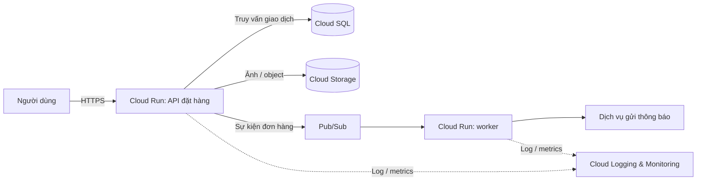

# Các nhóm dịch vụ và mô hình trách nhiệm chia sẻ trên GCP

> **Chương:** Tổng quan Google Cloud  
> **Module:** CLOUD_PROVIDERS_GCP  
> **Phạm vi:** Khám phá Google Cloud từ tổ chức project, IAM và VPC đến Compute Engine, GKE, Cloud Run, dịch vụ lưu trữ và cơ sở dữ liệu. Qua các tình huống triển khai, người học biết lựa chọn dịch vụ, bảo vệ tài nguyên, tự động hóa phát hành và theo dõi độ tin cậy cùng chi phí.

Khi triển khai một ứng dụng lên Google Cloud Platform (GCP), có hai câu hỏi cần trả lời song song: **nên dùng dịch vụ nào** và **ai chịu trách nhiệm vận hành, bảo vệ phần nào của hệ thống**. Một dịch vụ được Google quản lý nhiều hơn có thể giảm việc bảo trì máy chủ, nhưng không tự động giải quyết các vấn đề như phân quyền sai, mã nguồn có lỗ hổng, dữ liệu nhạy cảm bị công khai hay chi phí vượt ngân sách.

## Mục tiêu học tập

Sau bài này, bạn có thể:

1. Nhận diện các nhóm dịch vụ chính của Google Cloud và chọn dịch vụ phù hợp với nhu cầu phổ biến.
2. Phân biệt tài nguyên nền tảng như organization, folder, project, region và zone với các dịch vụ chạy ứng dụng.
3. Giải thích mô hình **trách nhiệm chia sẻ** giữa Google Cloud và khách hàng, kể cả khi dùng dịch vụ được quản lý hoàn toàn.
4. So sánh trách nhiệm vận hành khi sử dụng Compute Engine, GKE và Cloud Run.
5. Xác định những kiểm soát tối thiểu về IAM, mạng, dữ liệu, giám sát và chi phí trong một kiến trúc thực tế.

## 1. Bản đồ tổng thể của Google Cloud

Google Cloud cung cấp hạ tầng và các dịch vụ được quản lý để xây dựng, triển khai, kết nối, bảo vệ và quan sát ứng dụng. Trước khi chọn máy ảo hay cơ sở dữ liệu, cần hiểu **tài nguyên thuộc về ai, nằm ở đâu và chịu chính sách nào**.

### 1.1. Cấu trúc quản lý tài nguyên

Hệ thống tài nguyên thường được tổ chức theo cấu trúc:

```text
Organization (tổ chức, nếu có)
  └── Folder (nhóm tài nguyên, nếu có)
        └── Project (ranh giới quản trị và sử dụng dịch vụ)
              ├── Compute Engine / GKE / Cloud Run
              ├── VPC, subnet, firewall rule
              ├── Cloud Storage / Cloud SQL / BigQuery
              └── Các tài nguyên, API và cấu hình khác
```

- **Organization:** gốc quản trị cho doanh nghiệp; cho phép áp dụng chính sách và quyền trên phạm vi rộng.
- **Folder:** nhóm các project theo đơn vị, môi trường hoặc chính sách; folder là tùy chọn.
- **Project:** đơn vị cơ bản để tạo và quản lý tài nguyên, bật API, gán quyền, theo dõi quota và gắn với tài khoản thanh toán. Project có mã định danh (project ID); không nên dùng chung một project cho mọi môi trường nếu yêu cầu phân tách quyền và chi phí rõ ràng.
- **IAM (Identity and Access Management):** xác định *principal nào* (người dùng, nhóm, service account...) có *quyền gì* trên *tài nguyên nào*. Quyền có thể được thừa kế từ các cấp cao hơn trong cấu trúc.
- **Organization Policy:** áp đặt ràng buộc quản trị ở cấp tổ chức, folder hoặc project, ví dụ hạn chế một số cách cấu hình tài nguyên.

**Phân biệt với vị trí triển khai:** một số tài nguyên mang tính toàn cục; nhiều dịch vụ cho phép chọn **region** (khu vực địa lý) hoặc **zone** (vùng triển khai bên trong region). Chọn region/zone ảnh hưởng đến độ trễ, khả năng chịu lỗi, vị trí lưu dữ liệu, khả năng cung cấp dịch vụ và chi phí. Không mặc định mọi dịch vụ đều triển khai theo cùng một cơ chế vùng.

### 1.2. Các nhóm dịch vụ cốt lõi

| Nhóm | Dịch vụ tiêu biểu | Dùng khi nào? |
|---|---|---|
| **Quản trị, danh tính, chi phí** | Resource Manager, IAM, Organization Policy, Cloud Billing | Phân tách môi trường, kiểm soát ai được làm gì, quản lý ngân sách và chính sách |
| **Mạng và kết nối** | Virtual Private Cloud (VPC), Cloud Load Balancing, Cloud DNS, Cloud NAT, Cloud VPN, Cloud Interconnect | Tạo mạng riêng logic, định tuyến, phân phối lưu lượng, kết nối từ Internet hoặc on-premises |
| **Tính toán và chạy ứng dụng** | Compute Engine, Google Kubernetes Engine (GKE), Cloud Run, App Engine | Chạy VM, container, ứng dụng web/API hoặc tác vụ nền |
| **Lưu trữ tệp và đối tượng** | Cloud Storage, Persistent Disk, Filestore | Lưu object, gắn ổ đĩa cho VM, chia sẻ file qua giao thức tệp |
| **Cơ sở dữ liệu và phân tích** | Cloud SQL, AlloyDB, Spanner, Firestore, Bigtable, BigQuery, Memorystore | Dữ liệu giao dịch, tài liệu, dữ liệu quy mô lớn, kho phân tích hoặc bộ nhớ đệm |
| **Tích hợp và xử lý dữ liệu** | Pub/Sub, Cloud Tasks, Workflows, Dataflow | Gửi sự kiện, xếp hàng tác vụ, điều phối nhiều bước, xử lý luồng/lô |
| **Bảo mật** | Cloud KMS, Secret Manager, Security Command Center, Cloud Armor | Quản lý khóa, bí mật, phát hiện rủi ro và bảo vệ ứng dụng trước một số loại tấn công |
| **Triển khai và quan sát** | Cloud Build, Artifact Registry, Cloud Deploy, Cloud Logging, Cloud Monitoring, Cloud Trace | Xây dựng/phát hành, quản lý artifact, thu thập log, theo dõi chỉ số và truy vết |
| **AI và học máy** | Vertex AI | Phát triển, triển khai và vận hành giải pháp AI/ML khi bài toán cần đến |

Danh sách trên là **bản đồ chức năng**, không phải danh mục đầy đủ. Một hệ thống thực tế thường kết hợp dịch vụ của nhiều nhóm.

### 1.3. Chọn dịch vụ theo dạng bài toán

**Chạy ứng dụng:**

- **Compute Engine:** máy ảo (VM), phù hợp khi cần quyền kiểm soát hệ điều hành, phần mềm hệ thống, tiến trình hoặc cấu hình mạng ở mức máy. Đổi lại, đội vận hành xử lý nhiều việc liên quan đến guest OS và ứng dụng.
- **GKE:** chạy container bằng Kubernetes, phù hợp khi đã có nhu cầu orchestration như nhiều service, scheduling, chính sách triển khai và khả năng mở rộng theo Kubernetes. **GKE Standard** cho quyền kiểm soát node pool lớn hơn; **GKE Autopilot** giảm công việc quản lý hạ tầng node nhưng vẫn yêu cầu quản lý ứng dụng và cấu hình Kubernetes phù hợp.
- **Cloud Run:** chạy container hoặc chức năng dựa trên nền tảng được quản lý; phù hợp với web/API và tác vụ có thể đóng gói theo mô hình Cloud Run. Google quản lý phần lớn hạ tầng chạy dịch vụ; khách hàng vẫn kiểm soát mã, cấu hình, danh tính và quyền truy cập.
- **App Engine:** nền tảng triển khai ứng dụng được quản lý, hữu ích khi mô hình runtime và các ràng buộc của dịch vụ phù hợp với ứng dụng.

**Lưu trữ và dữ liệu:**

- **Cloud Storage** dùng cho object như ảnh, bản sao dữ liệu xuất ra, tệp tải lên; không phải ổ đĩa POSIX gắn trực tiếp theo cách dùng của VM.
- **Persistent Disk** cung cấp block storage cho workload phù hợp, thường gắn với VM; **Filestore** cung cấp dịch vụ lưu trữ tệp được quản lý.
- **Cloud SQL** là lựa chọn quen thuộc cho cơ sở dữ liệu quan hệ được quản lý (ví dụ PostgreSQL, MySQL, SQL Server). Đội ứng dụng vẫn phải thiết kế schema, query, quyền truy cập, chiến lược backup/restore và dung lượng.
- **Spanner** phù hợp những hệ thống quan hệ cần khả năng mở rộng và phân tán mạnh; không nên chọn chỉ vì nó là dịch vụ "cao cấp" hơn Cloud SQL.
- **Firestore** phục vụ mô hình cơ sở dữ liệu tài liệu; **Bigtable** phục vụ các bài toán dữ liệu dạng key/column-family ở quy mô lớn; **Memorystore** hỗ trợ cache trong bộ nhớ.
- **BigQuery** là nền tảng phân tích dữ liệu, không thường được dùng như cơ sở dữ liệu OLTP chính của một ứng dụng web.

**Kết nối các thành phần:** **Pub/Sub** phù hợp với mô hình publish/subscribe phân phối sự kiện; **Cloud Tasks** phù hợp khi cần đưa tác vụ vào hàng đợi và kiểm soát việc gọi worker; **Workflows** điều phối nhiều lời gọi dịch vụ theo một quy trình; **Dataflow** xử lý dữ liệu theo lô hoặc luồng.

Không có dịch vụ tốt nhất cho mọi hệ thống. Nên so sánh nhu cầu kiểm soát hệ điều hành, kỹ năng đội ngũ, dạng dữ liệu, tính nhất quán, khả năng mở rộng, độ trễ, độ sẵn sàng, tuân thủ và **tổng chi phí vận hành**.

## 2. Mô hình trách nhiệm chia sẻ: ai bảo vệ phần nào?

Trong mô hình cloud, **Google Cloud** chịu trách nhiệm bảo vệ và vận hành hạ tầng thuộc phạm vi dịch vụ mà họ cung cấp; **khách hàng** chịu trách nhiệm với dữ liệu, danh tính, ứng dụng, quyền truy cập và các cấu hình thuộc phạm vi mình kiểm soát. Phần chia cụ thể **thay đổi theo dịch vụ** và cách triển khai.

Có thể ghi nhớ qua hai câu hỏi:

1. **Bảo mật của đám mây:** ai bảo vệ trung tâm dữ liệu, phần cứng, hạ tầng nền và các thành phần dịch vụ do nhà cung cấp quản lý?
2. **Bảo mật trong đám mây:** ai quyết định dữ liệu nào được đưa lên, ai có quyền truy cập, ứng dụng xử lý dữ liệu ra sao và cấu hình bảo vệ được bật thế nào?

### 2.1. Ma trận trách nhiệm thực tế

| Lớp hoặc hoạt động | Trách nhiệm chính của Google Cloud | Trách nhiệm chính của khách hàng |
|---|---|---|
| **Trung tâm dữ liệu, phần cứng, cơ sở hạ tầng vật lý** | Bảo vệ vật lý, duy trì và vận hành phần cứng hạ tầng dịch vụ | Lựa chọn dịch vụ/khu vực thích hợp với yêu cầu của tổ chức |
| **Hạ tầng ảo hóa và nền tảng được quản lý** | Vận hành các thành phần nền theo ranh giới dịch vụ | Chọn loại dịch vụ, thiết lập các tùy chọn được cung cấp; với VM, quản lý hệ điều hành khách |
| **Dữ liệu** | Cung cấp cơ chế lưu trữ, bảo vệ hạ tầng và các khả năng bảo mật của dịch vụ | Phân loại dữ liệu, quyết định nội dung và quyền truy cập, lưu giữ/xóa, mã hóa theo chính sách, backup/restore phù hợp |
| **IAM và tài khoản dịch vụ** | Cung cấp IAM, xác thực và cơ chế thực thi chính sách của nền tảng | Cấp quyền tối thiểu, kiểm soát tài khoản/quyền, tránh lộ credential, rà soát định kỳ |
| **Mạng** | Vận hành hạ tầng mạng của dịch vụ | Thiết kế VPC/subnet, quy tắc firewall, tuyến kết nối, mức độ public/private và bảo vệ lưu lượng theo khả năng từng dịch vụ |
| **Mã nguồn và dependency** | Quản lý phần runtime do Google cung cấp trong dịch vụ được quản lý | Viết mã an toàn, sửa lỗi ứng dụng, quản lý dependency/image do mình xây dựng, xử lý lỗ hổng |
| **Hệ điều hành và patch** | Quản lý hệ điều hành của hạ tầng Google và phần runtime/host được dịch vụ quản lý | Với Compute Engine: quản lý guest OS. Với GKE: trách nhiệm node/workload tùy Standard hoặc Autopilot. Với Cloud Run: quản lý code, dependency và image ứng dụng |
| **Sẵn sàng và khôi phục** | Cung cấp độ tin cậy và các khả năng HA/backup trong phạm vi sản phẩm | Thiết kế khả năng chịu lỗi, chọn cấu hình HA, đặt mục tiêu RTO/RPO, kiểm tra khôi phục và ứng phó sự cố |
| **Giám sát và chi phí** | Cung cấp đo lường, log/metrics và cơ chế tính phí của dịch vụ | Đặt cảnh báo, phân tích log, quản lý quota/chi phí, tối ưu tài nguyên và ứng phó |
| **Tuân thủ** | Cung cấp các chứng nhận, tài liệu và cam kết áp dụng cho nền tảng/dịch vụ | Xác định nghĩa vụ pháp lý riêng, cấu hình đúng, quản lý dữ liệu và thu thập bằng chứng kiểm soát |

**Lưu ý:** đây là ma trận khái quát để tư duy; hợp đồng, tài liệu sản phẩm và cấu hình cụ thể mới xác định ranh giới chính xác. Chứng nhận tuân thủ của Google Cloud **không tự động** khiến ứng dụng của khách hàng đáp ứng mọi yêu cầu pháp lý.

### 2.2. Trách nhiệm thay đổi theo cấp độ quản lý

| Ví dụ | Google Cloud quản lý nhiều nhất ở phần nào? | Khách hàng còn phải làm gì? |
|---|---|---|
| **Compute Engine (VM/IaaS)** | Hạ tầng vật lý, host và lớp nền ảo hóa | Chọn image, harden/patch guest OS, phần mềm, firewall, IAM, dữ liệu, backup, theo dõi |
| **GKE Standard** | Kubernetes control plane được quản lý và các thành phần hạ tầng thuộc dịch vụ | Quản lý node pool theo cấu hình/chế độ nâng cấp, workload, image, Kubernetes RBAC, network policy, secret, dữ liệu và phát hành |
| **GKE Autopilot** | Quản lý hạ tầng node và nhiều tác vụ vận hành cụm Kubernetes | Quản lý manifest, workload, chính sách/quyền, image, cấu hình bảo mật, dữ liệu, quota và chi phí |
| **Cloud Run (serverless)** | Máy chủ hạ tầng, orchestration và môi trường thực thi theo hợp đồng dịch vụ | Viết/sửa code, xây dựng image an toàn, gán service account, kiểm soát ingress/authorization, cấu hình secret, dữ liệu và giám sát |
| **Cloud SQL (managed database)** | Hạ tầng DB được quản lý và các hoạt động vận hành thuộc dịch vụ | Cấp quyền, truy cập mạng, schema, query, cập nhật phía ứng dụng, cấu hình HA/backup và thử khôi phục |

Giảm công sức quản lý hạ tầng **không đồng nghĩa** chuyển giao việc quyết định chính sách truy cập hay chất lượng mã nguồn cho Google. Dù Cloud Run tự mở rộng, ứng dụng có thể vẫn bị lộ dữ liệu nếu endpoint thiếu xác thực.

### 2.3. Ba dạng kiểm soát dễ bị hiểu nhầm

- **Kiểm soát do nhà cung cấp thực hiện:** ví dụ bảo vệ vật lý trung tâm dữ liệu; khách hàng chủ yếu đánh giá cam kết và phạm vi dịch vụ.
- **Kiểm soát do khách hàng thực hiện:** ví dụ giới hạn IAM, phân loại dữ liệu, cấu hình endpoint công khai, bảo vệ API và xử lý lỗ hổng trong code.
- **Kiểm soát phối hợp:** ví dụ Google cung cấp Cloud KMS, logging, cơ chế sao lưu và hạ tầng HA, còn khách hàng quyết định cách dùng, quyền quản lý khóa, chính sách lưu giữ và diễn tập phục hồi.

Google Cloud còn nhấn mạnh cách tiếp cận **shared fate** (cùng hướng tới kết quả bảo mật tốt): nhà cung cấp hỗ trợ khách hàng thực hiện trách nhiệm qua kiến trúc khuyến nghị, mặc định an toàn và công cụ bảo vệ. Khái niệm này **không xóa** trách nhiệm cấu hình và quản trị của khách hàng.

## 3. Từ trách nhiệm trừu tượng đến quyết định bảo mật

### Tình huống A: dữ liệu Cloud Storage vô tình được công khai

Một đội phát triển lưu tài liệu nội bộ vào bucket rồi cấp quyền đọc cho đối tượng quá rộng. Google vẫn có thể bảo vệ hạ tầng lưu trữ đúng thiết kế, nhưng **quyền đọc do khách hàng cấp** khiến dữ liệu bị truy cập ngoài dự kiến.

**Cách xử lý:** dùng IAM theo nguyên tắc quyền tối thiểu, ưu tiên cơ chế ngăn truy cập công khai khi phù hợp, kiểm tra cấu hình bucket/object và giám sát thay đổi quyền. Mã hóa lúc lưu trữ không thay thế kiểm soát truy cập.

### Tình huống B: VM trên Compute Engine lâu ngày không cập nhật

Ứng dụng trên VM gặp lỗ hổng ở hệ điều hành khách hoặc gói phần mềm. Google vận hành host và cơ sở hạ tầng, còn việc duy trì guest OS, image và dependency của máy ảo là phần việc đội quản trị ứng dụng phải thực hiện.

**Cách xử lý:** có lịch patch, dùng image đáng tin cậy, hạn chế cổng quản trị, áp dụng nguyên tắc không mở Internet khi không cần thiết và theo dõi cảnh báo bảo mật.

### Tình huống C: Cloud Run có tài khoản dịch vụ quá nhiều quyền

Code ứng dụng có lỗi cho phép gọi API trái phép. Nếu Cloud Run sử dụng service account có quyền quản trị toàn project, hậu quả có thể lan ra nhiều tài nguyên dù nền tảng thực thi vẫn do Google quản lý.

**Cách xử lý:** cấp service account riêng theo workload, chỉ cấp những role cần thiết trên đúng tài nguyên, giới hạn quyền gọi endpoint, sử dụng Secret Manager khi phù hợp và kiểm tra dependency.

### Tình huống D: cơ sở dữ liệu được quản lý nhưng không phục hồi được

Cloud SQL giảm việc quản trị cơ sở hạ tầng cơ sở dữ liệu. Tuy nhiên, lỗi ứng dụng xóa dữ liệu, migration sai hoặc thời hạn giữ backup không đáp ứng yêu cầu có thể khiến dịch vụ không phục hồi kịp.

**Cách xử lý:** xác định RPO (mức mất dữ liệu tối đa chấp nhận được) và RTO (thời gian khôi phục mục tiêu), lựa chọn backup/HA theo nhu cầu, kiểm thử restore và kiểm soát migration.

## 4. Ví dụ kiến trúc: triển khai hệ thống đặt hàng

Giả sử cần triển khai một API đặt hàng gồm lưu thông tin giao dịch, nhận ảnh sản phẩm và xử lý email xác nhận bất đồng bộ. Đội có ít nhân sự vận hành nên ưu tiên dịch vụ được quản lý, nhưng yêu cầu kiểm soát danh tính, dữ liệu và chi phí.



Đây là **sơ đồ logic**: cấu hình kết nối Cloud SQL, đường mạng, trigger Pub/Sub, xác thực và dịch vụ gửi email cụ thể cần được thiết kế khi triển khai.

| Quyết định triển khai | Dịch vụ | Trách nhiệm khách hàng cần nhớ |
|---|---|---|
| API và worker chạy container | Cloud Run | Mã nguồn, image/dependency, quyền invoke, ingress, scale/concurrency phù hợp và service account |
| Dữ liệu đơn hàng dạng quan hệ | Cloud SQL | Schema và migration, tài khoản DB, kết nối an toàn, backup/restore và kiểm soát dung lượng |
| Ảnh sản phẩm | Cloud Storage | Bucket, quyền đọc/ghi, vòng đời object và chính sách truy cập công khai |
| Sự kiện xử lý sau đặt hàng | Pub/Sub | Thiết kế message, xử lý trùng lặp, retry, idempotency và quyền publish/subscribe |
| Quản trị truy cập | IAM và Secret Manager | Phân quyền tối thiểu, danh tính riêng cho mỗi workload, không đưa credential vào mã nguồn |
| Theo dõi hệ thống | Logging, Monitoring, Cloud Billing | Theo dõi lỗi, độ trễ, lưu lượng, sử dụng tài nguyên và ngân sách |

Một quy trình triển khai hợp lý:

1. **Tổ chức project:** phân tách môi trường phát triển/sản xuất theo chính sách; cấp IAM theo nhóm chức năng. Gắn billing account và thiết lập budget/cảnh báo.
2. **Thiết kế luồng truy cập:** xác định endpoint nào công khai, các kết nối đến cơ sở dữ liệu và object storage nào cần bảo vệ, dịch vụ nào được phép gọi dịch vụ nào. Dùng VPC và khả năng kết nối riêng khi kiến trúc yêu cầu.
3. **Đóng gói và phát hành:** xây dựng image, lưu Artifact Registry, tự động kiểm tra và triển khai bằng Cloud Build/Cloud Deploy hoặc pipeline tương đương. Tránh đưa secret vào image/repository.
4. **Thiết lập quyền:** API, worker và quy trình triển khai dùng danh tính phù hợp; chỉ cấp quyền đọc/ghi từng tài nguyên cần thiết. Đánh giá quyền truy cập dữ liệu từ người dùng cuối.
5. **Bảo đảm khôi phục:** thiết kế backup/restore cho Cloud SQL, chiến lược phục hồi khi queue/worker lỗi và phương án triển khai rollback.
6. **Quan sát và điều chỉnh:** theo dõi tỷ lệ lỗi HTTP, thời gian phản hồi, lượng message tồn, kết nối DB, tài nguyên và ngân sách; thiết lập cảnh báo cho các ngưỡng có ý nghĩa với người dùng.

Cloud Run và Cloud SQL giảm gánh nặng quản lý hệ điều hành/hạ tầng, nhưng **kết quả bảo mật và độ tin cậy** vẫn phụ thuộc nhiều vào các quyết định trên.

## 5. Thực hành nhận diện trách nhiệm trong project

Có thể bắt đầu kiểm tra một project đã được cấp quyền truy cập bằng vài lệnh Google Cloud CLI:

```bash
# Liệt kê API/dịch vụ đang bật
gcloud services list --enabled --project=PROJECT_ID

# Xem chính sách IAM ở cấp project
gcloud projects get-iam-policy PROJECT_ID

# Liệt kê các quy tắc firewall của VPC trong project
gcloud compute firewall-rules list --project=PROJECT_ID
```

Các lệnh này **chỉ đọc thông tin**; thay `PROJECT_ID` bằng project ID thực tế và đăng nhập bằng danh tính có quyền xem tương ứng. Không thấy một rủi ro trong ba kết quả trên **không có nghĩa** toàn bộ hệ thống đã an toàn: cần kiểm tra cả IAM ở các cấp khác, chính sách trên từng tài nguyên, kết nối dịch vụ và cấu hình ứng dụng.

Khi rà soát, hãy tự trả lời:

- Project này chứa những môi trường và loại dữ liệu nào? Ai sở hữu quyền quản trị? Có thể phân tách để giảm phạm vi ảnh hưởng không?
- Những API và workload nào đang chạy? Có tài nguyên không dùng vẫn phát sinh chi phí hay tạo bề mặt tấn công không?
- Quyền của mỗi service account có khớp nhu cầu thực tế không? Có credential dài hạn hay quyền quá rộng không?
- Luồng mạng, điểm vào công khai và đường truy cập dữ liệu đã được kiểm soát chưa?
- Đã xác định thời hạn lưu giữ, backup, quy trình restore, cảnh báo sự cố và ngân sách chưa?

## 6. Những nguyên tắc chọn dịch vụ và thiết kế vận hành

| Câu hỏi | Gợi ý ra quyết định |
|---|---|
| Có cần kiểm soát guest OS hoặc phần mềm hệ thống? | Cân nhắc Compute Engine; chấp nhận phần trách nhiệm bảo trì hệ điều hành |
| Hệ thống đã cần Kubernetes và mô hình orchestration riêng? | Cân nhắc GKE; so sánh Standard và Autopilot theo yêu cầu kiểm soát node |
| API/container ít cần quản trị hạ tầng? | Cân nhắc Cloud Run; vẫn phải thiết kế authorization, IAM, image và scale |
| Dữ liệu là object, file dùng chung hay block disk? | Phân biệt Cloud Storage, Filestore và Persistent Disk trước khi chọn |
| Dữ liệu cần giao dịch quan hệ hay chủ yếu phân tích? | Phân biệt Cloud SQL/Spanner với BigQuery; kiểm tra nhu cầu mở rộng và nhất quán |
| Xử lý nền cần sự kiện hay hàng đợi tác vụ? | Phân biệt Pub/Sub, Cloud Tasks và Workflows theo mẫu tương tác và retry |
| Yêu cầu thời gian hoạt động và vị trí dữ liệu ra sao? | Thiết kế region/zone, HA, backup, RTO/RPO và tuân thủ theo tính năng từng dịch vụ |
| Ai theo dõi chất lượng và hóa đơn? | Thiết lập Cloud Monitoring, Logging, budget, cảnh báo và quy trình xử lý |

**Chi phí:** giá dịch vụ thường không chỉ phụ thuộc CPU hay dung lượng lưu trữ; cần tính cả lưu lượng truyền dữ liệu, số lần gọi API, thời gian chạy, tài nguyên dự phòng và mức sử dụng theo từng sản phẩm. Budget và cảnh báo giúp phát hiện sớm, nhưng bản thân cảnh báo ngân sách không đảm bảo hệ thống tự ngừng phát sinh phí.

**Độ tin cậy:** dịch vụ được quản lý có thể cung cấp cơ chế sẵn sàng cao, nhưng ứng dụng vẫn cần chọn cấu hình, xử lý lỗi, retry hợp lý, kiểm soát tác dụng phụ khi thử lại và diễn tập phục hồi. Không thể suy ra kiến trúc có HA chỉ vì dùng một dịch vụ managed.

**Bảo mật:** bắt đầu từ quyền tối thiểu, phân tách workload, kiểm soát kết nối, giữ secret an toàn, cập nhật dependency, quản lý bản ghi audit và đặt chính sách về dữ liệu. Tránh suy luận rằng tài nguyên nằm trong VPC mặc nhiên chỉ được truy cập từ mạng riêng: mỗi dịch vụ có cơ chế kết nối và điểm truy cập khác nhau.

## 7. Câu hỏi tự kiểm tra

**Câu 1.** Một ứng dụng trên Compute Engine bị khai thác qua lỗ hổng thư viện do nhóm phát triển cài đặt. Ai chịu trách nhiệm chính để khắc phục?  
**Gợi ý trả lời:** khách hàng, vì thư viện và mã ứng dụng nằm trong phần họ quản lý. Google bảo vệ các lớp hạ tầng do Google vận hành theo phạm vi dịch vụ.

**Câu 2.** Chuyển API từ VM sang Cloud Run có làm biến mất nhu cầu quản lý IAM và rà soát secret không?  
**Gợi ý trả lời:** không. Google quản lý thêm hạ tầng thực thi, còn quyền truy cập, secret và mã nguồn vẫn do khách hàng quyết định.

**Câu 3.** Một website cần lưu ảnh sản phẩm và lưu giao dịch đơn hàng bằng SQL. Nên chọn cùng một dịch vụ dữ liệu cho cả hai không?  
**Gợi ý trả lời:** thường tách Cloud Storage cho object và một hệ quản trị SQL phù hợp như Cloud SQL cho giao dịch; quyết định cuối cùng phụ thuộc quy mô và yêu cầu thực tế.

**Câu 4.** Vì sao có Cloud SQL backup vẫn cần diễn tập khôi phục?  
**Gợi ý trả lời:** backup chỉ hữu ích nếu phương án khôi phục phù hợp RPO/RTO và đã được kiểm chứng với dữ liệu, quyền và quy trình triển khai của hệ thống.

**Câu 5.** Một đội bật Cloud Billing budget alert rồi cho rằng phí không thể vượt mức ngân sách. Nhận định đó đúng không?  
**Gợi ý trả lời:** không. Cảnh báo cung cấp tín hiệu để phản ứng và điều chỉnh; cần thêm giới hạn, tự động hóa hoặc chính sách vận hành phù hợp nếu muốn kiểm soát chặt.

## Ghi nhớ

- **Nhóm dịch vụ** trả lời câu hỏi *hệ thống cần loại năng lực nào*; **mô hình vận hành** trả lời *đội kỹ thuật muốn kiểm soát bao nhiêu phần hạ tầng*.
- **Project, IAM, VPC, region/zone và billing** là những quyết định nền tảng trước khi triển khai workload.
- **Trách nhiệm chia sẻ thay đổi theo dịch vụ**: từ VM qua Kubernetes đến serverless, Google quản lý ngày càng nhiều lớp hạ tầng, còn khách hàng luôn có trách nhiệm với dữ liệu, danh tính, mã nguồn và cấu hình mình chọn.
- **Dịch vụ managed không đồng nghĩa với kiến trúc tự động an toàn, sẵn sàng cao hoặc tối ưu chi phí**. Các mục tiêu đó phải được thiết kế, đo lường và kiểm tra.
