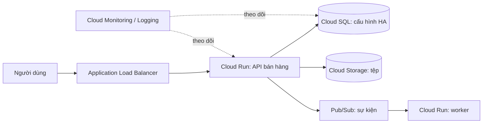

# Google Cloud Well-Architected Framework

## 1. Vì sao cần một khung đánh giá kiến trúc?

Một ứng dụng chạy được trên Google Cloud chưa chắc đã là một hệ thống được thiết kế tốt. Một API có thể đáp ứng yêu cầu chức năng nhưng vẫn gặp rủi ro khi triển khai phiên bản mới, mất một vùng khả dụng (zone), bị cấp quyền quá rộng, tăng lưu lượng đột ngột hoặc phát sinh chi phí ngoài dự kiến.

**Google Cloud Well-Architected Framework** là tập hợp nguyên tắc, khuyến nghị và câu hỏi thiết kế giúp kiến trúc sư, lập trình viên, đội vận hành và người quản lý **thiết kế, đánh giá và cải tiến workload trên Google Cloud**. Khung này cũng áp dụng khi di chuyển hệ thống từ trung tâm dữ liệu riêng, triển khai hybrid cloud hoặc multicloud.

Trong hành trình học Google Cloud, framework giúp kết nối những mảnh ghép thường được học riêng lẻ: **Organization, Folder, Project, IAM, VPC, Compute Engine, GKE, Cloud Run, Cloud Storage, cơ sở dữ liệu, CI/CD, giám sát và quản lý chi phí**. Thay vì chỉ hỏi “dùng dịch vụ nào?”, ta hỏi thêm “vì sao phù hợp với mục tiêu kinh doanh, vận hành và rủi ro của workload?”.

Sau bài học, người học có thể:

- Giải thích sáu trụ cột của Well-Architected Framework và cách chúng bổ sung hoặc đánh đổi với nhau.
- Chuyển yêu cầu kinh doanh thành chỉ tiêu kỹ thuật: bảo mật, SLO, RTO, RPO, độ trễ và ngân sách.
- Đề xuất các lựa chọn dịch vụ Google Cloud phù hợp với đặc điểm ứng dụng.
- Tổ chức một đợt rà soát kiến trúc dựa trên bằng chứng và lập kế hoạch cải tiến có ưu tiên.

> **Phạm vi:** Framework là hướng dẫn để ra quyết định và cải tiến liên tục; không phải chứng nhận tự động rằng một kiến trúc “đạt chuẩn”, cũng không thay thế các yêu cầu pháp lý, chính sách bảo mật hoặc thỏa thuận dịch vụ cụ thể.

## 2. Cấu trúc: sáu trụ cột và góc nhìn liên trụ cột

Theo tài liệu Google Cloud Well-Architected Framework hiện hành (2026), các khuyến nghị được tổ chức thành **sáu trụ cột**:

| Trụ cột | Câu hỏi trung tâm | Ví dụ kết quả cần đạt |
| --- | --- | --- |
| **Operational excellence** – Vận hành xuất sắc | Làm sao triển khai, vận hành, ứng phó sự cố và cải tiến có kiểm soát? | Có CI/CD, quan sát hệ thống, runbook và quy trình xử lý sự cố |
| **Security, privacy, and compliance** – Bảo mật, quyền riêng tư và tuân thủ | Ai được truy cập tài nguyên và dữ liệu, bằng cách nào, trong phạm vi nào? | IAM tối thiểu, phân tách môi trường, bảo vệ bí mật và audit |
| **Reliability** – Độ tin cậy | Hệ thống có phục vụ đúng kỳ vọng khi có lỗi và phục hồi được không? | SLO rõ ràng, dự phòng phù hợp, khôi phục đã kiểm thử |
| **Cost optimization** – Tối ưu chi phí | Chi tiêu đám mây có tương xứng với giá trị mang lại? | Phân bổ chi phí, đặt ngân sách, điều chỉnh tài nguyên |
| **Performance optimization** – Tối ưu hiệu năng | Hệ thống có đáp ứng tải và độ trễ mục tiêu một cách hiệu quả? | Đo p95/p99, thử tải, mở rộng và tối ưu điểm nghẽn |
| **Sustainability** – Tính bền vững | Có thể giảm tài nguyên và tác động môi trường của workload không? | Tăng hiệu suất sử dụng, tối ưu lưu trữ, đo dấu chân carbon |

Sustainability được mở rộng thành một trụ cột đầy đủ trong năm 2026. Một số tài liệu hoặc sơ đồ cũ có thể chỉ liệt kê năm trụ cột; khi đánh giá kiến trúc cần đối chiếu phiên bản tài liệu Google Cloud đang áp dụng.

Ngoài các trụ cột, Google Cloud cung cấp **perspectives**: các góc nhìn áp dụng khuyến nghị xuyên nhiều trụ cột cho một loại workload hoặc ngành, chẳng hạn **AI/ML** và **dịch vụ tài chính**. Perspective không thay thế trụ cột; nó bổ sung những yêu cầu chuyên biệt, ví dụ quản trị mô hình AI hoặc ràng buộc nơi lưu trữ dữ liệu trong ngành tài chính.

## 3. Đi sâu vào từng trụ cột

### 3.1. Operational excellence – Thiết kế để vận hành được

Mục tiêu là biến hoạt động hàng ngày thành quy trình **đo lường được, lặp lại được và có khả năng cải tiến**. Một hệ thống vận hành tốt không phụ thuộc vào trí nhớ của một kỹ sư duy nhất.

Các quyết định thực tế:

1. **Chuẩn hóa môi trường:** phân chia Project hoặc Folder cho development, staging và production; quản lý hạ tầng bằng Terraform hoặc công cụ IaC tương đương.
2. **Tự động hóa phát hành:** xây dựng, kiểm thử, lưu image trong Artifact Registry và triển khai có kiểm soát bằng Cloud Build, Cloud Deploy hoặc pipeline phù hợp.
3. **Quan sát được hệ thống:** tập trung logs, metrics và traces qua Cloud Logging, Cloud Monitoring, Cloud Trace; đặt alert theo tác động đến người dùng.
4. **Sẵn sàng xử lý sự cố:** có người trực, hướng dẫn khôi phục (runbook), cách rollback, kênh thông báo và postmortem để rút kinh nghiệm.
5. **Quản lý thay đổi:** kiểm tra cấu hình, phân quyền duyệt thay đổi quan trọng, triển khai theo từng phần và xác minh sau phát hành.

Ví dụ: khi một revision Cloud Run mới làm tăng tỷ lệ lỗi HTTP 5xx, dashboard phải cho thấy lỗi tăng từ thời điểm phát hành; nhóm vận hành có thể chuyển traffic về revision ổn định và ghi nhận nguyên nhân. Chỉ lưu log mà không có cảnh báo, người chịu trách nhiệm và hướng dẫn xử lý thì chưa đủ.

**Bằng chứng rà soát:** pipeline triển khai, lịch sử thay đổi, dashboard SLO, chính sách alert, runbook và biên bản sự cố.

### 3.2. Security, privacy, and compliance – Bảo vệ từ thiết kế

Google Cloud bảo vệ hạ tầng nền tảng, còn khách hàng vẫn phải chịu trách nhiệm về **cấu hình workload, quyền truy cập, ứng dụng và dữ liệu** theo mô hình trách nhiệm chia sẻ. Các biện pháp cần được thiết kế từ đầu, kiểm thử trong pipeline và rà soát khi hệ thống thay đổi.

| Lớp bảo vệ | Gợi ý triển khai | Điều cần kiểm tra |
| --- | --- | --- |
| **Tổ chức và quản trị** | Organization → Folder → Project; Organization Policy cho ràng buộc chung | Dự án production có tách biệt? Có tài nguyên nằm ngoài cấu trúc quản trị? |
| **Danh tính và quyền** | Cloud IAM theo nguyên tắc quyền tối thiểu; service account riêng cho từng workload; Workload Identity Federation khi phù hợp | Có cấp vai trò quá rộng? Có dùng khóa service account dài hạn không cần thiết? |
| **Mạng và biên truy cập** | VPC, subnet, firewall policies, kết nối riêng khi cần; Cloud Armor tại điểm vào được hỗ trợ | Luồng inbound/outbound có được mô tả và giới hạn đúng không? |
| **Bí mật và mã hóa** | Secret Manager; Cloud KMS khi cần kiểm soát khóa; TLS | Bí mật có bị đặt trong image, mã nguồn hoặc biến cấu hình công khai? |
| **Dữ liệu và tuân thủ** | Phân loại dữ liệu; chính sách lưu giữ, xóa, vị trí lưu; audit logs | Có đáp ứng quy định về dữ liệu cá nhân và data residency không? |
| **Phát hiện và điều tra** | Cloud Audit Logs, Security Command Center và quy trình xử lý cảnh báo | Có người chịu trách nhiệm khi phát hiện sai cấu hình hoặc rò rỉ dữ liệu? |

**Lưu ý về IAM:** quyền được áp ở Organization/Folder/Project có thể kế thừa xuống tài nguyên. Vì vậy cần xét **quyền hiệu lực** của một principal, không chỉ xem chính sách gắn trực tiếp lên từng dịch vụ. Vai trò Owner/Editor rộng chỉ nên dùng trong những tình huống thực sự cần thiết và đã được kiểm soát.

**Lưu ý về mạng:** VPC không tự động chặn mọi lối truy cập công khai, và Cloud Run không mặc nhiên dùng đường mạng riêng chỉ vì project có VPC. Phải kiểm tra ingress, egress, cơ chế kết nối database, IAM và cấu hình firewall thực tế. VPC Service Controls là biện pháp giảm nguy cơ rò rỉ dữ liệu cho các dịch vụ được hỗ trợ, không thay thế firewall hoặc IAM.

### 3.3. Reliability – Thiết kế cho lỗi và khả năng phục hồi

Độ tin cậy là khả năng hệ thống liên tục thực hiện đúng chức năng trong điều kiện xác định. Cần thiết kế với giả định **thành phần nào đó sẽ hỏng**, rồi xác định mức dịch vụ nào phải được giữ và thời gian phục hồi chấp nhận được.

Các khái niệm nền tảng:

| Thuật ngữ | Ý nghĩa | Ví dụ |
| --- | --- | --- |
| **SLI** – Service Level Indicator | Chỉ số đo chất lượng dịch vụ thực tế | Tỷ lệ request thành công, p95 độ trễ |
| **SLO** – Service Level Objective | Mục tiêu nội bộ đặt trên SLI trong một khoảng thời gian | Tối thiểu 99,9% request hợp lệ thành công mỗi 30 ngày |
| **SLA** – Service Level Agreement | Cam kết dịch vụ theo hợp đồng, có thể kèm chế tài | SLA của nhà cung cấp là một đầu vào, không tự động là SLO của ứng dụng |
| **RTO** – Recovery Time Objective | Thời gian tối đa mục tiêu để khôi phục dịch vụ sau gián đoạn | Khôi phục luồng đặt hàng trong 30 phút |
| **RPO** – Recovery Point Objective | Mức mất dữ liệu theo thời gian mà doanh nghiệp chấp nhận | Sau sự cố chỉ chấp nhận mất tối đa 5 phút dữ liệu |
| **Error budget** | Phần sai lệch cho phép so với SLO, dùng để cân bằng độ ổn định và tốc độ thay đổi | Với SLO thành công 99,9%, tối đa 0,1% request hợp lệ có thể thất bại trong cửa sổ đo |

Giả sử có 1.000.000 request hợp lệ trong 30 ngày, SLO thành công 99,9% tương đương **ngân sách tối đa 1.000 request thất bại** theo cách đo này. Nếu SLI là thời gian sẵn sàng thay vì request, cách tính ngân sách sẽ khác. Đừng dùng con số này để suy ra một SLA pháp lý.

Những thực hành quan trọng:

- **Xác định failure domain:** phân biệt lỗi container, VM, zone và toàn region. Cloud SQL **High Availability trong một region** giúp xử lý lỗi theo zone nhưng không đồng nghĩa có phương án khôi phục khi cả region gặp sự cố.
- **Dùng dự phòng có chủ đích:** cấu hình nhiều instance/zone khi workload cần; kết hợp health check, load balancing, scaling và cơ chế chuyển đổi phù hợp. Độ sẵn sàng end-to-end phải xét tất cả thành phần phụ thuộc.
- **Thiết kế khôi phục dữ liệu riêng:** backup, kiểm thử restore, point-in-time recovery khi được hỗ trợ và chiến lược disaster recovery tương ứng với RPO/RTO. Bản sao phục vụ HA không thay cho bản sao lưu chống xóa hoặc hỏng dữ liệu.
- **Chịu lỗi ở tầng ứng dụng:** timeout, retry có backoff, idempotency, circuit breaker, queue để hấp thụ tải và graceful degradation.
- **Diễn tập và học từ sự cố:** mô phỏng mất zone, mất kết nối database, lỗi deploy; ghi lại RTO/RPO thực tế và cải thiện kịch bản.

Ví dụ, chuyển việc gửi email xác nhận sang Pub/Sub và worker bất đồng bộ có thể giúp API không bị chậm khi dịch vụ email lỗi. Nhưng người xử lý sự kiện vẫn phải **idempotent**, bởi việc giao lại thông điệp có thể dẫn đến xử lý lặp.

### 3.4. Cost optimization – Chi phí gắn với giá trị

Tối ưu chi phí là chọn mức chi phù hợp với **giá trị kinh doanh và yêu cầu chất lượng**, thay vì cắt giảm tài nguyên bằng mọi giá.

- **Tạo khả năng nhìn thấy chi tiêu:** Cloud Billing reports, budgets, cost labels/tags phù hợp, export chi phí sang BigQuery để phân tích theo môi trường, nhóm và sản phẩm.
- **Đo đơn vị kinh tế:** ví dụ chi phí trên 1.000 đơn hàng thành công, một người dùng hoạt động hoặc mỗi GB dữ liệu xử lý. Khi lượng giao dịch tăng, tổng chi phí có thể tăng nhưng chi phí đơn vị vẫn giảm.
- **Cấp phát vừa đủ:** dùng recommender, right-sizing VM, autoscaling, tắt tài nguyên thử nghiệm không dùng và lifecycle cho dữ liệu lưu trữ.
- **Chọn mô hình giá hợp tải:** so sánh Cloud Run, GKE, Compute Engine; cân nhắc committed use discounts cho nhu cầu ổn định và phù hợp điều kiện áp dụng.
- **Rà soát định kỳ:** chi phí thay đổi theo lưu lượng, vị trí triển khai, truyền dữ liệu qua vùng, dung lượng log và mức dự phòng.

Một **budget dạng cảnh báo** giúp theo dõi ngưỡng nhưng **không tự dừng chi tiêu**. Một số dịch vụ có thể hỗ trợ cơ chế spend cap với phạm vi và giới hạn riêng; không nên mặc định mọi workload hay mọi project đều được chặn chi phí tự động. Khi áp dụng giới hạn cứng cho dịch vụ đủ điều kiện, phải xem xét rủi ro gián đoạn ứng dụng.

**Bằng chứng rà soát:** báo cáo chi phí theo workload, ngân sách và người nhận cảnh báo, mức sử dụng thực tế so với tài nguyên cấp phát, dự báo chi phí sau khi mở rộng.

### 3.5. Performance optimization – Tối ưu đúng điểm nghẽn

Hiệu năng phải được nhìn từ trải nghiệm người dùng và cả chuỗi xử lý, không chỉ từ mức CPU của máy chủ.

1. **Chọn chỉ số:** thông lượng (requests/second), độ trễ p50/p95/p99, tỷ lệ lỗi, thời gian xử lý hàng đợi và giới hạn kết nối cơ sở dữ liệu.
2. **Thiết lập tải đại diện:** thử tải bình thường, giờ cao điểm, đột biến và tình huống một thành phần trở nên chậm.
3. **Đo rồi mới tối ưu:** dùng Cloud Monitoring, Cloud Trace, log ứng dụng, profiler hoặc công cụ phân tích database để xác định bottleneck.
4. **Tối ưu từng tầng:** cache, Cloud CDN cho nội dung phù hợp, chỉ mục và truy vấn SQL, batching, connection pooling, async processing và lựa chọn vùng gần người dùng.
5. **Chọn năng lực compute:** Cloud Run phù hợp nhiều ứng dụng container stateless theo request/event; GKE dành cho nhu cầu điều phối Kubernetes sâu hơn; Compute Engine có ích khi cần kiểm soát máy ảo hoặc chạy ứng dụng khó container hóa.

Ví dụ: tăng số instance Cloud Run có thể không giúp cải thiện p95 nếu Cloud SQL đã chạm giới hạn kết nối. Cần quan sát cả thời gian truy vấn và connection pool, sau đó mới quyết định tăng instance, điều chỉnh concurrency, cache hay thay đổi thiết kế dữ liệu.

**Cẩn trọng:** kết quả benchmark chỉ có ý nghĩa khi mô tả rõ loại request, dữ liệu kiểm thử, tải, vị trí khách hàng và cấu hình tài nguyên. Một điểm số trung bình đẹp có thể che giấu p99 rất kém.

### 3.6. Sustainability – Hiệu quả tài nguyên và tác động môi trường

Tính bền vững yêu cầu nhìn vào năng lượng, tài nguyên, vòng đời dữ liệu và các tác động môi trường của workload. Nhiều quyết định tiết kiệm tài nguyên cũng giảm chi phí và tăng hiệu quả, nhưng **không được bỏ qua yêu cầu pháp lý, độ trễ hoặc độ tin cậy**.

Các hướng cải thiện:

- Chọn region với cân nhắc về nguồn năng lượng carbon thấp **cùng với** data residency, khả năng phục hồi và vị trí người dùng.
- Right-size VM, tối ưu mức sử dụng của GKE, áp dụng autoscaling và cơ chế scale-to-zero ở dịch vụ hỗ trợ như Cloud Run khi phù hợp.
- Giảm xử lý thừa: thuật toán hiệu quả, cache hợp lý, nén và lifecycle dữ liệu; loại bỏ bản sao hoặc log không còn giá trị theo chính sách lưu giữ.
- Theo dõi xu hướng bằng các công cụ như **Google Cloud Carbon Footprint**; hiểu đây là số liệu ước tính cần diễn giải theo phạm vi/phương pháp đo, không phải phép đo trực tiếp cho từng request.
- Đặt mục tiêu đo lường và cải tiến lặp lại theo chu kỳ, có người chịu trách nhiệm.

Ví dụ: xóa dữ liệu tạm quá hạn và chuyển dữ liệu ít truy cập sang storage class phù hợp có thể giảm tài nguyên và chi phí. Cần tính thêm chi phí truy xuất, thời gian khôi phục và yêu cầu lưu giữ trước khi thay đổi.

## 4. Các trụ cột tác động qua lại như thế nào?

Không có lựa chọn dịch vụ nào tối ưu tuyệt đối theo cả sáu trụ cột. Một buổi review tốt nêu rõ **điều kiện, lợi ích, giá phải trả và quyết định được chấp nhận**.

| Quyết định | Lợi ích | Đánh đổi và điều kiện cần xem xét |
| --- | --- | --- |
| Triển khai đa region | Có thể giảm tác động khi một region gặp sự cố | Tăng chi phí, độ phức tạp dữ liệu, đồng bộ và kiểm thử failover |
| Tăng số bản sao / instance tối thiểu | Có thể giảm thời gian cold start và tăng dự phòng | Tăng chi phí và sử dụng tài nguyên khi nhàn rỗi |
| Dùng Cloud Run thay cho VM tự quản lý | Giảm việc quản trị máy chủ, tự động mở rộng phù hợp request | Phải xem xét đặc điểm container, giới hạn thời gian, concurrency, kết nối và mô hình giá |
| Dùng kết nối riêng và kiểm soát egress | Giảm bề mặt tấn công, kiểm soát luồng dữ liệu | Tăng công sức thiết kế mạng và có thể tăng chi phí truyền dữ liệu |
| Lưu log chi tiết lâu dài | Hữu ích cho điều tra, quan sát và tuân thủ | Phát sinh chi phí, cần giới hạn dữ liệu nhạy cảm và thời gian lưu giữ |
| Đặt database ở khu vực gần khách hàng | Giảm độ trễ cho một nhóm người dùng | Có thể xung đột data residency, độ sẵn sàng region và mục tiêu carbon |

Vì vậy, thay vì hỏi “Cloud Run hay GKE tốt hơn?”, hãy bắt đầu bằng yêu cầu. Với API stateless, lưu lượng biến động và nhóm nhỏ, Cloud Run thường là phương án đáng đánh giá đầu tiên. Nếu ứng dụng cần khả năng tùy chỉnh sâu của Kubernetes, môi trường cluster thống nhất hoặc thành phần nền tảng đặc thù, GKE có thể phù hợp hơn. Với phần mềm phụ thuộc hệ điều hành hoặc cấu hình VM, Compute Engine có thể là lựa chọn thực tế. Quyết định cuối cùng phải qua kiểm tra bảo mật, SLO, hiệu năng và chi phí của chính workload.

## 5. Tình huống thực tế: nền tảng bán hàng trên Google Cloud

Giả sử một đội phát triển vận hành ứng dụng bán hàng trực tuyến với các yêu cầu:

- Khách hàng ở Việt Nam; giờ cao điểm có lượng truy cập gấp nhiều lần bình thường.
- API giỏ hàng và đặt hàng cần độ trễ thấp; giao dịch phải ghi nhận nhất quán.
- Không được lộ dữ liệu cá nhân, thông tin thanh toán hoặc khóa ứng dụng.
- Có mục tiêu SLO thành công 99,9% mỗi 30 ngày; doanh nghiệp đặt RTO 30 phút và RPO 5 phút cho luồng đặt hàng, cần kiểm chứng khả năng đáp ứng qua diễn tập.
- Đội vận hành nhỏ, muốn tự động hóa triển khai và theo dõi chi phí.

Một **kiến trúc tham khảo có điều kiện** có thể là:



Sơ đồ chỉ mô tả quan hệ logic, **chưa phải bản thiết kế mạng và phục hồi hoàn chỉnh**. Khi triển khai thực tế, cần thiết lập serverless NEG nếu dùng Application Load Balancer với Cloud Run; cấu hình IAM, ingress, cơ chế kết nối Cloud SQL, chính sách mạng và xác thực sự kiện theo thiết kế. Tài nguyên có tên “HA” cũng không thay thế việc kiểm thử khôi phục dữ liệu.

Đánh giá kiến trúc này theo từng trụ cột:

| Trụ cột | Quyết định và cách kiểm chứng |
| --- | --- |
| Operational excellence | Build image và triển khai qua pipeline; dashboard tỷ lệ lỗi, p95, queue backlog; có rollback và runbook |
| Security | Project prod tách nonprod, service account riêng, IAM tối thiểu, Secret Manager, Cloud SQL chỉ được truy cập qua đường đã kiểm soát |
| Reliability | Cloud SQL HA trong region, backup và PITR nếu phù hợp; retry/idempotency; diễn tập mất DB và restore để đo RTO/RPO thực tế |
| Cost | Theo dõi chi phí Cloud Run, Cloud SQL, mạng, storage, logging; budget alerts; cân nhắc min instances theo nhu cầu |
| Performance | Thử tải checkout, đo p95/p99, quan sát SQL connection pool, tối ưu truy vấn và bất đồng bộ hóa tác vụ không thiết yếu |
| Sustainability | Scale theo tải, lifecycle object/log, đo xu hướng Carbon Footprint, tránh lưu tài nguyên thử nghiệm vô thời hạn |

**Tình huống sự cố 1 – deploy lỗi:** phiên bản API mới tăng tỷ lệ 5xx. Alert theo SLO kích hoạt; đội vận hành chuyển traffic về revision ổn định và ghi lại mốc thời gian. Biện pháp này kiểm tra đồng thời khả năng quan sát, quản lý thay đổi và độ tin cậy.

**Tình huống sự cố 2 – mất một zone:** nếu Cloud SQL cấu hình HA đúng và cơ chế failover hoạt động, database có thể chuyển sang zone dự phòng trong cùng region. Ứng dụng vẫn phải xử lý kết nối gián đoạn và thử lại an toàn. Kiểm thử thực tế mới cho biết yêu cầu RTO có đạt không.

**Tình huống sự cố 3 – mất dữ liệu do thao tác sai:** HA không giải quyết việc xóa nhầm dữ liệu đã được đồng bộ. Cần backup/PITR, quy trình restore, quyền khôi phục được kiểm soát và kiểm thử RPO.

Nếu doanh nghiệp yêu cầu tiếp tục phục vụ ngay cả khi **cả region** ngừng hoạt động, kiến trúc một region nói trên không đủ; phải đánh giá lại phương án đa region, replication, routing/failover, dữ liệu nhất quán và chi phí bổ sung.

## 6. Quy trình review kiến trúc có thể áp dụng ngay

### Bước 1: Xác định workload và ranh giới

Liệt kê người dùng, giao dịch quan trọng, phụ thuộc ngoài hệ thống, dữ liệu nhạy cảm và các môi trường. Đánh dấu ranh giới giữa Organization, Folder, Project, VPC, region và zone. Có một sơ đồ luồng dữ liệu (data flow) giúp tránh bỏ sót IAM, luồng mạng hoặc thành phần phụ thuộc.

### Bước 2: Biến kỳ vọng thành mục tiêu đo được

Chọn vài chỉ số ưu tiên: SLO thành công theo request, p95 checkout, RTO/RPO cho dữ liệu giao dịch, giới hạn chi phí tháng và các yêu cầu về nơi lưu trữ dữ liệu. Gán **owner** cho mỗi chỉ số. Phân biệt rõ mục tiêu đã được kiểm chứng với mục tiêu còn là mong muốn.

Ví dụ ghi nhận yêu cầu ban đầu bằng YAML (đây là **mẫu tài liệu nội bộ**, không phải schema cấu hình của Google Cloud):

```yaml
workload: checkout-api
owner: commerce-platform
environment: production
primary_region: asia-southeast1
business_critical_flow: "Xác nhận đơn hàng"
objectives:
  request_success_slo_30d: ">= 99.9%"
  latency_p95_ms: 500
  rto_minutes: 30
  rpo_minutes: 5
  monthly_budget_usd: 1500
constraints:
  - "Bảo vệ dữ liệu khách hàng"
  - "Xác minh vị trí lưu trữ dữ liệu theo yêu cầu"
evidence:
  dashboards: "Chưa điền"
  recovery_drill: "Chưa thực hiện"
```

Các con số trong ví dụ là **giả định để luyện tập**; không phải cam kết hay khuyến nghị mặc định cho mọi hệ thống.

### Bước 3: Kiểm kê và thu thập bằng chứng

Thu thập sơ đồ triển khai, chính sách IAM, cấu hình dịch vụ, lịch sử phát hành, kết quả test, dashboard, báo cáo billing, hồ sơ backup và kết quả khôi phục. Một vài lệnh **chỉ đọc** có thể giúp kiểm tra cấu hình khi đã đăng nhập và có quyền phù hợp:

```bash
gcloud projects describe PROJECT_ID
gcloud projects get-iam-policy PROJECT_ID --format=json
gcloud run services describe SERVICE_NAME --region=REGION --project=PROJECT_ID
gcloud sql instances describe INSTANCE_NAME --project=PROJECT_ID
```

Các lệnh trên chỉ cho biết một phần tình trạng cấu hình; đánh giá quyền kế thừa cần xem thêm chính sách ở cấp Folder/Organization, và SLO phải dựa trên dữ liệu giám sát thực tế.

### Bước 4: Đánh giá cả sáu trụ cột, ghi rõ bằng chứng

Mỗi phát hiện nên có cấu trúc: **hiện trạng → rủi ro đối với mục tiêu → bằng chứng → hành động đề xuất → owner → hạn xử lý**. Ví dụ: “Cloud SQL chưa có lịch diễn tập restore; chưa chứng minh được RTO 30 phút; đề xuất restore vào môi trường kiểm thử và đo thời gian, nhóm SRE chịu trách nhiệm trước kỳ phát hành lớn”.

Có thể phân loại ưu tiên nội bộ như sau:

- **P0:** nguy cơ gây mất dữ liệu nghiêm trọng, lộ dữ liệu hoặc không đáp ứng chức năng kinh doanh quan trọng.
- **P1:** thiếu cơ chế phục hồi, quan sát hoặc kiểm soát chi phí có tác động lớn nhưng chưa phát sinh sự cố.
- **P2:** cơ hội cải thiện hiệu suất, trải nghiệm vận hành hoặc tính bền vững.

Thang P0/P1/P2 ở đây chỉ là ví dụ để lập kế hoạch, **không phải điểm chấm chính thức của Google Cloud**.

### Bước 5: Thực hiện, kiểm chứng, đánh giá lại

Ưu tiên thay đổi có tác động lớn và có thể đo được. Với mỗi hành động, ghi nhận **trước/sau**: p95, error rate, số phút khôi phục, chi phí đơn vị hoặc tài nguyên nhàn rỗi. Chạy thử tải và khôi phục định kỳ; đưa phát hiện vào backlog kỹ thuật. Review lại khi có thay đổi kiến trúc lớn, yêu cầu tuân thủ mới hoặc mẫu tải thay đổi đáng kể.

## 7. Những ngộ nhận thường gặp

| Ngộ nhận | Cách hiểu đúng |
| --- | --- |
| “Chạy dịch vụ managed thì tự động well-architected” | Managed giảm việc quản lý hạ tầng, nhưng cấu hình, quyền, ứng dụng, dữ liệu và mục tiêu vận hành vẫn cần thiết kế. |
| “Cloud SQL HA nghĩa là luôn chống chịu mất region” | HA nội vùng chủ yếu bảo vệ trước những lỗi trong region; phục hồi đa region cần phương án bổ sung. |
| “Có backup là chắc chắn đạt RPO/RTO” | Chỉ có kết quả restore và diễn tập dưới điều kiện thực tế mới chứng minh mục tiêu. |
| “Có budget thì chi phí tự dừng ở ngưỡng” | Budget cảnh báo không tự động chặn chi phí; spend cap chỉ áp dụng với dịch vụ và điều kiện đủ hỗ trợ. |
| “Cấp nhiều quyền cho service account giúp vận hành dễ hơn” | Quyền rộng làm tăng mức độ tác động nếu thông tin xác thực bị lộ hoặc workload bị xâm nhập. |
| “Tối ưu CPU là tối ưu hiệu năng” | Điểm nghẽn có thể nằm ở database, mạng, khóa giao dịch, queue hoặc độ trễ dịch vụ phụ thuộc. |
| “Well-Architected chỉ kiểm tra một lần trước go-live” | Tải, công nghệ, chi phí và yêu cầu kinh doanh thay đổi; đánh giá phải liên tục. |

## 8. Checklist ngắn cho một buổi thiết kế hoặc review

- [ ] Có mô tả mục tiêu kinh doanh, sơ đồ hệ thống, data flow, vùng triển khai và các thành phần phụ thuộc.
- [ ] Có cấu trúc Organization/Folder/Project, chủ sở hữu tài nguyên, chính sách IAM và quản lý bí mật.
- [ ] Có SLI/SLO, dashboard, alert, runbook và quy trình rollback/incident response.
- [ ] Có kịch bản lỗi theo VM/container, zone, region và mất dữ liệu; đã thử restore theo RPO/RTO yêu cầu.
- [ ] Có kiểm thử hiệu năng ở tải đại diện, quan sát được p95/p99 và điểm nghẽn database.
- [ ] Có theo dõi chi phí theo workload, cảnh báo ngân sách và kế hoạch right-sizing.
- [ ] Có kế hoạch cải thiện sử dụng tài nguyên, vòng đời dữ liệu và theo dõi tác động môi trường.
- [ ] Mỗi phát hiện đều có mức ưu tiên, bằng chứng, người phụ trách và điều kiện xác nhận hoàn thành.

## 9. Tài liệu chính thức để tra cứu tiếp

Framework được cập nhật theo thời gian, nên khi ra quyết định triển khai cần đọc khuyến nghị gốc và tài liệu dịch vụ tại thời điểm thực hiện:

1. [Google Cloud Well-Architected Framework – tổng quan](https://docs.cloud.google.com/architecture/framework)
2. [Operational excellence](https://docs.cloud.google.com/architecture/framework/operational-excellence)
3. [Security, privacy, and compliance](https://docs.cloud.google.com/architecture/framework/security)
4. [Reliability](https://docs.cloud.google.com/architecture/framework/reliability)
5. [Cost optimization](https://docs.cloud.google.com/architecture/framework/cost-optimization)
6. [Performance optimization](https://docs.cloud.google.com/architecture/framework/performance-optimization)
7. [Sustainability](https://docs.cloud.google.com/architecture/framework/sustainability)
8. [What's new in the Well-Architected Framework](https://docs.cloud.google.com/architecture/framework/whats-new)

**Điểm cốt lõi:** kiến trúc tốt được đánh giá qua kết quả mà workload mang lại cho người dùng và doanh nghiệp. Hãy xác định mục tiêu trước, chọn dịch vụ sau, đo lường bằng dữ liệu thực và cải tiến theo cả sáu trụ cột.
