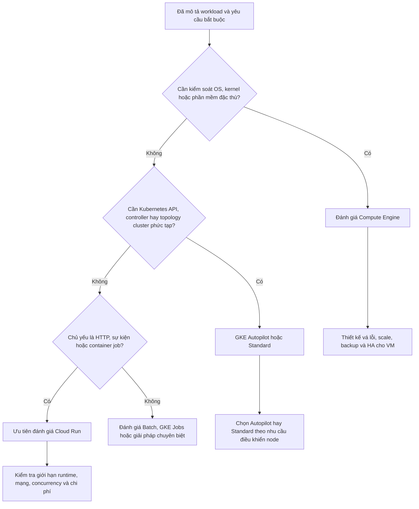
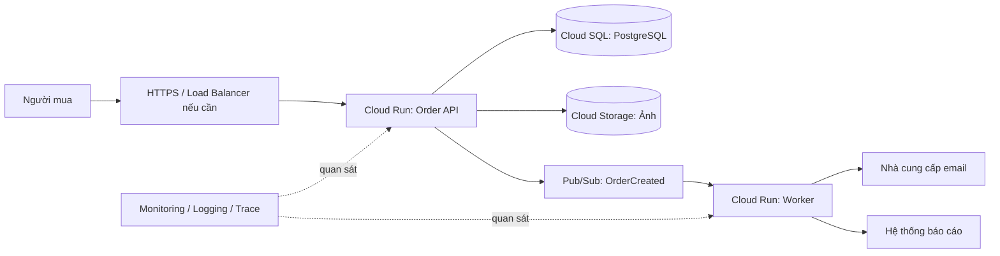

# Tư duy chọn dịch vụ GCP theo yêu cầu hệ thống

Một kiến trúc tốt trên Google Cloud (GCP) không bắt đầu bằng câu hỏi “dịch vụ nào mạnh nhất?” mà bằng câu hỏi “hệ thống cần đạt điều gì, chịu những ràng buộc nào và đội ngũ có thể vận hành đến đâu?”. Cùng một ứng dụng có thể chạy bằng Compute Engine, Google Kubernetes Engine (GKE) hoặc Cloud Run; lựa chọn hợp lý phụ thuộc vào đặc tính tải, mức kiểm soát cần thiết, kỹ năng vận hành và tổng chi phí.

Bài học thuộc module `CLOUD_PROVIDERS_GCP`. Những quyết định dưới đây kết nối kiến thức về tổ chức/project, IAM, VPC, Compute Engine, GKE, Cloud Run, lưu trữ, cơ sở dữ liệu, tự động hóa phát hành, giám sát độ tin cậy và chi phí thành một quy trình lựa chọn dịch vụ có thể giải thích và kiểm chứng.

## 1. Đổi góc nhìn: từ tên dịch vụ sang yêu cầu

Trước khi mở danh mục sản phẩm, hãy mô tả **workload** (đơn vị công việc mà hệ thống thực hiện) và **ràng buộc** của nó. Một API nhận đơn hàng, một tác vụ xử lý ảnh, một pipeline phân tích dữ liệu và một ứng dụng kế thừa chạy trên Windows có nhu cầu rất khác nhau, dù đều được gọi là “backend”.

### Sáu nhóm câu hỏi cần trả lời

| Nhóm | Câu hỏi cần làm rõ | Ví dụ câu trả lời có thể kiểm chứng |
| --- | --- | --- |
| Chức năng và kiểu tải | Nhận request đồng bộ, xử lý sự kiện, chạy theo lịch hay xử lý dữ liệu lớn? | API HTTPS, tác vụ bất đồng bộ sau khi tạo đơn, báo cáo hằng đêm |
| Quy mô và biến động | Tải trung bình/đỉnh, thời gian tác vụ, tỷ lệ tăng trưởng, mức song song? | Bình thường 40 request/giây, đỉnh gấp 8 lần trong 15 phút |
| Dữ liệu | Quan hệ hay tài liệu, cần transaction nào, truy vấn gì, dung lượng và vòng đời bao lâu? | Đơn hàng cần transaction SQL; ảnh là object; báo cáo tổng hợp theo ngày |
| Độ tin cậy | SLO độ sẵn sàng/độ trễ, RTO và RPO, mức chịu lỗi theo zone/region? | SLO 99,9%/tháng; p95 API dưới 400 ms; RPO tối đa 15 phút |
| Bảo mật và địa lý | Ai được truy cập, dữ liệu đặt ở đâu, kết nối riêng hay công khai, yêu cầu audit? | Dịch vụ nội bộ dùng IAM; dữ liệu phải nằm trong vùng được phê duyệt |
| Vận hành và chi phí | Kỹ năng SRE, thời gian phát hành, ngân sách, chi phí cố định/biến đổi? | Nhóm nhỏ, muốn deploy liên tục và giảm quản trị máy chủ |

Các con số trên chỉ là ví dụ yêu cầu, **không phải cam kết mặc định** của bất kỳ dịch vụ nào. Cần phân biệt:

- **Yêu cầu bắt buộc:** ví dụ residency, giao thức đặc thù, hệ điều hành bắt buộc, giới hạn RPO/RTO. Phương án không đáp ứng phải bị loại trước khi chấm điểm.
- **Mục tiêu có thể tối ưu:** ví dụ chi phí thấp hơn, mở rộng nhanh hơn, ít công quản trị hơn. Các mục tiêu này được đánh đổi sau khi đã đáp ứng yêu cầu bắt buộc.
- **Giả định cần kiểm chứng:** ví dụ “traffic ít”, “transaction không phức tạp”, “có thể chịu retry”. Ghi thành giả định đo được, không coi là sự thật vĩnh viễn.

## 2. Nhìn kiến trúc qua các lớp trách nhiệm

Thay vì tìm một dịch vụ giải quyết mọi thứ, tách hệ thống thành các lớp. Mỗi lớp trả lời một câu hỏi khác nhau.

| Lớp quyết định | Câu hỏi | Dịch vụ GCP thường cân nhắc |
| --- | --- | --- |
| Tổ chức tài nguyên | Ai sở hữu môi trường, quyền và hóa đơn? | Organization, Folder, Project, Cloud Billing, IAM, Organization Policy |
| Thực thi ứng dụng | Chạy HTTP service, container, VM, job hay cluster? | Cloud Run, GKE, Compute Engine, App Engine, Cloud Run jobs, Batch |
| Dữ liệu nghiệp vụ | SQL transaction, document, object, cache hay phân tích? | Cloud SQL, Spanner, Firestore, Cloud Storage, Memorystore, BigQuery |
| Kết nối và tích hợp | Gọi đồng bộ, giao việc có kiểm soát hay phát sự kiện? | Cloud Load Balancing, Pub/Sub, Cloud Tasks, Eventarc, Workflows |
| Mạng và truy cập | Đường đi của traffic và ranh giới tin cậy ở đâu? | VPC, subnet, firewall, Cloud NAT, Cloud Armor, IAM |
| Vòng đời và vận hành | Build, phát hành, quan sát, khôi phục và quản lý chi phí thế nào? | Cloud Build, Artifact Registry, Cloud Deploy, Cloud Monitoring, Cloud Logging, Cloud Trace, Billing budgets |

**Nguyên tắc:** Chọn dịch vụ từ hành vi hệ thống mong muốn, rồi kiểm tra ràng buộc của sản phẩm như region hỗ trợ, quota, giới hạn kết nối, khả năng backup và mô hình tính phí. Danh sách dịch vụ chỉ giúp tạo tập phương án; nó không thay thế quyết định kiến trúc.

## 3. Quyết định nơi chạy ứng dụng

### 3.1. Bắt đầu với mức quản trị thấp nhất đáp ứng yêu cầu



| Lựa chọn | Thích hợp khi | Đánh đổi cần chấp nhận hoặc kiểm tra |
| --- | --- | --- |
| **Cloud Run services** | API HTTP/gRPC, webhook, dịch vụ container có thể scale theo traffic; nhóm muốn tập trung vào code | Runtime có thể được tạo/hủy linh hoạt; trạng thái lâu dài phải nằm ngoài instance. Kiểm tra giới hạn request, concurrency, cold start, kết nối DB và cấu hình min instances. |
| **Cloud Run jobs** | Batch hữu hạn có điểm bắt đầu/kết thúc, tác vụ chạy theo lịch hoặc được kích hoạt | Không phải web server tiếp nhận request liên tục; cần thiết kế retry, giới hạn thời gian, kết quả và khả năng chạy lặp. |
| **GKE Autopilot** | Nhiều workload container, cần Kubernetes objects/API và bớt quản trị node | Cần hiểu vận hành Kubernetes; kiểm tra hạn chế/cấu hình tài nguyên và tổng chi phí. |
| **GKE Standard** | Cần quyền kiểm soát node pool, máy chuyên dụng, cấu hình cluster sâu | Tăng trách nhiệm nâng cấp, bảo mật, capacity và vận hành cluster. |
| **Compute Engine** | Phần mềm kế thừa, OS hoặc agent đặc thù, VM tùy biến, cấu hình không phù hợp mô hình managed | Tự xử lý image, patch, cấu hình instance, autoscaling, backup và nhiều thành phần HA. |
| **App Engine** | Ứng dụng phù hợp runtime và mô hình triển khai của App Engine, nhất là hệ thống đã sử dụng | Cần xác minh giới hạn runtime, cách scale và đường phát triển lâu dài trước khi chọn cho hệ thống mới. |

Cloud Run functions (tên mới của thế hệ chức năng dựa trên Cloud Run) đáng cân nhắc cho đoạn xử lý sự kiện nhỏ và độc lập. Nếu đã có một ứng dụng container hóa hoàn chỉnh, Cloud Run services thường cho cách đóng gói nhất quán hơn. Việc “serverless” không làm biến mất giới hạn kết nối, độ trễ hoặc trách nhiệm thiết kế lỗi ứng dụng.

### 3.2. Những câu hỏi tách biệt giữa Cloud Run, GKE và VM

1. Có bắt buộc dùng Kubernetes CRD, operator, DaemonSet hoặc bộ điều khiển tùy biến không? Nếu có, đánh giá GKE.
2. Có cần truy cập OS/kernel, một license ràng buộc VM hoặc phần mềm chưa thể container hóa không? Nếu có, đánh giá Compute Engine.
3. Workload có thể xử lý request/job một cách độc lập, giữ trạng thái trong database/object store và chấp nhận instance được thay thế không? Nếu có, Cloud Run là ứng viên mạnh.
4. Tải nền liên tục hay theo đợt? Tính giá trên profile thực tế: request, vCPU/RAM, số instance tối thiểu, tài nguyên cluster/VM, thời gian nhàn rỗi và chi phí mạng.
5. Đội ngũ có khả năng trực cluster 24/7 không? Độ phức tạp vận hành là chi phí kỹ thuật thực tế, kể cả khi phí hạ tầng nhìn có vẻ thấp.

Đừng mặc định **microservices = Kubernetes** hay **serverless = luôn rẻ hơn**. Một hệ thống nhỏ hoàn toàn có thể chạy nhiều Cloud Run services; ngược lại workload ổn định với mức sử dụng tài nguyên cao cần được so giá với các lựa chọn đặt trước/công suất ổn định.

## 4. Chọn nơi lưu trữ theo cách dữ liệu được sử dụng

### 4.1. Đặt câu hỏi về thao tác dữ liệu trước loại database

| Nhu cầu chủ đạo | Điểm khởi đầu phù hợp | Khi nào cần xem lại |
| --- | --- | --- |
| Giao dịch SQL, join, constraint, dữ liệu quan hệ | **Cloud SQL** (PostgreSQL/MySQL/SQL Server) | Tăng trưởng vượt giới hạn instance, mô hình phân vùng phức tạp, yêu cầu phân tán lớn hoặc đa khu vực |
| Transaction quan hệ ở quy mô lớn với kiến trúc phân tán | **Spanner** | Nếu khối lượng còn nhỏ, độ phức tạp và chi phí có thể chưa tương xứng |
| Tài liệu JSON, mô hình truy cập theo document, client/web/mobile | **Firestore** | Nếu phần lớn nghiệp vụ cần join phức tạp và báo cáo quan hệ, cần đánh giá lại mô hình dữ liệu |
| File, ảnh, video, bản backup, dữ liệu dạng object | **Cloud Storage** | Nếu ứng dụng cần POSIX shared filesystem hoặc block device, xem Filestore hoặc Persistent Disk/Hyperdisk |
| Phân tích dữ liệu lớn, truy vấn tổng hợp, BI/warehouse | **BigQuery** | Không dùng làm database giao dịch cho từng yêu cầu mua hàng |
| Cache, session ngắn hạn, dữ liệu truy cập cực nhanh | **Memorystore** | Dữ liệu nguồn vẫn phải được lưu bền vững ở hệ thống phù hợp; tính tới cache miss và eviction |

Ba câu hỏi quyết định rất nhiều: **dữ liệu được ghi như thế nào, được đọc như thế nào, cần nhất quán đến mức nào?** Ví dụ, hệ thống đơn hàng thường cần transaction để ghi đơn và dòng hàng cùng nhau; ảnh sản phẩm lưu dạng object; dữ liệu giao dịch được xuất sang BigQuery để phân tích xu hướng. Không nên ép một database làm cả ba vai trò.

Đặc biệt với Cloud SQL, cần kiểm tra số lượng kết nối khi ứng dụng tự động tăng instance, thiết lập connection pooling, backup, point-in-time recovery (nếu cấu hình hỗ trợ) và high availability (HA). **HA không đồng nghĩa với chiến lược disaster recovery (DR):** failover trong region, khôi phục dữ liệu đã bị xóa và phục hồi khi region gặp sự cố là các bài toán khác nhau.

### 4.2. Chọn mô hình giao tiếp giữa các thành phần

| Kiểu giao tiếp | Công cụ phù hợp | Cách suy nghĩ |
| --- | --- | --- |
| Request cần kết quả ngay | HTTPS/gRPC qua Cloud Run, GKE hoặc load balancer | Trả lời đồng bộ; đặt timeout và xử lý lỗi của dịch vụ phụ thuộc |
| Sự kiện cần đến một hoặc nhiều consumer độc lập | **Pub/Sub**; có thể dùng Eventarc để định tuyến sự kiện phù hợp | Producer phát sự kiện, consumer tự xử lý; chấp nhận giao hàng lặp và thiết kế idempotency |
| Giao một nhiệm vụ HTTP cho một worker, cần điều tiết tốc độ/retry | **Cloud Tasks** | Hợp với gửi email, đồng bộ một đơn hoặc gọi API bên ngoài có quota |
| Chuỗi bước có điều kiện, cần orchestration | **Workflows** | Điều phối các lời gọi và xử lý nhánh/lỗi mà không tự dựng orchestrator |
| Kích hoạt theo thời điểm/lịch | **Cloud Scheduler** | Lên lịch kích hoạt Cloud Run job, endpoint hoặc workflow; không thay cho worker |
| Biến đổi, phân tích dữ liệu theo batch/stream lớn | **Dataflow** | Xử lý pipeline dữ liệu; không phải message queue tổng quát |

Pub/Sub thường dùng mô hình giao nhận *at least once*; consumer phải chịu được việc cùng một thông điệp được xử lý nhiều lần. Cloud Tasks cũng có thể retry: **không được coi retry là bằng chứng tác vụ chỉ chạy một lần**. Với thao tác tạo đơn hoặc trừ tiền, dùng khóa idempotency, transaction hoặc ràng buộc duy nhất để ngăn tác dụng phụ trùng.

## 5. Ranh giới tổ chức, mạng và quyền truy cập là một phần của lựa chọn

Lựa chọn Compute hay database mới chỉ giải được “chạy ở đâu”. Còn phải trả lời **ai được sử dụng tài nguyên** và **traffic đi qua những ranh giới nào**.

- **Organization → Folder → Project:** tổ chức quyền quản trị và chính sách; dùng project để tách môi trường, đội nhóm hoặc phạm vi tính phí khi phù hợp. Đặt nhãn (labels), quyền, quota và cảnh báo ngân sách ngay từ đầu.
- **IAM:** cấp quyền tối thiểu cho từng service account theo workload; tránh dùng một danh tính có quyền quá rộng cho mọi dịch vụ. Ưu tiên danh tính gắn với workload/Workload Identity Federation thay cho khóa service account dài hạn.
- **VPC và subnet:** VPC có phạm vi global, subnet có phạm vi regional; thiết kế đường truy cập giữa các workload, database và hệ thống bên ngoài. Kiểm tra firewall và các đường egress thay vì giả định “nằm trong cloud” là tự động riêng tư.
- **Đường vào:** dùng cơ chế xác thực ở lớp ứng dụng/IAM tùy đối tượng gọi; với ứng dụng public có thể cần Application Load Balancer, Cloud Armor và TLS. Không mở public service/database nếu không có lý do nghiệp vụ.
- **Đường ra:** workload trong mạng riêng có thể cần Cloud NAT; Cloud Run có tùy chọn kết nối VPC phù hợp. Phân biệt truy cập API Google với truy cập tài nguyên private và Internet.
- **Secrets và mã hóa:** đặt bí mật trong Secret Manager, quản lý khóa trong Cloud KMS khi có yêu cầu; audit quyền đọc secret và vòng đời rotation. Không nhúng mật khẩu vào image, biến cấu hình commit lên git hoặc file Terraform state công khai.

Các dịch vụ managed vẫn hoạt động theo mô hình **trách nhiệm chia sẻ**: nhà cung cấp vận hành một phần hạ tầng; đội phát triển vẫn chịu trách nhiệm cấu hình IAM, phân loại dữ liệu, mã nguồn, tài khoản, chính sách và giám sát.

## 6. Ví dụ xuyên suốt: nền tảng đặt hàng trực tuyến

### 6.1. Đề bài và quyết định ban đầu

Một nhóm nhỏ triển khai ứng dụng đặt hàng trong một thị trường. Người dùng đăng nhập, tạo đơn, tải ảnh sản phẩm và nhận email xác nhận. API có tải biến thiên theo chiến dịch; dữ liệu đơn cần transaction, báo cáo không cần realtime đến từng giây. Mục tiêu minh họa: SLO 99,9%/tháng, p95 API dưới 400 ms, ít công vận hành và có khả năng phục hồi khi một zone gặp vấn đề.

Phương án ban đầu có thể là:

| Thành phần | Quyết định | Lý do và lưu ý |
| --- | --- | --- |
| API nhận đơn | Cloud Run service chạy container ứng dụng | Scale theo traffic; không cần quản lý cluster. Đặt concurrency và giới hạn instance phù hợp sức chứa database. |
| Dữ liệu đơn hàng | Cloud SQL for PostgreSQL với HA và backup theo RPO | Transaction và ràng buộc dữ liệu; cần kiểm tra pool kết nối, failover và phục hồi thực tế. |
| Ảnh sản phẩm | Cloud Storage | Object bền vững, không lưu trực tiếp trên filesystem tạm của container. Thiết kế quyền upload/download và lifecycle. |
| Sự kiện sau khi đặt đơn | Pub/Sub và một Cloud Run consumer | Tách xử lý email, thống kê khỏi độ trễ trả lời request. Consumer phải idempotent. |
| Gọi dịch vụ gửi email có giới hạn tốc độ | Cloud Tasks (nếu cần điều tiết/retry từng tác vụ) | Có thể dùng thay hoặc bổ sung cho Pub/Sub tùy semantics; không phải cứ có queue là cần cả hai. |
| Bí mật và quyền | IAM service account riêng, Secret Manager | Giảm phạm vi truy cập và quản lý credential tập trung. |
| Vận hành | Cloud Monitoring, Logging, Trace, Cloud Build/Artifact Registry | Đo SLI, phát hiện lỗi và phát hành image có thể truy vết. |



Sơ đồ là **kiến trúc logic để thảo luận**, không phải bản vẽ cấu hình production hoàn chỉnh. Load balancer là lựa chọn tùy yêu cầu về route, bảo mật và tên miền; một Cloud Run service cũng có endpoint HTTPS riêng. Khối “Hệ thống báo cáo” cần được cụ thể hóa (ví dụ export vào BigQuery) khi xác định tần suất cập nhật và truy vấn thực tế.

### 6.2. Một luồng xử lý đáng tin cậy

1. API xác thực người gọi, kiểm tra đầu vào và tạo đơn trong một transaction SQL.
2. API trả kết quả sau khi dữ liệu quan trọng đã commit. Tác vụ phụ như gửi email được thực hiện bất đồng bộ để không kéo dài độ trễ request.
3. Worker nhận thông điệp, kiểm tra khóa nghiệp vụ/idempotency, thực hiện tác vụ và ghi nhận kết quả. Khi gọi bên ngoài lỗi tạm thời, hệ thống retry có giới hạn và cơ chế xử lý thông điệp không thể hoàn tất.
4. Nếu yêu cầu **không được bỏ sót sự kiện sau transaction**, không đơn giản `COMMIT` rồi `publish` vì tiến trình có thể chết giữa hai thao tác. Cân nhắc **transactional outbox**: ghi đơn và bản ghi sự kiện trong cùng transaction; một publisher riêng chuyển sự kiện từ outbox sang Pub/Sub, có retry và cơ chế chống phát trùng tác dụng phụ.

### 6.3. Khi nào phải đổi quyết định?

- Nếu service cần các Kubernetes operator, sidecar hoặc lịch điều phối đặc biệt và đội ngũ chấp nhận vận hành cluster, xem xét chuyển một phần workload sang GKE.
- Nếu ứng dụng là bộ phần mềm kế thừa phụ thuộc môi trường OS/VM, có thể triển khai giai đoạn đầu trên Compute Engine và lập kế hoạch hiện đại hóa sau.
- Nếu database cần transaction quan hệ phân tán với quy mô và phân bố địa lý vượt khả năng thiết kế hiện tại của Cloud SQL, đánh giá Spanner bằng kiểm thử cụ thể.
- Nếu trọng tâm là phân tích hàng terabyte log/giao dịch, dùng BigQuery cho phân tích và giữ database giao dịch cho luồng đặt hàng.

Đó là quyết định theo **yêu cầu thay đổi**, không phải đổi dịch vụ chỉ vì sản phẩm khác mới hơn.

## 7. Độ tin cậy phải thiết kế và đo được

Một dịch vụ managed không tự tạo ra hệ thống có HA. Độ tin cậy đến từ cả thiết kế ứng dụng, dữ liệu, phụ thuộc, giám sát và diễn tập phục hồi.

| Cần bảo đảm | Việc phải quyết định | Cách kiểm chứng |
| --- | --- | --- |
| Độ sẵn sàng | SLO và error budget; phân biệt lỗi ứng dụng với lỗi phụ thuộc | Dashboard tỷ lệ request thành công theo cửa sổ đo đã chọn |
| Độ trễ | p50/p95/p99 và giới hạn timeout theo từng đường gọi | Load test khi traffic đỉnh; theo dõi latency và saturation |
| Khả năng chịu lỗi | Retry có backoff, timeout, circuit breaker khi phù hợp, idempotency | Chaos/failure test trên consumer và API phụ thuộc |
| Phục hồi dữ liệu | Backup, PITR nếu có, RPO, RTO và nơi lưu backup | Diễn tập restore vào môi trường kiểm chứng, đo thời gian và mất dữ liệu |
| Sự cố zone/region | HA theo zone, multi-region nếu thật sự cần | Diễn tập failover và xác nhận giới hạn thực tế của từng dịch vụ |
| Quan sát hệ thống | Log có cấu trúc, metric, trace, alert theo SLI | Alert có owner và runbook; xác nhận tín hiệu đủ để chẩn đoán |

Một hệ thống có hai instance nhưng cùng phụ thuộc một database thiếu HA vẫn có điểm lỗi tập trung. Ngược lại, thiết kế multi-region từ đầu có thể làm tăng chi phí, độ phức tạp dữ liệu và rủi ro vận hành. Chọn mức dự phòng tương xứng với RTO/RPO và mức thiệt hại thực tế khi gián đoạn.

## 8. Tự động hóa phát hành, chi phí và quota cũng là tiêu chí kiến trúc

### 8.1. Vòng đời triển khai tối thiểu

Một quy trình mẫu: lưu mã nguồn và cấu hình hạ tầng dưới version control → CI chạy kiểm tra cần thiết → build container bằng Cloud Build → lưu image vào Artifact Registry → triển khai bằng Cloud Deploy hoặc pipeline tương ứng → theo dõi metric sau deploy và có phương án rollback. Có thể dùng Terraform để quản lý project resources, IAM, VPC, Cloud Run, database và policy theo cách có thể review.

Không coi một lần deploy thành công là đã sẵn sàng production. Cần phân quyền người/phần mềm có thể phát hành, quản lý secret, kiểm tra migration database, đánh giá backward compatibility và khả năng hoàn tác version.

### 8.2. So sánh tổng chi phí, không chỉ giá niêm yết

| Loại chi phí | Ví dụ nguồn phát sinh | Câu hỏi cần đo |
| --- | --- | --- |
| Compute | vCPU, RAM, thời gian chạy, min instances, node/VM nhàn rỗi | Traffic và mức sử dụng thay đổi theo giờ như thế nào? |
| Dữ liệu | Dung lượng, backup, replication, truy vấn hoặc dung lượng quét | Đọc/ghi thường xuyên, thời gian lưu, lớp lưu trữ phù hợp? |
| Mạng | Egress ra Internet, truyền giữa region hoặc các dịch vụ tính phí riêng | Có di chuyển dữ liệu lớn giữa các vùng không? |
| Vận hành | Số người trực, nâng cấp, xử lý sự cố, giờ triển khai | Nhóm tự quản cluster/VM được bao nhiêu mà vẫn đạt SLO? |
| Quan sát và hỗ trợ | Log ingestion/retention, metric, trace và các dịch vụ bổ trợ | Có lọc log, retention và ngưỡng cảnh báo phù hợp không? |

Áp dụng một quy trình chi phí có kỷ luật: ước tính bằng Google Cloud Pricing Calculator → chạy benchmark với dữ liệu tương tự production → xem billing thực tế theo project/label → điều chỉnh sizing và retention. **Cloud Billing budgets chủ yếu cảnh báo; không mặc định là công tắc tự ngắt mọi chi tiêu.** Đặt quota phù hợp, cảnh báo ngân sách và kiểm soát quyền tạo tài nguyên.

## 9. Cách chốt lựa chọn mà nhóm khác có thể review

Dùng một bản ghi quyết định kiến trúc (ADR) ngắn cho từng quyết định quan trọng:

```text
Quyết định: Compute cho Order API
Yêu cầu bắt buộc: API HTTPS, transaction SQL, vùng triển khai được duyệt
SLO và tải dự kiến: 99,9%/tháng; p95 < 400 ms; tải đỉnh gấp 8 lần bình thường
Phương án: Cloud Run / GKE Autopilot / Compute Engine
Chọn: Cloud Run (ở giai đoạn đầu)
Vì sao: container HTTP stateless; nhu cầu scale biến thiên; nhóm vận hành nhỏ
Điều kiện để đúng: pool kết nối DB, IAM, scale limits, load test, backup/restore
Rủi ro: cold start, bùng nổ kết nối khi tăng instance, phụ thuộc Cloud SQL
Tín hiệu xem lại: p95/SLO không đạt, chi phí vượt dự toán, cần tính năng cluster
Chủ sở hữu và ngày review: [người chịu trách nhiệm], [thời điểm]
```

Có thể chấm các phương án theo tiêu chí như **đáp ứng bắt buộc, vận hành, chi phí, độ linh hoạt, rủi ro chuyển đổi** với trọng số được nhóm đồng thuận. Đừng dùng điểm tổng để hợp thức hóa phương án vi phạm một ràng buộc bắt buộc; hãy loại phương án đó trước.

### Các sai lầm dễ gặp

1. **Chọn trước rồi mới tìm yêu cầu phù hợp:** tạo kiến trúc phức tạp hơn mức cần thiết.
2. **Dùng một loại dữ liệu cho mọi việc:** lưu file vào SQL hoặc dùng warehouse như cơ sở dữ liệu giao dịch.
3. **Nhầm managed service với miễn vận hành:** bỏ qua cấu hình IAM, backup, quota, metric và trách nhiệm khôi phục.
4. **Chỉ benchmark hiệu năng đơn lẻ:** quên độ trễ mạng, DB connections, throughput khi retry và khả năng chịu lỗi của downstream.
5. **Đánh đồng HA với backup/DR:** vẫn không phục hồi được lỗi xóa dữ liệu, lỗi logic hoặc sự cố cấp region.
6. **Bỏ qua chi phí truyền dữ liệu và hệ thống nhàn rỗi:** dự toán compute thấp nhưng billing thực tế tăng mạnh.
7. **Tự động retry mà không idempotent:** gây đơn hàng hoặc thao tác thanh toán trùng lặp.

## 10. Bài tập áp dụng tư duy

**Tình huống A — API nhận ảnh:** Ứng dụng nhận ảnh từ người dùng, lưu ảnh gốc, tạo thumbnail trong vài giây hoặc phút và trả URL kết quả. Hãy đề xuất dịch vụ nhận HTTP, nơi lưu file và cơ chế chạy tác vụ bất đồng bộ. Nếu có nhiều consumer cùng quan tâm sự kiện upload, lựa chọn có thay đổi không?

**Tình huống B — Hệ thống kế thừa:** Công cụ kế toán nội bộ buộc chạy trên một phiên bản Windows được nhà cung cấp hỗ trợ, tải đều và ít thay đổi. Cloud Run, GKE hay Compute Engine là phương án cần đánh giá đầu tiên? Cần bổ sung những việc vận hành/bảo mật nào?

**Tình huống C — Phân tích đơn hàng:** Doanh nghiệp có database giao dịch SQL và muốn phân tích vài năm lịch sử giao dịch bằng truy vấn tổng hợp lớn. Có nên chạy các báo cáo nặng trực tiếp trên database giao dịch không? Đề xuất luồng đưa dữ liệu sang nơi phân tích và cân nhắc tính mới của dữ liệu.

Khi tự trả lời, hãy ghi rõ **yêu cầu → dịch vụ ứng viên → rủi ro/đánh đổi → phép đo kiểm chứng**. Đây là cách tư duy có thể tái sử dụng ngay cả khi danh mục dịch vụ GCP thay đổi.
