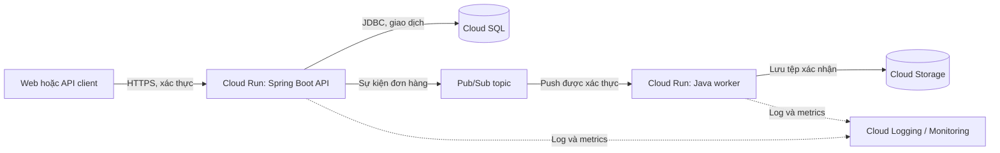

# Lộ trình học GCP dành cho lập trình viên Java

## 1. Vì sao lập trình viên Java nên học Google Cloud?

Một ứng dụng Java chạy tốt trên máy cá nhân mới giải quyết được phần viết mã. Khi triển khai cho người dùng thật, nhóm phát triển còn phải trả lời: ứng dụng chạy ở đâu, ai được phép gọi API, dữ liệu lưu ở đâu, thay đổi phiên bản thế nào, làm sao xử lý tải tăng đột biến, phát hiện sự cố và kiểm soát chi phí?

**Google Cloud Platform (GCP)** cung cấp các dịch vụ để giải quyết những bài toán đó. Với một ứng dụng Spring Boot, lập trình viên có thể bắt đầu bằng **Cloud Run** để chạy API, **Cloud SQL** để lưu dữ liệu quan hệ, **Cloud Storage** để chứa tệp, **Pub/Sub** để trao đổi sự kiện, sau đó dùng **Cloud Build**, **Artifact Registry**, **Cloud Monitoring** và **Cloud Logging** để vận hành ứng dụng theo quy trình.

Bài học này đưa ra một lộ trình từ nền tảng GCP đến triển khai hệ thống Java có tính bảo mật, khả năng mở rộng và theo dõi chi phí. Trọng tâm là **hiểu lúc nào nên chọn dịch vụ nào** và **có thể tự triển khai, kiểm tra, vận hành** một ứng dụng Java; không yêu cầu học tất cả dịch vụ GCP trước khi làm dự án đầu tiên.

### Kết quả học tập

Sau khi hoàn thành lộ trình, người học có thể:

1. Tổ chức tài nguyên theo **organization, folder, project**, hiểu **region, zone, billing, quota** và quyền IAM.
2. Phân biệt **Cloud Run, Compute Engine, GKE** và chọn mô hình chạy phù hợp với ứng dụng Java.
3. Kết nối Spring Boot với **Cloud SQL, Cloud Storage, Firestore** hoặc **Pub/Sub** theo đặc điểm dữ liệu và luồng xử lý.
4. Sử dụng **service account** và **Application Default Credentials (ADC)**, quản lý secret và giới hạn truy cập mạng.
5. Xây dựng quy trình **build → kiểm thử → phát hành → theo dõi → khôi phục**, có cấu hình hạ tầng có thể tái tạo.
6. Đánh giá hệ thống qua **độ tin cậy, bảo mật, hiệu năng và chi phí** thay vì chỉ kiểm tra API có trả về HTTP 200 hay không.

## 2. Kiến thức đầu vào và môi trường thực hành

Nên biết Java, Maven hoặc Gradle, REST/HTTP, JSON, Git, SQL căn bản và cách Spring Boot khởi động. Biết Docker, Linux và mạng TCP/IP sẽ giúp học nhanh hơn, nhưng có thể bổ sung song song.

Chuẩn bị:

- Một **Google Cloud project** dùng riêng cho học tập, có **billing** nếu các bài thực hành cần dịch vụ tính phí; nên đặt **budget và cảnh báo** trước khi tạo tài nguyên. Budget là cơ chế theo dõi/cảnh báo, **không tự động giới hạn hoặc ngắt mọi chi phí**.
- Quyền phù hợp để bật API, tạo tài nguyên và gán service account trong project thử nghiệm. Nếu thuộc tổ chức, chính sách của tổ chức có thể giới hạn thao tác.
- JDK được Spring Boot đang sử dụng hỗ trợ (ví dụ **Java 21 LTS**), Maven/Gradle, Git, Google Cloud CLI (**`gcloud`**) và một IDE.
- Một ứng dụng Spring Boot nhỏ, có endpoint kiểm tra sức khỏe, ít nhất một bài test và cấu hình qua biến môi trường.

**Nguyên tắc thực hành:** tách project học tập khỏi môi trường thật; đặt tên tài nguyên rõ ràng; chọn region gần người dùng và phù hợp yêu cầu lưu trữ dữ liệu; gỡ tài nguyên không còn dùng sau mỗi bài.

## 3. Bản đồ khái niệm GCP cần nắm

### 3.1. Tổ chức tài nguyên và quyền

Hệ thống phân cấp thường gặp là **organization → folder → project → resource**. Project là ranh giới thực tế để bật API, quản lý nhiều tài nguyên, liên kết billing, theo dõi quota và gán quyền. Region là khu vực địa lý triển khai; zone là vị trí triển khai độc lập trong một region (khái niệm dùng nhiều với máy ảo và cụm).

**IAM** trả lời ba câu hỏi: *ai* (principal), *được làm gì* (role/permission) và *trên tài nguyên nào* (resource). Cần phân biệt:

- **Danh tính người phát triển**: dùng để truy cập môi trường thử nghiệm theo quyền được cấp.
- **Danh tính phát hành**: được phép build, đưa artifact lên registry và triển khai phiên bản.
- **Danh tính ứng dụng lúc chạy (runtime service account)**: chỉ được phép đọc/ghi những dịch vụ thực sự cần.

Không nhúng khóa service account vào mã nguồn hay image. Khi chạy trên GCP, ưu tiên gắn **service account** cho workload; khi phát triển trên máy cá nhân, thư viện Google Cloud có thể lấy thông tin xác thực qua **ADC**. Việc có danh tính hợp lệ **không đồng nghĩa** danh tính đó đã có quyền truy cập tài nguyên.

### 3.2. Mạng và đường đi của yêu cầu

**VPC** là mạng riêng logic; subnet của VPC thuộc một region. Học các thành phần theo thứ tự: địa chỉ IP, subnet và route → firewall → ingress/egress → kết nối dịch vụ và kết nối từ môi trường riêng → DNS/load balancing khi thật sự cần.

Với Cloud Run, cần tách hai vấn đề: **ai có quyền gọi dịch vụ** (authentication/authorization, IAM hoặc cơ chế bảo vệ API thích hợp) và **đường mạng nào được phép tiếp cận dịch vụ** (ingress). Nếu ứng dụng gọi tài nguyên nội bộ trong VPC, nghiên cứu **Direct VPC egress** hoặc **Serverless VPC Access** theo kiến trúc hiện tại; không mặc định mọi truy cập từ Cloud Run đều đi qua VPC.

### 3.3. Chọn nơi chạy ứng dụng Java

| Nhu cầu | Lựa chọn khởi đầu | Khi nào cân nhắc |
| --- | --- | --- |
| REST API Spring Boot, webhook, xử lý HTTP, container không lưu trạng thái | **Cloud Run** | Muốn tập trung viết mã, triển khai đơn giản, co giãn theo tải |
| Tác vụ chạy một lần hoặc theo lịch, không phục vụ HTTP liên tục | **Cloud Run Jobs** kết hợp lịch/kích hoạt phù hợp | Batch, import dữ liệu, tác vụ bảo trì |
| Kiểm soát hệ điều hành, tiến trình, môi trường VM hoặc phần mềm cũ | **Compute Engine** | Cần quản lý máy ảo và cấu hình hệ thống sâu hơn |
| Nhiều service trên Kubernetes, có yêu cầu orchestration và vận hành cluster | **Google Kubernetes Engine (GKE)** | Đội ngũ có năng lực Kubernetes, cần các khả năng cluster cụ thể |

**Gợi ý:** bắt đầu với Cloud Run cho Spring Boot thuần HTTP; chuyển sang Compute Engine hoặc GKE khi có **yêu cầu kỹ thuật xác định**, không chỉ vì hệ thống nhiều người dùng. Ở mọi mô hình, phải kiểm tra cấu hình CPU, bộ nhớ, số instance, thời gian chờ, network và cách ứng dụng dừng an toàn.

### 3.4. Chọn nơi lưu dữ liệu

| Dạng dữ liệu hoặc bài toán | Dịch vụ | Điều cần học cùng dịch vụ |
| --- | --- | --- |
| Giao dịch, bảng, khóa ngoại, truy vấn SQL | **Cloud SQL** (PostgreSQL/MySQL/SQL Server theo nhu cầu) | Connection pooling, migration, backup, HA, kết nối bảo mật |
| Tài liệu/đối tượng dạng NoSQL, truy xuất theo khóa và truy vấn phù hợp mô hình document | **Firestore** | Thiết kế collection/document, index, transaction, chi phí theo thao tác |
| Hình ảnh, tệp đính kèm, bản xuất báo cáo, dữ liệu dạng object | **Cloud Storage** | Bucket, object, IAM, lifecycle, lớp lưu trữ, signed URL |
| Phân tích trên dữ liệu lớn, truy vấn báo cáo | **BigQuery** | Dataset/table, phân vùng, chi phí lưu trữ và truy vấn |
| Cache truy cập nhanh | **Memorystore** | TTL, tính nhất quán, xử lý cache miss và độ sẵn sàng |

Không sử dụng object storage như cơ sở dữ liệu giao dịch, và không chọn BigQuery cho mọi truy vấn OLTP của ứng dụng.

## 4. Lộ trình đề xuất: 8 giai đoạn

Thời lượng dưới đây mang tính tham khảo cho người học **5–8 giờ/tuần**; có thể học nhanh hơn nếu đã quen DevOps. Mỗi giai đoạn đều cần một **sản phẩm kiểm chứng được**.

| Giai đoạn | Thời lượng gợi ý | Trọng tâm | Sản phẩm sau khi học |
| --- | --- | --- | --- |
| 1. Nền tảng cloud | Tuần 1 | Project, region, billing, API, CLI, quota | Project học tập, budget, danh sách tài nguyên |
| 2. IAM và VPC | Tuần 2 | Principal, role, service account, mạng, ingress/egress | Sơ đồ quyền và mạng tối thiểu |
| 3. Chạy Spring Boot | Tuần 3 | Container, Cloud Run; so sánh Compute Engine/GKE | API Java truy cập được bằng cơ chế xác thực đã chọn |
| 4. Dữ liệu | Tuần 4–5 | Cloud SQL, Storage, Firestore; migration | API lưu dữ liệu và tệp, có test lỗi kết nối |
| 5. Bất đồng bộ | Tuần 6 | Pub/Sub, retry, idempotency, dead-letter | Producer/consumer xử lý sự kiện an toàn |
| 6. Tự động hóa phát hành | Tuần 7 | Cloud Build, Artifact Registry, IaC, rollout | Pipeline tạo và phát hành phiên bản |
| 7. Vận hành | Tuần 8 | Logging, Monitoring, Trace, IAM, secrets, chi phí | Dashboard, alert, runbook, báo cáo chi phí |
| 8. Dự án tổng hợp | Tuần 9–10 (tùy chọn) | Ghép thành hệ thống nhỏ hoàn chỉnh | Demo, sơ đồ kiến trúc, tài liệu vận hành |

### Giai đoạn 1 — Nền tảng Google Cloud

**Cần hiểu:** một ứng dụng có thể dùng nhiều service nhưng chúng được quản lý theo project; từng API có thể cần kích hoạt trước khi sử dụng; billing và quota ảnh hưởng trực tiếp đến khả năng chạy thử. Học cách đọc trang **APIs & Services**, **IAM**, **Billing**, **Quotas** và **Cloud Asset Inventory** trong Console.

**Bài thực hành:**

1. Tạo/chọn project học tập, liên kết billing theo quyền được cấp.
2. Chọn region mặc định theo vị trí người dùng và yêu cầu dữ liệu, ví dụ `asia-southeast1` (Singapore); phân biệt rõ region này với zone.
3. Đặt budget/cảnh báo chi phí, dùng nhãn (labels) cho tài nguyên và ghi lại nơi xem chi phí.
4. Cài `gcloud`, đăng nhập với tài khoản có quyền phù hợp, chọn project bằng `gcloud config set project YOUR_PROJECT_ID`.

**Đạt yêu cầu khi:** giải thích được project khác organization ra sao, region khác zone ra sao, và chỉ ra được nơi tìm hóa đơn/quota khi một thao tác thất bại.

### Giai đoạn 2 — IAM, service account và VPC

**Cần hiểu:** nguyên tắc **least privilege** (chỉ cấp quyền cần dùng), kế thừa quyền trên hệ thống phân cấp tài nguyên, vai trò của runtime service account, IAM cho Cloud Run và Cloud Storage. Với mạng, phân biệt yêu cầu đi **vào** service và các kết nối service **đi ra**.

**Bài thực hành:** tạo một runtime service account dành cho ứng dụng học tập, gán quyền sử dụng đúng bucket hoặc dịch vụ dữ liệu cần thiết theo phạm vi nhỏ nhất có thể. Vẽ đường đi `client → Cloud Run → Cloud SQL/Cloud Storage`, đánh dấu điểm cần xác thực và đường mạng. Kiểm tra hành vi khi **thiếu quyền** (403) và khi **không kết nối được** (timeout); đó là hai lớp lỗi khác nhau.

**Đạt yêu cầu khi:** không cần lưu JSON key trong repository, biết nơi gắn service account cho workload và có thể giải thích lý do một request bị từ chối.

### Giai đoạn 3 — Đóng gói và triển khai Spring Boot

**Cần hiểu:** Cloud Run chạy một **revision** của ứng dụng container, hỗ trợ cấu hình môi trường, co giãn instance, timeout và concurrency; ứng dụng cần lắng nghe trên cổng được nền tảng cung cấp và không phụ thuộc vào trạng thái lưu trên filesystem cục bộ giữa các request.

**Bài thực hành:**

1. Viết API Spring Boot với `GET /hello` và endpoint health riêng.
2. Chạy test và chạy ứng dụng tại máy cá nhân.
3. Build bằng cơ chế phù hợp (source deployment/buildpacks hoặc Dockerfile); đưa lên Cloud Run.
4. Đọc log của revision; thay đổi câu trả lời API, phát hành bản mới và thử cách quay lại bản ổn định.
5. Thử tăng số request đồng thời, theo dõi latency, memory và số instance để hiểu cấu hình co giãn.

Ví dụ mã nguồn tối giản trong dự án Spring Boot có dependency web:

```java
package dev.example.gcp;

import java.util.Map;
import org.springframework.boot.SpringApplication;
import org.springframework.boot.autoconfigure.SpringBootApplication;
import org.springframework.web.bind.annotation.GetMapping;
import org.springframework.web.bind.annotation.RestController;

@SpringBootApplication
public class DemoApplication {
    public static void main(String[] args) {
        SpringApplication.run(DemoApplication.class, args);
    }
}

@RestController
class HelloController {
    @GetMapping("/hello")
    public Map<String, String> hello() {
        return Map.of("message", "Hello from Java on Google Cloud");
    }
}
```

Từ thư mục gốc của dự án đã build/test thành công, một luồng triển khai minh họa là:

```shell
gcloud config set project YOUR_PROJECT_ID
gcloud services enable run.googleapis.com cloudbuild.googleapis.com artifactregistry.googleapis.com
gcloud run deploy java-learning-api --source . --region asia-southeast1 --no-allow-unauthenticated
gcloud run services describe java-learning-api --region asia-southeast1 --format="value(status.url)"
```

Các lệnh yêu cầu project có billing và quyền tương ứng; quyền build/deploy cũng phụ thuộc chính sách tổ chức. Ở ví dụ này, service **yêu cầu xác thực**, vì vậy mở URL bằng trình duyệt thông thường có thể nhận 403. Có thể kiểm tra qua chức năng test được xác thực trong Console hoặc bằng client gửi **identity token** của principal có quyền gọi Cloud Run. Nếu dùng Dockerfile, bảo đảm ứng dụng lắng nghe trên biến môi trường `PORT`; với Spring Boot thường dùng `server.port=${PORT:8080}` trong cấu hình.

**Đạt yêu cầu khi:** giải thích được quá trình source → image → revision → endpoint, đọc được log và thực hiện được một lần quay lại phiên bản cũ.

### Giai đoạn 4 — Kết nối dữ liệu cho Java

**Cloud SQL:** bắt đầu với PostgreSQL và Spring Data JPA/JDBC nếu đã quen SQL. Dùng migration bằng Flyway hoặc Liquibase; thiết lập connection pool (ví dụ HikariCP) phù hợp tổng số instance và giới hạn kết nối của DB. Khi triển khai Cloud Run, nghiên cứu **Cloud SQL Java Connector** hoặc phương án kết nối được GCP hỗ trợ, cùng IAM, network, TLS và cách dùng secret. Không đẩy username/password vào Git.

**Cloud Storage:** dùng khi ứng dụng quản lý tệp. Java có client library chính thức; SDK có thể tự tìm ADC, còn quyền cụ thể được kiểm soát qua IAM.

```java
import com.google.cloud.storage.BlobId;
import com.google.cloud.storage.BlobInfo;
import com.google.cloud.storage.Storage;
import com.google.cloud.storage.StorageOptions;

public class FileStore {
    private final Storage storage =
            StorageOptions.getDefaultInstance().getService();

    public void upload(String bucket, String objectName, byte[] data) {
        BlobInfo blob = BlobInfo.newBuilder(BlobId.of(bucket, objectName)).build();
        storage.create(blob, data);
    }
}
```

Ví dụ yêu cầu thêm dependency `google-cloud-storage` theo cách quản lý phiên bản của dự án và cấp quyền ghi **đúng bucket** cho runtime service account. Khi làm API thật, cần kiểm tra kích thước/loại tệp, tên object, quyền truy cập và vòng đời dữ liệu. Đừng dùng file cục bộ của container làm nơi lưu dữ liệu bền vững.

**Firestore:** làm một bài nhỏ để so sánh cách truy vấn document với SQL. Kiểm tra index, cách mô hình hóa dữ liệu, tính nhất quán cần thiết và chi phí theo số lần đọc/ghi.

**Bài thực hành:** xây `POST /documents` để lưu metadata vào Cloud SQL và tệp vào Cloud Storage; bổ sung kiểm tra input, xử lý rollback hoặc bù trừ khi một bước thất bại, cùng test quyền truy cập.

**Đạt yêu cầu khi:** chọn được kho dữ liệu theo mô hình truy vấn, hiểu kết nối bảo mật, và có phương án cho dữ liệu khi instance ứng dụng bị thay thế.

### Giai đoạn 5 — Giao tiếp bất đồng bộ với Pub/Sub

**Cần hiểu:** publisher đưa message vào **topic**; subscriber nhận qua **subscription**. Delivery có thể lặp lại, nên handler cần **idempotent** (xử lý lặp không gây tác dụng phụ sai). Nắm **acknowledgment, retry, ordering khi cần, dead-letter topic**, và ý nghĩa của việc xử lý thất bại giữa chừng.

Với Java, dùng Pub/Sub client library để xuất bản message sau khi thay đổi nghiệp vụ. Bên nhận có thể là một Cloud Run service với **authenticated push subscription** hoặc một kiến trúc xử lý sự kiện phù hợp. Ghi `eventId` và `schemaVersion` trong payload/attributes để hỗ trợ chống xử lý trùng và tiến hóa schema.

**Bài thực hành:** `POST /orders` tạo đơn hàng, phát sự kiện `order.created`; worker ghi một bản xác nhận hoặc cập nhật trạng thái. Cố tình gửi lại cùng event để kiểm tra tính idempotent; mô phỏng lỗi tạm thời để quan sát retry và dead-letter.

**Đạt yêu cầu khi:** có thể giải thích vì sao “message được gửi thành công” chưa chứng minh được nghiệp vụ đã xử lý xong và đưa ra chiến lược tránh mất sự kiện giữa DB transaction và publish (ví dụ **transactional outbox** khi cần đảm bảo mạnh).

### Giai đoạn 6 — CI/CD và hạ tầng có thể tái tạo

**Cần hiểu:** tách **build** với **deploy**, lưu image trong **Artifact Registry**, chạy kiểm thử trước khi phát hành, quản lý quyền của build/deploy identity và runtime identity riêng nhau. Học **Cloud Build** cho pipeline và **Cloud Deploy** khi cần quy trình phát hành qua nhiều môi trường/phê duyệt.

**Bài thực hành:**

1. Pipeline chạy unit test → build ứng dụng/image → lưu image trong registry.
2. Triển khai image vào Cloud Run môi trường thử nghiệm; kiểm tra endpoint và log sau deploy.
3. Dùng **Terraform** hoặc công cụ IaC phù hợp để mô tả ít nhất service account, Cloud Run service, quyền và các tài nguyên liên quan; tách biến cấu hình giữa môi trường.
4. Thử rollback phiên bản/traffic, ghi lại điều kiện quyết định rollback.

**Đạt yêu cầu khi:** một người khác có thể dùng tài liệu, cấu hình và quyền được cấp để dựng lại môi trường mà không cần chép tay hàng chục thiết lập trong Console.

### Giai đoạn 7 — Bảo mật, quan sát và tối ưu chi phí

**Quan sát:** ghi log có cấu trúc, request ID/correlation ID, mức severity thích hợp; xem **Cloud Logging**, dựng dashboard trên **Cloud Monitoring**, dùng **Cloud Trace** hoặc OpenTelemetry cho các đường gọi quan trọng. Đặt alert về tỷ lệ lỗi, độ trễ và mức dùng tài nguyên. Xây **SLI/SLO** đơn giản, ví dụ tỷ lệ request thành công và p95 latency.

**Bảo mật:** quản lý mật khẩu/secret trong **Secret Manager**, chọn quyền IAM tối thiểu, kiểm tra ingress và quyền gọi Cloud Run, cập nhật dependency Java, giới hạn quyền truy cập DB/bucket và ghi nhận hoạt động quan trọng qua audit logs khi cần. Không ghi secret hoặc dữ liệu nhạy cảm vào log.

**Hiệu năng Java:** chú ý thời gian khởi động JVM, kích thước heap, GC, concurrency của Cloud Run, số kết nối DB tối đa theo số instance, timeout, retry có giới hạn và grace period khi service dừng. Việc tăng concurrency có thể giảm số instance nhưng tăng tranh chấp bộ nhớ/kết nối; cần đo thay vì đoán.

**Chi phí:** theo dõi CPU/memory/thời gian chạy và số instance của Cloud Run, chi phí Cloud SQL ngay cả khi ít truy cập, dung lượng và request Cloud Storage, Pub/Sub, log, network egress và artifact còn tồn tại. Dùng budget, labels và báo cáo Billing để tìm chi phí bất thường; xóa môi trường thử nghiệm khi không dùng nữa.

**Bài thực hành:** tạo dashboard cho API, alert khi tăng tỷ lệ lỗi, thử gây một lỗi có chủ đích và tra ngược từ request ID đến log/traces. Ghi một bản runbook gồm dấu hiệu, cách xác nhận, cách khôi phục và cách kiểm tra chi phí.

**Đạt yêu cầu khi:** giải thích được sự cố dựa trên số liệu và có thao tác xử lý/rollback rõ ràng.

### Giai đoạn 8 — Dự án tổng hợp: Order Service trên GCP

Đề xuất làm một hệ thống nhỏ đủ thể hiện luồng đồng bộ lẫn bất đồng bộ:



**Yêu cầu chức năng:**

- `POST /orders` tạo đơn hàng và trả về mã đơn; `GET /orders/{id}` truy xuất trạng thái.
- Đơn hàng nằm trong Cloud SQL; message xử lý đơn đi qua Pub/Sub; worker xử lý lặp an toàn.
- Worker tạo một object trong Cloud Storage; API hoặc người dùng chỉ đọc object theo quyền được cấp.
- Có đường xử lý lỗi, retry, dead-letter và một cách đối soát trạng thái đơn hàng.

**Yêu cầu vận hành:** dùng service account riêng cho API và worker; secret được quản lý phù hợp; có pipeline phát hành, migration, test, dashboard, alert, budget và chỉ dẫn rollback. Mọi tài nguyên phải có cách xóa sau khi kết thúc bài học.

Tài liệu bàn giao nên gồm **sơ đồ kiến trúc**, lý do chọn dịch vụ, bảng IAM (principal → role → resource), sơ đồ request/data flow, các bước triển khai, kết quả kiểm thử, chỉ số vận hành và ước lượng nguồn phát sinh chi phí. Có thể thực hiện phiên bản tối giản với chỉ Cloud Run + Cloud SQL, rồi bổ sung Pub/Sub và Storage để tránh mở rộng phạm vi quá sớm.

## 5. Cách lựa chọn dịch vụ khi gặp bài toán thực tế

Đừng bắt đầu bằng danh sách sản phẩm. Hãy đi từ thuộc tính nghiệp vụ, rồi chọn mô hình chạy, dữ liệu và cách vận hành:

| Câu hỏi thiết kế | Dấu hiệu cần xem xét | Hướng xử lý ban đầu |
| --- | --- | --- |
| API cần xử lý request HTTP và co giãn khi có tải? | Stateless, không cần quản lý máy/cluster | Spring Boot trên Cloud Run |
| Ứng dụng phải kiểm soát OS, daemon hoặc môi trường đặc thù? | Cần quyền hệ thống hay tài nguyên VM | Đánh giá Compute Engine |
| Có nhiều workload cần orchestration theo Kubernetes? | Yêu cầu K8s và có năng lực vận hành cluster | Đánh giá GKE |
| Dữ liệu cần ACID, quan hệ và truy vấn SQL? | Giao dịch, join, schema rõ | Cloud SQL |
| Có hình ảnh, báo cáo, tệp lớn? | Object bất biến hoặc thay thế theo phiên bản | Cloud Storage |
| Tác vụ lâu hoặc cần tách vòng đời xử lý? | Không cần trả kết quả ngay cho HTTP caller | Pub/Sub + worker hoặc Cloud Run Jobs theo dạng tác vụ |
| Cần giám sát và chẩn đoán sự cố? | Lỗi phân tán, latency dao động | Logging + Monitoring + tracing |
| Cần phát hành đều đặn và khôi phục? | Nhiều phiên bản/môi trường | CI/CD + versioned artifacts + IaC |

Ví dụ: “Người dùng tải hóa đơn và nhận email xác nhận”. Endpoint Java có thể lưu metadata vào Cloud SQL, lưu file lên Cloud Storage, phát sự kiện qua Pub/Sub để worker thực hiện bước tiếp theo. Không nên giữ request HTTP đang mở trong lúc chờ toàn bộ tác vụ bên ngoài hoàn tất.

## 6. Những lỗi thường gặp của lập trình viên Java mới lên GCP

1. **Cấp quyền quá rộng:** dùng Owner/Editor cho runtime service account khiến phạm vi tác động khi bị lộ danh tính tăng lên. Hãy cấp quyền theo tài nguyên và thao tác cần thiết.
2. **Dùng key tĩnh:** cất JSON key trong Git hoặc image gây khó luân chuyển và nguy cơ rò rỉ. Ưu tiên danh tính workload và ADC; ở CI bên ngoài GCP có thể nghiên cứu Workload Identity Federation.
3. **Lưu dữ liệu trong container:** Cloud Run có thể thay thế instance; filesystem cục bộ không phải kho lưu trữ bền vững. Chuyển state sang DB/object storage.
4. **Mở kết nối DB không giới hạn:** Cloud Run co giãn số instance; nhiều connection pool cộng dồn có thể làm cạn giới hạn Cloud SQL. Tính theo instance × pool size và đo tải.
5. **Giả định Pub/Sub chỉ giao một lần:** retry hoặc redelivery có thể tạo sự kiện lặp. Thiết kế idempotency, retry và dead-letter từ đầu.
6. **Nhầm IAM với mạng:** 403 do thiếu quyền không giống timeout do đường kết nối; kiểm tra từng lớp trước khi sửa.
7. **Chỉ theo dõi log lỗi:** hệ thống vẫn có thể chậm, tốn tiền hoặc mất message dù ít log ERROR. Cần metrics, trace và cảnh báo cho các chỉ số nghiệp vụ.
8. **Quên dọn tài nguyên:** database, địa chỉ IP, artifact và log có thể tiếp tục phát sinh chi phí sau khi đã dừng gửi request.

## 7. Checklist tự đánh giá sau lộ trình

Chỉ đánh dấu khi có bằng chứng qua project thử nghiệm hoặc tài liệu đã làm:

- [ ] Tôi phân biệt được project, region, zone, billing, quota và tìm được nơi xem chi phí.
- [ ] Tôi giải thích và kiểm tra được quyền của người dùng, identity phát hành và runtime service account.
- [ ] Tôi triển khai được REST API Spring Boot lên Cloud Run, truy cập theo cơ chế xác thực đã cấu hình.
- [ ] Tôi biết khi nào cần Compute Engine hoặc GKE và nêu được lý do chọn thay cho Cloud Run.
- [ ] Tôi tích hợp được ít nhất một kho dữ liệu, backup/migration và một cách quản lý secret an toàn.
- [ ] Tôi dùng Pub/Sub cho một tác vụ bất đồng bộ, xử lý được retry và sự kiện lặp.
- [ ] Tôi có pipeline build/test/deploy, versioned artifact, cách rollback và cấu hình hạ tầng có thể tái tạo.
- [ ] Tôi theo dõi được latency, lỗi, log, chi phí; có alert và runbook cho một tình huống sự cố.

Nếu chưa đạt một mục, quay lại giai đoạn có **bài thực hành cụ thể** tương ứng. Không cần thuộc mọi tên dịch vụ: năng lực quan trọng nhất là **đặt đúng câu hỏi về dữ liệu, quyền, mạng, vận hành và chi phí**, sau đó chứng minh được lựa chọn qua một ứng dụng Java chạy thực tế.
