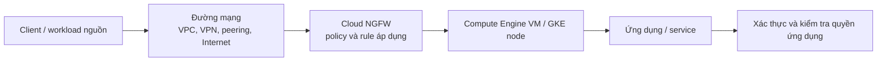
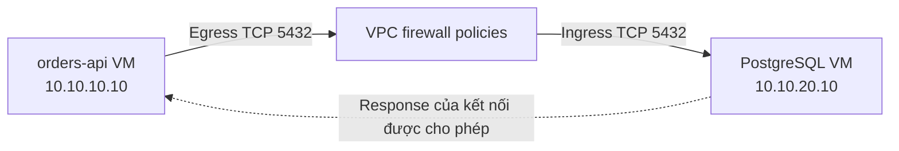
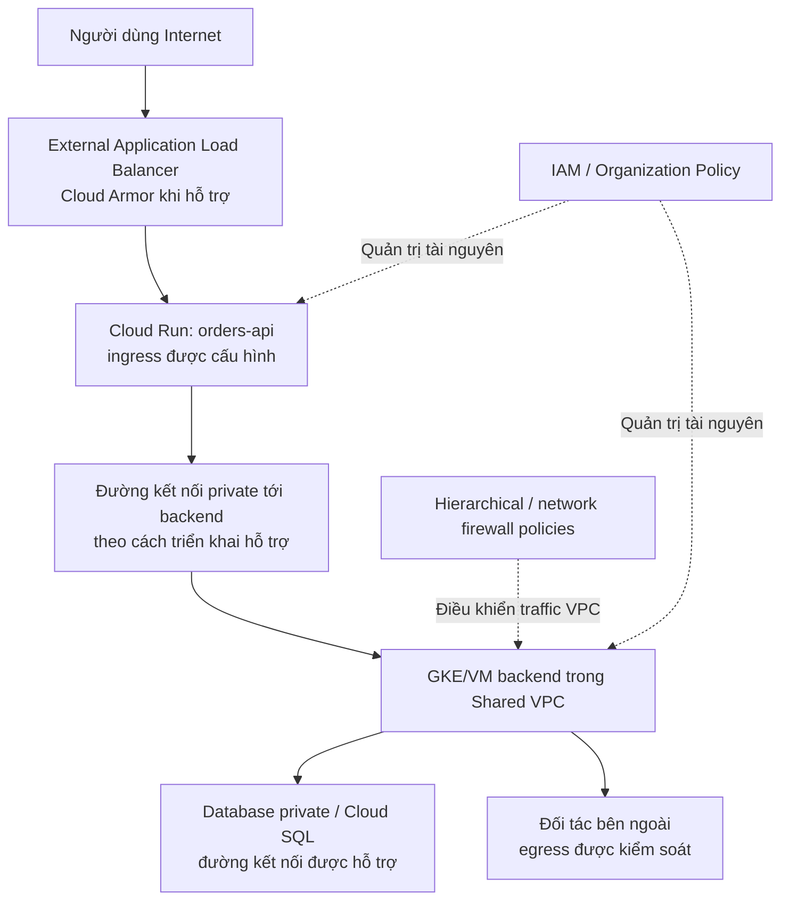

# Cloud NGFW và kiểm soát lưu lượng nâng cao trên Google Cloud

Trong Google Cloud, việc một tài khoản có IAM role phù hợp **không có nghĩa** các kết nối mạng tới ứng dụng sẽ được mở. Ngược lại, một máy ảo có cổng TCP 443 được firewall cho phép chưa chắc ứng dụng phía sau đã xác thực người gọi. Quản trị viên phải kết hợp **quyền danh tính, đường đi mạng và chính sách lọc lưu lượng** để bảo vệ từng lớp tài nguyên.

**Cloud Next Generation Firewall (Cloud NGFW)** là nhóm khả năng tường lửa mạng của Google Cloud: từ lọc kết nối theo địa chỉ, giao thức và cổng đến quản lý chính sách tập trung, các tiêu chí kiểm soát nâng cao và cơ chế ngăn chặn mối đe dọa khi cấu hình và gói tính năng hỗ trợ. Bài này thuộc chương **Bảo mật và truy cập mạng** của module `CLOUD_PROVIDERS_GCP`; kiến thức áp dụng khi tổ chức project/IAM/VPC, triển khai Compute Engine, GKE, Cloud Run, hệ thống lưu trữ và cơ sở dữ liệu, cũng như khi tự động hóa phát hành, theo dõi độ tin cậy và chi phí.

Mục tiêu thực tế là trả lời được: **Lưu lượng nào được phép đi từ nguồn nào tới đích nào, vì sao được phép hoặc bị chặn, và ai có quyền thay đổi quy tắc đó?**

## 1. Mục tiêu học tập

Sau bài này, bạn có thể:

1. Giải thích vị trí của **Cloud NGFW** so với IAM, Cloud Armor, Cloud IDS, VPC, Cloud NAT và kiểm soát ở cấp ứng dụng.
2. Phân biệt **VPC firewall rules**, **hierarchical firewall policies**, **global/regional network firewall policies** và phạm vi tác động của từng cơ chế.
3. Hiểu các tham số **ingress/egress, source/destination, protocol/port, priority, action, target và logging**.
4. Nhận diện các khả năng nâng cao như **FQDN filtering, Threat Intelligence, geo-based filtering, address groups, intrusion prevention và TLS inspection**, cùng điều kiện sử dụng của chúng.
5. Thiết kế rule theo **least privilege** cho Compute Engine/GKE trong VPC, kết nối tới backend/database và lưu lượng ra Internet.
6. Phân tích việc một kết nối bị từ chối bằng **Connectivity Tests, Firewall Rules Logging, Firewall Insights, VPC Flow Logs** và thông tin policy.
7. Lập quy trình thay đổi có thể kiểm toán: khảo sát → thiết kế → kiểm thử → triển khai → giám sát → thu hồi ngoại lệ.

## 2. Cloud NGFW bảo vệ lớp nào?

Tường lửa VPC đánh giá kết nối theo thông tin mạng và những tiêu chí được loại rule/tính năng hỗ trợ. Với VM Compute Engine, các rule được thực thi phân tán tại hạ tầng mạng; bạn không phải cài một firewall appliance thủ công trên từng VM để dùng VPC firewall.



Sơ đồ mô tả luồng vào một backend VM/GKE theo VPC; các hệ thống serverless và managed service có mô hình truy cập riêng. Cloud NGFW không thay thế toàn bộ các lớp kiểm soát khác:

| Thành phần | Câu hỏi chính | Ranh giới cần nhớ |
| --- | --- | --- |
| **Cloud NGFW / VPC firewall** | Gói tin hoặc kết nối này được phép đi vào/ra tài nguyên VPC không? | Không tự xác thực người dùng HTTP hoặc phân quyền SQL. |
| **IAM** | Principal nào được phép quản trị resource hay gọi API Google Cloud? | Có IAM role không tự mở cổng mạng cho VM. |
| **Cloud Armor** | Có nên cho HTTP(S) request/traffic được hỗ trợ đi qua điểm bảo vệ như load balancer không? | WAF/rate limiting ở điểm tích hợp, không đồng nghĩa một rule firewall L3/L4 trên mọi VM. |
| **Cloud IDS** | Traffic được quan sát có chứa dấu hiệu xâm nhập không? | Chủ yếu phục vụ phát hiện/phân tích theo cấu hình; không nên nhầm với chức năng ngăn chặn trong Cloud NGFW Enterprise. |
| **Cloud NAT** | VM private đi ra ngoài bằng địa chỉ nguồn như thế nào? | NAT không mặc nhiên cho phép lưu lượng bị firewall egress chặn. |
| **Ứng dụng / database** | Người gọi hoặc tài khoản DB có được đọc/sửa dữ liệu không? | Firewall chỉ là một lớp trước authentication/authorization của ứng dụng. |

**Ví dụ:** Rule cho phép VM ứng dụng kết nối Cloud SQL qua cổng phù hợp không đồng nghĩa mật khẩu database hợp lệ, IAM database authentication đã cấu hình đúng, hoặc truy vấn được chấp nhận. Mạng, danh tính và quyền dữ liệu phải đồng thời đáp ứng điều kiện cần thiết.

## 3. Cloud NGFW Editions và các khả năng nâng cao

Cloud NGFW thường được trình bày theo các **tier/edition** như **Essentials, Standard, Enterprise**. Khả năng cụ thể, phạm vi region, loại firewall policy hỗ trợ, điều kiện bật và phí có thể thay đổi theo dịch vụ và thời điểm; khi triển khai cần đối chiếu bảng tính năng chính thức.

| Nhóm khả năng | Vai trò | Điều phải kiểm tra |
| --- | --- | --- |
| **Stateful filtering L3/L4** | Cho phép/từ chối kết nối theo IP, giao thức, cổng, hướng lưu lượng và đối tượng đích. | Phạm vi policy, cách match, thứ tự đánh giá và rule mặc định. |
| **Quản lý policy tập trung** | Dùng hierarchical/network firewall policies để chuẩn hóa kiểm soát theo Organization/Folder/VPC. | Tài nguyên chứa policy, association, quyền IAM và tác động tới project con. |
| **FQDN filtering** | Sử dụng tên miền trong các quy tắc egress được tính năng hỗ trợ. | Cách phân giải tên, giới hạn match, DNS và gói tính năng phù hợp. |
| **Threat Intelligence** | Dùng tập địa chỉ/dữ liệu về mối đe dọa được cung cấp theo sản phẩm để hỗ trợ chặn traffic. | Tập dữ liệu nào có sẵn, cách cập nhật và tác động false positive. |
| **Geo-based filtering / address groups** | Dùng địa lý nguồn/đích hoặc nhóm địa chỉ để quản lý rule gọn hơn. | Phạm vi hỗ trợ, độ chính xác và quyền quản trị đối tượng. |
| **Intrusion prevention (IPS)** | Kiểm tra lưu lượng để nhận diện và chặn mẫu tấn công theo cấu hình Cloud NGFW Enterprise. | Security profile, endpoint/association, region và phương thức steering/inspection. |
| **TLS inspection** | Cho phép kiểm tra nội dung luồng TLS được hỗ trợ khi bật và cấu hình đúng. | PKI/chứng chỉ, phạm vi mã hóa, quyền riêng tư, loại ứng dụng và hiệu năng. |

Một mô hình tư duy hữu ích:

- **Essentials:** bắt đầu từ các chức năng firewall cơ bản và chính sách mạng L3/L4.
- **Standard:** đánh giá những tiêu chí lọc nâng cao như tên miền, Threat Intelligence và đối tượng dùng chung mà phiên bản Standard hỗ trợ.
- **Enterprise:** đánh giá kiểm tra/ngăn chặn xâm nhập; TLS inspection có yêu cầu cấu hình và giới hạn bổ sung.

Đây là cách định hướng lựa chọn, **không phải lời khẳng định mọi tính năng trong bảng đều khả dụng cho mọi loại rule, region hoặc backend**. Một tổ chức cần chọn theo **use case, phạm vi triển khai và gói tính năng thực tế**, không chỉ theo tên edition.

## 4. Các loại chính sách firewall trên Google Cloud

Cloud NGFW có nhiều cơ chế áp dụng chính sách. Điều quan trọng là **nơi lưu chính sách và nơi chính sách có hiệu lực**.

| Loại | Phạm vi quản trị/áp dụng | Trường hợp thường dùng |
| --- | --- | --- |
| **Hierarchical firewall policy** | Tổ chức/Folder; được gắn vào nút phân cấp và tác động tới các mạng/tài nguyên nằm trong phạm vi tương ứng. | Quy định an ninh chung cho tổ chức, giới hạn dịch vụ quản trị, áp chính sách xuống các project. |
| **Global network firewall policy** | VPC network và những tài nguyên gắn với VPC trên phạm vi global được sản phẩm hỗ trợ. | Chính sách dùng chung trong một mạng VPC trải nhiều region. |
| **Regional network firewall policy** | VPC network trong region tương ứng. | Yêu cầu lọc theo region và những tính năng regional được hỗ trợ. |
| **VPC firewall rules** | Quy tắc firewall truyền thống trong project chứa VPC network. | Allow/deny theo hướng ingress/egress cho VM/endpoint có cấu hình VPC phù hợp. |
| **Implied rules** | Quy tắc ngầm của VPC khi không có rule phù hợp khác. | VPC có mặc định **deny ingress** và **allow egress** ở tầng implied rule. |

Một VPC là tài nguyên có phạm vi **global** nhưng subnet thuộc **region**. Khi dùng Shared VPC, network và firewall rules/policies gắn với host network thường do **host project/nhóm quản trị mạng** kiểm soát; VM của service project có thể chịu các rule đó khi dùng subnet chung. Không thể kết luận service project tự kiểm soát firewall chỉ vì ứng dụng của nó chạy ở service project.

### 4.1. Thứ tự đánh giá và điểm dừng

Khi một gói tin được đánh giá, hệ thống cân nhắc các chính sách **có hiệu lực** theo thứ tự do Google Cloud định nghĩa; nói khái quát, hierarchical policies có vai trò kiểm soát cấp trên, sau đó có các lớp network firewall policies và VPC firewall rules, cuối cùng mới đến implied rules. **Thứ tự đầy đủ giữa từng loại network policy, các ngoại lệ và hành động cần đối chiếu tài liệu policy evaluation hiện hành**.

Trong phạm vi một tập rule có hỗ trợ priority:

- **Số priority nhỏ hơn** được đánh giá trước số lớn hơn.
- **`ALLOW` / `DENY`** thường đưa ra quyết định cho lưu lượng khớp điều kiện của rule trong lớp tương ứng.
- **`goto_next` / `GO_TO_NEXT`** (ở những loại policy hỗ trợ) cho phép tiếp tục đánh giá chính sách tầng sau, không đồng nghĩa cho phép kết nối.
- Rule **không match** thì evaluator tiếp tục tìm rule khác theo logic của hệ thống.
- Mặc định ingress/egress chỉ áp dụng sau khi không có rule hiệu lực nào quyết định khác theo cơ chế của VPC.

Không có một công thức “rule ở project luôn thắng rule ở folder”, cũng không nên xem một VPC allow rule đủ để vượt qua **deny ở lớp chính sách có ưu tiên cao hơn**.

### 4.2. Mô hình ví dụ: guardrail toàn tổ chức

Giả sử Organization muốn ngăn những kết nối quản trị trực tiếp từ Internet tới VM:

```text
Organization: example.com
├── Hierarchical firewall policy:
│   ├── rule A: hạn chế inbound SSH/RDP từ nguồn công khai
│   └── rule B: tiếp tục đánh giá chính sách mạng cho lưu lượng khác
└── Folder: workloads
    ├── Project: orders-dev  → VPC / VM
    └── Project: orders-prod → VPC / VM
```

Đội ứng dụng có thể có quyền thêm một ingress allow TCP 22 trong VPC, nhưng nếu **hierarchical deny** phù hợp đã được áp dụng trước, allow ở VPC không thể tự làm policy tổ chức mất hiệu lực. Nếu cần truy cập quản trị, hãy thiết kế **IAP TCP forwarding, VPN, bastion hoặc phương án truy cập có kiểm soát** thay cho mở `0.0.0.0/0:22`.

**Lưu ý:** muốn guardrail có hiệu lực phải **tạo policy, rule và association đúng**. Chỉ đặt tên một policy “organization security” mà không liên kết với đúng nút hoặc không match traffic sẽ không tạo được rào chắn.

## 5. Cấu trúc và ngữ nghĩa của firewall rule

Một rule thường dựa trên những trường sau (tùy loại policy):

| Trường | Câu hỏi trả lời | Ví dụ |
| --- | --- | --- |
| **Direction** | Lưu lượng đi **vào** (INGRESS) hay **ra** (EGRESS) tài nguyên đích? | Ingress từ API gateway vào VM. |
| **Action** | Nếu match, cho phép, từ chối hay thực hiện action nâng cao được hỗ trợ? | `ALLOW`, `DENY`, action inspection khi cấu hình tương ứng. |
| **Priority** | Rule được cân nhắc trước/sau các rule khác trong lớp? | `1000` ưu tiên hơn `2000`. |
| **Match** | Giao thức, cổng, IP nguồn/đích, tiêu chí khác có điều kiện nào? | `tcp:443` từ `10.20.0.0/16`. |
| **Target** | VM/endpoint nào là đối tượng của rule? | Nhóm VM có tag phù hợp, hoặc đích khác được cơ chế firewall hỗ trợ. |
| **Logging** | Có ghi nhận các kết nối match rule để điều tra không? | Bật Firewall Rules Logging cho rule quan trọng. |
| **Scope / association** | Policy thuộc Organization, Folder, VPC hay region nào? | Regional policy gắn với mạng ở `asia-southeast1`. |

### 5.1. Ingress và egress theo góc nhìn của VM

**Ingress** là traffic **đi vào** giao diện mạng của tài nguyên chịu firewall. **Egress** là traffic **đi ra** từ tài nguyên đó. Trong một luồng từ VM ứng dụng tới VM database cùng VPC:

1. VM ứng dụng gửi TCP connection: cần **egress** phía nguồn phù hợp.
2. VM database nhận kết nối: cần **ingress** phía đích phù hợp.
3. Vì firewall VPC có tính **stateful**, các gói hồi đáp thuộc kết nối đã được cho phép thường được xử lý dựa trên trạng thái kết nối; bạn không nhất thiết tạo rule mở mọi cổng ephemeral theo chiều ngược chỉ để nhận reply.

Đừng suy rộng rằng stateful firewall cho phép mọi kết nối **mới** đi ngược chiều. Nếu database chủ động khởi tạo một kết nối khác tới ứng dụng thì đây là luồng riêng cần policy phù hợp.



Đây là ví dụ database chạy trên **Compute Engine VM**. Với **Cloud SQL managed service**, đường kết nối private IP, connector/Auth Proxy, IAM và các kiểm soát riêng của dịch vụ phải được tính thêm; không xem Cloud SQL như một VM thông thường mà bạn có thể gắn VPC target tag tùy ý.

### 5.2. Target và source: IP range, network tag, service account

Các VPC firewall rules có thể dùng tiêu chí như:

- **Source/destination IP ranges** theo hướng và loại rule.
- **Network tags** gắn với VM, thường dùng để chọn VM đích hoặc nguồn theo khả năng rule.
- **Service accounts** gắn với VM, có thể được hỗ trợ làm tiêu chí nguồn/đích trong những kiểu rule tương ứng.
- **Secure tags (Resource Manager tags)** trong các **firewall policies** hỗ trợ, có quyền quản lý tag được kiểm soát bằng IAM.

**Network tag và secure tag khác nhau.** Network tag là thuộc tính của VM Compute Engine; nếu ai đó có quyền sửa network tags trên VM, việc đổi tag có thể ảnh hưởng phạm vi firewall. Secure tag dùng cơ chế Resource Manager tags và IAM kiểm soát quyền gắn/tag sử dụng theo cấu hình, phù hợp những môi trường cần phân tách trách nhiệm rõ.

Không thể dùng một tiêu chí được hỗ trợ trong **network firewall policy** để mặc định kết luận cùng cú pháp đó dùng được trong **VPC firewall rule** truyền thống. Khi xây policy, tra đúng loại rule, hướng traffic và danh sách selector tương thích.

### 5.3. Implied rules và vấn đề egress mặc định

Nếu không có explicit rule quyết định kết nối khác, VPC có quy tắc ngầm:

- **Ingress mặc định bị từ chối**.
- **Egress mặc định được cho phép**.

Vì vậy “không tạo ingress rule nào” thường phù hợp với việc không phơi VM trực tiếp. Nhưng “không tạo egress rule nào” **không có nghĩa outbound bị chặn**. Mô hình **deny-by-default egress** cần chính sách deny rõ ràng có thứ tự ưu tiên thích hợp và các allow cần thiết cho DNS, cập nhật, API, giám sát, dịch vụ Google Cloud hoặc phụ thuộc bên ngoài.

Khi bổ sung deny egress, phải đánh giá **luồng điều khiển và vận hành**. Chặn sai có thể khiến workload không tải được image, không gửi metrics/log, không xác thực workload identity hoặc không liên hệ database.

## 6. Các khả năng nâng cao: áp dụng khi có bài toán cụ thể

### 6.1. FQDN filtering

Trong một số trường hợp, VM cần gọi các endpoint dịch vụ bên ngoài bằng tên miền, chẳng hạn `api.partner.example`, nhưng đội bảo mật không muốn mở mọi IP đích Internet. **FQDN filtering** của Cloud NGFW (khi loại policy/tier hỗ trợ) cho phép dùng tiêu chí tên miền trong quy tắc egress.

Điểm cần kiểm tra:

1. Tên miền có nhiều A/AAAA records, DNS caching hoặc thay đổi IP theo thời gian không?
2. Chính sách lấy thông tin FQDN/DNS và cập nhật tập IP đích theo mô hình sản phẩm như thế nào?
3. Có yêu cầu chính xác theo **HTTP path/URL** không? FQDN filtering **không tương đương một WAF/HTTP proxy đọc mọi URL**.
4. DNS của workload có phù hợp cơ chế FQDN filtering, split-horizon DNS hoặc private zone không?
5. Tính năng này có hoạt động ở nơi triển khai, với lưu lượng/protocol thực tế không?

Nếu chính sách chỉ cho phép `api.partner.example`, không nên tự suy rằng nó cho phép mọi subdomain hoặc mọi endpoint nằm sau CDN của đối tác. Cần kiểm thử độ khớp và hành vi đổi IP.

### 6.2. Threat Intelligence và geolocation

Các nguồn **Threat Intelligence** có thể giúp nhận diện/chặn những địa chỉ nguồn hoặc đích được phân loại có rủi ro, theo danh sách được Google Cloud cung cấp và cơ chế chính sách hỗ trợ. Lọc theo **địa lý IP** có thể hữu ích cho một số quyết định quản trị traffic.

Tuy nhiên:

- Danh sách đe dọa có thể có **false positives** hoặc chưa chứa mọi địa chỉ nguy hiểm.
- Địa lý IP là phép suy luận theo IP, **không chứng minh vị trí vật lý hay danh tính** của người dùng.
- Traffic qua VPN/proxy/CDN có thể làm IP quan sát được khác IP thiết bị cuối.
- Không thay thế xác thực người dùng, phân quyền IAM hay kiểm tra nội dung request ở ứng dụng.

Đối với dịch vụ public HTTP(S), lọc truy cập theo quốc gia hoặc WAF có thể phù hợp hơn ở **Cloud Armor** tại điểm LB được hỗ trợ. Hãy chọn lớp thực thi đúng với đường traffic thay vì chồng rule theo cảm tính.

### 6.3. Address groups: quản trị danh sách lớn

**Address groups** giúp quản lý nhiều địa chỉ/range được chia sẻ trong các policy tương thích. Ví dụ nhóm `partner-networks` biểu diễn một tập CIDR của đối tác, được tái sử dụng trong nhiều rule.

Lợi ích là thay danh sách tại một nơi và giảm việc sao chép CIDR trên nhiều rule. Nhưng rủi ro là **thay một address group có thể ảnh hưởng đồng thời nhiều policy**. Do đó phải có người sở hữu, quy trình review, lịch sử thay đổi và kiểm thử ảnh hưởng.

### 6.4. Intrusion prevention của Cloud NGFW Enterprise

Cloud NGFW Enterprise bổ sung cơ chế **intrusion prevention** qua các thành phần kiểm tra lưu lượng và **security profile** khi được thiết lập đúng theo tài liệu dịch vụ. Đây là lớp sâu hơn lọc IP/cổng: mục tiêu là phát hiện và chặn mẫu lưu lượng nguy hiểm theo signature/quy tắc được hỗ trợ.

Để triển khai có ý nghĩa, đội vận hành phải xác định:

- Traffic nào được **đưa qua điểm kiểm tra**; chiều lưu lượng và region nào được hỗ trợ.
- **Security profile group**, chế độ phát hiện/chặn và các thành phần endpoint/association cần thiết.
- Các ứng dụng có mã hóa TLS; nếu muốn kiểm tra nội dung, có cần **TLS inspection** theo kiến trúc được hỗ trợ không.
- **False positive**, latency, throughput, kiểm soát privacy, hành vi fail-open/fail-closed hoặc khi thành phần inspection không sẵn sàng theo thiết kế thực tế.
- Mô hình giá và quota cho các thành phần kiểm tra.

**Chỉ sở hữu Enterprise tier không có nghĩa mọi packet trong VPC tự được kiểm tra IPS.** Phải cấu hình policy/rule, security profile và đường traffic thực sự được hỗ trợ. Những workload không đi qua cơ chế inspection hoặc protocol không hỗ trợ cần biện pháp khác.

### 6.5. TLS inspection: trách nhiệm bảo mật và vận hành bổ sung

Khi kiểm tra lưu lượng **TLS** bằng một giải pháp có hỗ trợ, hệ thống phải có cơ chế xử lý chứng chỉ và trust phù hợp để xem được phần nội dung cần kiểm tra. Đây là thay đổi kiến trúc đáng kể, có thể gây lỗi với client dùng certificate pinning/mTLS, làm tăng độ trễ và đòi hỏi kiểm soát quyền truy cập nội dung giải mã.

Trước khi bật:

1. Kiểm tra dịch vụ, protocol, direction, region và phiên bản TLS được hỗ trợ.
2. Thiết kế PKI/certificate authority và phân phối trust tới client thuộc phạm vi kiểm soát.
3. Xác định traffic phải **bỏ qua inspection** theo chính sách riêng tư hoặc tương thích.
4. Đánh giá ảnh hưởng tới performance, reliability, observability và chi phí.
5. Có lộ trình canary, giám sát TLS errors và rollback.

Không xem TLS inspection là cách hợp lệ để đọc nội dung mọi kết nối mã hóa trên Internet. Nó chỉ phù hợp trong phạm vi được dịch vụ hỗ trợ và tổ chức có quyền vận hành/kiểm soát.

## 7. Kiến trúc mẫu: bảo vệ Orders production

Giả sử một hệ thống Orders có:

- **Project `net-host-prod`** chứa Shared VPC `prod-vpc`.
- **Project `orders-prod`** chứa GKE/Compute Engine workload gắn vào Shared VPC và Cloud Run service.
- Cloud Run service `orders-api` dùng HTTPS public thông qua Application Load Balancer theo thiết kế.
- Một workload trên VM/GKE cần truy cập dịch vụ database trên mạng private và endpoint đối tác bên ngoài.
- Đội Security quản lý guardrail cấp tổ chức, đội Network quản lý firewall policy của VPC, đội ứng dụng quản lý code/deployment.



**Giới hạn của sơ đồ:** Cloud Run là sản phẩm serverless, không phải VM có network tag tùy ý. Với Cloud Run, phải thiết kế ingress/egress, VPC connectivity và xác thực riêng. VPC firewall rules liên quan đến luồng đi qua VPC và tài nguyên mà chúng hỗ trợ; **không tự áp VPC ingress rule lên endpoint public của Cloud Run**.

### 7.1. Ma trận luồng được phép và bị từ chối

| Luồng | Quyết định mong muốn | Lớp chính kiểm soát | Ghi chú |
| --- | --- | --- | --- |
| Internet → public ALB HTTPS | Cho phép theo chính sách edge | LB/Cloud Armor/TLS | Chỉ public đường vào cần thiết. |
| Internet → VM app cổng SSH | Mặc định từ chối | Hierarchical/VPC firewall | Quản trị qua kênh được bảo vệ, không mở SSH toàn Internet. |
| Load balancer/proxy/health checker → VM backend | Cho phép đúng nguồn/cổng cần thiết | VPC firewall, health check config | Các nguồn cần dùng phụ thuộc loại LB; không đoán CIDR. |
| GKE/VM app → database private TCP 5432 | Cho phép từ đúng nguồn | Egress nguồn + ingress đích nếu database là VM, cộng cơ chế DB | Với Cloud SQL, kiểm tra connector/VPC/IAM/database auth. |
| Workload → đối tác `api.partner.example` | Chỉ cho phép đích hợp lệ | Egress policy/FQDN khi hỗ trợ | Xác minh DNS, địa chỉ và nhu cầu port. |
| Workload → địa chỉ Internet tùy ý | Từ chối nếu chính sách egress yêu cầu | Egress guardrail | Bảo đảm ngoại lệ cần thiết cho API/telemetry trước khi deny. |
| Developer dev → dữ liệu production | Không được phép | IAM + mạng + kiểm soát DB | Firewall không thể thay việc quản trị danh tính. |
| API từ Internet → dịch vụ Cloud Run private | Chỉ theo đường ingress được chấp nhận | Cloud Run ingress/IAM, LB/network | Không chỉ dùng VPC firewall rule để bảo vệ public endpoint. |

### 7.2. Cấp nào nên giữ policy?

1. **Organization/Folder:** guardrail cho những giao thức/quy tắc bị cấm rõ ràng trên toàn nhánh, quy trình ngoại lệ và người chịu trách nhiệm.
2. **Host project / VPC:** network policy cho Shared VPC, dùng chung giữa các workload và region theo thiết kế.
3. **Team ứng dụng:** đề xuất luồng cho service của mình dựa trên source/destination/port cụ thể, được kiểm duyệt và đưa vào infrastructure-as-code.
4. **Application/IAM:** xác thực request, secrets, service account, database identity và logging ứng dụng.

Một policy áp cho cả Organization có **phạm vi ảnh hưởng lớn**. Quy tắc deny thiếu ngoại lệ có thể làm gián đoạn workload production ở nhiều project; do đó phải có quy trình thử nghiệm, đánh giá tác động và rollback trước khi mở rộng phạm vi.

## 8. Thực hành: thiết kế rule ingress/egress có giới hạn

Trong ví dụ lab, hai VM cùng thuộc VPC `prod-vpc`:

```text
Network: prod-vpc
Subnet app: 10.10.10.0/24
Subnet db:  10.10.20.0/24
VM app:     10.10.10.10  (network tag: orders-app)
VM db:      10.10.20.10  (network tag: orders-db)
Yêu cầu:    chỉ VM app được kết nối TCP 5432 tới VM db
```

### 8.1. Hình dung rule trước khi chạy lệnh

| Rule | Direction / target | Match | Action |
| --- | --- | --- | --- |
| `allow-orders-db` | INGRESS, VM có tag `orders-db` | Source `10.10.10.10/32`, TCP `5432` | ALLOW |
| `deny-public-admin` (policy cấp trên, ví dụ) | INGRESS, tập VM thuộc phạm vi | Source public theo yêu cầu; TCP `22,3389` | DENY |
| Egress restriction (nếu yêu cầu) | EGRESS, tập VM app | Chỉ đích/dịch vụ được liệt kê qua policy phù hợp | ALLOW + DENY có thứ tự thích hợp |

Rule này chỉ minh họa đường **ingress** của VM database. Nếu có **egress deny** ở app, bạn còn phải mở egress TCP `5432` tới database đúng scope. Nếu có GKE secondary Pod ranges hoặc backend thay đổi IP, một source `/32` cố định có thể không phù hợp; xem cách target theo identity/tag/range được kiến trúc hỗ trợ.

### 8.2. Lệnh `gcloud` mẫu cho VPC firewall rule truyền thống

**Lệnh sau sẽ tạo rule thật nếu chạy**. Chỉ thực hiện trong lab hoặc theo phiếu thay đổi được phê duyệt, và chỉ khi bạn có quyền quản lý firewall của VPC.

```bash
HOST_PROJECT="net-host-prod"
NETWORK="prod-vpc"

# Cho VM database (tag orders-db) nhận PostgreSQL chỉ từ VM app minh họa
gcloud compute firewall-rules create allow-orders-db \
  --project="$HOST_PROJECT" \
  --network="$NETWORK" \
  --direction=INGRESS \
  --priority=1000 \
  --action=ALLOW \
  --rules=tcp:5432 \
  --source-ranges=10.10.10.10/32 \
  --target-tags=orders-db \
  --enable-logging
```

Lệnh dùng **VPC firewall rules**, không tạo hierarchical/network firewall policy và không bật Threat Intelligence/IPS. Tag `orders-db` phải được gắn trên đúng VM đích; source IP phải đúng sau khi đi qua NAT/proxy nếu có. Nếu network/firewall policy tầng trên đã deny, rule này có thể không có tác dụng cho kết nối.

Không dùng `--source-ranges=0.0.0.0/0` để sửa nhanh lỗi PostgreSQL. IP private cũng không phải cơ chế xác thực database: vẫn cần database user, quyền và các biện pháp bảo mật khác.

### 8.3. Kiểm tra bằng lệnh chỉ đọc

```bash
# Xem rule hiện có của project chứa VPC
gcloud compute firewall-rules list \
  --project="$HOST_PROJECT"

# Xem chi tiết rule được tạo
gcloud compute firewall-rules describe allow-orders-db \
  --project="$HOST_PROJECT" \
  --format=yaml

# Xem network mà VM đang sử dụng
gcloud compute networks describe "$NETWORK" \
  --project="$HOST_PROJECT" \
  --format=yaml

# Kiểm tra network interface, network tags và service account của một VM
gcloud compute instances describe DB_VM_NAME \
  --zone=asia-southeast1-a \
  --project=orders-prod \
  --format="yaml(networkInterfaces,tags,serviceAccounts)"
```

Địa chỉ máy, tag, zone và project ở đây đều là ví dụ. **Liệt kê VPC firewall rules không cung cấp bức tranh đầy đủ về mọi hierarchical/network firewall policy có thể áp dụng**. Bạn cũng cần xem policy ở cấp Organization, Folder, VPC, region và association trong Google Cloud Console hoặc API/lệnh tương ứng với từng loại.

### 8.4. Gỡ rule ví dụ khi không còn cần

Nếu rule đã được tạo trong lab và cần hoàn tác:

```bash
gcloud compute firewall-rules delete allow-orders-db \
  --project="$HOST_PROJECT"
```

Đây là thao tác **xóa thật**. Chỉ chạy khi đã xác minh rule này thuộc bài thực hành và không có workload nào khác đang phụ thuộc nó. Khi quản trị bằng Terraform hoặc công cụ IaC, hãy cập nhật mã nguồn và chạy quy trình triển khai tương ứng để tránh drift.

## 9. Rule nâng cao và mô hình áp dụng trong thực tế

### 9.1. Chặn egress theo nguồn đích thay vì mở toàn Internet

Giả sử batch job trên VM chỉ cần gửi HTTPS tới một API đối tác. Thay vì không kiểm soát outbound:

1. Lập danh sách những phụ thuộc egress thật: DNS, API của Google, package repositories, registry, telemetry và endpoint đối tác.
2. Chọn rule hoặc policy có hỗ trợ IP, FQDN/Threat Intelligence và tiêu chí cần dùng.
3. Mở các luồng cần thiết **trước** khi kích hoạt deny egress rộng.
4. Chạy thử trên workload dev/staging, đo số lỗi DNS/TLS/API và xem firewall logs.
5. Mở rộng từng nhóm VM hoặc nhánh tài nguyên; có cơ chế rollback.

**Tránh nhầm:** Cloud NAT chỉ dịch địa chỉ nguồn cho kết nối outbound; có NAT không đồng nghĩa egress được firewall cho phép. Việc dùng Private Google Access hoặc Private Service Connect có thể thay đổi đường truy cập dịch vụ Google Cloud, nhưng các đường đó cũng cần thiết kế network policy phù hợp.

### 9.2. Dùng policy tập trung cho môi trường sản xuất

Tại Folder `prod`, đội bảo mật có thể muốn chuẩn hóa:

- Cấm SSH/RDP trực tiếp từ phạm vi Internet vào VM.
- Cho phép đúng kênh quản trị đã được phê duyệt.
- Chặn một số đích có rủi ro cao bằng danh sách Threat Intelligence khi được hỗ trợ.
- Giới hạn outbound đến đúng mạng/doanh nghiệp hoặc danh sách FQDN cần thiết.
- Gửi log đầy đủ cho các rule có nguy cơ cao, với chi phí được kiểm soát.

Không phải mọi mục trên đều phải được biểu diễn bằng **một** hierarchical firewall policy. Tính năng nâng cao chỉ dùng ở **đúng loại policy/tier/scope** được hỗ trợ. Có thể kết hợp guardrail cấp trên với network firewall policy áp riêng tại mạng VPC.

### 9.3. Bảo vệ luồng vào backend phía sau load balancer

Mô hình phổ biến: một external Application Load Balancer nhận traffic HTTPS từ Internet và gửi đến Compute Engine MIG/GKE backend. Khi đó:

- **Frontend public** không có nghĩa mỗi backend VM phải sở hữu public IP.
- Backend ingress firewall cần cho phép đúng **địa chỉ nguồn của health check và proxy hoặc dải được Google Cloud yêu cầu** theo **loại load balancer** đang dùng.
- Không tự lấy CIDR của một sản phẩm khác rồi áp vào LB hiện tại; nguồn health check/proxy có thể khác giữa global/regional, proxy/passthrough và kiểu backend.
- Lọc request ở Layer 7 có thể sử dụng Cloud Armor khi loại load balancer hỗ trợ; firewall VPC vẫn có nhiệm vụ riêng để bảo vệ backend VM.

Nếu health check báo unhealthy sau khi siết firewall, cần xem **đường vào của health check** trước khi đổi lại ứng dụng. Mở `0.0.0.0/0` tới mọi cổng backend để “cho khỏe” là cách sửa sai nguyên nhân và tăng bề mặt tấn công.

## 10. Kiểm tra kết nối và chẩn đoán firewall

Một lỗi `connection timed out`, `no route to host` hoặc TCP reset không nhất thiết do Cloud NGFW. Cùng một triệu chứng có thể bắt nguồn từ DNS, route, firewall, VPC peering, NAT, proxy, ứng dụng không listen cổng, database authentication hoặc service health.

### 10.1. Quy trình điều tra có thứ tự

1. **Xác định luồng:** source VM/service, IP nguồn thực, destination, protocol/port, region, VPC/network interface.
2. **Kiểm tra đường mạng:** route, DNS, subnet, peering/VPN/Interconnect và các cơ chế kết nối được triển khai.
3. **Tìm policy có hiệu lực:** hierarchical policy, network firewall policy, VPC rules, implied rules; chú ý association, priority, target và match.
4. **Xem log/trace:** Firewall Rules Logging, Connectivity Tests, VPC Flow Logs và application log tương ứng.
5. **Kiểm tra backend:** service có listen port không, health check, TLS, IAM, database credentials, quota và trạng thái dịch vụ.
6. **Áp dụng thay đổi nhỏ nhất:** sửa rule đúng cấp, đúng IP/protocol/target; chạy thử rồi xác nhận cả luồng được phép và bị từ chối.

### 10.2. Connectivity Tests

**Network Intelligence Center Connectivity Tests** hỗ trợ phân tích cấu hình đường đi mạng giữa nguồn và đích, giúp phát hiện các vấn đề như route hoặc firewall rule chặn traffic trong phạm vi mô hình được hỗ trợ.

Khi dùng:

- Cung cấp đúng source/destination, protocol/port và phạm vi VPC.
- Đọc kết quả mô phỏng/trace để biết đường đi mạng theo cấu hình.
- Hiểu rằng một phép phân tích tĩnh **không bảo đảm ứng dụng đang khỏe**, DNS vừa phân giải ra IP gì hoặc backend nhận request thành công.
- Với một số đường mạng, chức năng phân tích có thể cần runtime validation/công cụ bổ sung.

Ví dụ một test từ VM `orders-app` tới `10.10.20.10:5432` có thể chỉ ra firewall policy deny hoặc thiếu route. Nhưng kết quả reachability ở tầng mạng không thay việc dùng client PostgreSQL kiểm tra cơ chế xác thực.

### 10.3. Firewall Rules Logging, Firewall Insights và VPC Flow Logs

| Công cụ | Khi sử dụng | Cần lưu ý |
| --- | --- | --- |
| **Firewall Rules Logging** | Ghi nhận các kết nối/luồng match rule có bật logging trong phạm vi được hỗ trợ. | Có chi phí log; không phải mọi gói tin đều tạo một record và implied rules có hạn chế logging. |
| **Firewall Insights** | Đánh giá việc dùng rule, tìm rule ít dùng, phạm vi mở rộng hoặc vấn đề quản trị theo khả năng tính năng. | “Không thấy sử dụng trong cửa sổ quan sát” không chứng minh rule an toàn để xóa. |
| **VPC Flow Logs** | Xem mẫu/tổng hợp lưu lượng tại interface/subnet theo cấu hình được hỗ trợ. | Dữ liệu sampling/aggregation, không nhất thiết là bản ghi mỗi packet; không thay firewall decision trace. |
| **Connectivity Tests** | Điều tra đường đi, route và các policy ngăn kết nối. | Kết quả mô hình cần kết hợp kiểm thử thực tế khi điều tra sự cố. |
| **Cloud Logging / Monitoring** | Tập trung log, alert theo rule/service, xác định xu hướng block hoặc bất thường. | Cần chọn log sinks, retention, metric và budget phù hợp. |

**Ví dụ log analysis:** sau khi rollout một egress deny ở Folder `prod`, số lần kết nối TCP 443 tới một endpoint cập nhật phần mềm bị chặn tăng mạnh. Đội vận hành xác định đây là phụ thuộc hợp lệ bị bỏ sót, bổ sung exception ở đúng phạm vi, sau đó kiểm tra luồng độc hại vẫn bị chặn.

Đừng tắt log ngay khi hết lỗi: hãy dùng chu kỳ quan sát hợp lý để thấy những job chạy ít thường xuyên, ví dụ backup hàng tuần hoặc kiểm toán cuối tháng.

### 10.4. Những nguyên nhân bị bỏ sót thường gặp

| Hiện tượng | Khả năng | Cách xác minh |
| --- | --- | --- |
| VPC allow rule đúng nhưng kết nối vẫn bị chặn | Hierarchical/network policy deny ở lớp có hiệu lực trước. | Xem toàn bộ policy và association của VPC/Folder/Org. |
| Một VM truy cập được, VM khác không | Target tag, service account, region, subnet hoặc network interface khác. | So sánh metadata và policy match của hai VM. |
| Backend unhealthy sau khi bật firewall | Health check/proxy source bị chặn. | Xem kiểu LB và dải nguồn được tài liệu hỗ trợ. |
| App không gọi được Google API sau deny egress | Thiếu rule cho dịch vụ, DNS, Private Google Access/PSC hoặc proxy. | Kiểm tra đường gọi thực và các phụ thuộc cần thiết. |
| Cloud Run public bị gọi trực tiếp dù VM firewall đã chặt | Cloud Run ingress/auth độc lập với VM firewall. | Kiểm tra Cloud Run ingress/IAM, ALB và các endpoint được phơi. |
| Kết nối TCP được nhưng HTTP `403` | IAM hoặc xác thực/ủy quyền ứng dụng. | Đọc HTTP error, principal, token, service policy. |
| Không thấy log của một rule | Rule không match, logging chưa bật, log lọc sai hoặc cơ chế không hỗ trợ. | Xem cấu hình và mô hình logging, không chỉ một truy vấn log. |
| Thay network tag làm traffic thay đổi | Tag là tiêu chí target/source firewall. | Kiểm tra lịch sử VM metadata và quyền chỉnh tag. |

## 11. Vận hành Cloud NGFW bằng quy trình thay đổi

### 11.1. Mẫu phiếu đề nghị mở cổng

Trước khi thêm allow rule, đội ứng dụng nên cung cấp:

| Trường | Ví dụ |
| --- | --- |
| Chủ sở hữu | Đội Orders / trưởng ca vận hành |
| Môi trường / VPC | `prod` / `prod-vpc` |
| Nguồn | VM app `10.10.10.10` hoặc principal/tag hỗ trợ |
| Đích | VM DB `10.10.20.10` |
| Protocol / port | TCP 5432 |
| Hướng | Egress từ app và ingress tới DB, tùy policy có hiệu lực |
| Mục đích | Ứng dụng kết nối PostgreSQL nội bộ |
| Thời hạn | Dài hạn hoặc có ngày hết hạn nếu truy cập tạm thời |
| Người phê duyệt | Network/Security owner theo phạm vi tác động |
| Bằng chứng kiểm thử | Connectivity Tests, health check, ứng dụng test, log |
| Kế hoạch rollback | Rule/commit/plan cần khôi phục nếu có sự cố |

Không dùng mô tả “mở tất cả để hệ thống chạy” làm căn cứ phê duyệt. Mọi rule nên có **mục đích, owner và phạm vi nguồn/đích rõ ràng**.

### 11.2. Tự động hóa và kiểm soát drift

Khi số VPC và project tăng, quản lý thủ công firewall trên Console dễ xuất hiện rule bị quên. Với **Terraform hoặc một công cụ IaC**, nên:

1. Quản lý policy và association như cấu hình có phiên bản.
2. Review thay đổi qua pull request, có người sở hữu Security/Network.
3. Kiểm tra những mở rộng rủi ro cao: `0.0.0.0/0`, all protocols, all ports, priority bất thường.
4. Triển khai canary/staging trước chính sách có ảnh hưởng rộng.
5. Kiểm tra policy **thực tế** so với state/plan để phát hiện chỉnh tay ngoài quy trình.
6. Lưu kết quả kiểm thử và đường rollback.

Với Shared VPC, module IaC của **host project** có thể cần phối hợp ứng dụng ở **service project**. Không nên cấp quyền tổ chức cho mọi pipeline chỉ để chỉnh một rule dành cho một workload.

### 11.3. Ngoại lệ và quyền quản trị

Chính sách chặn ở cấp Organization có thể cần ngoại lệ cho workload quản trị/backup đặc thù. Ngoại lệ phải:

- Có lý do và hạn kết thúc, nếu không phải nhu cầu cố định.
- Chỉ áp dụng cho resource/source/destination cần thiết.
- Có người phê duyệt ở **đúng cấp** đang sở hữu policy.
- Được kiểm tra tránh làm vô hiệu hóa guardrail trên toàn nhánh.

**IAM cho người quản trị firewall** khác với **quyền kết nối mạng**. Một developer không được cấp IAM role sửa Firewall Policy vẫn có thể sử dụng mạng theo rules đang có; một Network Admin có quyền sửa policy chưa chắc được ứng dụng cấp quyền truy cập database.

## 12. Chi phí, độ tin cậy và giới hạn khi áp dụng kiểm soát nâng cao

Cloud NGFW Essentials, Standard và Enterprise có mô hình tính phí/tính năng khác nhau; những thành phần như Enterprise intrusion prevention, firewall endpoint, logging và xử lý kiểm tra lưu lượng có thể làm tăng chi phí tùy cấu hình và bảng giá hiện hành.

Khi chọn biện pháp, cân nhắc:

- **Số lượng và phạm vi policy/rule:** tài nguyên, quota/limits và khả năng quản trị.
- **Traffic volume và inspection:** thông lượng, latency, egress và overhead cho TLS/IPS nếu dùng.
- **Cloud Logging:** lượng dữ liệu, retention, sink và chi phí lưu trữ/đọc.
- **High availability và regionality:** thành phần inspection/endpoint có sẵn trong region và kịch bản lỗi hay không.
- **Độ phức tạp vận hành:** ai xử lý false positive, ai thay security profile và ai duyệt exception.
- **Độ tin cậy của backend:** firewall cho phép kết nối không bảo đảm backend còn capacity hay cơ sở dữ liệu khỏe.

Không nên bật mọi tính năng nâng cao cho mọi traffic mà thiếu yêu cầu và số liệu. Ưu tiên từ threat model: xác định dữ liệu nhạy cảm, đường xâm nhập, lưu lượng có thể bị khai thác và các kiểm soát đã có, rồi chọn mức đầu tư tương xứng.

## 13. Bài tập thực hành có đáp án

### Bài tập 1: Allow rule bị “vô hiệu”

Đội ứng dụng tạo VPC ingress allow TCP 22 từ `0.0.0.0/0` để SSH vào một VM, nhưng kết nối vẫn bị từ chối. Trước đó đội Security đã áp hierarchical firewall deny cho inbound SSH từ Internet.

**Câu hỏi:** Vì sao rule mới không mở được kết nối? Nên xử lý thế nào?

**Đáp án:** Deny có hiệu lực ở lớp chính sách cao hơn có thể chặn kết nối trước khi VPC allow rule được dùng. Cần kiểm tra policy evaluation/association, sau đó dùng đường quản trị được phê duyệt như IAP TCP forwarding hoặc VPN. Không xóa guardrail tổ chức chỉ để mở SSH tùy ý.

### Bài tập 2: Bật deny egress khiến GKE/VM gặp lỗi

Sau khi bật chính sách deny egress, workload không thể tải container image và gửi telemetry.

**Câu hỏi:** Những dữ liệu nào cần thu thập trước khi sửa?

**Đáp án:** Xác định source thực, destination/DNS, port, VPC, loại endpoint registry/monitoring, priority của policy, và log kết nối bị chặn. Bổ sung allow phù hợp cho các phụ thuộc hợp lệ, thử trên phạm vi nhỏ và bảo đảm deny bất hợp lệ vẫn có hiệu lực. Không mở toàn Internet vô thời hạn chỉ để lỗi biến mất.

### Bài tập 3: Cloud Run bị truy cập trái phép dù VM firewall chặt

Cloud Run service public có endpoint trực tiếp. Đội bảo mật đã chặn ingress trực tiếp vào VM backend của một VPC riêng, nhưng một người ngoài vẫn truy cập Cloud Run qua URL mặc định.

**Câu hỏi:** Vì sao? Những cơ chế nào phù hợp?

**Đáp án:** Cloud Run managed endpoint không phải giao diện VM được bảo vệ trực tiếp bằng VPC firewall rules đó. Cần xem **Cloud Run ingress**, IAM authentication, application authorization và điểm vào ALB/Cloud Armor theo thiết kế hỗ trợ; đồng thời xem xét kết nối VPC khi workload gọi các tài nguyên private.

### Bài tập 4: Chọn cơ chế chống truy cập đích độc hại

Một VM backend cần gọi HTTPS tới API đối tác và không được kết nối tùy ý tới các địa chỉ rủi ro đã biết.

**Câu hỏi:** Nên dùng những lớp nào?

**Đáp án:** Kết hợp egress policy hẹp, đánh giá **FQDN filtering**, **Threat Intelligence** hoặc address groups theo edition/policy hỗ trợ; ghi log và kiểm tra sự thay đổi của DNS/danh sách IP. Nếu cần ngăn các payload tấn công trên luồng được hỗ trợ, đánh giá **Cloud NGFW Enterprise IPS** cùng yêu cầu inspection/TLS; không xem một IP denylist là biện pháp duy nhất.

### Bài tập 5: Không thể tìm log rule

Một VM không liên hệ được database. VPC firewall rule `allow-db` đã bật logging nhưng Cloud Logging không có record nào cho rule.

**Câu hỏi:** Có thể kết luận firewall cho phép và database lỗi không?

**Đáp án:** **Không.** Có thể traffic chưa đến nơi, route/DNS sai, rule không match target/source, policy khác chặn trước, logging/lọc log không đúng hoặc cơ chế logging không ghi từng packet. Kiểm tra Connectivity Tests, policy evaluation, IP thực tế và application logs trước khi kết luận.

### Bài tập 6: Network tag hay secure tag?

Một nhóm phát triển có quyền chỉnh network tags trên VM của chính họ. Đội Security muốn một selector chỉ cho phép những VM đã được phê duyệt truy cập tài nguyên nhạy cảm.

**Câu hỏi:** Rủi ro của network tag là gì và cách giảm thiểu?

**Đáp án:** Nếu developer có thể tự gắn tag dùng trong allow rule, họ có thể khiến VM khớp rule mà Security định dùng như tín hiệu phê duyệt. Cần xem xét **secure tags với IAM quản trị gắn tag**, hoặc tiêu chí identity/scope được hỗ trợ phù hợp, cùng quy trình review và policy áp đúng loại rule.

## 14. Checklist trước khi triển khai production

- [ ] Đã lập sơ đồ luồng traffic **source → destination → protocol/port → region/VPC**.
- [ ] Đã phân biệt VM/GKE traffic chịu VPC firewall với Cloud Run/Cloud SQL managed access controls.
- [ ] Đã kiểm tra **hierarchical, global/regional network policies, VPC rules và implied rules** trong phạm vi đích.
- [ ] Mỗi allow rule đều có owner, mục đích và source/destination hẹp nhất có thể.
- [ ] Policy cấp cao có kế hoạch ngoại lệ, thử nghiệm và rollback rõ ràng.
- [ ] Không còn cổng quản trị public không cần thiết, nhất là SSH/RDP.
- [ ] Đã kiểm tra **egress mặc định** và các phụ thuộc DNS/Google APIs/registry/telemetry.
- [ ] Đã xác định điều kiện sử dụng FQDN/Threat Intelligence/IPS/TLS inspection theo edition và region.
- [ ] Đã bật logging và thiết lập thời gian lưu/chi phí phù hợp với mức rủi ro.
- [ ] Đã kiểm tra kết nối được phép **và** kết nối phải bị từ chối, không chỉ một health check.
- [ ] Đã có người chịu trách nhiệm quản lý tag, address groups, security profile và quyền thay đổi policy.
- [ ] Đã rà soát ảnh hưởng tới Shared VPC, load balancer health check, Cloud NAT, Cloud SQL, GKE và Cloud Run.
- [ ] Đã dự trù quota, giới hạn hệ thống, phí inspection/logging và cơ chế theo dõi sau triển khai.

## 15. Ghi nhớ

**Cloud NGFW là công cụ quan trọng để quản trị đường đi mạng, nhưng chỉ hiệu quả khi policy đúng cấp và đúng luồng.** Nền tảng của thiết kế an toàn là biết nguồn, đích, giao thức/cổng, ranh giới VPC và resource chịu kiểm soát.

- **Ingress/egress, allow/deny, priority, target và policy scope** là những khái niệm phải hiểu trước tính năng nâng cao.
- **Hierarchical/network firewall policies** giúp quản trị tập trung; **VPC firewall rules** phục vụ những kịch bản truyền thống. Cần kiểm tra toàn bộ lớp policy thay vì chỉ xem một rule.
- **Deny ingress mặc định** không đồng nghĩa **deny egress mặc định**. Nếu cần kiểm soát outbound, phải thiết kế explicit egress policies và bảo vệ các luồng cần thiết.
- **FQDN filtering, Threat Intelligence, geo filtering, address groups và Enterprise IPS/TLS inspection** có giá trị khi dùng đúng tier, policy, region và đường traffic hỗ trợ.
- **Firewall khác IAM, Cloud Armor, Cloud IDS và ứng dụng.** Không một lớp riêng lẻ nào thay thế được xác thực, logging và giám sát hệ thống.
- Thực hiện thay đổi bằng **least privilege, IaC, review, logging, kiểm thử và rollback**, nhất là với guardrail cấp Organization hoặc Shared VPC.

### Tài liệu Google Cloud tham khảo

- [Cloud NGFW overview](https://cloud.google.com/firewall/docs/about-firewalls)
- [Cloud NGFW tiers and capabilities](https://cloud.google.com/firewall/docs/cloud-ngfw-overview)
- [VPC firewall rules](https://cloud.google.com/firewall/docs/firewalls)
- [Firewall policies](https://cloud.google.com/firewall/docs/firewall-policies-overview)
- [Firewall policy evaluation order](https://cloud.google.com/firewall/docs/firewall-policy-evaluation-order)
- [Cloud NGFW threat prevention](https://cloud.google.com/firewall/docs/threat-prevention-overview)
- [Firewall Rules Logging](https://cloud.google.com/logging/docs/using-logging/firewall-rules)
- [Connectivity Tests overview](https://cloud.google.com/network-intelligence-center/docs/connectivity-tests/concepts/overview)
- [Firewall Insights](https://cloud.google.com/network-intelligence-center/docs/firewall-insights/concepts/overview)
