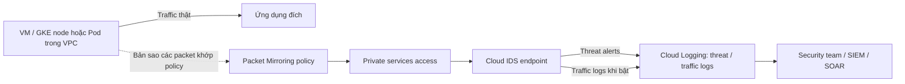
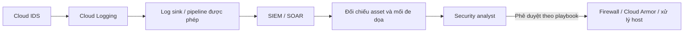

# Cloud IDS và phát hiện xâm nhập mạng

> **Chương:** Bảo mật và truy cập mạng  
> **Module:** CLOUD_PROVIDERS_GCP  
> **Phạm vi module:** Khám phá Google Cloud từ tổ chức project, IAM và VPC đến Compute Engine, GKE, Cloud Run, dịch vụ lưu trữ và cơ sở dữ liệu. Qua các tình huống triển khai, người học biết lựa chọn dịch vụ, bảo vệ tài nguyên, tự động hóa phát hành và theo dõi độ tin cậy cùng chi phí.

Khi một ứng dụng chạy trên Compute Engine hoặc Google Kubernetes Engine (GKE), các biện pháp phòng thủ như VPC firewall, IAM và xác thực ứng dụng giúp **giới hạn hành động được phép**. Nhưng đội vận hành cũng cần biết **lưu lượng nào có dấu hiệu bất thường hoặc tấn công**, ví dụ khai thác lỗ hổng, liên lạc với máy chủ điều khiển mã độc, hay hoạt động di chuyển ngang giữa các máy trong mạng.

**Cloud Intrusion Detection System (Cloud IDS)** là dịch vụ phát hiện xâm nhập mạng được Google Cloud quản lý, sử dụng công nghệ phát hiện mối đe dọa của Palo Alto Networks. Cloud IDS nhận **bản sao lưu lượng mạng** từ Packet Mirroring, phân tích và phát sinh **threat alerts/logs** khi thấy dấu hiệu đáng ngờ. Dịch vụ hỗ trợ quan sát lưu lượng **north–south** (giữa mạng nội bộ và bên ngoài) và **east–west** (giữa workload nội bộ).

**Giới hạn quan trọng nhất:** Cloud IDS là hệ thống **phát hiện và cảnh báo (IDS)**, không phải cơ chế **ngăn chặn nội tuyến (IPS)**. Cảnh báo xuất hiện **không đồng nghĩa** một request đã bị chặn, máy nhiễm mã độc đã được cô lập hoặc hệ thống đã tự khắc phục.

## Mục tiêu học tập

Sau bài học, bạn có thể:

1. Giải thích vai trò Cloud IDS trong mô hình phòng thủ nhiều lớp của Google Cloud và phân biệt IDS với IPS, Cloud NGFW, Cloud Armor, firewall và VPC Flow Logs.
2. Mô tả đường đi **workload → Packet Mirroring → Cloud IDS endpoint → Cloud Logging → quy trình phản ứng**.
3. Hiểu **zonal IDS endpoint**, region giám sát, private services access, IAM, mức severity và các giới hạn quan sát lưu lượng được mã hóa.
4. Lựa chọn subnet/VM, ingress/egress và bộ lọc Packet Mirroring để kiểm soát phạm vi phát hiện và chi phí.
5. Kiểm tra tài nguyên bằng Console/`gcloud`, đọc threat logs và xác minh một cấu hình giám sát đã có.
6. Thiết kế luồng triage, điều tra và phối hợp phản ứng khi phát hiện hoạt động đáng ngờ mà không gây gián đoạn tùy tiện.
7. Dọn Packet Mirroring policy và IDS endpoint dùng riêng cho lab theo đúng thứ tự, tránh ảnh hưởng tài nguyên dùng chung.

## 1. Cloud IDS nằm ở đâu trong kiến trúc mạng?

Cloud IDS hoạt động như một thành phần quan sát **out-of-band**: nó phân tích **bản sao** của những gói tin được chọn, thay vì đứng trên đường truyền và quyết định cho phép/chặn mỗi packet.



Sơ đồ cố ý tách **traffic thật** khỏi **traffic được mirror**:

- Dữ liệu ứng dụng vẫn đi đến đích theo route, firewall và kiến trúc mạng ban đầu.
- Packet Mirroring chọn lưu lượng từ VM hoặc nguồn được hỗ trợ rồi **sao chép** về collector của Cloud IDS.
- Endpoint Cloud IDS phân tích bản sao và ghi nhận kết quả vào các luồng log tương ứng.
- Nhóm bảo mật dùng log để xác minh mức độ nghiêm trọng, điều tra nguồn, quyết định chặn hoặc cô lập bằng **công cụ khác** khi cần.

Cloud IDS phù hợp khi bạn cần phát hiện hoạt động khai thác, spyware, malware, command-and-control hoặc dấu hiệu bất thường trên mạng VM/GKE; nó **không thay thế** việc vá hệ điều hành, kiểm soát IAM, firewall, mã hóa hay giám sát ứng dụng.

## 2. Những khái niệm cốt lõi

| Khái niệm | Ý nghĩa | Điều cần lưu ý |
|---|---|---|
| **IDS endpoint** | Tài nguyên Cloud IDS phân tích bản sao traffic | Là tài nguyên **zonal**, nhưng có thể giám sát nguồn từ các zone trong **cùng region** |
| **Packet Mirroring** | Sao chép traffic được chọn tới collector | Chỉ có endpoint mà chưa gắn mirroring policy thì chưa có traffic cần phân tích |
| **Private services access** | Kết nối private giữa VPC khách hàng và mạng dịch vụ do Google quản lý | Yêu cầu Service Networking API, dải IP được cấp phát và kết nối private phù hợp |
| **Severity** | Ngưỡng thấp nhất của mối đe dọa được thông báo | `INFORMATIONAL`, `LOW`, `MEDIUM`, `HIGH`, `CRITICAL` |
| **Threat signature** | Mẫu/đặc trưng hỗ trợ nhận diện hành vi đáng ngờ | Được cập nhật theo cơ chế dịch vụ, vẫn có false positive/false negative |
| **Threat log** | Nhật ký cảnh báo về mối đe dọa được nhận diện | Dùng để triage và phối hợp phản ứng |
| **Traffic log** | Thông tin về các phiên/luồng đã quan sát | Có thể tạo nhiều bản ghi; cần cân nhắc quyền và chi phí |
| **Mirrored bytes** | Chỉ số thể hiện lưu lượng được nhân bản | Dùng để kiểm tra policy có thực sự mirror nguồn traffic |
| **Threat exception** | Cấu hình bỏ qua một số threat ID gây nhiễu có căn cứ | Không được vô hiệu hóa rộng tùy tiện; có giới hạn theo endpoint |

### 2.1. Endpoint là zonal nhưng phạm vi giám sát theo region

Cloud IDS endpoint được tạo trong một **zone**, ví dụ `asia-southeast1-a`. Tuy nhiên, endpoint đó có thể xử lý traffic từ các zone khác **trong cùng region `asia-southeast1`** nếu Packet Mirroring policy chọn đúng nguồn được hỗ trợ.

Ví dụ:

```text
VPC: app-vpc
Region: asia-southeast1
    ├── Zone a: web-vm-1
    ├── Zone b: api-vm-2
    └── Cloud IDS endpoint tại zone a
           └── Nhận bản sao traffic từ nguồn thuộc region này

Region: asia-east1
    └── Các VM khác cần endpoint/policy phù hợp tại region này
```

**Không giả định endpoint ở Singapore tự giám sát mọi VM trong các region khác.** Mỗi region cần kế hoạch endpoint và Packet Mirroring thích hợp; nhiều endpoint trong cùng region có thể cần thiết khi dung lượng traffic lớn hoặc phạm vi giám sát được chia tách.

Theo hướng dẫn sản phẩm, mỗi endpoint có năng lực kiểm tra danh định đến **5 Gbps**; nên lập kế hoạch nhiều endpoint khi lưu lượng cần giám sát cao hơn mức đó. Khả năng xử lý đột biến không nên xem như dung lượng sử dụng liên tục được đảm bảo. Kiểm tra quota, giới hạn và tính sẵn có tại thời điểm triển khai.

### 2.2. North–south và east–west

| Luồng traffic | Ví dụ | Giá trị phát hiện |
|---|---|---|
| **North–south** | VM nhận kết nối từ Internet qua một frontend; VM kết nối ra host bên ngoài | Dấu hiệu khai thác từ ngoài, spyware hoặc liên lạc C2 |
| **East–west** | VM ứng dụng gọi VM database; các node/Pod GKE trao đổi traffic | Phát hiện dấu hiệu lateral movement hoặc kết nối bất thường trong mạng |
| **Hybrid** | Workload GCP giao tiếp với máy chủ on-premises qua VPN/Interconnect | Hỗ trợ giám sát những phần traffic thực sự xuất hiện tại nguồn mirror được hỗ trợ |

Được gọi là “giám sát mạng hybrid” **không đồng nghĩa** Cloud IDS có thể phân tích mọi packet phía on-premises. Bạn vẫn cần xác định **traffic nào đi qua những VM/subnet có thể mirror**, vùng nào có endpoint và ràng buộc dịch vụ.

## 3. Cloud IDS khác gì firewall, Cloud Armor và công cụ log?

| Công cụ | Vai trò chính | Có tự chặn traffic theo hành động cấu hình không? |
|---|---|---|
| **VPC firewall / Cloud NGFW** | Đánh giá và áp dụng quy tắc mạng, có thể kiểm soát traffic | **Có**, theo policy/rule và khả năng sản phẩm |
| **Cloud Armor** | Bảo vệ lớp 7 cho những backend/load balancer được hỗ trợ; policy, WAF, chống một số dạng DDoS | **Có**, khi policy được cấu hình để từ chối hoặc xử lý traffic |
| **Cloud IDS** | Phân tích bản sao network packets để phát hiện mối đe dọa | **Không**; phát hiện và cảnh báo, không thực hiện inline blocking |
| **VPC Flow Logs** | Quan sát metadata của các luồng mạng theo phạm vi hỗ trợ | **Không**; ghi nhận hoạt động, không phải engine signature IDS |
| **Cloud Logging / SIEM** | Thu thập, tìm kiếm và liên kết các sự kiện bảo mật | **Không mặc định**; có thể kết hợp automation được thiết kế riêng |
| **Endpoint Detection and Response (EDR)** | Quan sát tiến trình, file, hành vi trên host nếu agent được triển khai | Tùy EDR; Cloud IDS không thay cho host telemetry |

**Ví dụ:** hệ thống nhận nhiều request đáng ngờ. Cloud Armor có thể từ chối những request vi phạm rule trước khi chúng đến backend. Cloud IDS có thể phát hiện dấu hiệu khai thác trong **traffic đã được mirror và có thể quan sát**, rồi tạo log. EDR và log ứng dụng giúp xác định một tiến trình thực sự đã thực thi bất thường hay chưa.

Để thiết kế phòng thủ nhiều lớp, nên phối hợp các nguồn thông tin thay vì chờ một sản phẩm duy nhất chặn, phát hiện, điều tra và phục hồi mọi loại tấn công.

## 4. Kiến trúc triển khai Cloud IDS

### 4.1. Bốn thành phần bắt buộc

Một cấu hình có thể xử lý traffic cần:

1. **VPC workload** có những nguồn muốn mirror, ví dụ subnet chứa VM hoặc GKE nodes.
2. **Private services access** với dải RFC 1918 phù hợp và kết nối đến service networking; dịch vụ tạo phần hạ tầng do Google quản lý để nhận traffic mirror.
3. **Cloud IDS endpoint** ở zone phù hợp, có cấu hình severity và trạng thái sẵn sàng.
4. **Packet Mirroring policy** trỏ tới **collector forwarding rule** do endpoint cung cấp và lựa chọn nguồn traffic mong muốn.

Chỉ tạo endpoint **không** tự bật giám sát toàn bộ VPC. Chỉ tạo Packet Mirroring policy trỏ sai collector cũng không tạo ra các threat alerts mong đợi.

### 4.2. Private services access không phải Private Service Connect

Cloud IDS yêu cầu **private services access**. Trong quy trình thiết lập, người quản trị:

- Bật `servicenetworking.googleapis.com` và những API liên quan.
- Dành một dải địa chỉ IPv4 private tuân theo RFC 1918 cho mục đích dịch vụ.
- Tạo hoặc cập nhật **private connection** giữa VPC và producer service networking.
- Kiểm tra CIDR **không trùng** các subnet, VPC kết nối và dải đã phân bổ cho những dịch vụ khác.

Nếu VPC đã sử dụng private services access cho một dịch vụ khác, không được xóa/ghi đè kết nối đang chạy. Cloud IDS cần dải IP được phân bổ riêng theo hướng dẫn; việc cập nhật kết nối phải giữ các dải còn dùng. **Private services access** ở đây khác **Private Service Connect**, dù hai tên dễ bị nhầm.

### 4.3. Vì sao phải có Packet Mirroring policy?

Packet Mirroring policy xác định:

- **Nguồn nào được mirror:** subnet, instance hoặc network tag phù hợp. Một policy có thể chọn nhiều nguồn.
- **Vùng nào:** policy và các subnet/VM nguồn cần phù hợp region của endpoint.
- **Bản sao đi đâu:** collector forwarding rule gắn với IDS endpoint.
- **Traffic nào được chọn:** filter theo giao thức, CIDR, hướng ingress/egress trong những lựa chọn hỗ trợ.
- **Policy có hiệu lực không:** chính sách có thể bật/tắt khi vận hành.

Ví dụ:

```text
Project: lab-security-project
VPC: lab-vpc
Region: asia-southeast1
  Subnet: app-subnet
    VM api-lab-1 (traffic được chọn)
    VM db-lab-1  (không nằm trong phạm vi chọn)

Cloud IDS:
  Endpoint: ids-lab-1 (zone asia-southeast1-a)
  Packet Mirroring: mirror-api-lab
  Nguồn: VM hoặc network tag của api-lab-1
  Bộ lọc: chỉ traffic được yêu cầu kiểm tra
  Đích: endpoint forwarding rule của ids-lab-1
```

Nếu chọn **cả subnet**, những VM hiện có và VM tạo mới trong subnet có thể được mirror theo policy, dẫn đến mở rộng phạm vi và chi phí. Với bài lab nhỏ, nên ưu tiên đúng VM/tag và traffic cần đánh giá.

### 4.4. Tránh xung đột chính sách giám sát

- Một VM/packet chịu nhiều Packet Mirroring policy chồng lấn không có nghĩa mọi policy đều nhận một bản sao độc lập; kiểm tra giới hạn của Packet Mirroring.
- Khi **Cloud NGFW Layer 7 inspection policies** trùng traffic với Cloud IDS endpoint policies, cơ chế xử lý L7 của Cloud NGFW có thể **ưu tiên**, khiến traffic đó không được mirror vào Cloud IDS.
- Vì vậy, “đã có endpoint và policy” **không đủ** để chứng minh mọi nguồn traffic mong muốn đều được phân tích.

## 5. Phân loại và đánh giá cảnh báo

Cloud IDS sử dụng công nghệ phát hiện của Palo Alto Networks, gồm những lớp nhận diện khai thác lỗ hổng và spyware/command-and-control. Các signature được cập nhật theo cơ chế managed service; người vận hành không phải cài đặt thủ công engine IDS trên từng VM.

### 5.1. Chọn minimum severity level

| Severity | Cách diễn giải phục vụ triage | Hướng vận hành |
|---|---|---|
| **CRITICAL** | Dấu hiệu rủi ro đặc biệt nghiêm trọng theo phân loại engine | Ưu tiên điều tra, xác minh tác động và escalation ngay theo quy trình |
| **HIGH** | Đe dọa quan trọng cần kiểm tra sớm | Phân tích asset, nguồn–đích, dấu vết khai thác |
| **MEDIUM** | Có tín hiệu đáng quan tâm nhưng cần thêm ngữ cảnh | Tương quan với log host, ứng dụng, IAM |
| **LOW** | Tín hiệu ít nghiêm trọng hoặc ít khả năng gây tác động tức thời | Theo dõi, nhóm sự kiện liên quan, giảm nhiễu có kiểm soát |
| **INFORMATIONAL** | Hoạt động đáng chú ý nhưng chưa thể hiện nguy cơ trực tiếp | Hữu ích cho khảo sát độ bao phủ; có thể tăng log và việc triage |

Khi tạo endpoint, `--severity` là **mức tối thiểu** cần báo cáo. Ví dụ `MEDIUM` thu nhận các mức phù hợp từ medium trở lên, còn `INFORMATIONAL` mở phạm vi quan sát rộng nhất theo hệ thống phân loại. **Severity không phải điểm xác suất “bị xâm nhập thật”**; một alert CRITICAL vẫn cần xác minh bối cảnh.

### 5.2. Threat ID và ngoại lệ

Một alert có thể mang **threat ID, tên signature, loại, mức độ, nguồn/đích và thời điểm**. Với những chữ ký gây false positive liên tục, có thể cấu hình **threat exceptions** cho endpoint sau khi phân tích và phê duyệt.

Không nên:

- Vô hiệu hóa một nhóm lớn signature để làm dashboard “xanh”.
- Bỏ qua mọi alert từ một subnet chỉ vì chúng xảy ra thường xuyên.
- Coi threat exception là cách sửa lỗi firewall hoặc bảo vệ dữ liệu.

Cần ghi lại **vì sao ngoại lệ an toàn**, ai phê duyệt, tài nguyên ảnh hưởng và thời hạn đánh giá lại. Cloud IDS có giới hạn số ngoại lệ trên một endpoint; nên kiểm tra quota/giới hạn hiện hành khi vận hành.

## 6. Những gì Cloud IDS có và không thể quan sát

### 6.1. Lưu lượng được mã hóa

Packet Mirroring sao chép **packet thực tế**. Khi payload được mã hóa bằng TLS/HTTPS/HTTP2, IDS **không tự giải mã nội dung ứng dụng** chỉ vì nhìn thấy packet. Do đó, một exploit nằm trong nội dung HTTPS có thể không được nhận diện bằng signature kiểm tra HTTP payload.

Ví dụ:

```text
Client --- HTTPS ---> External Application Load Balancer
                         |
                         +--- HTTPS ---> VM backend
                                           |
                                           +-- Packet mirroring: vẫn là TLS mã hóa

Client --- HTTPS ---> External Application Load Balancer
                         |
                         +--- HTTP  ----> VM backend
                                           |
                                           +-- Packet mirroring: có thể quan sát HTTP payload
```

Ví dụ thứ hai chỉ minh họa điểm quan sát payload; **không phải khuyến nghị hạ cấp HTTPS giữa ALB và backend** để IDS nhìn rõ hơn. Trong hệ thống nhạy cảm, hãy giữ yêu cầu mã hóa, dùng ALB logs, Cloud Armor, log ứng dụng, EDR và các điểm kiểm soát được phê duyệt để có khả năng phát hiện phù hợp.

### 6.2. Loại workload và đường mạng

Cloud IDS phù hợp với traffic được mirror từ những nguồn Compute Engine/GKE được hỗ trợ. Một số trường hợp không nằm trên các đường đi đó:

- Request chỉ đi qua một dịch vụ fully-managed không có nguồn VM/subnet được mirror theo cơ chế áp dụng.
- Dữ liệu do giao thức mã hóa che khuất nội dung.
- Lưu lượng không khớp subnet, instance/tag, giao thức, CIDR hoặc hướng filter đã đặt.
- Traffic trong vùng/zone chưa được gắn policy phù hợp.
- Một số trường hợp traffic qua Private Service Connect hoặc địa chỉ link-local có giới hạn Packet Mirroring riêng.

**Kết luận:** “không thấy alert” không chứng minh “không có tấn công”; trước hết phải xác nhận **độ bao phủ mirroring**, lưu lượng đến endpoint, dữ liệu có thể được giải mã/quan sát và signature phù hợp.

### 6.3. Có tác động đến băng thông hay độ trễ không?

Cloud IDS không đứng inline chặn request; tuy vậy, cấu hình Packet Mirroring và lượng traffic cần xử lý vẫn là phần tài nguyên phải tính tới, gồm **năng lực endpoint, khối lượng bản sao, log và chi phí**. Không nên đánh giá triển khai theo giả định “miễn phí tài nguyên vì chỉ sao chép”.

## 7. Chuẩn bị thực hành an toàn

**Phương án khuyến nghị cho người học:** khảo sát **read-only** một Cloud IDS endpoint và Packet Mirroring policy đã được nhóm vận hành cấp quyền. Việc tạo endpoint mới có **chi phí theo giờ** kể cả khi chưa phát sinh threat alert, và chi phí biến đổi theo lưu lượng được phân tích. Nếu chưa có quyền/budget, không tự tạo endpoint.

Nếu cần làm đầy đủ quy trình, chỉ dùng **project sandbox** và **VPC riêng** với sự cho phép của người phụ trách:

| Giá trị | Ví dụ minh họa |
|---|---|
| Project | `my-gcp-security-lab` |
| VPC được giám sát | `lab-vpc` |
| Subnet chứa VM thử nghiệm | `app-subnet` |
| Region | `asia-southeast1` |
| Zone cho endpoint | `asia-southeast1-a` |
| IDS endpoint | `ids-lab-1` |
| Mirroring policy | `mirror-app-lab` |
| Severity tối thiểu | `MEDIUM` hoặc mức được nhóm bảo mật chấp thuận |
| Dải private services access | Dải RFC 1918 riêng, không trùng và được chủ mạng phê duyệt |

Các tên trên **không tạo tài nguyên**; mọi thao tác đều cần thay bằng tên thực tế. Không tự thay đổi mạng production, route, chính sách bảo mật hoặc kết nối private services access đang dùng chung.

### 7.1. Kiểm tra quyền và API

Những role liên quan có thể bao gồm:

- `roles/ids.viewer`: xem Cloud IDS endpoints theo quyền được cấp.
- `roles/ids.admin`: quản lý IDS endpoints, chỉ cấp cho người thực sự quản trị dịch vụ.
- `roles/compute.packetMirroringUser`: hỗ trợ thao tác gắn Packet Mirroring theo yêu cầu.
- `roles/logging.viewer`: xem các log phù hợp khi cần điều tra (một số log có thể cần quyền sâu hơn hoặc policy khác).
- Quyền cấu hình Service Networking, VPC và IAM nếu tiến hành **private services access**.

**Không mặc định** chủ project là người được phép thay đổi private services access, Packet Mirroring hay toàn bộ firewall của tổ chức. Mô hình Shared VPC và chính sách tổ chức có thể yêu cầu vai trò tại host project.

Các API liên quan gồm Cloud IDS API `ids.googleapis.com`, Service Networking API `servicenetworking.googleapis.com` và Compute Engine API `compute.googleapis.com`. Trước khi bật, xác nhận chúng chưa bật và bạn được cấp phép thay đổi.

### 7.2. Kiểm tra trước bằng lệnh chỉ đọc

Trong Cloud Shell hoặc terminal Bash đã đăng nhập:

```bash
PROJECT_ID="my-gcp-security-lab"
NETWORK_NAME="lab-vpc"
REGION="asia-southeast1"
ZONE="asia-southeast1-a"
ENDPOINT_NAME="ids-lab-1"
POLICY_NAME="mirror-app-lab"
SUBNET_NAME="app-subnet"

# Xem danh tính thực tế, project và VPC trước khi thay đổi bất kỳ cấu hình nào
gcloud auth list --filter="status:ACTIVE"
gcloud projects describe "$PROJECT_ID" \
  --format="table(projectId,name,lifecycleState)"
gcloud compute networks describe "$NETWORK_NAME" \
  --project="$PROJECT_ID"

# Xem các endpoint IDS và Packet Mirroring policies hiện có
gcloud ids endpoints list --project="$PROJECT_ID"
gcloud compute packet-mirrorings list --project="$PROJECT_ID"
```

Nếu `ids endpoints list` trả về permission denied hoặc API chưa bật, **không chạy tiếp lệnh tạo** khi chưa kiểm tra danh tính/role và quyền sở hữu. Các lệnh read-only này không xác nhận hệ thống đang mirror traffic cho đến khi bạn xem endpoint, policy và các chỉ số hoạt động.

## 8. Triển khai bằng Console: các bước cần kiểm soát

Với project sandbox đã được cấp phép, quy trình thường gồm:

### Bước 1 — Chuẩn bị private services access

1. Kiểm tra VPC và region muốn giám sát, các dải CIDR hiện hữu và kết nối service networking đang dùng.
2. Bật API cần thiết **nếu** được phép.
3. Dành một dải RFC 1918 **không trùng** dùng riêng cho Cloud IDS.
4. Tạo kết nối private services access hoặc cập nhật kết nối hiện hữu **mà không thay thế các dải đang phục vụ hệ thống khác**.
5. Xác nhận các thành phần đã sẵn sàng trước khi tạo endpoint.

Đây là thao tác thay đổi cấu trúc mạng. Không nên làm thử trên VPC đang phục vụ Cloud SQL hoặc nhiều dịch vụ khác nếu bạn không sở hữu kế hoạch IP và private service connections.

### Bước 2 — Tạo Cloud IDS endpoint

1. Mở **Cloud IDS → IDS Endpoints** trong Google Cloud Console.
2. Chọn **Create endpoint**.
3. Đặt tên endpoint, chọn VPC, region và **zone** thích hợp.
4. Chọn **minimum threat severity**. Với môi trường học, ưu tiên mức được người phụ trách bảo mật yêu cầu; `INFORMATIONAL` tăng độ bao phủ nhưng cũng tăng nhiễu.
5. Xem lại cấu hình và tạo endpoint. Quá trình khởi tạo có thể mất nhiều phút; chưa xem nó là sẵn sàng cho đến khi trạng thái hiển thị phù hợp.

### Bước 3 — Gắn Packet Mirroring policy

1. Tại endpoint, chọn **Attach** hoặc vào tính năng **Packet Mirroring**.
2. Chọn tên policy, **region đúng** với nguồn cần mirror và endpoint.
3. Chọn **subnet/instance/tag cụ thể** theo mục tiêu kiểm tra.
4. Xác định filter CIDR, giao thức và chiều traffic. Nếu muốn quan sát hai chiều, đảm bảo policy được cấu hình **ingress và egress** theo cơ chế tương ứng.
5. Kiểm tra **collector** trỏ tới forwarding rule do Cloud IDS endpoint tạo, và policy ở trạng thái **Enabled**.
6. Lưu rồi đọc lại cấu hình; theo dõi chỉ số mirrored traffic.

Không chọn “Mirror all traffic” trên toàn bộ subnet lớn chỉ để xem có alert hay không: điều đó có thể tăng mạnh khối lượng phân tích, chi phí và lượng dữ liệu bảo mật được ghi nhận.

### Bước 4 — Xác minh hoạt động

1. Endpoint ở trạng thái **READY** hoặc trạng thái hoạt động tương đương.
2. Policy xuất hiện trong danh sách **Attached policies**, đang Enabled và chọn đúng sources.
3. VM trong subnet được mirror có chỉ số **Mirrored Bytes** khi thực sự có lưu lượng phù hợp.
4. Cloud IDS/Cloud Logging có thể hiện threat log nếu traffic có mẫu bị phát hiện; **không có threat log vẫn có thể là tình huống bình thường**.
5. Kiểm tra log quyền quản trị và cấu hình thông báo cho nhóm trực vận hành.

Không tạo lưu lượng khai thác thực tế hoặc thử tấn công hệ thống để “ép” một alert. Nếu tổ chức cần validation signature, hãy làm theo quy trình kiểm thử bảo mật được phê duyệt trên tài nguyên cô lập.

## 9. Ví dụ gcloud: endpoint và mirroring policy

Đây là **lệnh mẫu có tác dụng tạo tài nguyên thật**; **không chạy** nếu chưa xác minh billing, IAM, private services access, VPC và quyền sở hữu. Bài cơ bản có thể kết thúc ở phần read-only và Cloud Logging mà không tạo endpoint mới.

### 9.1. Bật API khi được phép

```bash
# Chỉ bật trong project sandbox khi các API chưa bật và bạn được phân quyền
gcloud services enable \
  ids.googleapis.com \
  servicenetworking.googleapis.com \
  compute.googleapis.com \
  --project="$PROJECT_ID"
```

### 9.2. Private services access: ví dụ tham chiếu

Giả sử đội mạng đã chọn tên range `ids-private-range` và xác minh CIDR `10.200.0.0/16` không trùng với subnet, mạng hybrid hoặc dải service networking khác. **Không dùng nguyên dải này khi chưa rà soát IP plan**.

```bash
RANGE_NAME="ids-private-range"

# Đọc cấu hình kết nối service networking trước khi thao tác
gcloud services vpc-peerings list \
  --network="$NETWORK_NAME" \
  --project="$PROJECT_ID"

# Ví dụ tạo một reserved global range riêng, chỉ khi IP plan cho phép
gcloud compute addresses create "$RANGE_NAME" \
  --global \
  --purpose=VPC_PEERING \
  --prefix-length=16 \
  --addresses=10.200.0.0 \
  --network="$NETWORK_NAME" \
  --project="$PROJECT_ID"
```

Nếu **chưa có private connection**, lệnh dưới đây là ví dụ:

```bash
gcloud services vpc-peerings connect \
  --service=servicenetworking.googleapis.com \
  --ranges="$RANGE_NAME" \
  --network="$NETWORK_NAME" \
  --project="$PROJECT_ID"
```

**Nếu private connection đã tồn tại, không chạy lại `connect` và không ghi đè danh sách allocated ranges.** Phải kiểm kê các range đang dùng rồi sử dụng quy trình **update** được Service Networking hỗ trợ, giữ nguyên những dịch vụ khác. Thay đổi này có ảnh hưởng hệ thống và có thể cần quản trị viên mạng thực hiện.

### 9.3. Tạo Cloud IDS endpoint

```bash
gcloud ids endpoints create "$ENDPOINT_NAME" \
  --project="$PROJECT_ID" \
  --network="$NETWORK_NAME" \
  --zone="$ZONE" \
  --severity=MEDIUM \
  --description="IDS endpoint for authorized learning lab"

# Xác nhận thông tin endpoint, trạng thái và collector
gcloud ids endpoints describe "$ENDPOINT_NAME" \
  --zone="$ZONE" \
  --project="$PROJECT_ID"
```

Lệnh `create` có thể trả về khi tác vụ đang tiếp tục chạy. Chỉ thực hiện bước tiếp theo sau khi endpoint sẵn sàng và đã có trường **`endpointForwardingRule`**. Nếu endpoint lỗi khi tạo, xem private services access, quyền, quota, IP range và tình trạng của region/zone.

### 9.4. Tạo Packet Mirroring policy

Trong kết quả `describe` của IDS endpoint, tìm **endpoint forwarding rule**. Sao chép chính xác URL/đường dẫn collector vào biến dưới đây; không lấy IP nội bộ thông thường hoặc tự dựng URL:

```bash
# Thay bằng giá trị endpointForwardingRule thật từ lệnh describe
COLLECTOR_RULE="projects/PROJECT_ID/regions/REGION/forwardingRules/COLLECTOR_RULE"

# Chỉ tạo nếu subnet/region và collector đã được xác minh đúng
gcloud compute packet-mirrorings create "$POLICY_NAME" \
  --project="$PROJECT_ID" \
  --region="$REGION" \
  --collector-ilb="$COLLECTOR_RULE" \
  --network="$NETWORK_NAME" \
  --mirrored-subnets="$SUBNET_NAME" \
  --filter-direction=both

# Xem lại nguồn, collector, filter và trạng thái enable của policy
gcloud compute packet-mirrorings describe "$POLICY_NAME" \
  --region="$REGION" \
  --project="$PROJECT_ID"
```

Ví dụ chọn toàn bộ `app-subnet` để dễ hiểu tham số. Với môi trường thực, hãy dùng lựa chọn **mirrored instances/tags hoặc filters** hẹp hơn khi được hỗ trợ, để tránh thu thập những luồng không cần thiết và tăng chi phí. Kiểm tra cờ và giới hạn cụ thể theo phiên bản `gcloud` trước khi áp dụng.

### 9.5. Kiểm tra kết quả sau tạo

```bash
# Kiểm tra Cloud IDS endpoint
gcloud ids endpoints describe "$ENDPOINT_NAME" \
  --zone="$ZONE" \
  --project="$PROJECT_ID" \
  --format="yaml(name,network,createTime,state,severity,endpointForwardingRule)"

# Kiểm tra Packet Mirroring trong region tương ứng
gcloud compute packet-mirrorings list --project="$PROJECT_ID"
gcloud compute packet-mirrorings describe "$POLICY_NAME" \
  --region="$REGION" \
  --project="$PROJECT_ID"
```

**Đạt bước cấu hình** khi endpoint đã sẵn sàng, policy được bật, collector chính xác và nguồn mirror thuộc subnet/region dự kiến. **Đạt bước vận hành** khi có tín hiệu cho thấy traffic thực tế đang được mirror; điều này chưa chứng minh hệ thống chắc chắn phát hiện mọi cuộc tấn công.

## 10. Đọc threat logs và traffic logs

### 10.1. Threat logs

Cloud IDS gửi thông tin về mối đe dọa phát hiện được đến **Cloud Logging**. Một số trường có ích gồm:

| Trường log | Ý nghĩa khi điều tra |
|---|---|
| `jsonPayload.threat_id` | Mã signature/threat để tra cứu và đối chiếu |
| `jsonPayload.name` | Tên sự kiện hoặc mối đe dọa |
| `jsonPayload.alert_severity` | Mức độ `CRITICAL`, `HIGH`, `MEDIUM`, `LOW` hoặc `INFORMATIONAL` |
| `jsonPayload.source_ip_address` | IP nguồn được quan sát tại điểm mirror |
| `jsonPayload.destination_ip_address` | IP đích được quan sát |
| `jsonPayload.source_port` / `destination_port` | Cổng, khi log có dữ liệu |
| `jsonPayload.application` | Nhận diện loại ứng dụng/giao thức theo engine |
| `jsonPayload.direction` | Chiều lưu lượng theo thông tin log |
| `jsonPayload.alert_time` | Thời điểm phát hiện |
| `resource.labels.id` | Tên Cloud IDS endpoint được gắn với log |

Mở **Logging → Logs Explorer** trong project chứa Cloud IDS, dùng bộ lọc ví dụ:

```text
logName="projects/PROJECT_ID/logs/ids.googleapis.com%2Fthreat"
resource.type="ids.googleapis.com/Endpoint"
jsonPayload.alert_severity=("HIGH" OR "CRITICAL")
```

Thay `PROJECT_ID` bằng project thật. Bộ lọc này tập trung vào các cảnh báo HIGH/CRITICAL; khi kiểm tra cấu hình, có thể bỏ điều kiện severity để xem những mức khác. Nếu không có kết quả, kiểm tra khoảng thời gian, project, quyền xem log, cấu hình severity và hoạt động Packet Mirroring trước khi kết luận dịch vụ lỗi.

### 10.2. Traffic logs

Traffic logs cung cấp thông tin mạng như nguồn–đích, cổng, giao thức, thời lượng và bytes/packets trong các phiên được quan sát. Chúng giúp phân tích **độ bao phủ** và xu hướng traffic dù không có cảnh báo signature.

Tuy nhiên, bật traffic logging có thể tạo **nhiều log**, ảnh hưởng chi phí Cloud Logging, lưu giữ và quyền riêng tư. Chỉ bật khi có mục tiêu vận hành cụ thể; thiết kế retention và quyền xem log theo chính sách tổ chức.

### 10.3. Đọc đúng ngữ cảnh phía sau Load Balancer

Khi traffic được xử lý qua Google Cloud load balancer, IP nguồn trong threat log có thể là **địa chỉ proxy Google Front End (GFE)** thay vì IP client cuối. Vì vậy, để tìm người dùng thực sự phát request, cần đối chiếu **load balancer request logs, HTTP headers hợp lệ trong bối cảnh, timestamp, trace ID** và log ứng dụng.

Không kết luận một địa chỉ GFE là máy tấn công chỉ từ IP nguồn trong một bản ghi Cloud IDS.

### 10.4. Audit log thay đổi cấu hình

Cloud Audit Logs cho dịch vụ `ids.googleapis.com` có thể giúp xác định người đã **tạo, cập nhật hoặc xóa endpoint**. Đây là một loại thông tin khác với threat logs: audit dùng để điều tra **ai thay đổi cấu hình**, còn threat log phản ánh **điều gì được phát hiện trên lưu lượng mạng**.

Ví dụ truy vấn:

```text
protoPayload.serviceName="ids.googleapis.com"
```

Khả năng xem từng loại log còn phụ thuộc IAM và cấu hình audit logging, đặc biệt với Data Access audit logs.

## 11. Quy trình xử lý một alert bảo mật

Giả sử Cloud IDS phát hiện alert severity `HIGH` liên quan đến một VM ứng dụng. Một quy trình triage có trách nhiệm:

1. **Xác định sự kiện:** lấy `threat_id`, signature, nguồn/đích, cổng, thời điểm và IDS endpoint.
2. **Xác minh độ tin cậy:** xem loại traffic thực tế được mirror, mức mã hóa, lặp lại hay chưa, lịch sử của signature và khả năng false positive.
3. **Xác định tài nguyên:** ánh xạ IP và thời điểm sang VM, node/Pod, ứng dụng, VPC, service account và người phụ trách workload.
4. **Tương quan dấu vết:** xem VPC Flow Logs, Cloud Logging, load balancer logs, EDR, access/application logs và thay đổi IAM.
5. **Đánh giá tác động:** có truy cập trái phép, hành động nhạy cảm hoặc dữ liệu bị tác động hay chỉ có dấu hiệu thử khai thác bị ứng dụng từ chối?
6. **Chọn biện pháp:** theo playbook đã duyệt, có thể cập nhật firewall/Cloud Armor, hạn chế tài khoản, chặn đường kết nối hoặc cô lập workload khi đánh giá rủi ro phù hợp.
7. **Bảo toàn bằng chứng và khôi phục:** giữ log/snapshot theo quy định, vá lỗ hổng và kiểm tra lại ứng dụng.
8. **Học từ sự cố:** điều chỉnh độ bao phủ mirror, quy tắc cảnh báo, ownership, SLO và chi phí giám sát.

**Không tự động xóa VM, tắt project hoặc chặn toàn bộ IP chỉ vì một alert** mà không kiểm tra nguồn, mức độ tin cậy và tác động. IPS/firewall action và điều phối SOAR cần được thiết kế riêng, có phê duyệt, kiểm soát lặp và khả năng rollback.

### 11.1. Liên kết SIEM/SOAR

Khi tổ chức cần quy trình tập trung, có thể xuất hoặc định tuyến log từ Cloud Logging tới những hệ thống SIEM/SOAR hoặc pipeline theo cách Google Cloud hỗ trợ. Luồng xử lý có thể tạo ticket, bổ sung asset metadata, dò những cảnh báo liên quan và trình người trực an ninh phê duyệt biện pháp.



Hệ thống tự động cần chống xử lý trùng, bảo vệ credential và giới hạn quyền thao tác. Không đưa toàn bộ nội dung log chứa địa chỉ/nội dung nhạy cảm ra kênh chat không được phê duyệt.

## 12. Tối ưu chi phí và độ bao phủ

Cloud IDS có hai thành phần chi phí quan trọng:

1. **Phí theo thời gian của mỗi IDS endpoint** đang được tạo/vận hành.
2. **Phí biến đổi theo dung lượng traffic được phân tích**.

Cloud Logging, lưu trữ log, xuất log và các sản phẩm liên quan có thể phát sinh phí riêng. Vì thế “tạo endpoint rồi để đó” vẫn có rủi ro chi phí ngay cả khi chưa thấy alert.

### 12.1. Chọn mức độ mirror có chủ đích

| Phạm vi | Lợi ích | Đánh đổi |
|---|---|---|
| **Toàn bộ subnet** | Bao phủ rộng, ít bỏ sót VM mới trong subnet | Chi phí có thể lớn; khó phân loại mức độ ưu tiên |
| **Một nhóm VM hoặc tag** | Dễ tập trung vào ứng dụng quan trọng | Cần quản trị tag, vòng đời VM và nguồn mới |
| **Chỉ một số CIDR/giao thức** | Giảm lượng dữ liệu phân tích và log | Có thể bỏ sót hành vi ngoài phạm vi filter |
| **Chỉ ingress hoặc egress** | Phù hợp mục tiêu theo dõi rõ ràng | Mất góc nhìn chiều còn lại nếu không được giám sát nơi khác |
| **Tách endpoint theo region** | Phù hợp ranh giới region và capacity | Tăng số endpoint và chi phí cố định |

Không có một filter tối ưu cho mọi hệ thống. Đội bảo mật cần đánh giá **mối đe dọa cần phát hiện, vùng dữ liệu, lưu lượng kỳ vọng và chi phí chấp nhận**, sau đó đo mirrored bytes và hiệu quả detection.

### 12.2. Thiết lập ngân sách

Trước khi triển khai thật:

- Ước tính số endpoint, thời gian sử dụng và GB được mirror/phân tích theo mức tải thực.
- Xem bảng giá Cloud IDS và Cloud Logging tại thời điểm triển khai.
- Đặt **Cloud Billing budget và alert** cho project phù hợp. Nhớ rằng budget alert không tự chặn chi phí.
- Gắn nhãn/định danh owner cho endpoint và policy theo quy chuẩn để dễ điều tra chi phí.
- Định kỳ xem endpoint nào không còn nguồn mirror, endpoint nào quá tải và traffic filter nào quá rộng.

Không đưa một con số giá cố định từ tài liệu cũ vào kế hoạch vận hành; giá, chiết khấu và đơn vị tiền tệ phụ thuộc bảng giá/tài khoản hiện hành.

## 13. Các tình huống thực tế

### Tình huống A — Phát hiện liên lạc C2 từ một VM

Đội có các VM xử lý dữ liệu trong VPC; một VM bất ngờ tạo nhiều kết nối outbound tới host đáng ngờ. Cloud IDS phát hiện signature phù hợp và ghi threat log.

**Cách xử lý:** tìm VM từ IP + thời điểm, xem EDR/process và log ứng dụng, kiểm tra danh tính/service account, đánh giá mức độ nhiễm thật. Nếu xác nhận nguy cơ, đội phản ứng dùng firewall/NGFW và quy trình cô lập host được phê duyệt. Cloud IDS **không tự chặn** kết nối đó.

### Tình huống B — Hoạt động di chuyển ngang

Một VM ứng dụng bắt đầu kết nối sang nhiều VM cùng subnet trên những cổng không sử dụng thông thường. Vì Packet Mirroring bao phủ east–west traffic của VM nguồn, Cloud IDS có thể phát hiện các mẫu phù hợp.

**Cách xử lý:** đối chiếu lịch phát hành và job nội bộ, VPC Flow Logs, firewall logs, owner máy và signature. Không suy ra mọi kết nối east–west đều độc hại; cần xét workload và thời điểm.

### Tình huống C — HTTPS phía sau Application Load Balancer

Backend VM dùng HTTPS từ ALB đến backend. Mirroring tại VM cho thấy packet TLS nhưng Cloud IDS không giải mã được payload HTTP. Không xuất hiện alert từ một request ứng dụng nghi vấn không nhất thiết là Cloud IDS bị hỏng.

**Cách xử lý:** giữ kiến trúc mã hóa theo yêu cầu, dùng Cloud Armor policy, ALB request logging, ứng dụng/EDR để bổ sung khả năng phát hiện; điều chỉnh điểm quan sát nếu kiến trúc cho phép và có phê duyệt.

### Tình huống D — Triển khai nhiều region và chi phí vượt dự kiến

Nhóm tạo endpoint tại một zone ở Singapore nhưng mirror toàn bộ nhiều subnet tại region khác và mong endpoint đó nhận traffic; đồng thời tạo thêm endpoint không gắn policy. Thiết kế vừa không đáp ứng coverage kỳ vọng, vừa tạo phí theo thời gian endpoint.

**Cách xử lý:** kiểm tra region của nguồn/endpoint, policy collector, mirrored bytes, quy hoạch lại endpoint đúng region và dọn những endpoint riêng không dùng theo chủ sở hữu.

## 14. Dọn tài nguyên lab đúng thứ tự

**Chỉ thực hiện với endpoint và policy do bạn tạo riêng, sau khi xác minh chúng không còn phục vụ giám sát được giao.** Việc xóa có thể giảm độ bao phủ bảo mật; không dọn endpoint production hoặc policy dùng chung để giảm chi phí khi chưa có phê duyệt.

### 14.1. Kiểm kê tài nguyên trước khi xóa

```bash
printf 'Project: %s\nRegion: %s\nZone: %s\nEndpoint: %s\nPolicy: %s\n' \
  "$PROJECT_ID" "$REGION" "$ZONE" "$ENDPOINT_NAME" "$POLICY_NAME"

# Kiểm tra endpoint và chính sách liên quan
gcloud ids endpoints describe "$ENDPOINT_NAME" \
  --zone="$ZONE" --project="$PROJECT_ID"
gcloud compute packet-mirrorings describe "$POLICY_NAME" \
  --region="$REGION" --project="$PROJECT_ID"
```

### 14.2. Gỡ Packet Mirroring policy trước

```bash
# Chỉ chạy khi đã xác minh policy này thuộc lab và không cần giữ coverage
gcloud compute packet-mirrorings delete "$POLICY_NAME" \
  --region="$REGION" \
  --project="$PROJECT_ID"
```

### 14.3. Xóa endpoint đã không còn phục vụ giám sát

```bash
# Chỉ xóa Cloud IDS endpoint của riêng lab
gcloud ids endpoints delete "$ENDPOINT_NAME" \
  --zone="$ZONE" \
  --project="$PROJECT_ID"
```

Cloud IDS có phí endpoint theo thời gian nên **endpoint cần được xóa** khi kết thúc lab để ngừng khoản phí tương ứng; xóa Packet Mirroring policy **một mình** không phải bằng chứng endpoint đã hết phí.

### 14.4. Không tự phá private services access dùng chung

Nếu bạn đã tạo **dải VPC_PEERING và private services connection riêng chỉ dành cho lab**, hãy kiểm tra:

1. Có Cloud SQL hay dịch vụ khác đang dùng connection/range đó không?
2. Còn IDS endpoint ở VPC hay project tương ứng không?
3. Các range hiện hữu của kết nối đã được lập danh sách và chủ mạng phê duyệt cách gỡ chưa?

Nếu còn bất kỳ phụ thuộc nào, **giữ nguyên** và bàn giao cho chủ mạng. Không xóa `servicenetworking.googleapis.com`, private connection, firewall hay VPC production như một phần dọn bài lab.

### 14.5. Readback và billing

```bash
gcloud ids endpoints list --project="$PROJECT_ID"
gcloud compute packet-mirrorings list --project="$PROJECT_ID"
```

Xác nhận endpoint/policy lab không còn, cập nhật tài liệu bàn giao, kiểm tra Cloud Billing. Dữ liệu billing có thể hiển thị trễ, nên không dùng một trang báo cáo chưa cập nhật để kết luận rằng toàn bộ chi phí đã bằng 0.

## 15. Lỗi thường gặp và cách chẩn đoán

| Triệu chứng | Nguyên nhân có thể | Hướng xử lý |
|---|---|---|
| Không tạo được endpoint | Private services access chưa đủ, range không hợp lệ/trùng hoặc thiếu quota/quyền | Kiểm tra Service Networking, RFC 1918, peering, IAM và trạng thái API |
| Endpoint ở trạng thái chưa sẵn sàng | Tác vụ tạo dịch vụ còn đang tiến hành hoặc lỗi điều kiện ban đầu | Xem trạng thái/operation, log lỗi; không gắn policy trước khi READY |
| Endpoint READY nhưng không có threat logs | Chưa gắn mirroring policy, policy disable, traffic không khớp hoặc chưa có signature match | Xem attached policies, mirrored bytes và độ bao phủ |
| Policy gắn collector sai | Không dùng `endpointForwardingRule` thực của IDS | Lấy giá trị từ endpoint describe và rà đúng region |
| Không thể mirror VM ở region khác | Endpoint/policy và nguồn không cùng region được hỗ trợ | Tạo endpoint/policy đúng region theo thiết kế |
| Mirrored bytes bằng 0 | Không có traffic, VM không trong phạm vi hoặc filter quá hẹp | Kiểm tra nguồn/tag/subnet/chiều/filter; quan sát traffic hợp lệ |
| Chỉ thấy một phần traffic | Packet Mirroring policy chồng lấn, L7 inspection ưu tiên hoặc nguồn không hỗ trợ | Rà chính sách, NGFW L7, vùng traffic và giới hạn dịch vụ |
| HTTPS attack không phát sinh alert nội dung | Cloud IDS không giải mã payload TLS | Bổ sung Cloud Armor, ALB logs, application logs/EDR |
| Thấy IP nguồn Google Front End trong alert | Backend phía sau ALB, source IP được quan sát ở điểm mirror là proxy | Đối chiếu request logs và thời gian, không kết luận GFE là attacker |
| Có quá nhiều alert mức LOW | Scope/severity quá rộng hoặc signature nhiễu | Triage, thay mức cảnh báo khi cần; dùng exception có phê duyệt |
| Không xem được threat logs | Thiếu Logs Viewer/đang chọn sai project/time range | Kiểm tra IAM Cloud Logging, filter và thời gian |
| Chi phí IDS tăng mạnh | Mirror cả subnet lớn, nhiều endpoint hoặc logs quá nhiều | Kiểm kê policy/range, phân tích traffic, cắt phạm vi hợp lệ |
| Đã xóa policy nhưng còn tính phí endpoint | Endpoint vẫn tồn tại | Xác minh endpoint list và xóa endpoint không còn cần |

## 16. Câu hỏi tự kiểm tra

**1. Cloud IDS có tự chặn traffic khi phát hiện signature HIGH không?**  
**Trả lời:** không. Cloud IDS tạo cảnh báo. Chặn, cô lập hay phục hồi cần công cụ/quy trình riêng.

**2. Tạo IDS endpoint nhưng không tạo Packet Mirroring policy thì đã giám sát toàn VPC chưa?**  
**Trả lời:** chưa. Endpoint phải nhận traffic được mirror qua policy phù hợp.

**3. Endpoint nằm ở `asia-southeast1-a` có thể quan sát VM ở `asia-southeast1-b` không?**  
**Trả lời:** có thể, khi VM và endpoint cùng region và Packet Mirroring policy đáp ứng điều kiện; không phải tự động.

**4. Có thể chọn một endpoint ở `asia-southeast1` để giám sát mọi subnet tại `us-central1` không?**  
**Trả lời:** không theo mô hình region thông thường của Cloud IDS. Cần endpoint/policy phù hợp ở region được giám sát.

**5. Severity `MEDIUM` có đồng nghĩa chỉ ghi cảnh báo MEDIUM, không ghi HIGH/CRITICAL?**  
**Trả lời:** không. Đây là **ngưỡng tối thiểu**; các mức nghiêm trọng hơn vẫn có thể được báo cáo.

**6. Vì sao không xuất hiện alert trong HTTPS không chứng minh ứng dụng an toàn?**  
**Trả lời:** payload có thể mã hóa, traffic không được mirror, hoặc không khớp signature. Cần nguồn dữ liệu và kiểm soát bổ sung.

**7. Vai trò của private services access trong Cloud IDS là gì?**  
**Trả lời:** tạo kết nối private cần thiết giữa VPC khách hàng và hạ tầng IDS do Google quản lý để nhận bản sao traffic.

**8. Tại sao không chọn Mirror all traffic cho toàn bộ VPC sản xuất chỉ để thử dịch vụ?**  
**Trả lời:** tăng chi phí xử lý theo GB, phạm vi dữ liệu được quan sát và rủi ro vận hành; cần chọn mục tiêu và filter trước.

**9. Đã xóa Packet Mirroring policy thì có ngừng hoàn toàn phí Cloud IDS không?**  
**Trả lời:** không nếu endpoint còn tồn tại; phải quản lý vòng đời endpoint và kiểm tra chi phí.

**10. Khi threat log cho thấy IP của GFE, có nên coi GFE là nguồn tấn công không?**  
**Trả lời:** không. Cần đối chiếu load balancer request logs, dấu vết ứng dụng và đường proxy để truy nguồn đúng.

## Ghi nhớ

- **Cloud IDS phát hiện, không chặn:** bản sao traffic được phân tích ngoài luồng và cảnh báo cần được con người/hệ thống có trách nhiệm xử lý.
- **Cần cả endpoint và Packet Mirroring policy**, đồng thời private services access, IAM, region, nguồn traffic và collector phải đúng.
- **Endpoint zonal, phạm vi giám sát theo region**; chọn đúng nguồn/chiều/filter và đo mirrored bytes để biết độ bao phủ thực.
- **Threat logs khác traffic logs và audit logs**; chúng trả lời những câu hỏi điều tra khác nhau và có giới hạn riêng.
- **TLS mã hóa giới hạn việc kiểm tra payload**; kết hợp Cloud Armor, Cloud NGFW, EDR, logs ứng dụng và các biện pháp bảo mật nền tảng.
- **Chi phí endpoint theo thời gian và traffic theo dung lượng** phải được dự toán. Kết thúc lab cần xóa policy và endpoint do lab sở hữu, nhưng **không phá kết nối mạng dùng chung**.

## Tài liệu tham khảo chính thức

- [Google Cloud — Cloud IDS overview](https://cloud.google.com/intrusion-detection-system/docs/overview)
- [Google Cloud — Configure Cloud IDS](https://cloud.google.com/intrusion-detection-system/docs/configuring-ids)
- [Google Cloud — Best practices for Cloud IDS](https://cloud.google.com/intrusion-detection-system/docs/best-practice)
- [Google Cloud — Cloud IDS logging](https://cloud.google.com/intrusion-detection-system/docs/logging)
- [Google Cloud — Troubleshoot Cloud IDS](https://cloud.google.com/intrusion-detection-system/docs/troubleshooting)
- [Google Cloud — Use Packet Mirroring](https://cloud.google.com/vpc/docs/using-packet-mirroring)
- [Google Cloud — Cloud IDS pricing](https://cloud.google.com/security/products/intrusion-detection-system#pricing)
