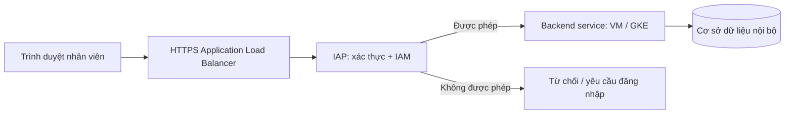
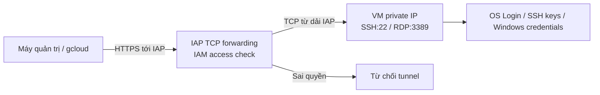
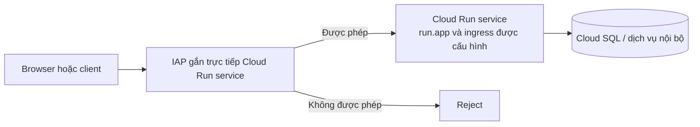

# Identity-Aware Proxy cho ứng dụng và TCP forwarding

## 1. Vấn đề: không phải tài nguyên nào cũng nên công khai trên Internet

Trong một hệ thống Google Cloud, nhiều ứng dụng chỉ dành cho nhân viên hoặc quản trị viên: trang điều hành đơn hàng, dashboard nội bộ, giao diện quản trị dịch vụ, máy ảo chạy cơ sở dữ liệu và bastion phục vụ xử lý sự cố. Nếu chỉ dựa vào việc công bố IP, mở port hoặc cho phép một dải IP văn phòng, tổ chức sẽ gặp khó khăn khi nhân viên làm việc từ xa, thay đổi mạng hoặc khi một tài khoản bị chiếm quyền.

**Identity-Aware Proxy (IAP)** là một cơ chế kiểm soát truy cập dựa trên **danh tính và ngữ cảnh** ở phía trước tài nguyên được hỗ trợ. Thay vì bắt buộc người dùng phải ở một địa chỉ IP cụ thể, IAP có thể xác thực danh tính và kiểm tra quyền IAM trước khi chuyển yêu cầu đến ứng dụng hoặc mở một đường hầm TCP.

Trong module **CLOUD_PROVIDERS_GCP**, IAP kết nối các nội dung về **Organization/Project, IAM, VPC, Compute Engine, GKE, Cloud Run**, triển khai ứng dụng và giám sát bảo mật. Hiểu IAP giúp đội kỹ thuật xây dựng đường truy cập vận hành có kiểm soát, giảm nhu cầu gán public IP cho VM và giới hạn bề mặt tấn công.

Sau bài học, bạn sẽ:

1. Phân biệt **IAP cho ứng dụng web** với **IAP TCP forwarding**.
2. Thiết kế điểm thực thi xác thực và phân quyền cho HTTP(S), SSH, RDP và TCP tùy biến.
3. Sử dụng các IAM roles như `roles/iap.httpsResourceAccessor`, `roles/iap.tunnelResourceAccessor` và quyền hệ điều hành độc lập với IAP.
4. Hiểu cách tích hợp IAP với **Application Load Balancer**, **Cloud Run**, Compute Engine và kiến trúc VPC/hybrid.
5. Thực hành lệnh `gcloud compute ssh --tunnel-through-iap` và `gcloud compute start-iap-tunnel`.
6. Phòng tránh các lỗi như **bypass trực tiếp vào backend**, mở firewall quá rộng, tin header chưa được xác minh và cấp quyền tunnel vượt nhu cầu.
7. Xử lý lỗi truy cập bằng IAM, audit logs, kiểm tra kết nối, quy trình vận hành và theo dõi chi phí.

> **Lưu ý:** Các Project ID, domain, VM, địa chỉ và email trong bài đều là **ví dụ giả định**. Lệnh tạo firewall hoặc sửa IAM có tác động bảo mật và chỉ được thực hiện khi có quyền cùng quy trình phê duyệt phù hợp. Đối với production, hãy xác minh tính năng, điều kiện sử dụng và cú pháp theo tài liệu hiện hành.

## 2. Mô hình Zero Trust và vị trí của IAP

Theo cách tiếp cận **Zero Trust**, một yêu cầu không được tin tưởng chỉ vì xuất phát từ mạng nội bộ. Quyền truy cập phải gắn với danh tính, ngữ cảnh và chính sách trên tài nguyên cụ thể.

IAP có hai hướng sử dụng chính:

| Hướng sử dụng | Tài nguyên điển hình | Kiểu kết nối | IAP kiểm tra gì? |
| --- | --- | --- | --- |
| **IAP-secured web applications** | Ứng dụng sau HTTPS Application Load Balancer, App Engine, Cloud Run trực tiếp theo cấu hình hỗ trợ | HTTP(S) | Danh tính người gọi và IAM/điều kiện truy cập web |
| **IAP TCP forwarding** | Compute Engine VM, một số đích TCP khác qua chức năng được hỗ trợ | SSH (TCP/22), RDP (TCP/3389), cổng TCP quản trị khác | Quyền mở tunnel tới tài nguyên/đích và port; ngữ cảnh IAM |

Hai hướng này dùng chung tinh thần **identity-aware access** nhưng **không có cùng cấu hình backend, luồng mạng hoặc vai trò IAM**.

### IAP không thay thế những lớp bảo vệ nào?

- **Xác thực ứng dụng và phân quyền nghiệp vụ:** IAP cho phép một principal tới ứng dụng, nhưng ứng dụng vẫn cần quyết định người đó được đọc đơn hàng hay sửa cấu hình gì.
- **Quyền hệ điều hành:** được phép mở tunnel SSH không tự tạo quyền đăng nhập Linux; được phép tunnel RDP không tự cấp tài khoản Windows.
- **Firewall và VPC:** IAP TCP cần đường mạng tới VM; IAP web cần chặn đường truy cập vòng qua IAP.
- **TLS và bảo vệ dữ liệu:** IAP dùng kênh bảo vệ cho kết nối tới IAP, nhưng dữ liệu nhạy cảm vẫn cần mã hóa khi lưu, quy tắc truyền dữ liệu và bảo vệ ứng dụng.
- **MFA, Context-Aware Access và giám sát:** IAP có thể phối hợp các cơ chế này; không nên xem việc bật IAP là hoàn thành toàn bộ chiến lược bảo mật.

**Nguyên tắc:** IAP bảo vệ **đường đi được cấu hình qua IAP**. Nếu tồn tại một đường đi khác đến cùng ứng dụng hoặc VM mà không qua IAP, người dùng có thể **bypass** lớp kiểm tra này.

## 3. Luồng truy cập ứng dụng web qua IAP

Giả sử nhân viên truy cập `https://admin.example.com`, ứng dụng được triển khai trên Compute Engine hoặc GKE, phía trước có **HTTPS Application Load Balancer** và IAP:



Các bước logic:

1. Client kết nối qua HTTPS đến frontend của load balancer.
2. IAP xác định danh tính hoặc hướng người dùng tới luồng đăng nhập khi cần.
3. IAP đánh giá principal có được phép truy cập **IAP-secured web resource** theo IAM policy, và các điều kiện liên quan nếu được cấu hình.
4. Khi được phép, yêu cầu đi tới backend; IAP có thể chuyển thông tin nhận dạng đến ứng dụng dưới các header do IAP quản lý.
5. Ứng dụng thực hiện **authorization nghiệp vụ** của riêng mình.

### Định nghĩa phạm vi tài nguyên IAM

Role **IAP-secured Web App User**:

```text
roles/iap.httpsResourceAccessor
```

Role này cho phép truy cập **web resource được IAP bảo vệ**, trong phạm vi IAM binding hiệu lực. Nó **không tự cấp** role quản trị project, không cấp quyền SSH và không cho phép sửa cấu hình IAP.

Tùy sản phẩm, chính sách có thể gắn ở cấp project hoặc ở tài nguyên IAP cụ thể (ví dụ backend service hoặc Cloud Run service theo tính năng). **Ưu tiên phạm vi nhỏ nhất** cần thiết thay vì cấp cho toàn bộ project.

## 4. Luồng IAP TCP forwarding

IAP TCP forwarding cho phép một client được cấp quyền mở **tunnel TCP** tới VM mà không nhất thiết cấp external IP cho VM.



Khác với IAP web, đây là **đường hầm cho luồng byte TCP** chứ không phải HTTP reverse proxy để xử lý cookie hoặc URL path.

### Những điều quan trọng

- **TCP chứ không phải UDP:** IAP TCP forwarding phù hợp SSH, RDP và các dịch vụ quản trị dùng TCP; không phải giải pháp để chuyển UDP theo cách tương đương.
- **Có thể dùng private IP:** VM đích không cần external IP, giúp giảm bề mặt tấn công.
- **Firewall vẫn bắt buộc:** dải IP do IAP dùng phải được phép kết nối tới đúng port.
- **IAP chỉ kiểm soát tunnel:** ứng dụng bên trong vẫn yêu cầu xác thực/ủy quyền theo giao thức của nó.
- **Không phải công cụ truyền dữ liệu dung lượng lớn:** IAP TCP forwarding được thiết kế chủ yếu cho hoạt động quản trị; tài liệu sản phẩm có giới hạn và có thể kiểm soát băng thông.
- **Không tự chặn đường trực tiếp:** nếu VM vẫn có public IP và port SSH mở từ mọi nơi, người khác có thể kết nối trực tiếp mà không qua IAP.

## 5. Bảng so sánh IAP web và TCP forwarding

| Tiêu chí | IAP cho ứng dụng web | IAP TCP forwarding |
| --- | --- | --- |
| Đối tượng | Ứng dụng HTTP(S) | TCP socket trên VM/đích hỗ trợ |
| Ví dụ | Dashboard, admin portal, internal web UI | SSH, RDP, TCP admin console |
| Trải nghiệm | Browser/login, HTTP requests | `gcloud compute ssh`, local port tunnel, RDP client |
| Role truy cập | `roles/iap.httpsResourceAccessor` | `roles/iap.tunnelResourceAccessor` |
| Quyền bổ sung | Authorization nghiệp vụ, backend invocation nếu phù hợp | OS Login/SSH key hoặc Windows credentials, quyền xem VM |
| Kết nối tới backend | Qua cơ chế web IAP và sản phẩm tích hợp | IAP TCP dải nguồn đến VM/đích |
| Firewall trọng tâm | Đảm bảo không bypass IAP; cấu hình ingress hợp lệ | Chỉ mở port quản trị từ nguồn IAP và nguồn đã phê duyệt |
| Tầng truy cập | HTTP(S) | TCP transport |
| Kiểm soát port | Không dùng để cấp riêng quyền tới TCP/22 | Có thể dùng IAM Conditions theo `destination.port` |
| Nhận diện người dùng ở ứng dụng | Header/JWT có thể được IAP gửi tới backend | IAP không tự biến user thành tài khoản bên trong giao thức |

## 6. IAM và phân tách trách nhiệm

| Nhóm / principal | Quyền thông thường | Mục đích |
| --- | --- | --- |
| Nhân viên dùng portal | `roles/iap.httpsResourceAccessor` trên đúng web resource | Truy cập ứng dụng qua IAP |
| Admin VM dùng tunnel | `roles/iap.tunnelResourceAccessor` | Được phép thiết lập tunnel |
| Admin đăng nhập Linux | `roles/compute.osLogin` hoặc `roles/compute.osAdminLogin` khi bật OS Login | Quyền đăng nhập hệ điều hành |
| Admin thao tác cấu hình VM | Role Compute phù hợp, ví dụ `roles/compute.instanceAdmin.v1` khi công việc đòi hỏi | Quản trị tài nguyên Compute Engine |
| Principal thao tác với service account VM | `roles/iam.serviceAccountUser` khi cần | Sử dụng danh tính service account theo cơ chế IAM |
| Người quản trị IAP policies | `roles/iap.admin` hoặc role quản trị policy thích hợp theo sản phẩm | Cấu hình và phân quyền IAP |
| Người quản trị firewall | Role network/security admin phù hợp | Mở chính xác đường từ IAP đến backend |

Các quyền trong bảng không phải gói bắt buộc cấp đồng loạt cho mọi người. Tài liệu `gcloud compute ssh` yêu cầu một số quyền đọc VM/project; mô hình OS Login và metadata-based SSH keys có quyền hệ điều hành khác nhau.

### Hai lớp quyền trong IAP TCP

Một nhân viên có quyền `roles/iap.tunnelResourceAccessor` nhưng không có quyền OS Login có thể **mở tunnel** thành công rồi vẫn **không đăng nhập SSH** được. Ngược lại, nhân viên có `roles/compute.osLogin` nhưng thiếu quyền IAP tunnel sẽ thất bại **trước** khi tới lớp hệ điều hành.

### Hai lớp quyền trong IAP web

Một nhân viên có quyền tới web portal qua IAP không mặc nhiên được phép:

- Xem bảng dữ liệu nhạy cảm trong hệ thống.
- Thay đổi IAM của Google Cloud project.
- Gọi API nội bộ từ môi trường khác.

**Đăng nhập được** và **được thực hiện thao tác nghiệp vụ** là hai quyết định khác nhau. Hạn chế việc áp dụng vai trò IAP ở cấp project nếu ứng dụng có nhóm người dùng khác nhau.

## 7. Bảo vệ web app qua HTTPS Application Load Balancer

Mô hình này phù hợp khi ứng dụng ở **Compute Engine, GKE hoặc backend được load balancer hỗ trợ**, và tổ chức muốn bảo vệ một hoặc nhiều backend service bằng IAP.

### Bước 1: Chọn điểm bảo vệ

Xác định HTTPS frontend, URL map, backend service và tài nguyên ứng dụng. IAP được bật trên **backend service phù hợp**, không phải đơn giản là một công tắc gắn vào mọi IP hoặc mọi forwarding rule.

Ví dụ:

```text
https://admin.example.com
        │
        ▼
External HTTPS Application Load Balancer
        │ backend service: admin-backend
        ▼
IAP-secured backend service
        │
        ▼
Managed instance group / GKE workload
```

### Bước 2: Cấu hình IAP cho backend

Trong Google Cloud Console, vào phần **Identity-Aware Proxy** hoặc cấu hình backend của **Application Load Balancer**, xác định backend service cần bảo vệ rồi bật IAP theo luồng thiết lập OAuth của sản phẩm.

Với những cấu hình dùng OAuth client riêng và hỗ trợ CLI, mẫu lệnh có dạng:

```bash
# Ví dụ thao tác thay đổi chính sách/cấu hình:
# yêu cầu backend service và OAuth client đã được tạo hợp lệ.
gcloud compute backend-services update BACKEND_SERVICE_NAME \
  --global \
  --iap=enabled,oauth2-client-id=OAUTH_CLIENT_ID,oauth2-client-secret=OAUTH_CLIENT_SECRET \
  --project=PROJECT_ID
```

**Không đặt OAuth client secret trực tiếp vào source control, ticket công khai hoặc shell history.** Dùng cơ chế quản lý bí mật và phương thức cấu hình được tổ chức chấp thuận. Một số luồng thiết lập dùng **Google-managed OAuth client**, vì thế phải làm theo hướng dẫn phù hợp với loại tài nguyên thay vì sao chép nguyên lệnh trên.

### Bước 3: Cấp quyền người dùng web

Tạo IAM binding `roles/iap.httpsResourceAccessor` cho đúng nhóm được phép sử dụng portal. Có thể áp dụng điều kiện truy cập theo **Access Context Manager** ở những luồng hỗ trợ và sau khi kiểm tra chính sách tổ chức.

Ví dụ: chỉ nhóm `commerce-admins@example.com` được vào giao diện quản trị; khách hàng internet không được nhận vai trò đó.

### Bước 4: Ngăn bypass backend

IAP chỉ kiểm soát lưu lượng **đi qua lớp bảo vệ của IAP**. Nếu backend có public endpoint độc lập cho phép truy cập trực tiếp, cần đóng hoặc hạn chế đường này:

- Với VM, tránh public IP/ingress ngoài nhu cầu; áp dụng firewall đúng nguồn load balancer và health check.
- Với GKE, kiểm tra Service, Ingress/Gateway, external IP và các đường vòng tới backend.
- Với Cloud Run làm backend cho load balancer, cần giới hạn ingress phù hợp hoặc vô hiệu default URL theo kiến trúc được hỗ trợ.
- Trong mọi trường hợp, vẫn giữ xác thực/ủy quyền ứng dụng và kiểm tra token ký từ IAP nếu sử dụng danh tính do IAP cung cấp.

### Lưu ý Cloud CDN

**Cloud CDN và IAP không tương thích khi bật trên cùng backend service theo hướng dẫn IAP của external Application Load Balancer.** Nếu backend cần cache công khai qua CDN và một phần yêu cầu xác thực bằng IAP, cần tách kiến trúc/đường đi thích hợp; không mặc định kết hợp hai tính năng trên cùng backend.

## 8. Bật IAP trực tiếp trên Cloud Run

Cloud Run hỗ trợ **IAP trực tiếp trên service**. Đây là điểm khác so với kiến trúc cũ bắt buộc đặt IAP tại load balancer.



### Ưu điểm

- Có thể bảo vệ **tất cả ingress paths** đến Cloud Run service, bao gồm URL mặc định `run.app` và các luồng qua load balancer.
- Đỡ phải dựng load balancer chỉ để có điểm kiểm tra IAP cho một Cloud Run service đơn giản.
- Có thể quản lý quyền IAP theo principal hoặc group.

### Giới hạn quan trọng

**Không cấu hình IAP đồng thời trên load balancer và trên chính Cloud Run service.** Phải chọn **một điểm thực thi IAP** cho đường đi đó theo tài liệu Cloud Run. Khi chuyển đổi phương án, cần đánh giá chính sách, service agent và các đường ingress để tránh bị chặn nhầm hoặc tạo đường bypass.

### Mẫu cấu hình CLI

Giả sử service `admin-portal` đã được triển khai trong region `asia-southeast1`, project `acme-prod-001`.

```bash
# Thao tác thay đổi dịch vụ, chỉ chạy khi đã được duyệt
gcloud run services update admin-portal \
  --region=asia-southeast1 \
  --project=acme-prod-001 \
  --iap
```

IAP cần khả năng gọi Cloud Run service. Với cách cấu hình bằng `gcloud`, tài liệu yêu cầu **IAP service agent** được cấp `roles/run.invoker` trên service. Mẫu danh tính:

```text
service-PROJECT_NUMBER@gcp-sa-iap.iam.gserviceaccount.com
```

Ví dụ (thay `PROJECT_NUMBER` thật và service thật):

```bash
# Thay đổi IAM của Cloud Run service:
gcloud run services add-iam-policy-binding admin-portal \
  --region=asia-southeast1 \
  --project=acme-prod-001 \
  --member=serviceAccount:service-PROJECT_NUMBER@gcp-sa-iap.iam.gserviceaccount.com \
  --role=roles/run.invoker
```

Khi bật IAP bằng **Cloud Run Console**, vai trò invoker cho IAP service agent thường được cấu hình tự động trong quy trình được hỗ trợ. Không gán quyền công khai `allUsers` để khắc phục lỗi invoker mà không hiểu nguyên nhân.

### Đọc cấu hình và chính sách IAP

```bash
# Chỉ đọc: trạng thái IAP trên Cloud Run service
gcloud run services describe admin-portal \
  --region=asia-southeast1 \
  --project=acme-prod-001

# Chỉ đọc: IAM policy cấp quyền IAP web cho Cloud Run service
gcloud iap web get-iam-policy \
  --resource-type=cloud-run \
  --service=admin-portal \
  --region=asia-southeast1 \
  --project=acme-prod-001
```

Trong kết quả `describe`, kiểm tra thông tin **Iap Enabled: true**. Với nhóm người dùng cần truy cập, dùng binding `roles/iap.httpsResourceAccessor` trên IAP resource tương ứng.

```bash
# Ví dụ cấp quyền truy cập web: thay đổi IAM sau phê duyệt
gcloud iap web add-iam-policy-binding \
  --resource-type=cloud-run \
  --service=admin-portal \
  --region=asia-southeast1 \
  --project=acme-prod-001 \
  --member=group:commerce-admins@example.com \
  --role=roles/iap.httpsResourceAccessor
```

**Chú ý:** service agent invoker dùng để IAP gọi được Cloud Run, còn `httpsResourceAccessor` cho biết **người dùng nào** được IAP cho qua. Hai binding khác nhau và không thay thế nhau.

### OAuth và người dùng ngoài tổ chức

Google-managed OAuth client thường phù hợp với người dùng **trong Organization**. Khi phục vụ người dùng **ngoài Organization** hoặc project không thuộc Organization, có thể cần **custom OAuth client** và bước thiết lập riêng; việc cấu hình ban đầu đôi khi phải thực hiện qua Console. Xem tài liệu hiện hành thay vì mặc định email bên ngoài sẽ được chấp thuận ngay.

## 9. Bảo vệ danh tính ứng dụng qua IAP signed headers

Khi IAP web đã xác thực người dùng, ứng dụng có thể nhận thông tin danh tính qua HTTP headers. Nhưng **không nên tin tuyệt đối một giá trị email nằm trong request** nếu ứng dụng có khả năng bị truy cập ngoài IAP.

### Header có và không có chữ ký

| Header | Ý nghĩa | Cách xử lý |
| --- | --- | --- |
| `x-goog-authenticated-user-email` | Thông tin email được IAP gửi trong request đi qua IAP | Không coi là bằng chứng mạnh nếu chưa chắc mọi request đều qua IAP |
| `x-goog-authenticated-user-id` | Mã định danh của người dùng từ IAP | Vẫn cần tránh spoofing ở đường bypass |
| `x-goog-iap-jwt-assertion` | JWT được IAP ký | Kiểm tra **signature, issuer, audience và thời hạn** trước khi tin |

Một attacker có thể tự gửi header giả nếu họ truy cập thẳng vào backend ngoài IAP. IAP cố gắng loại bỏ/thay thế các header client tự khai trên luồng qua IAP, nhưng **đường backend không được bảo vệ** vẫn cần bị chặn.

### Quy trình xác minh JWT

Ứng dụng có thể dùng thư viện JWT tin cậy để:

1. Đọc `x-goog-iap-jwt-assertion`.
2. Kiểm tra chữ ký bằng **public keys** IAP công bố, không hard-code một khóa duy nhất.
3. Yêu cầu thuật toán ký phù hợp, ví dụ **ES256** theo tài liệu IAP signed headers.
4. Kiểm tra `iss` là `https://cloud.google.com/iap`.
5. Kiểm tra `aud` đúng **IAP resource được bảo vệ**, với định dạng audience phụ thuộc loại backend.
6. Kiểm tra `exp`, `iat` và những ràng buộc thời gian theo thư viện và chính sách.
7. Trích xuất identity từ claims được xác minh rồi mới dùng để quyết định nghiệp vụ.

Ví dụ pseudocode, **không phải hàm bảo mật hoàn chỉnh**:

```text
token = request.header["x-goog-iap-jwt-assertion"]
claims = verify_with_iap_public_keys(
    token,
    expected_algorithm="ES256",
    expected_issuer="https://cloud.google.com/iap",
    expected_audience=RESOURCE_AUDIENCE,
    validate_expiration=true
)

if claims invalid:
    reject(401)

identity = claims["sub"]
authorize_business_action(identity, requested_action, resource)
```

**Không tự viết giải mã JWT bằng cách parse Base64 rồi tin claims.** Cần thư viện xác minh chữ ký thực sự, và định dạng audience phải lấy theo tài liệu ứng với **App Engine, Compute Engine backend service hoặc Cloud Run**. Không sao chép audience của môi trường thử nghiệm sang production.

## 10. Chuẩn bị IAP TCP forwarding trên Compute Engine

Tình huống: VM tên `ops-vm-01` tại project `acme-prod-001`, zone `asia-southeast1-a`, chỉ có **private IP**, dùng cho quản trị nội bộ.

### Điều kiện trước khi kết nối

1. Project có Compute Engine API, IAP API và billing theo yêu cầu sản phẩm.
2. VM đang chạy, có listener SSH TCP/22 (hoặc RDP TCP/3389 / dịch vụ TCP khác).
3. Client có `gcloud` hoặc công cụ hỗ trợ IAP TCP, đã đăng nhập đúng principal.
4. Principal được cấp quyền **IAP tunnel** trên đúng resource, và các quyền đọc VM cần thiết.
5. Firewall trong **VPC sở hữu subnet VM** cho phép ingress từ dải IAP TCP tới port cần thiết.
6. VM có tài khoản hệ điều hành/OS Login hoặc cơ chế xác thực của dịch vụ phù hợp.

### Dải nguồn IAP TCP

Với IPv4, dải nguồn được tài liệu Google Cloud chỉ định cho IAP TCP forwarding là:

```text
35.235.240.0/20
```

Với IPv6, tài liệu cũng công bố:

```text
2600:2d00:1:7::/64
```

Không mở port từ `0.0.0.0/0` chỉ vì không kết nối được. Nên giới hạn **đúng port và đúng backend** bằng firewall target tags hoặc service accounts khi sản phẩm hỗ trợ. Dải IAP là **nguồn gói mạng**, còn **ai có quyền dùng IAP** được kiểm soát bằng IAM riêng.

### Ví dụ firewall rule

Giả sử VM có network tag `iap-admin-ssh` và thuộc VPC `corp-prod` trong project host `acme-network-prod`:

```bash
# Thay đổi firewall: chỉ thực hiện khi được phê duyệt
gcloud compute firewall-rules create allow-ssh-from-iap \
  --project=acme-network-prod \
  --network=corp-prod \
  --direction=INGRESS \
  --action=ALLOW \
  --rules=tcp:22 \
  --source-ranges=35.235.240.0/20 \
  --target-tags=iap-admin-ssh
```

Nếu không dùng Shared VPC, project chứa firewall thường là project sở hữu VPC. Với Shared VPC, VM nằm trong **service project** còn firewall network thường được quản trị trong **host project**. Người tạo rule phải được cấp quyền thay đổi firewall ở phạm vi đúng.

**Kiểm tra quan trọng:** Quy tắc mới không tự thu hồi các ingress rules khác. Nếu có rule `default-allow-ssh` cho `0.0.0.0/0` hoặc VM có public IP với SSH mở, truy cập trực tiếp có thể vẫn đi vòng qua IAP.

## 11. Kết nối SSH qua IAP

Đối với VM không có public IP, `gcloud compute ssh` có thể tự chọn IAP tunnel. Nhưng để bảo đảm mọi kết nối SSH đều đi qua IAP, **chỉ rõ `--tunnel-through-iap`**:

```bash
gcloud compute ssh ops-vm-01 \
  --project=acme-prod-001 \
  --zone=asia-southeast1-a \
  --tunnel-through-iap
```

Khi VM có external IP, `gcloud compute ssh` **có thể dùng kết nối trực tiếp qua external IP nếu không có flag này**. Vì vậy, khi kiểm thử policy IAP, luôn quan sát chính xác phương thức kết nối.

### Phân biệt hai lỗi phổ biến

- **Tunnel bị IAP từ chối:** kiểm tra `roles/iap.tunnelResourceAccessor`, IAM Conditions, VM/zone/project và quyền của principal.
- **Tunnel đã mở nhưng SSH thất bại:** kiểm tra OS Login/SSH keys, sshd, tài khoản Linux, firewall port 22, metadata và logs VM.

Role `roles/iap.tunnelResourceAccessor` không thay thế `roles/compute.osLogin` hay các role phù hợp cho SSH. Khi sử dụng **OS Login**, hãy cấp quyền đúng mức (`osLogin` hoặc `osAdminLogin`), xem nhu cầu sudo và tránh tạo tài khoản dùng chung thiếu truy vết.

### Lệnh chỉ đọc hỗ trợ điều tra

```bash
# Xác nhận principal gcloud hiện tại
gcloud auth list

# Xác nhận VM và network interfaces
gcloud compute instances describe ops-vm-01 \
  --project=acme-prod-001 \
  --zone=asia-southeast1-a \
  --format="yaml(name,status,networkInterfaces,metadata)"

# Kiểm tra ingress firewall liên quan ở host project
gcloud compute firewall-rules list \
  --project=acme-network-prod \
  --filter="network:corp-prod"
```

Không in hoặc chia sẻ access token, SSH private keys hay metadata nhạy cảm trong log công khai.

## 12. Dùng start-iap-tunnel cho RDP và TCP tùy biến

`gcloud compute start-iap-tunnel` mở một **cổng TCP cục bộ** và chuyển lưu lượng đi qua IAP tới một port của VM đích.

### 12.1. RDP tới Windows VM

VM Windows `win-admin-01` không có public IP, RDP lắng nghe port 3389:

```bash
gcloud compute start-iap-tunnel win-admin-01 3389 \
  --project=acme-prod-001 \
  --zone=asia-southeast1-a \
  --local-host-port=localhost:13389
```

Khi lệnh báo đã lắng nghe tại `localhost:13389`, để terminal tiếp tục chạy và mở Remote Desktop client tới:

```text
localhost:13389
```

Lưu lượng từ RDP client đi vào cổng local rồi qua HTTPS đến IAP và tiếp tục tới TCP/3389 của VM. **IAP không cung cấp mật khẩu Windows**: người dùng vẫn phải có tài khoản/credential hợp lệ trong Windows.

Nếu mở cổng local trên interface khác `localhost`, có nguy cơ để máy khác truy cập tunnel của bạn. Ưu tiên local loopback; không chia sẻ tunnel qua LAN trừ khi có kiến trúc bảo vệ riêng.

### 12.2. Dịch vụ TCP quản trị khác

Ví dụ VM chạy một giao diện quản trị nội bộ trên TCP/8443:

```bash
gcloud compute start-iap-tunnel ops-vm-01 8443 \
  --project=acme-prod-001 \
  --zone=asia-southeast1-a \
  --local-host-port=localhost:18443
```

Ứng dụng cục bộ có thể kết nối `localhost:18443`. Nếu dịch vụ đích yêu cầu TLS với hostname riêng, client cần được cấu hình **đúng tên máy chủ/certificate**, không bỏ qua xác thực TLS chỉ vì đường hầm đã được IAP mã hóa.

**Đường hầm TCP không tương đương quyền truy vấn database.** Với MySQL/PostgreSQL, người dùng vẫn cần database credentials, network/SSL settings và phân quyền database. Không dùng IAP tunnel như đường công bố chung cho lưu lượng nghiệp vụ khối lượng lớn.

### 12.3. Windows PowerShell

Trong PowerShell, có thể nhập toàn bộ lệnh ở một dòng:

```powershell
gcloud compute start-iap-tunnel win-admin-01 3389 --project=acme-prod-001 --zone=asia-southeast1-a --local-host-port=localhost:13389
```

Ký hiệu `\` dùng xuống dòng trong các ví dụ Bash ở trên không phải ký hiệu nối dòng của PowerShell.

## 13. Điều kiện IAM theo port hoặc ngữ cảnh

Thay vì cho quản trị viên mở tunnel tới **mọi TCP port**, bạn có thể dùng **IAM Conditions** với role `roles/iap.tunnelResourceAccessor`.

Ví dụ điều kiện:

```cel
destination.port == 22
```

Ý nghĩa: grant tunnel chỉ phù hợp khi **destination port** bằng 22. Đây là điều kiện cho **IAP TCP access**, không phải cấu hình firewall.

Ví dụ condition chặt hơn:

```cel
destination.port == 22 &&
destination.ip == "10.20.10.15"
```

Có thể kết hợp với **Access Context Manager access levels** khi tổ chức có cấu hình và sản phẩm hỗ trợ. Điều kiện liên quan `request.auth.access_levels` chỉ được dùng khi đã tạo và kiểm soát Access Level phù hợp.

### Điều kiện và giới hạn

- IAM Conditions giới hạn **binding đang xét**, không nhất thiết xóa các grant khác ở cấp cha hoặc tài nguyên khác.
- IAM chính sách dành cho tunnel phải được gắn vào **IAP tunnel resource** đúng phạm vi; gắn sai nơi có thể tạo quyền rộng hoặc không có tác dụng.
- Điều kiện theo port không tự chặn ingress firewall từ nguồn khác.
- Gắn condition theo IP đích cần xét thay đổi private IP, nhiều NIC hoặc việc thay VM.
- Người dùng vẫn cần quyền đăng nhập ở tầng OS hoặc ứng dụng.

Khi thay đổi IAM, nên kiểm tra cả **positive test** (principal hợp lệ vào đúng port) và **negative test** (không vào được port khác hoặc VM ngoài phạm vi).

## 14. IAP trong hệ thống GKE, Cloud Run và hybrid

### 14.1. GKE và trang điều hành nội bộ

Một GKE cluster có thể phục vụ ứng dụng web thông qua HTTPS Application Load Balancer. IAP bảo vệ **backend web được hỗ trợ**, tùy loại Ingress/Gateway, BackendConfig và khả năng tích hợp sản phẩm.

Điều cần phân tích:

1. Tài nguyên Kubernetes nào được LB ánh xạ đến backend service?
2. IAP có được bật trên đúng backend chưa?
3. Có Service type LoadBalancer, Ingress khác hoặc public endpoint dẫn thẳng tới ứng dụng không?
4. Người dùng cuối có được grant `httpsResourceAccessor` không?
5. Ứng dụng có kiểm tra JWT/IAP identity và phân quyền thao tác nghiệp vụ không?

Không nên giả định một IAM binding của project tự bảo vệ mọi Pod hoặc mọi Kubernetes Service. Và không dùng IAP TCP forwarding như cách thay thế các chính sách **Kubernetes RBAC** hoặc quản trị control plane.

### 14.2. Cloud Run

Nếu chỉ cần bảo vệ một Cloud Run service với IAP, **IAP trực tiếp trên Cloud Run** thường là lựa chọn đơn giản. Nếu cần nhiều tính năng mạng ở frontend như tập trung HTTPS host/path routing, xem **Application Load Balancer** và chọn vị trí bật IAP **hoặc** ở Cloud Run theo cách được hỗ trợ.

Đặc biệt chú ý những sự kiện push hoặc lời gọi máy-máy: khi bật IAP, đường gọi bằng cơ chế xác thực dịch vụ khác (ví dụ Pub/Sub push đến endpoint) có thể cần thiết kế lại hoặc một endpoint tách riêng. Đừng mặc định một JWT/OIDC token gọi Cloud Run trực tiếp sẽ luôn đủ để vượt IAP.

### 14.3. Tài nguyên on-premises qua hybrid connectivity

IAP TCP forwarding có các tính năng hỗ trợ **tunnel destination groups** cho private IP/FQDN ngoài Compute Engine, kể cả đích ở on-premises nối với Google Cloud bằng **Cloud VPN hoặc Cloud Interconnect**. Trường hợp này khác kiểu tunnel mặc định theo tên VM:

- Cần cấu hình **destination group**, vùng và mạng theo tài liệu sản phẩm.
- Route và firewall phải cho phép traffic và đường phản hồi từ nguồn IAP.
- Đối với đích qua VPN/Interconnect, cần cân nhắc quảng bá dải **35.235.240.0/20** để lưu lượng phản hồi đi đúng đường hybrid.
- Quyền IAM được đánh giá trên đích/tunnel destination group, không chỉ trên Compute Engine instance.

Không lấy cấu hình chỉ dành cho VM rồi áp trực tiếp lên máy chủ on-premises; xem tài liệu **IAP TCP forwarding by hostname/IP** để thiết kế đúng.

## 15. Chống bypass và bảo vệ môi trường production

### Checklist kỹ thuật

1. **Giảm public exposure:** quản trị VM qua private IP/IAP, không mở SSH/RDP trực tiếp từ internet nếu không cần.
2. **Firewall đúng hướng:** chỉ cho IAP TCP từ nguồn và port cần thiết, có chính sách explicit deny/cleanup các rule quá rộng.
3. **Phạm vi IAM nhỏ:** cấp IAP web/tunnel trên resource cụ thể hoặc theo nhóm có thể kiểm toán; áp điều kiện theo port hoặc access level khi phù hợp.
4. **Xác thực ở backend:** OS Login/MFA, Windows credentials, ứng dụng có session/role và xác minh JWT khi dùng danh tính IAP.
5. **Không mở đường vòng:** hạn chế public URL, ingress và load balancer phụ; kiểm tra cả DNS và các endpoint không công bố.
6. **Bảo vệ quyền thay đổi:** role IAP Admin/Policy Admin, Security Admin và quyền thay đổi ingress/load balancer phải được review.
7. **Quan sát:** Cloud Audit Logs, IAP access logs và monitoring theo tài nguyên; kiểm tra thất bại lặp lại hoặc grants bất thường.
8. **Kế hoạch sự cố:** xác định ai được phép khắc phục IAM và mạng khi IAP hoặc danh tính người dùng gặp lỗi.

### Không “chữa cháy” bằng cách nới toàn bộ quyền

Nếu IAP từ chối kết nối SSH, cấp `roles/owner` hoặc mở `tcp:22` cho `0.0.0.0/0` có thể làm hệ thống truy cập được nhưng phá hỏng chủ đích của kiến trúc. Cách đúng là tìm **lớp nào đang từ chối**: danh tính, IAM tunnel, OS Login, firewall, listener hay route.

## 16. Troubleshooting IAP web và TCP forwarding

| Hiện tượng | Nguyên nhân có thể | Cách kiểm tra |
| --- | --- | --- |
| Web app chuyển đến trang đăng nhập liên tục | Cookie/session, OAuth configuration, browser policy, tài khoản khác | Kiểm tra IAP configuration, browser flow, OAuth client và account |
| Web trả 403 sau khi đăng nhập | Thiếu `httpsResourceAccessor`, IAM Condition, Access Level không khớp | Đọc IAP IAM policy trên đúng resource và các điều kiện |
| Web vào được qua đường khác dù IAP đã bật | Direct backend URL/public IP/ingress chưa khóa | Kiểm tra tất cả ingress paths và firewall, ứng dụng xác minh JWT |
| Cloud Run bật IAP nhưng truy cập thất bại | IAP service agent thiếu `run.invoker` hoặc role người dùng thiếu | Xem Cloud Run describe/IAM và IAP web IAM policy |
| Cloud Run không xử lý Pub/Sub push như trước | Luồng machine-to-machine không đáp ứng IAP | Rà soát kiến trúc caller, token và phân tách endpoint |
| `gcloud compute ssh` không đi qua IAP | VM có external IP nên gcloud đi trực tiếp | Thêm `--tunnel-through-iap` và kiểm tra logs |
| SSH báo thiếu quyền trước khi mở kết nối | Principal thiếu `tunnelResourceAccessor`, VM read permission hoặc condition sai | Xem account, project/zone, IAM IAP và IAM Conditions |
| IAP tunnel mở nhưng SSH login lỗi | OS Login/SSH key/sshd sai | Kiểm tra quyền OS, account, sshd và VM logs |
| RDP tunnel mở nhưng client không vào Windows | RDP listener, Windows firewall, credentials, local port sai | Kiểm tra port 3389, Windows settings và tunnel listener |
| Tunnel bị timeout | Không có firewall ingress từ `35.235.240.0/20`, network route/VM listener lỗi | Xem VPC firewall, route, VM status, port và health |
| Mở local tunnel nhưng ứng dụng báo lỗi TLS | Certificate không khớp hostname `localhost` | Giữ xác minh TLS, dùng cấu hình hostname phù hợp |
| IAP hybrid tunnel không nối được máy on-premises | Destination group, route/Cloud Router quảng bá dải IAP, firewall chưa đúng | Kiểm tra mạng hybrid, return path, IAM destination group |
| Truy cập bị từ chối chỉ sau thay đổi role | Propagation delay, thay đổi group membership/condition | Đọc IAM effective, audit logs và thử lại sau khi policy ổn định |

### Trình tự điều tra theo từng lớp

```text
Principal và tài khoản gcloud/browser
       ↓
IAP IAM policy + Conditions/Access Levels
       ↓
IAP web resource hoặc TCP tunnel destination
       ↓
Ingress/Firewall/VPC route
       ↓
Backend VM / Cloud Run / GKE
       ↓
OS Login / RDP account / application authorization
```

Không kết luận “lỗi IAP” chỉ từ HTTP 403 hoặc một phiên SSH thất bại. Cần tìm **tại lớp nào** request bị chặn và **principal thực tế** đang thực hiện. Thời gian lan truyền IAM và cấu hình có thể khiến kết quả tạm thời không đồng nhất ngay sau khi thay đổi.

## 17. Giám sát, kiểm toán, độ tin cậy và chi phí

### 17.1. Cloud Audit Logs và điều tra truy cập

Theo dõi các thao tác thay đổi cấu hình IAP, cấp/thu hồi IAM, mở tunnel hoặc truy cập web qua những **Cloud Audit Logs** mà sản phẩm cung cấp. Một số loại truy cập thuộc **Data Access logs** có thể cần bật thêm; tránh mặc định mọi sự kiện đều được ghi miễn phí và sẵn có.

Những tín hiệu hữu ích:

- Số lượng người dùng bị từ chối IAP tăng bất thường.
- Tài khoản mới được cấp `httpsResourceAccessor` hoặc `tunnelResourceAccessor` trên project production.
- Thay đổi bất thường đối với firewall SSH/RDP hoặc Cloud Run ingress.
- Đường kết nối trực tiếp tới backend xuất hiện ngoài thiết kế.
- Thời gian thiết lập tunnel, lỗi timeout và tỷ lệ thất bại sau một thay đổi IAM.

### 17.2. Độ tin cậy và trải nghiệm người dùng

IAP đặt thêm một kiểm tra trên đường truy cập. Với portal quan trọng, cần đo từ góc nhìn người dùng: tỷ lệ đăng nhập thành công, thời gian tải trang, lỗi 403/5xx, đáp ứng backend và quy trình khôi phục quyền. Với quản trị SSH/RDP, cần có runbook nếu identity provider, mạng khách hoặc IAP không sẵn sàng.

Tránh tạo **tài khoản khẩn cấp quyền quá rộng và không kiểm toán được**. Một cơ chế truy cập khẩn cấp, nếu bắt buộc, cần được phê duyệt, bảo vệ bằng MFA/biện pháp bổ sung, ghi log và thu hồi sau sự cố.

### 17.3. Chi phí

Không xem IAP là giải pháp “không tốn phí”. Chi phí tổng thể có thể gồm:

- Phí IAP cho mô hình web hoặc TCP theo chính sách giá/điều kiện hiện hành.
- HTTPS Application Load Balancer, forwarding rules, data processing và network egress nếu triển khai LB.
- Compute Engine, Cloud Run, GKE, VM disk và hệ thống database phía sau.
- Cloud Logging/Monitoring và công cụ mạng liên quan.

Hãy tra **Cloud Billing Pricing/SKU** theo billing account, khu vực và thời điểm triển khai. Với một ứng dụng nội bộ ít người dùng, so sánh chi phí/tính năng giữa **IAP trực tiếp Cloud Run** và **IAP qua load balancer**, đồng thời xét độ tin cậy và nhu cầu HTTP routing.

## 18. Bài thực hành và tình huống tự đánh giá

### Bài 1: Xác định đúng loại IAP

Cho ba yêu cầu:

1. Chỉ nhóm vận hành truy cập `https://internal-admin.example.com` qua browser.
2. Nhân viên hỗ trợ cần SSH tới VM không có public IP.
3. Đội quản trị Windows cần mở RDP tới VM mà không mở TCP/3389 từ internet.

**Đáp án gợi ý:** (1) IAP-secured web application; (2) IAP TCP forwarding + OS Login/SSH; (3) IAP TCP forwarding + RDP credentials. Role web khác role tunnel.

### Bài 2: Phân tích quyền hiệu lực

Một nhân viên có `roles/iap.tunnelResourceAccessor` trên VM và firewall đã mở port 22 từ IAP, nhưng chưa được cấp OS Login.

- Tunnel có thể được tạo không?
- SSH login có chắc thành công không?
- Cần cấp thêm quyền nào, ở đâu và theo nguyên tắc gì?

**Gợi ý:** IAP tunnel có thể được phép nếu đủ quyền khác, nhưng OS Login vẫn từ chối đăng nhập. Cấp quyền OS phù hợp theo nhu cầu, không cấp Owner toàn project.

### Bài 3: Đọc cấu hình Cloud Run không thay đổi tài nguyên

Với project và service được phép xem:

```bash
gcloud run services describe SERVICE_NAME \
  --region=REGION \
  --project=PROJECT_ID

gcloud iap web get-iam-policy \
  --resource-type=cloud-run \
  --service=SERVICE_NAME \
  --region=REGION \
  --project=PROJECT_ID
```

Kiểm tra IAP có bật chưa, những principal nào có `httpsResourceAccessor`, IAP service agent có `run.invoker` không và có một LB đang bật IAP trên cùng service hay không.

### Bài 4: Thử tunnel SSH đúng cách

Chỉ trên VM lab mà bạn được phép:

```bash
gcloud compute ssh VM_NAME \
  --zone=ZONE \
  --project=PROJECT_ID \
  --tunnel-through-iap
```

Nếu lỗi, phân loại theo **IAP IAM**, **Compute/OS Login permissions**, **firewall từ IAP**, **VM listener**. Không sửa IAM/firewall trước khi ghi nhận nguyên nhân và có quyền thực hiện.

### Bài 5: Chặn đường bypass

Một admin portal được bảo vệ bằng IAP ở HTTPS load balancer, nhưng Pod trong GKE còn được truy cập qua một IP công khai khác. Hãy thiết kế biện pháp:

1. Vô hiệu hoặc giới hạn public ingress tới Pod/Service không cần thiết.
2. Cấp quyền IAP web cho đúng nhóm.
3. Kiểm tra danh tính bằng JWT có chữ ký trong ứng dụng khi cần.
4. Kiểm thử đường được phép và cố gắng truy cập trực tiếp để chứng minh không bypass được.

### Bài 6: IAM Condition theo port

Nhóm hỗ trợ cần SSH port 22 nhưng không được tạo tunnel tới database port 5432. Viết CEL condition và giải thích tại sao không đủ nếu VM vẫn mở database port trực tiếp từ một nguồn khác.

**Đáp án mẫu:**

```cel
destination.port == 22
```

Condition chỉ giới hạn **grant qua IAP TCP**; firewall và cơ chế database vẫn cần bảo vệ các đường truy cập khác.

## 19. Checklist trước khi triển khai IAP

- [ ] Xác định rõ ứng dụng **HTTP(S)** hay tài nguyên **TCP**; chọn đúng hình thức IAP.
- [ ] Có sơ đồ đầy đủ các ingress paths; không còn đường bypass không được kiểm soát.
- [ ] IAP IAM policy cấp đúng nhóm, đúng tài nguyên và có điều kiện phù hợp.
- [ ] IAP web users nhận `roles/iap.httpsResourceAccessor`, không mặc định là VM admin.
- [ ] IAP TCP users nhận `roles/iap.tunnelResourceAccessor` trên VM/đích cần thiết.
- [ ] Với SSH/RDP, đã kiểm tra **OS Login/Windows credentials** và quyền Compute phụ trợ.
- [ ] Firewall IAP TCP cho đúng dải `35.235.240.0/20`, port và backend; không mở SSH/RDP internet ngoài nhu cầu.
- [ ] IAP Cloud Run được bật tại **một điểm duy nhất**, không đồng thời với IAP ở LB.
- [ ] IAP service agent có `run.invoker` khi cấu hình Cloud Run yêu cầu.
- [ ] OAuth client và người dùng ngoài Organization được cấu hình theo hướng dẫn hiện hành.
- [ ] Ứng dụng có phân quyền nghiệp vụ và xác minh JWT signed header nếu sử dụng identity từ IAP.
- [ ] Các luồng máy-máy, Pub/Sub push hoặc webhook được kiểm tra khi bật IAP.
- [ ] Có audit logs, monitoring, positive/negative tests và runbook phục hồi.
- [ ] Đã dự toán chi phí liên quan đến IAP, LB, network, logs và workload.

## 20. Tài liệu Google Cloud chính thức

1. [Identity-Aware Proxy overview](https://cloud.google.com/iap/docs/concepts-overview)
2. [IAP – Securing web applications](https://cloud.google.com/iap/docs/enabling-cloud-run)
3. [Configure IAP for Cloud Run directly](https://cloud.google.com/run/docs/securing/identity-aware-proxy-cloud-run)
4. [Set up an external Application Load Balancer with IAP](https://cloud.google.com/iap/docs/load-balancer-howto)
5. [IAP – TCP forwarding overview](https://cloud.google.com/iap/docs/tcp-forwarding-overview)
6. [Use IAP for TCP forwarding](https://cloud.google.com/iap/docs/using-tcp-forwarding)
7. [IAP TCP forwarding by hostname or IP](https://cloud.google.com/iap/docs/tcp-by-host)
8. [IAP – Signed headers and JWT verification](https://cloud.google.com/iap/docs/signed-headers-howto)
9. [IAM roles and permissions for IAP](https://cloud.google.com/iam/docs/roles-permissions/iap)
10. [Compute Engine – OS Login](https://cloud.google.com/compute/docs/oslogin)
11. [gcloud compute ssh](https://cloud.google.com/sdk/gcloud/reference/compute/ssh)
12. [gcloud compute start-iap-tunnel](https://cloud.google.com/sdk/gcloud/reference/compute/start-iap-tunnel)
13. [Cloud Audit Logs](https://cloud.google.com/logging/docs/audit)

**Kết luận:** IAP là một **điểm kiểm tra danh tính và quyền truy cập**, không phải firewall hay hệ thống phân quyền nghiệp vụ hoàn chỉnh. Với **web app**, bảo vệ luồng HTTP(S) và chặn đường backend bypass; với **TCP forwarding**, phối hợp IAM, firewall, private IP và quyền đăng nhập hệ điều hành. Một cấu hình an toàn phải luôn kiểm chứng cả **đường đi được phép** lẫn **đường đi không được phép**.
