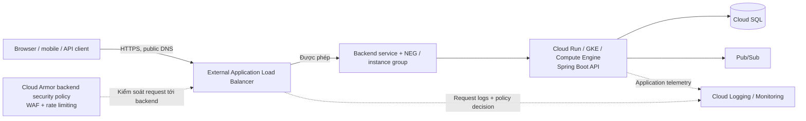
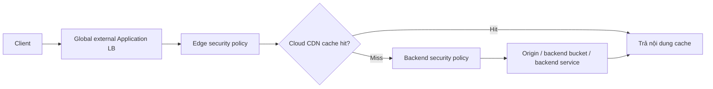

# Cloud Armor WAF, rate limiting và phòng vệ DDoS

## 1. Vấn đề: API Java cần được bảo vệ trước khi request đến backend

Một ứng dụng **Spring Boot** chạy trên **Cloud Run**, **Google Kubernetes Engine (GKE)** hoặc **Compute Engine** có thể phục vụ hàng triệu request từ Internet. Không phải request nào cũng là traffic hợp lệ: một số thử khai thác **SQL injection (SQLi)**, **cross-site scripting (XSS)**, quét endpoint, cố đăng nhập liên tục hoặc tạo lưu lượng lớn làm cạn kiệt tài nguyên.

Nếu tất cả request đều đến thẳng JVM, ứng dụng phải tốn CPU, kết nối cơ sở dữ liệu, thread và bộ nhớ để xử lý cả traffic đáng ngờ. **Google Cloud Armor** giúp áp dụng chính sách bảo vệ ở phía Google Cloud load balancing/edge đối với các cấu hình được hỗ trợ. Ba nhóm năng lực đặc biệt quan trọng:

- **Web Application Firewall (WAF):** nhận diện mẫu tấn công trong HTTP(S) request bằng quy tắc dựng sẵn dựa trên **OWASP Core Rule Set (CRS)** và biểu thức tùy chỉnh.
- **Rate limiting:** kiểm soát số request theo địa chỉ IP hoặc khóa khác; dùng **throttle** hoặc **rate-based ban** để giảm abuse, bot và các đợt tăng tải.
- **Phòng vệ DDoS:** tận dụng mạng biên Google Cloud để giảm thiểu một số hình thức tấn công làm cạn kiệt tài nguyên; bổ sung các chế độ bảo vệ network-level hoặc khả năng phát hiện thích ứng khi gói sản phẩm hỗ trợ.

Trong chương **Bảo mật và truy cập mạng** của mô-đun **CLOUD_PROVIDERS_GCP**, bài học kết nối Cloud Armor với các kỹ năng tổ chức project/IAM, VPC, Cloud Load Balancing, Cloud Run/GKE/Compute Engine, theo dõi độ tin cậy, tự động hóa triển khai và kiểm soát chi phí. **Cloud Armor là một lớp phòng thủ**, không phải giải pháp thay thế authorization, secure coding, database permissions, TLS hay kiểm thử bảo mật ứng dụng Java.

### Mục tiêu học tập

Sau bài này, bạn có thể:

1. Xác định vị trí **security policy** trong luồng request tới backend Java và các trường hợp traffic có thể đi vòng qua lớp bảo vệ.
2. Phân biệt **backend security policy**, **edge security policy** cho Cloud CDN và **network edge security policy**.
3. Cấu hình **rule priority**, **match condition**, **action**, **preview mode**, preconfigured WAF, custom rules và exclusions.
4. Thiết kế **throttle** và **rate-based ban** đúng với mẫu traffic; biết giới hạn của rate limiting trên môi trường nhiều region và nhiều backend.
5. Giải thích sự khác nhau giữa **Layer 3/4 DDoS**, **Layer 7 DDoS**, **Adaptive Protection** và bộ kiểm soát ứng dụng.
6. Thực hành bằng `gcloud` trên một **load balancer thử nghiệm**, bật log, theo dõi false positive, thử rollout và rollback an toàn.

## 2. Cloud Armor nằm ở đâu trong kiến trúc GCP?

### 2.1. Kiến trúc điển hình: HTTPS Load Balancer phía trước Spring Boot

Giả sử endpoint công khai là `https://api.example.com`. Người dùng gọi qua **external Application Load Balancer**; Cloud Armor đánh giá request theo chính sách được gắn với backend service trước khi chuyển request về **Cloud Run qua serverless NEG**, một GKE backend hoặc VM backend.



**Quan trọng:** Cloud Armor bảo vệ traffic **thực sự đi qua điểm kiểm soát được hỗ trợ**. Nếu một URL khác truy cập thẳng Cloud Run, public IP VM hoặc một load balancer không có policy, các request đó có thể **bỏ qua** chính sách. Chỉ gắn policy vào một backend service không bảo vệ mọi endpoint của project.

### 2.2. Ba lớp bảo vệ cần phân biệt

| Lớp | Công cụ/khả năng | Câu hỏi cần trả lời |
| --- | --- | --- |
| **Network/transport (L3/L4)** | Network DDoS protection, firewall, VPC, external passthrough Network Load Balancer | Có tấn công lưu lượng/giao thức tới IP, port hoặc hạ tầng mạng không? |
| **HTTP application edge (L7)** | Cloud Armor security policy, WAF, custom CEL, rate limiting, bot management | Request HTTP có pattern độc hại, request rate bất thường hoặc không đúng nguồn được phép? |
| **Backend business logic** | Spring Security, IAM/IAP khi phù hợp, input validation, prepared statements, per-account quotas | Người dùng đã xác thực có quyền thao tác tài nguyên này không? Giao dịch có hợp lệ không? |

**Cloud Armor không tự biết logic "người dùng A chỉ được xem đơn hàng của A".** Dù request vượt qua WAF, Spring Security và tầng dữ liệu vẫn phải thực thi phân quyền trên từng tài nguyên.

### 2.3. Cloud Armor áp dụng ở các lớp load balancing khác nhau

| Loại policy | Điểm áp dụng chính | Tác dụng/giới hạn cần nhớ |
| --- | --- | --- |
| **Backend security policy** | Backend service của load balancer được hỗ trợ | WAF, IP/geolocation filtering, CEL, rate limiting; với Cloud CDN, chủ yếu đánh giá request đi tới backend/cache miss |
| **Edge security policy** | Cloud CDN-enabled backend service hoặc backend bucket theo hỗ trợ của loại LB | Đánh giá request **trước khi phục vụ từ CDN cache**; có phạm vi tính năng khác backend policy |
| **Network edge security policy** | Các endpoint network/L3-L4 được hỗ trợ qua network edge service | Liên quan Advanced Network DDoS protection, một số khả năng lọc network tùy loại endpoint/tier |

Không mặc định mọi loại policy đều dùng được mọi WAF expression, rate limit key, action hoặc loại load balancer. Kiểm tra **ma trận hỗ trợ theo loại Application/Network Load Balancer, global/regional, backend service/bucket** trước khi triển khai. Ví dụ bên dưới minh họa **global external Application Load Balancer với backend security policy**, không phải regional internal ALB hay network edge policy.

## 3. Security policy và rule evaluation

### 3.1. Priority, match và action

Mỗi rule thường có **priority**, **điều kiện match** và **action**. Trong một policy, **số priority càng nhỏ càng được đánh giá trước**. Khi một request khớp một rule phù hợp, Cloud Armor áp dụng action đó; các rule ở priority thấp hơn (số lớn hơn) không tự chạy tiếp.

```text
Priority 100    Deny một nguồn IP đã xác minh độc hại
Priority 500    Kiểm tra SQLi bằng preconfigured WAF (deny, lúc đầu preview)
Priority 600    Kiểm tra XSS bằng preconfigured WAF (deny, lúc đầu preview)
Priority 1000   Throttle endpoint /api/auth/** theo IP
Priority 2147483647  Default rule (kiểm tra action; có thể đổi allow/deny)
```

Đây là **trật tự minh họa**. Một rule `allow` quá rộng ở priority 50 có thể khiến request không đi đến WAF ở priority 500. Ngược lại, rule deny ở priority thấp có thể chặn người dùng hợp lệ trước khi rule rate limit được xem xét. Khi thiết kế, phải xét **thứ tự và điều kiện thực tế** chứ không chỉ số lượng rule.

Các loại action có thể gồm `allow`, `deny(403)`, `deny(404)`, `deny(502)`, `redirect`, `throttle` và `rate-based-ban` tùy policy và điều kiện. Với rate limiting, mã **429 Too Many Requests** thường diễn đạt rõ ràng hơn khi client vượt ngưỡng.

### 3.2. Match cơ bản và biểu thức CEL

Hai kiểu match hay dùng:

- **Basic**: so sánh nguồn IP với một hoặc nhiều CIDR; phù hợp khi cần cho phép/chặn một dải được quản lý.
- **Advanced**: dùng cú pháp dựa trên **Common Expression Language (CEL)** để đánh giá `origin.ip`, `origin.region_code`, `request.path`, headers, query hoặc chức năng WAF có sẵn, theo tập thuộc tính được hỗ trợ.

Ví dụ biểu thức:

```cel
inIpRange(origin.ip, '198.51.100.0/24')
```

`198.51.100.0/24` là dải **TEST-NET-2 cho tài liệu**, không được sử dụng để chặn người dùng thật như thể đây là một threat feed. Một biểu thức lọc path:

```cel
request.path.startsWith('/api/auth/')
```

Hãy tránh dựa vào HTTP header tùy ý do client tự cung cấp làm căn cứ định danh đáng tin cậy. Nếu dùng `X-Forwarded-For`, cần hiểu chuỗi proxy và cách xác định IP nguồn; **header giả mạo** có thể làm rate limit/allowlist sai.

### 3.3. Preview mode để thử an toàn

Cloud Armor hỗ trợ **preview**: một rule vẫn được đánh giá và ghi nhận kết quả giả định, nhưng **action của rule đó không được enforce**. Đây là bước bắt buộc về mặt vận hành khi bật WAF hoặc siết rate limit cho API đang có khách hàng thật.

Quy trình gợi ý: thêm rule ở preview → bật/request logs phù hợp → quan sát matched requests, endpoints và false positives → điều chỉnh sensitivity/exclusions/ngưỡng → thử nghiệm control group → chuyển enforce theo change window → theo dõi và có rollback.

**Preview không phải "bảo vệ ở chế độ nhẹ".** Một rule deny trong preview **không chặn** traffic độc hại; luôn duy trì các lớp bảo mật đang có.

## 4. WAF và OWASP Core Rule Set

### 4.1. Preconfigured WAF rules là gì?

Cloud Armor có bộ quy tắc WAF dựng sẵn dựa trên **OWASP ModSecurity Core Rule Set (CRS)**. Mỗi nhóm rule chứa nhiều chữ ký nhận diện kiểu traffic đáng ngờ. Ví dụ:

| Nhóm | Rủi ro định hướng | Điều đội Java cần kiểm thử |
| --- | --- | --- |
| **SQL injection (SQLi)** | Payload có biểu hiện thao túng câu SQL | Endpoint filter/search, truy vấn tham số hóa, input hợp lệ chứa ký tự đặc biệt |
| **Cross-site scripting (XSS)** | Chuỗi có đặc điểm chèn script | Rich-text, comment, template/html rendering |
| **Local/remote file inclusion** | Cố ép ứng dụng nạp tài nguyên không phù hợp | Download/path routing, file parameter |
| **Remote code execution (RCE)** | Chuỗi gợi ý khai thác thực thi lệnh | JSON text, upload filename, log fields |
| **Scanner/protocol anomalies** | Dấu hiệu quét endpoint hoặc request không hợp lệ | Monitoring, traffic test của đội QA/SRE |
| **Java-specific attack signatures** | Một số mẫu tấn công có liên quan nền tảng Java | Input logging, serialized payload, framework middleware |

Tại thời điểm đối chiếu tài liệu, Google Cloud có nhóm rule **OWASP CRS 4.22** như `sqli-v422-stable` và `xss-v422-stable`. Tên bộ chữ ký và phiên bản được cập nhật theo thời gian; đọc [danh sách preconfigured WAF rules](https://cloud.google.com/armor/docs/waf-rules) khi tạo policy. Cloud Armor còn có **managed rules** với quy trình cập nhật phiên bản `stable`/`canary`; đây không hoàn toàn đồng nhất với việc bật thủ công từng bộ preconfigured WAF.

### 4.2. Ví dụ expression và độ nhạy

```cel
evaluatePreconfiguredWaf('sqli-v422-stable', {'sensitivity': 1})
```

Tham số `sensitivity` quyết định các chữ ký được bật theo mức nhạy (thường từ 1 đến 4; mức 0 dùng khi chỉ opt-in chữ ký cụ thể). Mức nhạy cao có thể phát hiện thêm loại payload, đồng thời tăng rủi ro **false positive**. Không bắt đầu bằng “đặt mức 4 rồi deny toàn bộ” trên API production mà không quan sát.

Một rule tương tự cho XSS:

```cel
evaluatePreconfiguredWaf('xss-v422-stable', {'sensitivity': 1})
```

Một số ứng dụng Java nhận request body JSON/GraphQL; Cloud Armor có **tùy chọn parse JSON body** và hỗ trợ các kiểu parse phù hợp. Việc bật xử lý theo Content-Type có thể giảm false positives do bộ ký tự cấu trúc JSON bị coi là một chuỗi raw. Kiểm tra khả năng và cú pháp trong [Request body content parsing](https://cloud.google.com/armor/docs/content-parsing).

### 4.3. Giới hạn kiểm tra body: đừng xem WAF là bộ phân tích vô hạn

Cloud Armor kiểm tra **tối đa phần đầu của request body**, giới hạn cấu hình có thể là **8, 16, 32, 48 hoặc 64 KiB**, tối đa **64 KiB**. Cần xem giá trị **inspection limit đang cấu hình** trên policy thay vì mặc định một kích thước cho mọi môi trường. Phần payload vượt giới hạn **không được WAF inspect đầy đủ**. Một số Content-Type/encoding có thể không được parse theo cấu trúc, ví dụ dạng nén hoặc multipart; Cloud Armor có thể xem dữ liệu raw.

Với API nhận file upload lớn hoặc nhiều dữ liệu JSON, cần lớp kiểm tra **kích thước request tại ứng dụng/proxy**, validate schema/body và giới hạn dữ liệu đầu vào. Không dùng biểu thức đơn giản dựa hoàn toàn vào header `Content-Length` như một cơ chế chống mọi request lớn: một số client dùng chunked transfer hoặc hành vi truyền khác.

### 4.4. Tuning và false positives

False positive là khi request hợp lệ khớp chữ ký WAF và có nguy cơ bị từ chối. Ví dụ người dùng tìm kiếm một chuỗi chứa dấu nháy đơn, nhập đoạn HTML trong bài viết kỹ thuật hoặc truyền chuỗi JSON đặc biệt. Để xử lý:

1. Dùng log tìm **rule ID/signature**, path, content-type và lượng traffic bị ảnh hưởng.
2. Đối chiếu với chức năng nghiệp vụ; xác nhận đây thật sự là traffic hợp lệ.
3. Giảm sensitivity, **opt-out một chữ ký cụ thể** hoặc cấu hình **request field exclusion** trong phạm vi hẹp nếu cần.
4. Giữ rule ở preview và test lại cả benign/attack regression cases trước khi enforce.
5. Tránh `allow` quá rộng theo IP/path chỉ để tắt một signature, vì có thể bỏ qua nhiều lớp kiểm soát.

Đối với WAF rule có **request field exclusions**, Google Cloud đặt các giới hạn action/đánh giá tương ứng; cần đọc tài liệu [WAF rule tuning](https://cloud.google.com/armor/docs/rule-tuning) trước khi tạo. Cả WAF và Java input validation có thể bổ trợ nhau, nhưng **prepared statements, output encoding và authorization của ứng dụng vẫn là bắt buộc**.

## 5. Rate limiting: throttle hay rate-based ban?

### 5.1. Hai chiến lược khác nhau

| Tiêu chí | `throttle` | `rate-based-ban` |
| --- | --- | --- |
| Mục đích | Giảm lưu lượng vượt ngưỡng, vẫn cho một phần request phù hợp đi tiếp | Tạm khóa request từ khóa khách hàng đã vượt ngưỡng theo thời gian |
| Khi vượt threshold | `exceed-action` cho request vượt giới hạn | `exceed-action` và trạng thái ban theo cấu hình; các request sau có thể bị chặn trong ban duration |
| Phù hợp | API public, traffic tăng đột ngột nhưng còn nhiều khách hàng hợp lệ | Abuse kéo dài/được xác nhận, tấn công lặp lại |
| Rủi ro | Người dùng hợp lệ vượt ngưỡng bị HTTP 429 | Nhiều người chung IP bị ảnh hưởng lâu hơn khi một người bị ban |
| Điều cần theo dõi | Requests/s, 429, latency, tỷ lệ vượt ngưỡng | Ban count, thời gian ban, tỷ lệ legitimate traffic bị chặn |

Đối với cả hai, **conform action** thường là `allow` khi request không vượt ngưỡng. `exceed action` thường là `deny-429` hoặc hành vi phù hợp được hỗ trợ. Không tự coi `rate-based-ban` là công cụ “bảo mật mạnh hơn” trong mọi trường hợp; với người dùng di động dùng chung IP carrier NAT, việc ban một IP có thể ảnh hưởng một nhóm rất lớn.

### 5.2. Rate limiting key quyết định ai chia sẻ quota

| Key | Ưu điểm | Rủi ro / bối cảnh |
| --- | --- | --- |
| **IP** | Dễ cấu hình, không cần ứng dụng sửa code | NAT/CGNAT, doanh nghiệp dùng proxy chung → nhiều người dùng cùng một key |
| **ALL** | Hạn chế tổng traffic thỏa điều kiện | Không phân biệt client, dễ chặn toàn bộ người dùng hợp lệ |
| **HTTP-PATH** | Giới hạn theo path | Cùng path có thể gồm nhiều người; endpoint động có high cardinality |
| **HTTP-HEADER / HTTP-COOKIE** | Phân nhóm request khi có token/header phù hợp | Header/cookie client tự điền có thể **giả mạo hoặc thay đổi liên tục** |
| **XFF-IP / user-ip** | Cố lấy IP nguồn qua các proxy trung gian | Cần cấu hình tin cậy proxy/header, tránh spoofing |
| **JA3/JA4 fingerprint** | Phân loại đặc điểm TLS client theo khả năng được hỗ trợ | Nhiều người dùng hợp lệ có fingerprint giống nhau; cần thử nghiệm |

Không dùng `User-Agent` hoặc cookie ngẫu nhiên do trình duyệt tự gửi làm khóa bảo mật duy nhất cho chống abuse có chủ đích. Đối với API cần hạn mức **theo tài khoản, API key, gói dịch vụ hoặc tenant**, nên triển khai **quota tại backend hoặc API Gateway/Apigee** theo danh tính đã xác thực; Cloud Armor rate limit không thay thế transactional per-account quota.

### 5.3. Ngưỡng áp dụng theo backend và region, không phải quota toàn cầu tuyệt đối

Cloud Armor áp dụng rate limiting theo các **backend services** được bảo vệ và **region xử lý traffic** theo mô hình hỗ trợ. Ví dụ nếu một policy gắn vào hai backend, ngưỡng 1.000 request/phút **không có nghĩa toàn project chỉ cho tổng 1.000 request/phút**. Với hệ thống đa region, cùng một key có thể được tính ngưỡng riêng trong các region; tổng số request tới backend có thể lớn hơn ngưỡng bạn tưởng.

Khi bài toán cần chính xác “khách hàng A tối đa 500 giao dịch/ngày trên toàn hệ thống”, hãy đặt **business quota** tại thành phần có thể phối hợp trạng thái tập trung hoặc kiểm tra giao dịch, thay vì suy ra quota nghiệp vụ từ Cloud Armor.

### 5.4. Thiết kế ngưỡng từ traffic thật

Ví dụ `POST /api/auth/login` nhận 20.000 request/giờ, nhưng người dùng hợp lệ thường gửi ít request/phút từ một IP. Nhóm thử nghiệm có thể bắt đầu bằng **120 request/60 giây/IP** cho endpoint đó ở preview, rồi điều chỉnh theo:

- phân phối request thực tế theo IP và theo quốc gia/ISP;
- lượng request bị HTTP 429, latency, lỗi auth, customer support tickets;
- retry của mobile/SDK và hành vi khi nhiều người ở cùng proxy;
- tải tối đa của backend khi mất một region hoặc khi ứng dụng autoscale;
- cách rate limiting được enforce trên từng backend/region.

Con số **120/60 giây** chỉ là **đơn vị minh họa để học**; không phải ngưỡng khuyến nghị chung cho mọi API đăng nhập.

## 6. DDoS: network-layer và application-layer khác nhau

### 6.1. DDoS tầng 3/4

Các cuộc tấn công network/transport như flood có thể hướng đến **IP address và giao thức** để bão hòa kết nối. Google Cloud cung cấp **Standard Network DDoS protection** bật mặc định cho những endpoint được hỗ trợ, bao gồm VM có public IP, protocol forwarding và regional external passthrough Network Load Balancers. Cơ chế standard giúp bảo vệ tính ổn định hạ tầng bằng kiểm soát traffic vượt giới hạn nhưng **không có đầy đủ phát hiện chữ ký hay mitigation có chọn lọc** như advanced network protection.

**Advanced Network DDoS protection** yêu cầu đăng ký **Cloud Armor Enterprise**, cấu hình theo **region** với một **network edge security policy** và network edge security service. Tính năng này khác hoàn toàn WAF của HTTP(S) LB và có điều kiện hỗ trợ riêng (ví dụ những hạn chế với VM dùng Dynamic NIC). Không đưa policy backend WAF gắn vào VM public IP rồi cho rằng nó bảo vệ network-level mọi cổng.

### 6.2. DDoS tầng 7

L7 DDoS/HTTP flood có thể gửi lượng request lớn hoặc khiến Java backend thực hiện tác vụ tốn kém, thậm chí không có payload SQLi/XSS rõ ràng. Với external Application Load Balancer, Cloud Armor **L7 policy**, rate limits, IP/threat intelligence controls, bot management và adaptive capabilities có thể giúp giảm request đáng ngờ trước backend.

Nhưng nếu bot sử dụng nhiều IP và mỗi IP đều dưới ngưỡng, **rate limit theo IP** có thể không hiệu quả; cần phối hợp traffic anomaly detection, hành vi người dùng, Cloud Armor features được phép và logic ứng dụng. WAF không tự động phân biệt mọi request HTTP hợp lệ với một cuộc tấn công.

### 6.3. Adaptive Protection, bot management và reCAPTCHA

- **Adaptive Protection** quan sát traffic, phát hiện các mẫu L7 bất thường theo năng lực/gói dịch vụ và có thể gợi ý hoặc hỗ trợ tạo rule giảm thiểu. Không mặc định mọi alert tự động trở thành rule đang enforce; kiểm tra cơ chế auto-deploy và quyền cần thiết.
- **Bot management** và các tích hợp **reCAPTCHA** có thể hỗ trợ phân biệt bot/human hoặc yêu cầu challenge cho một số luồng, theo phiên bản và gói sản phẩm.
- **Threat intelligence** có thể hỗ trợ match các nhóm IP rủi ro; tính khả dụng và chính sách sử dụng thay đổi theo tier/tính năng.

Luôn kiểm tra [Cloud Armor Enterprise/feature availability](https://cloud.google.com/armor/docs/armor-enterprise-overview), giới hạn theo loại policy và [Pricing](https://cloud.google.com/armor/pricing), không khẳng định tất cả đều miễn phí hoặc có sẵn ở mọi project.

## 7. Cloud Armor và Cloud CDN: chặn trước cache hay chỉ khi cache miss?

Một frontend có thể phân phối **static assets qua Cloud CDN** và API động qua Cloud Run/GKE:



Theo [Cloud Armor và Cloud CDN](https://cloud.google.com/armor/docs/integrating-cloud-armor), **edge security policy** có thể lọc request **trước cache hit** trên những backend hỗ trợ. **Backend security policy** với Cloud CDN-enabled backend service thường chỉ áp dụng khi request thực sự đến backend, như dynamic request hoặc **cache miss/bypass**.

Hệ quả: gắn WAF/backend policy rồi thấy nhiều request đến CDN vẫn được trả từ cache **không nhất thiết** là bug; cần xác định chính sách đang ở đâu. Khi bảo vệ Cloud Storage backend bucket phân phối ảnh, hãy xem **edge policy** và giới hạn tính năng của nó. Không dùng chung một “policy nào cũng áp dụng tại mọi điểm” cho tài nguyên cache và API động.

Với dữ liệu nhạy cảm, ưu tiên **không cache response có thông tin riêng**, đặt Cache-Control phù hợp và có authentication/authorization. Cloud Armor không sửa được thiết kế cache làm lộ dữ liệu.

## 8. Cloud Run, GKE và VM: tránh đường vào bỏ qua Cloud Armor

### 8.1. Cloud Run với serverless NEG

Một kiến trúc phổ biến là **global external Application Load Balancer → serverless NEG → Cloud Run**. Backend security policy được gắn vào **backend service** phía LB. Tuy nhiên, nếu ứng dụng còn mở **default `run.app` URL** cho Internet, client có thể gọi thẳng Cloud Run **không qua LB**.

Giải pháp cần đánh giá: cấu hình **Cloud Run ingress = `internal-and-cloud-load-balancing`** theo hướng dẫn hiện hành, hoặc những giới hạn ingress tương đương để request bên ngoài bắt buộc đi qua load balancer. Đồng thời xác nhận quyền xác thực caller, đường đi từ load balancer/serverless NEG và các đường nội bộ được phép; với API private, không chỉ dựa vào WAF.

### 8.2. GKE

GKE Ingress hoặc Gateway controller có thể **sở hữu và tái tạo** backend service cùng security policy attachment. Nếu sử dụng **GKE Ingress BackendConfig**, đặt security policy thông qua field tương ứng thay vì sửa tay tài nguyên do controller quản lý; nếu không, lần reconcile sau có thể ghi đè cấu hình.

Ví dụ khái niệm `BackendConfig`:

```yaml
apiVersion: cloud.google.com/v1
kind: BackendConfig
metadata:
  name: java-api-backendconfig
spec:
  securityPolicy:
    name: java-api-armor
```

Cần thêm annotation trên Kubernetes Service và cấu hình Ingress phù hợp theo tài liệu GKE; **đoạn YAML chỉ mô tả BackendConfig**, không phải manifest đầy đủ có thể tự tạo load balancer. Với Gateway controller, cách tham chiếu policy có thể khác; tra đúng controller/version. Kiểm tra **Service type**, ingress route, NetworkPolicy và khả năng truy cập thẳng NodePort/LoadBalancer IP để tránh bypass.

### 8.3. Compute Engine VM

Nếu VM làm backend của **external Application Load Balancer** có Cloud Armor policy, hãy bảo đảm VM **không có một external frontend công khai ngoài phạm vi policy** hoặc firewall cho phép bypass. VPC firewall áp dụng tại VM vẫn là lớp kiểm soát thiết yếu, còn Cloud Armor WAF áp dụng ở load balancer.

Với VM public IP hoặc **regional external passthrough Network Load Balancer**, cơ chế DDoS network-level khác với Cloud Armor L7 backend WAF. Đọc kỹ loại load balancer, endpoint và gói bảo vệ trước khi gọi một cấu hình là “đã có WAF”.

## 9. Thực hành gcloud: tạo backend security policy có WAF và throttling

**Bối cảnh:** dự án học tập đã có **global external Application Load Balancer**, một **global backend service** tên `EXISTING_GLOBAL_BACKEND_SERVICE` hướng về Spring Boot và một frontend DNS riêng. Các lệnh sau chỉ nên chạy trong **môi trường test được phép**, sau khi kiểm tra chi phí/giới hạn. **Không áp dụng ngưỡng rate limit hoặc WAF deny mới trực tiếp lên production** nếu chưa thử preview.

### Bước 1 — Kiểm tra project, API và IAM

Role thường dùng: **Compute Security Admin** (`roles/compute.securityAdmin`) để quản trị policy, và **Compute Network Admin** (`roles/compute.networkAdmin`) hoặc quyền tương đương để gắn policy vào backend service. Không cần cấp Project Owner cho cả đội để thực hành.

```bash
gcloud config set project YOUR_PROJECT_ID
gcloud services enable compute.googleapis.com

# Xác minh backend service thật trước khi gắn:
gcloud compute backend-services list --global
gcloud compute backend-services describe EXISTING_GLOBAL_BACKEND_SERVICE --global
```

Với **regional backend service**, cú pháp `--region` và loại policy tương thích có thể khác; đừng dùng `--global` khi resource ở region. Với GKE, lưu ý controller có thể quản lý backend service.

### Bước 2 — Tạo policy backend

```bash
gcloud compute security-policies create java-api-armor \
  --type=CLOUD_ARMOR \
  --description="WAF and rate protection for Java API lab"

# Policy mới có default rule; đổi rõ sang allow cho bài lab public API.
# Nếu yêu cầu mặc định deny, hãy thiết kế allowlist trước khi attach.
gcloud compute security-policies rules update 2147483647 \
  --security-policy=java-api-armor \
  --action=allow

gcloud compute security-policies describe java-api-armor
```

Policy luôn có **default rule** (priority 2147483647). Theo tài liệu hiện hành, **default action khi tạo policy mới là deny**; vì vậy ví dụ public API **chủ động đổi thành allow** trước khi gắn vào backend. Trong môi trường chỉ cho phép các nguồn cụ thể, có thể giữ deny làm mặc định nhưng phải tạo allowlist đúng trước khi attach. **Không vô tình chặn toàn bộ request hợp lệ.**

### Bước 3 — Thêm preconfigured SQLi và XSS ở preview

```bash
gcloud compute security-policies rules create 500 \
  --security-policy=java-api-armor \
  --description="SQLi CRS 4.22 stable (preview)" \
  --expression="evaluatePreconfiguredWaf('sqli-v422-stable', {'sensitivity': 1})" \
  --action=deny-403 \
  --preview

gcloud compute security-policies rules create 600 \
  --security-policy=java-api-armor \
  --description="XSS CRS 4.22 stable (preview)" \
  --expression="evaluatePreconfiguredWaf('xss-v422-stable', {'sensitivity': 1})" \
  --action=deny-403 \
  --preview
```

Đây là **bộ rule và độ nhạy minh họa**. Sau khi enable logs, dùng request **được phép** và mẫu kiểm thử kiểm soát trong lab để xác minh rule nào match; không tự quét hoặc gửi payload tấn công đến hệ thống ngoài phạm vi ủy quyền.

### Bước 4 — Thêm throttle cho endpoint đăng nhập

```bash
gcloud compute security-policies rules create 1000 \
  --security-policy=java-api-armor \
  --description="Login endpoint per-IP throttle (preview)" \
  --expression="request.path.startsWith('/api/auth/')" \
  --action=throttle \
  --rate-limit-threshold-count=120 \
  --rate-limit-threshold-interval-sec=60 \
  --conform-action=allow \
  --exceed-action=deny-429 \
  --enforce-on-key=IP \
  --preview
```

Quy tắc trên **chỉ match path bắt đầu bằng `/api/auth/`**. Nếu API thực tế dùng `/login`, `/oauth/token` hoặc có đường rewrite trước backend, cần sửa expression. Với nhiều người dùng sau NAT, cân nhắc key/ngưỡng khác; nếu mỗi client chỉ chịu một phần timeout, ứng dụng cũng cần **client backoff** khi nhận HTTP 429.

### Bước 5 — Gắn policy vào backend service

```bash
gcloud compute backend-services update EXISTING_GLOBAL_BACKEND_SERVICE \
  --security-policy=java-api-armor \
  --global

gcloud compute backend-services describe EXISTING_GLOBAL_BACKEND_SERVICE \
  --global

gcloud compute security-policies describe java-api-armor
```

Policy sẽ được áp dụng ở **backend service đã gắn**, không tự bảo vệ mọi backend khác trên cùng URL map. Kiểm tra lại chính sách hiện tại và lịch sử thay đổi trước khi update, vì việc gắn policy có thể **thay thế** policy đang bảo vệ backend đó. Việc thay đổi cần thời gian propagation; đừng dựa vào một lần test ngay lập tức để kết luận rule chưa hoạt động.

### Bước 6 — Bật Logging và kiểm tra preview

Với global external Application Load Balancer, Cloud Armor request logs là một phần của **load balancing request logging**. Logging trên backend service thường **không bật mặc định**; muốn nhìn đầy đủ matched rules cần bật logging theo kiểu LB được hỗ trợ:

```bash
gcloud compute backend-services update EXISTING_GLOBAL_BACKEND_SERVICE \
  --enable-logging \
  --logging-sample-rate=1.0 \
  --global
```

`1.0` là sampling tối đa cho lab/điều tra ngắn hạn, **có thể tăng chi phí log**; production thường dùng sampling và retention phù hợp. Trong **Cloud Logging → Logs Explorer**, lọc theo backend/load balancer, trường như `jsonPayload.previewSecurityPolicy`, `jsonPayload.enforcedSecurityPolicy`, `jsonPayload.statusDetails` và `httpRequest.status` (schema tùy loại LB). Với preview, **request không bị chặn bởi rule đang preview**, nhưng log có thể ghi nhận nó sẽ match rule nào.

Chỉ sau khi phân tích log và xác nhận false positives trong lab ở mức chấp nhận được, chuyển từng rule sang enforce (ví dụ trong Console bỏ **Preview** hoặc dùng CLI hỗ trợ cập nhật rule). Khi rollout từng rule, giám sát **403/429, latency, 5xx, volume theo endpoint, customer impact** và sẵn sàng quay lại preview.

### Bước 7 — Mở rộng với rate-based ban (không tự bật cho mọi client)

Ví dụ minh họa rule **ban tạm thời sau khi vượt threshold** theo IP:

```bash
gcloud compute security-policies rules create 1100 \
  --security-policy=java-api-armor \
  --description="Aggressive login abuse ban (preview)" \
  --expression="request.path.startsWith('/api/auth/')" \
  --action=rate-based-ban \
  --rate-limit-threshold-count=300 \
  --rate-limit-threshold-interval-sec=60 \
  --ban-duration-sec=300 \
  --conform-action=allow \
  --exceed-action=deny-429 \
  --enforce-on-key=IP \
  --preview
```

**Cảnh báo về priority:** rule throttle tại priority `1000` đã match `/api/auth/`, vì vậy rule ban tại priority `1100` **có thể không được đánh giá cho cùng request**. Hai ví dụ là **phương án so sánh để chọn một chiến lược**, không phải hướng dẫn bật cả hai theo đúng thứ tự trên rồi kỳ vọng chúng tự kết hợp. Khi thử ban, cần thiết kế lại priority/match hoặc thử trong policy lab riêng. Theo tài liệu hiện hành, không thể đổi action từ **rate-based ban → throttle** tại cùng rule như một thao tác update tương đương; nên xây kế hoạch rollback bằng rule/policy được kiểm soát.

### Bước 8 — Thu hồi thay đổi có kiểm soát

Trước khi đổi policy, hãy ghi lại **security policy cũ và cấu hình backend**. Khi có tác động không mong muốn, chuyển rule sang **preview** hoặc khôi phục **policy trước đó** trên backend service, rồi xem logs xác nhận. Đừng xóa ngay toàn bộ policy nếu nhiều backend đang dùng chung. Nếu sử dụng Terraform/IaC, sửa nguồn khai báo và review plan để tránh controller/IaC ghi đè sau rollback thủ công.

## 10. Tình huống Java thực tế: bảo vệ API đơn hàng

Giả sử hệ thống có:

- `GET /api/catalog`: public, cacheable ở CDN, nhiều request nhưng chi phí xử lý backend thấp.
- `POST /api/auth/login`: login request nhạy cảm với credential stuffing.
- `POST /api/orders`: tạo đơn, phải được xác thực và **chống duplicate**.
- `POST /api/orders/import`: JSON/upload lớn; WAF không thể kiểm tra vô hạn.
- `GET /api/admin/reports`: chỉ quản trị viên được gọi, chi phí CPU/DB cao.

| Endpoint | Phòng vệ ở Cloud Armor/LB | Phòng vệ tại Java/business layer |
| --- | --- | --- |
| `GET /api/catalog` | WAF phổ thông, edge policy/CDN nếu phù hợp, giới hạn abuse | Cache keys và dữ liệu công khai đúng phạm vi |
| `POST /api/auth/login` | Rate limiting theo key thích hợp, bot signals khi hỗ trợ, WAF | MFA, account lockout thận trọng, audit login, chống credential stuffing theo account |
| `POST /api/orders` | WAF SQLi/XSS với tuning, rate limit từ edge theo rủi ro | Spring Security authorization, input validation, idempotency key, transaction |
| `POST /api/orders/import` | Header/path/body inspection trong giới hạn, giới hạn request size ở tầng thích hợp | Streaming, giới hạn upload, validate CSV/JSON, virus/file scanning nếu cần |
| `GET /api/admin/reports` | IP restrictions nếu phù hợp, tăng quan sát/giảm abuse | Role-based access control, audit ai xem báo cáo, dữ liệu nhạy cảm |

### 10.1. Example Spring Boot: phản hồi quá tải có cấu trúc

Cloud Armor có thể trả HTTP 429 **trước khi request đến controller**. Nếu ứng dụng cũng có giới hạn nghiệp vụ theo account/tenant, nên dùng HTTP 429 với thông tin phù hợp để client backoff. Một ví dụ Java cho **quota logic ở ứng dụng** (không liên quan việc Cloud Armor enforce trước backend):

```java
package dev.example.orders.api;

import org.springframework.http.HttpStatus;
import org.springframework.http.ResponseEntity;
import org.springframework.web.bind.annotation.ExceptionHandler;
import org.springframework.web.bind.annotation.RestControllerAdvice;

import java.util.Map;

@RestControllerAdvice
public class ApiRateLimitAdvice {
    @ExceptionHandler(AccountQuotaExceededException.class)
    public ResponseEntity<Map<String, String>> quotaExceeded(
            AccountQuotaExceededException ex) {
        return ResponseEntity.status(HttpStatus.TOO_MANY_REQUESTS)
                .header("Retry-After", "60")
                .body(Map.of(
                        "code", "ACCOUNT_QUOTA_EXCEEDED",
                        "message", "Too many requests for this account"));
    }
}

// Định nghĩa lỗi nghiệp vụ trong một file nguồn riêng của ứng dụng:
class AccountQuotaExceededException extends RuntimeException {}
```

Con số `Retry-After: 60` chỉ để minh họa; dùng giá trị khớp cơ chế quota thực và không gửi thông tin mật vào error body. **Advice này không xử lý được 429 do Cloud Armor trả trực tiếp**, vì request đã bị từ chối trước Spring Boot. Vì vậy, để phân biệt hai nguồn 429, cần so request logs tại LB và application logs trong Java.

### 10.2. Client Java phải retry có kiểm soát

Nếu mobile app hoặc một Spring Boot service khác gọi API được bảo vệ, đặt **connect/read timeout**, exponential backoff với jitter cho request an toàn và tôn trọng `Retry-After` khi có. Không retry vô hạn `POST /api/orders` khi chưa có **idempotency key** hoặc cơ chế kiểm tra trạng thái, vì có thể tạo đơn trùng và làm abuse traffic tăng thêm.

### 10.3. WAF không sửa lỗ hổng SQL injection

Một câu SQL dựng bằng nối chuỗi trong backend Java vẫn có rủi ro, dù Cloud Armor chặn được một số payload đặc trưng. Hãy dùng **parameterized queries**, ORM/JDBC đúng cách, input validation và quyền DB tối thiểu; WAF là **defense-in-depth**, không thay code review hoặc SAST/DAST phù hợp.

## 11. Quan sát, phát hiện false positive và ứng phó sự cố

### 11.1. Ba nguồn tín hiệu cần đối chiếu

| Nguồn | Thông tin cần xem | Giải thích |
| --- | --- | --- |
| **Cloud Armor / LB logs** | Policy, rule priority, `previewSecurityPolicy`, `enforcedSecurityPolicy`, outcome, statusDetails | Request bị chặn/preview ở lớp edge hay đến backend? |
| **Cloud Monitoring** | Request count, blocked/allowed, previewed requests, rate limit decisions, latency | Có spike theo endpoint/IP/region? Có tăng 403/429? |
| **Spring Boot/GKE/Cloud Run logs** | Business error, authenticated principal, DB latency, exception, CPU/thread pool | Có phải WAF hay chính backend đang lỗi? |

Từ Cloud Logging, một số filter hữu ích:

```text
jsonPayload.statusDetails="denied_by_security_policy"

jsonPayload.enforcedSecurityPolicy.outcome="DENY"
```

Với rule preview, tìm `jsonPayload.previewSecurityPolicy` và so với enforced rule. Các field có thể khác theo loại policy/LB; kiểm tra bản ghi thực tế thay vì mặc định mọi môi trường có cùng schema. **Logging sampling** có thể khiến chỉ một phần traffic được ghi; không suy tổng request bị chặn chỉ bằng cách đếm những dòng log mẫu.

### 11.2. Khi WAF làm người dùng hợp lệ bị 403

1. Xác định **frontend/load balancer/backend** và security policy nào đã xử lý request.
2. Xem **matched rule priority**, WAF rule set/signature, path, content-type và cách request được encode.
3. Xác minh traffic hợp lệ bằng nghiệp vụ và test được phép, không chỉ nghe báo lỗi rồi tắt toàn bộ WAF.
4. Tạm chuyển **rule nghi vấn sang preview** khi cần giảm ảnh hưởng, giữ các rule còn lại và đánh dấu sự kiện.
5. Điều chỉnh sensitivity hoặc loại trừ đúng field/signature, chạy lại regression tests rồi enforce dần.

Trong hệ thống nhiều region hoặc nhiều backend, phải xác định false positive xảy ra ở đâu. Một policy dùng chung cho API và nội dung tĩnh có thể khiến thay đổi cho một endpoint tác động endpoint khác.

### 11.3. Khi bị HTTP flood

Quy trình ngắn gọn cho SRE:

- Xác định **L3/L4 hay L7**, endpoint nào bị quá tải, có bypass path hay không.
- Xem request rate, HTTP status, geographic distribution, bot fingerprints và backend saturation.
- Nếu là L7, đánh giá WAF/rate limiting/ban/adaptive suggestions theo công cụ được phép; **không thử ban toàn bộ IP hoặc quốc gia chỉ vì số request cao**.
- Nếu endpoint ngoài LB bị tấn công, xem kiến trúc network-level và Advanced Network DDoS nếu có, hoặc đóng đường bypass phù hợp.
- Ghi lại rule thay đổi, thời gian, kết quả giảm tải, false positives và cost. Sau sự cố, điều chỉnh SLO/rate threshold và autoscaling/caching.

**Không kiểm thử bằng traffic flood lên môi trường production**. Dùng load test có giới hạn trong lab và tuân theo chính sách của Google Cloud/đơn vị vận hành.

## 12. Terraform/IaC, phân quyền và rollout

Cloud Armor policies có thể khai báo trong **Terraform**, gắn với backend service theo các trường mà provider và loại LB hỗ trợ. Mục tiêu không phải viết một policy bằng tay rồi để lại trạng thái lệch với hạ tầng khai báo.

Đối với một project phát triển Java:

1. Tách file cấu hình policy theo môi trường và ứng dụng; policy prod được review qua pull request.
2. Dùng **least privilege** cho pipeline thay vì owner; người tạo/sửa policy khác người sửa backend attachment nếu tổ chức yêu cầu phân tách nhiệm vụ.
3. Tạo WAF/limit rules ở **preview** trước; lưu ngưỡng theo số liệu traffic, không hard-code từ ví dụ.
4. Attach policy đúng backend service trong IaC; với **GKE Ingress**, thay đổi qua BackendConfig/controller tương ứng để tránh reconcile ghi đè.
5. Cấu hình observability, test request hợp lệ/không hợp lệ trong phạm vi cho phép, có phương án rollback.
6. Quản lý chính sách chung với DNS, TLS Certificate Manager, Cloud Load Balancing, backend routing, Cloud Run ingress và VPC firewall.

### Mô hình Terraform ngắn cho backend policy

```hcl
resource "google_compute_security_policy" "java_api" {
  name        = "java-api-armor"
  description = "Policy for Java API behind external ALB"
  type        = "CLOUD_ARMOR"

  rule {
    action   = "allow"
    priority = 2147483647
    match {
      versioned_expr = "SRC_IPS_V1"
      config {
        src_ip_ranges = ["*"]
      }
    }
    description = "Default allow"
  }
}
```

Đây chỉ là **khung policy default**, chưa gồm preconfigured WAF, throttle, backend service attachment, API enablement hoặc provider/version. Một triển khai Terraform hoàn chỉnh phải thêm rules theo provider hiện hành, kiểm tra quota/tier và bảo đảm không tạo **hai công cụ** cùng sửa một policy. Nếu đã có policy gắn trên backend, cần nhập/import state hoặc thiết kế migration tránh thay thế bất ngờ.

## 13. Chi phí, quota và giới hạn thiết kế

### 13.1. Chi phí nào liên quan?

Cloud Armor có **giá security policies, rules, requests** và gói **Cloud Armor Enterprise**, tùy tính năng và mô hình triển khai. Ngoài ra còn có phí **External Application Load Balancer, Cloud CDN, Cloud Logging/Monitoring, Cloud Run/GKE/Compute Engine** và data transfer.

Không áp dụng một giá giả định “mỗi request WAF là X USD” cho mọi hệ thống. Dùng [Cloud Armor pricing](https://cloud.google.com/armor/pricing), [Cloud Billing Reports](https://cloud.google.com/billing/docs) và bảng SKU thực tế để tính. Tăng sampling log lên 100% trong cao điểm tấn công có thể phát sinh chi phí/khối lượng log lớn; cân bằng nhu cầu điều tra với retention và ngân sách.

### 13.2. Giới hạn đáng nhớ

- **Rule count/quota**, số policy/backend attachment và tổng độ phức tạp CEL phụ thuộc hạn mức và tính năng.
- **WAF request body inspection không vượt quá 64 KiB** trên cơ chế được mô tả; code Java vẫn phải kiểm tra dữ liệu toàn bộ.
- **Rate limit không phải quota chính xác toàn cầu theo tài khoản** khi traffic phân tán nhiều region/backend.
- **Propagation có độ trễ**: thay đổi rule không nên được kiểm nghiệm duy nhất bằng request ngay lập tức.
- **Tính năng khác nhau theo policy type, LB và tier**: không thể sao chép policy global backend sang network edge và mong nhận cùng kết quả.
- **Preview không chặn traffic**; muốn bảo vệ thật phải enforce sau khi kiểm tra.
- **Bypass path**: endpoint ngoài load balancer hoặc backend public khác làm mất tác dụng của Cloud Armor trên traffic đó.

## 14. Bài thực hành theo cấp độ

### Bài A — Vẽ đường đi request (cơ bản)

Vẽ kiến trúc `Client → external Application LB → Cloud Armor backend security policy → Spring Boot trên Cloud Run`. Thêm **URL `run.app`** và trình bày vì sao phải giới hạn ingress để người dùng Internet không bỏ qua LB. Mô tả đâu là nơi TLS certificate, IAM/Spring Security và SQL validation hoạt động.

### Bài B — WAF ở preview (trung bình)

Trong project lab được phép, tạo policy, bật WAF SQLi/XSS `sqli-v422-stable`/`xss-v422-stable` ở sensitivity 1 và **preview**. Gắn policy vào backend test và bật logging sampling thích hợp. Gửi một số request bình thường, sau đó dùng bộ test bảo mật được tổ chức phê duyệt. Xem matched rule và đề xuất điều chỉnh trước khi enforce.

### Bài C — Rate limiting cho login (trung bình)

Giả sử `POST /api/auth/login` có traffic từ mobile, IP công ty dùng chung và CI test. Đề xuất **per-IP throttle**, so sánh với **rate-based ban** và nêu rủi ro NAT. Thiết kế một bài test có giới hạn để quan sát HTTP 429, so lại với Spring Boot logs để chứng minh request bị chặn tại LB.

### Bài D — DDoS và Cloud CDN (nâng cao)

Một trang thương mại điện tử có static assets qua CDN và API đặt hàng qua Cloud Run. Trong buổi khuyến mãi, nhiều request tới image cache cùng lúc với bot gửi request login. Đặt **edge security policy** cho phạm vi cache được hỗ trợ, **backend security policy** cho API và biện pháp xác thực theo tài khoản trong Java. Giải thích trường hợp cache hit bỏ qua backend policy.

### Bài E — Runbook sự cố/rollback

Sau khi bật WAF, endpoint `POST /api/orders/import` bị 403 bất thường. Hãy viết runbook: tìm policy/rule signature → kiểm tra request body parsing và giới hạn inspection → tạm preview rule cụ thể → xác nhận nguồn 403 → tuning/test → enforce lại. Ghi cả cảnh báo, quyền thay đổi policy và tác động tới chi phí logging.

### Checklist

- [ ] Tôi biết Cloud Armor bảo vệ traffic qua **load balancer/endpoint được hỗ trợ**, không phải toàn bộ project mặc định.
- [ ] Tôi phân biệt backend, edge và network edge security policies.
- [ ] Tôi hiểu priority: số càng nhỏ càng được xét trước; default rule nằm cuối.
- [ ] Tôi có thể viết rule CEL cơ bản, dùng preconfigured WAF và preview trước khi enforce.
- [ ] Tôi kiểm tra false positives, WAF sensitivity, JSON parsing và giới hạn body inspection.
- [ ] Tôi phân biệt throttle và rate-based ban, hiểu rate limiting key và NAT.
- [ ] Tôi không dùng Cloud Armor rate limit thay cho per-account business quota.
- [ ] Tôi hiểu Standard/Advanced Network DDoS và L7 Adaptive Protection theo điều kiện hỗ trợ.
- [ ] Tôi giới hạn **đường bypass** vào Cloud Run/GKE/VM và biết cách gắn policy qua đúng controller/IaC.
- [ ] Tôi biết xem Cloud Logging/Monitoring, phân biệt 403/429 của edge với 4xx/5xx từ Java.
- [ ] Tôi có quy trình rollout/rollback và ước tính chi phí policy/rule/request/logging.

**Kết luận:** Cloud Armor giúp chặn một phần traffic độc hại ngay tại lớp biên, nhưng giá trị thật sự đến từ **thiết kế chính sách đúng loại load balancer, tập rule có priority hợp lý, rate limits dựa trên traffic thật, khả năng quan sát false positive và quy trình thay đổi có rollback**. Một ứng dụng Java trên GCP an toàn hơn khi Cloud Armor được kết hợp với IAM, VPC firewall, Cloud Load Balancing, TLS, Spring Security, xử lý SQL an toàn và giám sát độ tin cậy.

## 15. Tài liệu Google Cloud tham khảo

- [Google Cloud Armor overview](https://cloud.google.com/armor/docs/overview)
- [Cloud Armor security policy overview và rule evaluation](https://cloud.google.com/armor/docs/security-policy-overview)
- [Create and view Cloud Armor security policies](https://cloud.google.com/armor/docs/create-security-policies)
- [Create security policy rules, expressions và preview](https://cloud.google.com/armor/docs/create-security-policy-rules)
- [Preconfigured WAF rules / OWASP CRS](https://cloud.google.com/armor/docs/waf-rules)
- [Configure preconfigured WAF rules](https://cloud.google.com/armor/docs/configure-waf)
- [WAF rule tuning and exclusions](https://cloud.google.com/armor/docs/rule-tuning)
- [Rate limiting overview](https://cloud.google.com/armor/docs/rate-limiting-overview)
- [Configure rate limiting with gcloud](https://cloud.google.com/armor/docs/configure-rate-limiting)
- [Cloud Armor and Cloud CDN/Cloud Run integration](https://cloud.google.com/armor/docs/integrating-cloud-armor)
- [Advanced network DDoS protection](https://cloud.google.com/armor/docs/advanced-network-ddos)
- [Cloud Armor request logging](https://cloud.google.com/armor/docs/request-logging)
- [Monitoring Cloud Armor security policies](https://cloud.google.com/armor/docs/monitoring)
- [Cloud Armor pricing](https://cloud.google.com/armor/pricing)
