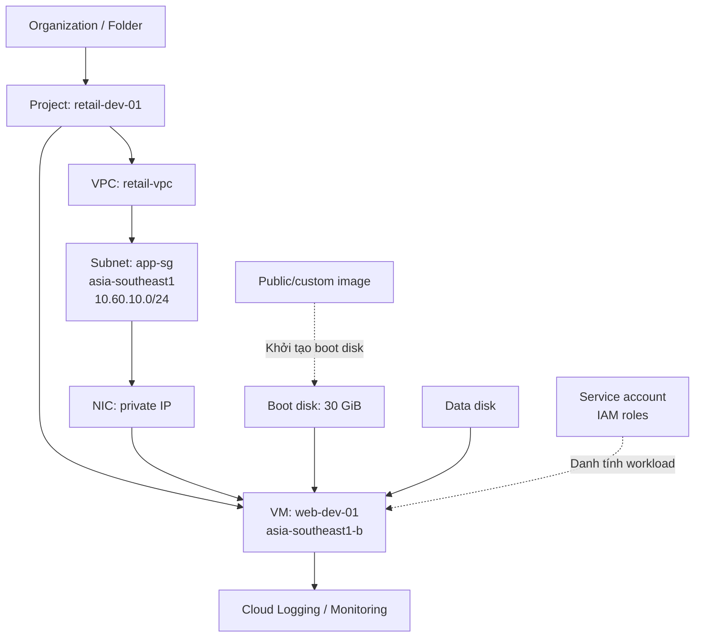
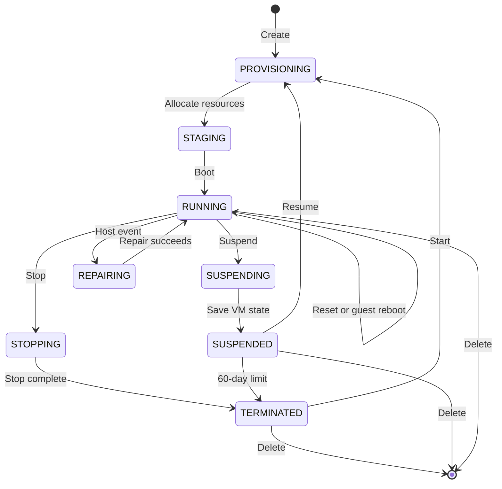
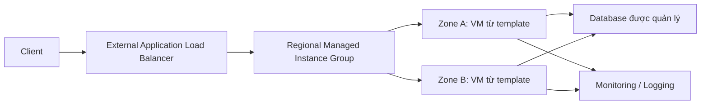

# Kiến trúc Compute Engine và vòng đời VM

**Google Compute Engine** cung cấp năng lực tính toán theo mô hình hạ tầng như một dịch vụ (IaaS): người dùng tạo và vận hành **virtual machine (VM)** trên hạ tầng Google Cloud, lựa chọn hệ điều hành, loại máy, tài nguyên đĩa, mạng, danh tính và cách xử lý khi máy chủ vật lý gặp sự kiện. Khác với Cloud Run hoặc GKE Autopilot, người vận hành VM thường chịu trách nhiệm nhiều hơn đối với cấu hình hệ điều hành, vá lỗi, tiến trình ứng dụng và việc quản lý năng lực máy.

Trong module **CLOUD_PROVIDERS_GCP**, hiểu Compute Engine là nền tảng để lựa chọn giữa VM, GKE và Cloud Run, thiết kế IAM/VPC, gắn lưu trữ, tự động hóa phát hành và đánh giá độ tin cậy cùng chi phí. Bài này thuộc chương **Compute Engine**, đi từ kiến trúc một VM đến **vòng đời tạo, khởi động, chạy, dừng, tạm ngưng, khôi phục, reset và xóa**; sau đó mở rộng sang nhóm máy được quản lý và cách vận hành an toàn trên production.

> Toàn bộ tên project, subnet, service account, VM và kết quả trạng thái trong bài là **ví dụ minh họa**, không phải tài nguyên đã tạo. Các lệnh có thể phát sinh phí hoặc gây gián đoạn được đánh dấu rõ; chỉ thực hiện trong project đã được ủy quyền.

## Mục tiêu học tập

Sau bài học, bạn có thể:

1. Nhận diện các thành phần của một VM: **project, zone, machine type, image, boot/data disk, VPC NIC, IP, service account và metadata**.
2. Phân biệt **image, snapshot, disk, instance template, VM instance và managed instance group (MIG)**.
3. Giải thích những trạng thái quan trọng trong vòng đời VM và sự khác nhau giữa **stop, suspend, reset, restart, reboot, delete**.
4. Chọn hành động vận hành dựa trên tính bền vững của dữ liệu, thời gian khôi phục, địa chỉ IP, khả năng cấp phát lại tài nguyên và chi phí.
5. Tạo, xem, cập nhật trạng thái và dọn dẹp VM bằng Google Cloud console hoặc `gcloud`, có ý thức về IAM và tác động.
6. Thiết kế VM an toàn với **least privilege, OS Login, Shielded VM, firewall và backup**, đồng thời phân biệt khả năng chịu lỗi của một VM với MIG đa zone.
7. Điều tra lỗi máy không khởi động, ứng dụng không truy cập được hoặc chi phí vẫn tăng sau khi dừng VM.

## 1. Compute Engine nằm ở đâu trong kiến trúc Google Cloud?

Một **VM instance** là tài nguyên tính toán đặt trong **một zone** của Google Cloud, thuộc **một project**. Nó sử dụng machine type để xác định CPU và RAM; gắn ít nhất một boot disk để chạy hệ điều hành; và có một hoặc nhiều network interface (NIC) kết nối vào các VPC/subnet phù hợp.



### Phạm vi của từng tài nguyên

| Thành phần | Phạm vi thường gặp | Vai trò |
| --- | --- | --- |
| **Project** | Một project ID duy nhất | Sở hữu VM, IAM, API, quota và chi phí |
| **Region** | Ví dụ `asia-southeast1` | Vị trí địa lý cho subnet, regional services và yêu cầu lưu trú dữ liệu |
| **Zone** | Ví dụ `asia-southeast1-b` | Nơi VM được lập lịch; mất một zone có thể ảnh hưởng VM trong zone đó |
| **VPC network** | Global trong project | Mạng logic, route, firewall và kết nối hybrid |
| **Subnet** | Regional | Dải IP nội bộ gắn với VM NIC |
| **VM instance** | Zonal | CPU, RAM, OS, NIC, boot process và metadata |
| **Boot/data Persistent Disk** | Thường zonal; có biến thể regional | Lưu dữ liệu bền vững độc lập với RAM |
| **Machine image / custom image** | Theo loại hình ảnh và phạm vi tài nguyên | Tạo hoặc khôi phục cấu hình hệ thống |
| **Instance template** | Global hoặc regional, tùy loại | Mẫu cấu hình để tạo các VM tương tự |
| **Managed instance group** | Zonal hoặc regional | Quản lý tập VM, cập nhật, autoscale, autoheal |

Tên VM không phải địa chỉ IP và không đủ xác định tài nguyên toàn cầu: khi thao tác cần biết ít nhất **project + zone + instance name**. Ví dụ đường dẫn REST:

```text
projects/retail-dev-01/zones/asia-southeast1-b/instances/web-dev-01
```

Zone của VM không được suy ra từ region của subnet: một subnet regional có thể được nhiều VM ở các zone khác nhau trong cùng region sử dụng.

## 2. Các khối cấu thành một VM

### 2.1 Machine series và machine type

**Machine series** phân nhóm phần cứng và đặc điểm hiệu năng; **machine type** xác định số vCPU/RAM và đôi khi có ràng buộc về accelerator, disk hoặc kiến trúc CPU. Ví dụ `e2-medium` phù hợp cho một bài thực hành cơ bản, nhưng không phải cấu hình tối ưu cho mọi ứng dụng.

Chọn máy theo **mức tải** chứ không theo tên gọi:

- Web/API nhẹ: CPU, RAM và mức đồng thời thực tế.
- Xử lý batch: tổng CPU-hours, khả năng chạy gián đoạn và lịch.
- Bộ nhớ lớn: tỷ lệ RAM/vCPU và yêu cầu cache in-memory.
- GPU/HPC: accelerator, số GPU, băng thông và khả năng cung cấp theo zone.
- Database: IOPS/throughput, RAM, CPU, backup và HA; cân nhắc dịch vụ được quản lý như Cloud SQL trước khi tự quản trị.

Tất cả machine types **không có mặt ở mọi region/zone**. Một số lựa chọn yêu cầu quota riêng hoặc điều kiện đặt trước tài nguyên.

### 2.2 Image, boot disk và data disk

- **Public image:** ảnh OS do Google hoặc đối tác cung cấp, ví dụ Debian/Ubuntu/Windows Server.
- **Custom image:** ảnh chuẩn hóa do nhóm tự quản lý để tạo boot disk nhất quán.
- **Boot disk:** volume chứa OS và có thuộc tính auto-delete khi VM bị xóa.
- **Data disk:** volume gắn thêm để chứa dữ liệu ứng dụng, tách khỏi boot disk khi cần.
- **Snapshot:** bản sao lưu dữ liệu disk ở một thời điểm theo cơ chế snapshots; dùng để khôi phục disk, không phải backup bộ nhớ RAM.
- **Machine image:** cơ chế lưu cấu hình VM cùng nội dung các disk theo khả năng hỗ trợ; không nên đánh đồng với image OS đơn thuần.

Với hầu hết VM, boot disk mặc định có **`autoDelete=true`**. Nghĩa là **xóa VM có thể xóa luôn boot disk**, trừ khi đã đổi chính sách thành giữ lại. Data disk có cách xử lý tùy cấu hình `autoDelete` của từng attachment. Vì vậy **kiểm tra chính sách xóa disk trước khi chạy lệnh delete**.

### 2.3 Persistent Disk, Hyperdisk và Local SSD

| Loại | Đặc trưng | Hệ quả vòng đời |
| --- | --- | --- |
| **Persistent Disk** | Lưu trữ block bền vững do Google quản lý | Có thể giữ khi stop; delete tùy `autoDelete` |
| **Hyperdisk** | Block storage có lựa chọn điều chỉnh hiệu năng theo loại | Vẫn phát sinh phí lưu trữ/hiệu năng provisioned theo SKU |
| **Local SSD** | Lưu trữ gắn gần host, độ trễ thấp, dữ liệu không có độ bền như disk lâu dài | Nhiều sự kiện stop/delete gây mất dữ liệu; một số quy trình **preserve Local SSD** có giới hạn và trạng thái Preview |

**Không lưu dữ liệu duy nhất, không thể tái tạo trên Local SSD.** Trước khi stop/delete hoặc di chuyển VM, cần sao lưu/chép dữ liệu sang lưu trữ bền vững và xem chính xác loại Local SSD được máy hỗ trợ.

### 2.4 VPC, IP, firewall và đường vào VM

Mỗi NIC kết nối đến một VPC/subnet và có **internal IP**; external IP là tùy chọn. Không có external IP thường giúp giảm bề mặt phơi bày trực tiếp, nhưng workload muốn đi ra Internet có thể cần **Cloud NAT**, proxy hoặc đường truy cập riêng theo thiết kế.

**Firewall của VPC** và các firewall policies quyết định lưu lượng vào/ra. Việc VM có external IP **không bảo đảm** SSH/HTTP từ Internet truy cập được; ngược lại không có external IP vẫn có thể SSH bằng **IAP TCP forwarding**, kết nối hybrid hoặc bastion được kiểm soát.

### 2.5 Service account và metadata

Service account gắn với VM xác định danh tính workload dùng để gọi Google Cloud APIs qua **metadata server** và credentials ngắn hạn. Hãy dùng service account chuyên biệt, cấp IAM roles tối thiểu trên đúng tài nguyên, và tránh lưu JSON private key dài hạn bên trong VM.

**Metadata** chứa các thông số như startup script, tags hoặc các giá trị cấu hình. Metadata server không phải nơi an toàn để giữ mật khẩu/khóa API tùy ý; nếu cần bí mật, dùng Secret Manager hoặc một cơ chế quản lý secrets tương đương.

## 3. Vòng đời VM là một máy trạng thái

Tạo VM không dẫn thẳng tới `RUNNING` ngay lập tức. Compute Engine lần lượt chuẩn bị tài nguyên, thiết lập môi trường và khởi động guest OS. Trạng thái thường gặp:



Sơ đồ là **mô hình giản lược**, không bao gồm mọi bước trung gian và điều kiện. Ngoài các trạng thái minh họa, Compute Engine còn có:

- **`PENDING`:** Một số Flex-start VM/TPU có thể chờ tài nguyên trước khi `PROVISIONING`.
- **`PENDING_STOP`:** VM có cấu hình graceful shutdown có thể đi qua trạng thái chờ dừng.
- **`REPAIRING`:** Compute Engine xử lý một số lỗi hạ tầng/host; trong thời gian đó VM không sử dụng được.

Các chuyển trạng thái không phải lúc nào cũng do người dùng chủ động: **host maintenance, lỗi host, scheduled operations hoặc provisioning model** có thể kích hoạt thay đổi. <u>Trạng thái `RUNNING` cho biết VM đã bắt đầu chạy/boot, không bảo đảm ứng dụng bên trong đã healthy.</u>

### Bảng trạng thái và việc cần làm

| Trạng thái | Điều đang diễn ra | Hành động phù hợp |
| --- | --- | --- |
| `PROVISIONING` | Cấp phát tài nguyên trong zone | Chờ; nếu lâu xem quota, capacity, operation log |
| `STAGING` | Chuẩn bị VM cho lần boot | Kiểm tra image, startup script và tiến trình |
| `RUNNING` | VM đang boot hoặc hoạt động | Kiểm tra health/readiness, CPU, disk, log |
| `PENDING_STOP` | Graceful shutdown khi được cấu hình | Theo dõi shutdown scripts và thời hạn |
| `STOPPING` | Hệ điều hành/VM đang dừng | Tránh tác vụ xung đột, chờ hoàn tất |
| `TERMINATED` | VM **đã dừng** nhưng resource VM còn tồn tại | Có thể start hoặc delete tùy mục đích |
| `SUSPENDING` | Đang lưu RAM/device state xuống lưu trữ | Chờ; không coi ứng dụng còn sẵn sàng |
| `SUSPENDED` | VM tạm ngưng, giữ trạng thái được hỗ trợ | Resume trước mốc giới hạn; xem phí lưu trạng thái |
| `REPAIRING` | Google đang sửa lỗi hạ tầng | Theo dõi trạng thái và khả năng tự phục hồi |

**`TERMINATED` khác `DELETED`.** VM dừng vẫn còn tên, metadata và các disk được giữ; VM bị xóa không còn là một instance để khởi động lại. Muốn chạy lại sau delete phải **tạo VM mới**, có thể dùng disk/snapshot/image còn tồn tại nếu đã bảo toàn trước đó.

## 4. Stop, suspend, reset, restart và delete khác nhau thế nào?

Một quyết định vận hành sai có thể làm mất dữ liệu trong RAM, giải phóng external IP hoặc xóa boot disk. Bảng sau là cơ sở để chọn thao tác:

| Hành động | Trạng thái sau khi hoàn tất | RAM / tiến trình | Disk bền vững | Tác động chính |
| --- | --- | --- | --- | --- |
| **Stop** | `TERMINATED` | Không giữ nội dung RAM và tiến trình | Vẫn tồn tại theo cấu hình | Ngừng CPU chạy, giữ cấu hình VM; có thể start lại |
| **Start** | `RUNNING` sau provisioning/staging | Boot OS mới, khởi động dịch vụ | Gắn lại disk đã giữ | Có thể thất bại nếu zone thiếu tài nguyên |
| **Suspend** | `SUSPENDED` | Lưu RAM, device/application state được hỗ trợ | Vẫn gắn và tiếp tục tính phí | Phù hợp khi cần resume công việc trong thời hạn cho phép |
| **Resume** | `RUNNING` sau provisioning/staging | Khôi phục trạng thái đã suspend | Tiếp tục dùng disk | Cần tài nguyên zone; không phải đảm bảo zero downtime |
| **Reset** | Vẫn `RUNNING` theo state của Compute Engine | Mất RAM, khởi động lại **không graceful** | Disk không tự xóa, nhưng có rủi ro hỏng filesystem | Chỉ dùng khi guest OS không phản hồi và hết phương án an toàn |
| **Reboot trong guest OS** | Thường tiếp tục `RUNNING` | Hệ điều hành khởi động lại theo cơ chế graceful | Disk giữ nguyên | Phù hợp khi cần restart OS bình thường |
| **Delete** | Tài nguyên VM không còn | Mất tiến trình/RAM | Boot/data disk theo `autoDelete`; Local SSD bị xóa | Có thể không khôi phục được dữ liệu nếu thiếu backup |

### 4.1 Stop không đồng nghĩa “miễn phí”

Khi stop thành công, VM ở `TERMINATED` và **không còn phí CPU/RAM chạy theo mô hình VM thông thường**. Tuy nhiên, persistent disks, snapshots, các IP tĩnh được giữ, reservations và các tài nguyên khác **có thể tiếp tục tính phí**. Chi phí thực tế tùy sản phẩm/SKU/điều khoản.

**External ephemeral IP** thường được **giải phóng** khi stop; khi start lại VM có thể nhận IP ngoài khác nếu tiếp tục yêu cầu external IP. Nếu ứng dụng phải giữ địa chỉ cố định, dùng **static IP** và đánh giá phí liên quan.

**Cảnh báo:** Stop giải phóng CPU/RAM để tài nguyên quay về zone. Khi start lại, việc cấp phát **có thể thất bại nếu zone thiếu capacity**; có thể cần reservation hoặc phương án chuyển zone.

### 4.2 Suspend khác stop vì giữ trạng thái bộ nhớ

Suspend giúp lưu guest OS memory và một phần trạng thái thiết bị/ứng dụng để resume. Theo tài liệu Compute Engine, VM chỉ có thể **SUSPENDED tối đa 60 ngày**; sau đó tự chuyển `TERMINATED` và **không còn lưu trạng thái RAM/device/application đó**.

Chi phí khi suspend **không bằng 0**: có phí lưu trạng thái bộ nhớ và các tài nguyên còn gắn, như persistent disks và static IP. Một số loại VM/OS/accelerator không hỗ trợ suspend. Nếu ứng dụng quan trọng, ưu tiên xử lý dữ liệu nhất quán và backup thay vì coi suspend như snapshot hoặc cơ chế DR.

### 4.3 Reset là lựa chọn cuối khi VM không phản hồi

Reset giống ngắt điện và bật lại: bỏ qua graceful shutdown. OS có thể cần filesystem recovery, giao dịch chưa commit hoặc dữ liệu chưa flush có thể bị mất. Khi vẫn còn kết nối guest OS, nên dùng reboot/service restart bình thường và thu thập log trước.

### 4.4 Delete là thao tác hủy tài nguyên

Trước delete:

1. Xác minh project, zone, instance name và người sở hữu.
2. Kiểm tra **`autoDelete` của từng attached disk**, đặc biệt boot disk.
3. Lưu snapshot/backup hoặc machine image cần thiết; thử phương án khôi phục.
4. Kiểm tra external static IP, disks, snapshots, load balancer backend/instance group, DNS, monitoring và automation tham chiếu VM.
5. Đảm bảo ứng dụng đã chuyển traffic hoặc dừng hợp lệ, không còn request đang xử lý.
6. Sau delete, kiểm tra tài nguyên nào còn tồn tại và có tiếp tục tính phí.

**Không được xem `gcloud compute instances delete` là cách dừng tạm thời.**

## 5. Hoạch định trước khi tạo VM

Một cấu hình tốt cần trả lời các câu hỏi ở nhiều lớp:

| Lớp | Câu hỏi | Ví dụ quyết định |
| --- | --- | --- |
| **Project** | Dev hay prod? Ai trả phí và chịu trách nhiệm? | `retail-dev-01`, label `environment=dev` |
| **Location** | Độ trễ, khả năng sẵn có, dữ liệu, quota? | Region `asia-southeast1`, zone phù hợp |
| **Compute** | CPU/RAM, loại CPU, burst/steady-state, GPU? | `e2-medium` cho môi trường thử nghiệm |
| **OS/image** | Image chuẩn hóa và cập nhật bảo mật? | Debian image family được quản lý |
| **Storage** | Boot/dữ liệu, IOPS, backup, auto-delete? | Boot pd-balanced 30 GiB; backup cần thiết |
| **Network** | Subnet, internal/external IP, route/egress? | Subnet riêng, không external IP |
| **Identity** | Workload cần gọi API nào? | Service account riêng, IAM tối thiểu |
| **Access** | SSH/RDP qua đường nào và ai được vào? | OS Login và IAP khi phù hợp |
| **Availability** | Một VM có đủ SLO không? | Production cần MIG/load balancer hoặc HA khác |
| **Operations** | Logs, metrics, startup script, patch, alert? | Ops Agent, health check, maintenance window |
| **Cost** | Giờ chạy, storage, network, license, discounts? | Budget dev và auto-stop ngoài giờ |

Nếu nhu cầu chỉ là HTTP API container tự scale, so sánh **Cloud Run** trước khi tự quản trị VM. Nếu cần hệ sinh thái Kubernetes và orchestration, xem **GKE**. Compute Engine phù hợp khi cần kiểm soát OS, cấu hình hệ thống, phần mềm legacy, workload dài hạn hoặc đặc tính phần cứng riêng.

## 6. Chuẩn bị dự án và quyền IAM

Để tạo một VM, cần:

- **Compute Engine API** `compute.googleapis.com` đã được bật trên project.
- Project có billing phù hợp cho tài nguyên trả phí và còn quota cần thiết.
- Danh tính thực thi có các permissions thích hợp, ví dụ `compute.instances.create`; chọn subnet có thể cần `compute.subnetworks.use`, chọn image có thể cần `compute.images.useReadOnly`.
- Khi gắn **service account vào VM**, danh tính tạo VM cần `iam.serviceAccounts.actAs` trên service account đích (thường có trong vai trò `roles/iam.serviceAccountUser`).
- Quy tắc organization policy, firewall và VPC cho phép cấu hình dự định.

Vai trò dựng sẵn `roles/compute.instanceAdmin.v1` thường được dùng để quản trị VM nhưng **không tự bao gồm mọi quyền** trên subnet, image ở project khác hoặc service account. Với production, cấp quyền có phạm vi nhỏ nhất phù hợp và dùng quy trình phê duyệt.

### Cấu hình danh tính workload

Một VM có thể chạy ứng dụng cần đọc đối tượng từ Cloud Storage. Nên gắn service account chỉ có quyền đọc bucket/repository cần thiết, thay vì gắn credential người dùng hoặc gán `roles/editor` cho VM. **OAuth access scopes** trên VM cũng có thể giới hạn khả năng gọi Google APIs: khi dùng `cloud-platform` scope rộng, IAM vẫn phải kiểm tra và giới hạn quyền thực tế.

### Bảo mật truy cập OS

Ưu tiên **OS Login** cho SSH khi tổ chức hỗ trợ, quản lý quyền truy cập bằng IAM và các controls cần thiết. Có thể dùng **IAP TCP forwarding** để vào VM không có public IP. Thực thi least privilege cho người SSH, không chia sẻ private key, và dùng **Shielded VM** (Secure Boot/vTPM/integrity monitoring nếu OS và cấu hình hỗ trợ).

## 7. Tạo VM qua Google Cloud Console

Ví dụ triển khai VM development để chạy một tiến trình nội bộ:

1. Mở [VM instances trong Google Cloud Console](https://console.cloud.google.com/compute/instances) và xác nhận **project**.
2. Chọn **Create instance**.
3. Đặt tên `web-dev-01`, chọn **region/zone**, machine family/type đủ tải.
4. Chọn **boot disk image, loại disk, dung lượng** và chính sách giữ/xóa disk khi delete.
5. Chọn **VPC/subnet**, internal IP; cân nhắc **không cấp external IP** nếu không cần truy cập từ Internet.
6. Ở Security, chọn **service account ít quyền**, Shielded VM/OS Login khi được hỗ trợ, tránh đưa secrets vào metadata.
7. Cấu hình labels, startup script/automation nếu cần; kiểm tra estimate về CPU, disk và network.
8. Chọn Create; đợi state `RUNNING`, sau đó kiểm tra **OS boot, health/endpoint và logs**.

Console có thể sinh ví dụ CLI/Terraform từ cấu hình. Cần review trước khi đưa vào IaC; không copy nguyên cấu hình mở SSH/HTTP công khai sang production mà chưa có firewall và IAM phù hợp.

## 8. Thực hành với Google Cloud CLI

Các lệnh dưới đây được chia thành **chỉ đọc** và **thay đổi tài nguyên**. Thay các giá trị ví dụ trước khi dùng; không chạy trên production nếu chưa được phê duyệt.

### 8.1 Xem ngữ cảnh và danh sách máy (chỉ đọc)

```bash
PROJECT_ID="retail-dev-01"
ZONE="asia-southeast1-b"
VM_NAME="web-dev-01"

# Danh tính và project mặc định có thể khác project mục tiêu.
gcloud auth list
gcloud config get-value project

# Xem các máy đang tồn tại.
gcloud compute instances list --project="$PROJECT_ID"

# Xem cấu hình, trạng thái và attached disks của một máy cụ thể.
gcloud compute instances describe "$VM_NAME" \
  --project="$PROJECT_ID" \
  --zone="$ZONE" \
  --format="yaml(name,status,machineType,disks,networkInterfaces,serviceAccounts)"
```

Đối với trường resource URL như `machineType`, giá trị có thể là một đường dẫn đầy đủ; không nên so sánh tên hiển thị bằng cách cắt chuỗi tùy tiện.

### 8.2 Tạo VM (thay đổi tài nguyên, có thể tính phí)

Mẫu dưới đây giả định VPC/subnet và service account **đã tồn tại**. VM không nhận external IP, phù hợp cho môi trường riêng đã có cách truy cập nội bộ:

```bash
gcloud compute instances create web-dev-01 \
  --project="retail-dev-01" \
  --zone="asia-southeast1-b" \
  --machine-type="e2-medium" \
  --image-family="debian-12" \
  --image-project="debian-cloud" \
  --boot-disk-size="30GB" \
  --boot-disk-type="pd-balanced" \
  --subnet="app-sg" \
  --no-address \
  --service-account="vm-web-dev@retail-dev-01.iam.gserviceaccount.com" \
  --scopes="cloud-platform" \
  --labels="environment=dev,team=retail"
```

Sau khi chạy, cần kiểm tra **trạng thái VM và khả năng boot của guest OS**. Không có external IP nghĩa là apt update hoặc tải package từ Internet có thể cần **Cloud NAT** hoặc con đường egress thích hợp; tạo VM thành công không chứng minh workload đã được cài đặt thành công.

### 8.3 Dừng và khởi động lại (thay đổi trạng thái)

```bash
# Dừng an toàn: không đồng nghĩa xóa VM.
gcloud compute instances stop web-dev-01 \
  --project="retail-dev-01" \
  --zone="asia-southeast1-b"

# Sau khi trạng thái TERMINATED, có thể khởi động lại.
gcloud compute instances start web-dev-01 \
  --project="retail-dev-01" \
  --zone="asia-southeast1-b"
```

Một số máy có Local SSD hoặc cơ chế graceful shutdown cần tham số/giới hạn đặc biệt; không áp lệnh stop mặc định cho workload giữ dữ liệu duy nhất trên Local SSD. Khi cần dừng VM do application state phức tạp, hãy **quiesce application, flush disk và backup** trước.

### 8.4 Suspend và resume (chỉ dùng khi cấu hình hỗ trợ)

```bash
# Suspend VM đang RUNNING và hỗ trợ suspend.
gcloud compute instances suspend web-dev-01 \
  --project="retail-dev-01" \
  --zone="asia-southeast1-b"

# Resume trước mốc tối đa và khi zone có đủ capacity.
gcloud compute instances resume web-dev-01 \
  --project="retail-dev-01" \
  --zone="asia-southeast1-b"
```

Sử dụng `describe` trước và sau thao tác để xác minh `SUSPENDED` / `RUNNING`. Không mặc định suspend được áp dụng với GPU, Confidential VM, mọi OS hay mọi loại disk; cần kiểm tra hạn chế theo loại máy hiện hành.

### 8.5 Reset (có rủi ro mất dữ liệu)

```bash
# Chỉ dùng khi VM không phản hồi và đã được phê duyệt.
gcloud compute instances reset web-dev-01 \
  --project="retail-dev-01" \
  --zone="asia-southeast1-b"
```

Lệnh reset không thực hiện shutdown OS một cách graceful. Đừng dùng reset như phương án cập nhật ứng dụng thông thường. Nếu còn SSH được, cân nhắc `sudo systemctl restart SERVICE` hoặc `sudo reboot` trong OS, nhưng phải review tính sẵn sàng của dịch vụ.

### 8.6 Kiểm tra disk trước khi xóa VM

```bash
# Xem attached disks và autoDelete — CHỈ ĐỌC.
gcloud compute instances describe web-dev-01 \
  --project="retail-dev-01" \
  --zone="asia-southeast1-b" \
  --format="yaml(disks)"
```

Lệnh xóa VM bên dưới có thể **xóa boot disk tự động** và làm dữ liệu không thể khôi phục nếu chưa có backup:

```bash
# CHỈ THỰC HIỆN SAU KHI XÁC NHẬN BACKUP, CHÍNH SÁCH DISK VÀ CHO PHÉP XÓA.
gcloud compute instances delete web-dev-01 \
  --project="retail-dev-01" \
  --zone="asia-southeast1-b"
```

Nếu cần giữ boot disk, trước khi delete phải xem và thay đổi `autoDelete` theo quy trình chính thức, hoặc chuẩn bị bản sao/snapshot riêng. Không giả định sau khi xóa VM tất cả resource gắn kèm sẽ được dọn sạch hoặc ngược lại tất cả đều được giữ.

## 9. Vòng đời của dữ liệu, địa chỉ IP và danh tính

Đặt trọng tâm vào **những thứ sống lâu hơn hoặc ngắn hơn VM**:

| Tài nguyên/trạng thái | Khi stop | Khi suspend | Khi reset | Khi delete |
| --- | --- | --- | --- | --- |
| **RAM và tiến trình** | Không giữ | Được lưu theo cơ chế suspend khi hỗ trợ | Mất RAM, reboot không graceful | Mất |
| **Boot Persistent Disk** | Thường giữ | Giữ | Giữ | Theo `autoDelete`, mặc định thường xóa |
| **Data Persistent Disk/Hyperdisk** | Giữ | Giữ | Giữ | Theo `autoDelete` của disk attachment |
| **Local SSD** | Có nguy cơ mất; preserve là trường hợp giới hạn/Preview | Chỉ với cấu hình hỗ trợ | Dữ liệu disk có thể còn nhưng có rủi ro hỏng | Bị xóa |
| **Internal IP** | VM giữ cấu hình/IP được hỗ trợ | Giữ cấu hình/IP được hỗ trợ | Giữ | Không còn gắn với VM |
| **Ephemeral external IP** | Thường được giải phóng | Được giải phóng | Thường giữ | Được giải phóng |
| **Static external IP** | Có thể giữ, vẫn có phí theo điều kiện | Có thể giữ, vẫn có phí | Giữ | Xem trạng thái địa chỉ được reserve và dọn dẹp riêng |
| **Service account/metadata** | Cấu hình gắn VM vẫn tồn tại | Cấu hình giữ | Cấu hình giữ | VM không còn; service account là tài nguyên riêng |

Trạng thái `TERMINATED` **không xóa VM**. Ngược lại, **tài khoản dịch vụ, snapshot hoặc static IP** không nhất thiết biến mất khi xóa VM, nên cần inventory để tránh chi phí tồn dư và cấp quyền không dùng đến.

## 10. Thiết kế độ tin cậy: Một VM chưa phải kiến trúc HA

VM được đặt ở một **zone**. Nếu zone có sự cố hoặc guest OS lỗi, một ứng dụng chạy trên một VM có thể không đáp ứng SLO. Compute Engine có **live migration** và **automatic restart** theo loại VM/scheduling policy, nhưng đây không phải đảm bảo ứng dụng luôn sẵn sàng hoặc tự phục hồi khi application process lỗi.

### 10.1 Phân biệt các cơ chế tự phục hồi

| Cơ chế | Phát hiện/xử lý | Giới hạn |
| --- | --- | --- |
| **Automatic restart** | Khởi động VM lại sau một số host failure theo scheduling policy | Không giải quyết mọi lỗi ứng dụng |
| **Live migration** | Di chuyển VM khi có maintenance đủ điều kiện để giảm gián đoạn | Không phải mọi VM/accelerator hỗ trợ, vẫn cần thiết kế application |
| **Managed instance group (MIG)** | Duy trì số VM mong muốn, có thể autoheal và rolling update | Cần instance template, health check, thiết kế state |
| **Regional MIG** | Phân bổ instances qua nhiều zone trong một region | Không thay thế DR giữa nhiều region |
| **External/Internal Load Balancer** | Điều hướng traffic đến backend healthy theo cấu hình | Không sao lưu dữ liệu lưu trên VM |
| **Snapshot/backup** | Giữ dữ liệu để khôi phục | Không tự mang lại zero downtime |

### 10.2 Instance template và MIG

**Instance template** mô tả cấu hình máy như machine type, disk image, network, metadata và service account. Một **managed instance group** dựa vào template để tạo các instance có cấu hình thống nhất và có thể:

- tự sửa instance không healthy bằng **recreate** theo health check;
- **autoscale** theo metrics/tải và quy tắc được hỗ trợ;
- rollout phiên bản template mới, rolling update và rollback theo quy trình;
- chạy ở **một zone** hoặc **nhiều zone trong region**, tùy loại MIG.

**Cảnh báo về state:** Nếu instance trong MIG được recreate, dữ liệu chỉ nằm trên filesystem cục bộ và không có chính sách giữ state có thể mất. Stateless applications là lựa chọn đơn giản nhất; **stateful MIG** có cơ chế giữ disk/metadata đặc thù, nhưng phải cấu hình có chủ đích. Với database production, cân nhắc Cloud SQL hoặc kiến trúc HA/backup phù hợp thay vì chỉ dựa vào MIG.

### 10.3 Một topology tham khảo cho web API



Ứng dụng nên lưu state ở **database/object storage được quản lý hoặc cơ chế chia sẻ bền vững** thay vì chỉ trong RAM/local disk của một VM. Cấu hình load balancer health check và rollout phù hợp để giảm gián đoạn khi thay VM.

## 11. VM host events, scheduling và hành vi tự động

Một VM có thể bị thay đổi trạng thái do:

1. **Người dùng/IaC:** stop, start, suspend, reset, delete, thay đổi machine type.
2. **OS/ứng dụng:** guest reboot, kernel panic, unresponsive process, shutdown script.
3. **Google host events:** bảo trì máy chủ vật lý, lỗi host, live migration hoặc restart nếu áp dụng.
4. **Capacity/scheduling:** thiếu capacity khi start/resume; Spot VM có nguy cơ bị preempt khi Google cần tài nguyên.
5. **Automation:** schedule start/stop, autoscaler/MIG, maintenance workflow hoặc pipeline deploy.

Khi cấu hình **Spot VM**, không coi máy được cấp phát là lâu dài: nó có thể bị thu hồi theo chính sách sản phẩm. Batch jobs nên hỗ trợ checkpoint/idempotent retry, dữ liệu đầu ra lưu bền vững và quy trình retry khi bị preemption.

Các setting như `automaticRestart` và `onHostMaintenance` giúp kiểm soát một số hành vi khi host event, nhưng phải chọn theo loại VM, accelerator và khả năng hỗ trợ. Không bật một setting chỉ vì nó có tên “restart” rồi coi đó là giải pháp HA.

## 12. Chi phí theo vòng đời VM

Compute Engine tính phí theo tài nguyên và **trạng thái sử dụng**, không chỉ số lượng dòng VM trong console. Các cấu phần cần ước tính:

| Khoản | Khi nào cần tính | Chú ý |
| --- | --- | --- |
| **vCPU/RAM** | VM đang ở trạng thái tính compute usage, thường khi `RUNNING` | Machine type, region, thời lượng, pricing model |
| **Guest OS license** | Tùy hệ điều hành và trạng thái, đặc biệt Windows/SQL Server | Có thể khác tính phí CPU; đọc SKU |
| **Persistent Disk/Hyperdisk** | Disk còn tồn tại, kể cả VM đã stop | Dung lượng và hiệu năng provisioned |
| **Local SSD / lưu trạng thái suspend** | Theo loại VM, suspend/stop mode và storage used | Không tự coi suspend là miễn phí |
| **Snapshots/images** | Tài nguyên được giữ | Retention và tăng trưởng dữ liệu |
| **Static/external IP** | Theo trạng thái address và loại IP | IP còn reserve có thể tính phí |
| **Network egress/NAT/LB** | Khi lưu lượng và hạ tầng mạng phát sinh | Region, hướng đi, số GB, SKU |
| **Logging/Monitoring** | Theo dữ liệu và policy thu thập | Log retention, sampling, alerting |

### 12.1 Phép tính đơn giản

Hai VM development chạy **8 giờ/ngày × 22 ngày/tháng**, giả định phí compute là **0,10 USD/VM-giờ** do bài tập tự đặt:

```text
Giờ chạy mỗi VM = 8 × 22 = 176 giờ/tháng
Tổng VM-hours  = 2 × 176 = 352 VM-hours
Phí compute giả định = 352 × 0,10 = 35,20 USD/tháng
```

Con số **35,20 USD chỉ là phép tính minh họa**, không phải báo giá Google Cloud. Còn disk, snapshots, IP, egress, license và các khoản khác. Dùng [Google Cloud Pricing Calculator](https://cloud.google.com/products/calculator) để chọn **machine type, region, giờ chạy và các tài nguyên còn tồn tại**.

### 12.2 Có nên tự động stop VM ngoài giờ?

Với dev/test **stateless**, scheduled stop/start có thể tiết kiệm compute. Nhưng cần kiểm tra:

- App có lưu dữ liệu trong RAM hoặc Local SSD không?
- IP ngoài ephemeral đổi có làm hỏng DNS/allowlist hoặc integration không?
- Có đủ capacity để start lại ở zone không?
- Có scheduled backup, CI job, batch task hoặc health check chạy ngoài giờ không?
- Disk và IP tĩnh còn phí; cần budget alert và rà soát tài nguyên mồ côi.

Với production cần uptime, **không áp lịch dừng** chỉ để tiết kiệm nếu không đáp ứng SLO. Tối ưu bằng right-sizing, autoscaling, Spot VM cho tải phù hợp hoặc chọn dịch vụ managed khi hợp lý.

## 13. Tự động hóa cấu hình VM bằng Infrastructure as Code

VM được tạo thủ công có thể bị **configuration drift**: khác image, tags, service account hoặc firewall giữa dev và prod. Với IaC, người vận hành review thay đổi và lưu cấu hình theo phiên bản.

Ví dụ Terraform tối giản — **phụ thuộc VPC, subnet và service account đã có sẵn**:

```hcl
variable "project_id" {
  type = string
}

variable "zone" {
  type = string
}

resource "google_compute_instance" "web_dev" {
  project      = var.project_id
  zone         = var.zone
  name         = "web-dev-01"
  machine_type = "e2-medium"

  boot_disk {
    initialize_params {
      image = "debian-cloud/debian-12"
      size  = 30
      type  = "pd-balanced"
    }
    auto_delete = true
  }

  network_interface {
    subnetwork = "app-sg"
    # Không khai báo access_config -> không cấp external IP.
  }

  service_account {
    email  = "vm-web-dev@retail-dev-01.iam.gserviceaccount.com"
    scopes = ["cloud-platform"]
  }

  labels = {
    environment = "dev"
    team        = "retail"
  }
}
```

Đây là **đoạn cấu hình học thuật** chưa có provider/backend Terraform, IAM roles hoặc subnet lookup. Thực tế cần khai báo đúng project của subnet/Shared VPC, dùng module, remote state, review chính sách auto-delete, và **không đưa secrets vào startup script, Terraform state hoặc metadata**.

**Terraform destroy sẽ phá hủy VM** tương ứng và có thể xóa boot disk theo policy — **khác stop**. Trước mỗi lần apply/destroy, kiểm tra plan, project, zone, disks và phương án khôi phục.

## 14. Bảo vệ dữ liệu, backup và thay đổi machine type

### 14.1 Không dựa vào disk tồn tại như backup

Một Persistent Disk còn tồn tại sau stop **không phải một bản sao lưu độc lập**. Nếu xóa disk nhầm hoặc dữ liệu bị mã hóa/hỏng logic, bản sao duy nhất vẫn có thể mất. Nên có:

- snapshot schedule và retention theo RPO/RTO;
- backup application-aware đối với database (khi phù hợp);
- kiểm thử restore, không chỉ kiểm tra job backup thành công;
- kiểm soát quyền xóa snapshot/disk và audit;
- thiết kế đa zone/đa region nếu SLO/DR yêu cầu.

### 14.2 Đổi machine type

Nhiều thay đổi máy đòi hỏi **stop VM trước**, chọn machine type tương thích rồi start lại. Có thể bị giới hạn bởi CPU architecture, loại disk, GPU, zone capacity và quota. Ví dụ:

```text
Kiểm tra tải -> thông báo maintenance -> backup
  -> stop VM -> đổi machine type -> start
  -> kiểm tra application/latency/cost -> cập nhật IaC
```

Nếu không được phép downtime, cần xây dựng mô hình thay thế VM/rolling update và load balancer thay vì kỳ vọng resize một máy luôn diễn ra không gián đoạn.

### 14.3 Startup/shutdown scripts

Startup scripts có thể bootstrap application hoặc cài agent khi boot, nhưng cần **idempotent**: chạy lại không được phá dữ liệu hay tạo trùng cấu hình. Shutdown scripts cần xử lý graceful stop trong thời hạn hỗ trợ và không được là cơ chế duy nhất bảo vệ dữ liệu.

Thực hành tốt là quản lý cấu hình/artefacts trong source control và pipeline bảo mật, kiểm tra logs, giảm phụ thuộc tải package trực tiếp từ Internet khi VM boot và dùng immutable images hoặc instance templates khi cần rollout quy mô lớn.

## 15. Tình huống thực tế: VM API bị dừng rồi start lại thất bại

Một nhóm chạy API nội bộ trên VM `orders-api-01` trong `retail-dev-01`. Để tiết kiệm chi phí, đội vận hành stop VM mỗi tối, nhưng sáng hôm sau job start báo lỗi **không cấp phát được machine type đã chọn**.

### Điều tra theo lớp

**Bước 1 — Xem VM có còn tồn tại không.** Chạy `instances describe`. Nếu trạng thái `TERMINATED`, VM **đã dừng**, không phải đã bị xóa.

**Bước 2 — Đọc operation/error thực tế.** Kiểm tra Compute Engine operations, Cloud Audit Logs và thông báo lỗi. Nếu lỗi capacity, quota hoặc policy, đừng coi đó là lỗi hệ điều hành.

**Bước 3 — Đối chiếu cấu hình.** Xem zone, machine type, GPU/Local SSD, reservation, quota và maintenance/scheduling settings.

**Bước 4 — Lựa chọn khôi phục.** Nếu có capacity reservation phù hợp, dùng theo quy trình. Nếu không, cân nhắc machine type hoặc zone thay thế nhưng cần bảo đảm tương thích disk/network, dữ liệu và ứng dụng. Di chuyển sang zone khác **không đơn thuần là đổi cờ `--zone` của VM cũ**; có thể cần snapshot/image, disk replication hoặc migrate theo khả năng dịch vụ.

**Bước 5 — Xác nhận ứng dụng.** Sau khi `RUNNING`, kiểm tra startup logs, service health, kết nối database, internal DNS, IAM và external dependency. `RUNNING` không tự đảm bảo lệnh HTTP trả 200.

**Bước 6 — Sửa kiến trúc.** Nếu cần liên tục, chuyển sang MIG/regional HA hoặc một dịch vụ managed; nếu đây là dev/test, cân nhắc schedule và cơ chế đặt trước capacity phù hợp với ngân sách.

### Khi cần bảo toàn IP

Nếu VM dùng **ephemeral external IP** cho allowlist của đối tác, stop/start có thể đổi IP khiến API phía đối tác từ chối. Bài học kiến trúc: không nên dùng IP ephemeral làm định danh ổn định. Sử dụng static IP, load balancer hoặc DNS phù hợp, đồng thời kiểm soát quyền và chi phí IP.

## 16. Chẩn đoán sự cố trạng thái VM

| Triệu chứng | Khả năng cần kiểm tra | Hành động đề xuất |
| --- | --- | --- |
| VM ở `PROVISIONING` lâu | Quota, zonal capacity, machine type, reservation | Xem operation status và thông báo lỗi |
| VM `RUNNING` nhưng SSH không được | Firewall, route, external/internal IP, OS Login/IAP, SSH daemon | Xác định đường truy cập và log OS |
| VM `RUNNING` nhưng ứng dụng 5xx | Startup script, process, disk full, dependency, port | Kiểm tra serial console, Ops Agent/logs và health |
| Stop VM xong vẫn có hóa đơn | Persistent Disk, static IP, snapshots, reservations, storage suspend | Xem Cloud Billing SKU, attached resources |
| Start VM `TERMINATED` thất bại | Thiếu capacity/quota, image/disk, policy | Xem operation, quota và availability của zone |
| Suspend bị từ chối | VM không `RUNNING`, OS/VM type không hỗ trợ, accelerator/Local SSD | Đọc giới hạn suspend và trạng thái hiện tại |
| Suspend quá 60 ngày | Tự chuyển `TERMINATED`, mất state RAM | Start như boot mới, không kỳ vọng resume session |
| Reset làm ứng dụng lỗi dữ liệu | Shutdown không graceful, filesystem recovery | Kiểm tra consistency, restore từ backup nếu cần |
| VM bị delete, boot disk biến mất | `autoDelete=true` | Tìm backup/snapshot, điều tra audit log |
| Autohealing MIG “xóa” dữ liệu local | Instance bị recreate và workload stateful | Thiết kế external state/stateful MIG phù hợp |
| IP ngoài đổi sau stop/start | External IP ephemeral được giải phóng | Dùng static IP/Load Balancer, cập nhật kiến trúc |
| Đổi machine type không thành công | Cần stop, ràng buộc loại máy/zone/disk | Đối chiếu compatibility và thực hiện theo maintenance plan |

### Cách kiểm tra trạng thái và nguyên nhân (chỉ đọc)

```bash
PROJECT_ID="retail-dev-01"
ZONE="asia-southeast1-b"
VM_NAME="orders-api-01"

# Trạng thái và thông tin VM.
gcloud compute instances describe "$VM_NAME" \
  --project="$PROJECT_ID" --zone="$ZONE" \
  --format="yaml(name,status,machineType,disks,networkInterfaces,scheduling)"

# Danh sách operations liên quan đến zone.
gcloud compute operations list \
  --project="$PROJECT_ID" \
  --filter="zone:($ZONE)" \
  --limit=20

# Xem quota và giới hạn tại project (định dạng có thể thay đổi).
gcloud compute project-info describe \
  --project="$PROJECT_ID"
```

Khi cần phân tích boot, dùng **serial port output** nếu được phép và phù hợp chính sách dữ liệu:

```bash
gcloud compute instances get-serial-port-output "$VM_NAME" \
  --project="$PROJECT_ID" \
  --zone="$ZONE"
```

Serial output có thể chứa thông tin nhạy cảm từ startup script hoặc OS; không đăng log nguyên văn công khai. Dùng Cloud Logging/Monitoring và audit logs đúng quyền để kết hợp bằng chứng về hành động của người dùng, host events và ứng dụng.

## 17. Runbook vận hành VM có kiểm soát

### Trước thao tác

- Xác định project, zone, instance name, owner, application và khung giờ bảo trì.
- Kiểm tra status hiện tại, machine type, boot/data disk, `autoDelete`, Local SSD và IP.
- Xác nhận tác động đối với load balancer, database, DNS, người dùng và SLO.
- Kiểm tra IAM của danh tính thực thi, không mở rộng quyền ngoài nhu cầu.
- Đảm bảo backup/snapshot và phương án khôi phục được kiểm thử.
- Có người phê duyệt và rollback plan đối với production.

### Trong thao tác

- Dùng `gcloud ... --project=... --zone=...` tường minh; ghi lại operation ID.
- Thực hiện graceful shutdown hoặc drain traffic nếu hoạt động có nguy cơ gián đoạn.
- Tránh sửa đồng thời cấu hình VM bằng console và IaC ngoài quy trình.
- Đợi trạng thái cuối phù hợp; không dừng ở thông báo “API request accepted”.
- Kiểm tra disk/IP/health và các dữ liệu cần giữ sau tác vụ.

### Sau thao tác

- Kiểm tra **ứng dụng**, không chỉ VM status; xác minh DNS, database, metrics và endpoint.
- Rà soát audit logs, các thay đổi IAM và chi phí của resources còn tồn tại.
- Cập nhật CMDB/asset inventory, runbook, IaC và ticket.
- Nếu delete hoặc di chuyển VM, rà soát disk, static IP, snapshot, reservation và alert mồ côi.

## 18. Các nhầm lẫn thường gặp

| Nhận định sai | Cách hiểu đúng |
| --- | --- |
| “VM `TERMINATED` nghĩa là VM đã bị xóa” | VM chỉ **đã stop**, có thể start lại khi đủ tài nguyên |
| “VM `RUNNING` nghĩa là ứng dụng khỏe” | OS có thể vẫn boot hoặc application có thể lỗi |
| “Stop VM thì không còn chi phí” | Disk, IP tĩnh, snapshot và resources khác vẫn có thể tính phí |
| “Suspend giống stop” | Suspend có thể giữ RAM/device state, có phí lưu và mốc tối đa 60 ngày |
| “Reset là reboot an toàn” | Reset không graceful và có nguy cơ mất dữ liệu |
| “Xóa VM không xóa dữ liệu” | Boot disk thường `autoDelete=true`; phải kiểm tra từng disk |
| “Một VM đặt trong một region” | VM là **zonal**, subnet là regional và VPC global |
| “Có external IP nghĩa là truy cập được Internet/SSH” | Firewall, routes và policies vẫn quyết định truy cập |
| “Service account của VM là người đăng nhập SSH” | Workload identity và OS Login/IAM SSH là các cơ chế khác nhau |
| “Một VM với auto restart đáp ứng HA” | SLO đa zone cần kiến trúc replication, load balancing/MIG hoặc giải pháp khác |
| “MIG luôn giữ dữ liệu local của instance” | Autohealing/recreate có thể mất state nếu không có chính sách bảo toàn |
| “Thay `--zone` là di chuyển VM sang zone khác” | Cần quy trình migration/recreation, disk/network/data phù hợp |

## 19. Bài tập tự kiểm tra

### Bài 1 — Xác định phạm vi

Một VM đặt ở `asia-southeast1-b`, subnet `app-sg` thuộc `asia-southeast1` và VPC `retail-vpc`. Hãy phân biệt zone, region và phạm vi của VPC.

<details>
<summary>Gợi ý đáp án</summary>

VM là tài nguyên zonal ở `asia-southeast1-b`; subnet là regional trong `asia-southeast1`; VPC là tài nguyên global của project. Một subnet trong region có thể được dùng bởi VM ở nhiều zone thuộc cùng region.
</details>

### Bài 2 — Stop hay suspend?

Một máy dev chạy IDE nặng, khởi động môi trường mất nhiều thời gian và cần giữ session trong 12 giờ. Nên cân nhắc stop hay suspend? Có điểm gì cần kiểm tra?

<details>
<summary>Gợi ý đáp án</summary>

Có thể cân nhắc **suspend** để giữ memory/application state nếu VM/OS hỗ trợ; cần kiểm tra giới hạn 60 ngày, phí lưu trạng thái và khả năng resume khi zone có capacity. Nếu không cần RAM/session, **stop** đơn giản hơn và tránh chi phí lưu trạng thái suspend.
</details>

### Bài 3 — Phân biệt stop/delete

VM `web-01` đã stop, trạng thái `TERMINATED`. Nhóm muốn chạy lại ngày mai. Có cần tạo VM mới? Nếu chạy lệnh delete thì sao?

<details>
<summary>Gợi ý đáp án</summary>

Không cần tạo VM mới: có thể dùng `gcloud compute instances start` khi zone đủ capacity. Nếu đã **delete**, instance không còn; phải recreate từ image/snapshot/disk còn giữ, và boot disk có thể đã bị xóa theo `autoDelete`.
</details>

### Bài 4 — Tính giờ chạy

Ba VM chạy 8 giờ/ngày, 20 ngày/tháng. Tổng VM-hours là bao nhiêu? Nếu đơn giá giả định 0,12 USD/VM-giờ thì compute charge minh họa là bao nhiêu?

<details>
<summary>Đáp án</summary>

Tổng VM-hours = 3 × 8 × 20 = **480 giờ VM**. Phí compute giả định = 480 × 0,12 = **57,60 USD**. Đây không phải đơn giá Google Cloud; chưa có disk, IP, network hoặc license.
</details>

### Bài 5 — Không mất dữ liệu khi delete

VM có boot disk 50 GiB và data disk 500 GiB. Hãy nêu ít nhất bốn việc cần làm trước khi xóa.

<details>
<summary>Gợi ý đáp án</summary>

Kiểm tra `autoDelete` của từng disk, chụp snapshot/backup cần thiết và thử restore, xác nhận disk nào phải giữ, kiểm tra traffic/owner và approval, rà soát static IP/Load Balancer, xác minh project/zone đúng, sau delete kiểm kê tài nguyên còn tính phí.
</details>

### Bài 6 — Running nhưng HTTP không hoạt động

VM báo `RUNNING` nhưng truy cập `https://api.example.com` thất bại. Nêu ít nhất sáu lớp cần kiểm tra.

<details>
<summary>Gợi ý đáp án</summary>

DNS → load balancer/backend health → route/VPC/firewall → internal/external IP/IAP → tiến trình ứng dụng và port listen → OS boot/startup logs → dependency database → certificate/TLS → application errors và metrics. `RUNNING` không phải chỉ báo health cho HTTP.
</details>

### Bài 7 — HA và dữ liệu

Vì sao đặt một VM ở zone A và bật automatic restart vẫn không bảo đảm website đạt availability cao khi zone A mất kết nối kéo dài?

<details>
<summary>Gợi ý đáp án</summary>

Automatic restart không thể bảo đảm VM có thể phục vụ khi cả zone không khả dụng. Cần ít nhất một kiến trúc đa zone, ví dụ **regional MIG + load balancer**, health checks và dữ liệu bền vững nằm ngoài một VM; vẫn phải xác định SLO, backup và chiến lược DR.
</details>

### Bài 8 — Quyền gắn service account

Người dùng có thể tạo VM nhưng bị từ chối khi gắn `vm-web-dev@retail-dev-01.iam.gserviceaccount.com`. Permission thường cần kiểm tra là gì?

<details>
<summary>Gợi ý đáp án</summary>

`iam.serviceAccounts.actAs` trên service account đích, thường có trong `roles/iam.serviceAccountUser`. Ngoài ra cần quyền Compute Engine và subnet/image tương ứng, cùng policy tổ chức cho phép. Không tự gán `roles/editor` để vượt lỗi.
</details>

## 20. Checklist trước khi phát hành VM

- [ ] Đã chọn đúng project, region, zone, VPC/subnet và dải địa chỉ không xung đột.
- [ ] Đã right-size machine type, kiểm tra quota và capacity cho start/restart.
- [ ] Image/OS có kế hoạch cập nhật, không chứa secrets, có hardening phù hợp.
- [ ] Boot/data disk, `autoDelete`, snapshot/backup và restore đã được xác định.
- [ ] Local SSD (nếu có) chỉ giữ dữ liệu có thể tái tạo hoặc có phương án preserve/backup hợp lệ.
- [ ] External IP chỉ cấp khi cần; firewall, OS Login/IAP và service account least privilege đã kiểm tra.
- [ ] Có logging, metrics, alerts, health checks và cách xác định ứng dụng thực sự sẵn sàng.
- [ ] Biết tác động của stop/suspend/reset/delete, nhất là RAM, IP và disk.
- [ ] Với production, đã đánh giá SLA, MIG/multi-zone, load balancing và vị trí lưu state.
- [ ] Có IaC, versioned startup config, rollback plan, owner và change approval.
- [ ] Đã lập dự toán CPU/RAM, disk, network, snapshots, IP, license và các tài nguyên còn phí khi VM dừng.
- [ ] Có runbook vận hành, lịch backup và kiểm thử khôi phục.

## Tài liệu tham khảo chính thức

- [Compute Engine overview](https://cloud.google.com/compute/docs/overview): mô hình VM, kiến trúc và chức năng.
- [Compute Engine instance lifecycle](https://cloud.google.com/compute/docs/instances/instance-lifecycle): trạng thái `PENDING`, `PROVISIONING`, `STAGING`, `RUNNING`, `PENDING_STOP`, `STOPPING`, `TERMINATED`, `SUSPENDING`, `SUSPENDED`, `REPAIRING`.
- [Create and start an instance](https://cloud.google.com/compute/docs/instances/create-start-instance): tạo VM qua Console/CLI/REST và quyền cần thiết.
- [Stop or restart an instance](https://cloud.google.com/compute/docs/instances/stop-start-instance): stop, start, billing và rủi ro capacity.
- [Suspend or resume an instance](https://cloud.google.com/compute/docs/instances/suspend-resume-instance): trạng thái RAM, giới hạn 60 ngày và điều kiện hỗ trợ.
- [Suspend, stop, or reset instances](https://cloud.google.com/compute/docs/instances/suspend-stop-reset-instances-overview): bảng so sánh stop/suspend/reset.
- [View disk details and auto-delete](https://cloud.google.com/compute/docs/disks/view-disk-details): cách xem chính sách xóa disk.
- [Modify Persistent Disk or Hyperdisk settings](https://cloud.google.com/compute/docs/disks/modify-persistent-disk): điều chỉnh disk và `autoDelete`.
- [Instance groups](https://cloud.google.com/compute/docs/instance-groups): regional/zonal MIG, autohealing, rolling update và stateful workloads.
- [VM instance pricing](https://cloud.google.com/compute/vm-instance-pricing): compute usage và chi phí theo loại máy.
- [Compute Engine IAM roles](https://cloud.google.com/compute/docs/access/iam): quyền tạo/quản trị VM và các tài nguyên liên quan.
- [Cloud Monitoring for Compute Engine](https://cloud.google.com/monitoring/docs/monitoring-compute-engine): metrics và observability của VM.
- [Google Cloud Pricing Calculator](https://cloud.google.com/products/calculator): ước tính chi phí theo cấu hình và giờ chạy.

