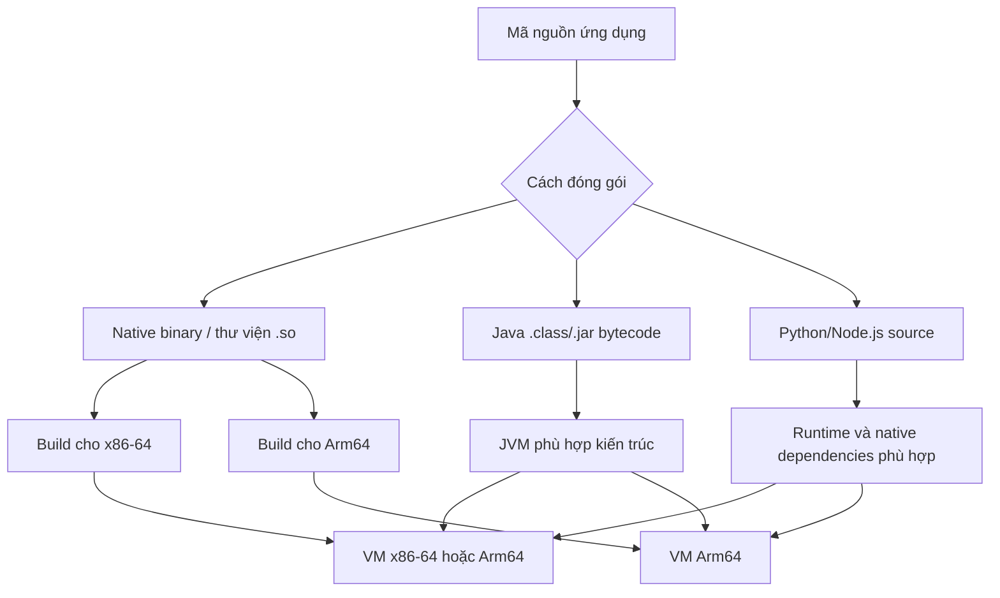
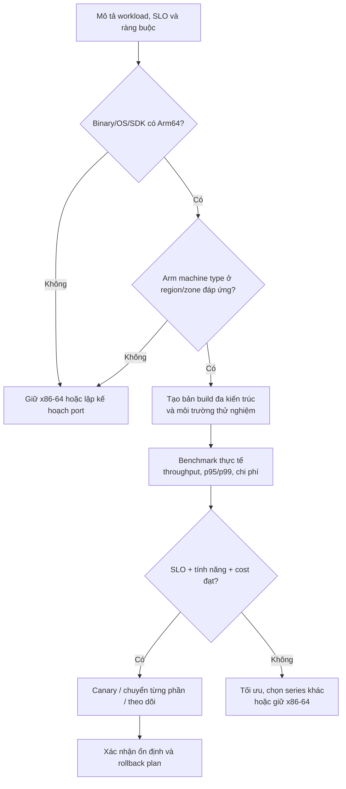
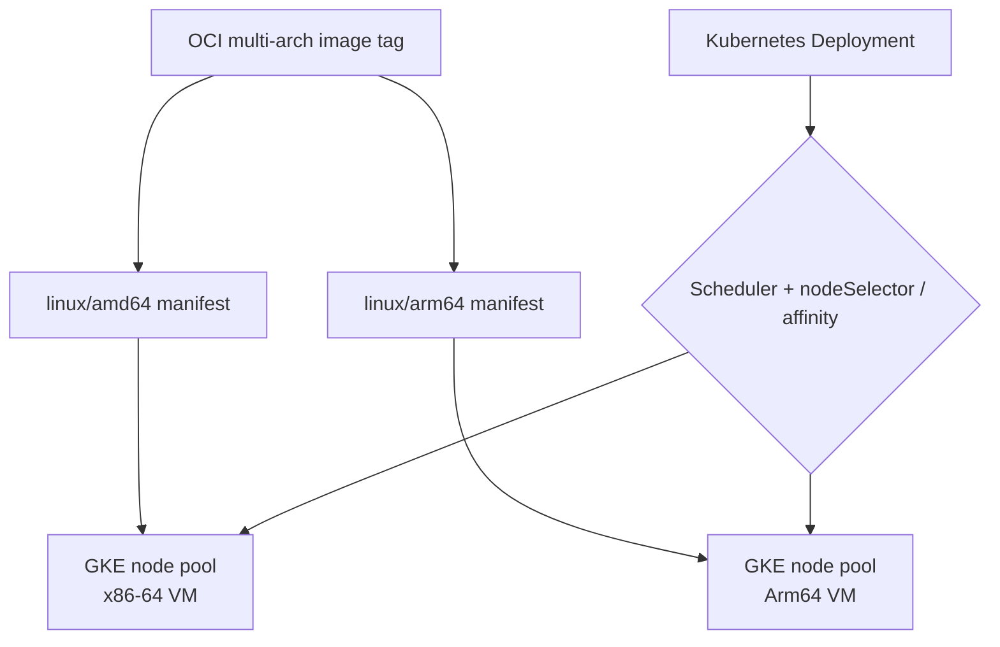

# Lựa chọn CPU architecture cho workload

Khi tạo máy ảo trên **Google Compute Engine**, chọn số vCPU và dung lượng RAM mới chỉ giải quyết một phần bài toán. Người quản trị còn phải quyết định **CPU architecture** (kiến trúc tập lệnh của bộ xử lý): ứng dụng sẽ chạy trên **x86-64** hay **Arm64**? Quyết định này ảnh hưởng đến hệ điều hành, executable, thư viện native, container image, hiệu năng, chi phí và khả năng triển khai đồng nhất từ môi trường phát triển đến production.

Bài học thuộc chương **Compute Engine** của mô-đun `CLOUD_PROVIDERS_GCP`. Mô-đun bao quát Google Cloud từ tổ chức project, IAM, VPC đến Compute Engine, GKE, Cloud Run, lưu trữ, cơ sở dữ liệu, tự động hóa triển khai và theo dõi độ tin cậy cùng chi phí. Trong bức tranh đó, bài này tập trung vào **cách chọn kiến trúc CPU dựa trên yêu cầu workload**, thay vì chọn máy theo giá niêm yết hoặc tên dòng máy.

## 1. Kết quả học tập

Hoàn thành bài này, bạn có thể:

1. Giải thích sự khác biệt giữa **x86-64 / AMD64** và **Arm64 / AArch64**, tránh nhầm kiến trúc CPU với hãng sản xuất CPU.
2. Đọc thông tin **machine series**, machine type và kiến trúc của Compute Engine trước khi triển khai.
3. Xác định phụ thuộc kiến trúc của **OS image, executable, JVM, JNI/native library, container image, agent giám sát và driver**.
4. Chọn kiến trúc theo **tương thích, hiệu năng, độ trễ, chi phí, region/zone, bảo mật và khả năng vận hành**.
5. Thực hiện kiểm tra khả dụng của machine type và image với `gcloud`; thiết kế một thử nghiệm x86-64 và Arm64 có thể tái hiện.
6. So sánh benchmark dựa trên **đơn vị công việc hoàn thành và chi phí**, không chỉ số vCPU hay kết quả benchmark tổng hợp.
7. Nhận diện rủi ro khi chuyển workload giữa hai kiến trúc, đặc biệt với boot disk và container image.
8. Liên hệ quyết định trên VM với **node pool GKE** và giới hạn runtime của các dịch vụ managed khác.

## 2. CPU architecture thực sự là gì?

CPU architecture ở đây chủ yếu là **instruction set architecture (ISA)**: cách phần mềm nhị phân giao tiếp với bộ xử lý qua tập lệnh, thanh ghi, quy ước thực thi và các tính năng liên quan. Cùng một chương trình ở cấp mã nguồn có thể biên dịch thành **hai binary khác nhau** cho hai ISA.

| Thuật ngữ | Tên thường thấy | Ý nghĩa |
| --- | --- | --- |
| **x86-64** | `x86_64`, `amd64`, `AMD64` | Kiến trúc 64-bit thuộc họ x86; có CPU của **Intel và AMD** |
| **Arm64** | `arm64`, `aarch64`, `AArch64` | Kiến trúc Arm 64-bit; Compute Engine có các máy dùng CPU Arm |
| **CPU vendor** | Intel, AMD, Google Axion, Ampere | Hãng/thiết kế bộ xử lý, **không phải** cùng khái niệm với ISA |
| **Machine series** | Ví dụ `N2`, `N2D`, `C4`, `C4D`, `C4A`, `T2A` | Họ máy của Compute Engine; quyết định lựa chọn tài nguyên và tính năng |
| **Machine type** | Ví dụ `n2-standard-4` hoặc `c4a-standard-4` | Cấu hình vCPU/RAM cụ thể trong một series |

**Lưu ý về tên AMD64:** chữ “AMD” xuất hiện vì lịch sử thiết kế ISA; một máy **Intel Xeon** cũng thường chạy Linux với `uname -m` trả `x86_64` và dùng Docker image `linux/amd64`. Không kết luận “amd64 image chỉ chạy trên CPU AMD”.

Tương tự, máy Arm64 có thể hiển thị:

```text
Linux uname -m:        aarch64
Debian/Ubuntu package: arm64
Docker/OCI platform:   linux/arm64
Go build GOARCH:       arm64
Java os.arch:          aarch64
```

Các nhãn khác nhau thuộc cùng nhóm kiến trúc. Trong khi đó, `linux/arm/v7` là Arm **32-bit**, không tương đương `linux/arm64`.

### 2.1. Mã nguồn, bytecode và binary



Mã Java `.jar` thuần bytecode nhìn chung có thể chạy trên cả hai ISA **nếu có JVM tương thích**. Nhưng thư viện JNI (`.so`), native image, Java agent dùng native code, hệ điều hành và package bên ngoài vẫn phải khớp architecture. Với Go, Rust, C/C++, ứng dụng được biên dịch thành binary native thì cần bản build đúng target.

Một binary `linux/amd64` không tự chạy trực tiếp trên kernel/CPU `arm64`. Có thể có giải pháp emulation hoặc translation trong một số môi trường, nhưng **không nên lấy đó làm giả định cho workload production**: hỗ trợ tính năng, hiệu năng và cách vận hành có thể khác đáng kể.

## 3. Các lựa chọn kiến trúc trên Compute Engine

Google Cloud cung cấp nhiều machine series dùng các nền tảng CPU khác nhau. Dưới đây là **ví dụ để nhận diện**, không phải danh sách đầy đủ và không cam kết mọi series có ở mọi zone hoặc phiên bản.

| Kiến trúc | Ví dụ machine series | Nền tảng CPU điển hình | Điểm cần nghiên cứu |
| --- | --- | --- | --- |
| **x86-64** | `N2` | Intel Xeon | Cấu hình general-purpose, tài nguyên và khả năng tương thích |
| **x86-64** | `N2D` | AMD EPYC | Cấu hình general-purpose và tương quan giá/hiệu năng |
| **x86-64** | `C4` | Intel Xeon | Nhóm tối ưu hiệu năng; xem hỗ trợ loại disk/network |
| **x86-64** | `C4D` | AMD EPYC | Nhóm tối ưu hiệu năng với CPU AMD |
| **Arm64** | `C4A` | **Google Axion** | CPU Arm do Google thiết kế, benchmark và hệ sinh thái Arm64 |
| **Arm64** | `T2A` | Ampere Altra | Nhóm Arm phù hợp một số workload scale-out |

Các dòng máy còn có thể khác nhau về **số vCPU, tỉ lệ RAM/vCPU, loại Persistent Disk/Hyperdisk, Local SSD, hiệu năng mạng, tính năng bảo mật, chính sách bảo trì, quota và region availability**. Không thể nói toàn bộ máy Arm “nhanh hơn” hoặc “rẻ hơn” toàn bộ máy x86 chỉ vì khác ISA.

### 3.1. CPU architecture không phải machine family

Có ba tầng quyết định:

1. **Architecture:** x86-64 hay Arm64 — ứng dụng có chạy được không?
2. **Machine series:** dòng máy N2, C4A, C4D… — tập tính năng, CPU platform và khả năng phù hợp workload.
3. **Machine type:** cấu hình vCPU/RAM cụ thể — tài nguyên và chi phí thực tế.

Ví dụ, một ứng dụng Java có thể **tương thích** với Arm64, nhưng cần CPU hiệu năng đơn luồng cao hoặc một loại disk cụ thể mà machine series định chọn không hỗ trợ tại zone đang dùng. Khi đó, kết luận vẫn có thể là dùng x86-64 hoặc chọn một series Arm khác phù hợp.

### 3.2. Đừng so sánh “một vCPU = một vCPU” tuyệt đối

Số vCPU là đơn vị cung cấp tài nguyên, **không bảo đảm** cùng số instructions/giây giữa các CPU. Họ CPU, thế hệ, tốc độ xung, memory subsystem, cache, SMT, network và mức sử dụng thực tế đều ảnh hưởng kết quả.

Một cấu hình “4 vCPU, 16 GiB” trên máy x86 có thể không có performance profile giống “4 vCPU, 16 GiB” trên máy Arm. So sánh công bằng cần kết hợp:

- Cùng **loại công việc** và phiên bản phần mềm.
- Cùng giới hạn tài nguyên ứng dụng.
- Cùng vị trí và điều kiện mạng gần tương đương.
- Cùng kích thước dữ liệu, concurrency và giới hạn I/O.
- Cùng chỉ số SLO, throughput và chi phí trong thời gian đo.

## 4. Tương thích phần mềm là điều kiện đầu tiên

Một quyết định chi phí không có giá trị nếu binary, runtime hoặc agent quan trọng không thể chạy ổn định.

### 4.1. Hệ điều hành, image và package

Đối với VM, **boot disk image phải hỗ trợ đúng architecture** của machine series. Image x86-64 không thể chỉ đổi machine type sang Arm64 rồi khởi động bình thường.

| Thành phần | Câu hỏi phải trả lời |
| --- | --- |
| OS image | Image có `architecture=ARM64` hoặc `X86_64` đúng với máy không? |
| Kernel/driver | Kernel và driver có được nhà cung cấp image hỗ trợ không? |
| Package repository | Các package cần thiết có bản `arm64` hoặc `amd64` không? |
| System agent | Cloud Ops Agent, security/EDR agent, backup agent có bản đúng architecture không? |
| Công cụ vận hành | Debugger, profiler, scanner, monitoring exporter có hỗ trợ máy đích không? |
| Phần mềm bản quyền | License có ràng buộc CPU, số core, processor type hay platform không? |

Với Debian/Ubuntu, dùng `dpkg --print-architecture` để xem kiến trúc package; với RPM-based Linux có thể dùng `rpm --eval '%{_arch}'`. Các distro có chính sách và danh mục image Arm riêng. **Không mặc định mọi image có bản Arm tương ứng** chỉ vì có image x86.

### 4.2. Thư viện bên thứ ba và native code

Các phụ thuộc hay gây khó khi chuyển sang Arm64:

- Thư viện C/C++ tạo file `.so`/`.a` hoặc executable chỉ phát hành bản x86.
- Module Python dạng **wheel** chứa native extension nhưng không có wheel `aarch64` thích hợp.
- Module Node.js dùng native addon/prebuilt binary.
- Driver database hoặc encryption library gắn với native ABI.
- Java **JNI**, native transport của Netty, RocksDB JNI, nén/cryptography native, profiling/observability agent.
- Docker base image hoặc Dockerfile tải một binary bằng URL hard-code `amd64`.
- Ứng dụng giả định CPU instructions cụ thể như AVX x86, hoặc nhúng assembler/SIMD không có fallback Arm.

Ví dụ code Python thuần có thể không phải biên dịch lại, nhưng package `numpy`, `cryptography` hoặc một thư viện ảnh có bản binary theo platform. Hãy xác minh **cả dependency graph**, không chỉ source app chính.

### 4.3. Với Java và Spring Boot

Java là ví dụ tốt cho tính di động **ở cấp bytecode**, nhưng không bảo đảm mọi lớp stack đều di động:

```text
Spring Boot JAR
  ├─ Bytecode JVM: có thể dùng chung
  ├─ JDK/JRE: phải có bản Linux x86-64 hoặc Linux AArch64
  ├─ JNI/native libraries: phải có .so theo kiến trúc
  ├─ Java agents: cần kiểm tra support matrix
  └─ Container base image: cần image manifest đúng platform
```

Các phiên bản JDK hiện đại có bản Linux AArch64 từ nhiều nhà phân phối; hãy chọn phiên bản **được hỗ trợ và cập nhật bảo mật**. Dùng cùng phiên bản Java, GC, heap settings và ứng dụng khi benchmark. Nếu sử dụng **GraalVM Native Image**, binary kết quả là native code cho target architecture tương ứng, không còn chỉ là `.jar` chung; quy trình build/CI cần tạo artifact cho từng target được hỗ trợ.

Lệnh kiểm tra Java khi VM đã có JDK:

```bash
java -XshowSettings:properties -version 2>&1 \
  | grep -E 'java.version|java.vendor|os.arch|os.name'
```

Trên x86-64, `os.arch` thường là `amd64`; trên Arm64 thường là `aarch64`. Không kết luận “Java chạy được” chỉ từ việc `java -version` thành công — phải khởi động **ứng dụng thật**, gọi các đường API, thực hiện tác vụ có native library và quan sát logs.

## 5. Workload nào có thể hưởng lợi từ Arm64?

Arm64 không phải lựa chọn chỉ dành cho điện thoại hay thiết bị nhúng. Trên Compute Engine, Arm có thể phù hợp với các dịch vụ backend, batch processing, ứng dụng cloud-native và workload scale-out đã có hệ sinh thái Arm64.

| Workload | Arm64 đáng thử khi | Phải kiểm tra kỹ |
| --- | --- | --- |
| **API HTTP / microservice** | Container/JDK có bản Arm64, dễ scale ngang | p95/p99 latency, TLS, compression, auth, native dependencies |
| **Java/Spring Boot** | JDK Arm64 và Java agents đầy đủ | JVM warm-up, GC, JNI, Netty native, peak memory |
| **Go / Rust service** | Có CI build `linux/arm64` và test đầy đủ | CGO/FFI, crypto, assembly-specific code |
| **Python web/worker** | Dependency có wheels Arm64 hoặc build được | Native extensions, image size, startup time |
| **Batch/ETL** | CPU-bound, công việc lặp lại và ít phụ thuộc platform | Thời gian hoàn thành/job, throughput, quota, I/O |
| **Redis hoặc service tự quản lý** | Phiên bản có build và support Arm | Bộ nhớ, network, persistence, compatibility |
| **Media/image processing** | Bộ codec/thư viện có bản Arm tối ưu | CPU SIMD, kiến trúc plugin, licensing |
| **Hệ thống cần vendor SDK độc quyền** | SDK có bản Arm64 được vendor hỗ trợ | Support contract, native library/driver |
| **GPU/HPC/thiết bị đặc thù** | Machine/GPU/driver hỗ trợ đúng architecture | CUDA, driver, machine availability, interconnect |

Không nên coi danh sách này là cam kết hiệu năng. Một thư viện nén, JVM GC hoặc module mã hóa có thể chạy tốt trên kiến trúc A nhưng khác nhiều trên kiến trúc B vì **phần mềm và CPU generation cụ thể**.

### 5.1. Khi nào giữ x86-64?

Giữ x86-64 thường là quyết định hợp lý nếu:

- Có binary/SDK/driver bản quyền **chỉ hỗ trợ x86-64**.
- Hệ thống đã được tối ưu sâu cho tập lệnh x86 cụ thể và chưa có port.
- Tooling build/deploy/monitoring/backup không hỗ trợ Arm64 ở mức có thể vận hành.
- Machine series Arm khả dụng không đáp ứng disk, network, accelerator, zone hoặc HA topology cần thiết.
- Việc chuyển đổi tốn thời gian, rủi ro quá lớn so với lợi ích chi phí đã đo được.
- Benchmark của workload **không chứng minh** lợi ích sau khi tính cả nhân sự, rủi ro và thời gian migration.

Không cần ép toàn bộ tổ chức dùng chung một kiến trúc. Hệ thống có thể chạy **dịch vụ A trên Arm** và **dịch vụ B trên x86**, miễn là các hợp đồng API, dữ liệu, monitoring và lịch triển khai được kiểm soát.

## 6. Quy trình ra quyết định kiến trúc CPU

Thay vì bắt đầu từ tên machine type, dùng quy trình sau:



### 6.1. Ma trận quyết định

Đặt trọng số từ yêu cầu nghiệp vụ thay vì “CPU nào mới hơn”:

| Tiêu chí | Câu hỏi | Tầm quan trọng |
| --- | --- | --- |
| **Compatibility** | OS, JDK, app binary, native libs, security agent có chạy không? | **Điều kiện bắt buộc** |
| **Latency SLO** | p95/p99 và thời gian startup có nằm trong giới hạn? | Bắt buộc với dịch vụ tương tác |
| **Throughput** | RPS, jobs/giờ, data rows/giờ hoặc MiB/s ở mức tải chuẩn | Ảnh hưởng chi phí/khả năng mở rộng |
| **Memory & I/O** | RAM, disk throughput/IOPS, network có phù hợp? | Có thể là nút cổ chai thực sự |
| **Availability** | Region/zone, quota, capacity, quy tắc HA có đáp ứng? | Bắt buộc với production |
| **Security** | Image/JDK/agent được vá, IAM/Shielded VM/tính năng bắt buộc? | Bắt buộc theo chính sách |
| **TCO** | Giá VM, license, disk/network và chi phí chuyển đổi/vận hành | So sánh theo đơn vị công việc |
| **Maintainability** | CI, artifact, test, on-call và rollback có hỗ trợ đa kiến trúc? | Quyết định tính bền vững |

Một lựa chọn chỉ có giá/giờ thấp hơn nhưng không đạt p99 latency hoặc khiến quy trình backup không chạy được **không phải giải pháp tốt**.

## 7. Chuẩn bị lab so sánh x86-64 và Arm64

Bài lab hướng dẫn **kiểm tra và lựa chọn**, không yêu cầu chạy trên production. Trong phần câu lệnh có thao tác tạo VM phát sinh chi phí; chỉ thực hiện trong **project đã được phép**, trên subnet và zone phù hợp.

### 7.1. Giả định đầu vào

| Biến | Ví dụ | Lưu ý |
| --- | --- | --- |
| `PROJECT_ID` | `YOUR_LAB_PROJECT_ID` | Project lab bật billing và Compute Engine API |
| `ZONE` | `YOUR_SUPPORTED_ZONE` | Chọn zone có máy x86 và Arm dự định |
| `SUBNET` | `YOUR_LAB_SUBNET` | Subnet cùng region với zone, có đường quản trị phù hợp |
| `X86_TYPE` | `n2-standard-4` | Chỉ ví dụ: x86-64, cấu hình 4 vCPU |
| `ARM_TYPE` | `c4a-standard-4` | Chỉ ví dụ: Arm64, cấu hình 4 vCPU |
| `X86_IMAGE_FAMILY` | `debian-12` | Image x86 của project `debian-cloud` |
| `ARM_IMAGE_FAMILY` | `debian-12-arm64` | Image Arm64 của project `debian-cloud` nếu còn được cung cấp |

**Không đảm bảo** các cặp machine type và image family trên cùng sẵn có ở zone của bạn. Đầu tiên phải dùng lệnh kiểm tra. Nếu một cấu hình không tồn tại hoặc không phù hợp, chọn series/zone khác theo tài liệu hiện hành, không tự đổi architecture cho image cũ.

Máy **không có external IP** an toàn hơn trong một số môi trường, nhưng cần phương thức quản trị như IAP TCP forwarding/VPN và firewall/IAM tương ứng. Không mở SSH `0.0.0.0/0` chỉ để vào VM chạy thử.

### 7.2. Kiểm tra CLI và project (chỉ đọc)

```bash
PROJECT_ID="YOUR_LAB_PROJECT_ID"
ZONE="YOUR_SUPPORTED_ZONE"
SUBNET="YOUR_LAB_SUBNET"

X86_TYPE="n2-standard-4"
ARM_TYPE="c4a-standard-4"
X86_IMAGE_FAMILY="debian-12"
ARM_IMAGE_FAMILY="debian-12-arm64"

gcloud --version
gcloud auth list

gcloud projects describe "$PROJECT_ID" \
  --format="yaml(projectId,projectNumber,lifecycleState)"

# Các machine type hiện được liệt kê cho zone bạn chọn.
gcloud compute machine-types list \
  --project="$PROJECT_ID" \
  --zones="$ZONE" \
  --format="table(name,guestCpus,memoryMb,zone.basename())"
```

Tìm `n2-standard-4` và `c4a-standard-4` trong danh sách. Nếu thiếu, **không thực thi** phần tạo VM. Bên cạnh danh sách machine type, cần kiểm tra **quota/capacity** và ràng buộc organization policy; sự hiện diện của machine type không đảm bảo quota hoặc có đủ capacity để tạo instance.

### 7.3. Xác minh thông số máy và OS image

```bash
# Chỉ đọc thông số loại máy đã chọn.
gcloud compute machine-types describe "$X86_TYPE" \
  --project="$PROJECT_ID" \
  --zone="$ZONE" \
  --format="yaml(name,guestCpus,memoryMb)"

gcloud compute machine-types describe "$ARM_TYPE" \
  --project="$PROJECT_ID" \
  --zone="$ZONE" \
  --format="yaml(name,guestCpus,memoryMb)"

# Image mới nhất trong image family do Debian Cloud cung cấp.
gcloud compute images describe-from-family "$X86_IMAGE_FAMILY" \
  --project="debian-cloud" \
  --format="yaml(name,architecture,status,creationTimestamp)"

gcloud compute images describe-from-family "$ARM_IMAGE_FAMILY" \
  --project="debian-cloud" \
  --format="yaml(name,architecture,status,creationTimestamp)"
```

Ở image x86, trường `architecture` phải biểu thị `X86_64`; ở image Arm phải biểu thị `ARM64` theo giá trị API. Nếu image family, OS version hoặc machine type không tồn tại, hãy chọn image **đúng ISA** và được hỗ trợ thay vì bỏ bước kiểm tra.

### 7.4. Kiểm tra VPC/subnet, IAM và quyền riêng tư

```bash
# Chỉ đọc subnet; cần biết region/CIDR và đường truy cập quản trị.
gcloud compute networks subnets list \
  --project="$PROJECT_ID" \
  --format="table(name,region.basename(),network.basename(),ipCidrRange)"

# Kiểm tra VM trùng tên trước khi tạo.
gcloud compute instances list \
  --project="$PROJECT_ID" \
  --filter="name=(arch-lab-x86 arch-lab-arm)" \
  --format="table(name,zone.basename(),status,machineType.basename())"
```

Những điều kiện nên được xác nhận trước lệnh tạo: IAM để tạo VM và dùng subnet, quota/CPU reservation, chính sách boot image, khả năng truy cập không có public IP, nhóm chịu chi phí, và tên VM không trùng workload đã tồn tại. Nếu dùng Shared VPC, phải kiểm tra host/service project và quyền `compute.networkUser` tương ứng.

## 8. Tạo hai VM lab đúng architecture

**Các lệnh dưới đây thay đổi tài nguyên Google Cloud và phát sinh chi phí.** Chỉ chạy sau khi phần preflight PASS, đúng project/zone/subnet và đã được phép tạo VM. Dùng một VM trên mỗi ISA; đây là một thử nghiệm ban đầu, không phải benchmark cuối.

### 8.1. VM x86-64

```bash
gcloud compute instances create "arch-lab-x86" \
  --project="$PROJECT_ID" \
  --zone="$ZONE" \
  --machine-type="$X86_TYPE" \
  --image-family="$X86_IMAGE_FAMILY" \
  --image-project="debian-cloud" \
  --boot-disk-size="20GB" \
  --subnet="$SUBNET" \
  --no-address \
  --labels="purpose=cpu-arch-lab,environment=dev"
```

### 8.2. VM Arm64

```bash
gcloud compute instances create "arch-lab-arm" \
  --project="$PROJECT_ID" \
  --zone="$ZONE" \
  --machine-type="$ARM_TYPE" \
  --image-family="$ARM_IMAGE_FAMILY" \
  --image-project="debian-cloud" \
  --boot-disk-size="20GB" \
  --subnet="$SUBNET" \
  --no-address \
  --labels="purpose=cpu-arch-lab,environment=dev"
```

Các lệnh chọn cấu hình thử nghiệm cụ thể. Khi tạo máy thật, Compute Engine có thể yêu cầu thông số khác theo machine series, image, disk hoặc policy organization. Trong môi trường quản trị chặt, hãy chỉ định **runtime service account có quyền tối thiểu** hoặc cách không gắn SA theo yêu cầu ứng dụng và đánh giá các access scopes/metadata. Không cấp Editor cho default service account chỉ để chạy benchmark CPU.

### 8.3. Đọc lại hai VM

```bash
gcloud compute instances describe "arch-lab-x86" \
  --project="$PROJECT_ID" \
  --zone="$ZONE" \
  --format="yaml(name,status,machineType,disks,networkInterfaces)"

gcloud compute instances describe "arch-lab-arm" \
  --project="$PROJECT_ID" \
  --zone="$ZONE" \
  --format="yaml(name,status,machineType,disks,networkInterfaces)"
```

VM có trạng thái `RUNNING` **không** đồng nghĩa OS khởi động hoàn chỉnh, ứng dụng sẵn sàng hoặc network có đường truy cập. Hãy kiểm tra boot logs, SSH/IAP, startup scripts và service health khi có quyền.

## 9. Kiểm tra kiến trúc từ bên trong hệ điều hành

Khi đã có phương thức SSH/IAP phù hợp, chạy trên từng VM:

```bash
# ISA mà Linux kernel báo cho user space.
uname -m

# Thông tin CPU nhận diện trong guest OS.
lscpu

# Kiến trúc package trên Debian/Ubuntu.
dpkg --print-architecture

# Thông tin phân phối Linux.
cat /etc/os-release
```

Kết quả định hướng:

| Máy | `uname -m` | `dpkg --print-architecture` | OCI platform dùng cho container |
| --- | --- | --- | --- |
| VM x86 | `x86_64` | `amd64` | `linux/amd64` |
| VM Arm | `aarch64` | `arm64` | `linux/arm64` |

Có thể thực hiện lệnh qua SSH từ Cloud Shell/máy admin đã cấu hình IAP, IAM và firewall:

```bash
# Ví dụ chỉ dùng được khi IAP TCP forwarding đã được chuẩn bị.
gcloud compute ssh "arch-lab-x86" \
  --project="$PROJECT_ID" \
  --zone="$ZONE" \
  --tunnel-through-iap \
  --command="uname -m"

gcloud compute ssh "arch-lab-arm" \
  --project="$PROJECT_ID" \
  --zone="$ZONE" \
  --tunnel-through-iap \
  --command="uname -m"
```

IAP là **một phương thức quản trị**, không tự có khi VM được tạo. Cần quyền truy cập IAP và OS Login/SSH key phù hợp với chính sách project, cũng như rule firewall cần thiết. Nếu không có đường quản trị, nhờ quản trị viên cấu hình một đường an toàn; không đổi VM thành có public IP vô điều kiện.

### 9.1. Phân biệt host CPU và thông tin trong VM

`lscpu` cho biết guest nhận diện CPU/ISA/các flags, nhưng không phải mô tả đầy đủ năng lực host vật lý và không thay thế tài liệu machine series. Một số CPU flags có thể bị giới hạn theo platform/virtualization, đặc biệt khi dùng instruction sets riêng. Muốn chọn thuật toán SIMD (AVX2/AVX-512/NEON/SVE…), phải **kiểm tra flags thực tế và khả năng runtime**; không suy từ chuỗi tên dòng máy.

## 10. Build container đa kiến trúc

Nhiều ứng dụng Compute Engine/GKE được đóng gói thành OCI container. Container image thường bao gồm binary và thư viện theo ISA; cùng một tag không mặc nhiên chứa cả hai kiến trúc.

### 10.1. Image tag và image manifest

```text
registry.example.com/team/api:1.4
  ├─ linux/amd64 -> image digest cho x86-64
  └─ linux/arm64 -> image digest cho Arm64
```

**Multi-platform image** dùng manifest index để runtime chọn image phù hợp kiến trúc của node. Nếu tag chỉ có `linux/amd64`, việc kéo image đó trên Arm VM/node có thể dẫn tới lỗi unsupported platform hoặc `exec format error` khi chạy binary.

Có thể xem manifest:

```bash
docker buildx imagetools inspect \
  "REGISTRY_HOST/PROJECT/REPOSITORY/IMAGE:TAG"
```

Lệnh này chỉ đọc registry nếu môi trường có Docker Buildx và quyền registry; thay placeholder và kiểm tra `linux/amd64` cùng `linux/arm64` có tồn tại hay không.

### 10.2. Ví dụ Dockerfile dùng Java

Mẫu minh họa cho ứng dụng Java đóng gói thành `app.jar`:

```dockerfile
FROM eclipse-temurin:21-jre
WORKDIR /app
COPY app.jar /app/app.jar
USER 10001
EXPOSE 8080
ENTRYPOINT ["java", "-jar", "/app/app.jar"]
```

Cần xác minh **tag thực tế của base image** có manifest cho cả `amd64` và `arm64` trước khi dùng; không suy rằng mọi biến thể image đều đa kiến trúc. Với `app.jar` chỉ dùng Java bytecode, image đa nền tảng có thể tái sử dụng JAR, nhưng nếu JAR chứa native libs hoặc agent thì pipeline cần gói đúng bản theo ISA.

Lệnh build nhiều platform (tạo/push artifact tới registry mà bạn sở hữu):

```bash
# Thao tác ghi lên registry: yêu cầu builder hỗ trợ multi-platform
# và quyền push; không chạy với registry của người khác.
docker buildx build \
  --platform linux/amd64,linux/arm64 \
  --tag "REGISTRY_HOST/PROJECT/REPOSITORY/IMAGE:TAG" \
  --push .
```

Buildx có thể dùng QEMU emulation hoặc build nodes native tùy cấu hình. **Build thành công không chứng minh benchmark chạy tốt** và không bảo đảm mọi native dependency tương thích. Hãy chạy unit/integration tests trên máy **native đúng architecture** nếu workload quan trọng.

### 10.3. Với Go/Rust/C/C++

Go thuần có thể build cho các target:

```bash
GOOS=linux GOARCH=amd64 go build -o app-linux-amd64 ./cmd/app
GOOS=linux GOARCH=arm64 go build -o app-linux-arm64 ./cmd/app
```

Ví dụ này chỉ đúng khi project Go có thư mục `./cmd/app`. Với CGO, cần toolchain và native libraries phù hợp; cross-compiling không đơn giản chỉ thay `GOARCH`. Với Rust hoặc C/C++, cần cross-target/toolchain/linker và tests tương đương. Không upload nhầm binary `amd64` vào image `arm64`.

## 11. Benchmark đúng bài toán, không chọn theo cảm tính

CPU architecture chỉ là một yếu tố của hiệu năng. Bài thử tốt phải phản ánh **hành vi người dùng hoặc job thực tế**.

### 11.1. Xác định workload và baseline

Ví dụ hệ thống Spring Boot xử lý đặt hàng có:

- Endpoint đọc dữ liệu, truy vấn database và dựng JSON.
- Endpoint tính giá và kiểm tra khuyến mại CPU-bound.
- Batch job tổng hợp dữ liệu chạy mỗi đêm.
- Yêu cầu: **p95 latency dưới SLO đã đặt**, error rate thấp và xử lý đủ lưu lượng cao điểm.

Trước khi benchmark, ghi:

| Yếu tố | Cần giữ giống nhau hoặc ghi nhận |
| --- | --- |
| App | Commit, JAR/image digest, feature flags |
| Runtime | Java version, GC, heap, thread pool |
| Data | Dataset, kích thước payload, tỷ lệ cache hit, trạng thái database |
| Network | Region/zone client và server, VPC path, TLS, LB nếu có |
| VM | CPU architecture, machine type, vCPU/RAM, disk, network |
| Load | Concurrency, RPS target, thời gian warm-up, ramp-up |
| Kết quả | RPS, p50/p95/p99, CPU%, RSS/heap, GC pause, error rate |
| Chi phí | Thời lượng VM, disk/network, license, monitoring và giá áp dụng |

Nếu mỗi VM dùng một database ở region khác nhau, kết quả API có thể phản ánh **latency mạng**, không phải khả năng CPU. Với workload I/O-bound, đổi CPU architecture có thể ít tác động hơn việc tăng IOPS hoặc đặt dữ liệu gần ứng dụng.

### 11.2. Warm-up và đo nhiều lần

Đặc biệt với JVM:

1. Khởi động app, xác nhận health checks thành công.
2. Chạy **warm-up** để JIT và cache đạt trạng thái gần ổn định.
3. Chạy cùng tập request/đầu vào và concurrency trên từng VM.
4. Lặp lại nhiều phiên, ghi thời gian và phần trăm CPU.
5. Loại trừ lỗi test harness, deployment hoặc network; lưu cả kết quả không mong muốn để phân tích.
6. So sánh **sai số/biến thiên** thay vì kết luận từ một kết quả đẹp nhất.

Không dùng CPU stress test hoặc lệnh `openssl speed` làm kết quả quyết định duy nhất nếu workload thật phụ thuộc database/HTTP. Microbenchmark hữu ích để tìm điểm nghi vấn, nhưng **business transaction** mới là đơn vị quyết định.

### 11.3. Microbenchmark minh họa có giới hạn

Nếu hai VM đã cài Python 3, có thể chạy đoạn mã nhỏ dưới đây để minh họa cách ghi tốc độ tính toán. Nó đo thư viện hashing trong môi trường đang chạy, **không phải benchmark tổng quát của mọi CPU**.

```python
import hashlib
import platform
import time

payload = b"cloud-benchmark" * 32768  # 0.5 MiB (xấp xỉ)
rounds = 2000

start = time.perf_counter()
checksum = b""
for _ in range(rounds):
    checksum = hashlib.sha256(payload).digest()
elapsed = time.perf_counter() - start

processed_mib = len(payload) * rounds / (1024 * 1024)
print("architecture:", platform.machine())
print("seconds:", round(elapsed, 3))
print("MiB/s:", round(processed_mib / elapsed, 2))
print("digest_prefix:", checksum.hex()[:12])
```

Chạy **cùng interpreter/library version** và cùng số vòng trên hai VM. Kết quả có thể phụ thuộc OpenSSL, SIMD instructions, crypto acceleration, VM scheduling và CPU frequency. Không extrapolate `MiB/s` này thành tốc độ xử lý HTTP/API hay giá thành thực tế.

### 11.4. Thử tải ứng dụng

Nếu ứng dụng có endpoint lab được phép test, dùng công cụ load như `hey`, `wrk` hoặc `k6` từ một **load generator độc lập**:

```text
1. Chọn endpoint test không tạo giao dịch tài chính thật.
2. Ghi rate/concurrency cố định và thời gian warm-up.
3. Đo 5 lần trên x86; lưu latency histogram và error rate.
4. Đo 5 lần trên Arm; dùng cùng dataset/request mix.
5. So sánh p95/p99, throughput, CPU/RAM, GC và network.
6. Thay machine size nếu bottleneck chưa tương đương.
```

Không load test production hay endpoint của người khác khi chưa được phép. **Máy phát tải** cũng có giới hạn CPU/network; nếu generator đạt trần thì hai server có thể trông “bằng nhau” dù sức mạnh khác nhau.

## 12. Tính hiệu năng trên mỗi đơn vị chi phí

**Giá mỗi giờ thấp hơn không chắc rẻ hơn cho toàn workload.** Nếu một VM xử lý chậm, bạn có thể cần nhiều instance hơn hoặc phải tăng kích thước.

Giả sử đây là số liệu **giả định**, không phải giá hiện hành của Google Cloud:

| Phương án | Giá VM giả định | Throughput đạt SLO | Chi phí VM cho 1 triệu request* |
| --- | --- | --- | --- |
| x86-64 | 0,20 USD/giờ | 100 req/s | Khoảng 0,56 USD |
| Arm64 | 0,16 USD/giờ | 110 req/s | Khoảng 0,40 USD |

\*Giả định instance hoạt động liên tục ở throughput nêu trên, không có traffic biến động, bỏ qua chi phí khác; số liệu **chỉ để minh họa công thức**.

Công thức:

\[
\text{Chi phí VM trên 1 triệu request}
=
\frac{\text{Giá VM mỗi giờ} \times 10^6}
{\text{Request/giây đạt SLO} \times 3600}
\]

Giá trị thực tế phải xem theo **machine series, region, VM size, provisioning model, thời gian sử dụng và chính sách chiết khấu**. Thêm Persistent Disk, Hyperdisk/Local SSD, egress, load balancer, logging, license và vận hành; có dịch vụ managed như Cloud SQL tính giá riêng, không chuyển chi phí của chúng sang kiến trúc VM.

### 12.1. Đo “cost per job” đối với batch

Một tác vụ ETL cần xử lý 100 GiB dữ liệu:

- Máy A giá thấp nhưng hoàn thành sau 6 giờ.
- Máy B giá cao hơn nhưng hoàn thành sau 2 giờ.

Chi phí VM của từng phương án bằng **giá/giờ × số giờ chạy**; sau đó cộng disk/network/storage và chi phí khởi động. Đo thêm lỗi và chi phí khi job retry. Nếu thời hạn batch là 3 giờ, máy A còn không đáp ứng SLO dù tổng chi phí có vẻ hấp dẫn.

### 12.2. Tính TCO khi di chuyển kiến trúc

Chuyển sang Arm có thể cần:

- Sửa build pipeline CI/CD để xuất bản `linux/arm64`.
- Mua hoặc nâng cấp phần mềm/agent có hỗ trợ Arm.
- Thêm unit, integration và canary tests cho architecture mới.
- Xử lý native library, đóng gói image và quét bảo mật.
- Diễn tập rollback, backup và runbook.
- Đào tạo đội trực vận hành và xác nhận support contract.

Đừng bỏ qua các chi phí ban đầu này khi quyết định chuyển đổi chỉ dựa trên một chênh lệch giá VM hàng tháng.

## 13. Bảo mật và vận hành khác nhau ở điểm nào?

CPU ISA **không quyết định trực tiếp** rằng một máy an toàn hơn máy khác. An toàn phụ thuộc **OS/JDK được vá**, kernel, runtime, chuỗi cung ứng image, IAM, VPC/firewall, service account, cấu hình disk encryption và tính năng VM cụ thể.

| Lớp kiểm soát | Câu hỏi khi chọn Arm64 hoặc x86-64 |
| --- | --- |
| OS patch | Nhà cung cấp image còn cập nhật bảo mật cho architecture này? |
| Firmware/boot | Shielded VM, secure boot, vTPM/integrity monitoring có được máy hỗ trợ theo cấu hình dự kiến? |
| Confidential Computing | Machine series/zone và tính năng Confidential VM có hỗ trợ hay không? |
| IAM/service account | VM chỉ có quyền đúng workload; có tránh keys tĩnh không? |
| Network | Firewall, private IP, IAP/NAT và logging có hoạt động như thiết kế? |
| EDR/backup agent | Có artifact đúng ISA và được vendor support? |
| Supply chain | Container base image, package, native binary và SBOM đúng architecture? |
| Observability | Metrics, tracing, profiling và crash dump đọc được trên ISA mới? |

Một số tính năng VM chỉ có trên các dòng máy cụ thể, không phải “toàn x86” hay “toàn Arm”. Trước khi áp security baseline production, đối chiếu **machine type và image đã chọn** với tài liệu hỗ trợ của tính năng.

## 14. Di chuyển VM x86-64 sang Arm64 có phải đổi machine type?

**Không nên coi đây là một thao tác sửa trường `machineType` duy nhất.** Vì boot disk và executable phụ thuộc ISA, cách an toàn thường là **tạo VM Arm64 mới với OS image Arm64**, triển khai cùng phiên bản ứng dụng đã được build/test cho Arm, sau đó chuyển traffic/data có kiểm soát.

### 14.1. Quy trình migration tham khảo

1. **Inventory:** liệt kê OS, machine type, architecture, disks, service account, firewall, routes, startup scripts, agents và license của VM nguồn.
2. **Compatibility matrix:** kiểm tra app, native deps, image, JDK, backup/monitoring trên Arm.
3. **Data plan:** dùng database bên ngoài VM, storage service hoặc chuyển dữ liệu qua phương án được hỗ trợ; không khởi động image boot x86 bằng CPU Arm.
4. **Build:** phát hành image/binary cho Arm64 với digest/version có thể truy vết.
5. **Canary:** tạo VM Arm, deploy dữ liệu thử nghiệm, chạy health/integration test.
6. **Benchmark:** đo p95/p99, throughput, memory, disk/network và chi phí.
7. **Cutover:** chuyển một phần traffic qua load balancer/MIG hoặc cơ chế routing thích hợp.
8. **Observe:** theo dõi SLO, số lỗi, CPU/GC, hành vi database và metrics chi phí.
9. **Rollback:** giữ VM x86 và cấu hình cũ đủ thời gian, chuyển traffic quay lại nếu có vấn đề.
10. **Cleanup:** chỉ dọn VM x86 và artifact cũ khi đã chắc chắn không còn phụ thuộc.

**Persistent Disk dữ liệu** có thể được chuyển/attach theo khả năng và ràng buộc của loại disk, nhưng phải kiểm tra filesystem, partition, mount options, database recovery, encryption và application compatibility. Boot disk x86-64 không tự biến thành Arm64 boot disk chỉ vì chuyển attachment.

### 14.2. Downtime và trạng thái

Ứng dụng stateless phía sau load balancer dễ triển khai canary hơn VM chứa state trực tiếp. Nếu app ghi dữ liệu cục bộ, phải lập kế hoạch đồng bộ/backup và thử khôi phục. Không đồng thời cho hai VM ghi vào cùng một disk hoặc database state nếu kiến trúc không được thiết kế cho việc đó.

### 14.3. Managed Instance Groups và autoscaling

Khi workload chạy dưới **Managed Instance Group (MIG)**, chọn architecture được thể hiện qua machine type/boot image của **instance template**. Muốn đổi ISA, nên tạo instance template mới, thử bằng canary hoặc một MIG riêng; sau đó triển khai rolling/canary update theo chiến lược đã kiểm chứng. Tránh đổi hàng loạt VM production trong một bước mà không có đường rollback.

## 15. GKE node pool và container architecture

GKE là một lớp orchestration trên Compute Engine. Nếu GKE dùng machine series Arm64 cho node pool, Pod phải có container image/agent tương thích với architecture của node.

### 15.1. Sơ đồ triển khai đa kiến trúc



Ví dụ yêu cầu scheduler chọn node Arm64:

```yaml
apiVersion: apps/v1
kind: Deployment
metadata:
  name: orders-api-arm
spec:
  replicas: 2
  selector:
    matchLabels:
      app: orders-api-arm
  template:
    metadata:
      labels:
        app: orders-api-arm
    spec:
      nodeSelector:
        kubernetes.io/arch: arm64
      containers:
        - name: orders-api
          image: REGISTRY_HOST/PROJECT/REPOSITORY/orders-api:multiarch
          ports:
            - containerPort: 8080
```

Kubernetes label chuẩn `kubernetes.io/arch` thường có giá trị `amd64` hoặc `arm64`. Nếu cluster không có node Arm64 phù hợp, Pod có thể `Pending` vì không được schedule. Nếu image tag thiếu Arm64 manifest hoặc native dependency sai, Pod có thể bị pull error hoặc crash. Cần kiểm tra DaemonSet (logging, security, CNI/CSI), CSI driver, operator và các GKE add-ons do team triển khai.

**Đừng suy rằng mọi GKE mode hoặc mọi machine type Arm hiện hỗ trợ**; khả năng dùng dòng máy, region, node auto-provisioning và feature khác nhau theo GKE mode/phiên bản. Xem tài liệu Arm trên GKE trước khi xây cluster production.

### 15.2. Cloud Run không phải Compute Engine VM tùy chọn CPU ISA

Cloud Run là dịch vụ managed, người dùng không chọn trực tiếp machine series như VM Compute Engine. Container runtime của Cloud Run có **yêu cầu kiến trúc và container contract riêng**, cần kiểm tra tài liệu Cloud Run hiện hành trước khi push image. Có một image đa kiến trúc không có nghĩa Cloud Run có thể chạy tùy ý mọi ISA mà image cung cấp.

Do đó, quyết định “migrating VM từ x86 sang Arm” không tự suy ra “Cloud Run backend cũng chuyển sang Arm”; hai sản phẩm có lớp hỗ trợ và chính sách runtime khác nhau.

## 16. Chọn CPU architecture cho các nhóm workload điển hình

### 16.1. API Java phục vụ người dùng Việt Nam

Giả định ứng dụng chạy ở một region Đông Nam Á, gọi Cloud SQL và Redis, có request peak. Hướng tiếp cận:

- Kiểm tra JDK Arm64 và tất cả JNI/native modules, monitoring agents.
- Build cùng JAR và container image chuẩn cho hai ISA.
- Đặt benchmark clients, database và cache sao cho độ trễ nền tương đương.
- Chạy workload thật với tỷ lệ endpoint read/write.
- Đo p95/p99 khi autoscale và JVM warm-up, không chỉ throughput bình quân.
- Chọn máy đạt SLO với cost/request tốt hơn và dễ quản lý khi sự cố.

Nếu CPU usage thấp nhưng latency do database cao, đổi ISA có thể không đem lại lợi ích đáng kể. Tối ưu query, connection pool và mạng có thể quan trọng hơn.

### 16.2. Job xử lý dữ liệu mỗi đêm

Một batch job đọc file từ Cloud Storage, giải nén, xử lý và ghi kết quả:

- Kiểm tra thuật toán có native codec/SIMD phụ thuộc ISA hay không.
- Đo tổng thời gian job và tỷ lệ lỗi/retry, không chỉ CPU speed.
- Tách **thời gian tải/ghi dữ liệu** khỏi **thời gian tính toán**.
- Nếu công việc dễ chia nhỏ, thử parallel workers trên VM Arm để so sánh cost/job.
- Kiểm tra quota, capacity và Spot VM nếu job có thể dừng/retry an toàn.

Spot VM là **provisioning model**, không phải architecture; không thể dùng sự chênh lệch giá Spot vs on-demand để kết luận CPU ISA nào hiệu quả hơn.

### 16.3. Dịch vụ có binary đóng, license hoặc driver đặc biệt

Hãy hỏi nhà cung cấp:

1. Có phát hành và hỗ trợ Linux AArch64/Arm64 chính thức không?
2. Có hỗ trợ đúng distro và phiên bản kernel/JDK không?
3. License theo core/vCPU có đổi khi chạy trên Arm không?
4. Monitoring, backup, failover, crypto modules có tương thích không?
5. Khi gặp lỗi production, vendor có chấp nhận support stack này không?

Nếu câu trả lời không rõ hoặc chỉ có x86 binary, giữ x86-64 là lựa chọn ít rủi ro hơn cho đến khi có phương án hỗ trợ.

## 17. Giám sát sau khi chuyển architecture

Benchmark trước triển khai là cần thiết nhưng chưa đủ. Sau canary/cutover, theo dõi ít nhất:

| Chỉ số | Ý nghĩa |
| --- | --- |
| **Availability/error rate** | Lỗi runtime, native library, OOM hoặc dependency tương thích |
| **p50/p95/p99 latency** | Tác động thật lên trải nghiệm người dùng |
| **Throughput tại SLO** | Khả năng xử lý công việc có chất lượng |
| **CPU utilization** | Còn capacity hay đã chạm giới hạn |
| **Memory RSS/heap/GC** | JDK/allocator/GC có profile khác không |
| **Disk IOPS/throughput** | Có nghẽn IO hay không |
| **Network throughput/latency** | Tắc nghẽn mạng gây sai kết luận CPU |
| **Cost/request hoặc cost/job** | Lợi ích tài chính thực tế |
| **Quota/capacity** | Có mở rộng lên nhiều instance được không |
| **Security/backup agent status** | Những thành phần bắt buộc có hoạt động không |

Google Cloud Monitoring và logging cung cấp nhiều chỉ số VM, nhưng mức độ chi tiết phụ thuộc loại metrics và agent được bật. Ví dụ, **guest memory usage** có thể cần Ops Agent. Đừng dùng “VM có log” như bằng chứng app/EDR/backup đều hoạt động.

### 17.1. Khi nào rollback?

Các trigger ví dụ:

- Tỷ lệ lỗi vượt error budget/SLO.
- p99 vượt ngưỡng đã thống nhất ở peak load.
- Native library hoặc agent cần thiết không hoạt động.
- Không đáp ứng HA/capacity trong zone dự phòng.
- Chi phí thực tế hoặc chi phí vận hành vượt mức mục tiêu.

Rollback nên chuyển traffic về phiên bản x86 còn hoạt động, giữ tương thích dữ liệu và theo dõi cho tới khi ổn định. **Không xóa x86 ngay sau một test thành công**.

## 18. Lỗi thường gặp và cách xử lý

| Triệu chứng | Nguyên nhân khả dĩ | Cách kiểm tra |
| --- | --- | --- |
| `gcloud` không tìm thấy machine type Arm | Zone chưa hỗ trợ series đó; tên sai hoặc loại máy không còn được cung cấp | `machine-types list --zones=...`, tài liệu series |
| Tạo VM bị lỗi image incompatible | Image x86 dùng với machine type Arm hoặc ngược lại | `images describe-from-family`, `architecture` |
| VM chạy nhưng binary báo `Exec format error` | Native executable sai ISA | `file binary`, `uname -m`, manifest OCI |
| Python package không cài được | Không có wheel Arm hoặc native build toolchain bị thiếu | PyPI wheel/platform, build logs, system libs |
| Java app lỗi `UnsatisfiedLinkError` | JNI/native `.so` sai ISA hoặc thiếu dependency | Stack trace, `file`/`ldd`, package version |
| Container kéo được nhưng khởi động lỗi | Image variant sai hoặc base image thiếu architecture | OCI manifest, app logs, container runtime |
| Benchmark Arm thấp bất thường | Cold start/JIT, CPU bottleneck, library thiếu tối ưu, test chưa công bằng | Warm-up, profiles, flags, data/regions |
| Giá VM thấp nhưng cost/job cao | Job lâu hơn, nhiều I/O hoặc số instance tăng | Đo throughput tại SLO, cost/job |
| GKE Pod Pending trên Arm | Node selector/taints, thiếu Arm nodes hoặc quota | `kubectl describe pod`, node allocatable/arch |
| VM không thể SSH | Private IP không có IAP/VPN/firewall/OS Login phù hợp | Network, IAM, serial console, logs |
| Di chuyển boot disk x86 sang Arm không chạy | Boot disk không tương thích ISA | Dùng Arm OS image mới và migration dữ liệu |
| App chạy nhưng agent không có metrics | Ops/security/backup agent chưa hỗ trợ bản Arm | Support matrix, deployment/logs |
| Một series chỉ có ở vài zone | Machine availability, quota/capacity hoặc service constraints | Region/zone lookup và quota trước rollout |

## 19. Dọn lab và tránh chi phí ngoài ý muốn

Nếu hai VM thật sự được tạo bởi bài lab, hãy xác minh tên/project/zone và không có ứng dụng hoặc dữ liệu nào còn phụ thuộc trước khi xóa.

### 19.1. Đọc lại các tài nguyên (chỉ đọc)

```bash
gcloud compute instances list \
  --project="$PROJECT_ID" \
  --filter="name=(arch-lab-x86 arch-lab-arm)" \
  --format="table(name,zone.basename(),status,machineType.basename())"

gcloud compute disks list \
  --project="$PROJECT_ID" \
  --format="table(name,zone.basename(),sizeGb,users)"
```

### 19.2. Lệnh dọn VM lab (có tác động phá hủy)

**Chỉ chạy nếu cả hai VM do bài lab tạo, đã lưu dữ liệu cần giữ và được phép xóa**:

```bash
gcloud compute instances delete "arch-lab-x86" \
  --project="$PROJECT_ID" \
  --zone="$ZONE"

gcloud compute instances delete "arch-lab-arm" \
  --project="$PROJECT_ID" \
  --zone="$ZONE"
```

Xác nhận lựa chọn xóa boot disk và kiểm tra các disk khác còn lại theo chính sách bảo tồn dữ liệu. Disk có thể bị giữ lại tùy `autoDelete` hoặc cấu hình attach; không giả định xóa VM tự động xóa toàn bộ disk, snapshot, image hoặc logs. Các tài nguyên còn lại có thể vẫn phát sinh phí.

Nếu chỉ muốn **dừng** máy, `gcloud compute instances stop` giảm chi phí CPU trong nhiều trường hợp nhưng **Persistent Disk, IP tĩnh không sử dụng và tài nguyên phụ trợ** có thể tiếp tục tính phí. Không coi “VM STOPPED” là “chi phí bằng 0”.

## 20. Bài tập tự luyện

### Bài 1 – nhận diện ISA

Một VM Intel Xeon có `uname -m = x86_64`. Một Docker image ghi platform `linux/amd64`.

**Câu hỏi:** image có nhất thiết phải chạy trên CPU AMD không?

*Đáp án định hướng:* Không. `amd64` là tên kiến trúc x86-64, được hỗ trợ trên CPU Intel và AMD tương thích.

### Bài 2 – Java bytecode có đủ chưa?

Một ứng dụng Spring Boot đóng gói JAR chạy được trên x86; dùng thêm JNI RocksDB native library và một security agent chỉ có bản Linux x86-64.

**Câu hỏi:** có thể chuyển ngay sang Arm VM bằng cách thay machine type không?

*Đáp án định hướng:* Không. Cần JDK Arm64, RocksDB JNI và security agent Arm64 hoặc phương án thay thế; boot image Arm64; test nghiệp vụ và vận hành. Không chỉ thay machine type.

### Bài 3 – so sánh đúng chi phí

VM A giá 0,25 USD/giờ xử lý 150 req/s tại p95 mục tiêu. VM B giá 0,18 USD/giờ xử lý 90 req/s tại cùng p95.

**Câu hỏi:** máy nào có chi phí VM thấp hơn cho 1 triệu request trong giả định tải liên tục?

*Đáp án định hướng:*

- A: \(0{,}25 \times 10^6/(150 \times 3600) \approx 0{,}463\) USD/triệu request.
- B: \(0{,}18 \times 10^6/(90 \times 3600) \approx 0{,}556\) USD/triệu request.

Mặc dù giá/giờ của B thấp hơn, A có chi phí VM/triệu request thấp hơn trong giả định này. Chưa tính disk, network, license, scaling và tải biến động.

### Bài 4 – image chỉ có một architecture

Một Deployment trên GKE chọn `kubernetes.io/arch: arm64` nhưng Docker manifest chỉ có `linux/amd64`.

*Đáp án định hướng:* CI phải build/push image Arm64 hoặc multi-platform manifest và xác minh dependency. Nếu không, node Arm có thể không chạy được image dù scheduling đã chọn đúng node.

### Bài 5 – vì sao benchmark API không phản ánh CPU?

Đội đặt VM Arm và x86 ở hai region khác nhau, cả hai truy vấn một database chỉ nằm gần x86. Kết quả latency của Arm kém hơn.

*Đáp án định hướng:* So sánh bị nhiễu bởi network/database latency. Cần thiết kế benchmark đồng điều kiện, đo CPU-bound segment và p95/p99, thử colocate backend hoặc so sánh cùng vùng và network path gần tương đương.

### Bài 6 – dùng Arm trong CI/CD nhưng Cloud Run vẫn lỗi

Nhóm đã tạo multi-arch image và giả định mọi sản phẩm Google Cloud có thể chạy `linux/arm64`.

*Đáp án định hướng:* Phải kiểm tra runtime contract và architecture của **từng dịch vụ managed**. Compute Engine VM và GKE nodes cho phép chọn machine series ở những cấu hình hỗ trợ, trong khi Cloud Run có hợp đồng runtime riêng.

### Bài 7 – migration có trạng thái

Một VM x86 chứa database trên boot disk, nhóm muốn đổi sang Arm và xóa VM cũ ngay sau deploy.

*Đáp án định hướng:* Rủi ro mất dữ liệu và không tương thích OS image. Cần backup/restore được kiểm thử, migration dữ liệu, bản Arm mới, canary, kiểm thử consistency, cutover và rollback; chỉ xóa VM nguồn khi không còn phụ thuộc.

### Bài 8 – chọn theo yêu cầu nghiệp vụ

Dịch vụ nội bộ chỉ chạy 2 giờ/tuần, có binary của vendor chỉ phát hành cho x86-64; máy Arm có giá/giờ thấp hơn 20%.

*Đáp án định hướng:* Arm không phải lựa chọn hợp lệ nếu vendor binary không tương thích và không có phương án thay thế được hỗ trợ. Giữ x86 hoặc đánh giá lại giải pháp/phần mềm, đồng thời tối ưu lịch chạy và kích thước VM.

## 21. Checklist trước khi chốt CPU architecture

- [ ] Ghi rõ yêu cầu về **OS, runtime, native libraries, license và agent**.
- [ ] Phân biệt x86-64/AMD64 với hãng CPU AMD; Arm64 với AArch64.
- [ ] Xác minh machine series/type có sẵn ở **region/zone** và đáp ứng quota/capacity.
- [ ] Xác minh **OS image architecture** đúng với ISA máy.
- [ ] Nếu dùng container, image manifest có đúng `linux/amd64` và/hoặc `linux/arm64`.
- [ ] JVM/JNI/native libs, driver, security agent và backup agent có bản tương thích.
- [ ] Kiểm tra CPU flags/SIMD khi workload tối ưu instruction set cụ thể.
- [ ] Có benchmark ứng dụng thật, đo throughput tại SLO và p95/p99, không chỉ microbenchmark.
- [ ] Tính **cost/request hoặc cost/job** cộng chi phí disk, network, license và vận hành.
- [ ] Kiểm tra disk/network/feature/security support của **machine series** cụ thể.
- [ ] Với GKE, node architecture, scheduler, DaemonSet/agent và container image đều phù hợp.
- [ ] Với dịch vụ managed như Cloud Run, xem hỗ trợ architecture riêng thay vì suy từ Compute Engine.
- [ ] Nếu migration, đã có **build mới, canary, data plan, rollback** và giai đoạn theo dõi.
- [ ] Có logging/metrics đủ để phát hiện thay đổi latency, GC, lỗi và chi phí.
- [ ] Sau lab, dọn VM/disk/snapshot không cần dùng và kiểm tra phần chi phí còn lại.

## 22. Tài liệu Google Cloud và công cụ tham khảo

- [Compute Engine machine families](https://cloud.google.com/compute/docs/machine-resource): đặc tính dòng máy, machine types và tài nguyên.
- [Arm-based VMs on Compute Engine](https://cloud.google.com/compute/docs/instances/arm-on-compute): các dòng Arm, tương thích và bước triển khai.
- [General-purpose machine series](https://cloud.google.com/compute/docs/general-purpose-machines): thông số N2/N2D/C4A và các dòng mới khi được hỗ trợ.
- [Compute-optimized machine series](https://cloud.google.com/compute/docs/compute-optimized-machines): dòng máy tối ưu hiệu năng và tính năng.
- [Public OS images](https://cloud.google.com/compute/docs/images/overview): image families, OS support và image architecture.
- [Create and start a VM instance](https://cloud.google.com/compute/docs/instances/create-start-instance): lệnh tạo VM, machine type, boot image và location.
- [Machine types gcloud reference](https://cloud.google.com/sdk/gcloud/reference/compute/machine-types): cách kiểm tra machine type trong zone.
- [Images gcloud reference](https://cloud.google.com/sdk/gcloud/reference/compute/images): xem image và image family.
- [GKE on Arm](https://cloud.google.com/kubernetes-engine/docs/how-to/arm-on-gke): hỗ trợ node architecture và các lưu ý GKE.
- [Cloud Run container runtime contract](https://cloud.google.com/run/docs/container-contract): yêu cầu container image và execution environment.
- [Compute Engine pricing](https://cloud.google.com/compute/all-pricing): so sánh giá theo machine series/region và thành phần chi phí.
- [Google Cloud Architecture Framework](https://cloud.google.com/architecture/framework): hiệu năng, chi phí, độ tin cậy và bảo mật ở cấp hệ thống.

**Kết luận:** đừng hỏi “Arm hay x86 cái nào tốt hơn?” theo nghĩa tuyệt đối. Hãy hỏi **“workload này có chạy đúng không, đạt SLO không, chi phí trên mỗi đơn vị công việc là bao nhiêu và đội vận hành có hỗ trợ được trong cả vòng đời không?”**. Kiến trúc CPU phù hợp là kiến trúc thỏa đồng thời **tính tương thích, hiệu năng thực tế, yêu cầu vận hành và chi phí tổng thể**.
