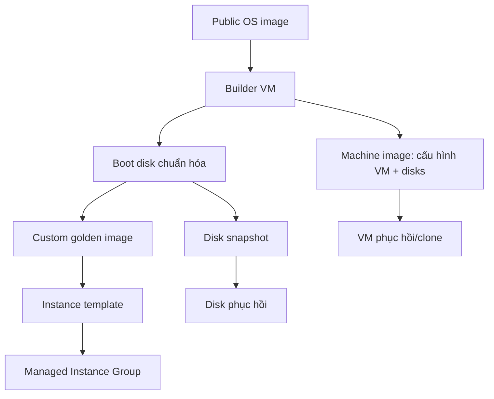
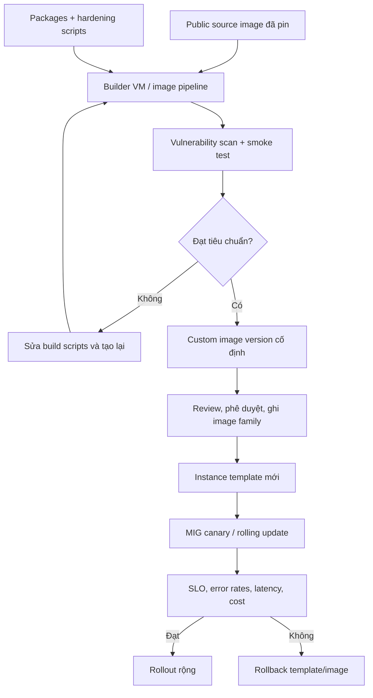

# Images, custom images và machine images

Khi tạo VM trên Google Compute Engine, bạn chọn một ảnh hệ điều hành làm nền cho boot disk. Nhưng khi cần **triển khai nhiều VM giống nhau**, **sao lưu dữ liệu đĩa** hoặc **khôi phục máy gồm nhiều đĩa và cấu hình**, bạn phải phân biệt chính xác *OS image*, *custom image*, *machine image*, *disk snapshot* và *instance template*. Chọn sai tài nguyên có thể làm mất dữ liệu, nhân bản bí mật nhạy cảm hoặc khiến hệ thống không khôi phục được theo RPO/RTO.

Bài này thuộc chương **Compute Engine** của module `CLOUD_PROVIDERS_GCP`, kết nối tổ chức project, IAM, VPC, Compute Engine, GKE, Cloud Run, lưu trữ, database, phát hành tự động, độ tin cậy và chi phí. Các tên project và VM là ví dụ cho môi trường sandbox; những lệnh tạo tài nguyên được đánh dấu rõ và **không chạy trong lúc đọc bài**.

## 1. Kết quả học tập

Sau bài học, bạn có thể:

1. Giải thích public OS image, custom image, image family và machine image lưu gì.
2. So sánh image với disk snapshot và instance template theo mục tiêu triển khai hoặc khôi phục.
3. Xây dựng golden image có version, không chứa secret và có khả năng tái lập.
4. Tạo, kiểm tra và sử dụng custom image hoặc machine image bằng `gcloud`.
5. Hiểu crash consistency, application consistency, các giới hạn loại đĩa, quyền IAM và CMEK khi restore.
6. Thiết kế quy trình phát hành VM qua instance template/MIG và backup/DR bằng phục hồi đã được thử nghiệm.

## 2. Chọn đúng tài nguyên cho đúng mục tiêu

| Tài nguyên | Nội dung chủ yếu | Dùng khi | Không thay thế |
| --- | --- | --- | --- |
| **Public OS image** | Nội dung boot disk hệ điều hành do Google/nhà cung cấp phát hành | Tạo VM mới từ Debian, Ubuntu, Windows và hệ điều hành hỗ trợ | Cấu hình ứng dụng, dữ liệu VM riêng |
| **Custom image** | Dữ liệu của **một disk** (thường boot disk) đã tùy chỉnh; tạo được từ disk, snapshot, image khác hoặc RAW import | Golden OS/application base, bản phát hành cho fleet | Machine type, network interfaces, nhiều data disks |
| **Standard disk snapshot** | Bản sao một persistent disk tại thời điểm tạo, lưu incremental theo cơ chế snapshot | Backup một disk, lịch snapshot và restore disk | Cấu hình VM đầy đủ, khôi phục đa đĩa có cùng mốc tự động |
| **Machine image** | Phần lớn VM configuration, metadata và dữ liệu boot cùng các attached disks đủ điều kiện | Backup/clone VM nhiều đĩa, phục hồi trạng thái máy | Application-consistent backup, toàn bộ thuộc tính VM và mọi loại disk |
| **Instance template** | Cấu hình mẫu tạo VM, tham chiếu image/disks, machine type, network và metadata | Managed Instance Group (MIG), scaling và rolling update | Dữ liệu đang ghi của VM chạy thực tế |

Ví dụ: 30 VM API stateless nên được tạo từ **custom image + instance template + MIG**; một database data disk nên có **snapshot hoặc backup cấp database**; một VM legacy có boot disk và hai data disks cần khôi phục nguyên máy có thể dùng **machine image**, nếu loại máy và đĩa được hỗ trợ.



**Điểm cần nhớ:** Machine image không phải phiên bản “nhiều file” của custom image. Nó thuộc một loại Compute Engine resource khác, có vòng đời, API, chi phí và giới hạn sử dụng khác.

## 3. Public OS images và image families

Một public image có **tên cụ thể** và thuộc image project do nhà cung cấp quản lý, như `debian-cloud`. Nhiều public images nằm trong một **family**. Ví dụ family `debian-13` trỏ tới image Debian 13 mới nhất chưa bị deprecate trong project tương ứng.

```bash
# CHỈ ĐỌC: xem những images của một public image project.
gcloud compute images list \
  --project=debian-cloud \
  --filter="family:debian-13"

# Xem image hiện tại của family.
gcloud compute images describe-from-family debian-13 \
  --project=debian-cloud
```

Trước khi chọn, kiểm tra bản OS còn được hỗ trợ cập nhật bảo mật, CPU architecture (x86-64/Arm), UEFI/Shielded VM/guest agent, compatibility với machine series, giấy phép phần mềm và chi phí OS premium. Tên family hoặc số phiên bản OS chỉ là một phần tiêu chí.

### 3.1. Family dùng latest nhưng không tự update VM

Giả sử family nội bộ `orders-base` chứa:

```text
orders-base-20261001       ACTIVE
orders-base-20261101       ACTIVE
orders-base-20261118       ACTIVE  <-- image mới nhất của family
```

Khi tạo VM mới từ `orders-base`, Google chọn image mới nhất đang ACTIVE/không deprecated. Nếu bản `20261118` được đánh dấu DEPRECATED, family có thể trỏ về bản ACTIVE trước đó. **Thay đổi family target không tự cập nhật boot disk của VM đang chạy**.

| Cách dùng | Phù hợp | Đánh đổi |
| --- | --- | --- |
| `--image-family=orders-base` | Sandbox/build pipeline muốn lấy baseline mới nhất đã duyệt | Kết quả có thể thay đổi giữa các lần chạy; phải lưu lại version đã resolve. |
| `--image=orders-base-20261118` | Production cần tái lập cùng image khi rollback | Phải chủ động đổi version khi vá lỗi. |
| Manifest/instance template pin image name | MIG, kiểm toán release, canary/rollback | Quản lý thêm artifact và quy trình phê duyệt. |

Nên dùng **tên image có phiên bản** trong release manifest, cho dù pipeline tìm ứng viên mới qua family. Khi MIG cần nâng bản, tạo instance template mới rồi rollout; family không tự cập nhật VM hiện tại.

## 4. Custom image và quy trình golden image

**Custom image** được tạo trong project bạn quản lý, từ một trong các nguồn được hỗ trợ: persistent disk, disk snapshot, image khác hoặc ảnh RAW trong Cloud Storage. Custom image hữu ích khi nhiều VM cần cùng hệ điều hành, package, security baseline, guest/monitoring agents và cấu hình runtime chuẩn.

### 4.1. Golden image nên chứa gì?

| Nên đóng gói | Tuyệt đối tránh đóng gói |
| --- | --- |
| OS đã patch, drivers, guest agent, security hardening, monitoring agent | Service account JSON keys, access tokens, passwords, TLS private keys |
| Application/runtime chung với version rõ ràng | Dữ liệu cá nhân, production database dumps, logs nhạy cảm |
| Startup hooks idempotent, configuration không nhạy cảm | Host identifiers/SSH host keys cần sinh riêng cho từng VM |
| Provenance, owner, build ID, thông tin scan hoặc SBOM khi thích hợp | Địa chỉ IP và secrets cố định chỉ đúng cho một project |

Secrets nên được cung cấp bằng **workload identity**, Secret Manager và IAM tại runtime, không “nướng” vào OS image. Với Windows, khi cần nhân bản OS phải chuẩn bị theo quy trình GCESysprep phù hợp; Linux cũng cần xóa state/identifiers riêng của máy mẫu.

### 4.2. Chuẩn bị disk trước khi tạo

Việc chụp boot disk từ VM đang chạy có nguy cơ chứa trạng thái chưa flush. Khuyến nghị dùng **VM builder đã dừng sạch** khi có thể. Tạo image từ disk đang gắn với VM chạy có thể cần tùy chọn `--force` trong `gcloud`, nhưng không bảo đảm nhất quán dữ liệu ứng dụng. Nếu không thể dừng, cần giảm ghi, flush ứng dụng/filesystem và thử restore.

Quy trình:

1. Chọn source public image có version và nguồn đáng tin cậy.
2. Tạo VM builder trong sandbox; cài OS updates, packages, agents.
3. Chạy kiểm thử bảo mật và khởi động, kiểm tra compatibility guest OS.
4. Xóa secrets, logs nhạy cảm, host identities; dừng ghi hoặc dừng VM.
5. Tạo custom image có version và family phù hợp.
6. Tạo VM **mới** từ image, kiểm tra boot và ứng dụng rồi mới phê duyệt.

### 4.3. Ví dụ tạo custom image từ disk

Giả sử đã có disk `orders-builder-boot` từ VM builder ở zone `asia-southeast1-b`:

```bash
# THAY ĐỔI: tạo image và phát sinh storage charges.
PROJECT_ID="gcp-image-lab"
ZONE="asia-southeast1-b"

gcloud compute images create orders-base-20261118 \
  --project="$PROJECT_ID" \
  --source-disk=orders-builder-boot \
  --source-disk-zone="$ZONE" \
  --family=orders-base \
  --storage-location=asia-southeast1 \
  --description="Hardened Orders baseline, release 2026-11-18"
```

`--storage-location` xác định nơi lưu nội dung image; có thể chọn region hoặc multi-region được hỗ trợ theo yêu cầu residency. Không mặc định nơi lưu image giống zone nguồn hoặc nơi VM sẽ chạy. Organization Policy, CMEK và IAM có thể ảnh hưởng lựa chọn.

Một nguồn khác có thể là snapshot hoặc một image đã có:

```bash
# THAY ĐỔI: tạo image từ snapshot một disk.
gcloud compute images create orders-base-from-snapshot \
  --project="$PROJECT_ID" \
  --source-snapshot=SNAPSHOT_NAME

# THAY ĐỔI: nhân bản một image đã có, kể cả cross-project được cấp quyền.
gcloud compute images create orders-base-copy \
  --project="$PROJECT_ID" \
  --source-image=SOURCE_IMAGE_NAME \
  --source-image-project=SOURCE_PROJECT_ID
```

Mỗi lệnh lấy dữ liệu từ **một nguồn**; không tự tạo image chứa toàn bộ boot và nhiều attached disks.

### 4.4. Tạo VM từ image

```bash
# THAY ĐỔI: tạo VM và disk, phát sinh chi phí.
gcloud compute instances create orders-api-test \
  --project="$PROJECT_ID" \
  --zone="$ZONE" \
  --machine-type=e2-standard-2 \
  --image=orders-base-20261118 \
  --image-project="$PROJECT_ID" \
  --subnet=SUBNET_NAME \
  --no-address
```

Image lưu nội dung boot disk; machine type, network/subnet, external IP, firewall tags và service account phải được cấu hình lúc tạo instance hoặc qua instance template/IaC. `--no-address` không tự cấp khả năng gọi Google APIs hay Internet cho VM: cần thiết kế network, routing, Cloud NAT/Private Google Access theo nhu cầu.

## 5. Disk snapshot: sao lưu một đĩa

**Standard snapshot** lưu dữ liệu của một persistent disk tại thời điểm chụp. Các bản snapshot tiếp theo có thể lưu incremental để tối ưu storage. Đây là công cụ quan trọng cho lịch backup disk và recovery, nhưng **không chứa toàn bộ VM config**.

```bash
# CHỈ ĐỌC.
gcloud compute snapshots list --project=gcp-image-lab

# THAY ĐỔI: snapshot một persistent disk.
gcloud compute snapshots create orders-data-20261118 \
  --project=gcp-image-lab \
  --source-disk=orders-data-disk \
  --source-disk-zone=asia-southeast1-b
```

Một VM có boot disk và hai data disks phải được sao lưu ba nguồn nếu chỉ dùng disk snapshots. Các snapshot tạo riêng lẻ không tự bảo đảm crash consistency **giữa ba disks ở cùng một thời điểm**. Khi sao lưu database, cần quiesce/backup ứng dụng hoặc native database backup/PITR nếu yêu cầu giao dịch nhất quán và RPO nhỏ.

Snapshots hữu ích cho restore một disk, nhưng không nên dùng ảnh disk mới làm thế cho quy trình backup hoàn chỉnh của Cloud SQL hoặc một hệ thống dữ liệu phân tán.

## 6. Machine image: VM configuration cộng nhiều đĩa

**Machine image** lưu phần lớn cấu hình instance và dữ liệu boot disk cùng các attached disks đủ điều kiện. Theo tài liệu Compute Engine, machine image lưu các snapshot disk có timestamp được phối hợp để đạt **crash consistency giữa các disk**, hữu ích để clone hoặc phục hồi nhiều đĩa cùng mốc.

> **Crash-consistent khác application-consistent.** Crash-consistent có ý nghĩa tương tự trạng thái máy vừa mất nguồn; dữ liệu đã ghi xuống disk được chụp nhất quán ở mức I/O, nhưng RAM, transaction chưa flush và trạng thái của hệ thống ngoài VM chưa chắc được đồng bộ.

| Thành phần | Machine image thường lưu | Khi restore phải kiểm tra |
| --- | --- | --- |
| Machine properties | Machine type, metadata, labels, network tags và nhiều instance settings | Một số thuộc tính không được phục hồi đúng như nguồn; có thể phải override. |
| Network | Các tham chiếu network interfaces/VPC/subnet | IP tạm thời, subnet theo region, firewall và địa chỉ cố định có thể không dùng lại được. |
| Identity | Service account và thông tin cấu hình liên quan khi được hỗ trợ | Quyền `iam.serviceAccounts.actAs`, cross-project service account overrides. |
| Disk contents | Boot disk và các attached disks được hỗ trợ | Filesystem mount, dữ liệu, disk types, encryption, regional disk replica zones. |
| Runtime | Dữ liệu persistent trên disk | Ứng dụng có thể cần phục hồi journal/DB transaction; RAM không được snapshot như VM suspend. |

Một số thuộc tính như Resource Manager tags, resource policies, một số disk properties và Shielded VM settings cụ thể **không được bảo toàn đầy đủ**; tham khảo mục *Instance and disk properties not supported by machine image* trên tài liệu chính thức. Đừng dùng machine image thay cho danh mục hạ tầng Terraform hay audit cấu hình.

### 6.1. Hạn chế cần biết

Theo tài liệu hiện hành, không thể tạo machine image từ VM:

- Không có attached disk hoặc tổng dung lượng các disk vượt **200 TiB**;
- Có bất kỳ **Hyperdisk** volume gắn kèm;
- Thuộc một số machine series đặc biệt (ví dụ C3D, H3, A3 và nhiều loại Z3/Z4, có các ngoại lệ được mô tả).

Các loại máy/đĩa hỗ trợ được Google cập nhật; cần kiểm tra đúng resource và phiên bản. Việc khôi phục VM nhiều lần từ **một** machine image cũng có rate limit (tài liệu hiện nêu tối đa **6 instance creation trong 60 phút** từ cùng nguồn). Do đó máy ảo stateless muốn autoscale hàng trăm bản không nên dùng một machine image làm nguồn nhân bản mặc định.

Machine image thường gồm toàn bộ attached disks. Chức năng chọn chỉ bao gồm hoặc loại trừ một số **non-boot disks** có thể có theo phiên bản tính năng/Preview; boot disk không được bỏ. Nếu `/etc/fstab` vẫn tham chiếu disk bị loại, VM restore có thể không boot trừ khi có `nofail` hoặc chuẩn bị phù hợp.

### 6.2. Tạo machine image từ VM

```bash
# THAY ĐỔI: tạo machine image, phát sinh storage/quota.
PROJECT_ID="gcp-image-lab"
ZONE="asia-southeast1-b"

gcloud compute machine-images create orders-vm-backup-20261118 \
  --project="$PROJECT_ID" \
  --source-instance=orders-vm-source \
  --source-instance-zone="$ZONE" \
  --storage-location=asia-southeast1 \
  --description="Orders VM backup before maintenance"
```

Khi VM đang chạy, machine image có crash-consistent capture, nhưng nếu ứng dụng yêu cầu transaction-level consistency thì phải dừng/flush/quiesce hoặc kết hợp database-aware backup. Khi dùng machine image để **clone golden VM**, cần xóa secrets, hostname/host identities và các dữ liệu riêng trước khi tạo nguồn.

```bash
# CHỈ ĐỌC: xem machine images.
gcloud compute machine-images list --project="$PROJECT_ID"

gcloud compute machine-images describe orders-vm-backup-20261118 \
  --project="$PROJECT_ID"
```

### 6.3. Khôi phục VM từ machine image

```bash
# THAY ĐỔI: tạo VM mới từ machine image, phát sinh chi phí.
gcloud compute instances create orders-restore-test \
  --project="$PROJECT_ID" \
  --zone="$ZONE" \
  --source-machine-image=orders-vm-backup-20261118
```

Không coi lệnh thành công là restore đã hoàn tất. Kiểm tra boot, tất cả disk và mount points, application health, network/firewall, service account, DB consistency, KMS, audit logs và thời gian phục hồi. Khi khôi phục sang region khác có thể phải override subnet, regional disk replica zones, IP và các tham chiếu theo zone/region.

**Bẫy CMEK:** Khi dùng `gcloud` hoặc REST tạo VM từ machine image của disks được mã hóa bằng CMEK, các disks mới **có thể mặc định chuyển sang Google-managed encryption** trừ khi khai báo lại CMEK/disks đúng cách; Console có workflow kế thừa CMEK trong những trường hợp được hỗ trợ. Cần kiểm tra `diskEncryptionKey` và KMS IAM sau restore, không suy đoán chỉ từ image nguồn.

## 7. IAM và ranh giới bảo mật

Image và machine image có thể chứa OS configuration, application state, logs, metadata và **credentials đã từng nằm trên disk nguồn**. Người có quyền sử dụng machine image để tạo VM có thể khôi phục và đọc những dữ liệu ấy. Vì vậy quản trị image là một phần bảo vệ dữ liệu, không chỉ bài toán build.

| Hành động | Quyền IAM cần kiểm tra |
| --- | --- |
| Tạo custom image | `compute.images.create` và quyền sử dụng/đọc disk, snapshot hoặc image nguồn. |
| Tạo machine image | `compute.machineImages.create` trên project, `compute.instances.useReadOnly` trên VM nguồn, `compute.disks.createSnapshot` trên disk. |
| Tạo VM từ machine image | `compute.instances.create`, `compute.machineImages.useReadOnly` trên image, cộng quyền ở network/disks liên quan. |
| Gắn service account cho VM | `iam.serviceAccounts.actAs` đối với service account đó (thường qua `roles/iam.serviceAccountUser`). |
| Sử dụng CMEK | Quyền sử dụng Cloud KMS key cho đúng service agents/workflows và chính sách tổ chức. |

Không cấp `Owner` toàn project chỉ để dùng một image. Hạn chế việc chia sẻ image cross-project theo IAM, lưu image ở location phù hợp yêu cầu data residency, quản lý secret bằng Secret Manager và phân tách account build/publish/deploy.

Khi khôi phục cross-project, cần chỉ rõ service account của project đích, VPC/subnet/Shared VPC host project, firewall và các regional resources nếu không thể dùng lại thuộc tính của VM nguồn. Một VM đã clone không nên cùng lúc chạy với hostname/IP/credentials và lịch job trùng production khi chưa kiểm soát.

## 8. Khi nào chọn custom image, snapshot hay machine image?

| Bối cảnh | Lựa chọn ưu tiên | Vì sao |
| --- | --- | --- |
| 100 API VM stateless chạy trong MIG | Custom golden image + instance template | Tái lập, scale out và rolling update, không copy state của VM bất kỳ. |
| Backup một persistent disk dữ liệu | Snapshot và lịch snapshot | Đúng phạm vi một disk; incremental storage. |
| Clone VM legacy với nhiều data disks | Machine image nếu được hỗ trợ | Gồm config và disk snapshots đồng bộ mức crash. |
| Database cần phục hồi tới 15 phút trước | Native DB backups/logs/PITR/replication | Machine image chụp hàng ngày không đáp ứng RPO nhỏ. |
| Định nghĩa cấu hình VM trong Git | Terraform/IaC, instance template | Kiểm soát change review và drift; image không thay thế source of truth. |
| Tạo VM mới trên project khác | Custom image hoặc machine image + IAM/overrides | Đối chiếu service accounts, network, KMS, region và quyền. |

**Tư duy chọn công cụ:** cần **base OS/app** → custom image; cần **một disk đã sao lưu** → snapshot; cần **khôi phục VM nhiều disk và cấu hình** → machine image (nếu hỗ trợ); cần **nhiều VM có config giống nhau** → instance template/MIG.

## 9. CI/CD cho golden images và instance templates

Một image dùng trong production phải là một **artifact có thể kiểm chứng và rollback**, không phải trạng thái tùy hứng của máy mà kỹ sư vừa SSH vào sửa.



Các bước cơ bản:

1. **Pin source image** và lưu OS version, source project, build ID, checksums/provenance nếu có.
2. **Build tự động** bằng scripts/Ansible/Packer hoặc CI được kiểm soát; không thao tác sửa tay trên production.
3. **Generalize** ảnh trước khi chụp; không lưu tokens, SSH host keys, instance identifiers, dữ liệu khách hàng.
4. **Kiểm thử bằng VM mới**, gồm boot, startup scripts, Cloud Monitoring/Logging, application health, IAM, network, failure handling.
5. **Security review**: bản vá, vulnerability scan, guest agent, Shielded VM/secure boot compatibility, dữ liệu nhạy cảm.
6. **Publish artifact bất biến**: image name version riêng, family, owner/cost center, release notes và retention policy.
7. **Rollout qua instance template**, dùng canary/rolling update phù hợp MIG; nếu lỗi rollback về template/image version đã kiểm chứng.

Đối với VM stateless, ứng dụng nên lưu trạng thái trong Cloud SQL, Cloud Storage hoặc hệ thống bền vững phù hợp thay vì chỉ lưu trên boot disk của từng VM. Cách này giúp MIG tự chữa lỗi, tạo lại instance và mở rộng dễ hơn.

### 9.1. Cẩn trọng với family khi rollout

Nếu instance template tham chiếu trực tiếp một image family, những instance tạo vào các thời điểm khác nhau có thể chọn các phiên bản khác nhau sau khi family thay đổi. Do đó một release nghiêm ngặt nên **resolve family ra image name cụ thể rồi pin** trong template được deploy. Image family là kênh phân phối version, không phải bảo đảm toàn bộ fleet sẽ tự đồng nhất sau khi publish.

## 10. Backup/DR: RPO, RTO và consistency

**RPO** (Recovery Point Objective) là lượng dữ liệu được chấp nhận mất theo thời gian; **RTO** (Recovery Time Objective) là thời gian mục tiêu đưa dịch vụ trở lại. Một machine image tạo mỗi 24 giờ thường không thỏa RPO 15 phút cho hệ thống giao dịch liên tục, cho dù máy có thể được khôi phục rất nhanh.

| Thuộc tính | Ý nghĩa | Cách đánh giá |
| --- | --- | --- |
| Crash consistency | Các disk có trạng thái tương đương cùng mốc mất điện | Có thể cần journal replay, DB recovery khi boot. |
| Application consistency | Ứng dụng/database đã flush hoặc tạm dừng phù hợp | Cần app/DB tham gia, native backup/quiesce và phép thử. |
| RPO | Mức dữ liệu tối đa được mất | Lịch backup, transaction logs, replication/PITR. |
| RTO | Mốc thời gian khôi phục xong dịch vụ | Restore disk, VM boot, cấu hình mạng/IAM/KMS, test ứng dụng, DNS/LB cutover. |
| Retention | Giữ bao lâu, bao nhiêu bản và ở đâu | Yêu cầu compliance, chi phí, immutable backups nếu cần. |

Một runbook DR cho VM nhiều đĩa nên gồm:

1. Ghi nhận loại VM/disks và những thành phần **không** được machine image hỗ trợ.
2. Chọn cách chụp phù hợp với application consistency: quiesce, dump/backup DB, snapshot và machine image.
3. Giữ backup tại location đáp ứng residency, disaster recovery và quyền KMS.
4. Khôi phục thành **VM test tách biệt**, tránh xung đột hostname, IP, scheduler hoặc dữ liệu production.
5. Đối chiếu filesystem, mount points, dữ liệu nghiệp vụ, app logs và truy cập phụ thuộc.
6. Đo tổng thời gian phục hồi thực tế và xác định backup gần nhất đáp ứng RPO.
7. Lưu bằng chứng thử nghiệm, lỗi, bài học và cập nhật runbook.

Không coi một yêu cầu `gcloud compute instances create` trả thành công là bằng chứng đã khôi phục ứng dụng. Đặc biệt với database, phải khởi động và kiểm tra tính toàn vẹn dữ liệu, replay logs/transactions và nghiệp vụ.

## 11. Vòng đời images: deprecate, rollback và xóa

Custom image có trạng thái deprecation. Khi một phiên bản có lỗ hổng hoặc lỗi startup, việc deprecate giúp family không tiếp tục chọn nó làm bản mới nhất:

| Trạng thái | Ý nghĩa thực hành |
| --- | --- |
| `ACTIVE` | Có thể dùng để tạo VM; family trỏ tới phiên bản phù hợp mới nhất. |
| `DEPRECATED` | Có thể còn được tạo VM theo tên cụ thể nhưng có cảnh báo; family không chọn. |
| `OBSOLETE` | Bị hạn chế dùng để tạo VM mới. |
| `DELETED` | Image không còn khả dụng; VM đã tạo trước đó không tự bị xóa. |

Khi bản `orders-base-20261118` có lỗi:

1. Tạm dừng rollout và xác định image version đang được template sử dụng.
2. Deprecate bản lỗi theo quy trình được duyệt nếu thích hợp.
3. Kiểm tra family trỏ tới bản ACTIVE nào, không giả định.
4. Dùng instance template phiên bản cũ đã thử nghiệm để rollback MIG.
5. Kiểm thử và ghi nhận thay đổi; tạo image mới thay vì sửa bản image đã phát hành.

```bash
# CHỈ ĐỌC: xác định image versions trong một family.
gcloud compute images list \
  --project=gcp-image-lab \
  --filter="family=orders-base"

gcloud compute images describe-from-family orders-base \
  --project=gcp-image-lab
```

Image đã bị xóa không còn làm nguồn để tạo VM mới, nhưng các VM đang chạy từ boot disk đã tạo trước đó không biến mất. Trước khi xóa, xác minh retention, references từ templates/scripts và nhu cầu rollback/DR; không dọn dẹp chỉ vì tên ảnh đã cũ.

## 12. Chi phí và giới hạn vận hành

Các image và snapshots có chi phí lưu trữ riêng với VM đang chạy:

| Hạng mục | Nguồn chi phí | Điều cần kiểm tra |
| --- | --- | --- |
| Public image | Bản thân ảnh công khai và license/premium OS khi sử dụng, nếu có | Giá VM, disk, bản quyền OS và region. |
| Custom image | Storage của image, location và số phiên bản giữ lại | Retention của golden images, số version tham chiếu. |
| Snapshot | Storage cho dữ liệu được lưu qua các điểm backup | Lịch backup, change rate, xóa đúng cơ chế bảo toàn chain. |
| Machine image | Storage dữ liệu disk theo cơ chế differential phù hợp, metadata, số phiên bản | Disk size/change rate, vị trí lưu và yêu cầu khôi phục. |
| KMS/network | Cloud KMS, data transfer tùy tình huống khôi phục/copy | Quyền key, region, phát sinh chi phí thực tế. |
| Restore test | VM mới, disks và network khi test | Dùng sandbox, giới hạn thời gian chạy, dọn tài nguyên test có kiểm soát. |

Machine image đầu tiên có thể lưu lượng dữ liệu lớn; các image sau có thể lưu dạng differential, song tính năng/cấu hình mã hóa có ngoại lệ. Không lấy dung lượng **logic** 1 TiB của disk nhân trực tiếp với số lần backup để kết luận chắc chắn chi phí storage. Sử dụng Cloud Billing export/Reports và bảng giá hiện hành.

Việc tạo nhiều VM liên tục từ một machine image có giới hạn tần suất; tài nguyên image/disk cũng có quota và điều kiện image source compatibility. Đối với mở rộng fleet, cách cân bằng hiệu năng và chi phí vẫn thường là golden image + MIG, không tạo hàng trăm clone VM stateful.

## 13. Case study: hệ thống Orders vừa triển khai vừa phục hồi

Một doanh nghiệp có ba nhóm workload:

| Workload | Kiến trúc | Công cụ đề xuất |
| --- | --- | --- |
| API Orders stateless | 12 VM sau HTTPS Load Balancer, cần auto-healing/scale | Custom image + instance template + MIG. |
| VM legacy xử lý batch | Boot disk và hai data disks, chạy cron và công cụ nội bộ | Machine image nếu đĩa/machine type hỗ trợ, kèm backup ở lớp ứng dụng. |
| Cloud SQL lưu đơn hàng | Dữ liệu giao dịch, đòi hỏi PITR và HA | Cloud SQL-native backup/PITR/replication theo RPO/RTO. |

**Project mẫu:**

```text
platform-image-catalog
  /orders-base-20261118
  /orders-base (image family)
orders-dev
  /image-builder
  /canary-vm
orders-prod
  /orders-api-mig
  /orders-legacy-vm
  /machine-images: backup lịch bảo trì
```

### 13.1. Phát hành API

Builder tạo custom image từ base OS được phê duyệt, scan và chạy canary. Pipeline pin image name vào instance template mới rồi rolling update MIG; rollback bằng template cũ nếu error rate/latency tăng. Không copy database/cache state từ VM production vào image dùng cho hàng chục VM mới.

### 13.2. Bảo vệ VM legacy

Trước maintenance, vận hành kiểm tra machine type và disks có hỗ trợ machine image, quiesce ứng dụng khi có yêu cầu, tạo machine image và thử khôi phục ở sandbox. Khôi phục sang project/region khác cần kiểm tra subnet, service account, disk encryption, source instance properties không được giữ, dữ liệu và job scheduler. Không để clone chạy cùng tác vụ trả phí/gửi email thật với VM production.

### 13.3. Liên kết với bảo mật và chi phí

Image catalog cần IAM chặt chẽ, phân tách tài khoản build/publish/deploy, policy về nơi lưu, KMS và các bản image được duyệt. Project production theo dõi cost center và labels, budget alerts, SLO và chi phí backup/restore test. Những quyết định này là một phần của chất lượng hệ thống, không chỉ các lựa chọn trên giao diện tạo VM.

## 14. Chẩn đoán lỗi thường gặp

| Triệu chứng | Nguyên nhân khả dĩ | Cách xác minh |
| --- | --- | --- |
| Tạo image từ disk đang được VM sử dụng bị từ chối | Nguồn chưa dừng hoặc lệnh cần tùy chọn live capture | Dừng VM chuẩn, hoặc đọc quy tắc `--force` và bảo đảm quiesce. |
| VM từ custom image không boot | Image chưa generalize, hỏng filesystem, OS/architecture/UEFI mismatch | Serial console/boot logs, version, Shielded VM settings, VM test. |
| Image family chọn nhầm bản | Image mới hơn đang ACTIVE hoặc bản mong muốn bị deprecated | `describe-from-family`, list image versions và trạng thái. |
| Tạo machine image báo unsupported | Hyperdisk, machine series hoặc capacity vượt giới hạn | Kiểm tra disks/types và danh mục hỗ trợ chính thức. |
| Restore thiếu disk/mount | Loại trừ disk, restore overrides, `/etc/fstab` chờ disk không có | So source properties, `deviceName`, volume mounts, app logs. |
| Clone khác region lỗi network | Subnet/regional disk không tồn tại, IP xung đột | Override network, subnetwork, replicaZones và tài nguyên regional. |
| Restore cross-project báo `403` | Thiếu useReadOnly/image IAM, service account actAs hoặc KMS | Đọc error details, sửa IAM ở đúng resource và principal. |
| VM mới không giữ CMEK | CLI/REST không truyền lại disk encryption config | Kiểm tra `diskEncryptionKey` và override disk settings theo tài liệu. |
| Database restore bị lỗi consistency | Snapshot chỉ crash-consistent, giao dịch chưa flush | Phục hồi log, backup ứng dụng, database-native PITR. |
| Tạo VM hàng loạt từ một machine image bị rate limit | Nhiều clone vượt giới hạn nguồn | Dùng golden image + instance template cho scaling. |

Không khắc phục `403` bằng cách cấp quyền Owner toàn project. Trước tiên xác định principal, operation, loại source image/disk và quyền cụ thể trên resource liên quan.

## 15. Bài tập thực hành

### Bài A — Chọn đúng loại tài nguyên

Một VM có boot disk 30 GiB và hai data disks 200 GiB, 500 GiB. Team muốn tạo 10 VM API giống nhau, backup data disk mỗi giờ và có điểm khôi phục toàn bộ VM trước maintenance. Hãy chọn custom image, disk snapshot hoặc machine image cho ba nhu cầu, giải thích phạm vi dữ liệu và consistency cần có.

### Bài B — Image family bị lỗi

Family `orders-base` có các versions 10, 15 và 18/11. Bản 18/11 lỗi startup. Hãy giải thích family sẽ chọn bản nào trước/sau deprecate, làm thế nào pin bản 15/11 để rollback và vì sao VM hiện hữu không tự quay về version cũ.

### Bài C — Khôi phục cross-project

Machine image ở project `backups-prod`, team DR muốn tạo VM tại `orders-dr` ở region khác. Hãy liệt kê quyền IAM, service account, subnet, regional disks, CMEK, hostname/IP và phép thử dữ liệu cần hoàn thành.

### Bài D — Security review

Builder VM có file service account JSON key, SSH host keys và logs chứa token. Kỹ sư muốn tạo image và chia sẻ toàn organization. Nêu những bước phải thực hiện trước: cleanup/generalize, workload identity, secret scanning, kiểm soát IAM và thử máy mới.

### Bài E — RPO/RTO

Một hệ thống đòi RPO 15 phút/RTO 60 phút nhưng chỉ tạo machine image mỗi 24 giờ. Vì sao chưa đạt? Thiết kế bổ sung database-native backups, logs, replication khi phù hợp, DR runbook và restore drills.

### Bài F — Kiểm soát chi phí

Một project giữ 150 custom images không còn dùng, hàng trăm machine images và nhiều builder VMs chạy 24/7. Lập checklist về image references, compliance retention, storage, quota, KMS, VM builder scheduling và thử restore trước khi xóa.

### Câu hỏi tự kiểm tra

1. Vì sao custom image là ảnh **một disk**, còn machine image lưu cấu hình và nhiều disk?
2. Disk snapshot khác image family ở mục đích như thế nào?
3. Family mới có tự cập nhật VM đang chạy hoặc instance template không?
4. Vì sao machine image crash-consistent chưa phải application-consistent?
5. Một VM dùng Hyperdisk có chắc tạo được machine image không?
6. Khôi phục machine image sang region khác cần xem những gì?
7. Tại sao phải kiểm tra CMEK của disks sau restore qua CLI/REST?
8. Vì sao MIG nên tạo VM từ instance template và custom image?
9. Có nên đưa bí mật và dữ liệu production vào golden image không?
10. Vì sao phải đo restore RTO thực tế, không chỉ kiểm tra thao tác tạo backup?

**Quy trình ghi nhớ:** xác định mục tiêu **VM baseline – backup một disk – clone toàn máy – scale fleet** → chọn custom image/snapshot/machine image/instance template → kiểm tra source, IAM, bảo mật, disk type, consistency và KMS → tạo artifact version → restore/boot test → rollout hoặc backup theo RPO/RTO → giám sát, retention và chi phí.

## 16. Nguồn tài liệu chính thức

- [Compute Engine OS images](https://cloud.google.com/compute/docs/images)
- [Create custom images](https://cloud.google.com/compute/docs/images/create-custom)
- [Image families best practices](https://cloud.google.com/compute/docs/images/image-families-best-practices)
- [Deprecate custom images](https://cloud.google.com/compute/docs/images/deprecate-custom)
- [Disk snapshots](https://cloud.google.com/compute/docs/disks/snapshots)
- [Machine images](https://cloud.google.com/compute/docs/machine-images)
- [Create machine images](https://cloud.google.com/compute/docs/machine-images/create-machine-images)
- [Create instances from machine images](https://cloud.google.com/compute/docs/machine-images/create-instance-from-machine-image)
- [Instance templates](https://cloud.google.com/compute/docs/instance-templates)
- [Disk/image pricing](https://cloud.google.com/compute/disks-image-pricing)
- [Compute Engine IAM access](https://cloud.google.com/compute/docs/access/iam)

Giới hạn của machine series/disk types, API, encryption, quota và giá có thể thay đổi theo thời gian. Khi áp dụng trong production, đối chiếu tài liệu hiện hành cho **đúng loại VM, disk, vùng lưu trữ, project và phương pháp restore** và chỉ coi backup đạt yêu cầu sau khi đã phục hồi thử.
