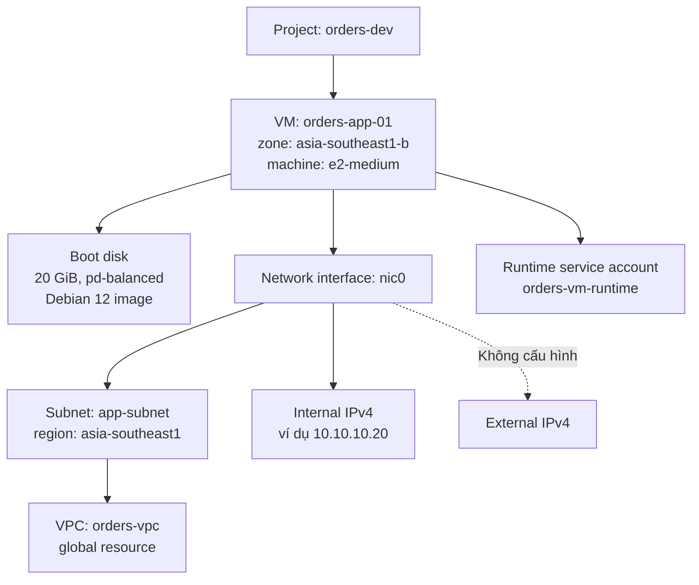
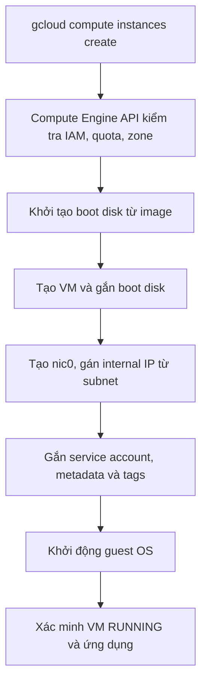

# Tạo VM với boot disk và network interface trên Compute Engine

Khi tạo một **virtual machine (VM)** trên Google Compute Engine, chọn CPU và RAM mới chỉ là một phần công việc. Để VM khởi động, bạn phải có **boot disk** chứa hệ điều hành; để VM trao đổi dữ liệu, bạn phải cấu hình **network interface (NIC)** gắn với VPC/subnet, địa chỉ IP và các kiểm soát kết nối phù hợp. Hai thành phần này ảnh hưởng trực tiếp đến bảo mật, hiệu năng, chi phí, khả năng khôi phục và cách ứng dụng kết nối Cloud SQL, Cloud Storage, các VM khác hoặc Internet.

Bài học thuộc chương **Compute Engine** của module `CLOUD_PROVIDERS_GCP`. Nó nối tiếp kiến thức về tổ chức project, IAM, VPC và định tuyến, đồng thời tạo nền tảng cho triển khai dịch vụ và cơ sở dữ liệu, tự động hóa phát hành, giám sát độ tin cậy và quản lý chi phí trên Google Cloud.

Ví dụ xuyên suốt: tạo Linux VM `orders-app-01` trong project `orders-dev`, zone `asia-southeast1-b`, có boot disk 20 GiB và NIC nối subnet riêng `app-subnet` của VPC `orders-vpc`. VM **không có external IPv4**; người vận hành sẽ truy cập qua phương án riêng được kiểm soát, chẳng hạn Identity-Aware Proxy (IAP) TCP forwarding.

> Những tên project, subnet, service account và VM trong bài là ví dụ. Các lệnh tạo/xóa tài nguyên bên dưới **có thể phát sinh chi phí và thay đổi hạ tầng thật nếu thực thi**. Chỉ chạy trong môi trường được ủy quyền sau khi kiểm tra lại định danh, quyền và cấu hình mạng.

## 1. Mục tiêu học tập

Sau bài này, bạn có thể:

1. Giải thích quan hệ giữa **VM instance, boot disk, disk image, zone, VPC, subnet và network interface**.
2. Chọn boot disk phù hợp: **image, dung lượng, loại lưu trữ, encryption, auto-delete** và cách bảo vệ dữ liệu.
3. Chọn NIC: **VPC/subnet, internal IP, external IP**, định tuyến và firewall, biết khi nào nên tạo VM private.
4. Tạo VM bằng **Google Cloud Console** và lệnh **`gcloud compute instances create`** với cấu hình rõ ràng, tránh dựa vào mặc định không mong muốn.
5. Sử dụng **service account riêng, IAM/OS Login/IAP** phù hợp thay vì mở SSH trực tiếp từ Internet.
6. Đọc lại cấu hình sau khi tạo, phân tích lỗi thường gặp và xác định các thành phần vẫn phát sinh phí khi VM dừng.
7. Phác thảo cách đưa cấu hình VM vào quy trình quản trị bằng infrastructure-as-code, logging và giám sát.

## 2. Hình dung cấu trúc một VM

Một VM Compute Engine là tài nguyên **zonal**. VM gắn một boot disk để nạp hệ điều hành và một hoặc nhiều network interface để đi vào các VPC network được phép. VPC có phạm vi **global**, nhưng mỗi subnet IPv4 trong VPC thuộc một **region**; NIC của VM phải dùng subnet tương thích với region của zone chứa VM.



| Thành phần | Vai trò | Quyết định cần đưa ra |
| --- | --- | --- |
| **Project** | Ranh giới quản trị, IAM, billing và một số quota. | Ai có quyền tạo VM, dùng subnet, gắn service account? |
| **Zone** | Vị trí chạy tài nguyên VM. | Phù hợp region dữ liệu, network và machine type chưa? |
| **Machine type** | CPU, memory và các khả năng phần cứng tương ứng. | Đủ tải, có sẵn, phù hợp disk/network và ngân sách? |
| **Boot disk** | Lưu hệ điều hành và tệp để khởi động VM. | Lấy image nào, loại disk gì, dung lượng và vòng đời thế nào? |
| **Network interface** | Kết nối VM với VPC/subnet. | IP riêng/công khai, stack IPv4/IPv6, routing, firewall? |
| **Service account** | Danh tính VM dùng khi gọi Google Cloud APIs. | Quyền IAM tối thiểu trên tài nguyên cần truy cập? |
| **Firewall/network policies** | Kiểm soát kết nối theo chiều, nguồn, đích, cổng. | VM cần nhận/gửi những luồng nào? |

**Hai sự thật cần ghi nhớ:** VM có thể tồn tại mà không có **external IP**, nhưng vẫn cần cấu hình mạng phù hợp cho các tác vụ thực tế; và **boot disk không mất đi khi chỉ dừng VM**. Cách xóa boot disk khi xóa VM là cấu hình vòng đời riêng cần kiểm tra.

## 3. Boot disk: hệ điều hành khởi động từ đâu?

### 3.1. Boot disk khác disk image và data disk

- **Disk image:** nguồn dữ liệu để khởi tạo một boot disk, thường chứa hệ điều hành. Google Cloud cung cấp public images; tổ chức có thể sử dụng custom image nếu được phép.
- **Boot disk:** một Compute Engine disk resource gắn với VM và có nội dung để khởi động. Mỗi VM khởi động từ một boot disk được chỉ định.
- **Data disk:** disk bổ sung để lưu ứng dụng/dữ liệu; không thay thế boot disk và có vòng đời riêng.
- **Snapshot:** bản sao theo cơ chế snapshot của disk dùng cho khôi phục hoặc tạo disk khác; không tự động là bản backup ứng dụng có tính nhất quán khi cơ sở dữ liệu vẫn đang ghi.

Ví dụ:

```text
Public image family: debian-12 (project debian-cloud)
                  │
                  ▼
Boot disk: orders-app-01
  - type: pd-balanced
  - size: 20 GiB
  - source: Debian 12 image
                  │
                  ▼
VM: orders-app-01
  - OS khởi động từ boot disk
  - ứng dụng chạy trên VM
```

**Image family** thường trỏ tới phiên bản image mới nhất còn hợp lệ trong family khi tạo disk. Vì vậy tạo hai VM vào hai thời điểm khác nhau từ cùng family **không nhất thiết cho nội dung image byte-for-byte giống nhau**. Nếu cần triển khai có thể tái lập chính xác, hãy khóa một **image cụ thể** hoặc quản lý phiên bản image bằng quy trình được kiểm soát.

### 3.2. Lựa chọn hệ điều hành

Khi chọn image, cân nhắc:

1. **Hệ điều hành và ứng dụng:** Debian, Ubuntu, RHEL, Windows Server hoặc image tổ chức đã harden có tương thích workload không?
2. **Kiến trúc CPU:** image hỗ trợ đúng kiến trúc/machine series đã chọn không?
3. **Bản vá và vòng đời hỗ trợ:** image có được nhà cung cấp cập nhật không, kế hoạch nâng cấp ra sao?
4. **License và chi phí:** một số image thương mại có phí license ngoài phí VM/disk.
5. **Khởi động an toàn:** Shielded VM, Secure Boot/vTPM/integrity monitoring có phù hợp image và tổ chức không?

Trong ví dụ thực hành, dùng image family `debian-12` thuộc project `debian-cloud`. Đây là lựa chọn minh họa, không bắt buộc cho workload thực tế.

### 3.3. Chọn loại boot disk

Compute Engine hỗ trợ nhiều loại persistent storage. Khả năng làm **boot disk** và tính tương thích với loại máy/zone thay đổi theo disk type, vì vậy phải kiểm tra riêng cho cấu hình đang tạo.

| Loại thường gặp | Đặc điểm định hướng | Khi cân nhắc |
| --- | --- | --- |
| **`pd-balanced`** | Persistent Disk SSD cân bằng giữa giá và hiệu năng cho nhiều workload. | Boot disk Linux tổng quát, ứng dụng thông thường. |
| **`pd-ssd`** | Persistent Disk SSD, hướng tới nhu cầu I/O cao hơn theo đặc tính dịch vụ. | Boot workload cần hiệu năng lưu trữ cao hơn, sau khi benchmark. |
| **`pd-standard`** | Persistent Disk HDD, thường phù hợp lưu trữ có yêu cầu I/O vừa phải; boot workload có thể chậm hơn. | Chỉ chọn nếu yêu cầu hiệu năng và hỗ trợ thực tế phù hợp. |
| **Các biến thể Hyperdisk hỗ trợ boot** | Tách nhiều thuộc tính hiệu năng/dung lượng theo loại Hyperdisk. | Workload/machine type cần hiệu năng đặc thù; kiểm tra khả năng boot, region/zone và pricing. |

Không mặc định **mọi Hyperdisk đều có thể làm boot disk** hoặc hoạt động với mọi machine family. Với máy yêu cầu tài nguyên cao, hãy xem bảng tương thích disk và giới hạn IOPS/throughput chính thức.

### 3.4. Dung lượng, hiệu năng và dữ liệu

Boot disk chứa hệ điều hành, package, log, các tệp runtime và có thể cả dữ liệu ứng dụng nếu thiết kế chưa tách riêng. Dung lượng quá nhỏ dễ làm đầy `/var/log` hoặc tệp tạm; quá lớn có thể tăng chi phí. Hiệu năng của một disk còn chịu ảnh hưởng bởi disk type, kích thước, cấu hình máy và quota/limit hiện hành.

**Ví dụ chọn 20 GiB:** một VM học tập chạy Debian, vài gói dịch vụ và log hạn chế có thể khởi đầu với 20 GiB. Đây không phải khuyến nghị chung cho production; xác định dung lượng bằng hệ điều hành, container/image, log retention, peak usage và nhu cầu nâng cấp.

Nếu cần dữ liệu bền vững:

- Cân nhắc **data disk riêng** cho nội dung cần giữ khi thay VM.
- Có lịch snapshot/backup và **kiểm thử khôi phục**, không dựa vào một boot disk duy nhất.
- Với cơ sở dữ liệu quan trọng, ưu tiên dịch vụ managed như Cloud SQL khi phù hợp hoặc triển khai mô hình backup/replication chuyên biệt.
- Bật encryption và quản trị khóa theo yêu cầu tổ chức; disk trên Compute Engine được mã hóa at rest, nhưng chọn **Google-managed key/CMEK/CSEK** có tác động vận hành khác nhau.

### 3.5. Encryption và quản lý khóa

Compute Engine disk được mã hóa at rest. Bạn có thể dùng **khóa do Google quản lý** (mặc định) hoặc một số cơ chế customer-managed/customer-supplied keys trong phạm vi sản phẩm hỗ trợ.

Nếu dùng **Cloud KMS customer-managed encryption key (CMEK)**:

- Đảm bảo service agent/identity cần thiết có quyền sử dụng KMS key.
- Đặt key ở location và cấu hình tương thích với tài nguyên.
- Xem ảnh hưởng khi key bị vô hiệu hóa, bị xóa theo lịch hoặc không truy cập được: VM/disk có thể không hoạt động đúng.
- Có quy trình rotation, khôi phục và kiểm toán khóa.

Không sao chép key material, service account JSON keys hoặc token vào startup script hay metadata của VM.

### 3.6. Vòng đời boot disk khi dừng/xóa VM

Các thao tác sau **khác nhau**:

| Thao tác trên VM | Tác động đến boot disk |
| --- | --- |
| **Stop** | VM dừng chạy nhưng disk vẫn tồn tại và lưu dữ liệu; phí lưu trữ có thể tiếp tục. |
| **Restart** | Khởi động lại với boot disk đang gắn; dữ liệu trên persistent boot disk được giữ theo đặc tính disk. |
| **Delete VM** | Boot disk có thể tự bị xóa hoặc được giữ lại tùy **auto-delete** của disk attachment. |
| **Detach/replace disk trong quy trình hỗ trợ** | Cần tuân thủ điều kiện attach/detach và boot; bảo vệ dữ liệu trước khi thao tác. |

Trước khi xóa VM hãy kiểm tra cờ **autoDelete** của boot disk, đặc biệt với VM chứa dữ liệu không thể tái tạo. Một boot disk còn tồn tại sau khi VM bị xóa vẫn có thể phát sinh phí. Ngược lại, nếu boot disk tự xóa cùng VM và bạn không có backup phù hợp thì dữ liệu có thể mất vĩnh viễn.

## 4. Network interface: VM kết nối vào VPC như thế nào?

### 4.1. VPC là global, subnet là regional, VM là zonal

Với ví dụ:

```text
Project       : orders-dev
VPC network   : orders-vpc                 (global)
Subnet        : app-subnet                 (asia-southeast1)
Subnet IPv4   : 10.10.10.0/24              (ví dụ)
VM zone       : asia-southeast1-b          (thuộc region asia-southeast1)
VM NIC        : nic0                       (gắn app-subnet)
Internal IPv4 : được cấp trong subnet
External IPv4 : None
```

VM trong zone `asia-southeast1-b` **không thể chọn một subnet chỉ tồn tại ở region `us-central1`** cho NIC thông thường. Khi dùng Shared VPC, VPC/subnet có thể thuộc **host project**, còn VM ở service project; IAM sử dụng subnet và quyền quản trị mạng phải được phân công đúng.

### 4.2. NIC và địa chỉ IP

**NIC đầu tiên** thường có tên `nic0`. Khi tạo VM với một NIC, nó nối tới một VPC và subnet; NIC nhận **internal IP** theo cấu hình subnet (ephemeral hoặc reserved static internal address nếu được hỗ trợ và cấu hình đúng). Bạn có thể chọn:

- **Không có external IPv4:** VM có địa chỉ riêng để giao tiếp qua VPC và kết nối private hợp lệ.
- **External IPv4 tạm thời:** địa chỉ công khai được gán khi cần theo cơ chế của Compute Engine; không nên phụ thuộc vào tính ổn định của ephemeral address.
- **Static external IPv4:** địa chỉ công khai được dự trữ và quản lý như resource riêng, cần kiểm soát nhu cầu, chi phí và vòng đời.
- **IPv6 / dual-stack** nếu cấu hình VPC/subnet/NIC, region và kiểu triển khai hỗ trợ; không mặc định mọi subnet đều có IPv6.

**Internal IP không đồng nghĩa chỉ có một VM có thể truy cập.** Traffic tới VM còn phụ thuộc route, VPC connectivity, firewall, DNS và identity ở tầng ứng dụng.

### 4.3. Có external IP hay không?

| Yêu cầu | Phương án ưu tiên đánh giá | Lý do |
| --- | --- | --- |
| VM chỉ phục vụ backend, không nhận traffic công khai | **Không gán external IP** | Giảm bề mặt Internet inbound. |
| VM phải truy cập Internet để tải package | Private VM + **Cloud NAT** / proxy egress được phê duyệt | Cho outbound mà không cần public IP trên VM. |
| VM cần gọi Google APIs | **Private Google Access**, Private Service Connect cho Google APIs hoặc giải pháp egress phù hợp | Không cần thiết phải gán public IP cho mọi VM. |
| Nhân viên cần SSH vào VM private | **IAP TCP forwarding** hoặc kết nối private qua VPN/Interconnect/bastion | Tránh mở TCP 22 từ toàn Internet. |
| Dịch vụ web public | Load balancer trước nhóm VM, firewall backend đúng nguồn | Không nhất thiết gán public IP trực tiếp cho từng backend. |
| Yêu cầu thật sự cần direct public endpoint | External IP + firewall chặt + xác thực, monitoring | Chỉ dùng khi đã đánh giá rủi ro và có phê duyệt. |

**Cloud NAT** phục vụ một số loại kết nối outbound từ tài nguyên private; nó **không tự tạo endpoint inbound** để client Internet kết nối vào VM. **Private Google Access** tạo đường gọi Google APIs/services được hỗ trợ cho VM chỉ có internal IP, không phải một NAT tổng quát tới mọi website.

### 4.4. Một VM có nhiều NIC khi nào?

Compute Engine hỗ trợ một số cấu hình VM **nhiều NIC**, phụ thuộc machine type, interface type và giới hạn dịch vụ. Chúng có thể nối tới các **VPC network khác nhau** theo quy tắc hỗ trợ; một số thiết kế dùng VM làm network appliance hoặc tách luồng quản trị/data plane.

Tuy nhiên nhiều NIC làm tăng độ phức tạp định tuyến, source IP selection, firewall và policy routing trong guest OS. Phần lớn VM ứng dụng chỉ cần **một NIC `nic0`**. Không thêm NIC thứ hai chỉ để tạo khả năng truy cập Internet: trước hết xem Cloud NAT, private service access, load balancing và kiến trúc VPC phù hợp.

## 5. IAM, service account và firewall trước khi tạo VM

### 5.1. Quyền tạo VM không phải quyền dùng mọi subnet

Người tạo VM cần các permission Compute Engine thích hợp (ví dụ qua role quản lý instance được cấp hẹp). Nếu gắn **service account** vào VM, họ thường cần quyền `iam.serviceAccounts.actAs` trên service account đó. Với **Shared VPC**, có thể cần `compute.networkUser`/role tương ứng trên subnet mà VM sẽ sử dụng.

**Không cấp `roles/editor` hoặc `roles/owner` cho toàn bộ đội** chỉ để tránh lỗi permission. Nếu một lệnh báo `PERMISSION_DENIED`, xác định permission thiếu và resource đích, sau đó điều chỉnh theo least privilege.

### 5.2. Runtime service account

Trong lab dùng ví dụ:

```text
orders-vm-runtime@orders-dev.iam.gserviceaccount.com
```

VM dùng service account này khi ứng dụng gọi Google Cloud APIs. Quyền IAM của service account cần giới hạn theo tác vụ, ví dụ đọc object từ một bucket hoặc gửi dữ liệu tới dịch vụ monitoring. Một VM **không tự nhận quyền của người dùng đã tạo VM**.

**OAuth scopes** trên VM cũng có thể ảnh hưởng cách access token dùng Google APIs. Một cách triển khai thường thấy là dùng scope `cloud-platform` và kiểm soát quyền truy cập thực bằng IAM role tối thiểu; điều đó **không có nghĩa** scope tự cấp quyền rộng, nhưng cần tuân thủ policy tổ chức. Không sử dụng service account mặc định có quyền quá rộng chỉ vì thuận tiện.

### 5.3. Firewall ingress/egress

Một VM mới trong VPC custom **không tự được phép nhận SSH/HTTP từ Internet**. Google Cloud VPC có implied ingress deny/egress allow ở lớp quy tắc mặc định, song **explicit firewall rules và hierarchical/network firewall policies** có thể thay đổi hiệu lực. Đừng nhầm điều này với các rule được tạo sẵn trong một **default VPC** nếu project đang có default network.

Ví dụ với VM private:

- Không cần ingress TCP 80/443 public nếu VM chỉ là backend.
- Nếu dùng IAP TCP forwarding cho SSH, firewall cần cho phép TCP 22 từ **dải nguồn IAP TCP forwarding hiện hành** tới đúng VM; ví dụ tài liệu thường dùng `35.235.240.0/20` cho IPv4.
- Nếu VM cần gọi database, kiểm tra egress phía VM, ingress đích khi backend là VM và các ràng buộc của Cloud SQL khi là managed database.
- Với load balancer, cần cho phép đúng **health check/proxy source** theo loại LB, không mặc định dùng `0.0.0.0/0`.

Một rule có network tag như `iap-ssh` chỉ chọn **VM được gắn tag đó**. Nếu ai có quyền chỉnh tags, họ có thể ảnh hưởng việc match firewall; môi trường an toàn cần quản trị tag và firewall policy tương ứng.

## 6. Chuẩn bị môi trường thực hành

### 6.1. Kiểm tra trước khi tạo

Giả định đã có:

- Project `orders-dev` với billing đang hoạt động và **Compute Engine API** đã bật.
- VPC custom `orders-vpc`; subnet `app-subnet` trong region `asia-southeast1`, đủ internal IP.
- Service account `orders-vm-runtime@orders-dev.iam.gserviceaccount.com` đã được tạo và cấp quyền tối thiểu.
- IAM cho người tạo VM và quyền gắn service account/subnet nếu cần.
- Quota vCPU, disk và tài nguyên mạng phù hợp trong region/zone.
- Kênh SSH private đã được phê duyệt hoặc có kế hoạch dùng IAP sau khi tạo.

Không cần tạo lại project hay VPC trong bài này nếu tổ chức đã cấu hình. Nếu subnet chưa có, cần bước thiết kế và tạo subnet riêng với kế hoạch địa chỉ IP, firewall, routes và owner rõ ràng.

Ví dụ Bash:

```bash
PROJECT_ID="orders-dev"
ZONE="asia-southeast1-b"
REGION="asia-southeast1"
NETWORK="orders-vpc"
SUBNET="app-subnet"
VM_NAME="orders-app-01"
VM_SA="orders-vm-runtime@orders-dev.iam.gserviceaccount.com"
```

### 6.2. Các lệnh kiểm tra chỉ đọc

```bash
# Đang đăng nhập với danh tính nào?
gcloud auth list
gcloud config get-value project

# Kiểm tra VPC và subnet đúng region
gcloud compute networks describe "$NETWORK" \
  --project="$PROJECT_ID"

gcloud compute networks subnets describe "$SUBNET" \
  --region="$REGION" \
  --project="$PROJECT_ID"

# Kiểm tra runtime service account
gcloud iam service-accounts describe "$VM_SA" \
  --project="$PROJECT_ID"

# Xem các VM đã có và zone
gcloud compute instances list \
  --project="$PROJECT_ID"
```

Trong Shared VPC, cần thay project ở lệnh đọc VPC/subnet thành **host project** phù hợp và chỉ định subnet qua đường dẫn đầy đủ nếu lệnh tạo VM cần. Lệnh trên giả định VM và subnet thuộc cùng project.

## 7. Cách 1 — Tạo VM bằng Google Cloud Console

Thao tác minh họa trong Google Cloud Console:

1. **Chọn project** `orders-dev` từ project selector. Xác minh bạn đang ở môi trường dev chứ không phải prod.
2. Mở **Compute Engine → VM instances**, chọn **Create instance**.
3. **Name:** `orders-app-01`. Chọn **Region: asia-southeast1** và **Zone: asia-southeast1-b**.
4. Chọn **machine type** phù hợp, ví dụ `e2-medium` nếu loại máy sẵn có và phù hợp quota/chi phí.
5. Trong phần **Boot disk / OS and storage**, chọn **Change** hoặc cấu hình đĩa khởi động tương ứng; chọn image **Debian 12**, disk type **Balanced persistent disk**, size **20 GiB**. Kiểm tra các tùy chọn mã hóa và auto-delete trước khi lưu.
6. Trong phần **Networking / Network interfaces**, chọn VPC **orders-vpc**, subnet **app-subnet**, internal IP theo nhu cầu và **External IPv4 address: None**.
7. Trong phần **Security / Identity and API access**, chọn service account **orders-vm-runtime** và thiết lập quyền API theo chính sách tổ chức. Bật **OS Login**, Shielded VM hoặc các kiểm soát khác khi tương thích và đã được phê duyệt.
8. Kiểm tra **firewall rules** riêng: không bật các lựa chọn mở HTTP/HTTPS từ Internet nếu VM này không trực tiếp public. Đối với SSH, chuẩn bị IAP hoặc kết nối riêng.
9. Xem lại **cost estimate**, disk auto-delete, số lượng NIC, network tags, metadata, zone và image. Chọn **Create**.
10. Chờ trạng thái VM sẵn sàng, mở trang chi tiết instance và kiểm tra **Boot disk**, **Network interfaces**, **Service account** và **Shielded VM**.

Tên menu/nhãn có thể đổi theo phiên bản Console, nhưng ý nghĩa của các trường không thay đổi: **VM → boot disk → NIC → VPC/subnet/IP → identity/security**.

### 7.1. Những trường không nên để mặc định thiếu kiểm tra

| Trường | Rủi ro khi chỉ dùng default | Cách xử lý |
| --- | --- | --- |
| Project/zone | Tạo nhầm môi trường hoặc region. | Kiểm tra trước khi tạo và trong phần review. |
| Boot image | Bản OS, license hoặc kiến trúc không như mong đợi. | Chỉ định image và quy trình pin version. |
| Boot disk size/type | Không đủ dung lượng/IO hoặc quá tốn phí. | Ước lượng log, package, peak và benchmark. |
| Delete boot disk with VM | Xóa nhầm dữ liệu hoặc giữ disk tạo phí không cần thiết. | Đặt có chủ đích; có backup/snapshot policy. |
| External IP | VM vô tình có public endpoint. | Chọn **None** khi không cần public IP. |
| Service account | VM có quyền mặc định quá rộng hoặc sai danh tính. | Chỉ định runtime account riêng, cấp least privilege. |
| Allow HTTP/HTTPS/SSH | Phơi cổng không cần thiết. | Chỉ mở đúng nguồn/đích, dùng LB/IAP khi phù hợp. |
| OS Login/SSH | Quản lý SSH keys không đồng nhất. | Dùng chính sách SSH/OS Login và audit được duyệt. |

## 8. Cách 2 — Tạo VM private bằng gcloud CLI

Sau khi kiểm tra các điều kiện ở mục 6, có thể tạo VM bằng lệnh rõ ràng:

```bash
gcloud compute instances create "$VM_NAME" \
  --project="$PROJECT_ID" \
  --zone="$ZONE" \
  --machine-type=e2-medium \
  --image-family=debian-12 \
  --image-project=debian-cloud \
  --boot-disk-size=20GB \
  --boot-disk-type=pd-balanced \
  --network-interface="network=$NETWORK,subnet=$SUBNET,no-address" \
  --service-account="$VM_SA" \
  --scopes=https://www.googleapis.com/auth/cloud-platform \
  --metadata=enable-oslogin=TRUE \
  --tags=iap-ssh
```

**Đây là lệnh tạo tài nguyên thật nếu chạy**. Ví dụ giả định image/machine type có sẵn trong zone, project có quota và lệnh được chạy bằng principal có permission phù hợp.

### 8.1. Giải thích từng nhóm tham số

| Tham số | Ý nghĩa |
| --- | --- |
| `--project` / `--zone` | Tạo VM trong project và zone đã xác định. |
| `--machine-type=e2-medium` | Máy có cấu hình CPU/RAM theo E2 machine family. |
| `--image-family` / `--image-project` | Chọn boot image theo Debian 12 image family trong public image project. |
| `--boot-disk-size=20GB` | Đặt dung lượng boot disk theo đơn vị tham số CLI hỗ trợ. |
| `--boot-disk-type=pd-balanced` | Chọn loại persistent disk cho boot disk. |
| `--network-interface=...` | Khai báo NIC nối VPC/subnet; `no-address` không cấp external IPv4 cho NIC. |
| `--service-account` | Gắn runtime service account vào VM. |
| `--scopes=cloud-platform` | Cung cấp OAuth scope rộng; **IAM role vẫn giới hạn permission thực tế**. |
| `--metadata=enable-oslogin=TRUE` | Bật OS Login theo khả năng image và chính sách; quyền IAM cho đăng nhập phải được cấp riêng. |
| `--tags=iap-ssh` | Gắn network tag để rule firewall có thể chọn VM này; bản thân tag không cho phép SSH. |

Lệnh cố tình **không** gán external IP. Nếu kết quả vẫn có external IP, cần kiểm tra cấu hình network interface và những thay đổi khác đã áp dụng. Không dùng `--address` hoặc thêm `access-config` khi không có nhu cầu public.

**Lưu ý về image:** dòng `--image-family` lấy image từ family tại thời điểm tạo. Trong CI/CD cần tái lập, hãy thay bằng một image name/version đã xác minh và kiểm soát.

### 8.2. Điều gì xảy ra khi lệnh chạy?

Ở mức khái niệm:



Sơ đồ là mô hình học tập, không phải mô tả thứ tự transaction chính xác của Compute Engine API. VM báo `RUNNING` nghĩa là instance đã ở trạng thái chạy theo hạ tầng, **không tự chứng minh** SSH, ứng dụng, DNS hoặc database đã hoạt động.

## 9. Xem lại boot disk và network interface sau khi tạo

### 9.1. Kiểm tra instance

```bash
gcloud compute instances describe "$VM_NAME" \
  --project="$PROJECT_ID" \
  --zone="$ZONE" \
  --format="yaml(name,status,zone,machineType,disks,networkInterfaces,serviceAccounts,metadata,tags)"
```

Trong đầu ra, tập trung vào:

- `status`: VM đã chạy chưa?
- `disks[]`: disk nào có `boot: true`, `source`, `autoDelete`, disk attachment mode.
- `networkInterfaces[]`: `name` (thường `nic0`), `network`, `subnetwork`, `networkIP` và `accessConfigs`.
- `serviceAccounts[]`: email runtime identity và scopes.
- `metadata`: OS Login và startup scripts theo cấu hình.
- `tags`: network tags dùng để match firewall rule.

**Điều kiện mong đợi:** có boot disk chứa image Debian 12 đã chọn, NIC ở `orders-vpc/app-subnet`, internal IPv4 hợp lệ và **không có `accessConfigs` cấp external IPv4**.

### 9.2. Kiểm tra boot disk chi tiết

Lấy tên disk từ `disks[].source` rồi xem metadata:

```bash
# Thay BOOT_DISK_NAME bằng tên lấy từ trường disks[].source
gcloud compute disks describe BOOT_DISK_NAME \
  --project="$PROJECT_ID" \
  --zone="$ZONE" \
  --format="yaml(name,sizeGb,type,sourceImage,status,users,diskEncryptionKey)"
```

Không kết luận trạng thái **auto-delete** của boot disk từ metadata của disk độc lập; cờ này thuộc **attachment của VM**, xem trong `instances describe → disks[].autoDelete`.

Tương tự, tên `orders-app-01` có thể là tên disk mặc định khi tạo cùng VM, nhưng khi dùng disk có sẵn hoặc cấu hình tùy biến thì **không nên đoán disk name**: hãy đọc đúng `source`.

### 9.3. Kiểm tra subnet và IP

```bash
gcloud compute networks subnets describe "$SUBNET" \
  --project="$PROJECT_ID" \
  --region="$REGION" \
  --format="yaml(name,region,network,ipCidrRange,privateIpGoogleAccess)"

# Liệt kê rule VPC trực tiếp trong project chứa network
gcloud compute firewall-rules list \
  --project="$PROJECT_ID"
```

Nếu dùng Shared VPC, chạy các lệnh xem subnet/firewall trong **host project**, và kiểm tra cả hierarchical/network firewall policies có thể tác động tới VM. Chỉ xem danh sách VPC firewall rules tại service project **không đủ** để kết luận tất cả policy hiệu lực.

### 9.4. Kiểm tra trong hệ điều hành

Khi đã có SSH hợp lệ, một số lệnh trên Linux:

```bash
hostname
ip -br addr
ip route
lsblk
df -h
```

`ip -br addr` và `ip route` cho biết địa chỉ và đường định tuyến guest OS; `lsblk` cho biết block device; `df -h` kiểm tra filesystem đã mount và dung lượng thực dùng. Đừng nhầm **kích thước disk đã tăng** với **kích thước filesystem**: tăng disk sau này đôi khi còn cần mở rộng partition/filesystem theo OS.

## 10. SSH vào VM private mà không mở external IP

Nếu VM chỉ có internal IPv4, một phương án truy cập là **IAP TCP forwarding**. Ví dụ:

```bash
gcloud compute ssh "$VM_NAME" \
  --project="$PROJECT_ID" \
  --zone="$ZONE" \
  --tunnel-through-iap
```

Để kết nối thành công cần **đồng thời**:

1. Người dùng được cấp quyền sử dụng IAP TCP forwarding phù hợp, ví dụ `roles/iap.tunnelResourceAccessor` ở phạm vi được phê duyệt.
2. Nếu dùng OS Login, người dùng có quyền đăng nhập OS thích hợp, như `roles/compute.osLogin` hoặc `roles/compute.osAdminLogin` tùy yêu cầu; một số trường hợp còn cần quyền đọc metadata Compute Engine liên quan.
3. Firewall cho phép **IAP TCP forwarding source ranges** đến đúng VM trên TCP 22.
4. VM đã khởi động, guest OS chạy SSH server và cấu hình OS Login/SSH tương thích.

Nếu thiết kế dùng network tag `iap-ssh`, có thể tạo firewall rule chỉ áp cho VM mang tag đó, ở **project sở hữu VPC**:

```bash
# Đây là lệnh THAY ĐỔI firewall; không chạy nếu không có quyền/phê duyệt.
gcloud compute firewall-rules create allow-iap-ssh \
  --project="$PROJECT_ID" \
  --network="$NETWORK" \
  --direction=INGRESS \
  --priority=1000 \
  --action=ALLOW \
  --rules=tcp:22 \
  --source-ranges=35.235.240.0/20 \
  --target-tags=iap-ssh
```

Dải nguồn trên là ví dụ được Google Cloud công bố cho IAP TCP forwarding IPv4; khi áp dụng, xác minh lại hướng dẫn về source ranges, IPv6 nếu dùng và các giới hạn của IAP. Nếu một **hierarchical/network deny policy** ngăn SSH thì VPC allow rule này không nhất thiết có hiệu lực.

**Không dùng** `--source-ranges=0.0.0.0/0` để mở TCP 22 chỉ vì SSH không kết nối được. Nếu VM nằm sau Shared VPC, sửa firewall ở **host project** và đánh giá ảnh hưởng tới VM khác.

## 11. Chứng minh VM private có đường ra ngoài hợp lệ

VM không external IP có thể vẫn cần:

- Tải package và bản vá OS.
- Gọi Google Cloud APIs như Cloud Storage, Pub/Sub, Secret Manager.
- Kết nối database nội bộ hoặc endpoint dịch vụ thông qua VPC.
- Gửi telemetry/log qua Cloud Operations.

### 11.1. Truy cập Internet qua Cloud NAT

Để VM private đi tới website/dịch vụ Internet thông thường, có thể dùng **Cloud NAT** hoặc một proxy egress được quản lý. Cloud NAT được cấu hình trên Cloud Router trong region theo kiến trúc Google Cloud, giúp VM không cần gắn external IP. Tuy nhiên:

- Vẫn cần **route** và **egress firewall policy** cho traffic đó.
- Cloud NAT không phải firewall rule và không tự mở đường inbound vào VM.
- Cấu hình NAT cần chọn subnet/IP ranges, số NAT IP/ports, logging và chi phí phù hợp.

### 11.2. Truy cập Google APIs qua đường riêng

Nếu VM chỉ gọi Google APIs, cân nhắc **Private Google Access** trên subnet hoặc các phương án **Private Service Connect cho Google APIs** được hỗ trợ. Đường DNS/routing và chính sách mạng phải phù hợp.

Chỉ bật Private Google Access **không** giúp VM đi ra mọi domain Internet. Cũng không đồng nghĩa service account có IAM permission mới; Google Cloud APIs vẫn kiểm tra danh tính và quyền.

### 11.3. Kết nối Cloud SQL

Một VM có NIC private có thể kết nối Cloud SQL bằng **private IP** hoặc Cloud SQL Auth Proxy/connector theo mô hình hỗ trợ. Phải kiểm tra:

- Kết nối giữa VPC của VM và private service network/đường liên kết tới Cloud SQL.
- Firewall egress, DNS hoặc cấu hình connector; IAM cho service account khi dùng cách xác thực được hỗ trợ.
- User/role bên trong database, cấu hình TLS và giới hạn kết nối.

**Có internal IP không đồng nghĩa có thể truy cập mọi Cloud SQL instance cùng project.** Network connectivity và database authorization là những lớp riêng.

## 12. Tạo VM bằng infrastructure-as-code: tư duy cấu hình có thể tái lập

Trong môi trường vận hành lớn, nên đưa VM, boot disk, NIC, service account và các kiểm soát liên quan vào **Terraform** hoặc nền tảng IaC phù hợp. Dưới đây là **mẫu minh họa**, không phải cấu hình có thể áp dụng nguyên xi trong mọi project:

```hcl
resource "google_compute_instance" "orders_app" {
  name         = "orders-app-01"
  project      = "orders-dev"
  zone         = "asia-southeast1-b"
  machine_type = "e2-medium"

  tags = ["iap-ssh"]

  boot_disk {
    initialize_params {
      image = "debian-cloud/debian-12"
      size  = 20
      type  = "pd-balanced"
    }
    auto_delete = true
  }

  network_interface {
    subnetwork = "projects/orders-dev/regions/asia-southeast1/subnetworks/app-subnet"
    # Không khai báo access_config: không cấp external IPv4.
  }

  service_account {
    email  = "orders-vm-runtime@orders-dev.iam.gserviceaccount.com"
    scopes = ["cloud-platform"]
  }

  metadata = {
    enable-oslogin = "TRUE"
  }
}
```

Mẫu trên minh họa ba lựa chọn trọng tâm:

1. **Boot disk**: Debian 12, 20 GiB, `pd-balanced`, `auto_delete = true` — nghĩa là cần **có snapshot/backup và dữ liệu không phụ thuộc boot disk** trước khi xóa VM.
2. **Network interface**: gắn subnet cụ thể và **không có external IPv4**.
3. **Runtime identity**: gắn service account đã được cấp role tối thiểu, tránh dùng tài khoản người triển khai.

Terraform chỉ tạo VM nếu **VPC, subnet và service account đã tồn tại** (hoặc được mô tả và tạo bằng module khác), provider đã được cấu hình, và principal thực thi có quyền thích hợp. Quản lý trạng thái Terraform một cách an toàn; không tùy tiện thay đổi VM qua Console nếu IaC là nguồn sự thật vì có thể gây drift. Khi cần cố định bản OS, thay image family bằng phiên bản image đã được kiểm duyệt.

## 13. Các lỗi thường gặp khi tạo VM

| Dấu hiệu | Nguyên nhân có thể | Cách kiểm tra/xử lý |
| --- | --- | --- |
| `PERMISSION_DENIED` khi tạo VM | Thiếu Compute Engine permission, quyền sử dụng subnet hoặc `iam.serviceAccounts.actAs`. | Xem error detail, project/subnet/SA, cấp role hẹp phù hợp. |
| `RESOURCE_EXHAUSTED` hoặc quota exceeded | Hết quota vCPU, IP, disk hoặc tài nguyên liên quan. | Xem đúng quota metric/project/region; giảm nhu cầu hoặc xin tăng quota phù hợp. |
| `ZONE_RESOURCE_POOL_EXHAUSTED` hoặc lỗi capacity | Zone không còn loại machine/resource cần thiết. | Xem machine type/zone, cân nhắc zone khác cùng region hoặc phương án capacity. |
| `Invalid value for field subnetwork` | Subnet sai tên, sai region hoặc không có quyền dùng Shared VPC subnet. | Đối chiếu subnet region với zone; xác nhận host project và quyền subnet. |
| Boot image không tìm thấy / không tương thích | Sai image project/family, image bị deprecated hoặc không phù hợp kiến trúc. | Liệt kê/chọn image chính thức, kiểm tra machine type và quyền dùng image. |
| VM `RUNNING` nhưng SSH không được | VM private thiếu IAP/VPN, firewall TCP 22, IAM OS Login hoặc SSH server. | Kiểm tra đường kết nối và logs, không mở SSH toàn Internet. |
| VM gọi Google APIs bị `403` | Service account thiếu IAM role, access scope không phù hợp hoặc API chưa bật. | Xem runtime identity, IAM policy, scopes và API enablement. |
| VM không tải package từ Internet | Không external IP/NAT/proxy, route/egress deny hoặc DNS sai. | Xác minh Cloud NAT/Private Google Access theo nhu cầu và network policy. |
| VM không tìm thấy dữ liệu sau khi recreate | Boot disk bị auto-delete, dữ liệu chỉ nằm trong VM cũ. | Kiểm tra chính sách backup/snapshot và thiết kế data disk. |
| Disk tăng kích thước nhưng `df -h` không đổi | Partition/filesystem chưa được mở rộng trong guest OS. | Thực hiện quy trình resize filesystem đúng loại OS/filesystem. |
| Xóa VM rồi vẫn có phí | Disk giữ lại, static IP, snapshot hoặc tài nguyên khác còn tồn tại. | Kiểm kê resource/billing trước và sau teardown. |

### 13.1. Quy trình chẩn đoán VM không khởi động đúng

1. Xem trạng thái Compute Engine và error operation từ Console hoặc `gcloud`.
2. Kiểm tra `disks[].boot`, nguồn image, disk type/size, KMS access nếu dùng CMEK.
3. Xem serial port output/boot diagnostics theo quyền và cấu hình hỗ trợ khi guest OS có lỗi khởi động.
4. Xác minh startup script, package repository/DNS và các dependencies có thể làm boot chậm.
5. Nếu VM chạy nhưng app không sẵn sàng, đọc application log, health checks và service process.

Không xóa VM hoặc boot disk để thử sửa lỗi trước khi quyết định giữ dữ liệu, chụp snapshot (nếu phù hợp) và có phương án khôi phục.

## 14. Tối ưu bảo mật, độ tin cậy và chi phí

### 14.1. Checklist bảo mật

- [ ] VM đúng project, zone và machine type được phê duyệt.
- [ ] Image được cập nhật, có chiến lược patch và kiểm soát phiên bản.
- [ ] Boot disk được mã hóa, có chính sách backup/snapshot và hiểu rõ auto-delete.
- [ ] Runtime service account riêng, IAM **least privilege**, không lưu khóa dài hạn trong VM.
- [ ] Không gán external IP nếu không cần public endpoint.
- [ ] SSH qua IAP/VPN/đường quản trị riêng; không mở TCP 22 công khai.
- [ ] VPC firewall và hierarchical/network policies được kiểm tra theo scope.
- [ ] Cloud NAT/Private Google Access/PSC chỉ cấu hình khi workload thật sự cần.
- [ ] Có audit logs, OS/service monitoring, kế hoạch incident response.

### 14.2. Những yếu tố chi phí

| Thành phần | Khi nào có thể phát sinh chi phí? | Hướng kiểm soát |
| --- | --- | --- |
| **VM CPU/RAM** | Khi instance ở trạng thái tính phí theo chính sách sản phẩm và machine type. | Right-size, stop/schedule khi không sử dụng, theo dõi billing. |
| **Boot/data disk** | Disk persistent còn tồn tại, **kể cả khi VM dừng**. | Chọn loại/size hợp lý, theo dõi disk mồ côi và backup. |
| **External IP** | Có thể bị tính phí theo phân loại địa chỉ, trạng thái sử dụng và bảng giá hiện hành. | Tránh cấp IP public không cần thiết, giải phóng IP dự trữ không dùng. |
| **Cloud NAT, network egress** | Lưu lượng outbound và thành phần NAT theo cách tính phí hỗ trợ. | Đo lưu lượng, cache/đường kết nối hợp lý, mô hình hóa chi phí. |
| **Snapshots/backup** | Dữ liệu snapshot và lưu trữ liên quan. | Lifecycle và retention theo RPO/RTO. |
| **Logs/monitoring** | Dữ liệu thu thập, lưu trữ và phân tích theo gói/dịch vụ. | Chọn sampling, retention và alert cần thiết. |
| **Licenses** | Một số image thương mại có phí phần mềm. | Kiểm tra trước khi chọn OS/image. |

**Budget cảnh báo không tự dừng VM.** Quota cũng không phải trần chi phí tuyệt đối. Khi tạo resource bằng CI/CD, hãy cấu hình guardrails và quy trình teardown phù hợp.

### 14.3. Độ tin cậy và quy mô

Một VM **đơn lẻ** là điểm lỗi đơn. Nếu ứng dụng cần sẵn sàng cao, cân nhắc:

- **Managed Instance Group (MIG)** với instance template chuẩn hóa boot disk, network interface, service account và startup config.
- **Load balancing** trước nhóm backend, health checks và autoscaling theo nhu cầu.
- **Multi-zone** khi yêu cầu độ sẵn sàng cao; cấu trúc dữ liệu cũng phải có replication/backup phù hợp.
- **State separation:** đặt session/data ở dịch vụ managed hoặc cơ chế lưu trữ có chiến lược khôi phục, không gắn số phận dữ liệu với một boot disk.
- **Monitoring và rollout:** quan sát CPU, disk, network, error rate và kiểm thử khả năng phục hồi sau deploy.

Khi ứng dụng chủ yếu là HTTP stateless và không cần kiểm soát hệ điều hành, có thể cân nhắc **Cloud Run** thay cho VM để giảm gánh nặng quản trị; với ứng dụng container phức tạp, GKE có thể phù hợp. Compute Engine phát huy ưu thế khi cần kiểm soát machine/OS/network/disk sâu hơn.

## 15. Thực hành củng cố

**Bài tập 1 — Chọn boot disk.** Bạn tạo VM Debian phục vụ CI thử nghiệm, disk chỉ chứa OS và package có thể cài lại. Vì sao boot disk `pd-balanced` 20 GiB có thể là điểm khởi đầu? Điều gì phải kiểm tra trước khi chọn?

**Bài tập 2 — NIC của VM private.** VM ở `asia-southeast1-b`; VPC `orders-vpc` có subnet `app-subnet` tại `asia-southeast1` và `other-subnet` tại `us-central1`. NIC của VM nên dùng subnet nào?

**Bài tập 3 — Không có external IP.** VM private cần tải package từ website bên ngoài, nhưng không truy cập được. Hãy nêu ít nhất ba yếu tố cần kiểm tra.

**Bài tập 4 — SSH qua IAP.** Tài khoản đã đăng nhập `gcloud auth login` thành công nhưng `gcloud compute ssh --tunnel-through-iap` vẫn thất bại. Có thể do những lớp nào?

**Bài tập 5 — Data loss khi xóa VM.** Bạn xóa một VM, boot disk cũng biến mất. Vì sao? Cần thiết kế thế nào để dữ liệu ứng dụng không mất khi thay VM?

**Bài tập 6 — Kiểm tra cấu hình.** Trong `instances describe`, bạn thấy:

```yaml
disks:
- boot: true
  autoDelete: true
networkInterfaces:
- name: nic0
  networkIP: 10.10.10.20
  accessConfigs:
  - natIP: 203.0.113.25
```

Đầu ra này là **dữ liệu minh họa**, không phải cấu hình một VM đang tồn tại. VM có external IPv4 không? Boot disk có thể bị xóa cùng VM không?

**Bài tập 7 — IAM.** Một kỹ sư có quyền tạo VM nhưng không được phép gắn `orders-vm-runtime` vào VM. Tăng `roles/compute.instanceAdmin.v1` có chắc giải quyết lỗi không? Cần xem permission nào?

### Đáp án gợi ý

1. `pd-balanced` là loại disk có cân bằng giá/hiệu năng cho nhiều workload. Tuy nhiên phải kiểm tra image, machine/disk compatibility, dung lượng OS/log/package, hiệu năng, dữ liệu cần lưu và giá.
2. `app-subnet` thuộc `asia-southeast1`, cùng region với zone `asia-southeast1-b`. Subnet ở `us-central1` không hợp lệ cho NIC zonal này.
3. Kiểm tra **Cloud NAT/proxy egress** (nếu cần Internet tổng quát), route, egress firewall, DNS và subnet/region tương ứng. Private Google Access chỉ dành cho tập dịch vụ Google APIs được hỗ trợ.
4. Authentication CLI chưa đủ. Xem quyền IAP TCP forwarding, OS Login/SSH, firewall TCP 22 từ nguồn IAP, tình trạng VM và dịch vụ SSH, cũng như các policy cấp trên.
5. Có thể disk attachment đặt `autoDelete: true`. Thiết kế data disk hoặc dịch vụ dữ liệu riêng, backup/snapshot có kiểm thử khôi phục, và kiểm tra auto-delete trước khi xóa VM.
6. **Có.** `accessConfigs[].natIP` biểu thị external IPv4 đã gán. `autoDelete: true` cho biết boot disk attachment được cấu hình tự xóa khi xóa VM theo cơ chế của dịch vụ.
7. **Không chắc.** Cần `iam.serviceAccounts.actAs` trên runtime service account (thường qua `roles/iam.serviceAccountUser`) cùng các permission Compute Engine/network liên quan.

## 16. Tổng kết

Một VM Compute Engine triển khai an toàn phải được thiết kế như **tổ hợp của compute, boot disk, network interface và identity**:

- **Boot disk** quyết định hệ điều hành, loại lưu trữ, dung lượng, mã hóa và vòng đời dữ liệu.
- **Network interface** nối VM vào đúng VPC/subnet/region, cấp IP và phối hợp với routes/firewall.
- **Không có external IP** là lựa chọn hợp lý cho phần lớn backend; dùng Cloud NAT, Private Google Access, IAP hoặc private connectivity theo nhu cầu.
- **IAM và service account** quyết định quyền quản trị VM và quyền ứng dụng gọi dịch vụ Google Cloud; firewall không thay thế authentication.
- **Kiểm tra cấu hình sau tạo** bằng `gcloud compute instances describe` và quan sát boot disk, `nic0`, IP, SA, auto-delete, logs và chi phí.
- **Một VM không tự bảo đảm độ sẵn sàng cao**. Khi đưa vào production, cân nhắc MIG, load balancer, backup, monitoring và deployment tự động có thể tái lập.

### Tài liệu Google Cloud tham khảo

- [Compute Engine VM instances](https://cloud.google.com/compute/docs/instances)
- [Create and start a VM instance](https://cloud.google.com/compute/docs/instances/create-start-instance)
- [Create a VM from a public image](https://cloud.google.com/compute/docs/instances/create-vm-from-public-image)
- [Boot disks](https://cloud.google.com/compute/docs/disks/boot-disks)
- [Persistent Disk overview](https://cloud.google.com/compute/docs/disks/persistent-disks)
- [VPC networks and subnets](https://cloud.google.com/vpc/docs/vpc)
- [VM network interfaces](https://cloud.google.com/compute/docs/networking/network-interfaces)
- [Internal IP addresses](https://cloud.google.com/compute/docs/ip-addresses/internal-ip-address)
- [Connect to VMs using IAP](https://cloud.google.com/compute/docs/connect/ssh-using-iap)
- [Cloud NAT overview](https://cloud.google.com/nat/docs/overview)
- [Service accounts for VMs](https://cloud.google.com/compute/docs/access/service-accounts)
