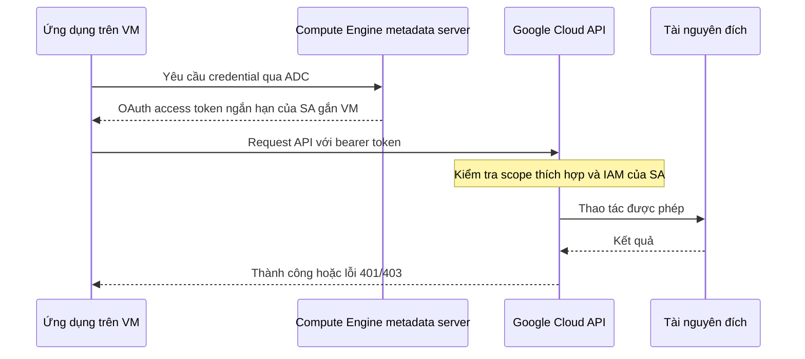

# Gắn service account và kiểm soát quyền của VM

> **Chương:** Compute Engine  
> **Module:** CLOUD_PROVIDERS_GCP  
> **Phạm vi module:** Khám phá Google Cloud từ tổ chức project, IAM và VPC đến Compute Engine, GKE, Cloud Run, dịch vụ lưu trữ và cơ sở dữ liệu. Qua các tình huống triển khai, người học biết lựa chọn dịch vụ, bảo vệ tài nguyên, tự động hóa phát hành và theo dõi độ tin cậy cùng chi phí.

Một máy ảo Compute Engine thường cần gọi dịch vụ khác trong Google Cloud: đọc cấu hình từ Cloud Storage, ghi log, lấy secret hoặc gửi thông điệp. Thay vì chép mật khẩu và khóa JSON vào VM, người quản trị có thể **gắn một service account (SA)** vào VM. Ứng dụng bên trong VM nhận thông tin xác thực ngắn hạn qua **metadata server**, rồi Google Cloud kiểm tra quyền IAM của service account trên tài nguyên cần truy cập.

Điểm mấu chốt của bài học là **gắn service account không đồng nghĩa cấp toàn quyền cho VM**. Quyền sử dụng API phụ thuộc vào **IAM roles của SA** và, đối với những yêu cầu OAuth phù hợp, **access scopes của VM**. Đồng thời, **quyền của người tạo/chỉnh VM** khác với **quyền của ứng dụng chạy trên VM**. Hiểu các ranh giới này giúp giảm nguy cơ rò rỉ dữ liệu, cấp quyền quá rộng và triển khai sai danh tính.

## Mục tiêu học tập

Sau bài này, bạn có thể:

1. Phân biệt **user-managed service account**, **Compute Engine default service account**, **Google-managed service agent** và tài khoản người dùng đăng nhập VM.
2. Giải thích vì sao cần cả **IAM permission** trên tài nguyên và **OAuth access scope** phù hợp trên VM.
3. Thiết kế SA quyền tối thiểu cho một workload cụ thể, tránh lạm dụng `roles/editor`, `roles/owner` và JSON service account key.
4. Phân biệt quyền **`iam.serviceAccounts.actAs`** để gắn SA với quyền **`iam.serviceAccounts.getAccessToken`** để impersonate SA.
5. Gắn SA khi tạo VM, thay SA trên VM đang tồn tại theo quy trình có kiểm soát, đọc lại cấu hình bằng Console/`gcloud`.
6. Kiểm tra danh tính VM qua metadata server, sử dụng Application Default Credentials (ADC), phát hiện lỗi `403`, `401`, thiếu OAuth scope và thiếu đường mạng.
7. Rà soát an toàn metadata server, logging, thay đổi IAM và dọn tài nguyên lab đúng quyền sở hữu.

## 1. Ba danh tính thường bị nhầm

### 1.1. Người quản trị VM

Đây là **human user** hoặc tài khoản tự động thực hiện lệnh `gcloud compute instances create`, chỉnh cấu hình máy hoặc triển khai image. Principal này được đánh giá quyền với **Compute Engine API** và, nếu cần, quyền **gắn service account**. Có quyền SSH vào VM hoặc quyền tạo VM **không tự đồng nghĩa** được đọc tất cả Cloud Storage bucket mà SA của VM có thể truy cập.

### 1.2. Service account gắn trên VM

SA là danh tính của **workload**. Compute Engine có thể cung cấp credential ngắn hạn để code trên VM gọi API thay mặt SA này. Một VM được gắn **tối đa một service account tại một thời điểm**, nhưng **cùng một SA có thể gắn cho nhiều VM**. Nếu sửa role của SA dùng chung, tất cả những VM dùng SA đó có thể bị ảnh hưởng.

Ví dụ địa chỉ SA do người quản trị tạo:

```text
vm-object-reader@my-gcp-compute-lab.iam.gserviceaccount.com
```

Nên tạo **SA chuyên biệt theo ứng dụng và môi trường**, ví dụ `orders-dev-vm` khác `orders-prod-vm`. Điều này giúp kiểm soát mức thiệt hại nếu VM bị xâm nhập và dễ phân tích audit hơn so với dùng chung một SA đặc quyền.

### 1.3. Service agent do Google quản lý

Một số service agent được Google Cloud tạo để vận hành các tính năng nền tảng, ví dụ Google APIs Service Agent có địa chỉ dạng:

```text
PROJECT_NUMBER@cloudservices.gserviceaccount.com
```

**Không gắn service agent vào VM ứng dụng.** Loại này phục vụ quy trình nội bộ của Google Cloud và khác với user-managed service account. Không xóa hoặc thay đổi role service agent để “làm sạch” project nếu không hiểu phụ thuộc dịch vụ.

### 1.4. Compute Engine default service account

Khi bật Compute Engine API, project thường có một SA mặc định:

```text
PROJECT_NUMBER-compute@developer.gserviceaccount.com
```

Nếu không chọn SA khác, một VM tạo qua Console/CLI có thể tự sử dụng SA mặc định theo cấu hình. Quyền của default SA **không phải lúc nào cũng giống nhau**: một số project cũ có thể từng được tự gán `roles/editor`, trong khi chính sách tổ chức mới thường chặn cấp quyền tự động. Với tổ chức được tạo từ ngày **03/05/2024**, ràng buộc `iam.automaticIamGrantsForDefaultServiceAccounts` được thực thi mặc định theo tài liệu Google Cloud. Không suy luận SA mặc định luôn có Editor hay luôn không có quyền; **phải kiểm tra IAM thực tế**.

**Khuyến nghị:** dùng SA riêng cho workload và chỉ gán những role cần thiết. Nếu default SA hiện có quyền quá rộng, đánh giá ảnh hưởng và dùng **Policy Simulator** hoặc quy trình thay đổi IAM trước khi thu hẹp; không xóa SA mặc định khi còn ứng dụng phụ thuộc.

## 2. Mô hình xác thực và phân quyền trên VM



Các bước thực tế:

1. VM có gắn SA `vm-object-reader@...` và cấu hình OAuth scopes.
2. Ứng dụng sử dụng **Application Default Credentials (ADC)** của Google Cloud client library, hoặc một cơ chế hỗ trợ khác, để lấy credential từ **metadata server**.
3. Metadata server trả về token có thời gian sống giới hạn; ứng dụng không cần lưu private key.
4. Dịch vụ đích kiểm tra quyền của **SA gắn VM** trên bucket, project hoặc tài nguyên tương ứng. Với OAuth API phù hợp, access scope trên VM còn có thể giới hạn lời gọi.
5. Khi token sắp hết hạn, client library phù hợp tự làm mới token; thay đổi IAM có thể ảnh hưởng những lần gọi tiếp theo sau khi quyền được cập nhật.

**Mã chạy trên VM nhận quyền theo service account, không phải tự động theo email người đã SSH vào máy.** Tuy nhiên, nếu người dùng chạy `gcloud auth login` hoặc đặt file `GOOGLE_APPLICATION_CREDENTIALS` riêng bên trong VM, lệnh/chương trình đó có thể sử dụng **credential khác**. Vì vậy, khi chẩn đoán cần kiểm tra **đường tìm credential thực tế**, không chỉ danh tính gắn trên cấu hình VM.

## 3. Hai lớp kiểm soát: IAM roles và access scopes

### 3.1. IAM roles kiểm soát *được làm gì* và *trên tài nguyên nào*

IAM gắn một principal với tập permissions trên **resource** (bucket, secret, project...) và có thể có điều kiện/chính sách kế thừa. Ví dụ:

- SA `vm-object-reader@...` có `roles/storage.objectViewer` **trên một bucket lab**, không phải trên toàn project.
- SA đó được phép xem/list object phù hợp trong bucket, nhưng không có `storage.objects.delete` để xóa chúng.
- Nếu cùng SA chưa được cấp quyền đọc Secret Manager, code trên VM **không thể tự truy cập secret** chỉ nhờ có danh tính SA hợp lệ.

Lỗi quyền điển hình: token hợp lệ nhưng Cloud Storage trả `403 Permission denied` vì SA không được cấp role cần thiết trên bucket.

### 3.2. Access scopes kiểm soát *OAuth token trên VM có thể yêu cầu nhóm API nào*

Access scopes là cơ chế giới hạn OAuth cũ của Compute Engine. Chúng là thuộc tính **từng VM**, không thay cho IAM role:

| Cấu hình trên VM | Ý nghĩa | Hệ quả |
|---|---|---|
| `https://www.googleapis.com/auth/cloud-platform` | OAuth scope rộng dành cho Google Cloud APIs | **Không tự cấp IAM permissions**; phù hợp khi muốn IAM quyết định quyền chi tiết |
| `https://www.googleapis.com/auth/devstorage.read_only` | OAuth scope đọc Cloud Storage | Có thể chặn thao tác ghi qua OAuth dù SA có role ghi |
| Không có scope API cần thiết | Token OAuth thiếu phạm vi | Request có thể gặp `403 Request had insufficient authentication scopes` |
| VM không gắn SA | Không có credential workload qua attached SA | Ứng dụng phải có cơ chế xác thực khác được phê duyệt |

Google Cloud khuyến nghị **gắn `cloud-platform` scope** và kiểm soát quyền chi tiết bằng IAM trên SA. Chọn scope rộng **không** làm workload thành Owner/Editor. Ngược lại, scope hẹp **không** bù được một IAM role quá rộng, vì scopes giới hạn theo API và không thể chọn chính xác một bucket hay một secret.

**Giới hạn quan trọng:** access scopes áp dụng cho những lời gọi API dùng cơ chế OAuth chịu scope; chúng **không bảo đảm ràng buộc mọi giao thức xác thực** (ví dụ các cơ chế khác như gRPC theo tài liệu sản phẩm). Không dùng scopes làm hàng rào bảo mật duy nhất.

### 3.3. Ma trận quyền cho một VM đọc dữ liệu

Giả sử ứng dụng chỉ cần **list và đọc object** trong bucket `gs://my-lab-read-only-bucket`:

| IAM trên SA | Scope trên VM | Kết quả kỳ vọng khi dùng OAuth phù hợp |
|---|---|---|
| `roles/storage.objectViewer` trên đúng bucket | `cloud-platform` | Có thể đọc/list object theo quyền và policy khác |
| `roles/storage.objectViewer` trên đúng bucket | `devstorage.read_only` | Có thể đọc/list object theo quyền hiện có |
| **Không có** quyền đọc object | `cloud-platform` | **Không** đọc được bucket chỉ vì scope rộng |
| `roles/storage.objectAdmin` trên bucket | `devstorage.read_only` | Các lời gọi ghi OAuth có thể bị chặn bởi scope hẹp |
| SA có Editor ở cấp project | `cloud-platform` | Nguy cơ quyền quá rộng; cần rà soát role cấp project |

Để biết tại sao request thực tế bị từ chối, cần xem đồng thời **resource IAM**, **deny/conditions**, **scope** và **API đã bật**. Phần mềm còn cần đường mạng và cấu hình endpoint API phù hợp.

## 4. Quyền của người *gắn SA vào VM* khác quyền của SA

Một service account vừa là **principal** vừa là **resource**. Hai nhóm quyền phục vụ hai mục đích:

| Câu hỏi | Quyền liên quan | Ai cần có? |
|---|---|---|
| Ai được tạo/chỉnh VM? | `compute.instances.create`, `compute.instances.setServiceAccount`, `compute.instances.stop/start` và quyền liên quan | Người triển khai/quản trị VM |
| Ai được **gắn** một SA vào VM? | `iam.serviceAccounts.actAs`, thường qua `roles/iam.serviceAccountUser` **trên SA cụ thể** | Người triển khai VM |
| Ai được cấp quyền **trên bucket** cho SA? | Quyền thay đổi IAM policy của bucket | Người quản trị tài nguyên hoặc chủ bucket |
| SA chạy trên VM được đọc object nào? | `roles/storage.objectViewer` và các policy khác trên bucket | **SA** là principal nhận role |
| Ai được **tạo access token** để impersonate SA trực tiếp? | `iam.serviceAccounts.getAccessToken`, thường qua `roles/iam.serviceAccountTokenCreator` | Người/caller cần impersonation, **không phải** thao tác gắn SA thông thường |

**`roles/iam.serviceAccountUser` không đồng nghĩa `roles/iam.serviceAccountTokenCreator`.** User cho phép gắn SA vào tài nguyên hỗ trợ; Token Creator cho phép tạo credential ngắn hạn thay mặt SA và là một quyền rất nhạy cảm. Không cấp cả hai role cho mọi người theo thói quen.

### Ví dụ ranh giới quyền

```text
Người triển khai: deployer@example.com
  ├── Có quyền tạo/chỉnh VM lab trong project
  └── Có iam.serviceAccounts.actAs trên SA vm-object-reader

Service account: vm-object-reader@PROJECT_ID.iam.gserviceaccount.com
  └── Có roles/storage.objectViewer trên DUY NHẤT bucket lab

VM: reader-vm
  ├── Gắn SA vm-object-reader
  └── OAuth scope: cloud-platform

Kết quả:
  ├── Ứng dụng trên VM đọc được bucket lab nếu các điều kiện khác phù hợp
  ├── Ứng dụng không tự xóa object nhờ quyền read-only
  └── Người triển khai không được suy ra là có quyền đọc bucket
      bằng danh tính cá nhân chỉ vì họ có quyền tạo VM
```

**Lưu ý an ninh:** quyền gắn một SA đặc quyền vào VM mà người triển khai có thể kiểm soát **có thể dẫn đến sử dụng quyền của SA từ bên trong VM**. Do đó, `actAs` không phải quyền vô hại; chỉ cấp trên SA cần thiết và kiểm tra ai có quyền khởi tạo/chạy code trên VM.

## 5. Chuẩn bị bài lab có kiểm soát

Bài lab mẫu dùng **một project và VPC sandbox**, một bucket tồn tại sẵn chứa tệp văn bản không nhạy cảm, một SA mới và một VM riêng. Nếu không có quyền tạo VM hoặc không muốn phát sinh chi phí, bạn vẫn có thể thực hiện **toàn bộ bước kiểm tra chỉ đọc** trên một VM được chủ sở hữu cho phép.

**Không áp dụng trực tiếp trên project production, VM chứa dữ liệu quan trọng hoặc SA dùng chung**. Việc gắn hoặc thay SA có thể yêu cầu **dừng VM**, gây downtime; VM, boot disk, static IP và lưu lượng mạng có thể phát sinh phí.

### 5.1. Bảng giá trị mẫu

| Biến | Ví dụ | Lưu ý |
|---|---|---|
| `PROJECT_ID` | `my-gcp-compute-lab` | ID thật của project sandbox |
| `ZONE` | `asia-southeast1-a` | Zone có quota và machine type thích hợp |
| `SUBNET_NAME` | `lab-subnet` | Subnet trong region của `ZONE` |
| `VM_NAME` | `reader-vm` | Chỉ dùng cho VM lab, không dùng máy production |
| `SA_NAME` | `vm-object-reader` | ID của user-managed service account |
| `SA_EMAIL` | `vm-object-reader@PROJECT_ID.iam.gserviceaccount.com` | Email thực sau khi tạo |
| `BUCKET_NAME` | `my-lab-read-only-bucket` | Bucket sẵn có, chỉ dùng dữ liệu thử nghiệm |
| `OPERATOR_EMAIL` | `deployer@example.com` | Người có quyền triển khai/gắn SA |

Người học cần kiểm tra:

1. **Compute Engine API** (`compute.googleapis.com`) và **IAM API** (`iam.googleapis.com`) được bật nếu thực hiện tạo; bật API cần quyền phù hợp.
2. Có quyền quản trị VM theo thao tác, quyền tạo SA nếu chưa có, quyền thay đổi IAM trên bucket và quyền `actAs` được cấp **đúng SA**.
3. VM có đường mạng truy cập Google Cloud API. Nếu VM **không có external IP**, phải thiết kế **Private Google Access**, **Cloud NAT** hoặc cơ chế kết nối được hỗ trợ phù hợp với subnet và endpoint sử dụng.
4. Đã tính toán chi phí, kiểm tra quota và **Cloud Billing budget**; ngân sách/cảnh báo không tự tắt VM khi vượt mức.
5. Đã xác định cách SSH an toàn, ví dụ IAP TCP forwarding kết hợp OS Login/IAM khi thích hợp, thay vì mở SSH `0.0.0.0/0`.

### 5.2. Chuẩn bị biến và xác minh project bằng Cloud Shell

Ví dụ Bash trong **Cloud Shell** hoặc terminal đã đăng nhập Google Cloud CLI. **Thay tất cả placeholder trước khi chạy lệnh ghi**:

```bash
PROJECT_ID="my-gcp-compute-lab"
ZONE="asia-southeast1-a"
SUBNET_NAME="lab-subnet"
VM_NAME="reader-vm"
SA_NAME="vm-object-reader"
SA_EMAIL="$SA_NAME@$PROJECT_ID.iam.gserviceaccount.com"
BUCKET_NAME="my-lab-read-only-bucket"
OPERATOR_EMAIL="deployer@example.com"

# Các lệnh chỉ đọc: xác minh danh tính, project, VM và bucket mục tiêu
gcloud auth list --filter="status:ACTIVE"
gcloud projects describe "$PROJECT_ID" \
  --format="table(projectId,projectNumber,name,lifecycleState)"
gcloud compute instances list --project="$PROJECT_ID"
gcloud iam service-accounts list --project="$PROJECT_ID"
gcloud storage ls --project="$PROJECT_ID"

printf 'Project: %s\nVM: %s\nZone: %s\nSA: %s\nBucket: %s\n' \
  "$PROJECT_ID" "$VM_NAME" "$ZONE" "$SA_EMAIL" "$BUCKET_NAME"
```

**Không dùng giá trị trong ví dụ để xóa/chỉnh resource đang có.** Nếu `reader-vm` hoặc `vm-object-reader` đã tồn tại, cần xác nhận chủ sở hữu trước khi thao tác; có thể đặt tên lab khác.

## 6. Thực hành A — Tạo SA và cấp quyền đọc một bucket

Mục đích của phần này: SA có **quyền đọc dữ liệu tối thiểu**, không được ghi/xóa bucket và không nhận role rộng trên toàn project.

### 6.1. Console: tạo service account

1. Chọn đúng project trên Google Cloud Console.
2. Mở **IAM & Admin → Service Accounts → Create service account**.
3. Đặt ID `vm-object-reader`, mô tả rõ “Chỉ đọc object trong bucket lab”.
4. Tạo SA. Nếu màn hình cho gán role tại cấp project, **không chọn Editor/Owner** và không cần cấp Storage Object Viewer trên toàn project khi mục tiêu chỉ là một bucket.
5. Mở **Cloud Storage → Buckets → bucket lab → Permissions**.
6. Thêm principal `vm-object-reader@PROJECT_ID.iam.gserviceaccount.com` với role **Storage Object Viewer** (`roles/storage.objectViewer`) **trên đúng bucket**.
7. Xác minh principal/role và phạm vi đã ghi nhận; không cấp quyền cho `allUsers` hay `allAuthenticatedUsers`.

### 6.2. Cloud Shell: thao tác tương đương

Người có quyền tạo service account và chỉnh IAM bucket:

```bash
# Chỉ chạy nếu SA này chưa tồn tại và project là sandbox được phép thay đổi
gcloud iam service-accounts create "$SA_NAME" \
  --project="$PROJECT_ID" \
  --display-name="Read-only VM application identity"

# Kiểm tra SA đã tạo đúng
gcloud iam service-accounts describe "$SA_EMAIL" \
  --project="$PROJECT_ID" \
  --format="yaml(email,displayName,disabled)"

# Cấp quyền đọc object trên đúng bucket, KHÔNG cấp ở toàn project
gcloud storage buckets add-iam-policy-binding "gs://$BUCKET_NAME" \
  --project="$PROJECT_ID" \
  --member="serviceAccount:$SA_EMAIL" \
  --role="roles/storage.objectViewer"

# Đọc lại IAM policy bucket
gcloud storage buckets get-iam-policy "gs://$BUCKET_NAME" \
  --project="$PROJECT_ID"
```

Nếu bucket thuộc project khác, quyền sửa IAM phải được cấp trên **bucket đó**, và lệnh cần được kiểm tra với project/bucket thực tế. **SA có thể truy cập tài nguyên ở project khác** nếu resource IAM cho phép; không phải mọi role đều phải gắn vào project nơi SA được tạo.

**Kết quả mong đợi:** principal `serviceAccount:$SA_EMAIL` xuất hiện cùng `roles/storage.objectViewer` trong IAM bucket. Chỉ đọc chính sách cấp bucket không đủ để thấy mọi quyền có hiệu lực nếu SA còn được cấp role ở cấp project/folder/organization hoặc bị deny/condition khác.

## 7. Thực hành B — Cho phép một người gắn SA vào VM

Trong ví dụ này, `OPERATOR_EMAIL` là tài khoản được phép tạo/chỉnh VM. Người quản trị SA cấp **Service Account User** trên **đúng SA lab**:

```bash
gcloud iam service-accounts add-iam-policy-binding "$SA_EMAIL" \
  --project="$PROJECT_ID" \
  --member="user:$OPERATOR_EMAIL" \
  --role="roles/iam.serviceAccountUser"

# Xem IAM policy của CHÍNH service account:
# policy này mô tả ai được sử dụng/quản lý SA, không phải role của SA trên bucket
gcloud iam service-accounts get-iam-policy "$SA_EMAIL" \
  --project="$PROJECT_ID"
```

Để thao tác với VM, operator còn cần các **Compute Engine permissions** tương ứng, ví dụ quyền tạo VM hoặc `compute.instances.setServiceAccount`, và các quyền network/disk liên quan nếu tạo VM mới. `roles/iam.serviceAccountUser` **không tự cho phép** tạo máy ảo.

Nếu operator chỉ được cấp quyền thao tác Compute Engine nhưng thiếu `actAs`, tạo VM có chọn SA thường bị từ chối. Ngược lại, có `actAs` mà thiếu quyền tạo VM vẫn không tạo được máy. **Không cấp Token Creator để né lỗi `actAs`.**

## 8. Thực hành C — Gắn SA khi tạo VM mới

### 8.1. Google Cloud Console

1. Mở **Compute Engine → VM instances → Create instance**.
2. Chọn project, tên `reader-vm`, zone `asia-southeast1-a` và machine type được phép/đã dự trù chi phí.
3. Chọn image hệ điều hành theo chính sách lớp học và tổ chức; với Linux có thể sử dụng image Debian được Google Cloud hỗ trợ.
4. Chọn **VPC/subnet `lab-subnet`** trong đúng region. Quyết định có external IP hay không dựa trên đường quản trị VM và đường truy cập Google APIs.
5. Trong mục **Security → Service account**, chọn `vm-object-reader@...`. Tên/vị trí nhóm cài đặt có thể thay đổi theo phiên bản Console.
6. Với SA do người quản trị tạo, lựa chọn scope khuyến nghị là **Allow full access to all Cloud APIs** (tương ứng `cloud-platform`). **Quyền thực tế vẫn do IAM role của SA quyết định**.
7. Xem lại firewall, SSH/OS Login, disk, metadata và ước lượng chi phí. Không bật “Allow HTTP/HTTPS traffic” nếu VM không cần frontend công khai.
8. Chọn **Create** và sau khi VM xuất hiện, mở trang chi tiết kiểm tra service account và access scopes.

### 8.2. gcloud: ví dụ VM **không có external IP**

Lệnh dưới đây **tạo VM thật và có thể phát sinh chi phí**. Chỉ dùng khi VPC/subnet, đường truy cập Google APIs và IAP/SSH đều đã được chuẩn bị theo chính sách. Với VM **không có external IP**, nếu không có Private Google Access/đường mạng phù hợp, request đến nhiều Google Cloud API có thể thất bại mặc dù IAM và scope đúng.

```bash
# Chỉ sau khi xác minh subnet ở đúng region, quota, billing và quyền
gcloud compute instances create "$VM_NAME" \
  --project="$PROJECT_ID" \
  --zone="$ZONE" \
  --machine-type=e2-small \
  --image-family=debian-12 \
  --image-project=debian-cloud \
  --subnet="$SUBNET_NAME" \
  --no-address \
  --service-account="$SA_EMAIL" \
  --scopes=cloud-platform

# Xem VM, SA và OAuth access scopes trên cấu hình Compute Engine
gcloud compute instances describe "$VM_NAME" \
  --project="$PROJECT_ID" \
  --zone="$ZONE" \
  --format="yaml(name,status,networkInterfaces,serviceAccounts)"
```

Không chạy lệnh `create` khi tên VM đã tồn tại. Nếu muốn SSH qua IAP, cần IAP API/role, đường nối TCP 22 và OS Login/SSH IAM tùy cấu hình; bài này **không** hướng dẫn mở SSH từ Internet.

**Điểm kiểm tra:** `serviceAccounts[].email` là SA lab và `serviceAccounts[].scopes` có `https://www.googleapis.com/auth/cloud-platform`. Lúc này ứng dụng trên VM có thể lấy credential, nhưng cần kiểm tra tài nguyên đích để chứng minh quyền đúng.

## 9. Thực hành D — Thay service account của VM hiện có

Thay SA của VM đang tồn tại là **thao tác thay đổi chạy dịch vụ**, không chỉ là gán IAM role. Theo hướng dẫn Compute Engine, phải **dừng VM trước khi thay SA hoặc access scopes**, sau đó khởi động lại.

### 9.1. Trước khi dừng VM

1. Chỉ chọn **VM lab thuộc phạm vi bạn được phép vận hành**; thông báo chủ hệ thống nếu máy có workload hoặc người dùng.
2. Ghi lại SA và scopes hiện có, IP, disk và phụ thuộc, để có kế hoạch rollback.
3. Xác định downtime được chấp nhận; dừng máy có thể làm gián đoạn xử lý, ảnh hưởng ephemeral IP hoặc state ứng dụng.
4. Kiểm tra quyền `compute.instances.stop`, `compute.instances.start`, `compute.instances.setServiceAccount` và `actAs` trên SA mới.
5. Nếu VM đang ở managed instance group (MIG), cần quản lý **instance template** và rolling update theo quy trình của MIG, không tùy tiện chỉnh một instance sẽ bị nhóm quản lý thay thế.

### 9.2. Cách A: Console

1. Mở **Compute Engine → VM instances**, chọn đúng VM lab.
2. Vào **Details**, ghi lại service account hiện tại và access scopes.
3. **Stop** VM; đợi trạng thái `TERMINATED` hoặc trạng thái dừng hoàn tất.
4. Chọn **Edit**, tìm phần **Service account**, chọn SA mới được phê duyệt.
5. Chọn scope `cloud-platform` theo khuyến nghị; các lựa chọn cụ thể phụ thuộc loại SA và giao diện.
6. **Save**, kiểm tra cấu hình và **Start/Resume** VM.
7. Đợi ứng dụng phục hồi, xác minh metadata server, API permissions và số liệu vận hành.

### 9.3. Cách B: Cloud Shell (chỉ VM lab)

```bash
# Đọc lại SA và scopes TRƯỚC khi chỉnh để giữ thông tin rollback
gcloud compute instances describe "$VM_NAME" \
  --project="$PROJECT_ID" \
  --zone="$ZONE" \
  --format="yaml(name,status,serviceAccounts)"

# Chỉ thực hiện trong cửa sổ thay đổi được phép
gcloud compute instances stop "$VM_NAME" \
  --project="$PROJECT_ID" \
  --zone="$ZONE"

# VM phải dừng trước khi thay SA và scopes
gcloud compute instances set-service-account "$VM_NAME" \
  --project="$PROJECT_ID" \
  --zone="$ZONE" \
  --service-account="$SA_EMAIL" \
  --scopes=cloud-platform

gcloud compute instances start "$VM_NAME" \
  --project="$PROJECT_ID" \
  --zone="$ZONE"

# Readback cấu hình mới sau khi VM hoạt động
gcloud compute instances describe "$VM_NAME" \
  --project="$PROJECT_ID" \
  --zone="$ZONE" \
  --format="yaml(name,status,serviceAccounts)"
```

Lệnh `set-service-account` không tạo service account mới. Nó cập nhật SA/scopes **đã gắn trên VM**. Khi dùng `--no-service-account`, bạn gỡ SA khỏi VM; ứng dụng đang dựa vào metadata credential có thể mất khả năng truy cập Google Cloud APIs.

**Không thử thay SA production chỉ để kiểm tra lệnh.** Nếu muốn giảm quyền của workload mà không thay danh tính SA, có thể xem xét thay **IAM binding** của SA, nhưng điều đó ảnh hưởng **mọi VM dùng SA** và cũng phải qua kiểm soát thay đổi.

## 10. Xác minh danh tính từ bên trong VM

Compute Engine cung cấp **metadata server** tại `metadata.google.internal` hoặc `169.254.169.254`. Một VM được gắn SA có thể truy vấn các endpoint metadata dành cho service account.

### 10.1. Truy vấn an toàn, **không in token**

Các lệnh dưới đây chạy **bên trong VM Linux**, không chạy từ laptop/Cloud Shell để suy ra danh tính của VM:

```bash
# Kiểm tra địa chỉ email SA đang gắn qua metadata server
curl --fail --silent --show-error \
  --header "Metadata-Flavor: Google" \
  "http://metadata.google.internal/computeMetadata/v1/instance/service-accounts/default/email"

# Xem OAuth scopes gắn với VM
curl --fail --silent --show-error \
  --header "Metadata-Flavor: Google" \
  "http://metadata.google.internal/computeMetadata/v1/instance/service-accounts/default/scopes"
```

`default` trong đường dẫn metadata server là bí danh cho **SA đang gắn trên VM**, không nhất thiết là Compute Engine **default service account** của project.

Các endpoint metadata khác có thể cung cấp **OAuth access token**. **Không in hoặc chia sẻ phản hồi chứa `access_token`**, vì token là bearer secret có thể được sử dụng trong thời gian còn hiệu lực. Khi cần gọi API, ưu tiên thư viện Google Cloud dùng ADC để tự lấy và làm mới token.

### 10.2. Kiểm tra từ bên ngoài bằng gcloud

Người có quyền xem VM có thể xác minh cấu hình mà không cần SSH:

```bash
gcloud compute instances describe "$VM_NAME" \
  --zone="$ZONE" \
  --project="$PROJECT_ID" \
  --format="yaml(name,status,serviceAccounts)"
```

Lệnh này cho biết cấu hình SA/scopes của VM tại Compute Engine, **không chứng minh code trong VM đã sử dụng đúng credential**. Nếu trong guest OS có `gcloud auth login` hoặc biến môi trường trỏ tới key file khác, chương trình có thể sử dụng danh tính khác.

### 10.3. Thử quyền đọc Cloud Storage

Nếu VM đã có đường mạng đến API, có Google Cloud CLI, và **không đăng nhập thêm bằng user credential**, có thể thử:

```bash
# Chạy TRONG VM, với bucket lab tồn tại sẵn và được cấp quyền
gcloud storage ls "gs://my-lab-read-only-bucket"
```

Thay tên bucket đúng với ví dụ bạn tạo. Lệnh `ls` chỉ đọc, không tạo/xóa object. Để khẳng định đang dùng **attached service account**, đối chiếu metadata email và cách gcloud chọn credential; `gcloud auth list` có thể lộ sự hiện diện tài khoản đăng nhập người dùng nhưng không phải bằng chứng đầy đủ về token đang được sử dụng.

Nếu có ứng dụng Java, Python, Go hoặc Node.js, Google Cloud client libraries thường dùng ADC:

```text
Ứng dụng gọi API qua Google Cloud client library
  └── ADC tìm credential trong môi trường
      ├── GOOGLE_APPLICATION_CREDENTIALS nếu được đặt
      ├── Credential cục bộ của nhà phát triển nếu có
      └── Compute Engine metadata server khi chạy trên VM phù hợp
```

Không khai báo `GOOGLE_APPLICATION_CREDENTIALS` trỏ đến JSON private key nếu không cần. Trong VM Compute Engine, metadata server là nguồn credential workload thường được khuyến nghị.

## 11. Phân biệt SSH vào VM với quyền gọi Google Cloud API

Đăng nhập vào hệ điều hành VM và truy cập API là hai bài toán khác nhau:

| Hoạt động | Thường kiểm tra | Không nên nhầm với |
|---|---|---|
| Xem/tạo/chỉnh VM qua Console/API | Compute Engine IAM permissions của operator | Role gắn cho ứng dụng chạy trong guest OS |
| SSH vào Linux VM | OS Login/SSH key, IAM/guest agent, IAP/network/firewall theo cấu hình | `roles/storage.objectViewer` của attached SA |
| Ứng dụng trên VM đọc bucket | SA token qua metadata/ADC, IAM của SA trên bucket, scopes và network | Quyền SSH của người vận hành |
| VM được gắn service account | `iam.serviceAccounts.actAs` + quyền Compute Engine của operator | `roles/iam.serviceAccountTokenCreator` |
| Impersonate SA từ laptop | `iam.serviceAccounts.getAccessToken` / Token Creator | Tự gắn SA vào VM |

Một kỹ sư có thể SSH vào VM bằng OS Login nhưng không được gán Storage Object Viewer trên danh tính cá nhân; code chạy với **attached SA** vẫn có thể đọc bucket nếu token của SA được sử dụng. Vì thế **quyền thực thi code trên VM là một ranh giới đặc biệt nhạy cảm**: những người có thể chạy code thường có khả năng sử dụng quyền của SA gắn trên máy.

## 12. An toàn metadata server và bảo vệ credential

### 12.1. Tại sao metadata server là điểm nhạy cảm?

Metadata server được thiết kế để workload trên VM truy cập thông tin cấu hình và nhận credential ngắn hạn. Bất kỳ mã độc hại hoặc tiến trình không đáng tin cậy nào có thể gọi metadata endpoint trong phạm vi được phép đều có nguy cơ lấy token của **SA đang gắn**.

Một dạng rủi ro là **Server-Side Request Forgery (SSRF)**: ứng dụng nhận URL từ client không tin cậy rồi tự truy cập địa chỉ nội bộ hoặc metadata endpoint. Nếu ứng dụng cho phép gửi header tùy ý hoặc có lỗ hổng khác, kẻ tấn công có thể tìm cách khai thác đường này. Không coi sự hiện diện của header `Metadata-Flavor: Google` là một cơ chế phòng vệ duy nhất của ứng dụng.

### 12.2. Các nguyên tắc giảm thiểu

1. **Quyền SA tối thiểu:** mỗi VM/workload có SA riêng, gán role trên tài nguyên hẹp; không dùng Editor/Owner.
2. **Không lưu JSON key:** dùng credential ngắn hạn từ metadata server/ADC; áp policy hạn chế tạo hoặc tải lên key khi thích hợp.
3. **Kiểm soát mã trên VM:** chỉ người/quy trình được phép mới có quyền SSH, root, cài phần mềm hoặc chạy container không tin cậy.
4. **Bảo vệ đường gọi metadata:** hạn chế SSRF, kiểm tra URL đích và redirect, chặn các hành vi proxy không mong muốn; sử dụng các cơ chế bảo vệ của hệ điều hành/ứng dụng phù hợp, không tự sửa metadata server.
5. **Tách SA theo môi trường và ứng dụng:** đừng gắn SA production cho máy test hoặc job chạy mã bên thứ ba.
6. **Theo dõi IAM và audit:** kiểm tra ai sửa SA/VM, ai gắn SA nào và API nào được gọi.
7. **Giảm quyền có quy trình:** dùng Policy Analyzer/Simulator, xem service account usage, thử staging trước khi bỏ role quan trọng.
8. **Quản lý chu kỳ token:** token ngắn hạn vẫn là secret; không ghi vào stdout/log/CI artifact, không đưa lên chat hoặc Git.

### 12.3. IAM Conditions, deny policy và Organization Policy

Ngoài allow policy cấp role, quyền có thể chịu ảnh hưởng từ **IAM Conditions**, **deny policies**, **Organization Policy** và các ràng buộc dịch vụ. Ví dụ tổ chức có thể chặn tạo khóa SA dài hạn hoặc giới hạn khả năng gắn SA thuộc project khác. Không “sửa” lỗi bằng cách cấp Editor ở cấp project mà chưa chẩn đoán permission cụ thể.

### 12.4. Gắn service account ở project khác

Một số tổ chức quản lý SA tập trung trong project chuyên dụng rồi gắn vào VM ở project khác. Mô hình này cần cấu hình **cross-project service account usage** được Google Cloud hỗ trợ, ràng buộc Organization Policy và quyền cho người triển khai/Compute Engine service agent thích hợp.

**Không giả định chỉ cần `roles/iam.serviceAccountUser` trên SA là đủ** khi VM và SA nằm ở hai project khác nhau. Với bài lab cơ bản, sử dụng VM và SA **cùng project** để tránh thay đổi chính sách tổ chức.

## 13. Quan sát và kiểm toán quyền của VM

### 13.1. Nên kiểm tra những gì?

- **Cấu hình VM:** tên SA, OAuth scopes, zone, network, image và thời gian thay đổi.
- **IAM policy của SA (resource):** ai được `actAs`, impersonate hoặc quản lý SA.
- **IAM của tài nguyên đích:** SA có role gì tại bucket, secret, project; có quyền kế thừa/deny hoặc condition không.
- **Cloud Audit Logs:** ai tạo/chỉnh VM, đổi service account, sửa IAM; các API data access logs nếu được bật.
- **Ứng dụng:** request thành công/thất bại, HTTP status, quota, auth error, trace ID.
- **Bảo mật guest OS:** OS Login, agent, cập nhật bản vá, quyền chạy code và dấu vết cấu hình credential khác.

### 13.2. Lệnh kiểm kê chỉ đọc

```bash
# Email SA/scopes thực tế gắn trên một VM
gcloud compute instances describe "$VM_NAME" \
  --project="$PROJECT_ID" --zone="$ZONE" \
  --format="yaml(name,status,serviceAccounts)"

# Kiểm tra SA resource và những ai có binding trên chính SA này
gcloud iam service-accounts describe "$SA_EMAIL" --project="$PROJECT_ID"
gcloud iam service-accounts get-iam-policy "$SA_EMAIL" --project="$PROJECT_ID"

# Xem bucket IAM - SA được quyền gì trên bucket lab?
gcloud storage buckets get-iam-policy "gs://$BUCKET_NAME" \
  --project="$PROJECT_ID"
```

**Lưu ý:** `get-iam-policy` **trên service account** trả về ai có quyền sử dụng/quản lý **SA resource**, không phải toàn bộ các role **SA được cấp** trên project/bucket. Để xem quyền của SA trên tài nguyên, cần kiểm tra IAM policy của **tài nguyên đích** hoặc dùng công cụ **IAM Policy Analyzer/Troubleshooter** phù hợp.

### 13.3. Ghi log thay đổi

Cloud Audit Logs cho `compute.googleapis.com` có thể cho thấy sự kiện tạo/chỉnh VM, trong đó có thay đổi service account theo khả năng logging. Các thay đổi IAM của bucket hoặc SA cũng có audit log của dịch vụ tương ứng. Với Data Access logs, việc bật và xem có thể cần chính sách bổ sung; không mặc định mọi request đọc object đều có log sẵn.

Khi điều tra, liên hệ:

```text
Ai thao tác thay đổi cấu hình VM?
  → SA nào được gắn? Scopes nào?
    → SA có những IAM bindings nào trên tài nguyên?
      → Request API nào bị từ chối/được phép?
        → Có người/tiến trình không đáng tin cậy chạy trên VM không?
```

## 14. Sự cố thường gặp: chẩn đoán theo lớp

| Triệu chứng | Nguyên nhân có thể | Hướng kiểm tra |
|---|---|---|
| Không tạo được VM khi chọn SA | Operator thiếu `iam.serviceAccounts.actAs` hoặc permission tạo VM/network/disk | Xem lỗi permission, kiểm tra IAM của SA và project/subnet |
| `gcloud compute instances set-service-account` bị từ chối | VM chưa stop, thiếu `compute.instances.setServiceAccount` hoặc `actAs` | Kiểm tra trạng thái VM và hai lớp quyền |
| Metadata endpoint `.../default/email` rỗng/lỗi | VM không gắn SA hoặc code không chạy trong Compute Engine VM phù hợp | Xem `instances describe` và xác minh môi trường |
| `403 Request had insufficient authentication scopes` | VM có OAuth scope hẹp | Xem `serviceAccounts[].scopes`; cân nhắc `cloud-platform` qua stop/change/start |
| `403 Permission denied` khi đọc bucket | SA không có permission hoặc bị condition/deny | Kiểm tra bucket IAM, role kế thừa và Cloud Audit Logs |
| `401 Unauthorized` | Token thiếu/hết hạn/không phù hợp API | Kiểm tra ADC, refresh, audience/token type và time skew |
| VM không gọi được API dù IAM hợp lệ | Không có egress/Private Google Access/NAT/route/DNS phù hợp | Kiểm tra VPC/subnet, DNS, firewall egress và endpoint |
| Lệnh dùng email người dùng thay SA | Có `gcloud auth login` hoặc ADC/key file khác trên VM | Kiểm tra nguồn credential đã chọn, không in token |
| Role mới chưa hoạt động ngay | Thay đổi IAM cần thời gian có hiệu lực; token/cache còn trạng thái cũ | Đợi propagation hợp lý, kiểm tra lại quyền |
| Gắn SA thành công nhưng API chưa dùng được | API chưa bật ở project thích hợp hoặc policy/quota chặn | Xem `gcloud services list --enabled` và lỗi API |
| Có quyền đọc cả bucket ngoài dự kiến | SA còn `roles/editor` hoặc role rộng ở cấp project/folder/org | Dùng IAM Policy Analyzer/Troubleshooter và thu hẹp quyền theo quy trình |
| Sau thu hồi role, workload khác hỏng | Nhiều VM dùng cùng SA | Xem inventory VM/SA trước khi sửa; tách SA theo ứng dụng |

### Quy trình chẩn đoán sáu bước

1. **Đúng VM/project/zone chưa?** Xem VM và service account bằng `instances describe`.
2. **Code dùng credential nào?** Kiểm tra metadata email, ADC, environment và tài khoản gcloud đăng nhập trong VM.
3. **Scope có phù hợp?** Với OAuth request, kiểm tra `cloud-platform` hoặc scope API.
4. **SA có quyền trên đích?** Xem resource IAM, điều kiện, quyền kế thừa và deny.
5. **API và network có hoạt động?** Kiểm tra API enabled, quota, DNS, đường mạng và firewall egress.
6. **Log nói gì?** So sánh request ID, audit, application log trước khi thay đổi IAM.

## 15. Ba tình huống thiết kế

### Tình huống A — VM xử lý ảnh chỉ cần đọc Cloud Storage

Ứng dụng chạy trên một VM xử lý ảnh trong bucket `incoming-images`, không cần xóa hoặc quản trị bucket. Tạo SA chuyên trách, cấp `roles/storage.objectViewer` ở **bucket đó**, gắn vào VM với scope `cloud-platform`. Code dùng ADC; người triển khai chỉ có `actAs` trên SA lab. Khi cần tải ảnh đầu vào, request được kiểm soát theo IAM tài nguyên.

**Sai lầm cần tránh:** cấp `roles/storage.admin` ở cấp project hoặc Editor chỉ để chương trình tải ảnh xuống.

### Tình huống B — VM ứng dụng cần Secret Manager

Một API chạy trên VM cần đọc **một secret cụ thể**. Tạo SA cho API, cấp `roles/secretmanager.secretAccessor` trên **secret đó** (và ràng buộc theo chính sách thích hợp). Gắn SA, dùng client library lấy secret bằng ADC. Giới hạn ai có quyền SSH/chạy code trên VM, bởi vì người kiểm soát code có thể sử dụng quyền truy cập secret của SA.

**Sai lầm cần tránh:** chép secret vào startup script, metadata tùy biến công khai với guest OS hoặc gán role Secret Manager Admin cho toàn project.

### Tình huống C — Nhiều VM dùng chung SA đặc quyền

Một đội gắn `shared-vm-sa` lên cả dev, staging và production. Khi SA được cấp thêm quyền để phục vụ production, VM dev cũng có thể thừa hưởng. Nếu dev VM bị xâm nhập, kẻ tấn công có thể tận dụng credential của SA để truy cập tài nguyên mà role cho phép.

**Giải pháp:** kiểm kê những VM cùng gắn SA, lập kế hoạch tách SA theo ứng dụng/môi trường, cấp quyền tối thiểu ở resource đích, thay cấu hình VM theo maintenance window và theo dõi audit. Không xóa SA dùng chung trước khi chuyển hết workload phụ thuộc.

## 16. Dọn tài nguyên lab và khôi phục cấu hình

### 16.1. Nguyên tắc dọn

Chỉ dọn **những tài nguyên do bài lab tạo**. Không xóa bucket đã tồn tại sẵn, service account mặc định, service agent hoặc VM dùng chung. Việc xóa một SA có thể phá hỏng mọi VM đang dùng nó; việc xóa VM có thể kéo theo boot disk theo thiết lập auto-delete và gây mất dữ liệu thử nghiệm.

**Nếu bạn tạo VM mới chỉ cho bài lab:** có thể xóa VM sau khi lưu kết quả/backup cần thiết, rồi thu hồi role SA và xóa SA riêng.

**Nếu bạn thay SA trên VM đã tồn tại:** trước khi dọn, **khôi phục SA và scopes ban đầu** theo quy trình stop → set-service-account → start nếu đó là thay đổi có chủ đích và được owner xác nhận; không mặc định xóa VM hoặc để lại danh tính mới khi chưa được phê duyệt.

### 16.2. Kiểm kê trước thao tác xóa

```bash
printf 'Project: %s\nVM: %s\nZone: %s\nSA: %s\nBucket: %s\nOperator: %s\n' \
  "$PROJECT_ID" "$VM_NAME" "$ZONE" "$SA_EMAIL" "$BUCKET_NAME" "$OPERATOR_EMAIL"

gcloud compute instances describe "$VM_NAME" \
  --project="$PROJECT_ID" --zone="$ZONE" \
  --format="yaml(name,status,serviceAccounts,disks)"

gcloud iam service-accounts describe "$SA_EMAIL" --project="$PROJECT_ID"
gcloud iam service-accounts get-iam-policy "$SA_EMAIL" --project="$PROJECT_ID"
gcloud storage buckets get-iam-policy "gs://$BUCKET_NAME" --project="$PROJECT_ID"
```

### 16.3. Xóa VM **chỉ khi VM được tạo riêng cho lab**

```bash
# Hành động không thể khôi phục VM trực tiếp; xem boot disk, IP, snapshot
# và mọi dữ liệu/cấu hình cần giữ trước khi chạy
gcloud compute instances delete "$VM_NAME" \
  --project="$PROJECT_ID" --zone="$ZONE"
```

Nếu chỉ thay SA của VM sẵn có, **không chạy lệnh delete**. Khôi phục service account và scopes cũ trước, xác minh ứng dụng hoạt động, sau đó mới thu hồi role lab.

### 16.4. Thu hồi quyền đã cấp trong lab

```bash
# Gỡ quyền đọc của SA lab trên bucket; không đụng tới IAM của owner khác
gcloud storage buckets remove-iam-policy-binding "gs://$BUCKET_NAME" \
  --project="$PROJECT_ID" \
  --member="serviceAccount:$SA_EMAIL" \
  --role="roles/storage.objectViewer"

# Gỡ quyền actAs của operator trên đúng SA lab
gcloud iam service-accounts remove-iam-policy-binding "$SA_EMAIL" \
  --project="$PROJECT_ID" \
  --member="user:$OPERATOR_EMAIL" \
  --role="roles/iam.serviceAccountUser"
```

Sau khi chắc chắn **không còn VM, instance template, managed instance group hoặc workflow khác dùng SA lab**, người được cấp quyền có thể xóa SA **riêng do lab tạo**:

```bash
# Chỉ xóa SA chuyên dụng do bài học tạo, không dùng cho workload khác
gcloud iam service-accounts delete "$SA_EMAIL" --project="$PROJECT_ID"

# Kiểm kê VM và SA sau khi dọn
gcloud compute instances list --project="$PROJECT_ID"
gcloud iam service-accounts list --project="$PROJECT_ID"
```

Không cần xóa bucket có trước bài học. Ghi nhận tình trạng disk, static IP, snapshot và những tài nguyên còn phí. Cloud Billing Reports có thể cập nhật trễ; budget cảnh báo không phải giới hạn chi tiêu cứng.

## 17. Checklist hoàn tất thực hành

| Hạng mục | Bằng chứng mong đợi |
|---|---|
| Danh tính | Phân biệt người tạo VM, attached SA, default SA và service agent |
| SA lab | User-managed SA riêng cho workload, không dùng role Editor/Owner |
| Bucket IAM | SA chỉ có `roles/storage.objectViewer` ở bucket được phép |
| Quyền gắn SA | Operator có `actAs` trên đúng SA và quyền Compute Engine phù hợp |
| VM | Cấu hình `serviceAccounts[].email` đúng SA |
| Access scopes | `cloud-platform` hoặc scope phù hợp được xác minh |
| Metadata | Endpoint `/default/email` trả đúng attached SA |
| API | Đọc thử dữ liệu lab thành công bằng credential của SA nếu đủ quyền và network |
| Bảo mật | Không tạo JSON private key, không mở SSH tùy tiện, không in bearer token |
| Kiểm toán | Biết kiểm tra role trên SA resource và role của SA trên tài nguyên đích |
| Dọn dẹp | Đã dọn VM/SA/binding **riêng của lab** hoặc khôi phục VM sẵn có |
| Chi phí | Đã xem VM/disk/IP còn tồn tại và kiểm tra Billing/budget |

## 18. Câu hỏi tự kiểm tra

**1. Một VM có thể gắn đồng thời hai service account để ứng dụng tự chọn không?**  
**Trả lời:** Không. Compute Engine cho phép **một attached service account trên mỗi VM tại một thời điểm**. Có thể sử dụng các cơ chế ủy quyền/impersonation hoặc tách workload khi thực sự cần nhiều danh tính, theo thiết kế được hỗ trợ.

**2. Vì sao Google khuyên dùng `cloud-platform` scope dù muốn giới hạn quyền?**  
**Trả lời:** Scope này giúp lời gọi OAuth đến Google Cloud APIs không bị chặn bởi scope quá hẹp; **IAM roles** của SA mới là nơi cấp quyền chi tiết trên từng tài nguyên.

**3. SA có `roles/storage.objectViewer` trên một bucket nhưng VM có scope `devstorage.read_only`. Có đọc được object không?**  
**Trả lời:** Thông thường có thể với OAuth API đọc được hỗ trợ nếu các điều kiện khác như bucket IAM, policy và network hợp lệ.

**4. VM có `cloud-platform` scope nhưng SA chưa được cấp bất kỳ quyền nào trên bucket. Có đọc được không?**  
**Trả lời:** Không chỉ nhờ scope rộng. Cần quyền IAM thích hợp trên tài nguyên đích.

**5. `roles/iam.serviceAccountUser` khác `roles/iam.serviceAccountTokenCreator` thế nào?**  
**Trả lời:** Service Account User cung cấp `actAs` để gắn SA vào resource; Token Creator cho phép tạo credential/impersonate SA theo những permissions của role.

**6. Tại sao thay attached SA trên một VM production cần maintenance window?**  
**Trả lời:** Theo quy trình Compute Engine phải dừng VM khi thay SA/scopes; downtime và thay đổi quyền có thể ảnh hưởng ứng dụng.

**7. Đường metadata `/instance/service-accounts/default/email` có luôn trả default SA của project không?**  
**Trả lời:** Không. `default` ở đường metadata là alias của **SA đang gắn vào VM**.

**8. Vì sao việc SSH vào VM là một rủi ro IAM đối với attached SA?**  
**Trả lời:** Người hoặc tiến trình được chạy code trong VM có thể sử dụng metadata credential của SA, trong phạm vi quyền được cấp.

**9. Vì sao `403` không nhất thiết là thiếu IAM role?**  
**Trả lời:** Có thể do OAuth scope thiếu, IAM Conditions/deny, policy khác hoặc API; cần xem thông báo lỗi đầy đủ.

**10. Vì sao không nên xóa default Compute Engine service account để kết thúc lab?**  
**Trả lời:** Nó có thể được nhiều VM/workload sử dụng; chỉ dọn SA riêng do lab tạo sau khi xác minh không còn phụ thuộc.

## Ghi nhớ

- **Người triển khai VM** và **SA chạy workload** là hai danh tính với quyền riêng. Để gắn SA cần cả quyền Compute Engine và `actAs` trên SA.
- **IAM kiểm soát hành động trên tài nguyên; OAuth access scopes có thể giới hạn thêm lời gọi trên VM.** Khuyến nghị dùng `cloud-platform` rồi giới hạn quyền bằng IAM.
- **Một VM gắn tối đa một SA**, nhưng một SA có thể dùng cho nhiều VM; thay role của SA dùng chung có thể ảnh hưởng mọi ứng dụng đang sử dụng.
- **ADC và metadata server** cung cấp token ngắn hạn không cần JSON key, nhưng token vẫn là secret và người có thể chạy code trên VM có thể sử dụng quyền của SA.
- **Thay SA/scopes trên VM đang chạy cần quy trình stop → set-service-account → start**, kiểm tra downtime, quyền và khả năng rollback.
- **Least privilege, audit và dọn tài nguyên có kiểm soát** giúp bảo vệ dữ liệu, duy trì độ tin cậy và tránh chi phí Compute Engine không cần thiết.

## Tài liệu tham khảo chính thức

- [Google Cloud — Service accounts for Compute Engine](https://cloud.google.com/compute/docs/access/service-accounts)
- [Google Cloud — Create a VM that uses a user-managed service account](https://cloud.google.com/compute/docs/access/create-enable-service-accounts-for-instances)
- [Google Cloud — Change the attached service account](https://cloud.google.com/compute/docs/instances/change-service-account)
- [Google Cloud — gcloud compute instances set-service-account](https://cloud.google.com/sdk/gcloud/reference/compute/instances/set-service-account)
- [Google Cloud — View and query VM metadata](https://cloud.google.com/compute/docs/metadata/querying-metadata)
- [Google Cloud — Attach service accounts to resources](https://cloud.google.com/iam/docs/attach-service-accounts)
- [Google Cloud — Best practices for using service accounts](https://cloud.google.com/iam/docs/best-practices-service-accounts)
- [Google Cloud — Application Default Credentials](https://cloud.google.com/docs/authentication/application-default-credentials)
