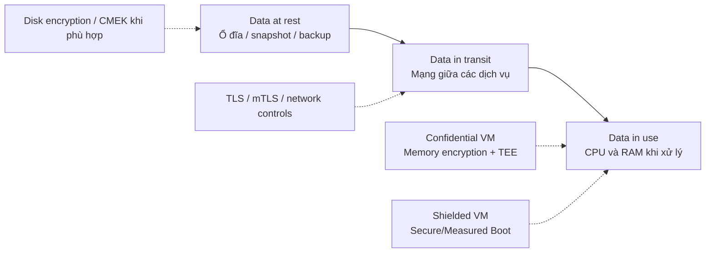
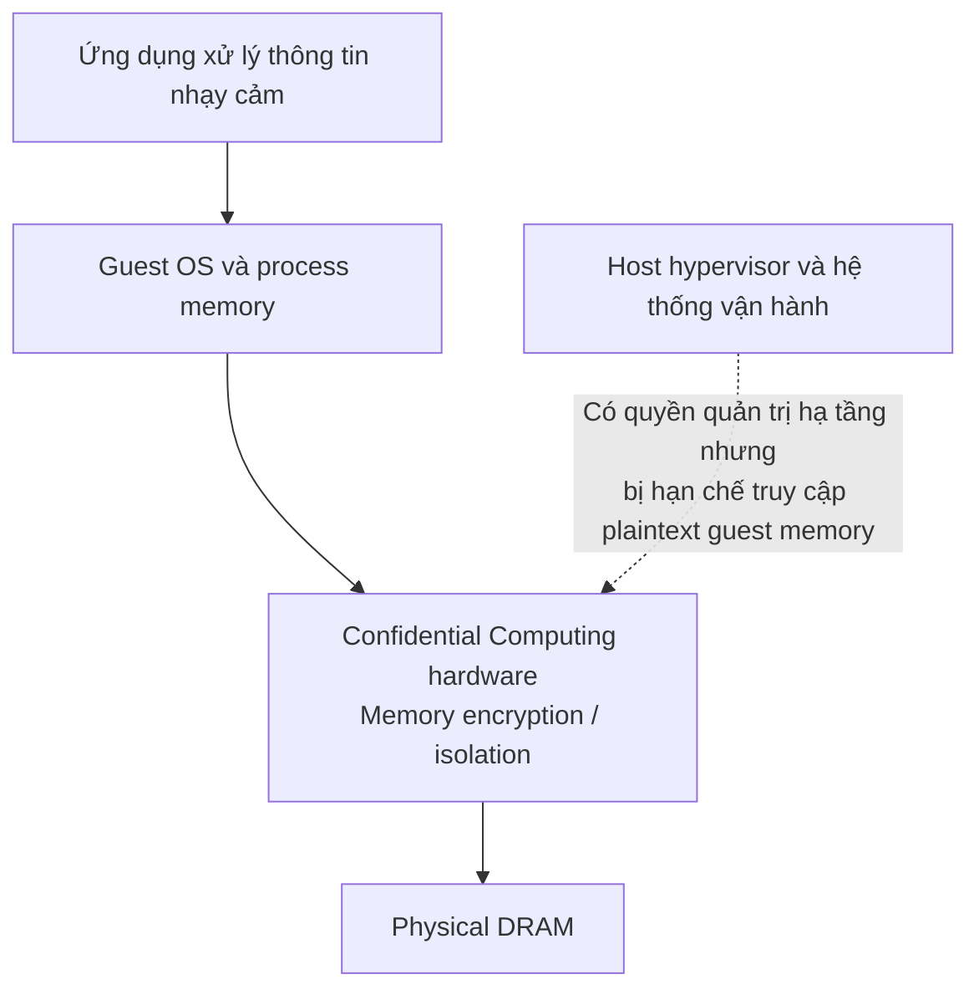
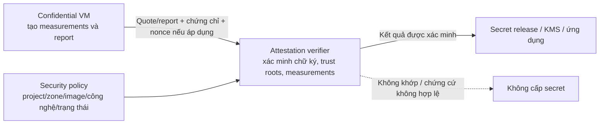
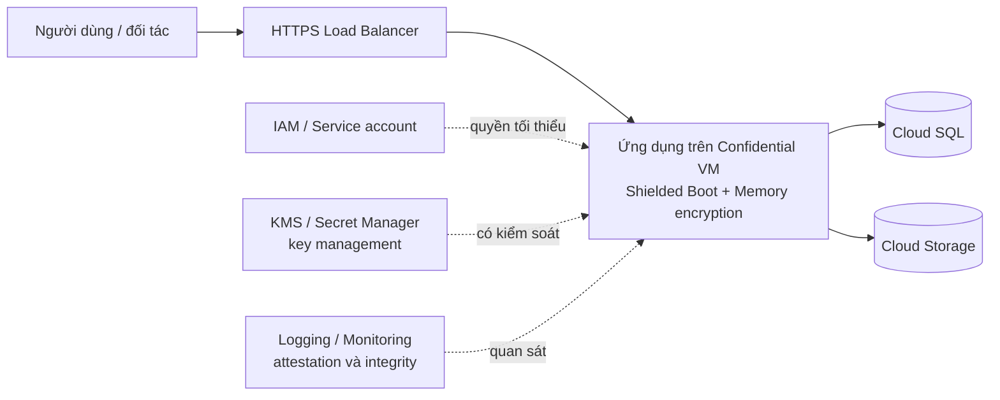

# Shielded VM và Confidential VM

## 1. Vì sao bảo mật máy ảo không chỉ là firewall và IAM?

Giả sử một doanh nghiệp chạy hệ thống xử lý giao dịch trên **Compute Engine**. Đội vận hành đã giới hạn quyền IAM, chỉ mở những cổng VPC cần thiết, đặt HTTPS trước dịch vụ, mã hóa ổ đĩa và sao lưu dữ liệu. Tuy nhiên, vẫn còn hai câu hỏi quan trọng:

1. **Khi máy ảo khởi động, làm sao biết firmware, bootloader và kernel không bị thay đổi trái phép?**
2. **Khi chương trình đang chạy và dữ liệu đã được giải mã trong RAM, công nghệ nào giúp giảm nguy cơ dữ liệu bị đọc từ tầng host/hypervisor?**

Google Cloud có hai tập khả năng liên quan nhưng **không đồng nghĩa**:

- **Shielded VM:** tăng cường tính toàn vẹn và mức độ tin cậy của **chuỗi khởi động** nhờ Secure Boot, virtual Trusted Platform Module (vTPM), Measured Boot và Integrity Monitoring.
- **Confidential VM:** dùng công nghệ **Confidential Computing** do CPU/phần cứng hỗ trợ để **mã hóa bộ nhớ trong lúc xử lý**, giảm một số nguy cơ đến từ tầng hạ tầng bên ngoài guest; đồng thời hỗ trợ cơ chế **attestation** phù hợp với công nghệ CPU.

Hai công nghệ có thể **bổ trợ nhau**. Confidential VM vẫn có những tính năng Shielded VM như vTPM và Integrity Monitoring; bảo vệ bộ nhớ không thay thế việc kiểm tra chuỗi boot. Trong module **CLOUD_PROVIDERS_GCP**, bài học này kết nối **Compute Engine** với IAM, VPC, quản trị tổ chức, Cloud KMS, CI/CD, giám sát độ tin cậy và chi phí.

Sau khi học, bạn có thể:

1. Giải thích threat model và giới hạn của Shielded VM so với Confidential VM.
2. Phân biệt **Secure Boot**, **Measured Boot**, **integrity baseline**, **memory encryption** và **attestation**.
3. Chọn được cấu hình phù hợp theo OS image, machine series, CPU platform, zone, bảo trì host và mức độ bảo vệ mong muốn.
4. Đọc, tạo và chỉnh cấu hình Shielded VM bằng Console/`gcloud` mà không làm gián đoạn production ngoài kế hoạch.
5. Tạo một Confidential VM bằng công nghệ được hỗ trợ, hiểu các ràng buộc về live migration, disk, GPU và khả năng chuyển đổi máy hiện hữu.
6. Đọc tín hiệu integrity, điều tra lỗi Secure Boot và lập quy trình phản ứng an toàn.
7. Kết hợp các lớp bảo vệ với IAM, Organization Policy, network, encryption at rest/in transit, backup và vận hành ứng dụng.

> **Lưu ý thực hành:** Mọi Project ID, VM, zone và tên tài nguyên trong bài là **ví dụ giả định**. Những lệnh tạo hoặc dừng VM có thể phát sinh phí và gây gián đoạn. Hãy kiểm tra quyền, quota, loại máy, tính sẵn có và phê duyệt trước khi thực thi.

## 2. Phân biệt nhanh: bảo vệ quá trình khởi động và dữ liệu đang sử dụng

| Tiêu chí | Shielded VM | Confidential VM |
| --- | --- | --- |
| **Mục tiêu chính** | Tăng khả năng phát hiện/ngăn chặn thay đổi trái phép ở boot chain | Giảm khả năng truy cập dữ liệu và mã của guest trong **bộ nhớ đang sử dụng** từ tầng bên ngoài |
| **Công nghệ nền** | UEFI Secure Boot, vTPM, Measured Boot, Integrity Monitoring | AMD SEV, AMD SEV-SNP, Intel TDX; với cấu hình GPU được hỗ trợ có thêm công nghệ liên quan GPU |
| **Secure Boot** | Kiểm tra chữ ký thành phần boot và có thể ngăn boot nếu chữ ký không hợp lệ | Có thể dùng như một lớp bổ sung nếu image/cấu hình hỗ trợ |
| **vTPM** | Lưu các phép đo boot, hỗ trợ TPM 2.0 | Vẫn được cung cấp; có thể dùng cho boot measurement và attestation tùy loại Confidential Computing |
| **Integrity Monitoring** | Đối chiếu boot measurements với baseline | Có, giúp giám sát boot; attestation phần cứng có thể cung cấp bằng chứng bổ sung |
| **Mã hóa RAM bằng CPU TEE** | **Không phải mục đích** của Shielded VM | **Có**, với cơ chế và bảo đảm cụ thể theo loại CPU |
| **Phạm vi máy hỗ trợ** | Nhiều image/machine configurations của Compute Engine | Chỉ các CPU, machine types, OS images và zones được liệt kê |
| **Phí tính năng** | Không thu phí riêng cho Shielded VM | Có **phụ phí Confidential VM** ngoài chi phí Compute Engine theo bảng giá hiện hành |
| **Ảnh hưởng vận hành** | Secure Boot có thể chặn driver/kernel không được ký; baseline có thể thay đổi sau update | Có thể hạn chế loại disk, machine, live migration và một số tính năng; cần đo hiệu năng |
| **Thay thế IAM/VPC/TLS/backup?** | **Không** | **Không** |

**Một câu dễ nhớ:** Shielded VM quan tâm **“máy ảo có khởi động theo chuỗi mã mong đợi không?”**; Confidential VM quan tâm thêm **“dữ liệu và mã trong bộ nhớ guest được cách ly khỏi một số rủi ro từ host như thế nào?”**.

### Ba trạng thái của dữ liệu



Sơ đồ thể hiện **các lớp bảo vệ bổ trợ**, không có nghĩa Shielded VM trực tiếp mã hóa data in use. Encryption at rest không còn đủ cho dữ liệu vừa được CPU/ứng dụng giải mã trong RAM; Confidential Computing nhắm vào khoảng rủi ro đó.

## 3. Shielded VM hoạt động như thế nào?

### 3.1. UEFI Secure Boot: kiểm tra chữ ký trước khi chạy

**Secure Boot** dựa trên UEFI và danh sách khóa/chứng chỉ được tin cậy. Trong lúc boot, firmware kiểm tra chữ ký các thành phần như bootloader và mã cấp thấp theo chuỗi boot. Thành phần không có chữ ký hợp lệ có thể bị từ chối chạy, giúp hạn chế bootkit và một số rootkit tồn tại qua lần khởi động lại.

Điều cần hiểu:

- Secure Boot **không mặc định bật** cho mọi Shielded VM mới vì một số kernel modules, drivers hoặc phần mềm boot không được ký có thể không tương thích.
- Trên các image hỗ trợ, **vTPM và Integrity Monitoring thường bật mặc định**, nhưng **Secure Boot cần bật rõ ràng**.
- Secure Boot **không phải antivirus** và không đảm bảo toàn bộ chương trình userspace không có lỗ hổng.
- Một kernel module tự biên dịch, driver GPU hoặc bootloader tùy biến có thể làm VM **không khởi động** khi bật Secure Boot. Phải kiểm tra image và drivers trước.
- Đối với Windows, cần theo dõi các cập nhật **Microsoft Secure Boot certificates** theo khuyến cáo của nhà cung cấp để tránh lỗi liên quan đến vòng đời chứng chỉ.

Khi Secure Boot chặn một thành phần, serial console có thể cho thấy thông báo gần dạng `UEFI: Failed to load image` và `Status: Security Violation`. Đây là tín hiệu để điều tra boot chain, **không phải lý do mặc định tắt Secure Boot vĩnh viễn**.

### 3.2. vTPM và Measured Boot: ghi lại điều đã được nạp

**Virtual Trusted Platform Module (vTPM)** là thiết bị TPM ảo tương thích TPM 2.0. Với **Measured Boot**, mỗi thành phần boot được đo (hash), các phép đo được nối tiếp vào **Platform Configuration Registers – PCRs**. Chúng phản ánh những thành phần đã nạp và thứ tự nạp.

```text
Firmware / UEFI
      ↓  measurement
Bootloader
      ↓  measurement
Kernel + boot drivers
      ↓  measurement
PCR values / boot measurements trong vTPM
      ↓
Integrity Monitoring so sánh với baseline đáng tin
```

**Phân biệt hai hành vi:**

- **Secure Boot** có thể **ngăn** thành phần không đáp ứng chữ ký được phép chạy.
- **Measured Boot** ghi nhận **cái gì đã được nạp**; bản thân phép đo không tự từ chối mọi thành phần.

vTPM cũng có thể hỗ trợ những tác vụ như bảo vệ/niêm phong (*sealing*) secret gắn với trạng thái TPM. Việc dùng secret sealing đòi hỏi thiết kế ứng dụng và kiểm soát khôi phục khóa; không mặc định mọi secret của VM đều tự được seal vào vTPM.

### 3.3. Integrity Monitoring: so sánh với baseline

Khi VM Shielded khởi động lần đầu, hệ thống thiết lập **integrity policy baseline** từ trạng thái boot được tin tưởng ban đầu. Những lần boot sau tạo phép đo mới và so với baseline:

- **Early Boot Validation:** phần từ UEFI firmware đến khi chuyển điều khiển sang bootloader.
- **Late Boot Validation:** phần từ bootloader tới giai đoạn khởi động kernel tương ứng.

Nếu phép đo không khớp, Google Cloud tạo **integrity validation failure**, cung cấp thông tin qua **Cloud Logging** và **Cloud Monitoring**. Sự thay đổi này **có thể là cập nhật kernel hợp lệ**, nhưng cũng có thể là dấu hiệu xâm nhập hoặc thay đổi trái phép.

> **Không nhấn “learn new baseline” ngay khi thấy alert đỏ.** Phải tìm nguyên nhân; nếu cập nhật là hợp lệ và đã được xác minh mới ghi nhận baseline mới. Việc nhận một boot state bị xâm nhập làm baseline chuẩn sẽ che khuất vấn đề.

## 4. Mặc định và quan hệ phụ thuộc giữa các tùy chọn

| Tùy chọn Shielded VM | Trạng thái phổ biến khi tạo VM hỗ trợ | Chú ý |
| --- | --- | --- |
| **Secure Boot** | Tắt theo mặc định | Nên bật sau khi kiểm thử bootloader, kernel và drivers |
| **vTPM** | Bật | Nếu tắt vTPM, **Integrity Monitoring cũng bị tắt** |
| **Integrity Monitoring** | Bật | Phụ thuộc phép đo từ vTPM / Measured Boot |

Cấu hình thực tế có thể bị chi phối bởi **image, chính sách Organization Policy và lựa chọn của người tạo VM**. Luôn dùng `gcloud compute instances describe` để xác nhận thay vì suy từ mặc định.

### Quyền IAM liên quan

| Thao tác | Permission thường liên quan | Nguyên tắc |
| --- | --- | --- |
| Xem VM và Shielded config | `compute.instances.get` | Cấp quyền đọc theo project/resource phù hợp |
| Tạo VM | `compute.instances.create` cùng quyền phụ trợ | Không bắt buộc cấp Owner chỉ để tạo VM |
| Sửa Shielded options | `compute.instances.updateShieldedInstanceConfig` | Yêu cầu kiểm soát thay đổi và dừng VM |
| Thay integrity baseline | `compute.instances.setShieldedInstanceIntegrityPolicy` | Hạn chế quyền này vì có thể che trạng thái boot không mong muốn |
| Bật ràng buộc toàn tổ chức | Quyền quản trị Organization Policy | Nên đi qua review, không trao cho mọi workload administrator |

## 5. Tạo và kiểm tra Shielded VM với gcloud

Giả sử sử dụng **project** `acme-security-lab`, **zone** `asia-southeast1-a` và image Linux hỗ trợ Shielded VM. Một VM test có thể được tạo như sau:

```bash
# Có thể phát sinh chi phí: chỉ chạy trong project lab được phép
gcloud compute instances create shielded-demo \
  --project=acme-security-lab \
  --zone=asia-southeast1-a \
  --machine-type=e2-standard-2 \
  --image-project=ubuntu-os-cloud \
  --image-family=ubuntu-2404-lts-amd64 \
  --shielded-secure-boot \
  --shielded-vtpm \
  --shielded-integrity-monitoring \
  --no-address
```

**Giải thích:** `--shielded-secure-boot` bật Secure Boot; vTPM và Integrity Monitoring được chỉ rõ để bài tập dễ đọc. `--no-address` không gán external IPv4, nhưng VM không mặc nhiên có internet egress; để cài package có thể cần Cloud NAT hoặc đường mạng khác.

Nếu tài khoản không có quyền, zone không hỗ trợ cấu hình hoặc image thay đổi, lệnh sẽ thất bại. Không tự bỏ các cờ bảo mật rồi kết luận “bài lab đã đúng”.

### Xem cấu hình bằng lệnh chỉ đọc

```bash
gcloud compute instances describe shielded-demo \
  --project=acme-security-lab \
  --zone=asia-southeast1-a \
  --format="yaml(name,status,machineType,shieldedInstanceConfig,shieldedInstanceIntegrityPolicy)"
```

Trong `shieldedInstanceConfig`, kiểm tra những giá trị như:

```yaml
shieldedInstanceConfig:
  enableSecureBoot: true
  enableVtpm: true
  enableIntegrityMonitoring: true
```

Đây là **mảnh đầu ra minh họa**, không phải toàn bộ kết quả thực từ một project. Khi dùng Google Cloud Console: **Compute Engine → VM instances → VM details → Security** để kiểm tra các mục tương ứng.

### Đổi tùy chọn trên VM đã tồn tại

Muốn thay Shielded options, tài liệu yêu cầu **dừng VM trước khi cập nhật**:

```bash
# Thao tác có gián đoạn: chỉ thực hiện theo change window
gcloud compute instances stop shielded-demo \
  --project=acme-security-lab \
  --zone=asia-southeast1-a

# Cập nhật cấu hình boot sau khi VM đã dừng
gcloud compute instances update shielded-demo \
  --project=acme-security-lab \
  --zone=asia-southeast1-a \
  --shielded-secure-boot \
  --shielded-vtpm \
  --shielded-integrity-monitoring

gcloud compute instances start shielded-demo \
  --project=acme-security-lab \
  --zone=asia-southeast1-a
```

Với một VM production, phải cân nhắc downtime, thay đổi IP, backend load balancer, trạng thái ứng dụng và cơ chế bảo vệ dữ liệu trước khi stop/start. Đặc biệt, nếu VM dùng boot image hoặc drivers không tương thích Secure Boot, VM có thể không lên được sau khi bật.

### Nếu VM không boot được sau khi bật Secure Boot

1. Dùng **serial console output** và logs để xác nhận nguyên nhân; tìm dấu hiệu lỗi xác minh chữ ký.
2. Kiểm tra bootloader, kernel và drivers đã cài; đối chiếu thay đổi gần nhất.
3. Theo quy trình khôi phục được duyệt, **dừng VM**, có thể tạm dùng `--no-shielded-secure-boot` để boot và sửa lỗi.
4. Sau khi cập nhật kernel/driver được ký phù hợp, **bật lại Secure Boot** và xác minh hoạt động.

Tắt vĩnh viễn để “sửa lỗi nhanh” không đạt mục tiêu hardening. Trong một số môi trường đặc thù phải dùng unsigned driver, cần ghi nhận risk exception, phạm vi và biện pháp bù trừ.

## 6. Vận hành Integrity Monitoring và baseline đúng cách

### 6.1. Xem sự kiện và metrics

Trên Console:

1. Mở **Compute Engine → VM instances**, chọn VM đang bật Integrity Monitoring.
2. Mở phần **Logs** để xem các bản ghi boot integrity.
3. Mở **Monitoring → Metrics Explorer**, chọn resource **VM instance** rồi metric **Early Boot Validation** hoặc **Late Boot Validation**.
4. Tạo alert khi giá trị validation chuyển sang thất bại, có runbook xử lý cho đội bảo mật và vận hành.

Trong Cloud Logging, những sự kiện hữu ích gồm `earlyBootReportEvent`, `lateBootReportEvent`, `startupEvent`, `shutdownEvent`, `updateShieldedInstanceConfig` và `setShieldedInstanceIntegrityPolicy`.

Ví dụ truy vấn **chỉ đọc** để xem integrity log:

```bash
gcloud logging read \
  'logName="projects/acme-security-lab/logs/compute.googleapis.com%2Fshielded_vm_integrity"' \
  --project=acme-security-lab \
  --limit=20 \
  --format="table(timestamp,severity,jsonPayload)"
```

Trường `policyEvaluationPassed` trong bản ghi early/late boot có thể cho biết phép đo có khớp baseline hay không. Xem thêm `actualMeasurements`, `policyMeasurements` và thông tin PCR trong bản ghi. Không suy luận từ một PCR đơn lẻ nếu chưa hiểu thành phần tương ứng.

### 6.2. Sau cập nhật kernel hợp lệ

Một đợt cập nhật kernel/driver được phê duyệt có thể thay đổi giá trị đo boot. Quy trình:

1. Kiểm tra nguồn bản cập nhật, chữ ký và ticket thay đổi.
2. Dùng môi trường canary để cập nhật và reboot.
3. Đọc integrity failure và so sánh measurements; phân biệt thay đổi dự kiến với dấu hiệu đáng ngờ.
4. **Chỉ sau khi xác minh trạng thái mới đáng tin**, ghi nhận baseline mới:

```bash
# Đổi integrity policy baseline, cần quyền riêng và bằng chứng review
# VM phải đang chạy theo hướng dẫn của Google Cloud
gcloud compute instances update shielded-demo \
  --project=acme-security-lab \
  --zone=asia-southeast1-a \
  --shielded-learn-integrity-policy
```

5. Kiểm tra sự kiện integrity sau thay đổi, theo dõi lại alert và lưu bằng chứng audit.

**Quan trọng:** cập nhật baseline **không giống tắt cảnh báo**. Nếu VM thực sự đã bị xâm nhập, baseline mới có thể biến trạng thái xấu thành “bình thường”; hãy dùng runbook sự cố và điều tra trước.

## 7. Confidential VM: mã hóa dữ liệu trong RAM bằng công nghệ CPU

Một VM bình thường thường dựa vào các cơ chế phần mềm/hypervisor và cơ sở hạ tầng vật lý để cô lập memory. **Confidential VM** bổ sung **hardware-based memory encryption và Trusted Execution Environment (TEE)** để giảm khả năng lớp bên ngoài guest đọc nội dung guest memory.



Trong một trường hợp được hỗ trợ, phần cứng giúp dữ liệu của VM được bảo vệ **khi đang nằm trong RAM**, ngay cả khi tầng host có những quyền quản trị hạ tầng nhất định. Bảo đảm cụ thể khác nhau giữa **AMD SEV, AMD SEV-SNP, Intel TDX** và các cấu hình GPU.

**Confidential VM không có nghĩa:**

- Không ai bên trong **guest OS** có thể đọc dữ liệu; tiến trình có quyền/root hoặc lỗ hổng trong guest vẫn rất quan trọng.
- Mọi side-channel hoặc mọi tấn công phần cứng đều đã bị loại bỏ.
- Dữ liệu gửi ra network hoặc ghi xuống disk tự động được bảo vệ theo đúng threat model trong mọi kịch bản; vẫn phải dùng TLS và encryption at rest.
- Bất kỳ CPU/zone/image/VM cũ nào cũng bật Confidential Computing bằng một công tắc.
- Không cần quản lý secrets, IAM, bản vá OS, audit và backup.

### Bảo mật bổ trợ chứ không triệt tiêu lớp hiện có

Khi workload cần bảo vệ dữ liệu cá nhân hoặc thông tin thương mại nhạy cảm, các lớp thường gồm: **IAM least privilege**, VPC/firewall, **Shielded Boot/Integrity**, **Confidential VM**, TLS/mTLS, disk encryption/CMEK nếu phù hợp, quản lý khóa/bí mật và kiểm soát truy cập dữ liệu ở ứng dụng.

## 8. So sánh AMD SEV, AMD SEV-SNP và Intel TDX

| Công nghệ | Cơ chế và mục tiêu chính | Attestation | Giới hạn cần đọc |
| --- | --- | --- | --- |
| **AMD SEV** | Mã hóa guest memory với hỗ trợ AMD Secure Processor | Google-managed vTPM và các bằng chứng liên quan; cơ chế xác thực riêng của SEV | Không có đầy đủ bảo vệ memory integrity như SEV-SNP |
| **AMD SEV-SNP** | Mở rộng SEV với bảo vệ phần cứng chống một số kiểu can thiệp hypervisor như memory remapping/replay | Attestation report có thể yêu cầu từ AMD Secure Processor, kiểm tra bằng chứng phần cứng | Chọn đúng N2D/AMD Milan và zone/OS được hỗ trợ; không mặc định có live migration |
| **Intel TDX** | Tạo **Trust Domain** cô lập bộ nhớ/CPU guest, có hardware-based measurements | Báo cáo từ Intel TDX module, ví dụ MRTD/RTMR; có cơ chế attestation theo TDX | Chỉ những machine series/image/zone phù hợp; live migration có giới hạn |

**So sánh an ninh cần bám threat model**, không mặc định “SNP luôn tốt hơn TDX” hoặc ngược lại. SEV-SNP và TDX có những khác biệt về measurement, loại báo cáo và phần cứng tin cậy; hãy chọn theo yêu cầu ứng dụng và khả năng kiểm chứng bằng chứng của hệ thống nhận secrets.

### Gợi ý hỗ trợ machine series theo tài liệu hiện hành

| Machine series (ví dụ) | Công nghệ Confidential Computing được liệt kê | Chú ý vận hành |
| --- | --- | --- |
| **N2D (AMD Milan)** | SEV hoặc SEV-SNP | **SEV** có thể live migrate; **SEV-SNP** thường yêu cầu host maintenance policy `TERMINATE` |
| **C2D (AMD Milan)** | SEV | Không mặc định có live migration |
| **C3D (AMD Genoa)** | SEV | Hỗ trợ live migration cho cấu hình được liệt kê |
| **C4D (AMD Turin)** | SEV | Xem giới hạn hiệu năng networking và maintenance |
| **C3 / C4 Intel tương thích** | TDX | Kiểm tra type cụ thể, image, disk và vùng |
| **A3 H100 / G4 RTX Pro GPU** | Một số tổ hợp TDX/SEV với NVIDIA Confidential Computing | Có điều kiện GPU/driver/license và chi phí riêng |

**Đây không phải danh sách mọi machine type.** Cấu hình hỗ trợ thay đổi theo thời gian. Google Cloud có danh sách theo **machine type, CPU, OS image, zone, disk type, GPU, vNIC và provisioning model**; cần kiểm tra [Supported configurations](https://cloud.google.com/confidential-computing/confidential-vm/docs/supported-configurations) trước khi chọn.

### Live migration khác nhau thế nào?

**Phần lớn Confidential VM không hỗ trợ live migration**. Theo tài liệu hiện hành, **N2D và C3D chạy AMD SEV** là các trường hợp hỗ trợ live migration. Nhiều cấu hình khác như SEV-SNP hoặc TDX phải chọn xử lý sự kiện host maintenance bằng **terminate/stop** (và cân nhắc tự khởi động lại theo chính sách).

Đừng áp một lệnh `--maintenance-policy=MIGRATE` cho mọi Confidential VM. Một workload có SLO cao phải thiết kế **nhiều VM, nhiều zone, load balancing, replicated data** thay vì kỳ vọng host maintenance hoàn toàn không gây gián đoạn.

## 9. Tạo Confidential VM có cấu hình cụ thể

Giả sử đội bảo mật chọn **AMD SEV-SNP** để xử lý một tác vụ nhạy cảm. Một ví dụ tương ứng hướng dẫn chính thức dùng N2D tại `us-central1-a` và Ubuntu được hỗ trợ:

```bash
# Có thể phát sinh phí. Chỉ chạy khi project/zone/quota đã được phê duyệt.
gcloud compute instances create confidential-demo \
  --project=acme-security-lab \
  --zone=us-central1-a \
  --machine-type=n2d-standard-2 \
  --min-cpu-platform="AMD Milan" \
  --confidential-compute-type=SEV_SNP \
  --maintenance-policy=TERMINATE \
  --image-project=ubuntu-os-cloud \
  --image-family=ubuntu-2404-lts-amd64 \
  --no-address
```

**Ý nghĩa các cờ đặc thù:**

- `--confidential-compute-type=SEV_SNP` chỉ định công nghệ Confidential Computing.
- `--machine-type=n2d-standard-2` và `--min-cpu-platform="AMD Milan"` chọn tổ hợp phần cứng phù hợp với ví dụ.
- `--maintenance-policy=TERMINATE` phù hợp giới hạn live migration của SEV-SNP.
- `--image-family=ubuntu-2404-lts-amd64` chọn image gia đình đã được hướng dẫn cho cấu hình tương thích. Khi dùng image khác, cần kiểm tra hỗ trợ.
- `--no-address` bỏ external IPv4; nếu muốn SSH, cấu hình OS Login/IAP và firewall phù hợp.

**Không chạy lệnh này nếu `us-central1-a` không phù hợp yêu cầu data residency.** Một ví dụ kỹ thuật có zone được hỗ trợ không đồng nghĩa được phép đưa dữ liệu khách hàng tới region đó. Phải chọn zone vừa đáp ứng chính sách dữ liệu vừa hỗ trợ công nghệ cần dùng.

### Dùng Google Cloud Console

1. Vào **Compute Engine → VM instances → Create instance**.
2. Chọn **Region/zone, machine family, machine type** có hỗ trợ Confidential VM.
3. Trong phần **Security → Confidential VM service**, bật và chọn **AMD SEV, AMD SEV-SNP hoặc Intel TDX** theo khả năng tương thích.
4. Kiểm tra những thay đổi Console gợi ý với **machine type, image, NIC, on-host maintenance**; không chỉ bấm xác nhận mà bỏ qua thông báo.
5. Rà lại boot disk, VPC, service account, SSH/OS Login, Shielded options, firewall, IAM và chi phí trước khi Create.

### Kiểm tra bằng lệnh chỉ đọc

```bash
gcloud compute instances describe confidential-demo \
  --project=acme-security-lab \
  --zone=us-central1-a \
  --format="yaml(name,status,machineType,confidentialInstanceConfig,shieldedInstanceConfig,scheduling)"
```

Kết quả cần thể hiện cấu hình Confidential Computing đã chọn, Shielded options và maintenance policy phù hợp. **Lệnh describe xác nhận cấu hình do Compute Engine ghi nhận**, chưa thay thế việc **xác minh remote attestation** khi ứng dụng có threat model đòi hỏi bằng chứng mật mã.

### Có thể bật Confidential VM cho VM cũ không?

**Không thể biến một VM Compute Engine hiện có thành Confidential VM chỉ bằng update flag.** Theo tài liệu hỗ trợ, muốn dùng Confidential VM phải **tạo VM mới** có machine type/image/công nghệ tương thích.

Di chuyển một workload hiện hữu thường cần:

1. Kiểm kê VM, OS image, boot disk, data disks, startup scripts, instance metadata và phụ thuộc mạng.
2. Xác định tính tương thích của hệ điều hành, filesystem và driver với Confidential VM (ví dụ yêu cầu **NVMe**, không dùng SCSI theo điều kiện sản phẩm).
3. Thiết kế cách di chuyển dữ liệu có mã hóa, khôi phục secrets và cấu hình service account.
4. Tạo VM mới, kiểm thử, xác minh security properties rồi cutover bằng load balancer/DNS hoặc orchestration phù hợp.
5. Có phương án rollback và quy trình xóa/sanitize các tài nguyên cũ theo chính sách dữ liệu.

## 10. Attestation: không chỉ “bật công tắc Confidential VM”

**Attestation** là quy trình thu thập và kiểm chứng bằng chứng cho thấy VM đang chạy trong môi trường được kỳ vọng. Mục tiêu là hỗ trợ một **bên xác minh** quyết định có tin trạng thái VM và có nên cấp secrets hoặc cho phép xử lý dữ liệu nhạy cảm hay không.

### 10.1. Thành phần của quy trình



Quy trình đúng gồm:

1. VM lấy **attestation report/quote** từ nguồn được hỗ trợ.
2. Bên xác minh kiểm tra **chữ ký, certificate chain, measurements**, tuổi của bằng chứng và challenge/nonce khi yêu cầu.
3. So với **policy do tổ chức đặt ra**: công nghệ phải đúng, image đáng tin, môi trường không có trạng thái debug bị cấm, danh tính VM/cấu hình phù hợp.
4. Chỉ khi đạt mới cho phép một hành động nhạy cảm, ví dụ cấp một khóa phiên để giải mã dữ liệu.

**Chứng thực thành công không tự động tạo IAM grant** hoặc đảm bảo code userspace không có bug. Việc phát hành secret phải do hệ thống và policy riêng thực thi.

### 10.2. Bằng chứng khác nhau giữa công nghệ

| Cấu hình | Nguồn attestation nổi bật | Phạm vi dữ liệu đo |
| --- | --- | --- |
| **AMD SEV** | Google-managed **vTPM** | Bằng chứng đo boot chain; cơ chế gắn với SEV |
| **AMD SEV-SNP** | **AMD Secure Processor**; có thể kết hợp vTPM | Hardware/firmware measurement và thông tin trạng thái TEE |
| **Intel TDX** | **Intel TDX module**, có thể kết hợp vTPM cho tính năng TPM | MRTD và RTMR của trust domain; các phép đo chain tương ứng |

Trong Google Cloud, **Go-TPM tools** và các công cụ vendor có thể lấy evidence; một số trường hợp sử dụng **Google Cloud Attestation** để xác minh. Tuy nhiên, tính năng Google Cloud Attestation và các kiểu report được hỗ trợ **không giống nhau** cho mọi SEV/SEV-SNP/TDX/GPU. Xem tài liệu attestation cụ thể thay vì chỉ giả định có một nút “Verify” dùng cho mọi cấu hình.

### 10.3. Phân biệt alert integrity và attestation

- **Shielded Integrity Monitoring:** so boot measurements với baseline, phát hiện **sự thay đổi** trên một VM; có thể tạo alert trong Logging/Monitoring.
- **Confidential VM attestation:** cung cấp **evidence có thể kiểm chứng** về TEE/boot/hardware tùy công nghệ để một verifier **khác** quyết định tin cậy theo policy.

Một phép so sánh baseline thành công **không** tự chứng minh VM đáp ứng mọi tiêu chuẩn phần cứng Confidential Computing. Ngược lại, có report TEE hợp lệ **không** đồng nghĩa ứng dụng đã được cấp đúng IAM hoặc các secret bên trong guest đều an toàn.

## 11. Tích hợp các lớp bảo vệ vào kiến trúc ứng dụng

Giả sử một công ty xử lý hồ sơ khách hàng trên Compute Engine, lưu file ở Cloud Storage và metadata trong Cloud SQL:



Một thiết kế có trách nhiệm cần:

**IAM và danh tính**

- Cấp service account riêng cho VM và quyền tối thiểu tới Cloud Storage/Cloud SQL/Secret Manager.
- Hạn chế principal có `compute.instances.setMetadata`, `compute.instances.setServiceAccount` hoặc quyền quản trị rộng, vì thay đổi startup scripts, image, identity có thể gây rủi ro.
- Dùng OS Login, IAP TCP forwarding hoặc phương thức SSH có kiểm soát. Không mở port 22 hoặc 3389 rộng chỉ vì VM là Confidential VM.

**Mạng**

- Đặt VM trong VPC/subnet phù hợp; dùng firewall, IAM và egress control.
- Khi truy cập Cloud SQL, cân nhắc private IP/Private Service Connect theo loại database và cấu hình hỗ trợ.
- Mã hóa **in transit** bằng TLS/mTLS khi cần; memory encryption không thay thế.

**Lưu trữ**

- Compute Engine disk đã có các cơ chế encryption at rest; cân nhắc **CMEK/Cloud KMS** khi cần kiểm soát khóa.
- Confidential VM không tự đảm bảo dữ liệu backup, snapshot hoặc object storage được mã hóa bằng **cùng một key/policy**.
- Chọn đúng loại disk được Confidential VM hỗ trợ. Với một số cấu hình, **Confidential mode for Hyperdisk Balanced** là tính năng riêng có yêu cầu và phí bổ sung.

**CI/CD và quản lý image**

- Dùng image được hỗ trợ, có nguồn tin cậy; theo dõi bản vá bootloader, kernel và dependency.
- Kiểm thử Secure Boot và driver trong canary trước khi triển khai production.
- Nếu sử dụng attestation để cấp secrets, phải kiểm tra sự thay đổi image/kernel có làm measurements khác với policy kỳ vọng hay không.

### Những dịch vụ nào được bảo vệ?

Một ứng dụng trên **Confidential VM** không biến tự động **Cloud SQL, Cloud Storage, Cloud Run** thành Confidential Computing workloads. Mỗi dịch vụ có mô hình bảo vệ riêng; khi dùng **Confidential GKE Nodes** hoặc Confidential Computing cho GPU, cần xem sản phẩm và điều kiện hỗ trợ riêng.

## 12. Organization Policy: biến baseline bảo mật thành guardrail

Trong một Organization nhiều project, không nên chỉ mong mỗi người tạo VM nhớ bật đúng tùy chọn. **Organization Policy** có những constraints liên quan:

| Constraint | Mục đích | Chú ý |
| --- | --- | --- |
| `constraints/compute.requireShieldedVm` | Yêu cầu VM mới tạo dùng Shielded VM image và các tính năng Shielded theo quy định | Tác động chủ yếu lúc tạo; không nên hiểu đây là cơ chế khóa vĩnh viễn mọi tùy chọn sau tạo |
| `constraints/compute.requireConfidentialVm` | Yêu cầu VM Compute Engine **mới tạo** dùng Confidential VM khi constraint được enforce | Có thể thu hẹp machine types/zones/image được phép tạo và ảnh hưởng CI/CD |

Theo tài liệu của constraint `requireShieldedVm`, nó yêu cầu **Secure Boot, vTPM và Integrity Monitoring lúc tạo VM**, nhưng Secure Boot **có thể được tắt sau khi tạo** ở những trường hợp được cho phép. Do đó Organization Policy không thay thế **kiểm tra drift** hoặc việc review quyền `updateShieldedInstanceConfig`.

### Triển khai chính sách an toàn

1. Kiểm kê những workload cần exception: legacy image, custom kernel, GPU, hạn chế machine series hay region.
2. Đặt policy ở **Folder hoặc Project thử nghiệm** trước khi mở rộng Organization.
3. Xem tác động lên instance templates, Managed Instance Groups, GKE nodes và CI/CD; các dịch vụ managed có đặc tính riêng.
4. Sử dụng policy simulator/dry-run nếu loại constraint có hỗ trợ.
5. Thử tạo VM hợp lệ và không hợp lệ để xác minh guardrail.
6. Theo dõi lỗi provisioning, quota, chi phí và drift sau triển khai.

**Không bật constraint requireConfidentialVm trên toàn Organization mà chưa kiểm kê vùng và loại máy.** Một số máy ảo hoặc dịch vụ phụ thuộc có thể không được tạo vì thiếu tổ hợp Confidential Computing tương thích.

## 13. Vận hành hiệu năng, độ tin cậy và bảo trì host

### 13.1. Khả năng tương thích quan trọng hơn tên tính năng

Trước khi triển khai, cần rà lại các chiều sau:

| Chiều kiểm tra | Shielded VM | Confidential VM |
| --- | --- | --- |
| OS image | Image phải hỗ trợ UEFI/Shielded features | Image phải nằm trong danh sách hỗ trợ của loại SEV/SNP/TDX |
| Driver/kernel | Secure Boot có thể chặn module không ký | Cần kernel/driver tương thích công nghệ memory encryption và disk/NIC |
| Machine type | Nhiều series được hỗ trợ | Chỉ series/type được công bố |
| Region/zone | Theo vị trí VM thông thường | Có thể bị giới hạn theo công nghệ, CPU platform và quota |
| Disk | Theo Compute Engine và tính năng tương thích | Có ràng buộc interface/disk type; tài liệu nêu **NVMe**, không hỗ trợ SCSI |
| GPU/TPU | Tùy machine type và boot settings | Một số tổ hợp GPU được hỗ trợ; **TPU không hỗ trợ gắn vào Confidential VM** |
| Host maintenance | Theo series/type | N2D/C3D với SEV có thể live migrate; nhiều cấu hình khác phải terminate |
| Snapshot/backup | Phụ thuộc cấu hình disk/sản phẩm | Vẫn cần backup, encryption và test restore như workload thường |

### 13.2. Độ sẵn sàng cao khi không hỗ trợ live migration

Với Confidential VM phải terminate khi có host maintenance, quy trình vận hành phải tránh giả định “một VM luôn sống”:

- Triển khai **nhiều instance ở nhiều zone** khi ứng dụng hỗ trợ.
- Dùng load balancer/health checks để chuyển traffic khỏi backend không khỏe.
- Lưu state trong dịch vụ được thiết kế chịu lỗi, hoặc replication/consensus phù hợp; không dựa vào RAM cục bộ như nguồn dữ liệu duy nhất.
- Cấu hình restart behavior, bảo trì và rolling updates dựa trên tài liệu machine series.
- Kiểm thử mất VM, mất zone, stop/start và khôi phục secret sau khi attestation.
- Đo p95/p99 latency, CPU, memory, disk/network throughput và tỷ lệ lỗi khi chọn Confidential VM thay cho VM thường.

**Mã hóa bộ nhớ có chi phí hiệu năng và vận hành tiềm tàng**, thay đổi tùy workload/công nghệ CPU. Tài liệu nêu nhiều trường hợp AMD SEV có overhead nhỏ, nhưng không được suy ra tất cả cấu hình GPU, TDX và SNP có tác động như nhau.

## 14. Chi phí: phần bảo vệ nào được tính thêm?

Theo trang giá Google Cloud:

- **Shielded VM:** không thu thêm phí riêng cho việc sử dụng các tùy chọn Shielded VM.
- **Confidential VM:** thường có **phụ phí** ngoài Compute Engine dựa trên vCPU, bộ nhớ, công nghệ Confidential Computing và mô hình sử dụng. Các tổ hợp GPU có phụ phí/license riêng tùy loại.
- Các khoản **VM compute, boot disk/data disk, networking, image license, snapshots, Logging/Monitoring, KMS, GPU và egress** vẫn cần được tính trong dự toán tùy cấu hình.

### Công thức dự toán minh họa

Không cố định đơn giá trong bài vì giá thay đổi theo machine type/region/consumption model:

```text
Tổng chi phí dự toán
 = Compute Engine base compute
 + Confidential Computing surcharge (nếu chọn Confidential VM)
 + disk / snapshot / image license
 + network / load balancer / egress
 + logging, monitoring và dịch vụ phụ thuộc nếu phát sinh
 - discounts / credits hợp lệ theo cách tính của chương trình
```

Đối với phụ phí dựa trên vCPU và RAM, có thể dự toán ý tưởng:

```text
Phụ phí Confidential VM (ví dụ mô hình theo giờ)
 = số vCPU × số giờ tính phí × phụ phí/vCPU-giờ
 + số GiB RAM × số giờ tính phí × phụ phí/GiB-giờ
```

Đây là **mô hình học cách đọc đơn vị tính phí**, không phải công thức đầy đủ cho mọi Confidential VM/GPU và không dùng để tính giá thực khi chưa tra bảng SKU. Dùng [Confidential VM pricing](https://cloud.google.com/confidential-computing/confidential-vm/pricing), [Compute Engine pricing](https://cloud.google.com/compute/all-pricing) và Pricing Calculator tại thời điểm ra quyết định.

**Đánh đổi đáng đo:** chi phí Confidential Computing có thể được biện minh khi nó giảm rủi ro dữ liệu cho workload nhạy cảm. Nhưng không nên bật mặc định mọi nơi chỉ vì tên nghe an toàn hơn; cần xác định threat model, tuân thủ, workload và năng lực vận hành.

## 15. Tình huống 1: hardening VM vận hành thông thường

Một doanh nghiệp chạy dịch vụ nội bộ trên Compute Engine, sử dụng Ubuntu image phổ biến, không cần bảo vệ dữ liệu in-memory khỏi host theo yêu cầu hợp đồng. Đội bảo mật muốn giảm nguy cơ bootkit và phát hiện thay đổi kernel bất thường.

**Đề xuất phân tích:**

1. Dùng image hỗ trợ Shielded VM; giữ **vTPM và Integrity Monitoring** bật.
2. Bật **Secure Boot** trong canary, xác minh các drivers/kernel có chữ ký.
3. Cấu hình Cloud Monitoring alert cho **early/late boot validation failures**.
4. Kiểm soát IAM của người được thay Shielded config và baseline.
5. Đối với kernel update, xác nhận lý do thay đổi measurements trước khi rebaseline.
6. Đồng thời dùng IAM tối thiểu, IAP/OS Login, firewall, backup và giám sát ứng dụng.

Nếu Secure Boot gây lỗi với một driver không ký, đội vận hành cần sửa chuỗi cung ứng phần mềm hoặc quyết định exception minh bạch, không mặc định tắt hết Shielded options.

## 16. Tình huống 2: xử lý dữ liệu nhạy cảm với Confidential VM

Một dịch vụ xử lý dữ liệu tài chính nhận bản ghi từ Cloud Storage, giải mã trong ứng dụng, tính toán rồi ghi kết quả đến Cloud SQL. Tổ chức muốn giảm rủi ro đọc dữ liệu RAM từ host và có bằng chứng về môi trường chạy trước khi cấp khóa giải mã.

**Kiến trúc cần xem xét:**

1. Chọn **Confidential VM** với SEV-SNP hoặc TDX (hoặc SEV theo threat model), căn cứ vào OS, machine type, zone và yêu cầu attestation.
2. Dùng **Shielded features** phù hợp, bao gồm Secure Boot nếu tương thích.
3. Phát hành secret chỉ sau khi verifier xác minh **report/quote và policy**; không tin mỗi flag `confidentialInstanceConfig`.
4. Kết nối tới Cloud Storage/Cloud SQL qua IAM riêng, TLS và đường mạng được kiểm soát.
5. Dùng disk encryption, backups, auditing, kiểm thử phục hồi và lifecycle quản lý khóa.
6. Thiết kế **multi-zone HA** vì cấu hình có thể không live migrate.
7. Theo dõi chi phí Confidential VM, disk/network và cân nhắc performance test.

**Không thể kết luận:** “dữ liệu tài chính hoàn toàn không thể bị đọc trộm”. Confidential VM giảm các rủi ro được định nghĩa trong threat model của phần cứng, nhưng bug ứng dụng, IAM lỏng, secret lộ trong log, memory dump được cho phép hoặc endpoint không mã hóa vẫn có thể làm rò rỉ dữ liệu.

## 17. Troubleshooting thường gặp

| Hiện tượng | Nguyên nhân có thể | Cách xử lý có kiểm soát |
| --- | --- | --- |
| VM không boot sau khi bật Secure Boot | Unsigned kernel/driver hoặc bootloader không được tin | Xem serial console; kiểm tra chữ ký và thay đổi gần đây; tạm tắt Secure Boot theo runbook để sửa rồi bật lại |
| Integrity Monitoring báo failure sau kernel update | PCR values khác baseline | Xác minh change ticket và measurements; chỉ rebaseline khi đã xác nhận trạng thái an toàn |
| Integrity failure không có thay đổi được duyệt | Có thể có sửa boot chain hoặc lỗi khác | Điều tra sự cố, cô lập VM khi cần; **không** tự động reset baseline |
| Không có metrics integrity | Integrity Monitoring tắt, vTPM tắt, thiếu quyền hoặc log/metric chưa xuất hiện | Đọc `shieldedInstanceConfig`, VM status, Cloud Monitoring/Logging và time range |
| Tạo Confidential VM báo machine type không hỗ trợ | Machine series/CPU/zone/OS không hợp lệ | Đối chiếu bảng Supported configurations; chọn tổ hợp được công bố |
| `MIGRATE` bị từ chối | Công nghệ/machine type Confidential VM không hỗ trợ live migration | Chọn `TERMINATE` khi yêu cầu; thiết kế HA/rollout |
| Không chuyển được VM cũ thành Confidential | Chuyển đổi tại chỗ không được hỗ trợ | Tạo VM mới với image/disk tương thích và kế hoạch migration |
| Guest không boot do disk/NIC/driver | Cấu hình Confidential VM có giới hạn NVMe/image/network interface | Kiểm tra disk interface, image/kernel version và trang limitations |
| Lấy attestation report thất bại | Chọn sai công cụ/vendor module, guest kernel thiếu driver hoặc công nghệ chưa hỗ trợ luồng này | Xem AMD SEV/SNP/Intel TDX attestation docs, OS và guest device |
| Attestation hợp lệ nhưng không cấp được secret | Verifier policy không khớp, IAM/KMS thiếu, measurement kỳ vọng đã thay đổi | Kiểm tra report, policy, thời gian, role và key release logic |
| VM reboot hoặc gián đoạn khi host maintenance | Cấu hình phải terminate thay vì live migrate | Kiểm tra maintenance policy, alerts, auto restart, replica và runbook |
| Confidential VM có phí/độ trễ cao | Surcharge, disk/GPU/egress hoặc workload chưa benchmark | Kiểm tra Billing SKU và benchmark theo workload/region |

### Cách điều tra theo lớp

```text
Yêu cầu bảo mật / threat model
    ↓
VM image, machine type, CPU platform, zone
    ↓
Shielded options / Confidential Computing type
    ↓
Boot status, serial logs, integrity reports, attestation
    ↓
IAM, OS Login, VPC/firewall, disk và application logs
    ↓
Quyết định khắc phục + bằng chứng thay đổi + kiểm thử lại
```

Khi gặp lỗi, tránh cấp `roles/owner` hoặc mở public ingress chỉ để “thử xem có chạy không”. Bảo mật boot/memory không thay đổi nguyên tắc **phân quyền tối thiểu và giảm bề mặt tấn công**.

## 18. Bài tập và câu hỏi kiểm tra

### Bài 1: Phân loại yêu cầu

Chọn công nghệ hoặc lớp kiểm soát phù hợp:

1. Muốn phát hiện bootloader thay đổi sau reboot.
2. Muốn ngăn kernel module không được ký khởi động.
3. Muốn bảo vệ dữ liệu giải mã trong RAM khỏi một số rủi ro ở host.
4. Muốn chỉ nhân viên bảo mật được SSH vào VM.
5. Muốn dữ liệu truyền giữa VM và database được mã hóa.

**Gợi ý:** (1) Measured Boot + Integrity Monitoring; (2) Secure Boot; (3) Confidential VM; (4) IAM/OS Login/IAP/firewall; (5) TLS/mTLS theo sản phẩm.

### Bài 2: Phân biệt mặc định

Một VM mới dùng image có hỗ trợ Shielded VM. Có thể khẳng định **Secure Boot chắc chắn bật mặc định** không? Nếu vTPM bị tắt, Integrity Monitoring có còn hoạt động không?

**Đáp án:** Không; Secure Boot thông thường **tắt mặc định** trừ khi có lựa chọn/policy khác. Nếu tắt vTPM, Integrity Monitoring cũng bị tắt.

### Bài 3: Đọc cấu hình VM, không thay đổi tài nguyên

Trên một project được phép xem:

```bash
gcloud compute instances describe VM_NAME \
  --project=PROJECT_ID \
  --zone=ZONE \
  --format="yaml(name,machineType,shieldedInstanceConfig,confidentialInstanceConfig,scheduling)"
```

Hãy ghi:

- Secure Boot, vTPM, Integrity Monitoring đang bật hay tắt?
- `confidentialInstanceConfig` có thể hiện công nghệ Confidential Computing không?
- Maintenance policy có phù hợp với machine type và công nghệ đã chọn không?
- Cần thêm bằng chứng nào để khẳng định VM đáp ứng một chính sách **remote attestation**?

### Bài 4: Điều tra cảnh báo integrity

Một VM báo `lateBootReportEvent.policyEvaluationPassed=false` sau lần reboot lúc 02:00.

1. Liệt kê những dữ liệu cần đọc trước khi thay baseline.
2. Nếu có cập nhật kernel đã được phê duyệt, quy trình cần làm gì?
3. Nếu không có thay đổi được duyệt, vì sao không nên chạy ngay `--shielded-learn-integrity-policy`?

**Gợi ý:** Đọc logs/PCR measurements, ticket thay đổi, image/kernel/driver. Sau khi xác nhận thay đổi hợp lệ mới rebaseline; nếu bất thường phải điều tra/cô lập.

### Bài 5: Chọn công nghệ theo ràng buộc vận hành

Một hệ thống xử lý dữ liệu nhạy cảm phải chịu được lỗi host và không được ngừng dịch vụ lâu. Nhóm muốn dùng SEV-SNP trên N2D nhưng cũng yêu cầu **live migration**. Hãy giải thích xung đột và đưa ra hai hướng giải quyết.

**Gợi ý:** SEV-SNP trên N2D không có live migration theo bảng hỗ trợ; hoặc điều chỉnh mục tiêu công nghệ/hardware/threat model (nếu được chấp nhận), hoặc thiết kế replicas đa zone, health check, replicated state và failover để chịu gián đoạn host.

### Bài 6: Dự toán chi phí (số giả định)

Một Confidential VM giả định chạy 2 vCPU, 8 GiB RAM trong 100 giờ. Giả sử phụ phí **học tập**, không phải đơn giá Google Cloud:

- 0,006 USD/vCPU-giờ.
- 0,0008 USD/GiB-giờ.

```text
Phụ phí CPU    = 2 × 100 × 0,006  = 1,20 USD
Phụ phí RAM    = 8 × 100 × 0,0008 = 0,64 USD
Tổng phụ phí giả định             = 1,84 USD
```

Tại sao đây **không phải tổng chi phí VM**? Vì còn compute cơ bản, disk, networking, image/GPU/license, logging và các điều kiện giá thực tế.

## 19. Checklist triển khai production

- [ ] Xác định rõ threat model: **boot integrity** hay **memory confidentiality**, hay cả hai.
- [ ] Image/OS hỗ trợ Shielded và driver/kernel tương thích với Secure Boot.
- [ ] vTPM + Integrity Monitoring được bật; Secure Boot đã được kiểm thử khi cần.
- [ ] Có baseline đáng tin, alert early/late boot và runbook xử lý bất thường.
- [ ] Quyền sửa Shielded config và rebaseline được kiểm soát riêng.
- [ ] Nếu dùng Confidential VM: chọn đúng **SEV / SEV-SNP / TDX**, machine type, CPU, zone và OS hỗ trợ.
- [ ] Đã kiểm tra disk interface, GPU (nếu có), NIC, maintenance policy và các hạn chế cấu hình.
- [ ] Không cố bật Confidential VM bằng cách update máy hiện hữu; có migration plan khi cần.
- [ ] Nếu có yêu cầu remote attestation, thiết kế verifier/policy/secret release và kiểm thử bằng chứng thật.
- [ ] Không dùng Confidential Computing để thay thế IAM, VPC, TLS, KMS, patching, backup và audit.
- [ ] Đã kiểm thử kernel update, restart, mất VM/mất zone, failover và quy trình khôi phục.
- [ ] Đã xem Organization Policy và nguy cơ phá CI/CD/quota khi enforce trên diện rộng.
- [ ] Đã dự toán phí Compute Engine, Confidential VM surcharge, disk/network/monitoring và GPU/license nếu có.
- [ ] Có người chịu trách nhiệm đánh giá sự cố integrity/attestation và phê duyệt rollback.

## 20. Tài liệu Google Cloud chính thức

Các tính năng, machine types, regions, mức giá và giới hạn có thể thay đổi. Tra cứu tài liệu tại **thời điểm triển khai**:

1. [About Shielded VMs](https://cloud.google.com/compute/docs/about-shielded-vm)
2. [Shielded VM overview – Secure Boot, vTPM, Measured Boot](https://cloud.google.com/compute/shielded-vm/docs/shielded-vm)
3. [Modifying Shielded VM options](https://cloud.google.com/compute/shielded-vm/docs/modifying-shielded-vm)
4. [Monitoring integrity on Shielded VMs](https://cloud.google.com/compute/shielded-vm/docs/integrity-monitoring)
5. [Confidential VM overview](https://cloud.google.com/confidential-computing/confidential-vm/docs/confidential-vm-overview)
6. [Supported Confidential VM configurations](https://cloud.google.com/confidential-computing/confidential-vm/docs/supported-configurations)
7. [Create a Confidential VM instance](https://cloud.google.com/confidential-computing/confidential-vm/docs/create-a-confidential-vm-instance)
8. [Remote attestation overview](https://cloud.google.com/confidential-computing/confidential-vm/docs/attestation-overview)
9. [Confidential VM attestation](https://cloud.google.com/confidential-computing/confidential-vm/docs/attestation)
10. [Monitor Confidential VM integrity](https://cloud.google.com/confidential-computing/confidential-vm/docs/monitor-integrity)
11. [Organization policies for Compute Engine](https://cloud.google.com/compute/docs/access/organization-policies)
12. [Confidential VM pricing](https://cloud.google.com/confidential-computing/confidential-vm/pricing)
13. [Cloud Monitoring and Logging](https://cloud.google.com/monitoring/docs)

**Ghi nhớ:** **Shielded VM** giúp bảo vệ và quan sát **chuỗi khởi động**, còn **Confidential VM** thêm một lớp bảo vệ **dữ liệu đang sử dụng trong RAM** bằng phần cứng được hỗ trợ. Không công nghệ nào là thay thế hoàn chỉnh cho thiết kế IAM, VPC, mã hóa truyền/lưu trữ, cập nhật OS, giám sát, backup và khôi phục. Một lựa chọn đúng phải dựa trên **threat model, khả năng tương thích, bằng chứng kiểm chứng, yêu cầu độ tin cậy và tổng chi phí vận hành**.
