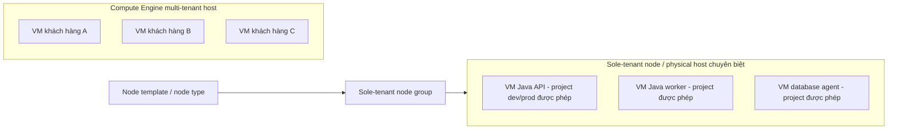
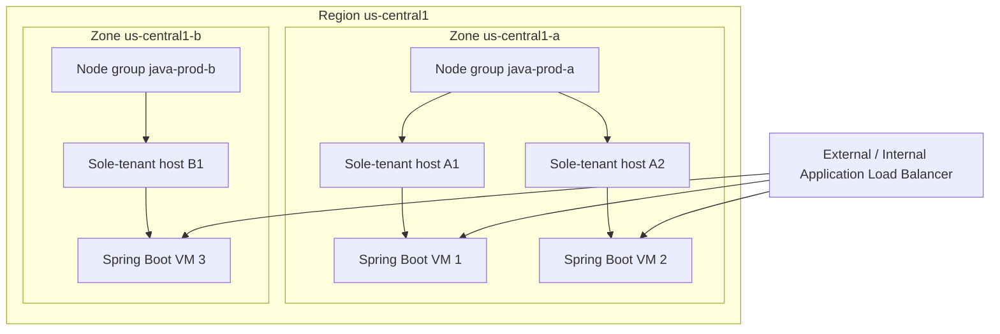
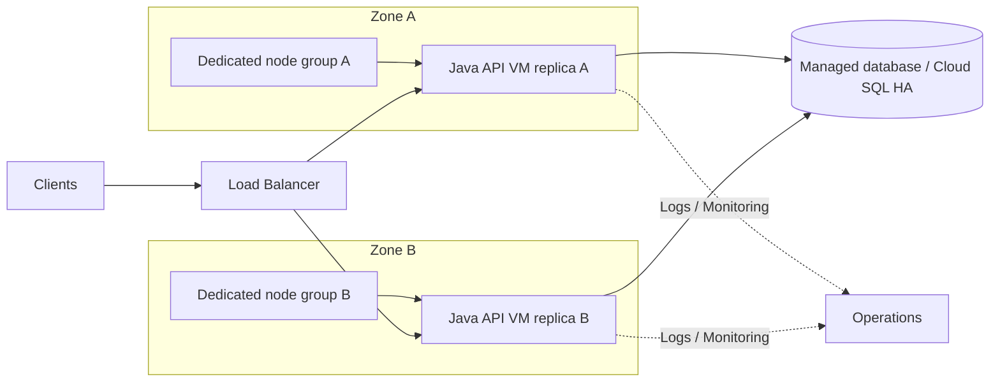
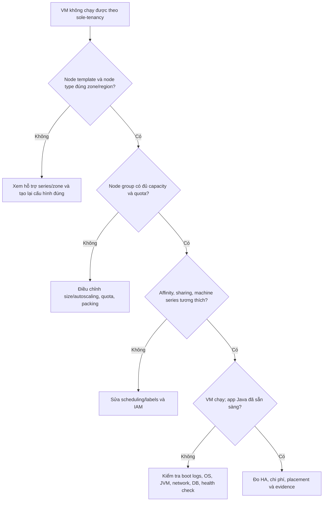

# Sole-tenant nodes và yêu cầu cô lập máy chủ

## 1. Tình huống: khi một VM thông thường chưa đáp ứng yêu cầu về host

Một doanh nghiệp vận hành hệ thống xử lý giao dịch viết bằng **Java/Spring Boot** trên Google Cloud. Phần lớn API có thể chạy trên **Cloud Run** hoặc **GKE**; tuy nhiên, một số thành phần kế thừa phải triển khai trên **Compute Engine** và có yêu cầu đặc biệt:

- Chính sách nội bộ hoặc hợp đồng yêu cầu VM không dùng chung **máy chủ vật lý** với VM của khách hàng bên ngoài.
- Phần mềm thương mại được cấp phép theo **số lõi vật lý** hoặc có điều kiện về việc chuyển VM giữa các máy chủ.
- Nhóm vận hành muốn kiểm soát vị trí tương đối của những VM, tránh đặt chung host giữa môi trường production và thử nghiệm.
- Tải xử lý dữ liệu, hệ thống có trạng thái hoặc workload nhạy cảm hiệu năng cần một kế hoạch quản lý dung lượng host riêng.

**Sole-tenant nodes** của Compute Engine cho phép một khách hàng sử dụng các **physical server chuyên biệt** để chạy VM của mình. Node được ánh xạ **một-một** với máy chủ vật lý bên dưới; các VM của khách hàng khác không được tự ý đặt trên cùng host đó. Đây là **cô lập ở lớp máy chủ vật lý**, khác với việc chỉ tách VPC, subnet hoặc project.

Trong chương **Compute Engine** của mô-đun **CLOUD_PROVIDERS_GCP**, bài này tập trung vào mô hình sole-tenancy, node template, node group, VM placement, host maintenance, license, năng lực dự phòng và chi phí. Mục tiêu là biết **khi nào thực sự cần dedicated host**, triển khai đúng và không nhầm tính năng này với một lời bảo đảm tuân thủ hoặc an toàn tuyệt đối.

### Kết quả học tập

Sau bài này, bạn có thể:

1. Phân biệt **multi-tenant VM**, **sole-tenant node**, **bare metal**, **Confidential VM**, **Shielded VM**, VPC isolation và các dịch vụ serverless.
2. Giải thích chuỗi **node type → node template → node group → VM**, cùng phạm vi region/zone.
3. Lập kế hoạch vCPU/RAM, chọn máy phù hợp, đặt VM bằng **node affinity/anti-affinity** và phân chia node group cho môi trường.
4. So sánh **Default**, **Restart in place** và **Migrate within node group** để cân bằng downtime, độ ổn định host và license.
5. Triển khai ví dụ sole-tenant VM bằng **gcloud**, mô tả cấu hình **Terraform** và xác minh việc đặt VM.
6. Ước tính chi phí **toàn bộ tài nguyên của node + sole-tenancy premium**, kể cả khi VM sử dụng ít công suất.
7. Thiết kế phòng vệ bổ sung bằng IAM, VPC, mã hóa, logging, backup và thử nghiệm bảo trì cho hệ thống Java.

## 2. Sole-tenancy cung cấp sự cô lập nào?

### 2.1. Máy chủ dùng chung và máy chủ chuyên biệt

Trong mô hình Compute Engine thông thường, các VM của nhiều khách hàng có thể được đặt trên cùng hạ tầng máy chủ vật lý, được cách ly bởi lớp ảo hóa và các cơ chế bảo mật nền tảng. Với **sole-tenant node**, một máy chủ vật lý được dành cho các VM của project sở hữu node group hoặc các project trong cùng tổ chức **được chia sẻ rõ ràng** theo cấu hình.



**Đúng phạm vi bảo đảm:** VM của các khách hàng khác không được xếp chung trên **physical server** của sole-tenant node. Tuy nhiên, nếu bạn **chia sẻ node group** cho nhiều project trong tổ chức, VM của các project được phép **có thể cùng chạy trên host đó**. “Sole-tenant” không mặc nhiên nghĩa là **mỗi VM có riêng một máy chủ**, cũng không tự bảo đảm tách VM dev và prod.

### 2.2. Cô lập host không đồng nghĩa cô lập mọi lớp

| Lớp/ràng buộc | Sole-tenant node giúp gì? | Cần thêm gì? |
| --- | --- | --- |
| **Host vật lý** | Dành máy chủ vật lý cho VM thuộc phạm vi sole-tenancy | Cấu hình node group sharing/placement và chứng cứ kiểm toán |
| **Mạng** | Không tự tạo VPC/firewall riêng | VPC, subnet, firewall, Cloud NAT/Private Google Access khi cần |
| **Danh tính** | Không tự phân quyền người dùng hoặc service account | IAM least privilege, OS Login, service account per workload |
| **Dữ liệu** | Không tự mã hóa dữ liệu ở tầng ứng dụng | Disk encryption, CMEK khi cần, TLS, secret management, backup |
| **Hệ điều hành** | Không tự vá Linux/Windows hoặc Java runtime | Image chuẩn, cập nhật bản vá, EDR, kiểm tra lỗ hổng |
| **Ứng dụng Java** | Không tự chống SQLi, rò rỉ token, lỗi authorization | Spring Security, parameterized SQL, rate limits, logs |
| **Khả dụng** | Không tự bảo đảm nhiều zone hoặc DR | Nhiều node groups ở nhiều zone, LB/MIG, dữ liệu sao lưu/replica |
| **Tuân thủ** | Cung cấp một thành phần của yêu cầu cô lập vật lý | Đánh giá chính sách pháp lý/hợp đồng, bằng chứng và kiểm soát liên quan |

Nếu yêu cầu là **ngăn VM lạ ở project khác truy cập ứng dụng**, VPC/IAM/firewall có thể đủ mà không phải thuê cả host. Nếu yêu cầu ghi rõ **“không chia sẻ CPU/máy chủ vật lý với khách hàng khác”**, sole-tenancy mới là ứng viên phù hợp. Nếu cần **kiểm soát trực tiếp hệ điều hành trên bare metal**, cần đánh giá sản phẩm bare-metal tương ứng; sole-tenant node vẫn chạy **Compute Engine VM** trên hypervisor.

## 3. Thành phần tài nguyên và cách chúng liên kết

### 3.1. Node type

**Node type** mô tả năng lực của một physical host, gồm **số vCPU và dung lượng RAM**; một số node types có lựa chọn GPU hoặc Local SSD. Ví dụ `n1-node-96-624` tương ứng **96 vCPU và 624 GB RAM** trên từng node. Không phải mọi node type đều có ở mọi zone, và chỉ những máy VM/machine series tương thích mới chạy được trên node đó.

Chú ý:

- Có thể đặt nhiều VM trên cùng node đến khi hết **vCPU/RAM** hoặc gặp ràng buộc placement/NUMA.
- Node types và machine types phải tương thích theo **series**. Không thể đặt máy bất kỳ lên một node chỉ vì tổng RAM còn đủ.
- Một số dòng máy có yêu cầu tỷ lệ vCPU:RAM, NUMA, GPU hoặc Local SSD đặc thù; đọc phần giới hạn theo series.
- CPU overcommit chỉ được hỗ trợ trên một số loại sole-tenant node và cần đánh giá hiệu năng/phí; **RAM không thể overcommit theo cơ chế CPU này**.
- **Sole-tenant nodes không hỗ trợ preemptible VM**; không lấy bảng giá Spot/preemptible để ước tính VM trên node.

### 3.2. Node template: tài nguyên theo region

**Node template** là cấu hình dùng làm khuôn tạo node group. Nó chứa **node type**, các **node affinity labels** và những thuộc tính bổ sung nếu được hỗ trợ. Template có phạm vi **regional**: cùng một template có thể được dùng để tạo node groups tại nhiều zone thuộc **chính region đó**.

Ví dụ:

```text
Node template: java-prod-template
Region: us-central1
Node type: n1-node-96-624
Custom affinity labels:
  environment=production
  workload=java-api
```

Không đặt template ở region A rồi giả định dùng trực tiếp cho node group của region B. Nếu cần DR cross-region, cần quy hoạch lại template và năng lực node type ở region đích.

### 3.3. Node group: tài nguyên theo zone

**Node group** là tập hợp những sole-tenant nodes cùng node template trong **một zone**. Khi tạo group, chọn kích thước hoặc autoscaling, maintenance policy, sharing settings và tùy chọn cửa sổ bảo trì. Một group có thể có nhiều node, nhưng **không trải qua nhiều zone**.

Một sơ đồ phân bố phục vụ Java API nhiều zone:



Hai zone yêu cầu **hai node groups**. Nếu dùng **regional Managed Instance Group (MIG)** trên sole-tenancy, cần có group tại các zone được chọn, cấu hình node affinities và tuân thủ yêu cầu **target distribution shape = EVEN** được tài liệu Compute Engine nêu cho trường hợp này.

### 3.4. VM placement: node affinity và anti-affinity

Khi tạo VM, có thể chọn **node group** hoặc **node cụ thể** bằng các nhãn:

| Nhãn | Ý nghĩa |
| --- | --- |
| `compute.googleapis.com/node-group-name` | Gắn VM với một node group có tên xác định |
| `compute.googleapis.com/node-name` | Pin VM vào một node cụ thể, khi maintenance policy cho phép |
| Nhãn tùy chỉnh như `environment=production` | Chọn nhóm nodes theo quy tắc nghiệp vụ |
| `NOT_IN` trong affinity rule | Loại một nhóm node có nhãn không mong muốn |

**Affinity** chủ động chọn host/group có thuộc tính phù hợp; **anti-affinity** loại host/group có thuộc tính đã định. Đây là **ràng buộc scheduler**, không tự tạo firewall, không bảo đảm mọi replica nằm ở hai physical hosts khác nhau nếu rule không phản ánh mục tiêu đó.

### 3.5. Chia sẻ giữa các project

Compute Engine hỗ trợ **share node group** cho những project cụ thể trong cùng tổ chức hoặc cả organization. Đây là công cụ tăng hiệu quả sử dụng host, nhưng làm thay đổi tập VM có thể dùng chung server. Theo best practices, nên **chỉ chia sẻ cho các project được phê duyệt** thay vì toàn tổ chức khi có yêu cầu tách môi trường.

Project **sở hữu node group chịu phí host**, dù một số VM thuộc các project được chia sẻ. Vì vậy, nếu nhóm hạ tầng tạo node group trong project nền tảng và nhóm ứng dụng sử dụng từ project Java riêng, cần thỏa thuận **chargeback/showback nội bộ** thay vì chỉ nhìn chi phí VM ở project ứng dụng.

## 4. Khi nào nên chọn sole-tenancy và khi nào không?

| Tình huống | Đánh giá | Phương án cân nhắc |
| --- | --- | --- |
| Hợp đồng yêu cầu host vật lý không chung tenant bên ngoài | **Phù hợp**, nhưng phải xác minh điều khoản cụ thể | Sole-tenant Compute Engine nodes |
| Cần kiểm soát lõi vật lý/di chuyển host vì BYOL | **Có thể phù hợp** | Sole-tenancy + bảo trì tương thích + xác minh license |
| Spring Boot REST API stateless có autoscaling theo request | Sole-tenancy có thể **tốn chi phí nhàn rỗi** | Cloud Run, GKE hoặc multi-tenant VM |
| Cần mã hóa dữ liệu và khóa do khách hàng quản lý | Sole-tenancy **không thay thế mã hóa** | CMEK, TLS, KMS, phù hợp theo service |
| Cần isolation ở mức confidential computing | Sole-tenancy không đồng nghĩa bảo vệ **memory-in-use** theo confidential computing | Đánh giá Confidential VMs và giới hạn tương thích |
| Không muốn VM prod và dev dùng chung host | Cần cấu hình **tách node groups hoặc affinity** | Node groups theo môi trường, sharing chặt |
| Muốn ứng dụng bền vững khi mất một zone | Một host riêng **không đủ** | Node groups đa zone + LB/MIG + storage/DB HA |
| Cần chạy container trên cluster | Phụ thuộc platform và yêu cầu host | Đánh giá GKE Standard và tính năng/node type hỗ trợ; không suy từ Cloud Run |

**Quy tắc quyết định:** trước hết viết yêu cầu thành câu kiểm chứng được, ví dụ: “VM xử lý thanh toán không cùng physical host với VM thuộc tổ chức khác”. Nếu mục tiêu chỉ là **giảm nguy cơ truy cập qua mạng**, dedicated host thường không phải biện pháp trực tiếp và có thể gây tốn kém không cần thiết.

## 5. Quy hoạch dung lượng: thuê host, không chỉ đặt VM

### 5.1. Tính theo tài nguyên node

Giả sử node mẫu `n1-node-96-624` có:

- **96 vCPU** và **624 GB RAM** cho mỗi node.
- Một JVM worker sử dụng VM `n1-standard-8`: **8 vCPU, 30 GB RAM**.
- Tám worker dùng tổng cộng **64 vCPU, 240 GB RAM**.

Tính riêng theo tài nguyên danh nghĩa:

```text
Mức sử dụng vCPU = 8 VM × 8 / 96 = 66,7%
Mức sử dụng RAM  = 8 VM × 30 / 624 ≈ 38,5%
```

Node có thể còn RAM nhưng thiếu vCPU hoặc ngược lại. Ngoài tổng vCPU/RAM, placement có thể bị ràng buộc **NUMA, tỷ lệ vCPU:RAM, kiểu GPU, Local SSD, CPU overcommit và giới hạn machine series**. Do đó “còn 20 vCPU” không bảo đảm scheduler tạo được bất kỳ VM nào.

### 5.2. Hiệu quả sử dụng công suất

| Phương án | Tổng VM cùng node | Hậu quả chi phí |
| --- | ---: | --- |
| Một Spring Boot VM nhỏ duy nhất | 1 | Có thể trả phí cho gần như toàn bộ host mà dùng ít tài nguyên |
| Nhiều Java workers phù hợp | 8 | Tận dụng host tốt hơn, nhưng cần quản trị công suất và rủi ro noisy neighbor nội bộ |
| Tách prod/dev sang hai nhóm riêng | Theo môi trường | Tăng cô lập nhưng giảm tỷ lệ sử dụng tổng thể |
| Hai zone, mỗi zone có host dự phòng | Phân tán | Tăng độ sẵn sàng, tăng chi phí công suất chờ |

**Node group autoscaler** có thể thêm node khi không đủ chỗ đặt VM và bớt node đang trống theo cấu hình; nó **không** có nghĩa Google Cloud chỉ tính phí vCPU thực đang chạy. Nếu giữ số node tối thiểu bằng một hoặc nhiều máy, phần năng lực nhàn rỗi vẫn được tính phí.

### 5.3. Không đồng nhất host capacity với application throughput

Với Spring Boot, đánh giá cả:

- CPU thực sử dụng trong tải đỉnh, garbage collection và thời gian JIT warm-up;
- RAM heap, native memory, page cache và overhead OS/agent;
- số kết nối DB, network bandwidth, disk IOPS và latency;
- số replica cần để chịu lỗi host/zone;
- khả năng scale khi có host maintenance và khi node group đầy.

Tối ưu JVM từ `-Xmx` hoặc giới hạn concurrency có thể giảm số VM cần thiết, nhưng **không làm giảm phí host đang được cấp** nếu không thể giảm số node tương ứng. Mục tiêu là cải thiện **packing và số node sử dụng**, không chỉ giảm CPU của từng process.

## 6. Host maintenance policy: lựa chọn ảnh hưởng tới license và uptime

Google Cloud có ba nhóm chính sách bảo trì host cho sole-tenant node groups. Không nhầm chúng với thiết lập **on-host maintenance** của từng VM.

| Chính sách node group | Khi host cần bảo trì | Ưu điểm | Đánh đổi |
| --- | --- | --- | --- |
| **Default** | VM có thể **live migrate** sang một sole-tenant node khác, tùy VM hỗ trợ và cấu hình | Thường phù hợp workload thông thường cần giảm downtime | Host vật lý có thể thay đổi; cần xem điều khoản BYOL |
| **Restart in place** | VM **dừng** trong lúc host bảo trì, sau đó **khởi động lại trên cùng physical server** | Phù hợp yêu cầu giữ host/cố định lõi vật lý | Có downtime đáng kể; VM cần `onHostMaintenance=TERMINATE` |
| **Migrate within node group** | VM live migrate trong **tập physical hosts cố định** thuộc node group | Giới hạn số host vật lý được sử dụng, phục vụ một số mô hình BYOL | Cần **holdback node** trống, mất công suất, không phù hợp VM không hỗ trợ live migration |

### 6.1. Default: ưu tiên vận hành thông thường

Với những VM hỗ trợ live migration, Compute Engine có thể di chuyển VM sang một sole-tenant host khác trước bảo trì. Host mới vẫn là host **dành riêng** cho phạm vi dự án/nhóm được phép, không phải một máy multi-tenant ngẫu nhiên. Một số VM không hỗ trợ live migration có thể bị **terminate/restart** nếu được cấu hình tự khởi động lại.

Mô hình này hợp lý cho Spring Boot API stateless và workloads không có ràng buộc license gắn với một bộ host cố định. **Live migration giúp giảm gián đoạn, nhưng không thay thế cơ chế chịu lỗi ở lớp ứng dụng.**

### 6.2. Restart in place: giữ host, chấp nhận downtime

Compute Engine dừng VM khi host cần bảo trì và khởi động lại trên **chính host đó** sau bảo trì. Tài liệu nêu có thể cần chấp nhận **khoảng một giờ gián đoạn** với một số tình huống bảo trì; dùng phương án này nếu workflow hoặc hợp đồng license buộc giữ host vật lý.

Ví dụ một Java batch worker chịu được downtime có thể dùng **queue/checkpoint** để tiếp tục công việc. Tuy nhiên API thanh toán trực tuyến yêu cầu SLO cao **không nên chỉ dựa vào một VM Restart in place**; phải có replica trên node/zone khác và thiết kế trạng thái an toàn.

### 6.3. Migrate within node group: host cố định với công suất dự phòng

Phương án này live migrate VM trong nhóm host vật lý đã định. Để có nơi chuyển khi bảo trì, Compute Engine dành **một holdback node cho mỗi tối đa 20 node được reserve**: nhóm 2–20 node cần **ít nhất một node trống** cho live migration. Không dùng chính sách này với VM không hỗ trợ live migration.

Ví dụ nhóm 4 sole-tenant nodes cùng loại, có thể chỉ có **3 node để bố trí workload**, 1 node dành riêng làm holdback theo quy tắc. Chính sách này không cho pin một VM theo **`node-name` cụ thể** khi dùng khả năng migrate within group; dùng **node-group affinity** và các nhãn phù hợp.

### 6.4. Maintenance window và giả lập sự cố

Với một số chính sách, node group hỗ trợ **maintenance window** để giới hạn thời điểm **bắt đầu** bảo trì; không có nghĩa mọi bảo trì kết thúc chính xác trong khung đó. Google Cloud còn có tùy chọn advanced maintenance control cho điều kiện hỗ trợ. **Migrate within node group** không hỗ trợ maintenance window kiểu thông thường theo tài liệu hiện hành.

Khi đánh giá Java workload có trạng thái, nên **giả lập host maintenance event** trong môi trường test được phép, quan sát request error rate, restart, session persistence và mất kết nối DB. Thời điểm host event thực tế không phải lịch để đội phát triển có thể dự đoán tuyệt đối.

## 7. License và tuân thủ: đừng xem sole-tenancy là giấy phép BYOL tự động

Một số hợp đồng phần mềm tính phí theo **physical CPU core/socket**, số host mà VM từng chạy hoặc thời gian tối thiểu giữa các lần chuyển host. Sole-tenancy có thể giúp theo dõi và giới hạn phạm vi host nhưng **không thay đổi điều khoản license do vendor phát hành**.

### 7.1. Câu hỏi cần xác nhận với đội license

1. Sản phẩm/phiên bản nào cho phép **Bring Your Own License (BYOL)** trên public cloud?
2. License dựa trên **vCPU VM**, **physical core**, socket, thiết bị, user hay container?
3. Quy tắc **License Mobility** và điều kiện di chuyển host có áp dụng không?
4. Cần bằng chứng gì: host identity, số node đã chạy, lịch maintenance/migration?
5. Khi đổi số node, autoscale hoặc dùng holdback, có phát sinh license mới không?
6. Đang chạy Windows Server, SQL Server hay middleware nào có yêu cầu riêng đối với Google Cloud?

Không đưa ra kết luận tuân thủ chỉ từ việc CLI tạo node thành công. Đánh giá pháp lý/hợp đồng phải do đơn vị sở hữu license xác nhận, và có thể yêu cầu chứng cứ kiểm toán bổ sung.

### 7.2. Mẫu lựa chọn chính sách theo nhu cầu

| Trường hợp | Lựa chọn sơ bộ | Cần xác minh |
| --- | --- | --- |
| Java app có license theo user và cần uptime | **Default** | VM có live migrate được không, fallback/restart |
| Phần mềm license theo số physical cores, chấp nhận gián đoạn | **Restart in place** | Downtime và yêu cầu giữ nguyên host |
| License per-core cần HA nhưng hạn chế host được sử dụng | **Migrate within node group** | Holdback capacity, số host license, VM migration support |
| Workload GPU hoặc hình thức VM không live migrate được | Tùy hỗ trợ, thường **terminate/restart** | GPU, Confidential VM, Local SSD và giới hạn series |

Những gợi ý này chỉ giúp **thiết kế kỹ thuật ban đầu**, không thay thế điều khoản nhà cung cấp.

## 8. Bảo mật, IAM và phạm vi chia sẻ project

Sole-tenancy không cấp role IAM hoặc access tới hệ điều hành. Cần chia trách nhiệm:

- **Infrastructure team** có quyền tạo template/group, đổi sharing, autoscaling và maintenance policy theo nhiệm vụ.
- **Application team** có quyền tạo/đặt VM trong node groups được phê duyệt, nhưng không tự mở sharing cho project khác.
- **Security/compliance team** xem lịch thay đổi, kiểm toán quyền, gắn nhãn môi trường và đánh giá physical isolation requirement.
- **Runtime service account** của Java app chỉ có quyền cần dùng trên Cloud Storage, Pub/Sub, Secret Manager hoặc dịch vụ liên quan.

Các quyền API quan trọng có thể bao gồm `compute.nodeTemplates.create`, `compute.nodeTemplates.use`, `compute.nodeGroups.create`, `compute.instances.create`, cùng quyền dùng network/subnet, disks, images và service account tùy tác vụ. Thực thi **least privilege** thay vì cấp `roles/owner` cho người thao tác lab.

**Điểm kiểm soát then chốt:** node group shared cho project A/B khiến VM của cả A/B có thể chạy trên cùng host, nếu placement cho phép. Muốn bảo đảm “production không chung host với development”, phải **tách node group/affinity/sharing** và kiểm chứng VM thật được xếp đúng chỗ. Shared VPC chỉ chia sẻ **mạng**; nó không tự tạo hay thay đổi node-group sharing.

## 9. Thực hành gcloud: tạo sole-tenant VM cho Java workload

> **Cảnh báo chi phí:** lệnh tạo **sole-tenant node group** có thể bắt đầu tính phí **toàn bộ vCPU/RAM của host ngay khi cấp node**, kể cả VM chưa được tạo. Chỉ chạy khi project, billing account, quota và quyền đã được phê duyệt. Bài này không tự thực thi các lệnh ngoài môi trường học.

Ví dụ minh họa dùng:

- `PROJECT_ID`: project thử nghiệm đã có billing.
- `us-central1` / `us-central1-a`: region/zone minh họa; **chỉ dùng sau khi kiểm tra node type còn hỗ trợ ở zone đó**.
- `n1-node-96-624`: node type mẫu có thể không phù hợp nếu zone/quota không hỗ trợ.
- `n1-standard-4`: machine type tương thích N1.

### Bước 1 — Kiểm tra quota, zone và node type

```bash
gcloud config set project PROJECT_ID
gcloud services enable compute.googleapis.com

# Liệt kê để xác minh trước khi quyết định tạo node:
gcloud compute sole-tenancy node-types list \
  --zones=us-central1-a

gcloud compute sole-tenancy node-groups list
gcloud compute sole-tenancy node-templates list
```

Kiểm tra quota **sole-tenant nodes / CPU** theo region, sự sẵn có của node type, machine type, địa chỉ IP/subnet và quyền dự án. Nếu dùng Shared VPC hoặc tách project, kiểm tra cả project sở hữu node group và project dùng VM.

### Bước 2 — Tạo regional node template

```bash
gcloud compute sole-tenancy node-templates create java-host-template \
  --region=us-central1 \
  --node-type=n1-node-96-624 \
  --node-affinity-labels=environment=lab,workload=java

gcloud compute sole-tenancy node-templates describe java-host-template \
  --region=us-central1
```

Nhãn `environment=lab` là **affinity label để scheduler đặt VM**; không tự tạo resource label dùng cho billing hoặc firewall. Nếu thay đổi node type, bạn cần xác nhận machine types dùng cho VM cũng tương thích.

### Bước 3 — Tạo zonal node group

```bash
gcloud compute sole-tenancy node-groups create java-host-group \
  --zone=us-central1-a \
  --node-template=java-host-template \
  --target-size=1 \
  --maintenance-policy=default

gcloud compute sole-tenancy node-groups describe java-host-group \
  --zone=us-central1-a

gcloud compute sole-tenancy nodes list \
  --zone=us-central1-a
```

Lab dùng **Default** nên một node là đủ để minh họa placement, **không phải một thiết kế HA cho production**. Nếu chọn `migrate-within-node-group`, phải cấp ít nhất hai nodes và dự phòng holdback, không đổi flag tùy ý khi group đang chạy.

### Bước 4 — Tạo VM trên đúng node group

```bash
gcloud compute instances create java-worker-01 \
  --zone=us-central1-a \
  --machine-type=n1-standard-4 \
  --image-family=debian-12 \
  --image-project=debian-cloud \
  --node-group=java-host-group \
  --no-address

gcloud compute instances describe java-worker-01 \
  --zone=us-central1-a \
  --format="yaml(name,machineType,scheduling,networkInterfaces)"
```

`--no-address` giúp VM **không có external IPv4**, nhưng không tự tạo private subnet, SSH/IAP, NAT hoặc Private Google Access. Nếu cần tải Maven dependencies, container images hay OS patches, hãy thiết kế **đường egress hợp lệ** và bảo vệ outbound traffic. Dùng OS Login/IAP cho admin access thay vì mở SSH Internet mặc định.

### Bước 5 — Kiểm chứng VM thật đã chạy trên sole-tenant node

Kiểm tra cả **scheduling.nodeAffinities** trong thông tin VM và **danh sách VMs của từng sole-tenant node** trong Console/CLI. Ví dụ:

```bash
gcloud compute sole-tenancy nodes describe NODE_NAME_FROM_LIST \
  --zone=us-central1-a

gcloud compute instances describe java-worker-01 \
  --zone=us-central1-a \
  --format="json(scheduling)"
```

Đừng chỉ lấy việc node group tồn tại làm bằng chứng VM đã chạy trên đó. **VM đặt nhầm host hoặc VM khác project dùng chung host** có thể khiến kết luận kiểm toán sai. Ghi nhận tên zone, node group, node type, placement và cấu hình sharing tại thời điểm kiểm tra.

### Bước 6 — Dọn môi trường lab

Khi không còn cần sử dụng, kiểm tra các tài nguyên thực tế đang gắn vào node group rồi xóa **theo thứ tự phụ thuộc**. Ví dụ lab chỉ có đúng một VM:

```bash
gcloud compute instances delete java-worker-01 \
  --zone=us-central1-a

gcloud compute sole-tenancy node-groups delete java-host-group \
  --zone=us-central1-a

gcloud compute sole-tenancy node-templates delete java-host-template \
  --region=us-central1
```

**Không xóa node group dùng chung cho production** nếu còn VM hoặc project khác sử dụng. Lệnh xóa phải được review trong môi trường shared; node và disk/network resources khác có thể có vòng đời/chi phí riêng.

## 10. Node affinity và anti-affinity nâng cao

### 10.1. Tạo VM theo label thay vì chỉ tên group

Khi cần đặt nhiều loại VM lên một số node groups có nhãn riêng, dùng **node affinity file**. Ví dụ một file JSON phục vụ lệnh CLI:

```json
[
  {
    "key": "environment",
    "operator": "IN",
    "values": ["production"]
  },
  {
    "key": "workload",
    "operator": "IN",
    "values": ["java-api"]
  }
]
```

Sau khi tạo template/group có đúng hai label trên, có thể tạo VM:

```bash
gcloud compute instances create java-api-01 \
  --zone=us-central1-a \
  --machine-type=n1-standard-4 \
  --image-family=debian-12 \
  --image-project=debian-cloud \
  --node-affinity-file=node-affinity-prod.json
```

File `node-affinity-prod.json` phải tồn tại trên máy đang chạy CLI và phù hợp với cấu hình thực tế. Đây là **phương án khác** so với `--node-group` ở lab trước, không bắt buộc dùng cả hai. Nếu label quá rộng hoặc nhóm node được chia sẻ, cần thêm điều kiện để không xếp nhầm môi trường.

### 10.2. Anti-affinity cho workload thử nghiệm

Nếu dev/test không được chạy trên nodes gắn `environment=production`, dùng điều kiện:

```json
[
  {
    "key": "environment",
    "operator": "NOT_IN",
    "values": ["production"]
  }
]
```

**Anti-affinity không đủ cho tính bảo mật cấp project:** người có quyền thay đổi template, group sharing hoặc VM scheduling có thể làm thay đổi phạm vi placement. Cần bổ sung IAM và quy trình phê duyệt.

### 10.3. Kết hợp MIG và cân bằng tải

Với API Spring Boot, một **Managed Instance Group** có thể quản lý nhiều VM giống nhau:

- Instance template chứa machine type/image/startup configuration và **node affinities** tương thích với group.
- Zonal MIG đặt VM vào node group của zone; regional MIG cần node groups ở **tất cả zone được chọn**, cùng distribution shape phù hợp.
- Load balancer kiểm tra health và phân phối request tới các VM đang khỏe.
- Đảm bảo capacity node group đủ cho **rolling update, autoscaling, maintenance và khôi phục lỗi**; nếu chỉ đủ chỗ cho VM hiện có, MIG có thể không tạo được replica thay thế.

Không nên giả định **MIG autoscaler** và **node group autoscaler** phản ứng đồng thời. MIG có thể yêu cầu VM mới khi node group chưa kịp bổ sung physical host. Theo dõi tình huống `ZONE_RESOURCE_POOL_EXHAUSTED` hoặc `insufficient capacity` và kế hoạch scale-out.

## 11. Terraform: đưa node templates và node groups vào IaC

Tạo sole-tenant resources bằng Terraform giúp tái tạo cấu hình giữa môi trường và kiểm tra thay đổi qua pull request. Ví dụ mô hình **hai tài nguyên chính**, chưa tạo VM/VPC:

```hcl
variable "project_id" {
  type = string
}

variable "region" {
  type    = string
  default = "us-central1"
}

variable "zone" {
  type    = string
  default = "us-central1-a"
}

variable "node_type" {
  type    = string
  default = "n1-node-96-624"
}

provider "google" {
  project = var.project_id
  region  = var.region
}

resource "google_compute_node_template" "java_host" {
  name      = "java-host-template"
  region    = var.region
  node_type = var.node_type

  node_affinity_labels = {
    environment = "lab"
    workload    = "java"
  }
}

resource "google_compute_node_group" "java_host" {
  name               = "java-host-group"
  zone               = var.zone
  node_template      = google_compute_node_template.java_host.id
  initial_size       = 1
  maintenance_policy = "DEFAULT"
}
```

Trước khi chạy `terraform apply`:

1. Kiểm tra **provider version**, zone/node type availability, quota, billing và quyền.
2. Kiểm tra `terraform plan` xem có thay đổi **node group replacement**, đặc biệt maintenance policy, node template hoặc việc giảm số node đang chạy VM.
3. Không dùng project production làm môi trường lab; tránh đồng thời để CLI và Terraform quản lý các giá trị cùng một tài nguyên mà không cập nhật state.
4. Khi áp dụng production, tham số hóa **sharing settings, size/autoscaling, labels, maintenance strategy**, kiểm soát state và quyền CI/CD.

**Tài nguyên có phí từ lúc được cấp**, ngay cả khi IaC chỉ tạo node group mà chưa tạo VM. Dùng `deletion_policy` phù hợp để tránh việc vô tình xóa group đang dùng; chính sách này cũng cần được review vì có thể ngăn dọn môi trường.

## 12. Chi phí sole-tenancy và cách đánh giá hiệu quả

### 12.1. Khác biệt lớn nhất với multi-tenant VMs

Với VM Compute Engine thông thường, chi phí CPU/RAM thường được tính theo **machine resources** của VM và các thành phần riêng. Với sole-tenant nodes, bạn bị tính phí cho **toàn bộ vCPU/RAM của physical node đã provision**, cộng **sole-tenancy premium**; những VM được xếp trên node **không bị tính thêm vCPU/RAM một lần nữa** theo chính sách node đó.

Theo tài liệu giá của Google Cloud, sole-tenancy premium là **10% chi phí vCPU/RAM cơ sở** trước các khoản discount thích hợp. Ngoài ra, vẫn có thể có phí:

- Persistent Disk/Hyperdisk, snapshot, Local SSD/GPU nếu được cấp;
- OS hoặc image có license trả phí, phần mềm BYOL từ vendor;
- external/static IP, load balancing, network egress, Cloud Logging/Monitoring;
- số node reserve để maintenance hoặc capacity dự phòng;
- chi phí project dùng chung và phí data khác nếu có.

**Không** lấy chi phí VM `n1-standard-4` cộng với chi phí `n1-node-96-624` như thể cả hai khoản vCPU/RAM đều được tính độc lập cho cùng một năng lực.

### 12.2. Công thức ước tính

Đặt `C` là giá CPU+RAM cơ sở của node trong một giờ và `H` là số giờ được tính phí. Khi chưa xét discount:

```text
Chi phí CPU/RAM của node trong kỳ ≈ C × H
Sole-tenancy premium               ≈ 10% × C × H
Tổng phần node                       ≈ 1,10 × C × H
Tổng hệ thống                       = phần node + disk + license + network
                                       + GPU/Local SSD nếu có + dịch vụ khác
```

Ví dụ **giả định để tập tính**, không phải giá GCP hiện hành: nếu `C = 5 USD/giờ` và node chạy `730 giờ` trong tháng, chi phí phần node là:

```text
5 × 730 = 3.650 USD (CPU/RAM cơ sở)
10% × 3.650 = 365 USD (premium giả định)
Tổng node = 4.015 USD/tháng, trước discount/phí khác.
```

Nếu chỉ có **một VM 4 vCPU** nằm trên node **96 vCPU**, bạn vẫn cần tính phí toàn bộ phần host đã cấp, không phải 4/96 hóa đơn. Đây là lý do sole-tenancy chỉ hợp lý khi **giá trị từ cô lập/license/bảo đảm vận hành vượt mức chi phí công suất chờ**.

### 12.3. Sustained use và committed use discounts

Sole-tenant nodes có thể đủ điều kiện cho **sustained use discounts (SUDs)** và **committed use discounts (CUDs)**, nhưng **phần sole-tenancy premium có quy tắc discount riêng**: resource-based CUDs không trực tiếp áp dụng cho premium, trong khi flexible CUDs/SUDs có điều kiện được hỗ trợ theo tài liệu giá. Không coi một CUD mua cho VM tự động bao phủ toàn bộ host và premium.

Khi lập dự toán, hãy lấy đúng **region, node type, thời gian chạy, phần capacity dự phòng, discounts/hợp đồng** từ [Sole-tenant node pricing](https://cloud.google.com/compute/sole-tenant-pricing) và Cloud Pricing Calculator. Kiểm tra ngân sách thực tế trong **Cloud Billing Reports**; tính năng chia sẻ node group đòi hỏi **phân bổ nội bộ** nếu nhiều team cùng hưởng tài nguyên.

## 13. Độ tin cậy và kế hoạch chạy Spring Boot trên dedicated host

### 13.1. Cô lập vật lý vẫn có một failure domain

Nếu một Java API được chạy trên **một host duy nhất**:

- host hỏng → các VM trên host có thể cùng bị ảnh hưởng;
- maintenance với **Restart in place** → cả nhóm VM có thể dừng cùng lúc;
- thiếu dung lượng node → replica mới không có chỗ chạy khi tăng tải;
- node group ở **một zone** → mất zone ảnh hưởng toàn bộ workload.

Để tăng độ tin cậy, cân nhắc ít nhất **hai physical hosts, nhiều zone** theo SLO của hệ thống, health checks, load balancer/MIG, cơ chế triển khai rolling và bảo vệ cơ sở dữ liệu bằng backup/HA. Từng nhóm node chỉ ở một zone, nên cần nhiều nhóm nếu mục tiêu chịu lỗi zone.

### 13.2. Kiến trúc tham khảo



Sơ đồ chỉ minh họa **hai nguồn compute độc lập ở hai zone**. Nếu database là Cloud SQL managed service, sole-tenancy của **VM Java không tự mở rộng** sang physical hosts của Cloud SQL. Nếu yêu cầu tuân thủ bao gồm cả database, phải đánh giá **cơ chế cô lập của từng dịch vụ** riêng.

### 13.3. Java workloads cần chịu bảo trì

Ứng dụng nên có:

- readiness/liveness hoặc health endpoint chính xác cho LB/MIG;
- graceful shutdown và drain request khi được thông báo bảo trì;
- timeout/retry có giới hạn, idempotency khi xử lý giao dịch;
- worker có checkpoint hoặc xử lý message ít nhất một lần;
- DB connection pool có khả năng phục hồi khi TCP connection bị rớt;
- Cloud Monitoring, logging theo cấu trúc và cảnh báo về error rate/latency.

Thử nghiệm **host maintenance simulation** trong môi trường staging được phép và đo thời gian khôi phục ở **lớp ứng dụng**, không chỉ trạng thái node group. Với JVM có heap lớn, đo tác động của restart/warm-up và lưu lượng thực khi một replica rời LB.

## 14. Giám sát, kiểm toán và xử lý lỗi

| Hiện tượng | Nguyên nhân có thể | Hướng kiểm tra |
| --- | --- | --- |
| `node type không khả dụng` | Zone không hỗ trợ series/GPU hoặc quota chưa đủ | `node-types list`, quota và region/zone selection |
| Không tạo được node group | Template không cùng region, IAM thiếu, quota/capacity | `node-templates describe`, API errors, permissions |
| VM báo lỗi placement | Machine series không khớp node, affinity sai, node group đầy | VM scheduling, node group/individual node utilization |
| VM tạo thành công nhưng chạy không đúng host dự kiến | Rule affinity quá rộng, sharing cho project khác | `instances describe`, node assignments, labels |
| Không thể tạo replica mới từ MIG | Không còn capacity hoặc autoscaler node chưa mở rộng | MIG events, node group autoscaler, max-nodes, quota |
| Host maintenance gây downtime | Chọn Restart in place hoặc VM không live migrate được | Node group policy, VM `onHostMaintenance`, event timeline |
| Không thể pin VM vào `node-name` | Policy Migrate within node group hạn chế node-name | Dùng `node-group-name`, kiểm tra maintenance policy |
| Hóa đơn cao dù CPU VM thấp | Phí theo **host đã provision**, số node dư và premium | Billing SKUs, node count, utilization, chargeback |
| Compliance audit không xác nhận được cô lập dev/prod | Node group shared hoặc không có bằng chứng placement | Sharing policy, node/group inventory, IAM audit logs |
| Java app lỗi nhưng node khỏe | Lỗi mạng/DB, JVM GC, disk, auth | Application logs/metrics, network/firewall, DB state |

### Quy trình kiểm tra theo tầng



Khi điều tra sự cố, thu thập **thời điểm thay đổi node group**, sự kiện maintenance, log của VM, IAM audit logs, dữ liệu Billing và metrics ứng dụng. Không suy từ Cloud Logging “VM đã boot” rằng mọi yêu cầu isolated host/licensing đã được thỏa mãn.

## 15. Bài tập và checklist

### Bài A — Phân loại nhu cầu cô lập

Đối với ba workload: (1) API Java stateless, (2) Java batch có license tính theo physical cores, (3) hệ thống xử lý dữ liệu nhạy cảm đòi hỏi tách host khỏi tenant khác, hãy đề xuất **multi-tenant VM, sole-tenant node, Cloud Run hoặc phương án bảo mật khác**. Nêu tối thiểu một yêu cầu phải xác nhận với security/compliance hoặc vendor license trước khi lựa chọn.

### Bài B — Tính toán năng lực và giá

Một node mẫu có 96 vCPU và 624 GB RAM. Mỗi worker Java tiêu thụ 8 vCPU và 30 GB. Với **8 workers**, tính tỷ lệ vCPU/RAM sử dụng và công suất còn lại. Nếu node có giá cơ sở giả định 5 USD/giờ, tính chi phí phần node cho 730 giờ cộng **10% premium giả định**, sau đó so sánh với việc chỉ chạy **2 workers** nhưng vẫn giữ một node.

### Bài C — Tạo node group và đặt VM

Trong project test có billing/quota được phép, chạy danh sách node types, tạo template/group, đặt một VM Debian lên node group bằng `--node-group`; kiểm tra `instances describe` và danh sách VM trên node. **Không cần chạy lab thật** nếu không có quyền/billing: có thể hoàn thành bằng bảng thông số, lệnh mẫu và sơ đồ dự kiến.

### Bài D — Lựa chọn bảo trì

Đội vận hành có hai ứng dụng: API cần HA khi bảo trì và batch engine được cấp phép dựa trên physical cores, chấp nhận downtime. Chọn một trong ba host maintenance policies cho mỗi hệ thống, tính số holdback node nếu sử dụng Migrate within node group, mô tả runbook kiểm thử host maintenance.

### Bài E — Cross-project sharing và kiểm toán

Infrastructure project chia sẻ node group cho hai app projects. Hãy liệt kê IAM quyền cần kiểm tra, nơi phí host xuất hiện, cách phân bổ nội bộ và cách chứng minh VM production không chạy chung host với VM development nếu tổ chức yêu cầu. Thảo luận vì sao sharing toàn organization có thể trái với ràng buộc cô lập môi trường.

### Checklist tự đánh giá

- [ ] Tôi phân biệt được cô lập **physical host** với VPC/IAM, Confidential VM và bare metal.
- [ ] Tôi biết **node type**, **regional template**, **zonal node group** và VM placement.
- [ ] Tôi biết kiểm tra node type theo zone, quota, machine-series compatibility và capacity.
- [ ] Tôi dùng được node group, affinity/anti-affinity, xem placement thực tế.
- [ ] Tôi hiểu điều kiện chia sẻ node group, ranh giới môi trường và project chịu phí host.
- [ ] Tôi so sánh đúng Default, Restart in place và Migrate within node group; hiểu holdback node.
- [ ] Tôi kiểm tra hợp đồng BYOL thay vì suy rằng sole-tenancy tự bảo đảm license.
- [ ] Tôi tính phí **toàn bộ host + premium** và có dự toán disk/license/network.
- [ ] Tôi thiết kế nhiều zone/replica, health checks, backup và ứng dụng Java chịu bảo trì.
- [ ] Tôi có cách xác minh isolation, quan sát sự cố và quản trị thay đổi bằng IaC.

**Kết luận:** sole-tenant nodes hữu ích khi có **yêu cầu kiểm chứng được về máy chủ vật lý**, host affinity hoặc license; chúng **không phải cấu hình mặc định cho mọi Java service**. Quyết định đúng đòi hỏi chọn node type và maintenance policy theo ràng buộc thật, quản lý sharing/affinity để cô lập đúng đối tượng, giữ đủ công suất cho failover và hiểu rằng hóa đơn tính theo **host được cấp**, không chỉ số VM đang sử dụng.

## 16. Tài liệu chính thức để tiếp tục

- [Compute Engine — Sole-tenancy overview](https://cloud.google.com/compute/docs/nodes/sole-tenant-nodes)
- [Create sole-tenant node templates](https://cloud.google.com/compute/docs/nodes/sole-tenancy-node-templates)
- [Create sole-tenant node groups](https://cloud.google.com/compute/docs/nodes/sole-tenancy-node-groups)
- [Provision VMs on sole-tenant nodes](https://cloud.google.com/compute/docs/nodes/provisioning-sole-tenant-vms)
- [Best practices for sole-tenant nodes](https://cloud.google.com/compute/docs/nodes/sole-tenant-best-practices)
- [Share sole-tenant node groups](https://cloud.google.com/compute/docs/nodes/share-node-groups)
- [Autoscale node groups](https://cloud.google.com/compute/docs/nodes/autoscaling-node-groups)
- [Simulate a host maintenance event](https://cloud.google.com/compute/docs/nodes/simulate-host-maintenance)
- [Sole-tenant node pricing](https://cloud.google.com/compute/sole-tenant-pricing)
- [Terraform google_compute_node_group](https://registry.terraform.io/providers/hashicorp/google/latest/docs/resources/compute_node_group)
