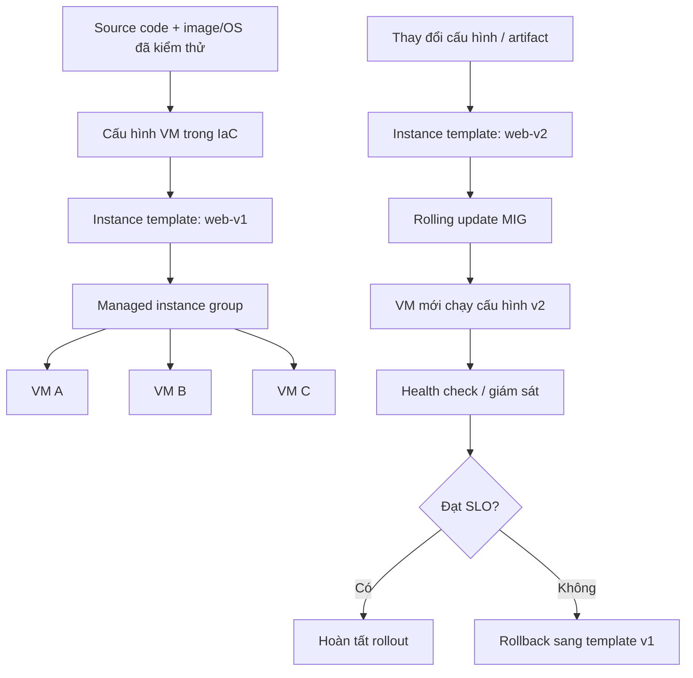
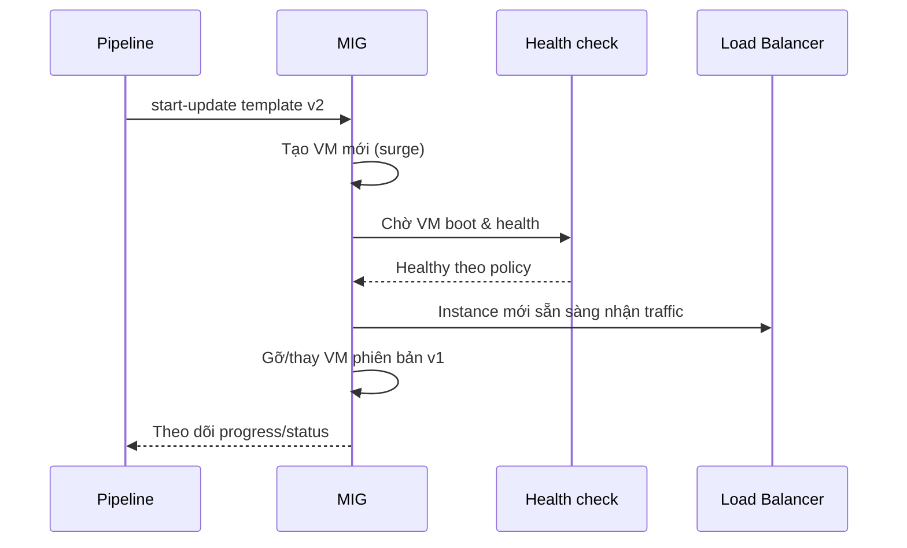

# Instance templates và cấu hình triển khai bất biến

Khi một ứng dụng web chạy trên một máy ảo Compute Engine, việc sửa cấu hình trực tiếp bằng SSH có thể tạm giải quyết một sự cố. Nhưng nếu ứng dụng tăng lên **20 VM**, mỗi VM lại được chỉnh sửa theo thời điểm khác nhau, đội vận hành khó biết máy nào đang chạy phiên bản đúng, mất nhiều thời gian tái tạo sau lỗi và dễ phát sinh **configuration drift**. Trên Google Cloud, **instance template** cung cấp bản khai cấu hình dùng để tạo các VM đồng nhất; kết hợp với **Managed Instance Group (MIG)**, nó là nền tảng cho **triển khai bất biến (immutable deployment)** và tự động mở rộng.

Trong chương **Nhóm máy ảo và tự động mở rộng** của module **CLOUD_PROVIDERS_GCP**, bài học này đi từ cấu trúc template, cách tạo các phiên bản cấu hình đến triển khai theo đợt, cập nhật canary/rolling, rollback, bảo vệ dữ liệu, IAM/VPC, đo độ tin cậy và quản lý chi phí. Kiến thức có thể áp dụng khi chạy ứng dụng trên Compute Engine thay vì chọn GKE hay Cloud Run.

> Project, tên VM, vùng triển khai, bản release, service account và đường dẫn image dùng dưới đây đều là **dữ liệu minh họa**. Các lệnh tạo, cập nhật hoặc xóa tài nguyên có thể gây phí và gián đoạn; chỉ thực thi trong project và cửa sổ thay đổi được cho phép.

## Mục tiêu học tập

Sau bài học, bạn có thể:

1. Giải thích **instance template là bản khai cấu hình VM bất biến**, không phải một VM đang chạy hay một bản backup.
2. Chọn thuộc tính phù hợp trong template: machine type, boot disk/image, network, service account, metadata, labels, tags và scheduling.
3. Phân biệt **global/regional instance templates**, public/custom image, snapshot, machine image và MIG.
4. Tạo và kiểm tra template bằng Console/`gcloud`, sử dụng template để tạo instance hoặc MIG.
5. Áp dụng nguyên tắc **tạo template mới cho mỗi thay đổi**, không chỉnh trực tiếp template hoặc VM đang chạy.
6. Thiết kế rollout/rollback có health checks, **max surge**, **max unavailable**, canary và giới hạn tài nguyên.
7. Nhận diện rủi ro với boot disk, dữ liệu stateful, startup scripts, IAM, network, autoscaling và quota.
8. Quan sát rollout, kiểm tra khác biệt cấu hình và viết runbook triển khai an toàn.

## 1. Instance template giải quyết vấn đề gì?

**Instance template** là tài nguyên Compute Engine ghi lại cấu hình dùng để **tạo VM mới** hoặc làm mẫu cho Managed Instance Group. Template có thể mô tả machine type, disk, image, VPC/subnet, network tags, metadata, startup script, service account, labels, guest accelerator và một số thiết lập scheduling. Sau khi tạo, bạn **không thể sửa nội dung của template đã tồn tại**; muốn thay đổi cấu hình phải **tạo template mới**.

Hình dung quy trình:



Đường nối trên là **mô hình logic**: việc tạo template v2 không tự động khởi động cập nhật cho MIG. Người quản trị hoặc pipeline phải **chọn template mới và khởi chạy hành động cập nhật**.

### Mục tiêu của immutable deployment

Thay vì SSH vào từng VM để nâng phiên bản ứng dụng, đội vận hành:

1. Build artifact và/hoặc machine image mới có phiên bản.
2. Tạo **instance template mới** trỏ đến artifact/config đã được kiểm chứng.
3. Cho MIG **thay dần VM cũ bằng VM mới** theo chính sách rollout.
4. Xác nhận các VM mới healthy và đáp ứng chất lượng dịch vụ.
5. Giữ lại phiên bản template/image cũ trong thời gian cần rollback.

Ưu điểm gồm **dễ kiểm toán, cấu hình nhất quán, có lịch sử thay đổi và giảm việc sửa thủ công**. Tuy nhiên, bất biến ở lớp VM không tự giải quyết migration database, thay đổi schema hoặc dữ liệu ứng dụng; cần chiến lược phát hành riêng cho những thành phần đó.

### So sánh với cấu hình sửa tại chỗ

| Tiêu chí | Sửa trực tiếp VM | Tạo template mới + thay VM |
| --- | --- | --- |
| Lịch sử thay đổi | Thường rải rác ở lệnh SSH/script | Cấu hình có phiên bản trong IaC/template |
| Khả năng tái tạo | Dễ phụ thuộc state trong máy | VM mới có thể được dựng theo template |
| Rollback | Cần script hoàn tác, khó chắc chắn | Có thể quay về template/image trước đó |
| Drift | Cao nếu nhiều người sửa | Thấp hơn nếu ngăn thay đổi thủ công |
| Gián đoạn | Có thể cập nhật tại chỗ nhưng khó quản lý | Kiểm soát qua surge/unavailable và health |
| Chi phí chuyển đổi | Ít máy chạy song song | Có thể tạm tăng VM/CPU/đĩa khi rollout |
| Dữ liệu local | Có thể được giữ giữa các lần sửa | **Có nguy cơ mất khi VM bị thay** |

## 2. Phân biệt template với các tài nguyên liên quan

| Tài nguyên | Lưu gì? | Sử dụng chính | Bất biến? |
| --- | --- | --- | --- |
| **Instance template** | Cấu hình để tạo VM; có tham chiếu image, disk, NIC, metadata… | MIG và tạo VM từ mẫu | Nội dung template không sửa sau khi tạo |
| **VM instance** | Một VM cụ thể ở zone, có trạng thái chạy/dừng và disk | Chạy workload | Có thể cập nhật một số thuộc tính |
| **Public/custom OS image** | Ảnh hệ điều hành hoặc ảnh disk làm nguồn boot | Tạo boot disk | Image version cụ thể là snapshot nội dung theo cách quản lý image |
| **Image family** | Tên logic trỏ đến một image phù hợp/mới hơn trong family | Tiện dùng image mới | **Tham chiếu có thể thay đổi theo thời gian** |
| **Disk snapshot** | Bản sao dữ liệu block disk theo thời điểm | Backup/restore disk | Không mô tả đầy đủ VM/network |
| **Machine image** | Cấu hình instance và dữ liệu disk được hỗ trợ để clone/backup | Khôi phục hoặc tạo VM tương tự | Là loại artifact khác instance template |
| **Managed instance group** | Nhóm VM và chính sách duy trì/sửa chữa/cập nhật | Autohealing, rollout, autoscaling | Có thể cập nhật phiên bản/target size |
| **Unmanaged instance group** | Nhóm các VM tự quản lý | Đưa VM vào backend của load balancer | **Không** tự tạo/thay VM từ template |

**Đừng nhầm "template bất biến" với "mọi VM tạo từ template đều không thể đổi".** Quản trị viên vẫn có thể chỉnh một số cài đặt VM trực tiếp; MIG có thể phát hiện sự khác biệt và thay/recreate tùy hành động, nhưng việc sửa tay tạo ra **drift** không nên là quy trình chuẩn.

### Global và regional instance templates

Instance templates có loại **global** và, khi sản phẩm/công cụ hỗ trợ, loại **regional**. Global templates có thể được tham chiếu khi tạo VM/MIG ở nhiều vùng (nếu image, machine type và cấu hình network tương thích). Regional templates đặt phạm vi tài nguyên template trong một region.

**Không có nghĩa:** một template tự động tạo VM ở mọi region. Vị trí VM được xác định khi tạo VM/MIG; khả năng cung cấp machine type, disk, GPU, subnet, IP và policy phải đúng tại vùng/zone đích.

## 3. Những gì nên nằm trong một instance template?

Một bản template thường gồm:

| Nhóm | Ví dụ thuộc tính | Khuyến nghị |
| --- | --- | --- |
| **Compute** | `machineType=e2-medium` | Right-size từ CPU/RAM thực tế và quota |
| **Boot disk** | Image tự quản lý, disk type, size, auto-delete | Pin image version; đảm bảo OS boot |
| **Data disks** | Disk mới từ image/size, disk gắn kèm được hỗ trợ | Tránh gắn một disk stateful cùng lúc vào nhiều instance |
| **Network** | VPC/subnet, NIC, internal/external IP | Thiết kế ingress/egress/firewall tường minh |
| **Identity** | Service account, OAuth scopes | IAM least privilege, không dùng user credentials |
| **Security** | Shielded VM, confidential settings khi hỗ trợ | Chọn image/capability tương thích |
| **Metadata** | Startup script, bật OS Login, app config không nhạy cảm | Không lưu secrets; script idempotent |
| **Network tags** | `web-frontend` | Dùng firewall policy rõ phạm vi |
| **Resource labels** | `environment=prod`, `release=v2` | Phân bổ owner/chi phí và truy vấn |
| **Scheduling** | Maintenance, automatic restart, Spot provisioning | Theo tính chất workload và SLO |

Template lưu **cấu hình khai báo**, không chứa mọi runtime state. Nó không tự ghi lại dữ liệu RAM, file ứng dụng được tạo sau boot hay token đang dùng trong máy.

### 3.1 Boot image và tính tái lập

Hai chiến lược:

- **Image family**, ví dụ `debian-12`: tiện tự nhận bản OS image mới, nhưng family có thể trỏ đến image khác theo thời gian. **Cùng template không bảo đảm mọi lần tạo VM dùng cùng một bitwise image nếu nguồn thay đổi**.
- **Pin image version/self-link cụ thể**, ví dụ custom image được định danh bằng tên/ID version cố định: giảm thay đổi ngầm và dễ rollback. Build/publish image mới khi cần cập nhật OS.

Với phát hành bất biến có yêu cầu tái lập, nên **pin artifact** tại thời điểm build: image ID/self-link, package version, container digest (nếu VM chạy container), cấu hình có commit SHA, và kiểm thử các bản đó. Không pin chỉ image nhưng startup script lại tải **latest** từ một URL có thể thay đổi.

### 3.2 Baked image hay startup script?

| Phương án | Ưu điểm | Rủi ro | Khi thích hợp |
| --- | --- | --- | --- |
| **Baked image (golden image)** | Boot nhanh, phần mềm được kiểm thử trước, dễ tái lập | Phải xây pipeline cập nhật image và vá OS | Production cần khả năng rollout đồng nhất |
| **Startup script** | Linh hoạt, dễ bootstrap cấu hình đơn giản | Chậm boot, phụ thuộc mạng/repository, script chạy không idempotent | Development hoặc cài đặt bước cuối |
| **Kết hợp** | Image chứa phần mềm lớn; script chỉ inject cấu hình không nhạy cảm | Cần kiểm soát version và secret distribution | Nhiều môi trường dùng cùng image |

Một startup script tải `https://example.com/install-latest.sh` **không đảm bảo bất biến**: ngày mai URL có thể trả một script khác. Với production, pin checksum/commit/tag hoặc dùng Cloud Storage object generation cụ thể và kiểm soát IAM.

### 3.3 Metadata, secrets và danh tính

Metadata server cho VM cung cấp các metadata và credentials ngắn hạn của **service account gắn VM**. Không cho vào template:

- Private key JSON của service account.
- Mật khẩu database, API token hay khóa TLS bí mật.
- Nội dung dữ liệu khách hàng, access tokens hoặc webhook secrets.

Sử dụng Secret Manager cùng IAM tối thiểu; nếu VM cần secrets khi khởi động, thiết kế cơ chế đọc an toàn, audit và rotation. Quyền trên service account phải được kiểm soát riêng với quyền tạo template/MIG.

## 4. Instance templates phối hợp với Managed Instance Group ra sao?

Một **Managed Instance Group (MIG)** lưu thông tin nhóm và template/version hiện hành, rồi dùng chúng để tạo hoặc **recreate** VM khi cần. MIG có thể là:

- **Zonal MIG:** các VM nằm trong một zone; đơn giản hơn nhưng toàn bộ nhóm vẫn phụ thuộc zone đó.
- **Regional MIG:** phân phối VM trên nhiều zone trong một region theo chính sách phân bố; có khả năng chịu lỗi zone tốt hơn khi các điều kiện được đáp ứng.

Các khả năng MIG:

1. **Target size:** duy trì số VM mục tiêu; MIG bổ sung VM nếu thiếu.
2. **Autohealing:** kiểm tra health và recreate những VM không khỏe theo cấu hình.
3. **Rolling update:** thay VM theo phiên bản template mới với chính sách surge/unavailable.
4. **Autoscaling:** điều chỉnh target size dựa trên tín hiệu CPU, load balancing serving capacity, Cloud Monitoring metrics hoặc schedule khi cấu hình được hỗ trợ.
5. **Named ports và load balancing:** cung cấp backend instances cho load balancer; health check xác định traffic được chuyển tới instance phù hợp.

**Quan trọng:** Autoscaling điều chỉnh **số lượng VM**; rolling update thay đổi **cấu hình/phiên bản VM**. Hai quy trình có liên quan nhưng **không phải một**. Tăng replicas không tự cập nhật OS hoặc application release; đổi template không tự điều chỉnh min/max replicas.

### Luồng quản lý vòng đời instance

```text
Instance template v1
      |
      v
MIG target_size = 3
      |
      +--> VM instance A (v1)
      +--> VM instance B (v1)
      +--> VM instance C (v1)

Tạo template v2 --> cập nhật MIG version
      |
      v
Rolling update thay từng VM v1 thành VM v2
      |
      v
MIG target_size = 3, các VM mới chạy v2
```

Nếu không chạy rolling update, việc cập nhật template mà MIG tham chiếu **không nhất thiết làm mọi VM hiện có đổi phiên bản ngay lập tức**. Cần kiểm tra **update policy** và trạng thái triển khai thực tế, không chỉ trường version trong cấu hình nhóm.

## 5. Thiết kế một bản cấu hình VM có thể tái tạo

Ví dụ ứng dụng `retail-web` cần:

| Yêu cầu | Quyết định minh họa |
| --- | --- |
| Project | `retail-prod-01` |
| Region và zone | `asia-southeast1`; chạy zonal MIG trong `asia-southeast1-b` ở lab |
| VPC/subnet | `retail-vpc`, subnet `app-sg` |
| Compute | `e2-medium` |
| OS image | Debian 12, **pin bản image cụ thể khi lên production** |
| Boot disk | `pd-balanced`, 30 GiB, auto-delete |
| External IP | Không cấp trực tiếp; egress qua NAT nếu cần |
| Service account | `retail-web-vm@retail-prod-01.iam.gserviceaccount.com` |
| Application | Build artifact/image được kiểm thử và version hóa |
| Truy cập | OS Login, firewall chỉ nhận traffic cần thiết từ load balancer |
| Logging/monitoring | Ops Agent hoặc exporter phù hợp |
| Availability | MIG + health check; production nên đánh giá regional MIG |
| Release | `retail-web-v1` → `retail-web-v2` bằng rolling update |

### Nguyên tắc về network

Một template chỉ ghi tên subnet không đảm bảo subnet tồn tại hoặc dùng được ở mọi region/Shared VPC. Với multi-project deployment:

- Xác minh project sở hữu subnet; có thể là **Shared VPC host project**.
- Danh tính tạo VM/MIG cần quyền sử dụng subnet ở đúng scope.
- Không mở port 22/80/443 từ Internet trừ khi được yêu cầu; firewall rules/Firewall Policies được tạo và review riêng.
- VM không có external IP có thể cần Cloud NAT, Private Google Access hoặc proxy để tải gói/đọc Google APIs theo đường đi phù hợp.
- Health checks của load balancer có source ranges/requirements tương ứng, cần cấu hình firewall đúng chứ không mở toàn bộ nguồn.

## 6. Tạo instance template qua Console

1. Trong [Compute Engine Console](https://console.cloud.google.com/compute/instanceTemplates), chọn project đúng.
2. Mở **Instance templates** và chọn **Create instance template**.
3. Chọn tên có phiên bản hoặc build ID, chẳng hạn `retail-web-v1`; nếu có lựa chọn global/regional, dùng phạm vi phù hợp kiến trúc.
4. Chọn machine type, boot disk image/size/type; xác minh chính sách auto-delete.
5. Chọn VPC/subnet, external IP có cần hay không, network tags và service account.
6. Chọn security options, metadata, startup scripts/guest configuration phù hợp.
7. Xem lại cấu hình và tạo. **Template được tạo không thể sửa nội dung; thay đổi yêu cầu tạo template mới.**
8. Xem chi tiết template; có thể thử tạo **một VM tạm từ template** trước khi cập nhật MIG production.

Để kiểm tra thực tế, đừng dừng ở việc API chấp nhận template: cần xác nhận VM từ template boot được, app sẵn sàng, traffic/firewall đúng, ghi log, truy cập Cloud APIs theo IAM và không tiết lộ dữ liệu nhạy cảm.

## 7. Các lệnh gcloud: tạo, đọc và dùng template

Lệnh ví dụ chạy ở Bash hoặc Cloud Shell. Chúng chỉ chạy được khi project, VPC, subnet và service account đã tồn tại, có quota và người dùng đủ IAM.

### 7.1 Kiểm tra ngữ cảnh (chỉ đọc)

```bash
PROJECT_ID="retail-prod-01"
TEMPLATE_V1="retail-web-v1"
ZONE="asia-southeast1-b"
MIG="retail-web-mig"

gcloud auth list
gcloud config get-value project
gcloud compute instance-templates list \
  --project="$PROJECT_ID"
```

### 7.2 Tạo một template global minh họa

Lệnh này **thay đổi tài nguyên**. Nó sử dụng `--image-family=debian-12` để minh họa cú pháp dễ hiểu; **môi trường production nên pin image cụ thể** để tránh image family thay đổi theo thời gian.

```bash
gcloud compute instance-templates create retail-web-v1 \
  --project="retail-prod-01" \
  --machine-type="e2-medium" \
  --image-family="debian-12" \
  --image-project="debian-cloud" \
  --boot-disk-size="30GB" \
  --boot-disk-type="pd-balanced" \
  --subnet="app-sg" \
  --no-address \
  --service-account="retail-web-vm@retail-prod-01.iam.gserviceaccount.com" \
  --scopes="cloud-platform" \
  --tags="web-frontend" \
  --labels="environment=prod,release=v1" \
  --metadata="enable-oslogin=TRUE"
```

Không có external IP nghĩa VM mới có thể cần đường egress riêng. `--scopes=cloud-platform` không có nghĩa service account tự có quyền rộng: **IAM roles** vẫn quyết định truy cập và phải cấp ít quyền nhất.

**Lưu ý bất biến:** Lệnh `create` với cùng tên đã tồn tại sẽ không ghi đè template cũ. Muốn đổi machine type, image, metadata hoặc service account, hãy tạo `retail-web-v2` hoặc tên version khác.

### 7.3 Đọc lại template (chỉ đọc)

```bash
gcloud compute instance-templates describe retail-web-v1 \
  --project="retail-prod-01" \
  --format="yaml(name,properties)"
```

Xem `properties.machineType`, `properties.disks`, `properties.networkInterfaces`, `properties.serviceAccounts`, `properties.metadata` và tags. Đường dẫn `sourceImage` hoặc tên family phải tương ứng chủ đích phát hành.

### 7.4 Tạo một VM từ template để thử nghiệm

Đây là bước **tạo VM có thể phát sinh phí**, nên dùng project/staging và vùng đã được cho phép:

```bash
gcloud compute instances create retail-web-smoke-01 \
  --project="retail-prod-01" \
  --zone="asia-southeast1-b" \
  --source-instance-template="retail-web-v1"
```

Sau khi tạo, kiểm tra VM state `RUNNING` **và** app readiness; xem startup/serial logs, firewall, disk, DNS, kết nối database và service account. Xóa VM thử nghiệm theo quy trình chỉ sau khi xác nhận disk/backup/auto-delete.

## 8. Tạo Managed Instance Group từ template

### Zonal MIG cho thực hành

Giả sử template `retail-web-v1` và subnet đã hợp lệ, tạo một zonal MIG ba VM:

```bash
# TẠO MIG VÀ VM, có thể phát sinh phí.
gcloud compute instance-groups managed create retail-web-mig \
  --project="retail-prod-01" \
  --zone="asia-southeast1-b" \
  --template="retail-web-v1" \
  --base-instance-name="retail-web" \
  --size=3
```

Các VM do MIG quản lý có tên được sinh tự động từ base-instance-name và định danh riêng. Không viết automation phụ thuộc vào tên cố định như `retail-web-1` nếu cấu trúc tên/instance có thể đổi khi recreate.

### Xem trạng thái nhóm (chỉ đọc)

```bash
gcloud compute instance-groups managed describe retail-web-mig \
  --project="retail-prod-01" \
  --zone="asia-southeast1-b"

gcloud compute instance-groups managed list-instances retail-web-mig \
  --project="retail-prod-01" \
  --zone="asia-southeast1-b"
```

Đọc các chỉ số target size, phiên bản instance template, instance status và current action (tạo, thay, xóa) nếu có. **Target size = 3 không có nghĩa ngay lúc đó có ba VM đang healthy**; cần đối chiếu health check và trạng thái vận hành.

### Regional MIG

Với production cần chịu lỗi một zone, có thể chọn **regional MIG** phân bổ VM qua nhiều zone trong một region, kết hợp load balancer và health checks. Các zone phải hỗ trợ machine type và có quota/capacity tương ứng; máy cùng nhóm có thể tạm phân bố lệch khi một zone thiếu tài nguyên.

Việc chọn regional MIG **không làm ứng dụng thành multi-region**. Database, persistent state, network và cách khôi phục ở vùng khác vẫn là bài toán riêng.

## 9. Thay đổi cấu hình bất biến: template v2

Giả sử `retail-web-v1` đang dùng `e2-medium`. Sau benchmark, nhóm muốn đổi boot image đã vá bảo mật và tăng RAM. Không sửa template v1:

1. Build/publish image mới hoặc xác nhận image phiên bản cụ thể.
2. Sao chép cấu hình của v1 trong **source control/IaC**, sửa machine type hoặc image.
3. Review diff, IAM/VPC/firewall/boot disk và tác động đến pricing/quota.
4. Tạo **`retail-web-v2`** với metadata/labels mới.
5. Smoke test một VM v2 độc lập.
6. Tạo kế hoạch MIG rollout: surge, unavailable, readiness, rollback.
7. Cập nhật MIG bằng phiên bản v2; giám sát đến khi toàn nhóm healthy.

Một bản cấu hình có thể cần sự thay đổi như:

```yaml
release:
  name: retail-web-v2
  project: retail-prod-01
  region: asia-southeast1
  instance_template: retail-web-v2
  os_image: "PINNED_IMAGE_SELF_LINK_HERE"
  artifact_version: "app-2.3.0+build.481"
  machine_type: "e2-standard-2"
  required_health_check: "HTTP GET /healthz"
  rollout:
    max_surge: 1
    max_unavailable: 0
  rollback_template: retail-web-v1
```

Đây là **bản mô tả release cho con người**, **không phải YAML cấu hình được `gcloud` tự động hiểu**. Một bản rollout chính thức còn cần artifact checksum/commit ID, chủ sở hữu, thời gian, thay đổi schema, rủi ro và phương án quay lại.

## 10. Rolling update: thay VM theo lô có kiểm soát

**Rolling update** thay VM dùng template cũ bằng những VM theo template mới theo nhịp triển khai, thay vì xóa toàn bộ cùng lúc.

Hai thông số quan trọng:

- **`max-surge`:** Số VM **bổ sung vượt target size** mà MIG có thể tạo tạm trong rollout. Tạo thêm VM có thể làm tăng phí, quota và tải dịch vụ phụ thuộc.
- **`max-unavailable`:** Số VM có thể **không sẵn sàng** trong quá trình cập nhật so với target size, theo quy tắc của loại MIG và health policy.

Ví dụ target size 4, `max-surge=1`, `max-unavailable=0`: nhóm có thể tạm chạy đến **5 VM** trong quá trình thay thế; kế hoạch hướng tới giữ số VM sẵn sàng, nhưng **không tự bảo đảm zero downtime** nếu chưa cấu hình health check, readiness, load balancer và ứng dụng phù hợp.



### Khởi chạy cập nhật (thay đổi tài nguyên)

Khi template `retail-web-v2` đã tồn tại và được thử nghiệm:

```bash
gcloud compute instance-groups managed rolling-action start-update retail-web-mig \
  --project="retail-prod-01" \
  --zone="asia-southeast1-b" \
  --version="template=retail-web-v2" \
  --max-surge=1 \
  --max-unavailable=0
```

Đọc tài liệu hiện hành nếu dùng **regional MIG**: cơ chế tính phần trăm/số lượng surge/unavailable, số zone và chính sách update có những ràng buộc riêng. Không bê nguyên `--zone` sang một lệnh dùng `--region` mà không kiểm tra cú pháp.

### Điều kiện cần để rollout an toàn

1. **Health check thật sự kiểm tra readiness** của ứng dụng, không chỉ port 80/443 có mở.
2. Đặt **initial delay** phù hợp cho autohealing để VM mới có đủ thời gian khởi động và khởi tạo dữ liệu.
3. Có cơ chế **drain** kết nối/trạng thái session khi load balancer ngừng gửi traffic.
4. Application nên **stateless** hoặc lưu session/dữ liệu ở Cloud SQL/Cloud Storage và các dịch vụ bền vững.
5. Phải đủ **quota/capacity cho surge**, kể cả IP/boot disk/CPU/SSD/GPU nếu có.
6. Giám sát tỷ lệ 5xx, p95/p99 latency, error budget, CPU, bộ nhớ, network egress và logs trước/sau.
7. Thử rollback khi có thất bại; định rõ ngưỡng tự động dừng rollout hoặc quyết định bằng người.

**Không nhầm health check của MIG autohealing với health check của load balancer.** Chúng có thể phục vụ các mục đích và ngưỡng khác nhau; không nên để một health check nhạy cảm khiến VM bị recreate liên tục vì spike ngắn.

## 11. Canary và phát hành theo phần trăm

Trước khi thay toàn bộ MIG, nhiều đội chọn **canary**: dùng template v2 cho một phần nhỏ số VM, theo dõi trước khi mở rộng.

| Giai đoạn | Mục tiêu | Cổng xác nhận |
| --- | --- | --- |
| 0 — Smoke | 1 VM tách biệt từ template v2 | Boot, API, IAM, mạng, dependency |
| 1 — Canary | Một phần nhỏ VM chạy template v2 | Error/latency/CPU và business metrics tương đương baseline |
| 2 — Rolling | Tăng dần tỷ lệ/phiên bản v2 | Không vượt error budget, health ổn định |
| 3 — Full | Tất cả VM dự kiến ở v2 | Không có instance mắc kẹt ở bản cũ |
| 4 — Cleanup | Giữ artifact rollback đủ thời gian, xóa tài nguyên thử nghiệm | Không làm mất recovery path |

MIG hỗ trợ **multiple versions** và phân bổ target size cho phiên bản canary theo tính năng được hỗ trợ. Tuy nhiên, **canary ở lớp số VM không có nghĩa đúng tỷ lệ request thực tế**: load balancer, locality, sessions, capacity và traffic distribution có thể lệch. Đo bằng request metrics hoặc nếu cần kiểm soát traffic chính xác hơn, chọn kiến trúc load balancer/backends và release routing phù hợp.

Khi một canary dùng 10% VM của MIG nhưng mỗi VM nhận traffic khác nhau, tỷ lệ request đi vào canary có thể không đúng 10%. Bài học chính: **đo đầu ra thực, không suy ra từ phân bố instance**.

### Tín hiệu rollback

Rollback khi có một trong các dấu hiệu đã thống nhất:

- VM mới không boot hoặc không đạt readiness.
- Tỷ lệ 5xx tăng đáng kể; p95 latency vi phạm SLO.
- Có lỗi xác thực, IAM, kết nối database hoặc cấu hình mạng khác với baseline.
- Một thay đổi schema không tương thích phiên bản v1/v2 đang cùng hoạt động.
- Metrics kinh doanh/luồng đặt hàng có sai lệch dù hạ tầng vẫn báo healthy.

Rollback phải trả về **template/image cũ còn sử dụng được**, nhưng không tự đảo ngược **database migration, thay đổi dữ liệu hoặc side effects** mà phiên bản mới đã tạo.

## 12. Rollback bằng một template trước đó

Vì template v1 chưa bị sửa, nó là một điểm tham chiếu hữu ích. Nếu v2 gây lỗi:

1. Dừng/tạm ngừng mở rộng rollout theo quy trình hiện hành.
2. Xác nhận **artifact v1 và image v1** vẫn tồn tại, repository/permission còn hợp lệ.
3. Đánh giá vấn đề database/schema và session để tránh rollback ứng dụng không tương thích.
4. Khởi chạy một bản update mới trỏ MIG về template v1.
5. Theo dõi instance status, health check và SLO, rồi đối chiếu logs và postmortem.

Ví dụ CLI thay đổi tài nguyên:

```bash
gcloud compute instance-groups managed rolling-action start-update retail-web-mig \
  --project="retail-prod-01" \
  --zone="asia-southeast1-b" \
  --version="template=retail-web-v1" \
  --max-surge=1 \
  --max-unavailable=0
```

**Giới hạn quan trọng:** Rollback template chỉ thay/recreate cấu hình VM theo chính sách MIG; **không phục hồi dữ liệu đã bị xóa, cập nhật sai hoặc migrate schema**. Với database, cần backup, quy tắc tương thích ngược và kế hoạch migration/roll-forward riêng.

## 13. Trạng thái dữ liệu: Vì sao stateful workload dễ gặp rủi ro?

Immutable deployment thường thay VM cũ, do đó **dữ liệu chỉ tồn tại trên máy cũ có thể mất**. Phân biệt:

| Dữ liệu | Nên lưu ở đâu? | Khi VM bị recreate |
| --- | --- | --- |
| Binary ứng dụng | Baked image, artifact store, container registry | VM mới có cùng version được pin |
| Configuration không nhạy cảm | Version control, metadata theo template | VM mới nhận bản config đã khai báo |
| Secrets | Secret Manager hoặc hệ quản trị bí mật | VM mới truy cập theo IAM; không embed trong image |
| Session web | External session store/cơ chế stateless | Không phụ thuộc RAM của VM cũ |
| File upload | Cloud Storage hoặc dịch vụ lưu trữ bền vững | Không mất khi một VM bị thay |
| Dữ liệu quan hệ | Cloud SQL hoặc DB có HA/backup | Không nằm trong boot disk của VM |
| Log | Cloud Logging/Monitoring và sink | Không phụ thuộc local log file khi VM bị xóa |
| Temporary cache | Local disk/RAM nếu tái tạo được | Có thể mất và tái tạo |

**Stateful MIG** có cơ chế quản lý stateful disks và metadata để giữ một phần trạng thái qua các thao tác được hỗ trợ. Nhưng nó phải được cấu hình/kiểm thử riêng và **không đảm bảo dữ liệu luôn an toàn trong mọi thao tác xóa hoặc disaster**. Khuyến nghị cho web/API là **stateless MIG** và đưa dữ liệu lâu dài ra dịch vụ bền vững.

### Disk auto-delete và dữ liệu

Trong template, boot disk thường có `autoDelete=true`. Khi MIG thay/recreate VM, boot disk cũ có thể bị xóa theo cấu hình. Hãy xem:

- Disk nào được tạo từ template và disk nào được gắn ngoài.
- `autoDelete` của từng attached disk.
- Snapshot/backup policy và mức chấp nhận mất dữ liệu (RPO).
- Recovery time objective (RTO), thử restore định kỳ.

Không dùng **instance template như một bản backup dữ liệu**. Nó chỉ khai báo cấu hình để tạo VM; nếu origin image/disk bị xóa hoặc hỏng, template không tự sinh ra nội dung ứng dụng đã mất.

## 14. Terraform: version hóa cấu hình và thay template

Với Infrastructure as Code (IaC), thay đổi machine type/image/service account cần được review, thay vì có người sửa trực tiếp trên Console. Ví dụ tối giản:

```hcl
variable "project_id" {
  type = string
}

variable "zone" {
  type = string
}

variable "subnetwork_self_link" {
  type = string
}

variable "service_account_email" {
  type = string
}

variable "image_self_link" {
  type = string
  # Truyền self-link của một IMAGE CỤ THỂ đã kiểm thử, không dùng family latest.
}

resource "google_compute_instance_template" "web" {
  project      = var.project_id
  name_prefix  = "retail-web-"
  machine_type = "e2-medium"

  disk {
    boot         = true
    auto_delete  = true
    source_image = var.image_self_link
    disk_size_gb = 30
    disk_type    = "pd-balanced"
  }

  network_interface {
    subnetwork = var.subnetwork_self_link
    # Không có access_config => không gán external IP.
  }

  service_account {
    email  = var.service_account_email
    scopes = ["cloud-platform"]
  }

  metadata = {
    enable-oslogin = "TRUE"
  }

  labels = {
    environment = "prod"
    team        = "retail"
  }

  lifecycle {
    create_before_destroy = true
  }
}

resource "google_compute_instance_group_manager" "web" {
  project            = var.project_id
  zone               = var.zone
  name               = "retail-web-mig"
  base_instance_name = "retail-web"
  target_size        = 3

  version {
    instance_template = google_compute_instance_template.web.id
  }
}
```

Đây là **mẫu kiến trúc tối giản**, chưa thêm health check, autohealing, load balancer, autoscaler, rollout policy, provider configuration hoặc CI/CD gates. Không dùng nguyên trạng cho production. Ngoài ra, tham chiếu `google_compute_instance_template.web.id` và thay template qua Terraform phải được kiểm tra kế hoạch **replace/rolling update**; không mặc định `terraform apply` tự đảm bảo rollout không gián đoạn nếu chưa có chính sách phù hợp.

### Vì sao có `create_before_destroy`?

Template bất biến nên khi sửa thuộc tính Terraform thường tạo resource mới. `name_prefix` giúp cho phép tên khác nhau; `create_before_destroy=true` yêu cầu Terraform cố tạo template mới trước khi loại bản cũ, giảm rủi ro MIG đang dùng template bị xóa trước khi cấu hình mới sẵn sàng.

Tuy nhiên:

- **Không xóa template đang được MIG hoặc rollback workflow sử dụng** chỉ để “dọn dẹp”.
- Kiểm tra quota, permissions và tài nguyên trong kế hoạch replace.
- Review `terraform plan`, đặc biệt mọi thay đổi có liên quan VM/disk/data.
- Giữ artifact, image và template phiên bản trước trong thời gian hậu kiểm đã được thống nhất.

## 15. IAM và chính sách bảo mật của template

Người tạo template/MIG có thể gián tiếp điều khiển danh tính workload, network và boot code. Vì vậy phải coi **quyền tạo/sửa cấu hình instance templates** là quyền nhạy cảm.

| Tác vụ | Permission liên quan (tham khảo) | Kiểm soát |
| --- | --- | --- |
| Xem template | `compute.instanceTemplates.get`/`list` | Vai trò chỉ đọc phù hợp |
| Tạo template | `compute.instanceTemplates.create` | Phê duyệt change, kiểm tra image/network |
| Tạo hoặc cập nhật MIG | `compute.instanceGroupManagers.create`/`update` và quyền tài nguyên liên quan | Tách owner pipeline/ops |
| Tạo VM từ template | `compute.instances.create` cùng quyền dùng template, disk, subnet, image | Scope project/zone rõ ràng |
| Gắn service account | `iam.serviceAccounts.actAs` trên service account đích | Không cấp toàn project nếu có thể giới hạn |
| Sử dụng Shared VPC subnet | `compute.subnetworks.use` trên subnet liên quan | Đúng host project và network |
| Đọc image project khác | Quyền đọc/sử dụng image phù hợp | Chỉ nguồn image tin cậy |
| Quản lý secrets | IAM cho Secret Manager trên secret cụ thể | Audit/rotation, không embed vào template |

Vai trò `roles/compute.instanceAdmin.v1` có thể hỗ trợ nhiều thao tác quản trị VM nhưng không mặc nhiên cấp `iam.serviceAccounts.actAs` hoặc quyền trên project khác. Dùng Policy Troubleshooter khi nhận `PERMISSION_DENIED` thay vì thêm `Owner` tùy tiện.

### Rủi ro supply chain

Không nên cho pipeline sử dụng image OS không được kiểm soát hoặc khởi chạy script từ nguồn không đáng tin. Quy trình tốt:

1. Build image/artefact từ commit có review.
2. Quét lỗ hổng và kiểm tra provenance/chữ ký nếu tổ chức yêu cầu.
3. Gắn version bất biến, checksum/image ID.
4. Chỉ phát hành template tham chiếu các bản đã phê duyệt.
5. Phân quyền tạo template, quản lý MIG, quản lý image, service account và secrets tách biệt.
6. Ghi audit logs và giám sát thay đổi cấu hình MIG.

Nếu VM có startup scripts, giới hạn người có thể sửa metadata/template vì script khởi chạy dưới quyền OS và có thể truy cập credentials workload thông qua metadata server theo cấu hình.

## 16. Tính sẵn sàng, autoscaling và quota

Immutable rollout là một phần của độ tin cậy, nhưng **không thay thế thiết kế HA**. Một zonal MIG có thể bị ảnh hưởng khi cả zone gặp sự cố; với production cần đánh giá regional MIG hoặc topology multi-region theo SLO.

### 16.1 Tính headroom khi rolling update

Giả sử MIG có target size 6, `max-surge=2` và mỗi VM dùng 2 vCPU:

```text
Target size               = 6 VM
Max surge                 = 2 VM
Số VM tối đa tạm thời     = 6 + 2 = 8 VM
vCPU cần dự phòng tối đa  = 8 × 2 = 16 vCPU
vCPU trong trạng thái ổn định = 6 × 2 = 12 vCPU
Phần tăng đột thời có thể = 4 vCPU
```

Đây là phép tính **nhu cầu capacity**, không phải bảo đảm Compute Engine cấp phát được 8 VM. Có thể còn giới hạn quota, zonal capacity, disk throughput, IP, resource policy, GPU/SSD và network. Với regional MIG, phân bố theo zone khiến yêu cầu headroom phức tạp hơn.

### 16.2 Autoscaling trong lúc rollout

Khi autoscaler đang bật, target size có thể thay đổi đồng thời với template rollout. Cần thống nhất:

- Min/max replicas và việc duy trì đủ VM khỏe trong thời gian cập nhật.
- **Initialization period/cooldown** để autoscaler không hiểu sai CPU khi VM boot.
- Peak season hoặc batch traffic có thể kích hoạt scale-out đúng lúc đang rollout, làm tăng nhu cầu quota.
- Health check mới/ứng dụng mới có thể khiến autohealing liên tục recreate instance.
- Quy tắc scale-in, session drain và tránh xóa VM đang xử lý request quan trọng.

MIG cần được quan sát theo **số VM target, số VM ready, version, current action, load balancer health và application SLO**; không chỉ nhìn autoscaler báo một số replicas.

### 16.3 Chi phí phát hành

Các khoản cần tính:

- Chi phí VM cũ và mới **chạy đồng thời** trong giai đoạn surge.
- Boot disks mới được cấp phát; snapshot/image và container artifact storage còn tồn tại.
- Network egress khi VM mới download image/package; cân nhắc cache/mirror hợp lệ.
- Load balancer, logging/monitoring, health check và data transfer liên vùng nếu có.
- VM smoke test, canary còn chạy và những template/image cũ được giữ cho rollback.

**Tạo instance template là tạo bản cấu hình**, không tự tạo VM tính phí compute. Chi phí đáng kể bắt đầu khi các VM, disks và dịch vụ phụ trợ được tạo/chạy. Dùng Google Cloud Pricing Calculator để dự toán và Cloud Billing để kiểm tra thực chi theo project/SKU.

## 17. Kiểm thử và quan sát deployment

Một pipeline không nên coi lệnh `gcloud ... start-update` trả exit code 0 là rollout thành công. Nó chỉ cho biết request được chấp nhận. Thực tế VM có thể đang tạo, chờ capacity, khởi động hoặc lỗi.

### Checklist theo giai đoạn

| Giai đoạn | Bằng chứng cần có | Khi thất bại |
| --- | --- | --- |
| **Preflight** | Image pin, IAM/subnet hợp lệ, quota và budget phù hợp | Dừng trước khi thay MIG |
| **Template creation** | Template được tạo, thuộc tính đúng | Không phát hành template sai |
| **Smoke test** | VM boot, app readiness, truy cập DB/secret, metrics | Sửa template/artifact mới, không sửa VM thủ công |
| **Canary** | Lỗi/latency/CPU không xấu hơn baseline | Rollback hoặc dừng rollout |
| **Rolling update** | VMs mới tăng, VMs cũ giảm, health tốt | Điều tra stuck current action/health/quota |
| **Post-deploy** | Tất cả instances đạt version mong muốn, SLO giữ ổn định | Postmortem, rollback hoặc roll-forward |
| **Cleanup** | Xóa VM thử nghiệm đúng kế hoạch; giữ backup/rollback | Ngăn orphaned resources và rủi ro mất khả năng khôi phục |

### Lệnh kiểm tra rollout (chỉ đọc)

```bash
PROJECT_ID="retail-prod-01"
ZONE="asia-southeast1-b"
MIG="retail-web-mig"

# Xem trạng thái MIG và version/policy.
gcloud compute instance-groups managed describe "$MIG" \
  --project="$PROJECT_ID" \
  --zone="$ZONE"

# Danh sách VM và hành động hiện tại.
gcloud compute instance-groups managed list-instances "$MIG" \
  --project="$PROJECT_ID" \
  --zone="$ZONE"

# Xem template dự kiến được triển khai.
gcloud compute instance-templates describe retail-web-v2 \
  --project="$PROJECT_ID"
```

Đối chiếu thêm Cloud Monitoring và Cloud Logging theo nhóm/backend. Các tín hiệu quan trọng: số instance healthy/unhealthy, instance creation errors, startup script failures, 5xx và p95 latency. Với service phía sau load balancer, đảm bảo chỉ những backend đã sẵn sàng mới nhận traffic.

## 18. Case study: Triển khai bản vá an ninh cho hệ thống bán hàng

Một ứng dụng nhận đơn hàng chạy trên **regional MIG** trong `asia-southeast1`, có load balancer ở phía trước và Cloud SQL phía sau. Phiên bản VM cũ `retail-web-v41` sử dụng image có thư viện cần vá. Đội platform muốn lên `retail-web-v42` mà vẫn phục vụ người dùng.

### Yêu cầu

| Yêu cầu | Giá trị minh họa |
| --- | --- |
| Số VM ổn định | 6 instance |
| Availability | Tối thiểu 2 zone trong một region, đáp ứng SLO đã chọn |
| Thời gian boot tới readiness | 60–120 giây sau thử tải |
| Rolling policy | Max surge 2; max unavailable 0, nếu phù hợp ràng buộc regional MIG |
| Nguồn artifact | Golden image v42 và cấu hình app được pin |
| Session | Lưu ngoài VM |
| Database | Cloud SQL; migration tương thích cả v41/v42 |
| Quan sát | Error rate, latency, backend health, CPU, log errors |

### Quy trình triển khai

1. **Build** image v42 và chạy security/functional tests.
2. **Tạo** template `retail-web-v42` tham chiếu image v42 cụ thể; không dùng `latest`.
3. **Smoke test** một VM thử nghiệm ở staging; xác minh HTTPS/DB/IAM/secret/metrics.
4. **Canary** với một nhóm VM nhỏ và đo request thực tới phiên bản v42.
5. **Rollout** dần theo max surge/unavailable, giám sát mỗi đợt.
6. **Rollback** sang template v41 khi vượt ngưỡng lỗi; migration DB phải vẫn tương thích.
7. **Hậu kiểm** VM versions, audit logs, Cloud Billing, giữ template và artifact v41 trong thời gian rollback.

### Ví dụ timeline

| Thời gian minh họa | Sự kiện | Người chịu trách nhiệm |
| --- | --- | --- |
| 09:00 | Build image v42 và kiểm thử | CI/Platform |
| 09:20 | Tạo template v42 | Infra pipeline |
| 09:30 | Smoke test staging | Developer/SRE |
| 10:00 | Canary một phần VM | SRE |
| 10:20 | Kiểm tra SLO và quyết định mở rộng | SRE/Release owner |
| 10:30 | Rolling update | Platform |
| 10:50 | Tất cả VM healthy, lưu bằng chứng | Operations |

**Điểm cần nhớ:** Nếu canary hoạt động tốt nhưng full rollout lỗi do lượng kết nối database tăng, nguyên nhân có thể là **tải phụ thuộc** khi nhiều VM cùng bootstrap, không phải bản image v42 hỏng. Kiểm tra connection pooling, instance initialization và capacity của backend.

## 19. Những nhầm lẫn thường gặp

| Nhận định sai | Cách hiểu đúng |
| --- | --- |
| “Template sửa được như VM” | Template bất biến; tạo bản mới khi đổi cấu hình |
| “Tạo template mới là VM cũ tự cập nhật” | VM chỉ đổi khi MIG/pipeline thực hiện update/recreate theo policy |
| “Template là backup của VM” | Nó chỉ giữ cấu hình để tạo; cần image/snapshot/backup riêng cho dữ liệu |
| “Dùng image family vẫn đảm bảo y hệt mãi mãi” | Family có thể đổi image đích theo thời gian; cần pin version |
| “Baked image thì không cần quản lý package” | Vẫn phải có pipeline rebuild/patch, kiểm thử và ký/phê duyệt |
| “Startup script tải latest vẫn là immutable” | Nguồn thay đổi dẫn đến VM mới khác VM cũ dù template không đổi |
| “MIG update đồng nghĩa toàn bộ VM lập tức là v2” | Rollout có trạng thái chuyển tiếp, phải xem current actions/health |
| “Max unavailable=0 đảm bảo 100% availability” | Còn health checks, load balancer, app, quota và phụ thuộc backend |
| “Canary 10% VM tương đương 10% request” | Tỷ lệ request có thể khác theo load balancing và session |
| “MIG phù hợp lưu dữ liệu ứng dụng trên boot disk” | Boot disk thường bị thay/xóa; nên externalize state hoặc stateful MIG có thiết kế |
| “Autoscaling và rolling update là cùng một việc” | Autoscaler chỉnh số VM, rolling update chỉnh phiên bản/cấu hình |
| “Regional MIG là multi-region DR” | Regional MIG là đa zone **trong một region**, DR cần thiết kế riêng |
| “Chỉ cần có IAM để tạo template là đủ” | Còn quyền dùng subnet, image, gắn service account, MIG và policy |
| “Terraform plan chỉ thay template nên chắc chắn không gián đoạn” | Thay template có thể kéo theo VM replace nếu MIG/update policy thực thi |

## 20. Bài tập tự kiểm tra

### Bài 1 — Phân biệt các tài nguyên

Trong một cụm web có instance template, custom OS image, MIG và 3 VM. Hãy xác định thành phần nào khai báo cấu hình, thành phần nào chứa nội dung boot OS, thành phần nào duy trì số VM và thành phần nào thực sự xử lý request.

<details>
<summary>Gợi ý đáp án</summary>

Instance template khai báo cấu hình; OS image cung cấp nội dung boot disk; MIG quản lý nhóm, size và rollout; các VM đang RUNNING/healthy thực sự phục vụ request phía sau load balancer.
</details>

### Bài 2 — Bất biến ở lớp nào?

Template `web-v1` dùng image family `debian-12` và startup script `curl https://example.com/latest.sh`. Hai VM được tạo cách nhau một tháng có chắc giống hệt nhau không?

<details>
<summary>Đáp án</summary>

Không. Dù template không đổi, image family và script `latest` có thể đổi nội dung. Để tăng tính tái lập, pin image cụ thể và version/checksum của script/artifact.
</details>

### Bài 3 — Tại sao không sửa VM trực tiếp?

Trong MIG ba VM, kỹ sư SSH vào VM A để nâng package, không cập nhật image/template. Sau đó MIG autoheal recreate VM A. Có gì xảy ra?

<details>
<summary>Gợi ý đáp án</summary>

VM mới được tạo từ template hiện tại, có thể **mất thay đổi package** được cài thủ công. Cần build image/template mới và rollout qua MIG; không dùng sửa tay VM làm nguồn cấu hình chuẩn.
</details>

### Bài 4 — Tính số VM khi surge

MIG target 8, `max-surge=2`, `max-unavailable=1`. Trong quá trình rolling update, tối đa có thể tạm có bao nhiêu VM nếu quota đủ? Tại sao số VM healthy có thể thấp hơn?

<details>
<summary>Đáp án</summary>

Có thể tạm có đến **10 VM** khi surge. Một VM mới có thể còn boot hoặc unhealthy, hoặc một VM cũ đang được thay, nên tổng VM tồn tại **không phải** số VM sẵn sàng. Phải xem health check và load balancer backend.
</details>

### Bài 5 — Chọn cơ chế bảo vệ dữ liệu

Một ứng dụng upload tệp lên `/var/uploads` trong boot disk của VM trong MIG. Khi rolling update thay instance, dữ liệu sẽ ra sao? Hướng khắc phục?

<details>
<summary>Gợi ý đáp án</summary>

Dữ liệu có thể bị mất khi boot disk cũ bị xóa theo `autoDelete`. Đưa uploads ra Cloud Storage hoặc dịch vụ bền vững, có backup và quyền phù hợp; nếu thực sự cần disk stateful, thiết kế stateful MIG riêng và kiểm thử giới hạn.
</details>

### Bài 6 — Quyền gắn service account

CI có quyền tạo instance template nhưng nhận `PERMISSION_DENIED` khi dùng service account `retail-web-vm@retail-prod-01.iam.gserviceaccount.com`. Cần kiểm tra permission gì?

<details>
<summary>Gợi ý đáp án</summary>

Kiểm tra `iam.serviceAccounts.actAs` trên service account đích (tùy thao tác và policy), cùng quyền tạo template/MIG, subnet và image. Không cấp rộng `roles/editor` thay cho phân tích policy.
</details>

### Bài 7 — Rollback phiên bản

MIG đã được cập nhật v2 nhưng business metrics suy giảm. Template v1 còn tồn tại. Hãy mô tả quy trình rollback và giới hạn cần nhớ.

<details>
<summary>Gợi ý đáp án</summary>

Xác nhận image/artifact v1 và DB tương thích, dừng rollout theo quy trình, thực hiện rolling update về template v1, giám sát health/SLO, lưu logs. Rollback template không đảo ngược database migration hoặc dữ liệu mà v2 đã sửa.
</details>

### Bài 8 — Autoscaling trong khi rollout

Ứng dụng có target 6 VM và autoscaler tối đa 15. Traffic tăng vào lúc rollout v2. Bạn cần kiểm tra gì để tránh lỗi capacity?

<details>
<summary>Gợi ý đáp án</summary>

Min/max autoscaler, target size thực, số VM surge, quota vCPU/disk/IP, zonal capacity, readiness delay, tốc độ bootstrap, DB connection pool và load balancer health. Tải tăng có thể khiến autoscaler mở rộng trong lúc MIG đang tạo VM mới.
</details>

### Bài 9 — Canary percentage

Đội triển khai cấu hình 10% VM v2 trên MIG và nói “chỉ có 10% khách hàng truy cập v2”. Nhận định này có chắc đúng không?

<details>
<summary>Đáp án</summary>

Không chắc. Phân bổ VM không đảm bảo tỷ lệ request vì load balancer, session affinity, instance capacity và client behavior. Cần đo request routing thật hoặc dùng cơ chế traffic splitting phù hợp nếu muốn giới hạn chính xác.
</details>

## 21. Checklist release production với instance templates

- [ ] Đã xác định project/region/zone, VPC, subnet/Shared VPC và IAM owner.
- [ ] Image/OS/artifact đã được kiểm thử và **pin version**, không phụ thuộc `latest`.
- [ ] Template mới có tên/version riêng; không sửa hoặc xóa template đang dùng cho rollback.
- [ ] Machine type, disk size/type/auto-delete, service account, metadata và network đã được review.
- [ ] Không có secrets hay credential dài hạn trong image, metadata, script hoặc Terraform state.
- [ ] Đã smoke test VM tạo từ template mới, xác minh app health chứ không chỉ VM RUNNING.
- [ ] Đã lập kế hoạch MIG rollout, max surge/unavailable, initialization delay và health checks.
- [ ] Có đủ quota/capacity cho surge và khi autoscaler mở rộng trong lúc triển khai.
- [ ] Dữ liệu stateful/session/uploads nằm ngoài VM hoặc có stateful MIG được thiết kế và backup.
- [ ] Đã có canary/rollback thresholds theo error rate, latency, SLO và metrics nghiệp vụ.
- [ ] Database migration tương thích phiên bản cũ/mới, có recovery plan.
- [ ] Có monitoring, audit logs, alert và người chịu trách nhiệm dừng rollout khi cần.
- [ ] Sau deploy đã đối chiếu version của từng VM, số ready và backend health.
- [ ] Đã tính chi phí VM chạy song song, boot disks, network và resources thử nghiệm.
- [ ] Template và artifact rollback được giữ đủ thời gian; dọn tài nguyên cũ có kiểm soát.

## Tài liệu tham khảo chính thức

- [Compute Engine — Instance templates](https://cloud.google.com/compute/docs/instance-templates): khái niệm, global/regional templates và thuộc tính.
- [Create instance templates](https://cloud.google.com/compute/docs/instance-templates/create-instance-templates): Console, gcloud, REST và cách tạo phiên bản.
- [Create a VM from an instance template](https://cloud.google.com/compute/docs/instances/create-vm-from-instance-template): cách áp dụng template cho VM đơn.
- [Managed instance groups overview](https://cloud.google.com/compute/docs/instance-groups): zonal/regional MIG, instance lifecycle, autohealing và autoscaling.
- [Update instances in a MIG](https://cloud.google.com/compute/docs/instance-groups/rolling-out-updates-to-managed-instance-groups): rolling update, max surge/max unavailable, canary và rollback.
- [Autoscaling instance groups](https://cloud.google.com/compute/docs/autoscaler): target size, metrics, initialization và capacity.
- [Apply configuration changes to VMs in a MIG](https://cloud.google.com/compute/docs/instance-groups/applying-config-changes-to-managed-instances): hiệu lực template mới và trạng thái VM.
- [Stateful managed instance groups](https://cloud.google.com/compute/docs/instance-groups/stateful-migs): stateful disks, metadata và giới hạn.
- [Golden images and image families](https://cloud.google.com/compute/docs/images): lựa chọn image và kiểm soát phiên bản.
- [Compute Engine IAM](https://cloud.google.com/compute/docs/access/iam): quyền quản trị template/MIG/VM.
- [Cloud Monitoring for Compute Engine](https://cloud.google.com/monitoring/docs/monitoring-compute-engine): quan sát sức khỏe, metrics và logs.
- [Compute Engine pricing](https://cloud.google.com/compute/vm-instance-pricing): tính phí VM và ảnh hưởng của rollout.
- [Google Cloud Pricing Calculator](https://cloud.google.com/products/calculator): dự toán VM, đĩa và tài nguyên phụ trợ.

