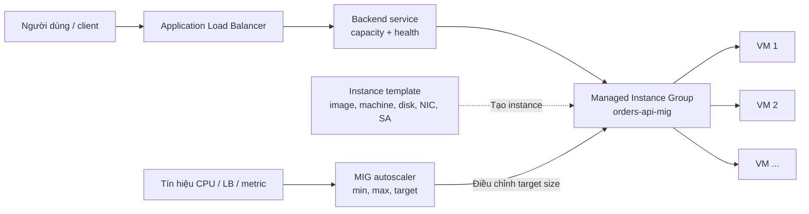
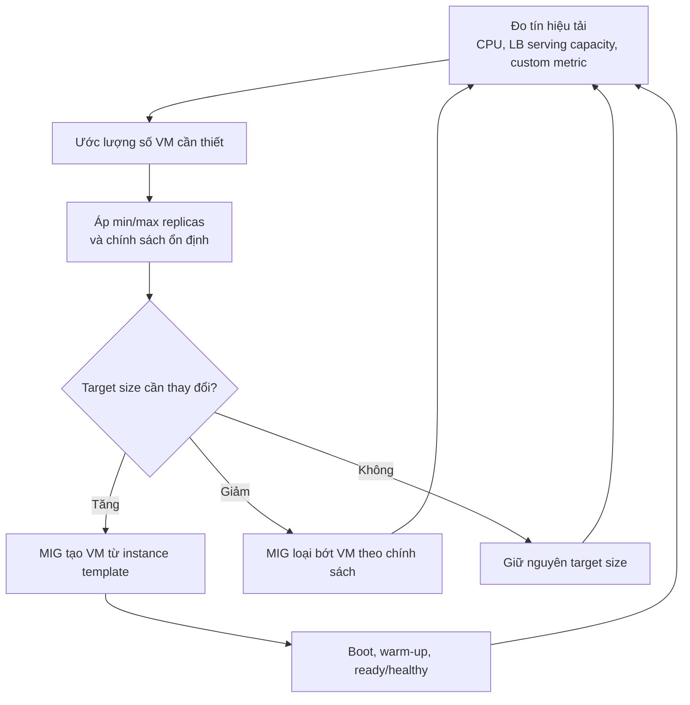

# Autoscaling theo CPU, tải cân bằng và custom metrics trên Google Cloud

Một dịch vụ chạy trên **Compute Engine Managed Instance Group (MIG)** có thể phục vụ ít yêu cầu vào ban đêm nhưng tăng tải nhiều lần vào giờ cao điểm. Nếu duy trì số VM cố định ở mức phục vụ đỉnh, doanh nghiệp trả tiền cho năng lực ít sử dụng; nếu chỉ giữ số VM vừa đủ cho tải thấp, khách hàng có thể gặp độ trễ, lỗi hoặc quá tải khi nhu cầu tăng. **Autoscaling** là cơ chế điều chỉnh số VM trong MIG theo các tín hiệu về nhu cầu, trong giới hạn và chính sách do người vận hành cấu hình.

Bài thuộc chương **Nhóm máy ảo và tự động mở rộng** của module `CLOUD_PROVIDERS_GCP`. Sau khi biết tổ chức project, IAM, VPC, Load Balancing và tạo Compute Engine VM, người học cần kết hợp chúng để bảo đảm độ tin cậy và chi phí khi triển khai ứng dụng. Trọng tâm là **ba tín hiệu autoscaling: CPU utilization, load balancing serving capacity và Cloud Monitoring custom metrics**, cùng cách kiểm chứng hành vi của autoscaler trên một hệ thống thực tế.

> Bài này nói về **Compute Engine MIG autoscaler**, không phải Horizontal Pod Autoscaler của GKE hay autoscaling instance của Cloud Run. Các nền tảng này có mô hình metric và điều khiển năng lực riêng, dù cùng hướng tới thích ứng với tải.

## 1. Mục tiêu học tập

Sau bài học, bạn có thể:

1. Mô tả vai trò của **instance template, MIG, autoscaler, backend service và health check** trong một ứng dụng VM tự mở rộng.
2. Phân biệt autoscaling theo **CPU**, **load balancing utilization** và **custom metrics** của Cloud Monitoring.
3. Thiết lập các khái niệm **minimum/maximum replicas, target utilization, initialization period, stabilization và scale-in controls**.
4. Hiểu hành vi khi cấu hình **nhiều tín hiệu** và khi tải vượt quá giới hạn số VM hoặc quota.
5. Tạo một MIG mẫu và autoscaler CPU bằng Console/`gcloud`, sau đó xác minh cấu hình và hành vi bằng lệnh chỉ đọc.
6. Thiết kế khả năng mở rộng cho HTTP API sau Load Balancer và worker xử lý queue bằng metric phù hợp.
7. Tránh các lỗi thường gặp về warm-up, health check, regional capacity, metric ít tin cậy, chi phí và quyền IAM.

## 2. Bức tranh kiến trúc: ai quyết định số VM?

Một kiến trúc HTTP trên Compute Engine có thể gồm:



**Những trách nhiệm khác nhau:**

| Thành phần | Vai trò | Không tự làm gì? |
| --- | --- | --- |
| **Instance template** | Mô tả cấu hình VM được tạo: machine type, boot disk, NIC, service account, metadata/startup script. | Không đo tải và không tự thêm VM. |
| **Managed Instance Group** | Tạo/duy trì tập VM tương đối đồng nhất theo template, thực hiện quản lý vòng đời. | Không tự suy ra CPU mục tiêu nếu chưa cấu hình autoscaling. |
| **Autoscaler** | Tính nhu cầu số VM từ tín hiệu, giới hạn và chính sách. | Không tự sửa code hoặc tăng quota. |
| **Load Balancer + backend service** | Phân phối lưu lượng tới backend được hỗ trợ và khai báo serving capacity/health theo sản phẩm. | Không tự quyết định số VM trong MIG nếu MIG chưa được cấu hình autoscaler phù hợp. |
| **Health check / autohealing** | Phát hiện instance không khỏe để MIG thay thế theo cấu hình. | Không đồng nghĩa autoscaling dựa trên tải. |
| **Cloud Monitoring** | Cung cấp metric và quan sát hoạt động. | Không tự tạo autoscaler nếu chưa cấu hình policy. |

**MIG zonal** quản lý VM trong một zone; **regional MIG** có thể phân bố VM trong nhiều zone thuộc một region theo chính sách phân phối và năng lực vùng. **Autoscaling đa zone trong regional MIG không đồng nghĩa failover đa region**. Nếu muốn chịu lỗi cả region, cần thêm kiến trúc đa region ở lớp ứng dụng, load balancing và dữ liệu.

## 3. Cơ chế autoscaler: tăng và giảm số lượng VM

Autoscaler liên tục đánh giá tín hiệu đã cấu hình. Nếu nhu cầu dự đoán vượt năng lực hiện có, autoscaler yêu cầu MIG **scale out** (tăng số instance); khi nhu cầu giảm đủ lâu, autoscaler có thể **scale in** (giảm số instance). Tất cả chịu giới hạn tối thiểu/tối đa và các biện pháp ổn định.



### 3.1. Min và max replicas

- **Minimum replicas** xác định số VM tối thiểu mà autoscaler duy trì theo cấu hình. Ví dụ `min=2` là lựa chọn khởi đầu cho dịch vụ HTTP không muốn chờ cold start trong điều kiện bình thường.
- **Maximum replicas** là trần số VM do autoscaler có thể yêu cầu. Nó giúp giới hạn quy mô tự động, nhưng **không phải trần chi phí tuyệt đối** vì disk, load balancing, network egress, logging và các dịch vụ khác vẫn phát sinh phí.
- Nếu việc mở rộng cần nhiều VM hơn `max`, autoscaler không vượt qua giới hạn chỉ để đạt target; ứng dụng có thể tiếp tục quá tải.
- Với regional MIG, phải hiểu cách `min/max` và phân phối instance giữa các zone được phiên bản tính năng áp dụng; đừng vô tình đặt số tối thiểu quá thấp so với yêu cầu phục vụ khi một zone gặp sự cố.

Ví dụ cấu hình `min=2, max=10` không có nghĩa lúc nào cũng chạy 10 VM, cũng không bảo đảm lúc cần luôn tạo được 10 VM. **Compute Engine quota, giới hạn địa chỉ IP, disk, capacity của zone và phụ thuộc mạng** có thể ngăn bổ sung instance.

### 3.2. Target utilization là ngưỡng điều khiển, không phải SLA

Giả sử đặt **target CPU utilization = 60%**. Autoscaler sẽ cố gắng điều chỉnh số VM để CPU trung bình của nhóm tiệm cận mục tiêu theo thuật toán sản phẩm, chứ không đợi tới 100% mới thêm VM.

Để xây trực giác, có thể dùng công thức **minh họa**, *không phải thuật toán nội bộ chính xác của Google Cloud*:

\[
N_{\text{ước lượng}} \approx
\left\lceil N_{\text{hiện tại}}\times
\frac{U_{\text{quan sát}}}{U_{\text{mục tiêu}}}\right\rceil
\]

Ví dụ 4 VM đang chạy trung bình 90% CPU và mục tiêu 60%:

\[
N_{\text{ước lượng}} \approx \lceil 4 \times 0{,}90/0{,}60 \rceil = 6
\]

Điều này giúp giải thích vì sao autoscaler có xu hướng tăng quy mô khi CPU cao. **Trong thực tế**, việc tăng/giảm còn phụ thuộc thời gian lấy mẫu, khởi tạo VM, dữ liệu metric, giới hạn, stabilization, scale-in controls và năng lực tạo VM thực tế.

### 3.3. VM cần thời gian khởi động

Thời điểm instance được tạo **khác** thời điểm ứng dụng sẵn sàng nhận lưu lượng:

```text
Tạo VM → boot OS → tải/cài cấu hình → khởi động ứng dụng
     → readiness/health check thành công → phục vụ request
```

Autoscaler có tham số **initialization period** (trong một số lệnh/tài liệu cũ được gọi là `cool-down period`) để ước lượng thời gian workload khởi tạo và xử lý metric trong giai đoạn ban đầu. Cần chọn dựa trên quan sát ứng dụng, không phải luôn để giá trị thấp nhất.

Nếu ứng dụng cần 4 phút để sẵn sàng nhưng giai đoạn khởi tạo cấu hình quá ngắn, metric của VM chưa xử lý tải thực có thể ảnh hưởng cách autoscaler ước lượng. Nếu cấu hình quá dài, autoscaler có thể phản ứng không như mong đợi trong một số tình huống. Kiểm tra hành vi từ load test và tài liệu của tính năng đang sử dụng.

### 3.4. Scale in thường thận trọng hơn scale out

Giảm số VM quá nhanh có thể gây dao động `scale out → scale in → scale out`, nhất là khi tải theo đợt hoặc metric biến động. Autoscaler sử dụng cơ chế **stabilization** và có thể cấu hình **scale-in controls** theo khả năng sản phẩm để giới hạn mức giảm trong một khoảng thời gian.

Chú ý:

- **Stabilization** giúp tránh cắt giảm quá nhanh dựa trên một đoạn metric thấp ngắn.
- **Scale-in controls** đặt giới hạn về số lượng/tỷ lệ instance được phép giảm trong cửa sổ thời gian đã cấu hình.
- **Connection draining** của Load Balancer và **graceful shutdown** ở ứng dụng giúp xử lý request/connection đang chạy khi một instance bị loại.
- Tham số **initialization period** không nên được hiểu đơn giản là “chỉ đợi X giây mới scale lần tiếp theo”.

Với HTTP xử lý request dài hoặc worker có job chưa hoàn thành, việc giảm số VM phải phối hợp cơ chế hoàn tất công việc, checkpoint/retry và idempotency; autoscaler không biết toàn bộ trạng thái nghiệp vụ chỉ từ CPU.

## 4. Autoscaling theo CPU utilization

### 4.1. CPU đo điều gì?

**CPU utilization** biểu thị phần năng lực CPU VM đang được sử dụng. Với MIG, autoscaler có thể dùng dữ liệu CPU trung bình của các instance và target do bạn chọn để đề xuất số lượng VM cần duy trì.

CPU phù hợp khi:

- Ứng dụng thực sự **CPU-bound**: xử lý tính toán, encode, parsing, render hoặc API có thời gian CPU đáng kể.
- Tải có tương quan tương đối ổn định giữa số request và CPU.
- Các VM có cấu hình/khả năng xử lý đồng nhất theo template, tránh một vài instance quá tải trong khi phần còn lại rảnh.
- Ứng dụng có khả năng phân phối tải đủ tốt để CPU trên các instance không quá lệch.

CPU có thể **không phản ánh nhu cầu** khi hệ thống chậm vì:

- Chờ Cloud SQL, Redis, external API hoặc storage I/O.
- Số concurrent request chạm ngưỡng kết nối/worker pool dù CPU vẫn thấp.
- Hàng đợi công việc tăng nhưng worker đang blocked bởi tài nguyên khác.
- Một nhóm request nặng tập trung vào số ít backend do session affinity/routing.

Vì vậy không nên chọn CPU chỉ vì đây là metric dễ bật. Phải xác nhận nó đại diện cho **năng lực cần mở rộng**.

### 4.2. Ví dụ mục tiêu CPU 65%

Một API Node.js chạy 2 VM trong MIG với `min=2`, `max=8`, target CPU 65%. Khi lượng truy cập tăng liên tục, autoscaler có thể bổ sung VM để phân tán tải; khi giảm, nó dần loại bớt VM theo chính sách ổn định.

**Không nên xem 65% là con số “đúng cho mọi ứng dụng”.** Ứng dụng JVM cần thời gian warm-up, hệ thống xử lý video, VM có CPU sharing hay chương trình đa luồng có đường cong CPU → latency khác nhau. Hãy dùng load test, metric p95/p99 latency, error rate và queue length để chọn target.

### 4.3. Ưu, nhược điểm

| Ưu điểm | Giới hạn |
| --- | --- |
| Có sẵn tín hiệu hạ tầng, ít phải instrument ứng dụng. | CPU thấp không đồng nghĩa ứng dụng đủ capacity. |
| Phù hợp dịch vụ CPU-bound và load phân phối đều. | Spike cực nhanh có thể vượt tốc độ boot VM. |
| Cách cấu hình tương đối đơn giản. | Không phản ánh trực tiếp SLA HTTP hoặc queue backlog. |
| Có thể kết hợp tín hiệu khác. | Dữ liệu trung bình che khuất một số backend bị nóng cục bộ. |

## 5. Autoscaling theo tải cân bằng (load balancing utilization)

Một số loại **Load Balancing backend service** hỗ trợ cấu hình **serving capacity** cho nhóm instance, ví dụ cách cân bằng theo mức sử dụng hoặc số request/connection tùy loại LB và backend. Autoscaler MIG có thể dùng tín hiệu **load balancing serving capacity** để điều chỉnh số VM phục vụ lưu lượng.

### 5.1. Serving capacity khác CPU thế nào?

CPU quan sát **mức sử dụng compute**. Load balancing serving capacity phản ánh **mức độ sử dụng năng lực phục vụ lưu lượng mà backend khai báo/được đo theo loại Load Balancing**.

Ví dụ backend service được cấu hình theo **RATE** với khả năng phục vụ mục tiêu trên mỗi instance:

```text
Backend service: orders-http-backend
Balancing mode : RATE (minh họa, tùy loại LB)
Max rate/VM    : 100 request/giây
Autoscaler target load balancing utilization: 0.80
```

Về trực giác, một VM được sử dụng tới khoảng 80% năng lực đã khai báo khi phục vụ xấp xỉ 80 request/giây trong **ví dụ giả định** này. Nếu nhóm 3 VM phải phục vụ tải khoảng 400 request/giây ổn định, rõ ràng 3 VM không đủ ở ngưỡng đó. Autoscaler có thể tăng số VM tùy dữ liệu metric, cách tính phục vụ và những ràng buộc khác.

**Không dùng phép tính minh họa làm dự báo chính xác số VM do autoscaler tạo.** Cách backend service định nghĩa capacity, thuật toán lựa chọn backend, metric và thời gian khởi tạo có thể làm kết quả khác. `RATE`, `UTILIZATION` và những lựa chọn khác không khả dụng giống nhau ở mọi Load Balancer.

### 5.2. Những điều kiện quan trọng

1. **MIG phải làm backend** của một backend service thuộc loại load balancer hỗ trợ autoscaling theo serving capacity.
2. Backend service phải có **balancing mode/maximum capacity** phù hợp để phản ánh năng lực trên instance hoặc nhóm.
3. Autoscaler của MIG được cấu hình tín hiệu **load balancing utilization target**; chỉ gắn MIG vào LB **không tự bật autoscaling**.
4. **Health check** phải phản ánh backend đủ sẵn sàng; nếu LB xem nhiều VM unhealthy, traffic có thể dồn lên số VM còn lại.
5. Cần hiểu yêu cầu tài nguyên của **Load Balancer** đang dùng: external/internal, regional/global, backend type, health check, firewall/proxy range.

**Điểm dễ nhầm:** việc gán một backend `maxRatePerInstance` không có nghĩa VM được hard-limit chính xác tại số request ấy. Đây là tham số phục vụ chọn backend và capacity trong mô hình tương ứng. Khi lượng tải vượt quá năng lực hữu dụng, latency/lỗi vẫn có thể tăng; autoscaler không tự biến backend quá tải thành có sức chứa vô hạn.

### 5.3. Khi nào chọn load balancing autoscaling?

Phù hợp khi ứng dụng được cân bằng tải và **nhu cầu request/connection** liên quan trực tiếp tới năng lực phục vụ, nhưng CPU có thể thấp do chờ I/O. Ví dụ API phải giữ nhiều kết nối đồng thời tới upstream, hoặc một VM có giới hạn số request/giây được kiểm chứng bằng load test.

Không phù hợp khi:

- VM không nhận lưu lượng qua backend service của loại LB hỗ trợ.
- Workload là queue worker độc lập không nhận request từ LB.
- Bạn chưa biết capacity thực của VM và chỉ đặt `maxRatePerInstance` bằng một số tùy ý.
- Luồng LB có nhiều policy/routing làm metric không phản ánh đúng tổng nhu cầu của dịch vụ.

## 6. Autoscaling theo Cloud Monitoring custom metrics

Khi CPU hay Load Balancer không phản ánh đúng nhu cầu, bạn có thể dùng **metric của Cloud Monitoring**, bao gồm custom metrics do ứng dụng/agent xuất bản, để autoscaler điều chỉnh MIG theo các điều kiện được hỗ trợ.

### 6.1. Custom metric trả lời bài toán gì?

Một worker đọc queue và xử lý đơn hàng có thể đạt CPU chỉ 20% nhưng backlog tăng từ 100 lên 20.000 message vì mỗi job chờ external API. Giữ autoscaling CPU 65% sẽ không bổ sung VM kịp.

Metric nghiệp vụ phù hợp hơn có thể là:

- **Pending jobs / queue backlog:** số công việc đang chờ.
- **Requests in flight:** số tác vụ đồng thời.
- **Work items per instance:** khối lượng công việc trên mỗi VM.
- **Processing lag:** độ trễ xử lý so với thời điểm nhận sự kiện.
- **Active sessions/connections:** lượng phiên mà mỗi VM có thể phục vụ.

Không phải metric nào cũng dùng trực tiếp được để autoscale. Cần xác định **metric type, monitored resource, metric kind, value type, định nghĩa tổng/đơn vị và cách autoscaler tính trên từng VM hoặc cả nhóm**. Metric tên hay nhưng phát sai scope hoặc sai kiểu dữ liệu có thể không được autoscaler chấp nhận.

### 6.2. Per-instance metric và per-group metric

Hai mô hình thường gặp:

| Mô hình | Ví dụ | Điều cần nghĩ tới |
| --- | --- | --- |
| **Per-instance metric** | `custom.googleapis.com/orders/active_jobs` trên từng VM. | Mỗi VM xuất bản một chuỗi metric tương ứng đúng resource/instance. |
| **Per-group metric** | `custom.googleapis.com/orders/queue_backlog` mô tả tổng backlog của một queue phục vụ cả MIG. | Phải khai báo cách quy đổi nhu cầu tổng thành năng lực mỗi VM, theo cấu hình được autoscaler hỗ trợ. |

Ví dụ một queue có 900 job đang chờ; mỗi VM được đánh giá có thể xử lý tối đa khoảng 150 job đang chờ trong mục tiêu vận hành. Theo phép tính **minh họa**:

\[
N_{\text{ước lượng}} \approx \left\lceil
\frac{900 \text{ jobs}}{150 \text{ jobs/VM}}
\right\rceil = 6
\]

Để áp dụng thực tế, nhóm phải xác minh cấu hình **single-instance assignment** hoặc cơ chế tương đương được Google Cloud hỗ trợ cho metric toàn nhóm. Không được chỉ đổi tên metric thành `queue_backlog` rồi kỳ vọng autoscaler hiểu số job/VM. Cần kiểm tra cách hệ thống lấy mẫu, làm trễ và tổng hợp metric.

### 6.3. Thiết kế một metric tốt

Một metric dùng làm tín hiệu điều khiển nên có:

1. **Nghĩa rõ ràng:** `pending_jobs` là số job đang chờ tại thời điểm quan sát, không lẫn job đang xử lý và job lỗi.
2. **Unit và loại dữ liệu đúng:** backlog là gauge hiện tại; counter tích lũy không thể so trực tiếp với backlog. Nếu dùng tốc độ, cần rate phù hợp.
3. **Resource/labels nhất quán:** dữ liệu từ các VM thuộc MIG hoặc từ nguồn nhóm được thể hiện theo cấu hình autoscaler hỗ trợ.
4. **Chu kỳ cập nhật hợp lý:** metric quá trễ khiến VM được tạo sau khi peak đã qua; quá nhiễu có thể gây oscillation.
5. **Xử lý missing/zero data:** thiếu metric không giống metric bằng 0. Khi agent/ứng dụng lỗi, cần biết autoscaler sẽ phản ứng thế nào.
6. **Mục tiêu có cơ sở:** dựa trên benchmark throughput, thời gian xử lý, giới hạn upstream và yêu cầu backlog age/SLO.
7. **Khả năng kiểm thử:** có dashboard metric gốc, number of instances, throughput, backlog age và errors để xác nhận tương quan.

**Ví dụ lỗi thiết kế:** mỗi instance xuất bản tổng backlog của cùng queue. Nếu Cloud Monitoring đọc nhiều chuỗi cùng số tổng và autoscaler diễn giải như metric per-instance, tín hiệu bị nhân lặp và có thể dẫn đến hành vi không mong muốn. Phải phân biệt metric **của từng VM** với metric **của toàn nhóm**.

### 6.4. Custom metrics không miễn trừ các giới hạn khác

Một custom metric có thể yêu cầu thêm VM nhưng không giải quyết:

- **Quota/availability:** region/zone không còn tài nguyên VM.
- **Bottleneck ngoài MIG:** Cloud SQL không đủ connection, API đối tác rate limit, queue broker quá tải.
- **Thời gian khởi động:** VM mới chưa vào vòng xử lý.
- **Chi phí:** tăng VM có thể khiến bill tăng nhanh mà không giảm backlog nếu tác nhân gây nghẽn nằm ở upstream.
- **Độ tin cậy nguồn metric:** metric mất dữ liệu hoặc xuất bản sai cũng làm autoscaler nhận tín hiệu sai.

## 7. Nhiều tín hiệu trong một autoscaling policy

Một MIG có thể cấu hình **nhiều autoscaling signals** khi loại tín hiệu và các giới hạn tính năng cho phép. Ví dụ:

- CPU target 65%.
- Load balancing utilization target 80%.
- Custom metric về concurrent jobs có target thích hợp.

Về khái niệm, autoscaler xem xét số VM mỗi tín hiệu yêu cầu và thường **chọn yêu cầu quy mô lớn nhất** để đáp ứng nhiều ràng buộc. Đó **không phải phép cộng đơn giản** tất cả kết quả.

Ví dụ giả định:

| Tín hiệu | Số VM được mô hình minh họa đề xuất |
| --- | ---: |
| CPU | 5 |
| Load balancing | 7 |
| Custom metric | 6 |
| Trần max của MIG | 10 |

Kỳ vọng điều khiển có thể hướng tới **7 VM**, không phải `5 + 7 + 6 = 18`. Kết quả thực còn phụ thuộc stabilization, thời gian metric, min/max và hạn chế tính năng. Nếu `max=6`, autoscaler không tự vượt qua trần dù tín hiệu LB cần 7.

### 7.1. Cẩn thận với tín hiệu mâu thuẫn

Ví dụ CPU thấp nhưng load balancing utilization cao. Tình huống này có thể hợp lý: một VM bị giới hạn số socket/connection, request bị chặn chờ database hoặc backend service capacity đặt quá thấp.

Ngược lại, CPU cao nhưng LB thấp có thể chỉ ra job nền nặng, GC, lỗi ứng dụng hoặc lưu lượng không đi qua LB. **Autoscaler là bộ điều khiển năng lực**, không phải công cụ xác minh các giả thuyết về hiệu năng. Phải dùng dashboard/log để tìm bottleneck thực.

### 7.2. Tách scale theo tải khỏi lịch hoạt động

Compute Engine cũng có khả năng **autoscaling schedules** và các cấu hình dự đoán trong những trường hợp được hỗ trợ. Một kế hoạch cho giờ cao điểm có thể duy trì baseline phù hợp trước thời điểm tải tăng, thay vì chỉ phản ứng sau khi CPU/queue đã cao.

Tuy nhiên lịch không thay thế signals: lịch chỉ thể hiện kỳ vọng thời gian; workload vẫn có thể tăng đột biến ngoài lịch. Mọi signal/schedule phải nằm trong phạm vi tính năng thực tế của MIG và tương thích với min/max.

## 8. Các thông số ảnh hưởng tới hành vi và độ tin cậy

| Thông số | Ý nghĩa | Nếu cấu hình sai |
| --- | --- | --- |
| **Minimum replicas** | Baseline VM tối thiểu. | Quá thấp gây cold start/rủi ro đơn điểm; quá cao gây chi phí idle. |
| **Maximum replicas** | Trần autoscaler. | Quá thấp nghẽn tải; quá cao tăng chi phí nhanh khi metric sai. |
| **CPU target** | Mục tiêu mức sử dụng CPU. | Quá cao dễ tăng latency; quá thấp dư năng lực. |
| **LB utilization target** | Mục tiêu sử dụng serving capacity LB. | Cần backend capacity được đo/khai báo đúng. |
| **Custom metric target** | Năng lực mong muốn theo metric. | Sai đơn vị hoặc scope dẫn đến scale không đúng. |
| **Initialization period** | Thời gian ước lượng VM cần khởi tạo. | Phản ứng có thể kém ổn định nếu lệch thực tế. |
| **Scale-in controls** | Giới hạn mức giảm trong cửa sổ thời gian. | Xóa VM quá nhanh, mất job/connection. |
| **Health check/autohealing** | Phát hiện và xử lý VM hỏng. | VM không sẵn sàng vẫn tồn tại/traffic dồn sai. |
| **Regional distribution policy** | Phân bổ instance trên các zone. | Một zone sự cố có thể ảnh hưởng lớn; capacity không đều. |

### 8.1. Autoscaling khác autohealing

**Autoscaling** trả lời: “Cần bao nhiêu VM để xử lý tải?”  
**Autohealing** trả lời: “VM nào không khỏe và cần thay thế?”

Ví dụ đang có 5 VM, một VM bị treo. **Autohealing** có thể thay VM đó để giữ capacity phục vụ. **Autoscaling** có thể tăng lên 6 VM nếu tín hiệu tải yêu cầu. Hai cơ chế có thể cùng hoạt động nhưng cần **health check phù hợp với ứng dụng** và thời gian khởi tạo đủ để VM mới không bị coi là hỏng ngay.

### 8.2. Instance template và khả năng mở rộng thực sự

MIG tạo instance mới từ **instance template**. Vì vậy template phải chứa cấu hình có thể bootstrap không cần thao tác thủ công:

- Image đã được quản lý phiên bản, boot disk đúng loại và đủ dung lượng.
- VPC/subnet/region, firewall và các phụ thuộc network.
- Runtime service account có IAM quyền tối thiểu.
- Startup script hoặc phương pháp cấu hình ứng dụng có kiểm soát; không đặt secret trong metadata plaintext.
- Logging/monitoring agent, health endpoint và cơ chế nhận cấu hình.
- **Dữ liệu phiên/session** nằm ngoài VM nếu cần scale/recreate; không chỉ nằm trên boot disk ephemeral/lifecycle VM.

Nếu VM mới khởi động nhưng không kết nối được Cloud SQL hoặc Artifact Registry, autoscaler có thể bổ sung nhiều VM **không phục vụ được request**, làm tăng chi phí mà không cải thiện availability.

## 9. Hướng dẫn thực hành: MIG autoscaling theo CPU

Giả định môi trường thử nghiệm đã có:

- Project `orders-dev` và Compute Engine API hoạt động.
- VPC/subnet trong region `asia-southeast1`, firewall và mạng cho VM theo thiết kế.
- Instance template tên `orders-api-template-v1` đã tồn tại, khởi động được ứng dụng.
- Người dùng có quyền quản trị MIG/autoscaler và quota đủ để tạo tối đa 8 VM.

Nếu template chưa tồn tại, cần tạo và kiểm chứng **template riêng** theo bài tạo VM trước khi tiếp tục. Thực hành này **không tự tạo VPC, DNS, firewall hoặc service account**. Mọi lệnh tạo/đổi autoscaling đều làm thay đổi tài nguyên và có thể phát sinh phí.

### 9.1. Khai báo biến và kiểm tra trước

```bash
PROJECT_ID="orders-dev"
ZONE="asia-southeast1-b"
MIG_NAME="orders-api-mig"
TEMPLATE_NAME="orders-api-template-v1"

gcloud auth list
gcloud compute instance-templates describe "$TEMPLATE_NAME" \
  --project="$PROJECT_ID" \
  --format="yaml(name,properties.machineType,properties.disks,properties.networkInterfaces)"

gcloud compute instance-groups managed list --project="$PROJECT_ID"
```

Đây là các lệnh **chỉ đọc**, giúp xác nhận template thực sự tạo VM có boot disk, NIC và service account đúng. Nếu một MIG cùng tên đã tồn tại, **không tạo trùng hoặc ghi đè** mà cần kiểm tra policy và owner trước.

### 9.2. Tạo MIG zonal

```bash
# Lệnh THAY ĐỔI HẠ TẦNG: chỉ chạy trong lab đã được phê duyệt.
gcloud compute instance-groups managed create "$MIG_NAME" \
  --project="$PROJECT_ID" \
  --zone="$ZONE" \
  --template="$TEMPLATE_NAME" \
  --size=2
```

Lệnh tạo **zonal MIG** với 2 VM theo template. Nếu template gắn external IP, service account sai hoặc startup script không an toàn, những cấu hình đó sẽ nhân ra ở các VM mới. Hãy kiểm tra template trước khi tạo MIG.

Nếu cần **regional MIG** trải nhiều zone, phải dùng lệnh/phạm vi regional và cấu hình phân phối phù hợp, không chỉ đổi tên MIG. Bài lab chọn zonal để tập trung vào tín hiệu autoscaling.

### 9.3. Bật autoscaling CPU

```bash
# Lệnh THAY ĐỔI HẠ TẦNG: tự động tăng/giảm số VM khi chạy.
gcloud compute instance-groups managed set-autoscaling "$MIG_NAME" \
  --project="$PROJECT_ID" \
  --zone="$ZONE" \
  --min-num-replicas=2 \
  --max-num-replicas=8 \
  --target-cpu-utilization=0.65 \
  --cool-down-period=180
```

Ý nghĩa:

- `min=2`: baseline ít nhất 2 VM theo cấu hình.
- `max=8`: không tự vượt quá 8 VM dù CPU cao.
- `target-cpu-utilization=0.65`: CPU target 65%.
- `--cool-down-period=180`: tham số CLI truyền thống mô tả giai đoạn khởi tạo ước lượng 180 giây; trong tài liệu tính năng thường gọi là **initialization period**. Đối chiếu phiên bản `gcloud` đang dùng để chọn flag hiện hành được hỗ trợ.

Mốc 180 giây chỉ là ví dụ. Đo từ lúc tạo VM đến lúc health check đánh dấu backend sẵn sàng để chọn tham số phù hợp hơn.

### 9.4. Đọc lại autoscaler và trạng thái MIG

```bash
gcloud compute instance-groups managed describe "$MIG_NAME" \
  --project="$PROJECT_ID" \
  --zone="$ZONE" \
  --format=yaml

gcloud compute instance-groups managed list-instances "$MIG_NAME" \
  --project="$PROJECT_ID" \
  --zone="$ZONE"

# Danh sách autoscalers có phạm vi phù hợp
gcloud compute autoscalers list \
  --project="$PROJECT_ID"
```

Trong Console, mở **Compute Engine → Instance groups → MIG → Autoscaling** và kiểm tra target CPU, min/max replicas, initialization period, lịch sử instance count và thông báo lỗi. Kết hợp với Cloud Monitoring để so CPU utilization, số VM, request latency và error rate cùng một trục thời gian.

Không kết luận autoscaler hoạt động đúng chỉ vì policy đã tồn tại. Cần kiểm tra **VM mới khởi động, healthy và thực sự tham gia xử lý tải**.

### 9.5. Thử tải an toàn

Để quan sát scale out, chỉ tạo load trên **ứng dụng lab**, không gửi request vào dịch vụ production hoặc endpoint của bên thứ ba. Nên sử dụng công cụ load test được nhóm vận hành phê duyệt và đặt giới hạn request rate/thời lượng.

Quy trình:

1. Ghi nhận số VM ban đầu, CPU trung bình, latency, error rate và trạng thái backend.
2. Tăng tải dần, theo dõi CPU có vượt 65% ổn định không.
3. Xem autoscaler có yêu cầu tăng target size và MIG có tạo VM mới không.
4. Kiểm tra VM mới được đánh dấu ready/healthy, phân phối request có thay đổi không.
5. Giảm tải theo kế hoạch, chờ cơ chế ổn định rồi xem scale in; không kỳ vọng lập tức về minimum.
6. Ghi kết quả: thời gian khởi tạo, số VM lớn nhất, latency/error peak, chi phí dự kiến và mọi lỗi quota.

**Nếu không thấy scale out**, chưa đủ kết luận autoscaler sai: metric có thể chưa vượt target, tải chưa kéo dài đủ, đã chạm max, VM mới không tạo được vì quota/capacity, hoặc policy sai scope.

## 10. Thực hành cấu hình load balancing autoscaling

Đối với hệ thống HTTP sau Load Balancer:

1. Tạo hoặc dùng backend service thuộc **loại LB hỗ trợ MIG backend và serving-capacity autoscaling**.
2. Gắn MIG vào backend service; cấu hình **balancing mode và maximum serving capacity** có cơ sở từ benchmark.
3. Cấu hình health check, firewall đúng nguồn và đảm bảo các VM được coi là healthy khi ứng dụng sẵn sàng.
4. Trên trang **Autoscaling** của MIG, chọn tín hiệu **HTTP load balancing utilization** hoặc mục tương ứng theo phiên bản Console; đặt target (ví dụ 80% capacity).
5. Giữ `min/max` phù hợp và đo thời gian VM sẵn sàng.
6. Thử tăng request load, quan sát **backend serving capacity, requests per instance, số VM, p95 latency và 5xx**.

Tùy sản phẩm và phiên bản CLI, có thể gặp tùy chọn dạng `--target-load-balancing-utilization` trong thao tác cấu hình MIG autoscaler. **Không chạy mù một lệnh đổi policy** khi đã có tín hiệu CPU hoặc custom metric: trước tiên đọc policy hiện tại và kiểm tra liệu lệnh cập nhật sẽ thêm tín hiệu hay ghi đè cấu hình khác.

### 10.1. Lệnh chỉ đọc hữu ích

```bash
# Danh sách backend services; xác định rõ scope global/regional
gcloud compute backend-services list \
  --project="$PROJECT_ID"

# Ví dụ backend service global; chỉ dùng nếu kết quả list xác định global
gcloud compute backend-services describe orders-http-backend \
  --project="$PROJECT_ID" \
  --global \
  --format=yaml

# Kiểm tra MIG ở zone được chọn
gcloud compute instance-groups managed describe "$MIG_NAME" \
  --project="$PROJECT_ID" \
  --zone="$ZONE"
```

Khi đọc backend service, tìm **backends[]**, cách tham chiếu MIG, `balancingMode`, `maxRatePerInstance` hoặc những trường capacity tương đương của loại LB, health check và timeout. Nếu backend service là **regional**, thay `--global` bằng `--region=REGION` khi describe.

**Không nhầm:** health check quyết định VM có thể được dùng làm backend; load balancing autoscaling quyết định **số lượng VM** theo tín hiệu capacity. Một MIG có thể scale out nhưng LB vẫn unhealthy nếu startup script sai hoặc firewall chặn health check.

## 11. Thực hành thiết kế custom metric cho queue worker

Hệ thống `orders-batch-mig` chạy VM workers lấy task từ một hàng đợi. Worker chủ yếu chờ kết quả API nên CPU thấp, trong khi `queue_backlog` tăng nhanh. Mục tiêu là bổ sung VM khi backlog tăng nhưng không gửi quá nhiều request đến API upstream.

### 11.1. Đề xuất metric

Ví dụ định nghĩa:

```yaml
metric_type: custom.googleapis.com/orders/queue_backlog
meaning: "So cong viec dang cho xu ly"
unit: "1"
kind: GAUGE
scope: "Per-group / queue-wide"
update_interval_seconds: 60
intended_capacity_per_instance: 150
```

Đây là **bản thiết kế metric**, không phải JSON/YAML có thể tự đưa vào Cloud Monitoring API để đăng ký metric. Hệ thống xuất bản metric phải tuân thủ schema và monitored resource của Cloud Monitoring; autoscaler phải được cấu hình đúng cơ chế **per-group metric / single-instance assignment** mà sản phẩm hỗ trợ.

### 11.2. Quy trình đưa metric vào autoscaler

1. **Instrument** queue publisher/collector: xuất bản `queue_backlog` cho resource/labels nhất quán và không nhân bản tổng backlog trên mọi VM.
2. Kiểm tra metric trong **Metrics Explorer**: có dữ liệu liên tục, đúng unit, không có giá trị âm/bất thường.
3. Benchmark một worker xử lý bao nhiêu job mà không vi phạm SLO và giới hạn API upstream. Ví dụ 150 job/VM là **mục tiêu giả định**, không phải năng lực có sẵn của mọi VM.
4. Trong cấu hình autoscaling MIG, chọn **Cloud Monitoring metric**; chọn metric type, scope, target và cách quy đổi per-instance/per-group phù hợp.
5. Đặt min/max, initialization period và scale-in controls. Chỉ dùng những tùy chọn được UI/API của loại metric đó hỗ trợ.
6. Tạo queue backlog mô phỏng an toàn, đo `backlog age`, throughput, số VM, external API errors và số job đang xử lý.
7. Kiểm tra trường hợp **queue rỗng**, **metric bị thiếu** và **upstream rate limit**; xác nhận autoscaler không tăng vô ích hoặc giảm gây mất job.

### 11.3. Tại sao backlog đơn lẻ chưa đủ?

Queue backlog 1.000 job có thể nhẹ nếu mỗi job mất 10 ms, nhưng rất nặng nếu mỗi job mất 60 giây. Với hệ thống nhiều loại job, cần thêm thông tin:

- Thời gian xử lý trung bình, p95/p99 và mức độ biến thiên.
- Backlog **age**, không chỉ số lượng message.
- Tỉ lệ retry/dead-letter, số job đang xử lý và hiệu suất worker.
- Rate limit, concurrency hoặc quota của API downstream.
- Khả năng scale in khi còn job đang xử lý; worker cần hoàn tất/ack đúng cách.

**Tư duy đúng:** autoscaler tối ưu một tín hiệu thay thế cho nhu cầu năng lực. Tín hiệu chỉ tốt khi có mối liên hệ được kiểm chứng với **SLO và throughput** của hệ thống.

## 12. Ba kịch bản vận hành so sánh

| Tình huống | Tín hiệu khởi đầu | Vì sao | Cần kiểm tra thêm |
| --- | --- | --- | --- |
| **A. REST API tính toán nặng** trên MIG, traffic khá đều. | **CPU utilization** | CPU tương quan tốt với số request xử lý. | p95 latency, readiness, CPU hotspot, min/max và warm-up. |
| **B. HTTP API giữ nhiều kết nối** qua backend service, CPU chưa cao nhưng đến giới hạn request/connections. | **Load balancing serving capacity** | Nhu cầu HTTP đến gần năng lực backend khai báo. | Balancing mode, capacity benchmark, health checks, loại LB hỗ trợ. |
| **C. Worker xử lý queue** không đi qua LB, CPU thấp vì chờ I/O. | **Custom metric** backlog/processing lag. | Tín hiệu phản ánh số việc còn phải xử lý. | Metric kind/scope, single-instance assignment, idempotency và upstream quota. |

Một ứng dụng có cả API và background job có thể cần **hai MIG riêng**. Nếu gộp chúng trong một MIG, CPU và request capacity có thể phản ánh lẫn lộn và khó tối ưu. Phân tách workload theo hành vi tải giúp chọn metric, template và quyền truy cập phù hợp hơn.

### 12.1. Khi nào cân nhắc đa tín hiệu?

Ví dụ một API bị nghẽn CPU khi xử lý ảnh nhưng có lúc bị nhiều kết nối HTTP đồng thời. Có thể đánh giá kết hợp CPU + LB utilization để tránh chỉ số này tốt trong khi chỉ số kia xấu. Cần đo hiệu quả từng tín hiệu trước khi phối hợp để tránh scale ngoài dự kiến.

Nếu custom metric backlog **tăng khi thêm VM** do hệ thống nhận thêm job song song, chỉ tăng min/max sẽ không khắc phục thiết kế metric. Phải kiểm tra ý nghĩa metric, throughput và queue semantics.

## 13. Giám sát, kiểm thử và xử lý lỗi autoscaling

### 13.1. Dashboard tối thiểu

| Nhóm chỉ số | Ví dụ | Mục tiêu quan sát |
| --- | --- | --- |
| **Capacity** | Target size, current instance count, VM creating/healthy. | Autoscaler có tạo đủ VM và VM mới sẵn sàng không? |
| **CPU** | Avg utilization, p95/p99 giữa VM nếu có. | CPU có tương quan với throughput và latency? |
| **Load Balancing** | Requests/s, backend utilization/capacity, 4xx/5xx, latency. | Tải vào và chất lượng phục vụ thay đổi thế nào? |
| **Custom metrics** | Queue backlog, backlog age, active jobs. | Tín hiệu nghiệp vụ có đúng/đủ kịp thời? |
| **Reliability** | Health checks, failed instance creations, error logs. | Scale có bị chặn bởi startup/health/quota? |
| **Cost** | Số VM x giờ, disk, network egress, LB/logging. | Có chi phí vượt lợi ích hoặc scaling sai mục đích? |

Các metric và log cụ thể phụ thuộc Compute Engine, LB, Cloud Monitoring và cách ứng dụng instrument. Nếu một metric không tồn tại, phải cấu hình thu thập thay vì suy đoán giá trị là 0.

### 13.2. Bảng xử lý sự cố thường gặp

| Triệu chứng | Nguyên nhân thường gặp | Hướng điều tra |
| --- | --- | --- |
| CPU tăng nhưng MIG không scale out | Chưa bật autoscaler, sai MIG/scope, target chưa đạt, đã chạm max hoặc bị hạn chế scale. | Đọc autoscaler policy, target size, CPU timeseries, min/max. |
| Autoscaler yêu cầu nhiều VM nhưng không tạo được | Quota vCPU/disk/IP, machine type unavailable, thiếu subnet IP, IAM hoặc capacity zone. | Xem MIG instance operations/errors, quota theo zone/region và network. |
| VM tăng nhưng HTTP 5xx vẫn cao | VM mới chưa healthy, startup lỗi, LB backend config sai, database bottleneck. | Health check, app logs, LB errors, Cloud SQL connections. |
| CPU thấp nhưng request latency cao | Chờ I/O, thread/connection pool chạm trần hoặc queue tăng. | APM/traces, LB utilization, in-flight requests, backlog. |
| Scale ra/vào liên tục | Metric nhiễu, target chưa đúng, initialization/stabilization/scale-in controls không phù hợp. | So timeseries signal với instance count, điều chỉnh thận trọng. |
| Custom metric không làm scale | Metric thiếu, sai scope/type, filter lỗi, bị trễ hoặc cấu hình per-group sai. | Metrics Explorer, resource labels, autoscaler error và API policy. |
| LB autoscaling không phản ứng | MIG không gắn backend service tương thích, balancing mode/capacity sai. | Backend service config, health, LB kind, autoscaler policy. |
| Chi phí tăng mạnh dù request không tăng | Metric bị lỗi, job retry storm, CPU nền, max đặt cao, boot disk/egress tăng. | Correlate signals, instance count, request/job count và Billing. |
| Scale in làm mất job/connection | Không có draining/graceful shutdown hoặc job không ack/retry an toàn. | Worker lifecycle, shutdown hook, session state, scale-in controls. |
| Một zone thiếu capacity | Regional distribution/quota/capacity chưa đáp ứng. | MIG distribution, quota và thiết kế multi-zone; cân nhắc điều chỉnh hợp lệ. |

### 13.3. Quy trình chẩn đoán trước khi thay policy

1. **Chọn đúng MIG**: project, zonal hay regional, danh tính đang quản trị.
2. **Xác nhận target size và current instance count**; số instance trong quá trình tạo không phải số backend ready.
3. **Đọc policy signals, min/max, initialization và scale-in controls**.
4. **Đọc metric gốc**, không chỉ biểu đồ trung bình; kiểm tra missing data hoặc outliers.
5. **Xem operations/errors** của MIG và autoscaler, quota, capacity, startup/health.
6. **Đọc LB backend service** hoặc Cloud Monitoring metric tương ứng.
7. **Thử thay đổi nhỏ có kế hoạch**, theo dõi 5xx, p95 latency, throughput, VM count và chi phí.

Đừng tăng `max replicas` từ 10 lên 500 chỉ để “thử xem sao”. Thay đổi như vậy có thể mở rộng chi phí nhanh, tăng áp lực database và không giải quyết nguyên nhân gốc.

## 14. Các giới hạn của autoscaling và tối ưu chi phí

### 14.1. Autoscaler không tạo được capacity không tồn tại

Giả sử `max=20`, autoscaler quyết định cần 16 VM, nhưng quota chỉ cho 12 vCPU khả dụng hoặc subnet hết internal IP. MIG có thể không tạo đủ VM, bất kể metric có hợp lý. Vì vậy cần:

- Tính quota CPU, disk, IP, forwarding rules và tài nguyên phụ trợ theo **scope đúng**.
- Kiểm tra regional/zonal resource availability, đặc biệt với machine type/accelerator hiếm.
- Thiết kế headroom để chịu thời gian khởi tạo và các đợt tăng nhanh.
- Cân nhắc reservations/khả năng capacity phù hợp với workload quan trọng.

Một MIG nhiều zone giúp giảm phụ thuộc một zone nhưng **không biến regional quota thành vô hạn** và không bảo vệ dữ liệu tự động.

### 14.2. Mô hình chi phí đơn giản

Nếu một VM có chi phí compute giả định `C`/giờ, số VM trung bình trong ngày là `N_avg`, chi phí compute sơ bộ:

\[
\text{Chi phí compute/ngày} \approx 24 \times N_{\mathrm{avg}} \times C
\]

Đây **chưa** bao gồm disk persistent, license, load balancing, egress, NAT, logging, Monitoring, external API hoặc chi phí data services. Ngay cả khi MIG về minimum, VM còn chạy và disk vẫn được tính phí theo mô hình sản phẩm.

Autoscaling thường giảm lãng phí so với cấu hình dự phòng ở peak cố định, nhưng không bảo đảm **tự động rẻ nhất**. Ví dụ một custom metric bị phát sai có thể làm tăng VM liên tục, hoặc autoscaler tăng workers khiến downstream tính phí theo request.

### 14.3. Bảo mật khi scale out

Mỗi VM mới nhận **runtime service account** và cấu hình từ template. Nếu template chứa service account quá rộng, startup script có secret hoặc mở external IP không cần thiết thì **autoscaling nhân bản rủi ro** nhanh như nhân bản năng lực.

Checklist:

- Sử dụng instance template/version được duyệt và image được cập nhật.
- Gắn service account least privilege; không dùng khóa JSON dài hạn.
- NIC private, Cloud NAT/Private Google Access và firewall theo nhu cầu.
- Health/readiness chỉ mở đúng cổng và nguồn cần thiết.
- Tránh lưu trạng thái nghiệp vụ quan trọng trên boot disk của VM dễ bị thay thế.
- Xem xét quyền người có thể thay instance template, MIG/autoscaler và backend service.

### 14.4. Rolling update và autoscaling không phải một thao tác

**Rolling update** thay VM sang template mới theo chính sách cập nhật; **autoscaling** thay target size theo tải. Hai quá trình có thể diễn ra gần nhau, nhưng cần tính tổng năng lực dự phòng, surge/unavailable policy và health checks.

Với ứng dụng production, rollout nên thử từ môi trường staging, theo dõi request errors, latency, số VM sẵn sàng và rollback khi lỗi. Thay template mà không kiểm tra bootstrap có thể khiến autoscaler tạo thêm nhiều VM mới cùng lỗi.

## 15. Bài tập vận dụng

### Bài tập 1 — CPU cao nhưng scale không thêm

Một MIG có 4 VM, target CPU 60%, `min=2`, `max=4`. CPU giữ 95% trong giờ cao điểm.

**Câu hỏi:** Vì sao không scale? Cần đánh giá gì trước khi tăng max?

**Gợi ý đáp án:** MIG đã chạm **max=4**. Cần kiểm tra quota/capacity, khả năng backend, database dependencies, SLO và chi phí trước khi nâng trần.

### Bài tập 2 — HTTP API CPU thấp, latency cao

MIG phục vụ HTTP qua LB. CPU trung bình chỉ 30%, nhưng nhiều request treo 10 giây vì giới hạn kết nối. Autoscaler CPU target 70% không tạo thêm VM.

**Câu hỏi:** Nên cân nhắc metric nào?

**Gợi ý đáp án:** **Load balancing serving capacity**, in-flight requests hoặc **custom metric** đo kết nối/queue là những ứng viên. Trước tiên xác định bottleneck thật; thêm VM không giải quyết được nếu cả nhóm cùng chạm giới hạn external database.

### Bài tập 3 — Queue backlog tăng

Worker đang đọc 8.000 công việc từ queue, CPU chỉ 15%. Mỗi VM xử lý được trung bình 200 việc đang chờ theo ngưỡng được benchmark.

**Câu hỏi:** Có thể dùng tín hiệu nào và số lượng VM minh họa là bao nhiêu?

**Gợi ý đáp án:** Dùng **custom Cloud Monitoring metric** thể hiện backlog theo cách autoscaler hỗ trợ. Theo mô hình đơn giản, `ceil(8000/200) = 40 VM`, nhưng thực tế bị min/max, quota, thời gian khởi tạo và giới hạn upstream. Phải xác định metric per-group, target/single-instance assignment và bảo vệ scale in.

### Bài tập 4 — Health check không thành công

Autoscaler tạo thêm 3 VM nhưng Load Balancer không gửi request tới chúng. VM ở trạng thái `RUNNING`.

**Câu hỏi:** Tại sao chưa thể kết luận autoscaler thất bại?

**Gợi ý đáp án:** VM `RUNNING` chưa chứng minh ứng dụng đã **ready/healthy**. Cần kiểm tra startup script, service port, firewall health checker/proxy, backend association, health endpoint và initialization period.

### Bài tập 5 — Nhiều tín hiệu

Autoscaler được cấu hình CPU, LB utilization, custom metric; mỗi tín hiệu gợi ý lần lượt 5, 9 và 7 VM. `max=8`.

**Câu hỏi:** Hành vi mục tiêu khái niệm là gì?

**Gợi ý đáp án:** Tín hiệu cao nhất yêu cầu 9 VM nhưng bị **max=8**. Không cộng 5+9+7, cũng không tự vượt qua trần. Kết quả thực cần thời gian và các biện pháp ổn định.

### Bài tập 6 — Scale in gây mất việc

Queue worker được giảm từ 6 còn 2 VM. Một số job dài bị xử lý dở và mất trạng thái.

**Câu hỏi:** Cần sửa gì ngoài autoscaler?

**Gợi ý đáp án:** Thiết kế shutdown/draining, checkpoint hoặc ack/retry idempotent, trạng thái bền vững ở ngoài VM, scale-in controls và thời gian chờ phù hợp. Autoscaler không thể tự cứu một job không có cơ chế phục hồi.

### Bài tập 7 — Chi phí tăng bất thường

Custom metric báo backlog gấp 5 lần giá trị thật, MIG tăng sát max. Sau khi sửa metric, số VM giảm chậm.

**Câu hỏi:** Vì sao? Cần giám sát điều gì?

**Gợi ý đáp án:** Tín hiệu sai làm tăng nhu cầu capacity; sau khi sửa, stabilization và scale-in controls có thể khiến giảm dần, không lập tức. Giám sát metric gốc, target size, current VM, backlog thật, request errors, chi phí và xem lại ngưỡng/cửa sổ dữ liệu.

## 16. Checklist đưa autoscaling vào production

- [ ] Đã chọn **zonal/regional MIG** theo yêu cầu availability và topology.
- [ ] Instance template có image, boot disk, NIC, service account và startup/bootstrap an toàn.
- [ ] Health check/autohealing, Load Balancer/backend service và firewall được thiết kế phù hợp.
- [ ] Đã benchmark CPU, requests/instance hoặc queue throughput để chọn metric/target.
- [ ] Có lý do rõ cho **min/max replicas**, quota headroom và chi phí có thể tăng.
- [ ] Initialization period phản ánh thời gian VM thật sự sẵn sàng.
- [ ] Scale-in controls, graceful shutdown và connection draining bảo vệ request/job đang chạy.
- [ ] Nếu dùng LB, serving capacity/balancing mode đúng và backend compatible.
- [ ] Nếu dùng custom metric, metric type, scope, unit và frequency được kiểm chứng trên Metrics Explorer.
- [ ] Nếu dùng nhiều tín hiệu, hiểu cách autoscaler chọn nhu cầu lớn nhất và giới hạn trần.
- [ ] Dashboard theo dõi instance count, CPU/LB/custom metric, p95 latency, 5xx, queue age, quota và chi phí.
- [ ] Đã thử scale out/scale in, lỗi bootstrap, mất backend, metric thiếu và upstream rate limit trong môi trường được kiểm soát.
- [ ] Có quy trình rollback, chủ sở hữu, log và phê duyệt thay đổi production.

## 17. Tổng kết

Để autoscale một **Managed Instance Group** thành công, bạn cần **đúng tín hiệu, đúng target và đúng năng lực khởi tạo VM**:

- **CPU utilization** phù hợp khi tải CPU đại diện cho áp lực thực và các VM phục vụ tương đối cân bằng.
- **Load balancing utilization** phù hợp khi năng lực phục vụ traffic qua backend service được cấu hình và đo đúng trên loại LB hỗ trợ.
- **Cloud Monitoring custom metrics** hữu ích cho queue worker, số job hoặc các giới hạn nghiệp vụ mà CPU không phản ánh.
- **Min/max, initialization, stabilization và scale-in controls** ảnh hưởng tính ổn định, độ trễ và chi phí của quy trình mở rộng.
- **Autoscaling không thay autohealing, Load Balancing, IAM, mạng hay thiết kế dữ liệu**; ứng dụng phải có khả năng scale và khôi phục khi VM bị tạo/thay thế.
- Kết quả chỉ đáng tin khi được **kiểm tra bằng load test, số VM ready, request latency/errors, backlog và chi phí**, chứ không chỉ bằng việc policy xuất hiện trong Console.

### Tài liệu Google Cloud tham khảo

- [Autoscaling managed instance groups](https://cloud.google.com/compute/docs/autoscaler)
- [Autoscaling based on CPU utilization](https://cloud.google.com/compute/docs/autoscaler/scaling-cpu)
- [Autoscaling based on load balancing serving capacity](https://cloud.google.com/compute/docs/autoscaler/scaling-load-balancing)
- [Autoscaling based on Cloud Monitoring metrics](https://cloud.google.com/compute/docs/autoscaler/scaling-cloud-monitoring-metrics)
- [Autoscaler configuration and concepts](https://cloud.google.com/compute/docs/autoscaler/understanding-autoscaler-decisions)
- [Managed instance groups](https://cloud.google.com/compute/docs/instance-groups)
- [MIG autohealing](https://cloud.google.com/compute/docs/instance-groups/autohealing-instances-in-migs)
- [Cloud Monitoring custom metrics](https://cloud.google.com/monitoring/custom-metrics)
- [Backend services and balancing modes](https://cloud.google.com/load-balancing/docs/backend-service)
