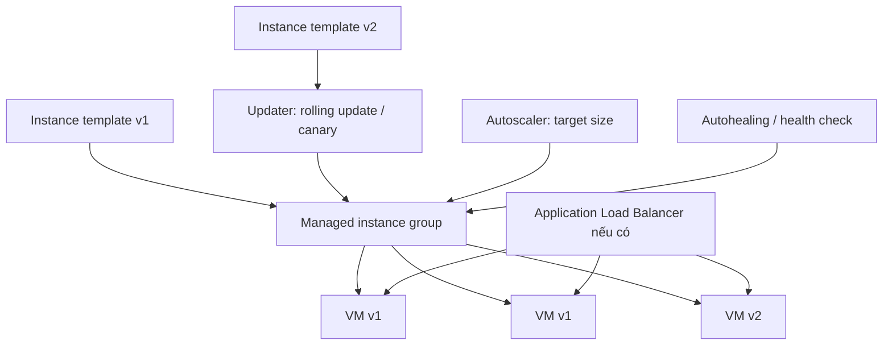
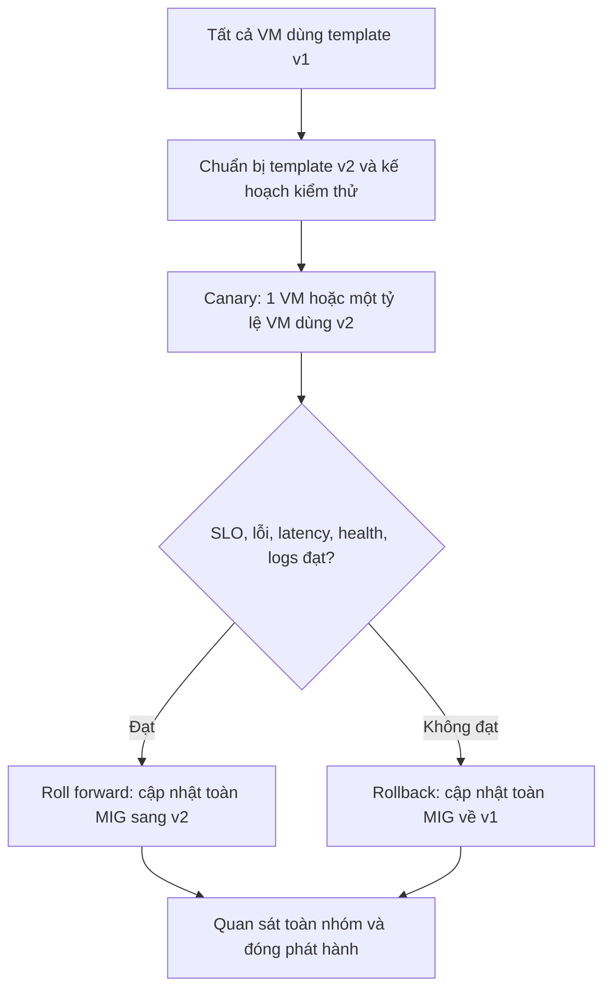

# Rolling updates, canary và khôi phục phiên bản VM

> **Chương:** Nhóm máy ảo và tự động mở rộng  
> **Module:** CLOUD_PROVIDERS_GCP  
> **Phạm vi module:** Khám phá Google Cloud từ tổ chức project, IAM và VPC đến Compute Engine, GKE, Cloud Run, dịch vụ lưu trữ và cơ sở dữ liệu. Qua các tình huống triển khai, người học biết lựa chọn dịch vụ, bảo vệ tài nguyên, tự động hóa phát hành và theo dõi độ tin cậy cùng chi phí.

Một ứng dụng chạy trên nhiều máy ảo Compute Engine cần cập nhật phiên bản hệ điều hành, bản vá, cấu hình hoặc mã ứng dụng. Nếu tắt toàn bộ máy cũ rồi tạo toàn bộ máy mới cùng lúc, người dùng có thể mất dịch vụ. Nếu chỉ thay đổi một vài máy thủ công, hệ thống lại dễ rơi vào trạng thái mỗi máy chạy một cấu hình khác nhau.

**Managed instance group (MIG)** giúp quản lý một nhóm VM theo **instance template**. Với **rolling update**, MIG dần áp dụng cấu hình mới lên các VM theo giới hạn gián đoạn được đặt trước. Với **canary update**, chỉ một phần VM dùng template mới để quan sát rủi ro trước khi mở rộng. Khi có lỗi, **rollback** đưa nhóm về template cũ bằng một yêu cầu cập nhật khác.

Điểm cần nhớ từ đầu: **rolling update không bảo đảm không gián đoạn**, **canary theo số VM không bảo đảm phần trăm request**, và **rollback về VM template cũ không tự hoàn nguyên dữ liệu hoặc database schema**. Độ an toàn phụ thuộc cấu hình updater, health check, load balancer, quota, trạng thái ứng dụng và kế hoạch tương thích dữ liệu.

## Mục tiêu học tập

Sau bài học, bạn có thể:

1. Phân biệt **MIG**, unmanaged instance group, **instance template**, **version** và chính sách cập nhật.
2. Giải thích hai cách cập nhật **proactive** và **opportunistic**, cùng vai trò của `maxSurge`, `maxUnavailable`, `minimalAction`, `replacementMethod` và thời gian sẵn sàng.
3. Thiết kế các giai đoạn **canary → quan sát → roll forward hoặc rollback** có tiêu chí quyết định.
4. Sử dụng Console và `gcloud compute instance-groups managed rolling-action start-update` trên MIG lab được cho phép.
5. Kiểm tra tiến trình qua `status.isStable`, `status.versionTarget.isReached`, danh sách VM và chỉ số sức khỏe ứng dụng.
6. Phân biệt **rollback cấu hình VM** với **khôi phục dữ liệu**, xử lý các lỗi capacity, health check và thay đổi không tương thích.
7. Lập kế hoạch tránh xóa nhầm MIG, template, boot disk, dữ liệu hoặc hệ thống đang được người dùng sử dụng.

## 1. Vì sao cần Managed Instance Group?

MIG là một tập hợp VM được Compute Engine quản lý theo cấu hình mong muốn. Mỗi nhóm có **instance template** quy định những đặc tính như loại máy, image, boot disk, network, metadata, startup script và service account. MIG có thể có **autoscaling**, **autohealing**, **load balancing** và **rolling updates** tùy thiết kế.



### 1.1. Managed và unmanaged instance group

| Đặc điểm | Managed instance group | Unmanaged instance group |
|---|---|---|
| Cấu hình VM chuẩn | Dựa vào instance template và thành phần cấu hình được hỗ trợ | Người quản trị tự quản lý từng VM |
| Tạo/thay VM để đạt trạng thái mong muốn | Có bộ điều khiển MIG | Không có updater tương tự cho toàn nhóm |
| Rolling update và canary tự động | Có trong MIG theo tính năng được hỗ trợ | Cần cơ chế triển khai khác |
| Autohealing | Có thể cấu hình health check và repair | Không có cơ chế MIG autohealing |
| Autoscaling | Có thể bật theo tín hiệu phù hợp | Không có MIG autoscaler |
| Stateful workload | Có mô hình **stateful MIG** với quy tắc riêng | Phải tự thiết kế trạng thái và vòng đời VM |

**Phạm vi bài này:** chủ yếu dùng **stateless MIG**, ví dụ nhóm VM phục vụ web/API sau load balancer. Với cơ sở dữ liệu hoặc VM cần giữ disk/IP/metadata cố định, cần thiết kế **stateful MIG** và kiểm tra giới hạn của rolling update trước khi áp dụng.

### 1.2. Zonal và regional MIG

- **Zonal MIG:** các VM thuộc một zone, thích hợp cho lab đơn giản hoặc khi có yêu cầu ràng buộc zone.
- **Regional MIG:** trải các VM qua nhiều zone trong cùng region theo chính sách phân phối và tính năng hỗ trợ, giúp giảm phụ thuộc vào một zone.

Chế độ MIG quyết định tham số `--zone` hoặc `--region` trong `gcloud`. **Không dùng cả hai** trong cùng lệnh cập nhật. Regional MIG nhiều zone cũng có quy tắc riêng cho `maxSurge`, `maxUnavailable` và việc phân bổ VM, nên không lấy nguyên ví dụ zonal áp vào production regional MIG mà không tính lại.

## 2. Instance template là đơn vị phiên bản cấu hình

**Instance template** là một resource dùng để khai báo cấu hình cho VM. Khi cần sửa một thuộc tính trong template đã sử dụng, quy trình thông thường là **tạo template mới** rồi yêu cầu MIG cập nhật VM. Không chỉnh sửa trực tiếp template cũ và mong toàn nhóm tự cập nhật.

```text
web-template-v1
  image: app-image-v1
  machine type: e2-small
  service account: web-runtime-sa
  metadata: release=v1

web-template-v2
  image: app-image-v2
  machine type: e2-small
  service account: web-runtime-sa
  metadata: release=v2
```

**Mẹo để rollback tái lập được:** giữ template cũ và tham chiếu **image/application artifact phiên bản bất biến**. Nếu template chỉ trỏ tới một **image family** có thể thay đổi phiên bản mặc định theo thời gian, VM mới được tạo sau này có thể dùng image khác với lần triển khai trước. Cần kiểm soát base image, startup script, package version và artifact repository.

### 2.1. Template khác version trong MIG

| Khái niệm | Ví dụ | Ý nghĩa |
|---|---|---|
| Template resource | `web-template-v2` | Bản mô tả cấu hình VM |
| Version trong MIG | `template=web-template-v2` | MIG sử dụng template nào để tạo VM mong muốn |
| Canary target size | `target-size=1` | Số VM mục tiêu theo template canary |
| Group target size | `targetSize=6` | Tổng số VM mong muốn của MIG |
| Current action | `CREATING`, `RECREATING`, `NONE` | Hành động updater đang thực hiện với VM |
| Actual VM template | `web-template-v1` hoặc `web-template-v2` | Cấu hình thật của từng VM hiện tại |

MIG có thể dùng tối đa **hai phiên bản instance template trong một lần canary**. Đây không phải hệ thống lưu lịch sử vô hạn các bản phát hành. Bạn phải tự giữ danh mục artifact, template cũ, bản ghi phát hành và kế hoạch rollback.

### 2.2. Những cấu hình ngoài template

MIG còn hỗ trợ **all-instances configuration** (ví dụ metadata/labels) và **stateful configuration** cho các trường hợp cần giữ một số trạng thái. Khi phân tích vì sao VM không giống template, phải xem **cả những lớp ghi đè này**. Template là nền tảng, không phải lúc nào cũng là cấu hình duy nhất tác động đến VM.

## 3. Rolling update hoạt động ra sao?

Giả sử một MIG có **6 VM** đang dùng `web-template-v1`. Bạn yêu cầu chuyển sang `web-template-v2`, đặt **`maxSurge=1`** và **`maxUnavailable=0`**. Nếu có đủ quota và tài nguyên, updater có thể tạo một VM mới trước, xác minh điều kiện sẵn sàng, rồi thay một VM cũ, tiếp tục từng lượt.

```text
Ban đầu:      [v1] [v1] [v1] [v1] [v1] [v1]        6 VM
Lượt đầu:     [v1] [v1] [v1] [v1] [v1] [v1] + [v2]  7 VM tạm thời
Khi v2 sẵn:   [v1] [v1] [v1] [v1] [v1] [v2]        6 VM
Tiếp tục:     [v1] [v1] [v1] [v1] [v2] [v2]        6 VM
...
Hoàn tất:     [v2] [v2] [v2] [v2] [v2] [v2]        6 VM
```

Đây là **minh họa logic**, không phải lời hứa về thứ tự hoặc thời điểm mà Compute Engine thay từng VM. Trên thực tế, update có thể thực hiện nhanh hoặc chậm tùy image, startup, health check, vùng, quota, độ trễ và tính sẵn có.

### 3.1. Proactive và opportunistic

| Update type | Cách hoạt động | Khi thích hợp |
|---|---|---|
| **Proactive** | Updater tự chủ động áp dụng cấu hình mới dần lên các VM để đạt trạng thái mong muốn | Rollout có kế hoạch, canary, phiên bản mới cần đồng nhất |
| **Opportunistic** | Không chủ động thay toàn bộ VM cũ; áp dụng khi tạo VM mới, resize, repair theo cấu hình hoặc được yêu cầu cập nhật chọn lọc | Thay đổi ít cấp bách, cần người vận hành kiểm soát chính xác thời điểm |

Với `opportunistic`, trong một thời gian có thể tồn tại VM cũ và mới. **Tạo VM mới do autoscaler scale out** có thể sử dụng cấu hình mới ngay cả khi VM cũ chưa bị thay; không được kết luận “opportunistic = đóng băng tuyệt đối mọi version”.

### 3.2. Một yêu cầu update được API chấp nhận chưa phải triển khai thành công

Lệnh `rolling-action start-update` mang tính **khai báo trạng thái mong muốn**. API phản hồi thành công nghĩa là yêu cầu hợp lệ/được chấp nhận, không phải tất cả VM đã chạy code mới và phục vụ tốt. Cần kiểm tra **trạng thái nhóm**, **từng VM** và **tín hiệu ứng dụng** sau đó.

## 4. Các tham số quyết định tốc độ và mức gián đoạn

### 4.1. `maxSurge`

`maxSurge` là số VM **có thể tạo thêm tạm thời** vượt group target size trong khi updater triển khai. Ví dụ nhóm có 6 VM, `maxSurge=2` có thể nâng số VM lên tối đa 8 trong thời gian thay, nếu quota và chính sách cho phép.

Ưu điểm: có thêm năng lực trước khi gỡ VM cũ, giảm nguy cơ giảm capacity. Đánh đổi: cần đủ CPU/VM quota, disk/IP và có thể tăng chi phí tạm thời.

### 4.2. `maxUnavailable`

`maxUnavailable` giới hạn số VM được phép **không khả dụng** do cập nhật tại một thời điểm theo cơ chế tính toán của MIG. Ví dụ nhóm 6 VM, `maxUnavailable=1` cho phép updater thực hiện mức gián đoạn nhất định; `maxUnavailable=0` ưu tiên không giảm số VM khả dụng trong quá trình thay, nhưng **không bảo đảm 100% request không lỗi** nếu health check hoặc ứng dụng không phản ánh đầy đủ khả năng phục vụ.

### 4.3. Ví dụ tổ hợp

| Cấu hình cho zonal MIG 6 VM | Ý nghĩa | Đánh đổi |
|---|---|---|
| `maxSurge=1`, `maxUnavailable=0` | Thử tạo VM mới trước khi loại VM cũ | Cần quota dư và thời gian chờ |
| `maxSurge=2`, `maxUnavailable=1` | Có thể thay nhanh hơn, cho phép một phần không khả dụng | Tăng yêu cầu quota và mức gián đoạn |
| `maxSurge=0`, `maxUnavailable=1` | Không tạo thêm VM, phải chấp nhận giảm capacity khi thay | Không phù hợp nếu không có dư tải |
| `maxSurge=0`, `maxUnavailable=0` | Không còn cách tiến triển với thay thế cần gián đoạn | Cấu hình không hợp lệ hoặc update không thể tiến hành |

Trong **regional MIG**, các giới hạn còn phụ thuộc số zone tham gia và cách làm tròn giá trị cố định/phần trăm. Hãy đối chiếu tài liệu `maxSurge`/`maxUnavailable` trước khi chọn giá trị cho regional MIG nhỏ.

### 4.4. `minimalAction` và `mostDisruptiveAllowedAction`

Không phải mọi thay đổi đều cần xóa VM và tạo VM khác.

| Mức hành động | Cơ chế | Ví dụ |
|---|---|---|
| **REFRESH** | Cập nhật một số cấu hình được hỗ trợ trên VM đang chạy | Nhãn, metadata trong các trường hợp phù hợp |
| **RESTART** | Dừng và khởi động lại VM, không thay VM nếu thuộc tính cho phép | Thay đổi cần khởi động lại dịch vụ/hệ thống |
| **REPLACE** | Thay VM theo replacement method | Boot image, cấu hình không thể cập nhật bằng restart |

`minimalAction` là **mức can thiệp tối thiểu** mà updater sẽ dùng; thay đổi cần mức cao hơn vẫn có thể buộc phải thay VM. `mostDisruptiveAllowedAction` là **giới hạn trên** của mức can thiệp được cho phép; nếu thay đổi cần hành động vượt ngưỡng, update không áp dụng như yêu cầu.

**Ví dụ:** sửa boot image là thay đổi cần `REPLACE`. Đặt `mostDisruptiveAllowedAction=RESTART` để cấm thay VM sẽ khiến cập nhật không thể hoàn thành, không âm thầm cài image mới vào boot disk đang chạy.

### 4.5. `replacementMethod`: giữ tên hay tạo tên mới?

- **SUBSTITUTE:** updater có thể tạo VM mới với **tên khác**, thuận lợi cho chiến lược tạo trước khi xóa VM cũ.
- **RECREATE:** xóa rồi tạo VM lại với **cùng tên**, nhưng ID/creation timestamp có thể khác. Khi dùng `RECREATE`, cần `maxSurge=0` và `maxUnavailable` lớn hơn 0; không thể tạo VM mới cùng tên khi VM cũ còn tồn tại.

Với **stateful MIG**, rolling updates tự động yêu cầu phương án giữ tên VM (`RECREATE`) theo giới hạn dịch vụ. Do rủi ro đĩa/IP/dữ liệu, bài lab ưu tiên **stateless MIG và SUBSTITUTE**.

### 4.6. Thời gian sẵn sàng

Google Cloud có thiết lập **minimum ready time** (`minReadySec`) trong update policy: khoảng thời gian mà VM mới cần ở trạng thái sẵn sàng trước khi updater tính nó đủ ổn định cho tiến trình. Một số phiên bản `gcloud` hiển thị cờ `--min-ready` trong **beta**, hoặc cấu hình có thể qua Console/API.

**Phân biệt ba mốc thời gian**:

1. **Ứng dụng khởi động:** VM đã RUNNING nhưng service chưa chắc sẵn sàng.
2. **Health check/autohealing:** cơ chế đánh giá tình trạng được cấu hình, cùng initial delay nếu có.
3. **Minimum ready time:** khoảng chờ của updater sau khi VM được xem là sẵn sàng, giúp tránh triển khai quá nhanh khi lỗi xuất hiện trễ.

Không coi “VM đang RUNNING” là bằng chứng ứng dụng đủ khả năng nhận traffic. Health check nên kiểm tra endpoint có ý nghĩa; các request thực tế cần được đo qua load balancer và ứng dụng.

## 5. Canary update: thử template mới trên một phần VM

**Canary** có nghĩa MIG mong muốn một phần VM chạy template mới, phần còn lại giữ template cũ. Sau thời gian quan sát, bạn quyết định **roll forward** (100% template mới) hoặc **roll back** (quay lại template cũ).



### 5.1. Có thể canary bao nhiêu VM?

Một MIG hỗ trợ **tối đa hai template versions tại một thời điểm** trong canary. Với `--canary-version`, **`target-size` là bắt buộc**. Có hai cách:

- **Số cố định**, ví dụ `target-size=1`: thử một VM mới trong nhóm 6 VM.
- **Tỷ lệ phần trăm**, ví dụ `target-size=10%`: **chỉ sử dụng được khi MIG có ít nhất 10 VM** theo yêu cầu dịch vụ.

Với MIG nhỏ hơn 10 VM, hãy dùng **số cố định**. Không sửa sang `1%` trong nhóm 4 VM để mong hệ thống tự làm tròn thành một máy.

### 5.2. Canary theo VM không phải canary theo request

Nếu 1 trong 10 VM chạy v2, **không có bảo đảm** 10% request sẽ đến v2. Load balancer có thể phân phối theo tình trạng health, backend capacity, session affinity, sự khác biệt giữa VM và tải thực tế. Trong trường hợp không có load balancer, việc client đến máy nào còn phụ thuộc service discovery.

Khi yêu cầu **chia traffic chính xác theo phần trăm**, cần thiết kế cơ chế ở **load balancer, service mesh hoặc tầng ứng dụng** có hỗ trợ traffic splitting; MIG canary chỉ xác định **số VM mục tiêu theo template**.

### 5.3. Tiêu chí quyết định trước khi canary

| Loại tín hiệu | Tiêu chí minh họa | Nếu không đạt |
|---|---|---|
| **Health** | VM v2 được đánh giá healthy và thực sự nhận request | Không tăng canary, kiểm tra startup/health |
| **HTTP lỗi** | 5xx không tăng vượt ngưỡng đã thống nhất | Điều tra URL map, ứng dụng, dependency |
| **Latency** | p95/p99 không tăng đáng kể so với v1 và SLO | Đo theo version, cân nhắc rollback |
| **Tài nguyên** | CPU, memory, disk, network, quota trong vùng an toàn | Đánh giá resource sizing hoặc memory leak |
| **Nghiệp vụ** | Giao dịch/đọc ghi dữ liệu theo test case đúng | Rollback phần code nếu lỗi tương thích |
| **Dữ liệu** | Schema/backward compatibility vẫn đáp ứng | Dừng rollout; phối hợp phương án DB riêng |
| **Bảo mật** | SA/IAM, image và dependency không mở rộng quyền ngoài dự kiến | Sửa template và kiểm tra lại |

**Canary không có giá trị nếu không quan sát được v1 và v2 riêng biệt.** Có thể gắn version label/metadata và đẩy thông tin version vào application logs, tracing, metrics; nhưng tránh để thông tin nhạy cảm xuất hiện trong logs.

## 6. Thiết kế phát hành: rollback cần chuẩn bị từ trước

Trước khi tạo v2:

1. **Giữ template v1 và artifact v1**, không xóa chỉ vì bản mới đã tạo.
2. Chọn image/app artifact **được cố định version** để tạo lại giống bản cũ.
3. Đảm bảo startup script và provisioning có tính **idempotent**, không tải gói `latest` tùy thời điểm nếu muốn rollback tái lập.
4. Thiết kế database migration theo kiểu **expand → migrate → contract** hoặc chiến lược tương thích tiến/lùi; không để v2 ghi dữ liệu mà v1 không thể đọc, nếu chưa có kế hoạch khôi phục dữ liệu.
5. Đảm bảo mọi secret, firewall, IAM và service account mà v1 cần vẫn còn hợp lệ.
6. Chuẩn bị biểu đồ quan sát, người phê duyệt, giới hạn dừng và kế hoạch liên lạc.
7. Dự trù quota và chi phí VM surge; nếu `maxSurge=1`, dự trù ít nhất một VM bổ sung ở cấu hình tương ứng trong zone của bài lab.

### Một ví dụ về database compatibility

Giả sử v2 của API chuyển từ cột `name` sang hai cột `first_name` và `last_name`. Nếu chạy migration xóa ngay `name`, rollback code về v1 có thể **không hoạt động**, dù mọi VM đã trở về template v1.

Thiết kế phù hợp thường là thêm các cột mới, để v1 và v2 cùng hoạt động trong giai đoạn canary, chuyển đổi dữ liệu có kiểm soát rồi chỉ loại bỏ cột cũ khi không còn bản dùng nó. **Rollback VM template khác rollback database**.

## 7. Chuẩn bị thực hành: chỉ dùng MIG được phép

Phần thực hành chính bắt đầu bằng **kiểm kê read-only**. Việc tạo instance templates hoặc chạy rolling update thật **thay thế/khởi động lại VM** và có thể gây downtime, mất dữ liệu cục bộ hoặc phát sinh phí. **Không chạy lệnh ghi lên MIG production** nếu chưa có change window, backup và phê duyệt.

### 7.1. Điều kiện của lab

- Project sandbox có **zonal MIG stateless đã tồn tại** hoặc được quản trị viên chuẩn bị riêng.
- MIG có **6 VM** chạy ứng dụng hoặc tác vụ kiểm thử được phép thay thế; cấu hình này minh họa canary `1 VM`.
- Đã có **template v1** của MIG và **template v2** đã tạo/test riêng, không dùng resource thuộc workload khác.
- Biết rõ các backend của MIG có nằm sau load balancer hay không, health check nào dùng để autohealing, và đường truy cập test.
- Người thao tác được cấp Compute Engine IAM phù hợp cho MIG/updater và quyền tạo template nếu cần; không nâng quyền quá rộng.
- Đã xem quota Compute Engine, disk/IP và Cloud Billing budget. Budget alert **không chặn** chi phí vượt ngưỡng.

Trong ví dụ, mọi tên đều là placeholder:

| Biến | Giá trị minh họa |
|---|---|
| `PROJECT_ID` | `my-mig-learning-project` |
| `ZONE` | `asia-southeast1-a` |
| `MIG_NAME` | `web-mig-lab` |
| `OLD_TEMPLATE` | `web-template-v1` |
| `NEW_TEMPLATE` | `web-template-v2` |
| `TARGET_SIZE` | `6` |
| `CANARY_SIZE` | `1` |

**Không tạo hai template chỉ khác tên mà không thay đổi gì có thể kiểm chứng.** Để thấy kết quả v2, template v2 nên tham chiếu đến một bản phát hành ứng dụng hoặc metadata/label version mà hệ thống quan sát của bài lab có thể đọc được.

### 7.2. Chuẩn bị image và instance template v2

**Cách qua Console:** mở **Compute Engine → Instance templates**, tìm template đang dùng bởi MIG và chọn hành động tạo một template mới dựa trên bản hiện tại (hoặc tạo mới với cấu hình tương đương). Chỉ chỉnh những thuộc tính cần thiết, ví dụ application image, startup script/artifact version, metadata `release=v2`. Đặt tên rõ `web-template-v2` và kiểm tra:

- VPC/subnet, loại máy, boot disk và cấu hình firewall tương thích với v1.
- SA gắn trên VM đủ quyền tối thiểu, scopes phù hợp.
- Image/startup script tải **đúng artifact v2**, không dùng đường dẫn `latest` thiếu kiểm soát.
- Health check endpoint và cổng phục vụ không bị thay đổi ngoài ý muốn.
- Template cũ `web-template-v1` vẫn tồn tại để rollback.

**Qua gcloud:** tạo template mới từ một VM nguồn thử nghiệm đã được cấu hình đúng có thể dùng `gcloud compute instance-templates create --source-instance=... --source-instance-zone=...`; nhưng cần kiểm tra nguồn VM có IP tĩnh, disk, metadata hoặc secret không phù hợp để sao chép. Trong bài học, để tránh sao chép nhầm resource production, dùng Console/Infrastructure as Code của tổ chức để chuẩn bị v2; các lệnh updater bên dưới **giả định v1 và v2 đã tồn tại**.

## 8. Kiểm kê read-only trước khi cập nhật

### 8.1. Xác minh project, MIG và templates

Chạy trong Cloud Shell hoặc terminal Bash với Google Cloud CLI; thay placeholder đúng môi trường:

```bash
PROJECT_ID="my-mig-learning-project"
ZONE="asia-southeast1-a"
MIG_NAME="web-mig-lab"
OLD_TEMPLATE="web-template-v1"
NEW_TEMPLATE="web-template-v2"

# Xác minh tài khoản và project thực tế
gcloud auth list --filter="status:ACTIVE"
gcloud projects describe "$PROJECT_ID" \
  --format="table(projectId,name,lifecycleState)"

# Liệt kê MIG và các template trong project
gcloud compute instance-groups managed list --project="$PROJECT_ID"
gcloud compute instance-templates list --project="$PROJECT_ID"

# Kiểm tra trạng thái MIG zonal được giao
gcloud compute instance-groups managed describe "$MIG_NAME" \
  --zone="$ZONE" --project="$PROJECT_ID" \
  --format="yaml(name,instanceTemplate,versions,targetSize,updatePolicy,status,autoHealingPolicies)"

# Xem VM thực tế và template mà từng VM đang dùng
gcloud compute instance-groups managed list-instances "$MIG_NAME" \
  --zone="$ZONE" --project="$PROJECT_ID"
```

### 8.2. Kiểm tra instance template trước khi dùng

```bash
# Với ví dụ này, cả hai template là global instance templates
gcloud compute instance-templates describe "$OLD_TEMPLATE" \
  --project="$PROJECT_ID"

gcloud compute instance-templates describe "$NEW_TEMPLATE" \
  --project="$PROJECT_ID"
```

Lưu ý: template có thể là **global** hoặc **regional**. Với regional instance template, các lệnh và tham chiếu cần `--instance-template-region` hoặc URL dạng `projects/PROJECT_ID/regions/REGION/instanceTemplates/TEMPLATE` tùy API/CLI. Đừng giả định tên ngắn của regional template có thể dùng ở mọi vùng.

### 8.3. Những câu hỏi phải trả lời trước khi ghi

1. `OLD_TEMPLATE` có thực sự là **template mà các VM đang chạy** sử dụng không?
2. MIG đang có autohealing, autoscaling, backend service hoặc stateful configuration nào?
3. Có thể duy trì **maxSurge** với quota hiện tại không?
4. Health check có đảm bảo version mới đã nạp cấu hình và sẵn sàng nhận request không?
5. v1 và v2 có cùng quyền IAM/service account, hoặc thay đổi quyền đã được thẩm định?
6. Có cửa sổ triển khai và người chịu trách nhiệm quan sát/rollback không?

Nếu chưa trả lời được, chỉ dừng ở read-only; **không thử start-update để xem chuyện gì xảy ra**.

## 9. Thực hành canary một VM trong zonal MIG

Đây là thao tác thật, **chỉ chạy với MIG stateless lab có quyền thay thế VM và không chứa dữ liệu cục bộ cần giữ**.

### 9.1. Gửi yêu cầu canary

```bash
# Template v1 cho phần lớn VM, v2 cho đúng một VM canary
# Chỉ chạy khi cả hai template đã tồn tại và được xác minh
gcloud compute instance-groups managed rolling-action start-update "$MIG_NAME" \
  --project="$PROJECT_ID" \
  --zone="$ZONE" \
  --version="template=$OLD_TEMPLATE" \
  --canary-version="template=$NEW_TEMPLATE,target-size=1" \
  --max-surge=1 \
  --max-unavailable=0
```

**Diễn giải:**

- `--version` chỉ template gốc v1 dành cho phần còn lại của nhóm.
- `--canary-version` khai báo template v2 và `target-size=1` (một VM).
- `--max-surge=1` cho phép tạm thời có thêm tối đa một VM so với target size.
- `--max-unavailable=0` cố giữ số VM khả dụng trong giới hạn updater, nhưng cần quota và điều kiện health phù hợp.
- `--zone` xác định **zonal MIG**; với regional MIG sử dụng `--region` và tính lại disruption budget theo zone.

Lệnh thành công nghĩa là **desired state đã được ghi nhận**, chưa phải phép thử chứng minh v2 hoạt động. Nếu nhóm không có đủ quota để tạo VM surge, updater có thể trì hoãn hoặc thất bại; không sửa bằng cách xóa VM đang phục vụ người dùng.

### 9.2. Quan sát tiến trình canary

```bash
# Tổng quan MIG, phiên bản mong muốn và trạng thái updater
gcloud compute instance-groups managed describe "$MIG_NAME" \
  --zone="$ZONE" --project="$PROJECT_ID" \
  --format="yaml(targetSize,versions,updatePolicy,status)"

# Từng VM, template, trạng thái VM, health và current action
gcloud compute instance-groups managed list-instances "$MIG_NAME" \
  --zone="$ZONE" --project="$PROJECT_ID"
```

Một kết quả minh họa khi canary đã được áp dụng ổn định:

```text
MIG targetSize: 6
  5 VM -> web-template-v1
  1 VM -> web-template-v2

status.versionTarget.isReached: true
status.isStable: true
```

Nếu `status.versionTarget.isReached=true`, Compute Engine báo các VM đã đạt version mục tiêu. Nếu `status.isStable=true`, nhóm không còn action đang xử lý theo đánh giá của hệ thống. **Hai cờ này không thay thế SLO, test ứng dụng hoặc việc xác minh response thực tế**.

Kiểm tra **HTTP errors, request latency, backend health, logs theo version, CPU/memory và metric nghiệp vụ**. Nếu application version được gắn nhãn trong log, hãy so sánh v1 và v2 cùng thời điểm; không chỉ nhìn số lượng VM.

### 9.3. Điều kiện để tiếp tục

Ví dụ một playbook:

| Điều kiện | Kết quả yêu cầu |
|---|---|
| v2 VM đã được tạo và sẵn sàng | Không có lỗi boot/startup hoặc health check kéo dài |
| Nhóm ổn định | `versionTarget.isReached` và `isStable` phù hợp |
| Error rate | Không tăng vượt guardrail đã xác định |
| p95 latency | Không xấu đi ngoài giới hạn đã thống nhất |
| Giao dịch mẫu | Các test case đọc/ghi và xác thực đạt |
| Quota và chi phí | Không có tăng phí, IP/disk/CPU vượt mức kế hoạch |
| Người phụ trách | Đã xem kết quả và đồng ý roll forward |

Không bắt đầu canary version mới trong khi rollout cũ chưa rõ trạng thái. Khi muốn thử **v3**, nên **rollback hoàn toàn v2** hoặc hoàn thành v2 rồi bắt đầu một chu kỳ canary riêng để tránh lẫn trạng thái nhiều template.

## 10. Roll forward lên 100% template mới

Sau khi canary đạt yêu cầu, chuyển toàn MIG về **một template mục tiêu v2**:

```bash
# Chỉ sau khi người phụ trách chấp thuận mở rộng rollout
gcloud compute instance-groups managed rolling-action start-update "$MIG_NAME" \
  --project="$PROJECT_ID" \
  --zone="$ZONE" \
  --version="template=$NEW_TEMPLATE" \
  --max-surge=1 \
  --max-unavailable=0
```

Lệnh **bỏ `--canary-version`**; mục tiêu mới là **100% VM dùng v2**. Updater có thể bỏ qua VM đã dùng v2 và tiếp tục thay VM còn ở v1.

**Điểm kiểm tra hoàn tất:**

1. `versions` của MIG còn template v2 theo cấu hình mong muốn.
2. Mỗi VM trong `list-instances` đã dùng template v2.
3. Nhóm không còn current action và `status.isStable` hợp lệ.
4. Health check của backend, error rate/latency và giao dịch thực đều đạt.
5. v1 template/artifact vẫn được giữ theo **chính sách rollback**; không xóa ngay sau rollout.

### Nếu canary đạt nhưng rollout toàn bộ gặp lỗi

Một bản v2 có thể chạy ổn trên một VM nhưng lỗi khi mọi VM đều chạy v2: quá nhiều connection tới database, cache stampede, thắt cổ chai API, vấn đề phiên người dùng hoặc quota. Vì vậy cần **theo dõi liên tục trong rollout**, không cho rằng canary thành công thì 100% chắc chắn an toàn.

## 11. Rollback khi phát hiện lỗi

Cloud Compute Engine không cung cấp một lệnh “undo phiên bản trước” tự nhận biết toàn bộ lịch sử ứng dụng. **Rollback MIG là một yêu cầu cập nhật mới trỏ đến instance template cũ đã được giữ lại**.

### 11.1. Rollback canary hoặc rollout v2 về v1

```bash
# Trở lại template v1 đã được xác minh là an toàn
gcloud compute instance-groups managed rolling-action start-update "$MIG_NAME" \
  --project="$PROJECT_ID" \
  --zone="$ZONE" \
  --version="template=$OLD_TEMPLATE" \
  --max-surge=1 \
  --max-unavailable=0
```

Đây là **rollback ưu tiên duy trì availability** cho zonal stateless MIG có đủ quota; không phải chế độ “rollback nhanh nhất” trong mọi tình huống. Google Cloud cho phép tăng `maxUnavailable` để thay nhanh hơn, thậm chí đặt giá trị lớn, nhưng có thể làm gián đoạn toàn bộ dịch vụ. **Không dùng `--max-unavailable=100%` trên production chỉ vì muốn nhanh**, trừ khi tác động đã được chấp thuận rõ ràng.

**Sau lệnh rollback:**

- Xem `describe` và `list-instances` cho tới khi đạt template v1.
- Xác minh v1 nhận traffic và test chức năng thành công.
- Kiểm tra log/application metrics để biết lỗi v2 đã hết.
- Xem database/schema, queue/message và các dữ liệu do v2 tạo hoặc sửa; VM rollback không xóa hay phục hồi các thay đổi dữ liệu ngoài VM.
- Lưu thông tin sự cố, trigger rollback, thời gian bắt đầu/kết thúc, version và quyết định tiếp theo.

### 11.2. “Stop rollout” không phải “Rollback”

Khi cần **ngừng chủ động thay các VM còn lại** trong lúc điều tra, Google Cloud có lệnh:

```bash
# Chỉ dùng khi đã quyết định tạm ngừng proactive rollout để điều tra
gcloud compute instance-groups managed rolling-action stop-proactive-update "$MIG_NAME" \
  --project="$PROJECT_ID" \
  --zone="$ZONE"
```

Lệnh thay update type sang **opportunistic**, nhờ đó updater không tiếp tục chủ động thay toàn bộ VM. Tuy nhiên:

- **VM đã dùng v2 không tự trở về v1**.
- VM mới do autoscaler/resize hoặc một số hoạt động quản lý tạo có thể dùng cấu hình mong muốn mới; do đó đây **không phải nút đóng băng tuyệt đối**.
- Để rollback thật, cần gửi **start-update về v1**, theo dõi quá trình thay và xác minh ứng dụng.

Không gọi liên tiếp `stop-proactive-update` và các lệnh cập nhật mới khi chưa biết current desired versions; cần ghi lại trạng thái trước khi xử lý.

### 11.3. Rollback có thể thất bại khi nào?

| Nguyên nhân | Ví dụ | Phương án xử lý |
|---|---|---|
| Template v1 đã bị xóa hoặc không tái lập được | Mất image/artifact được tham chiếu | Giữ template và artifact theo chính sách release; phục hồi từ bản sao được kiểm soát |
| Database không tương thích | v2 đổi schema khiến v1 lỗi | Chạy kế hoạch migration tương thích/khôi phục dữ liệu riêng |
| Thiếu quota/capacity | `maxSurge=1` nhưng zone không còn quota | Đánh giá quota/capacity, điều chỉnh kế hoạch với người phụ trách |
| Health check sai | VM tạo thành công nhưng không healthy | Kiểm tra startup, readiness, firewall, route và probe |
| Startup script không idempotent | v1 tải gói mới hoặc thay dữ liệu lúc boot | Cố định artifact, sửa script trước vòng phát hành mới |
| Cấu hình IAM/secret bị thay ngoài template | SA mất quyền hoặc secret đổi định dạng | Khôi phục policy/config tương thích theo quy trình riêng |
| Stateful disks/IP không được bảo vệ | Update xóa VM chứa dữ liệu cục bộ | Dùng stateful MIG và backup/restore phù hợp; không dùng template rollout như backup |

## 12. Autoscaling, autohealing và load balancing trong thời gian update

### 12.1. Autoscaler

**Autoscaler** thay đổi **group target size** theo tín hiệu như CPU, load balancing capacity, Cloud Monitoring metrics hoặc lịch trình tùy tính năng. Trong rollout, autoscaler có thể thêm/bớt VM, khiến:

- Số VM đang ở mỗi template thay đổi trong quá trình giám sát.
- **Canary theo phần trăm VM** có thể tương ứng với số máy khác khi target size thay đổi.
- Quota cần nhiều hơn dự kiến vì vừa autoscale out vừa có surge.
- Một máy v2 canary có thể nhận tải khác do autoscaling và hành vi LB.

Không tắt autoscaler production một cách tùy tiện; trước canary cần hiểu **min/max replicas, initialization period, scale-in controls** và mức tải có thể biến động.

### 12.2. Autohealing

Autohealing dùng health check để phát hiện VM không khỏe và **repair/recreate** theo chính sách MIG. Trong khi update đang chạy, autohealing và updater đều tác động tới vòng đời VM.

**Initial delay** dành cho autohealing nên phản ánh thời gian ứng dụng startup. Nếu quá ngắn, VM vừa lên chưa khởi động ứng dụng đã bị đánh dấu cần repair, tạo vòng lặp. Nếu quá dài, phát hiện VM thực sự hỏng sẽ chậm. Đây không phải cùng tham số với `minReadySec` của rolling updater.

### 12.3. Load balancer và draining

Nếu MIG làm backend cho HTTP(S) load balancer, cần xét:

- Backend service có health check đúng protocol/path/port.
- VM v2 có thật sự được LB coi là healthy và nhận traffic.
- Cấu hình **connection draining** hoặc xử lý graceful shutdown giúp giảm request bị ngắt khi VM bị gỡ, nếu backend/mode hỗ trợ.
- Session affinity, cache, retries và timeout có thể ảnh hưởng tỷ lệ request đến v2.
- Có thể dùng Cloud Logging/Monitoring gắn nhãn version để so sánh 5xx và latency.

**Healthy theo MIG không tự chứng minh mọi request qua ALB thành công**: health check có thể chưa bao trùm dependency, migration hoặc luồng nghiệp vụ. Nên triển khai smoke test và synthetic monitoring ở tầng ứng dụng.

## 13. Quan sát update qua Console và Cloud Monitoring

### 13.1. Google Cloud Console

1. Mở **Compute Engine → Instance groups** trong đúng project.
2. Chọn MIG, xem **Details**, **Instances**, **Instance template & overrides** và **Update policy**.
3. Kiểm tra template mong muốn, tỷ lệ/số VM canary và chính sách `maxSurge`/`maxUnavailable`.
4. Xem từng VM: template thực, current action, trạng thái RUNNING và health.
5. Kiểm tra thông báo lỗi ở group operations nếu updater không tiến triển.
6. Nếu MIG là backend LB, mở **Network services → Load balancing → Backend service** để xem health và chỉ số requests.

### 13.2. gcloud chỉ đọc

```bash
# Kiểm tra versions, target size, update policy và trạng thái
gcloud compute instance-groups managed describe "$MIG_NAME" \
  --zone="$ZONE" --project="$PROJECT_ID" \
  --format="yaml(targetSize,versions,updatePolicy,status)"

# Liệt kê VM và trạng thái hành động, không thay đổi resource
gcloud compute instance-groups managed list-instances "$MIG_NAME" \
  --zone="$ZONE" --project="$PROJECT_ID"
```

Hai cờ trạng thái được dùng phổ biến:

| Cờ | Cách đọc | Không đủ để kết luận điều gì? |
|---|---|---|
| `status.versionTarget.isReached` | Các VM đã đạt cấu hình phiên bản mục tiêu theo updater | Chưa bảo đảm ứng dụng đúng nghiệp vụ |
| `status.isStable` | MIG không còn tác vụ đang xử lý theo đánh giá của dịch vụ | Chưa bảo đảm không có 5xx hoặc lỗi dữ liệu |

Nếu một cờ vẫn `false`, xem từng VM và current action. Có thể updater đang tiến hành bình thường, hoặc mắc lỗi quota, timeout, autohealing hay cấu hình template; không lập tức gửi lại hàng loạt lệnh update.

### 13.3. Metrics và log nên có

| Tín hiệu | Cần biết | Cách hành động |
|---|---|---|
| **VM RUNNING/HEALTHY** | Máy mới đã boot và probe được chưa? | Kiểm tra startup script, readiness, firewall |
| **Current action / errors** | Đang tạo, xóa, repair hay stuck? | Xem errors ở MIG/Compute Engine operations |
| **5xx rate** | API/web trả lỗi có tăng khi thêm v2? | So sánh theo release/version, rollback nếu cần |
| **p95/p99 latency** | v2 chậm hơn khi tải tăng? | Kiểm tra CPU, database, lock, I/O |
| **CPU/memory/disk** | Máy v2 yêu cầu tài nguyên khác v1? | Điều chỉnh sizing, quota, image/config |
| **Autoscaler target** | Có scale-out/scale-in trùng lúc rollout? | Phân biệt sự cố triển khai với thay đổi tải |
| **Cost/quotas** | Surge làm tăng VM/disk/IP trong bao lâu? | Xem Billing Reports và quota alerts |

Để biết lỗi có đến từ canary, hệ thống log nên chứa **release id** (`v1`/`v2`), hostname/instance id và thời điểm; dùng trace hoặc request id khi phù hợp để nối các nguồn dữ liệu.

## 14. Ba tình huống vận hành

### Tình huống A — Website từ v1 lên v2 không muốn downtime

MIG web stateless có 6 VM, dùng LB và health check `/readyz`. Đội chuẩn bị template v2 với image đã kiểm thử, canary trên 1 VM và giữ `maxSurge=1`, `maxUnavailable=0`. Sau khi VM mới healthy, error rate và p95 ổn định trong cửa sổ quan sát, đội roll forward toàn nhóm.

**Bài học:** surge giúp giữ capacity nhưng cần quota. Canary theo một VM giúp giảm phạm vi lỗi, nhưng không cam kết 1/6 request đến v2.

### Tình huống B — Bản phát hành gây lỗi dữ liệu

Canary v2 vẫn trả HTTP 200 ở `/healthz` nhưng khi thao tác đặt hàng, ứng dụng phát sinh lỗi do migration schema không tương thích. Đội phát hiện qua business metric và application logs, rollback MIG về template v1.

**Bài học:** health check nông có thể đánh dấu healthy dù nghiệp vụ hỏng; rollback code có thể cần **khôi phục/chỉnh sửa schema và dữ liệu** theo kế hoạch riêng. Phải thử các luồng nghiệp vụ quan trọng trong canary.

### Tình huống C — Autoscaling và quota làm rollout dừng

MIG mục tiêu 12 VM, autoscaler đang tăng lên 18 VM vì lưu lượng lớn. Đội đặt `maxSurge=3` nhưng project không đủ CPU quota để tạo VM bổ sung. Updater không tiến triển như dự kiến.

**Bài học:** ngoài chính sách update, phải xem autoscaler, quota theo zone, disk/IP, machine family và capacity. Không vội tăng `maxUnavailable` trên production khi chưa chấp nhận giảm năng lực phục vụ.

### Tình huống D — Stateful MIG cần giữ danh tính máy

Một nhóm VM quản lý dữ liệu có disk/IP stateful và phụ thuộc vào tên VM. Nếu thay kiểu `SUBSTITUTE`, VM mới có tên khác, có thể phá ứng dụng/giả định cấu hình. Với stateful MIG, phải xem `RECREATE`, `maxSurge=0`, `maxUnavailable>0`, stateful disk/IP preservation và backup.

**Bài học:** rolling update stateless không phải bản sao an toàn cho stateful workloads. Cần chạy playbook riêng để bảo vệ dữ liệu.

## 15. Khắc phục lỗi thường gặp

| Hiện tượng | Nguyên nhân có thể | Hướng kiểm tra |
|---|---|---|
| `start-update` bị từ chối | Thiếu quyền sửa MIG, sai zone/region, template không tồn tại | Kiểm tra principal, scope MIG, global/regional template |
| `--canary-version` không hợp lệ | Thiếu `target-size` hoặc dùng % khi nhóm dưới 10 VM | Dùng `target-size=1` cho MIG nhỏ |
| `maxSurge=1` nhưng chưa tạo VM mới | Không đủ quota, capacity, IP/disk hoặc update policy ràng buộc | Xem VM/quota/operation và giới hạn theo zone |
| Update dừng không tiến triển | VM mới không healthy, startup script lỗi, min-ready chưa đạt | Xem logs guest, health check, initial delay |
| `status.isStable` là true nhưng API lỗi | Updater ổn định không đồng nghĩa nghiệp vụ đúng | Kiểm tra request logs, 5xx, p95 và test chức năng |
| V2 đang chiếm quá nhiều traffic | VM canary không bằng tỷ lệ request, LB affinity/capacity khác | Đo traffic theo version; dùng traffic splitting nếu cần |
| VM tạo lại có tên mới | Replacement method là `SUBSTITUTE` | Nếu tên phải giữ, đánh giá `RECREATE` cùng surge=0 |
| Muốn rollback nhưng v1 đã bị xóa | Không giữ template/image/artifact cũ | Bổ sung release retention, khôi phục artifact hợp lệ |
| Rollback v1 nhưng chức năng vẫn hỏng | Schema/data/secret/config đã đổi | Thực hiện plan dữ liệu riêng, kiểm tra phụ thuộc |
| Có VM mới dù vừa `stop-proactive-update` | Autoscaler/resize/repair tạo VM theo intended config | Xem update policy, current versions và autoscaling |
| Regional MIG cập nhật không đều giữa zone | Phân phối theo zone, quota và rounding constraints | Xem distribution policy và update limits theo zone |
| Phát sinh chi phí tăng | VM surge, disk/IP, LB, logs và thời gian rollout | Đọc Billing Reports, cân đối maxSurge/quota |

### Quy trình điều tra khi rollout bị kẹt

1. **Kiểm tra desired versions:** MIG đang muốn bao nhiêu VM ở v1/v2?
2. **Xem updater policy:** proactive/opportunistic, maxSurge, maxUnavailable, replacement method, minimal action.
3. **Xem từng VM:** current action, instance status, health, last error.
4. **Kiểm tra quota và mạng:** VM mới có tạo được không, startup script có lấy được artifact/secrets không?
5. **Đo tình trạng ứng dụng:** health, 5xx, latency, database và error logs.
6. **Quyết định rõ ràng:** tiếp tục, tạm ngừng proactive, hoặc rollback về template cũ.
7. **Xác minh trạng thái cuối:** toàn nhóm ở phiên bản mong muốn, ứng dụng hoạt động và dữ liệu không bị mất.

## 16. Dọn tài nguyên và giữ khả năng rollback

Với lab học tập, **không xóa MIG có dữ liệu thật hoặc đang nhận traffic**. Nếu dùng một MIG tồn tại sẵn của nhóm, chỉ khôi phục trạng thái đã thỏa thuận; không tự xóa tài nguyên.

### 16.1. Trả MIG lab về template v1

Nếu bạn đã chạy canary/roll forward và cần khôi phục đúng trạng thái ban đầu:

```bash
# Chỉ chạy trên MIG lab, sau khi xác minh OLD_TEMPLATE vẫn dùng được
gcloud compute instance-groups managed rolling-action start-update "$MIG_NAME" \
  --project="$PROJECT_ID" \
  --zone="$ZONE" \
  --version="template=$OLD_TEMPLATE" \
  --max-surge=1 \
  --max-unavailable=0

# Đợi updater hoàn tất rồi xác minh từng VM và desired version
gcloud compute instance-groups managed describe "$MIG_NAME" \
  --project="$PROJECT_ID" --zone="$ZONE" \
  --format="yaml(versions,status,updatePolicy)"
gcloud compute instance-groups managed list-instances "$MIG_NAME" \
  --project="$PROJECT_ID" --zone="$ZONE"
```

Không xoá template v2 trong khi còn VM/cấu hình MIG nào sử dụng nó. Khi tất cả VM đã trở về v1 và chủ sở hữu không còn cần v2, mới có thể cân nhắc xóa **template v2 riêng tạo cho lab**, sau khi đối chiếu mọi nhóm khác có thể tham chiếu template đó.

### 16.2. Kiểm kê trước khi xóa tài nguyên riêng của lab

```bash
# Đọc những tài nguyên đang tồn tại; không gây thay đổi
gcloud compute instance-groups managed list --project="$PROJECT_ID"
gcloud compute instance-templates list --project="$PROJECT_ID"
gcloud compute instances list --project="$PROJECT_ID"
```

Nếu bạn tạo một MIG mới **chỉ cho bài lab**, việc xóa MIG sẽ xóa các VM do MIG quản lý, có thể tác động tới boot disks, IP và dữ liệu theo cấu hình resource. Chỉ thực hiện qua Console hoặc runbook có xác nhận **đúng owner, resource IDs, dữ liệu cần giữ và thứ tự dọn**; không chạy lệnh xóa hàng loạt trên project dùng chung.

### 16.3. Template v1: giữ hay xóa?

Đừng xóa v1 chỉ vì v2 đã đạt 100%. Giữ artifact theo chính sách rollback/retention, kiểm tra ràng buộc bảo mật/chi phí. Nếu một image cũ có lỗ hổng bảo mật nghiêm trọng, việc giữ nó chỉ nên là khả năng phục hồi có quản lý, không phải cho phép chạy phiên bản đó vô thời hạn.

### 16.4. Kiểm tra Billing cuối buổi

Khi VM được tạo thêm lúc surge, tài nguyên Compute Engine có thể phát sinh chi phí tính theo thời gian sử dụng; boot disks và các tài nguyên liên quan có vòng đời riêng. Autoscaling, load balancer, logging và egress cũng có thể ảnh hưởng tổng chi.

Sau lab, xem Cloud Billing Reports theo project/service/SKU; **budget alerts không tự chặn chi phí** và số liệu billing có thể trễ. Không tạo VM lớn chỉ để thấy canary hoạt động nếu chưa có ngân sách hoặc quota được phép.

## 17. Checklist đánh giá một lần phát hành

| Nhóm kiểm tra | Yêu cầu đạt |
|---|---|
| **Phạm vi** | Project, MIG, zone/region, owner và change window đã xác nhận |
| **Version** | Template v1/v2 tồn tại, artifact/image đã cố định version |
| **IAM** | Người triển khai có đúng quyền; VM SA quyền tối thiểu |
| **Dữ liệu** | Schema/format tương thích; có backup và kế hoạch khôi phục riêng |
| **Sức khỏe** | Health check/autohealing, startup delay, min ready phù hợp |
| **Capacity** | Max surge/unavailable có căn cứ; quota, IP/disk đủ |
| **Canary** | Target size đúng; với nhóm ít hơn 10 VM dùng số cố định |
| **Observability** | Log/metrics có nhãn v1/v2, có p95/5xx, tín hiệu nghiệp vụ |
| **Go/no-go** | Tiêu chí chuyển tiếp/rollback và người phê duyệt rõ ràng |
| **Roll forward** | Target version 100% v2, toàn VM và ứng dụng được xác minh |
| **Rollback** | Có lệnh trở về v1, giữ template/artifact, biết giới hạn khôi phục dữ liệu |
| **Cleanup** | Không xóa resource dùng chung, dọn lab và xem chi phí sau cùng |

## 18. Câu hỏi tự kiểm tra

**1. Vì sao phải tạo instance template mới thay vì sửa trực tiếp template v1?**  
**Trả lời:** instance template là cấu hình phiên bản dùng để tạo VM; quy trình chuẩn là tạo template v2 và yêu cầu MIG cập nhật, giữ v1 để có khả năng rollback.

**2. `maxSurge=2` nghĩa là gì với MIG target size 6?**  
**Trả lời:** updater có thể tạm tạo tối đa 2 VM thêm ngoài target size, tức tối đa 8 VM trong giai đoạn thích hợp, nếu quota và ràng buộc khác cho phép.

**3. Với MIG 6 VM, có thể canary `target-size=10%` không?**  
**Trả lời:** không theo giới hạn hỗ trợ cho canary percentage; với nhóm dưới 10 VM dùng số cố định như `target-size=1`.

**4. 1/10 VM dùng v2 thì có chắc 10% HTTP request đến v2?**  
**Trả lời:** không. Đây là tỷ lệ VM, không phải traffic split. Phân phối request phụ thuộc LB, health, capacity và workload.

**5. API trả về thành công khi gọi `start-update` có nghĩa mọi VM đã dùng v2?**  
**Trả lời:** không. Phải quan sát desired/current versions, `status.isStable`, `versionTarget.isReached` và trạng thái ứng dụng.

**6. `stop-proactive-update` có đưa VM canary về template v1 không?**  
**Trả lời:** không. Nó đổi phương thức áp dụng update; rollback thực sự cần yêu cầu cập nhật về template v1.

**7. Vì sao rollback VM template không hoàn nguyên database?**  
**Trả lời:** template mô tả cấu hình VM. Dữ liệu và schema ở hệ thống bên ngoài có vòng đời độc lập; cần phương án khôi phục/migration riêng.

**8. Muốn giữ nguyên tên VM khi replace nên chọn gì?**  
**Trả lời:** `replacementMethod=RECREATE`, kèm `maxSurge=0` và giới hạn unavailable phù hợp; tên giữ lại nhưng VM instance ID có thể thay đổi.

**9. VM mới RUNNING nhưng ứng dụng chưa sẵn sàng có thể gây vấn đề gì?**  
**Trả lời:** nếu health/readiness không phản ánh startup thực và rollout quá nhanh, updater/LB có thể gửi traffic hoặc tiếp tục thay VM sớm; cần health check và thời gian sẵn sàng phù hợp.

**10. Autoscaler có thể tác động gì tới canary?**  
**Trả lời:** làm group target size và số VM từng version thay đổi, ảnh hưởng nhu cầu quota, capacity và tỷ lệ VM canary; phải theo dõi cùng updater.

## Ghi nhớ

- **Rolling update** áp dụng cấu hình mới dần trên MIG theo disruption budget; **canary** chỉ cập nhật một phần VM để giảm phạm vi rủi ro.
- **Instance templates là các cấu hình phiên bản cần giữ**; phiên bản phần mềm và image phải tái lập được để rollback tin cậy.
- **`maxSurge`** kiểm soát số VM tạo thêm, **`maxUnavailable`** kiểm soát gián đoạn do updater; cả hai phải dựa trên capacity, quota và mức chịu lỗi.
- **Canary target-size theo VM**, không phải theo traffic. Dùng fixed count khi MIG dưới 10 VM và đo tín hiệu ứng dụng chứ không chỉ nhìn trạng thái VM.
- **Rollback là một rolling update mới về template cũ**, không phải khôi phục dữ liệu. `stop-proactive-update` chỉ tạm dừng chủ động áp dụng cấu hình.
- **Autoscaling, autohealing và load balancing** tác động đến rollout; chỉ hoàn thành khi version, health, logs, SLO và nghiệp vụ cùng đạt.
- **Dọn lab có kiểm soát**: xác minh resource thuộc quyền sở hữu và giữ template/artifact cũ đủ thời gian theo chính sách rollback.

## Tài liệu tham khảo chính thức

- [Google Cloud — Instance groups overview](https://cloud.google.com/compute/docs/instance-groups)
- [Google Cloud — Apply new VM configurations in a MIG](https://cloud.google.com/compute/docs/instance-groups/updating-migs)
- [Google Cloud — Automatically apply VM configuration updates in a MIG](https://cloud.google.com/compute/docs/instance-groups/rolling-out-updates-to-managed-instance-groups)
- [Google Cloud — Create instance templates](https://cloud.google.com/compute/docs/instance-templates/create-instance-templates)
- [Google Cloud SDK — rolling-action start-update](https://cloud.google.com/sdk/gcloud/reference/compute/instance-groups/managed/rolling-action/start-update)
- [Google Cloud SDK — stop-proactive-update](https://cloud.google.com/sdk/gcloud/reference/compute/instance-groups/managed/rolling-action/stop-proactive-update)
- [Google Cloud — Autoscaling groups of instances](https://cloud.google.com/compute/docs/autoscaler)
- [Google Cloud — Autohealing instances in MIGs](https://cloud.google.com/compute/docs/instance-groups/autohealing-instances-in-migs)
