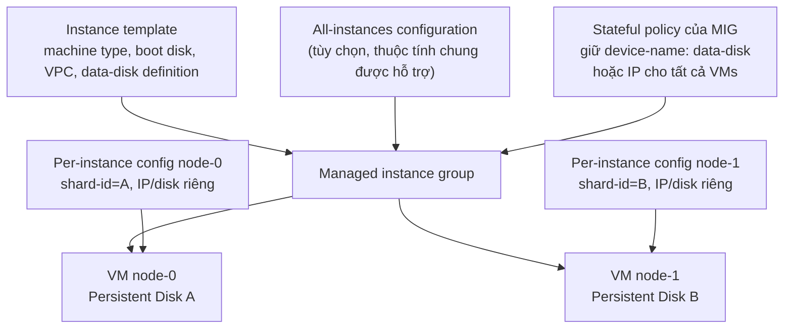
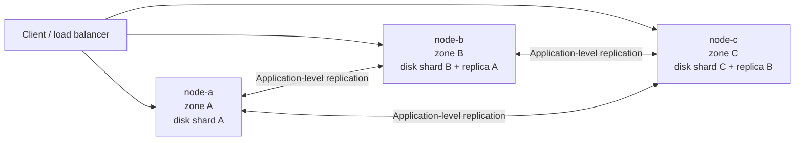
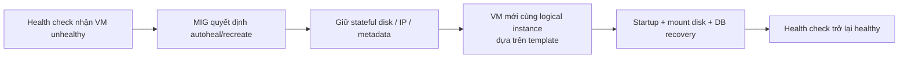

# Stateful managed instance groups

## 1. Bài toán: tự phục hồi máy ảo mà không mất trạng thái

Giả sử một doanh nghiệp vận hành cụm dịch vụ xử lý dữ liệu trên **Compute Engine**. Mỗi VM đảm nhiệm một phân vùng dữ liệu riêng: `node-0` xử lý shard A, `node-1` xử lý shard B. Ngoài ứng dụng, mỗi VM có một **Persistent Disk** chứa dữ liệu hoặc checkpoint, một địa chỉ IP ổn định và metadata xác định vai trò.

Với một **stateless managed instance group (MIG)**, VM có thể được tái tạo từ **instance template** khi lỗi. Đây là cách tốt cho web frontend không lưu dữ liệu cục bộ, nhưng có thể làm mất ổ đĩa hoặc danh tính ứng dụng nếu cấu hình theo mặc định. Một dịch vụ stateful không thể coi mọi VM đều có thể thay thế bằng máy hoàn toàn mới.

**Stateful managed instance group (stateful MIG)** cho phép Compute Engine quản lý vòng đời và **autohealing** của các VM, đồng thời giữ những thành phần trạng thái đã khai báo như **Persistent Disk**, **địa chỉ IPv4** và **instance-specific metadata** khi VM được tái tạo hoặc cập nhật theo cơ chế được hỗ trợ. Cách này phù hợp cho database tự quản, workload shard, hệ thống legacy và tác vụ dài có checkpoint.

Trong module **CLOUD_PROVIDERS_GCP**, chủ đề này kết nối kiến thức **Project/IAM, VPC, Compute Engine, load balancing, lưu trữ, CI/CD, theo dõi độ tin cậy và chi phí**. Điểm quan trọng nhất là phân biệt **khả năng giữ trạng thái VM** với **khả năng tự mở rộng theo tải** và **khả năng khôi phục dữ liệu qua vùng lỗi**.

### Mục tiêu học tập

Sau bài học, bạn có thể:

1. Phân biệt stateless MIG và stateful MIG theo dữ liệu, danh tính máy, cách phục hồi và hạn chế vận hành.
2. Giải thích sự kết hợp của **instance template**, **stateful policy** và **per-instance configuration**.
3. Cấu hình và kiểm chứng **stateful disk**, **stateful IP** và **stateful metadata**.
4. Hiểu tác động của **autohealing**, **rolling update**, **resize**, **delete**, **abandon** và **lỗi zone** lên preserved state.
5. Nêu rõ vì sao stateful MIG **không hỗ trợ autoscaling hay scaling schedules**, dù nằm trong chương “Nhóm máy ảo và tự động mở rộng”.
6. Đọc các lệnh `gcloud` để tạo và kiểm tra một stateful MIG theo quy trình an toàn.
7. Thiết kế backup, replication, kiểm soát IAM, giám sát và dự toán chi phí cho workload stateful.

> **Quy ước:** Project ID, tên nhóm, IP, giá trị metadata và sơ đồ trong bài đều là **ví dụ giả định**. Các lệnh tạo VM, ổ đĩa hoặc thay đổi group có thể phát sinh chi phí và gây mất dữ liệu nếu áp dụng sai. Chỉ chạy trên project thử nghiệm được cấp phép và kiểm tra tài liệu tại thời điểm triển khai.

## 2. Stateless MIG so với stateful MIG

**Managed instance group** là tập các VM được Compute Engine quản lý dựa trên template cùng các cấu hình bổ sung. Cả hai dạng có thể dùng cơ chế kiểm tra sức khỏe và tái tạo instance, nhưng trạng thái mà Compute Engine phải giữ khác nhau.

| Tiêu chí | Stateless MIG | Stateful MIG |
| --- | --- | --- |
| Loại workload | Web/API frontend, worker không giữ state trên VM | Database tự quản, shard, checkpoint, ứng dụng legacy |
| VM có thay thế tự do được không? | Thường **có** | **Không hoàn toàn**: mỗi VM có state hoặc vai trò riêng |
| Dữ liệu trên disk qua recreate | Disk mặc định có thể bị xóa và tạo lại theo template | **Stateful disk** đã cấu hình được giữ và gắn lại |
| IP qua recreate | Có thể thay đổi | Có thể giữ **stateful internal/external IPv4** |
| Metadata riêng cho node | Không nhất thiết được giữ nếu không cấu hình | Có thể giữ qua **per-instance configuration** |
| Tên VM | MIG có cơ chế giữ tên qua autohealing ngay cả khi stateless | Có thể giữ tên, kết hợp các stateful items |
| Autohealing | Có | Có, phục hồi VM theo state đã khai báo |
| Rolling update | Có nhiều lựa chọn thay thế VM | Có giới hạn: muốn tự động rolling thì **RECREATE**, không dùng `SUBSTITUTE` |
| **Autoscaling** | **Có**, theo CPU, load balancing, metrics... | **Không hỗ trợ** khi group có stateful configuration |
| **Scaling schedules** | Có theo khả năng hỗ trợ | **Không hỗ trợ** khi group có stateful configuration |
| Regional MIG | Có thể phân phối VM nhiều zone | Có thể chứa replica nhiều zone nhưng **không tự di chuyển shard/disk khi zone mất** |

### Stateful không phải chỉ là VM có disk

Một stateless MIG vẫn có boot disk hoặc data disk. Điểm phân biệt là **MIG có được yêu cầu giữ trạng thái cụ thể của disk/IP/metadata qua recreate hay không**. Một group trở thành **stateful** khi có **stateful policy không rỗng** hoặc ít nhất một **per-instance configuration không rỗng**.

MIG mặc định giữ tên VM trong nhiều thao tác autohealing, nhưng **chỉ cần tên cố định không nhất thiết phải dùng stateful MIG**. Khi rolling update muốn giữ tên, phải cấu hình replacement method `RECREATE`.

## 3. Kiến trúc: template, policy và cấu hình theo từng VM

Một stateful MIG không phải tập những VM độc lập được quản lý bằng tay. Compute Engine vẫn dựa vào **cấu hình khai báo** để tạo hoặc phục hồi VM.



### 3.1. Instance template — phần cấu hình chung

Template mô tả những thuộc tính VM áp dụng phổ biến cho cả nhóm: machine type, boot image, network interface, service account, startup script và các disk được tạo khi VM khởi động.

Để đưa một disk vào **stateful policy** của cả MIG, disk đó phải xuất hiện trong template với **device name** tương ứng, ví dụ `data-disk`. Những disk riêng của từng VM có thể được khai báo ở **per-instance configuration** mà không cần tồn tại trong template.

### 3.2. Stateful policy — trạng thái được giữ cho cả nhóm

**Stateful policy** là cấu hình mức **group**, ví dụ:

- Disk có `device-name=data-disk` phải được giữ qua autohealing, update và recreate.
- Địa chỉ IP của network interface `nic0` phải được giữ ổn định qua recreate.
- Chọn **delete rule** cho disk/IP khi VM bị **xóa vĩnh viễn** khỏi group.

Policy được MIG áp dụng **bất đồng bộ** cho các VM hiện có và tự động áp dụng lên VM mới. Thêm disk vào stateful policy thường làm thay đổi thuộc tính auto-delete của disk, **không đòi hỏi reboot ngay** chỉ để ghi nhận stateful policy.

### 3.3. Per-instance configuration — đặc tính riêng của từng VM

Mỗi VM có thể giữ các giá trị riêng:

- `shard-id=A` cho `node-0`, `shard-id=B` cho `node-1`.
- Một disk đã tồn tại, chẳng hạn `disk-shard-a`, được gắn vào đúng node.
- Một địa chỉ internal/external IPv4 nhất định, dùng cho ứng dụng legacy hoặc danh tính node.

Per-instance configuration không được hiểu là “metadata chung gán cho toàn group”; nó chỉ định **state của một VM cụ thể** và cần được **áp dụng** trước khi kỳ vọng recreate giữ đúng cấu hình đó.

### 3.4. Kiểm chứng trạng thái hiệu lực

Trong API, các giá trị **preserved state** có thể đến từ:

- `preservedStateFromPolicy`: stateful policy dùng chung.
- `preservedStateFromConfig`: per-instance configuration.

Trước khi cho phép autohealing hoặc thay đổi lớn, **đọc danh sách managed instances và preserved state thực tế**. Không chỉ nhìn template rồi kết luận disk đã được bảo vệ.

## 4. Stateful Persistent Disk: trạng thái quan trọng nhất

### 4.1. Cách bảo toàn disk

Ví dụ, VM có hai disk:

```text
node-0
├── boot-disk (stateless): OS, app binaries, startup script
└── data-disk (stateful): shard A, checkpoint và dữ liệu cần giữ

node-1
├── boot-disk (stateless): OS, app binaries, startup script
└── data-disk (stateful): shard B, checkpoint và dữ liệu cần giữ
```

Khi `node-0` bị autohealing thay thế:

1. MIG phát hiện VM cần recreate.
2. Disk `data-disk` của `node-0` được **giữ lại**, không tạo một disk trống từ template thay thế.
3. VM `node-0` được tạo lại theo cấu hình; disk stateful được **gắn lại** vào VM đó.
4. Ứng dụng khởi động, mount filesystem và khôi phục trạng thái từ disk/checkpoint.
5. Health check xác nhận ứng dụng có thể phục vụ.

**Tên VM và dữ liệu không đồng nghĩa logic giao dịch luôn nhất quán.** Autohealing không tự chạy database recovery, sửa log bị hỏng hoặc giải quyết giao dịch đang dở. Ứng dụng và cơ chế backup phải chịu trách nhiệm.

### 4.2. Vì sao nên giữ boot disk stateless?

Google Cloud khuyến nghị **giữ boot disk stateless** nếu kiến trúc có thể tách ứng dụng và dữ liệu:

- Boot disk có thể được tái tạo từ image đã được cập nhật, hỗ trợ patch và sửa tình trạng hỏng hệ điều hành.
- Stateful data disk giữ dữ liệu quan trọng, được mount lại sau recreate.
- Rolling update có thể sử dụng template/image mới mà không giữ nguyên boot image cũ mãi.

Nếu buộc phải giữ **boot disk stateful** cho ứng dụng legacy, hãy nhận rõ đánh đổi: quá trình recreate **không thay boot disk bằng image mới**, và MIG không thể tự chữa lỗi OS/boot disk bị hỏng bằng cách tạo disk mới. Việc cập nhật OS/binaries cần do bạn thực hiện theo cách khác.

### 4.3. Delete rule: thao tác xóa vĩnh viễn khác autohealing

Stateful disk hỗ trợ quy tắc xóa khi **VM bị xóa vĩnh viễn** khỏi group:

| Giá trị trong `gcloud` | Khi VM bị xóa vĩnh viễn | Khi VM autohealing/recreate |
| --- | --- | --- |
| `auto-delete=never` | **Giữ lại và detach disk**; disk tiếp tục tồn tại và tính phí | **Giữ lại, gắn lại** |
| `auto-delete=on-permanent-instance-deletion` | **Xóa disk cùng VM** trong các thao tác xóa vĩnh viễn | **Giữ lại, gắn lại** |

Vì vậy, `auto-delete=never` không có nghĩa dữ liệu chắc chắn sống sót nếu ai đó **xóa disk thủ công** hoặc disk bị hỏng; nó chỉ định hành vi của MIG khi VM bị xóa theo cơ chế quản lý.

**Lưu ý về chi phí:** disk còn tồn tại sau khi VM bị xóa **vẫn bị tính phí dung lượng**. Đừng tạo automation xóa “mọi disk unattached” khi chưa phân biệt disk được giữ lại để phục hồi.

## 5. Stateful IP và stateful metadata

### 5.1. Địa chỉ IP được giữ như thế nào?

Stateful MIG có thể bảo toàn **internal IPv4** hoặc **external IPv4** đã được khai báo là stateful. Dịch vụ sử dụng **static Address resources** để duy trì địa chỉ qua recreate.

Với policy áp cho toàn nhóm, bạn có thể yêu cầu IP của `nic0` được giữ mà không cần gán trước một con số cho từng VM. Với per-instance configuration, bạn có thể chỉ rõ một địa chỉ IP cụ thể, ví dụ `10.20.10.15` đã thuộc subnet của VM.

Khi cân nhắc IP stateful:

- Đảm bảo mạng/subnet không thay đổi và IP hợp lệ trong region/subnet.
- Với **Shared VPC**, kiểm tra quyền `roles/compute.networkUser` hoặc quyền IP/subnet tương ứng trong host project.
- Kiểm tra **chi phí static external IP** và địa chỉ không gắn VM sau khi xóa.
- Không giả định stateful IPv4 bao gồm IPv6 hoặc mọi loại interface chuyên biệt.
- Nếu truy cập qua load balancer hoặc service discovery, hãy đánh giá liệu IP node cố định có thật sự cần thiết.

### 5.2. Stateful metadata

Ví dụ metadata:

| VM | Metadata riêng | Tác dụng |
| --- | --- | --- |
| `node-0` | `shard-id=A` | Gắn node với shard A |
| `node-1` | `shard-id=B` | Gắn node với shard B |
| `node-2` | `role=observer` | Chỉ định một vai trò nghiệp vụ riêng |

Trong stateful MIG, **stateful metadata được định nghĩa theo từng VM**, không phải bằng stateful policy dùng chung. Thao tác autohealing hoặc recreate sẽ đặt lại các key-value đó lên VM mới theo per-instance configuration.

**Bảo mật:** instance metadata không phải nơi chứa mật khẩu, private key hoặc API token dài hạn. Người/tác nhân có khả năng đọc metadata của VM có thể truy cập các giá trị; sử dụng Secret Manager và IAM thích hợp cho dữ liệu bí mật.

## 6. Các thao tác vòng đời tác động tới state ra sao?

| Sự kiện | Hành vi của MIG | Điều phải kiểm tra |
| --- | --- | --- |
| **Reboot/stop/start** | Disk/IP và metadata tiếp tục được gắn theo cấu hình | Ứng dụng có tự khởi chạy và mount disk đúng không? |
| **Autohealing VM unhealthy** | Recreate VM, **giữ các stateful items đã khai báo** | Health check có thực sự biểu thị lỗi cần recreate? |
| **Rolling update với `RECREATE`** | Cập nhật các thuộc tính stateless nhưng giữ stateful items | Template, boot disk, metadata, downtime và readiness |
| **Thay stateful policy** | Áp dụng trạng thái mới cho group một cách bất đồng bộ | Chờ group stable và đọc preserved state |
| **Tăng target size thủ công** | Tạo node mới theo template và stateful policy | Phải cấp shard/metadata/IP riêng cho node mới nếu ứng dụng cần |
| **Giảm target size thủ công** | MIG chọn các VM để **xóa vĩnh viễn**, xóa per-instance state config của chúng | Không dùng để “scale down” tùy tiện khi VM giữ dữ liệu |
| **Xóa một VM khỏi MIG vĩnh viễn** | Xóa state config; disk/IP có thể còn hoặc mất theo delete rule | Backup và danh tính node trước khi xóa |
| **Abandon một VM** | Tách VM khỏi quản lý MIG theo thao tác; VM có thể tiếp tục tồn tại độc lập | Kiểm tra chính sách preserved state, disk/IP và trách nhiệm vận hành sau detach |
| **Mất zone** | Regional MIG không tự di chuyển stateful instance/disk từ zone hỏng sang zone khác | Cần replica và failover **ở tầng ứng dụng** |

**Bất kỳ thao tác “xóa vĩnh viễn” nào cũng phải được phân biệt với “recreate để phục hồi”.** Với workload sharded, việc MIG tùy chọn VM khi giảm size có thể xóa nhầm node giữ dữ liệu quan trọng. Nên xóa có chủ đích, sao lưu và xác minh shard trước khi giảm quy mô.

## 7. Giới hạn quan trọng: stateful MIG không tự autoscale

Chương này nói về **nhóm máy ảo và tự động mở rộng**, nhưng **stateful MIG là một ngoại lệ rõ ràng**: **không hỗ trợ autoscaling và scaling schedules** khi có stateful configuration. **Không được hứa rằng MIG stateful sẽ tự tăng/giảm VM theo CPU hoặc HTTP load-balancing utilization.**

Vì sao? Thêm hoặc xóa node stateful không chỉ là điều chỉnh số máy:

1. Node mới có thể cần **cấp shard**, phân phối dữ liệu, đăng ký trong cluster và chờ đồng bộ.
2. Node bị xóa có thể đang sở hữu dữ liệu chưa được replicate hoặc là thành viên quorum.
3. Giảm size tự động theo CPU có thể khiến **mất dữ liệu, mất quorum hoặc outage**.
4. Một disk hoặc IP riêng không thể tùy tiện gắn sang một VM khác ở zone khác khi chưa tính tới khả năng zone/replica.

### Có mở rộng được không?

**Có, nhưng theo quy trình có kiểm soát**, ví dụ:

- **Manual resize** khi đã chuẩn bị số lượng shard và quyền truy cập.
- **Tạo một managed instance cụ thể** cùng per-instance configuration cho disk/IP/metadata.
- **Tự động hóa bên ngoài** theo workflow đã có kiểm tra điều kiện ứng dụng, backup và approval, thay vì bật native MIG autoscaler.
- Dùng **stateless MIG autoscaling** ở frontend/worker nếu tầng đó không cần giữ state.

Google Cloud có các API `stopInstances` và `startInstances`; có thể kết hợp Cloud Scheduler hoặc workflow riêng cho lịch **bật/tắt** node stateful khi phù hợp. Đây **không phải** tính năng scaling schedules native của autoscaled MIG và vẫn cần quản lý dữ liệu.

## 8. Regional stateful MIG: multi-zone không đồng nghĩa auto-failover

Một regional MIG có thể phân bổ các VM vào nhiều zone trong một region. Điều này hữu ích cho ứng dụng có **replication ở tầng ứng dụng**, nhưng **stateful MIG không tự thực hiện cross-zone failover** cho state/disk của một node.



Nếu zone A không sẵn sàng, MIG **không tự lấy disk zonal của `node-a` rồi gắn ở zone B**. Những replica đã được ứng dụng đồng bộ trên zone B/C phải tiếp tục phục vụ dữ liệu, theo quorum/consensus và chính sách failover riêng.

### Bắt buộc vô hiệu proactive redistribution

Đối với **regional stateful MIG**, phải đặt:

```text
instanceRedistributionType: NONE
```

Nếu proactive redistribution vẫn bật, MIG có thể tự chuyển phân bổ VM giữa các zone bằng cách xóa/tạo instance, trái với mục tiêu giữ state. Việc **không chủ động redistribute** không làm ứng dụng tự bảo vệ trước mất zone; nó chỉ giảm nguy cơ thay đổi vị trí node ngoài ý muốn.

### Thiết kế HA thực sự

Một hệ thống có SLO/RPO/RTO cần:

- Replica và cơ chế đồng bộ dữ liệu phù hợp ứng dụng.
- Số node/quorum đủ chịu mất một zone; không chỉ có hai VM mà không có chiến lược leader election.
- Load balancer, readiness và service discovery phục vụ node khỏe mạnh.
- Runbook quyết định khi nào promote replica và khi nào tạo node/shard thay thế.
- Snapshot, backup và restore test để chống xóa nhầm, lỗi phần mềm hoặc dữ liệu bị hỏng.

**Stateful MIG bảo vệ lifecycle của VM; nó không tự cung cấp replication hay distributed consensus.**

## 9. Chuẩn bị một lab có stateful data disk

Ví dụ xây một **zonal stateful MIG** để minh họa bảo toàn disk. Giả định:

```text
Project:         acme-state-lab
Zone:            asia-southeast1-a
Region:          asia-southeast1
VPC/subnet:      lab-vpc / lab-subnet (đã tồn tại)
Instance template: stateful-template-v1
MIG:             stateful-demo
Group size:      2
Boot disk:       stateless, từ Debian image
Data disk:       device-name=data-disk, pd-balanced, 50 GB
Delete rule:     never (giữ disk khi xóa VM vĩnh viễn)
```

**Điều kiện trước khi làm:** project đã bật Compute Engine API, có billing/quota, mạng/subnet phù hợp, principal có quyền tạo instance template/MIG/disks, và hệ thống bảo mật cho phép tạo VM. Dữ liệu ở lab không chứa thông tin nhạy cảm.

### 9.1. Tạo instance template

```bash
# TẠO TÀI NGUYÊN: chỉ chạy ở lab được cấp quyền, phát sinh chi phí
gcloud compute instance-templates create stateful-template-v1 \
  --project=acme-state-lab \
  --machine-type=e2-standard-2 \
  --image-family=debian-12 \
  --image-project=debian-cloud \
  --subnet=lab-subnet \
  --no-address \
  --create-disk=device-name=data-disk,size=50GB,type=pd-balanced,auto-delete=yes
```

Template mô tả disk mới với device name **`data-disk`**. Tùy chọn `auto-delete=yes` trong template là thuộc tính disk khi chưa có stateful policy; bước tiếp theo sẽ đánh dấu `data-disk` là stateful và định nghĩa vòng đời riêng qua `--stateful-disk`.

Nếu đang dùng Shared VPC, thay `--subnet` bằng reference phù hợp của host project và cấp `compute.networkUser` trên subnet cho principal/service agent liên quan.

**Quan trọng:** tạo template **không tự tạo VM**. Các disk thực được khởi tạo khi MIG tạo instance. Trong guest OS, bạn vẫn phải **format/mount data disk và khởi chạy ứng dụng** theo cách nhất quán, ví dụ bằng startup script hoặc image được chuẩn bị sẵn. Không format disk đã có dữ liệu khi VM được autohealing tạo lại.

### 9.2. Tạo stateful MIG với data disk giữ lại

```bash
# TẠO VM VÀ DISK: chi phí tính ngay khi tài nguyên được provision
gcloud compute instance-groups managed create stateful-demo \
  --project=acme-state-lab \
  --zone=asia-southeast1-a \
  --template=stateful-template-v1 \
  --base-instance-name=node \
  --size=2 \
  --stateful-disk=device-name=data-disk,auto-delete=never
```

Đây là **zonal MIG** để tách việc học cơ chế preserved state khỏi bài toán replication multi-zone. Khi tạo, MIG áp dụng stateful policy cho disk `data-disk` của hai VM.

### 9.3. Đọc lại trạng thái (chỉ đọc)

```bash
# Xem stateful policy, target size, template và update policy
gcloud compute instance-groups managed describe stateful-demo \
  --project=acme-state-lab \
  --zone=asia-southeast1-a \
  --format="yaml(name,targetSize,instanceTemplate,statefulPolicy,updatePolicy,status)"

# Xem từng VM cùng trạng thái preserved state
gcloud compute instance-groups managed list-instances stateful-demo \
  --project=acme-state-lab \
  --zone=asia-southeast1-a

# Xem device names trong template
gcloud compute instance-templates describe stateful-template-v1 \
  --project=acme-state-lab \
  --format="yaml(properties.disks)"
```

Cột `PRESERVED_STATE` trong `list-instances` có thể hiển thị `POLICY`, `CONFIG` hoặc cả hai. `POLICY` biểu thị có stateful policy đang được áp dụng; `CONFIG` biểu thị per-instance configuration đang hiệu lực.

### 9.4. Đọc cấu hình disk của một VM

Từ output `list-instances`, chọn tên VM thực và kiểm tra:

```bash
gcloud compute instances describe ACTUAL_VM_NAME \
  --project=acme-state-lab \
  --zone=asia-southeast1-a \
  --format="yaml(name,status,disks,networkInterfaces,metadata)"
```

Kiểm tra disk có `deviceName: data-disk`, disk resource tương ứng, và trạng thái tự động xóa/giữ phù hợp. Đừng nhầm **device name trong guest** với **tên resource disk**: MIG có thể tạo disk resource với tên khác.

## 10. Bổ sung stateful IP và metadata theo nhu cầu

### 10.1. Giữ internal IP trên network interface mặc định

Khi workload legacy phụ thuộc vào IP node cố định, có thể cập nhật MIG:

```bash
# THAY ĐỔI CẤU HÌNH: có thể tạo static address resources tương ứng
gcloud compute instance-groups managed update stateful-demo \
  --project=acme-state-lab \
  --zone=asia-southeast1-a \
  --stateful-internal-ip=enabled
```

MIG sẽ thiết lập cơ chế giữ IP nội bộ của `nic0` cho các VM theo cách được hỗ trợ. Để giữ external IP, có tham số `--stateful-external-ip` riêng; không bật chỉ để thử trên production vì sẽ tạo thêm bề mặt tấn công và có thể phát sinh phí.

### 10.2. Metadata riêng khi tạo một managed instance cụ thể

Nếu muốn bổ sung một node có tên riêng cùng `shard-id`, thay vì tăng size không kiểm soát, có thể:

```bash
# Thao tác tạo instance mới, có tính phí và thay đổi cluster
gcloud compute instance-groups managed create-instance stateful-demo \
  --project=acme-state-lab \
  --zone=asia-southeast1-a \
  --instance=node-shard-c \
  --stateful-metadata=shard-id=C
```

Lệnh tạo instance và per-instance configuration chứa key `shard-id=C`. Trước khi đưa node vào hệ thống thật, phải thực hiện **rebalancing dữ liệu**, chờ replication và đăng ký ứng dụng.

Nếu VM **đã tồn tại**, hãy sử dụng `gcloud compute instance-groups managed instance-configs create/update` với `--stateful-metadata`, sau đó chọn cách áp dụng cấu hình theo tài liệu. Không giả định chỉ cập nhật metadata trong guest OS là MIG tự ghi thành per-instance configuration.

### 10.3. Disk hoặc IP riêng cho một node

Một ứng dụng legacy có thể cần gắn một disk cũ `legacy-shard-c` vào node được MIG quản lý. Có thể mô tả disk bằng `--stateful-disk` trong per-instance configuration và, khi phù hợp, chỉ định **source disk URI**. Với static IP, per-instance configuration dùng `--stateful-internal-ip=address=...` hoặc `--stateful-external-ip=address=...`.

Vì disk cũ có thể chứa dữ liệu độc nhất, quy trình migration phải kiểm tra:

1. Disk ở đúng zone hoặc thuộc loại regional được hỗ trợ.
2. Không có writer cũ vẫn đang sử dụng disk theo chế độ không cho phép dùng chung.
3. Tính nhất quán dữ liệu, filesystem và mount settings đã được xác nhận.
4. Tên node và metadata gắn shard đã đúng.
5. Có snapshot/backup và phương án rollback.

Không đưa một lệnh “attach bất kỳ disk” vào production nếu chưa xác định rõ điều kiện này.

## 11. Autohealing: khôi phục VM, không thay thế backup

### 11.1. Mối quan hệ giữa health check và recreate

MIG có thể dùng **application-based health check**. Khi VM không còn khỏe, MIG có thể tái tạo VM và gắn lại preserved state.



Để autohealing thành công, ứng dụng cần **tự khởi động khi VM boot**, mount stateful disk đúng vị trí và khôi phục trạng thái bằng cách an toàn. Nếu startup script format lại disk theo mỗi lần boot, cơ chế preserve của MIG cũng không thể cứu dữ liệu bị ghi đè.

### 11.2. Cấu hình health check

Giả sử ứng dụng có TCP health endpoint ở port 7000:

```bash
# TẠO HEALTH CHECK, chỉ chạy nếu ứng dụng thực sự có listener tương ứng
gcloud compute health-checks create tcp stateful-hc \
  --project=acme-state-lab \
  --port=7000

# CẬP NHẬT MIG: thiết lập autohealing sau khi kiểm chứng readiness
gcloud compute instance-groups managed update stateful-demo \
  --project=acme-state-lab \
  --zone=asia-southeast1-a \
  --health-check=stateful-hc \
  --initial-delay=300
```

**Không bật ví dụ health check này trên các VM chưa chạy service port 7000.** Nếu tất cả VM bị đánh giá unhealthy, MIG có thể liên tục recreate máy, gây gián đoạn và phát sinh chi phí.

### 11.3. Health check cho database/shard cần cẩn trọng

Một database đang làm replay log hoặc chờ replica đồng bộ có thể tạm thời chưa sẵn sàng. Nếu health check quá khắt khe, MIG sẽ recreate liên tục, khiến tiến trình recovery không hoàn thành.

- Đặt `initial-delay` theo thời gian khởi động và mount/recover thực tế.
- Chọn endpoint thể hiện tình trạng **hỏng cần sửa bằng recreate**, không chỉ là “chưa thể nhận traffic”.
- Phân biệt health check **đưa backend ra khỏi load balancer** với health check **kích hoạt VM autohealing**; hai mục tiêu có thể cần chính sách khác nhau.
- Thử nghiệm sự cố ứng dụng, reboot OS và disk mount trước khi áp dụng.

## 12. Rolling update với stateful MIG

Stateful MIG vẫn hỗ trợ cơ chế cập nhật VM, nhưng cần bảo toàn danh tính và state.

### Quy tắc RECREATE

Để dùng **automated rolling updates** với stateful configuration, phải đặt **replacement method** là:

```text
RECREATE
```

Không dùng `SUBSTITUTE` vì phương thức này thay VM bằng VM mới có tên và state khác. Với instance riêng biệt, ý nghĩa của `RECREATE` là giữ logical identity của VM và áp dụng state đã khai báo.

Ví dụ cập nhật policy:

```bash
# Thao tác thay đổi update policy trên MIG
gcloud compute instance-groups managed update stateful-demo \
  --project=acme-state-lab \
  --zone=asia-southeast1-a \
  --update-policy-replacement-method=RECREATE
```

### Template mới thay thế những gì?

| Thành phần | Khi cập nhật template, điều gì xảy ra? |
| --- | --- |
| Boot disk **stateless** | Có thể được tái tạo theo boot image/template mới trong recreate |
| Data disk **stateful** | **Giữ lại**, không ghi đè bằng disk trống từ template |
| Boot disk **stateful** | Không tự nhận boot image mới từ template; phải cập nhật OS bằng quy trình khác |
| State metadata từ per-instance config | Được giữ theo config khi VM được recreate |
| IP stateful | Được giữ nếu rule/IP phù hợp vẫn có hiệu lực |
| Các thuộc tính VM khác | Được áp dụng theo khả năng update của MIG, có thể cần restart/recreate |

### Kế hoạch rollout tối thiểu

1. Tạo template phiên bản mới và kiểm tra OS/app compatibility với data disk cũ.
2. Snapshot/backup dữ liệu theo cách **application-consistent** nếu có thể.
3. Xác nhận replacement method `RECREATE`, giới hạn mức gián đoạn và health check.
4. Canary một node hoặc subset có replica/khả năng phục hồi phù hợp.
5. Kiểm chứng dữ liệu, disk attachment, IP, metadata, replication lag và lỗi ứng dụng.
6. Tiến hành cập nhật các node còn lại một cách có kiểm soát; chuẩn bị rollback.

**Không rollback boot image một cách mù quáng** nếu migration schema database hoặc format dữ liệu trên disk không tương thích phiên bản ứng dụng cũ.

## 13. Resize và xóa instance: vùng rủi ro cao

### Tăng size

```bash
# TẠO THÊM VM: cần chuẩn bị shard/replication trước
gcloud compute instance-groups managed resize stateful-demo \
  --project=acme-state-lab \
  --zone=asia-southeast1-a \
  --size=3
```

MIG sẽ tạo thêm VM theo template cùng stateful policy. Node mới **chưa chắc đã được gắn shard hoặc vai trò nghiệp vụ cụ thể**; ứng dụng cần bootstrap và đồng bộ dữ liệu.

### Giảm size: không phải cách scale down an toàn

```bash
# KHÔNG CHẠY tùy tiện với dữ liệu thật:
gcloud compute instance-groups managed resize stateful-demo \
  --project=acme-state-lab \
  --zone=asia-southeast1-a \
  --size=1
```

MIG chọn những instance bị xóa theo logic của nền tảng, **không hứa sẽ giữ node chứa dữ liệu quan trọng nhất**. Một node bị xóa vĩnh viễn sẽ mất per-instance state configuration; disk và static IP còn hay mất phụ thuộc delete rule.

Quy trình thay thế:

1. Xác định **node/shard cụ thể** cần loại khỏi cluster.
2. Replicate/migrate dữ liệu sang các node còn lại và xác minh quorum.
3. Backup/snapshot, đọc disk và IP delete rule.
4. Dùng thao tác có chủ đích đối với managed instance mục tiêu, thay vì resize mù.
5. Kiểm tra disk/IP bị detach còn lại, cleanup khi có phê duyệt.

### Delete và abandon

- **Delete instance** qua quản lý MIG làm giảm số VM và xử lý preserved state theo chính sách xóa.
- **Abandon instance** đưa VM ra khỏi phạm vi quản lý của MIG, thường để giữ VM hiện hữu nhưng **MIG không tiếp tục autoheal/rollout** cho VM đó.
- Đừng xem **abandon** là một hình thức backup hoặc replication. Sau khi tách VM, team phải quản lý OS, disk, IP, giám sát và vòng đời tài nguyên theo quy trình mới.

## 14. Tình huống thiết kế: cụm xử lý sự kiện có checkpoint

Một hệ thống nhận sự kiện từ Pub/Sub, phân chia xử lý cho ba worker. Mỗi worker lưu checkpoint và một bộ dữ liệu tạm có thể khôi phục từ upstream. Nhóm muốn tránh mất tiến độ nếu VM hỏng.

### Lựa chọn ban đầu

- Stateful MIG: mỗi VM có **data disk** được giữ qua recreate.
- Boot disk stateless để cập nhật image/patch dễ hơn.
- Per-instance metadata xác định `partition-id`.
- Health check không ép recreate trong thời gian replay checkpoint.
- Quá trình checkpoint được ghi an toàn, ứng dụng khôi phục idempotently.
- Kết quả quan trọng được ghi thêm ra Cloud Storage hoặc database bên ngoài để bảo vệ khỏi disk mất/hỏng.

### Ma trận sự cố

| Sự cố | Stateful MIG hỗ trợ? | Cần bổ sung gì? |
| --- | --- | --- |
| Worker process chết | Có thể autoheal VM nếu health check phản ánh lỗi | Idempotency, startup/recovery |
| VM bị recreate | Giữ data disk/IP/metadata đã cấu hình | Mount/replay checkpoint đúng và kiểm thử |
| Data disk bị corruption | **Không tự sửa dữ liệu** | Snapshot/backup, checksum, recovery |
| Một zone bị gián đoạn | Không tự chuyển stateful disk zonal sang zone khác | Replica/checkpoint ở zone khác, failover ứng dụng |
| Cần thêm worker khi tải tăng | Không có native autoscaling | Manual/orchestrated scaling có cấp partition |
| Cần nâng cấp OS | Có thể update boot disk nếu stateless | Canary + rolling `RECREATE` |
| Xóa nhầm node | Disk có thể còn nếu `auto-delete=never`, nhưng không đảm bảo toàn bộ state | Backup, audit, quy trình phục hồi |

### Khi nào nên chọn phương án khác?

Nếu worker có thể đọc message từ Pub/Sub và lưu checkpoint tập trung, một **stateless MIG autoscaled** hoặc Cloud Run/GKE có thể đơn giản hơn. Nếu đang chạy PostgreSQL/MySQL, **Cloud SQL** có thể giúp giảm gánh nặng backup/failover. Với phân tích batch, cân nhắc dịch vụ managed phù hợp. Đừng dùng stateful MIG chỉ vì “ứng dụng có database”: phải xác định **state thực sự nằm ở đâu** và ai chịu trách nhiệm phục hồi nó.

## 15. Tình huống thiết kế: database có replica nhiều zone

Giả sử doanh nghiệp chạy database tự quản với ba node:

```text
Regional stateful MIG: db-cluster
  zone A: db-a + disk-a
  zone B: db-b + disk-b
  zone C: db-c + disk-c

App replication: đồng bộ dữ liệu giữa db-a, db-b, db-c
Failover: election/promotion do database/cluster manager xử lý
MIG autohealing: sửa node hỏng trong zone có thể sử dụng
```

**Quyết định không thể bỏ qua:**

1. Database chịu tối đa bao nhiêu mất mát dữ liệu (**RPO**) và thời gian ngừng (**RTO**)?
2. Phân phối replica có chịu mất một zone mà vẫn đủ quorum không?
3. Node vừa trở lại sau autohealing có cần **rejoin cluster** và đồng bộ WAL/replication log không?
4. Khi node primary mất kết nối, ai thực hiện **fencing** để tránh split-brain và dual-writer?
5. Stateful disks là disk **zonal hay regional**, và trong tình huống nào có thể gắn lại?
6. Backup, restore và phương án khôi phục sau lỗi logic/xóa dữ liệu đã được thử chưa?

Không nên giới thiệu stateful MIG như một dịch vụ **managed database HA** hoàn chỉnh. Nó quản lý VM và một phần state tài nguyên; còn quorum, transaction consistency, data replication và schema migrations là trách nhiệm của ứng dụng/hệ thống database.

## 16. IAM, VPC và tính an toàn khi tự động hóa

### Phân quyền theo trách nhiệm

| Nhóm | Quyền cần quản lý | Nguy cơ nếu quá rộng |
| --- | --- | --- |
| Platform/MIG admin | `compute.instanceGroupManagers.*` theo các permission thích hợp | Resize/delete sai có thể xóa node cùng state config |
| VM admin | Tạo/sửa VM, template, startup script, service account | Sửa startup script có thể format nhầm data disk |
| Storage admin | Disk, snapshot và IAM cho lưu trữ | Xóa disk/backup hoặc mở quyền đọc dữ liệu |
| Network admin | VPC/subnet, firewall và static address | IP conflict, mất route, backend không kết nối |
| Security/SRE | Logging, alert, backup policy và quyền audit | Thiếu tín hiệu để phân biệt autoheal và mất dữ liệu |

Không nên cấp role `roles/owner` cho CI/CD chỉ để tạo MIG. Dùng các role/permission nhỏ nhất được phép theo dự án; với **Shared VPC**, cấp thêm Network User đúng subnet và quyền quản trị IP nếu cần.

### Những quy tắc tự động hóa quan trọng

- Hạ tầng dạng mã (Terraform hoặc công cụ tương đương) phải biểu diễn rõ **stateful policy** và **per-instance configs**.
- CI/CD không được chạy lệnh “destroy/recreate tất cả” mà không đọc preserved state và kế hoạch backup.
- Script khởi động phải **phân biệt disk mới với disk đã có dữ liệu**; không format mỗi lần boot.
- Dùng metadata để chỉ định node identity **không chứa bí mật**; secrets nên lấy từ Secret Manager với service account có quyền tối thiểu.
- Kiểm thử hành vi khi retry, VM autohealed giữa chừng, metadata chưa áp dụng hoặc disk mount thất bại.
- Mọi xóa disk, VM, IP reservation và thay update policy nên có audit log và phê duyệt phù hợp.

## 17. Monitoring, troubleshooting và chi phí

### 17.1. Các tín hiệu cần theo dõi

| Tín hiệu | Mục tiêu |
| --- | --- |
| **MIG stability / current actions** | Biết group còn đang tạo, xóa, recreate hay áp dụng config |
| **Managed instance health** | Xác định VM không khỏe hoặc autohealing đang diễn ra |
| **Preserved state** | Xác nhận disk/IP/metadata đã khai báo được giữ |
| **Disk mount/fs errors** | Phát hiện disk đã gắn nhưng ứng dụng không đọc được |
| **Replication lag / quorum / checkpoint age** | Theo dõi khả năng phục hồi **ở tầng ứng dụng** |
| **Data disk utilization / IOPS / throughput** | Tránh disk đầy hoặc nghẽn IO gây unhealthy/recreate |
| **Snapshot/backup success** | Chứng minh có phương án khôi phục ngoài cùng một disk |
| **VM/disks/IP billing** | Kiểm tra chi phí tài nguyên còn lại sau delete/abandon |

### 17.2. Những lỗi phổ biến

| Hiện tượng | Nguyên nhân khả dĩ | Hướng xử lý |
| --- | --- | --- |
| Không bật được autoscaler | MIG có stateful configuration | Dùng manual/orchestrated scaling hoặc tách stateless tier |
| Không tạo regional stateful MIG | Proactive redistribution chưa ở `NONE` | Thiết lập đúng redistribution policy trước cấu hình stateful |
| Update bị từ chối khi dùng `SUBSTITUTE` | Stateful VM yêu cầu giữ identity/state | Chọn `RECREATE` và kiểm tra mức gián đoạn |
| VM autohealed nhưng mất dữ liệu | Disk chưa khai báo stateful hoặc startup format lại disk | Đọc preserved state, disks, startup logs; khôi phục backup |
| VM không khởi động khi disk được gắn lại | Mount UUID sai, filesystem hỏng, script chỉ hỗ trợ disk mới | Sửa mount/recovery script và thử với disk có dữ liệu |
| MIG liên tục autoheal | Health check quá khắt khe, ứng dụng cần nhiều thời gian recover | Chỉnh initial delay/readiness, điều tra root cause |
| Node mới thiếu partition assignment | Resize chỉ tạo VM theo template, chưa có per-instance metadata | Tạo/configure node cụ thể rồi rebalance |
| IP thay đổi sau recreate | IP chưa được cấu hình stateful hoặc reservation không hợp lệ | Kiểm tra stateful policy/config và static Address |
| Xóa VM nhưng disk vẫn còn tính phí | `auto-delete=never` giữ disk | Inventory disk, backup và xóa có kiểm soát khi thật sự không cần |
| Lỗi khi zone A mất | MIG không tự chuyển stateful node qua zone khác | Replica/failover ứng dụng, restore và DR runbook |
| Khó xác minh policy đã có hiệu lực | Cập nhật group bất đồng bộ, MIG chưa stable | Chờ ổn định, xem list-instances và preserved state |

### 17.3. Chi phí

Stateful MIG **không làm cho Compute Engine hoặc disk miễn phí**. Dự toán cần xét:

- VM compute, machine type, OS license và thời gian chạy.
- Persistent Disk theo dung lượng provision và loại disk, IOPS/throughput nếu áp dụng.
- Disk bị detach nhưng vẫn còn vì `auto-delete=never`.
- Static external IP reservations/usage, load balancing, VPC traffic và inter-zone egress.
- Snapshot, backup, Cloud Monitoring/Logging, replication và các dịch vụ phụ thuộc.

**Ví dụ giả định:** một nhóm 3 VM, mỗi VM có data disk 100 GiB; sau sự cố vận hành hai node bị xóa nhưng disks được giữ lại. Tổng dung lượng data disk tồn tại vẫn là **300 GiB**, dù chỉ còn **1 VM chạy**. Nếu 2 disk còn lại không cần, phải xóa theo quy trình đã sao lưu/kiểm tra; không coi chúng đã biến mất theo VM.

Tra cứu bảng giá Compute Engine/Disks/Network và Billing theo **SKU, region, thời điểm và account** của dự án. So sánh với chi phí dịch vụ managed để quyết định có nên tự quản trị stateful cluster hay không.

## 18. Bài tập thực hành và câu hỏi kiểm tra

### Bài 1: Xác định cách giữ trạng thái

Một MIG có hai VM. Mỗi VM có boot disk chứa OS và data disk chứa checkpoint; IP node cần cố định, còn phiên bản app được cập nhật thường xuyên.

1. Disk nào nên giữ stateless, disk nào nên giữ stateful?
2. Cần khai báo gì để IP `nic0` không đổi qua recreate?
3. Vì sao stateful boot disk khiến việc cập nhật image khó hơn?

**Gợi ý:** (1) Boot disk stateless, data disk stateful; (2) stateful internal IP trong policy hoặc per-instance config; (3) disk boot cũ được giữ, không tự tái tạo từ template mới.

### Bài 2: Tính tác động xóa vĩnh viễn

Nhóm có 3 data disk, mỗi disk 200 GiB và `auto-delete=never`. Một VM bị **autohealing**; sau đó một VM khác bị **xóa vĩnh viễn**.

- Disk nào được giữ và gắn lại khi autohealing?
- Disk của VM bị xóa vĩnh viễn còn tồn tại không?
- Có thể dùng disk còn tồn tại như backup đầy đủ không?

**Gợi ý:** Autohealing giữ disk được khai báo stateful; delete rule `never` làm disk của VM xóa vĩnh viễn vẫn còn (detached). Nhưng nó không bảo đảm data consistency, backup chống corruption hoặc DR.

### Bài 3: Nhận biết giới hạn autoscaling

Nhóm muốn MIG tăng từ 3 lên 10 VM theo CPU và giảm tự động lúc nửa đêm. MIG này lưu dữ liệu shard trên data disk của từng VM. Hãy đề xuất cách khác phù hợp, và nêu các bước phải làm trước khi bổ sung hoặc rút node.

**Gợi ý:** Stateful MIG không hỗ trợ native autoscaling/scaling schedules. Tạo workflow kiểm tra dữ liệu/quorum, provision node, bootstrap shard và xác nhận trước khi thay size; hoặc tách stateless worker autoscaled.

### Bài 4: Đọc trạng thái bằng lệnh chỉ đọc

Trong project được phép xem:

```bash
gcloud compute instance-groups managed describe MIG_NAME \
  --project=PROJECT_ID \
  --zone=ZONE \
  --format="yaml(statefulPolicy,updatePolicy,targetSize,status)"

gcloud compute instance-groups managed list-instances MIG_NAME \
  --project=PROJECT_ID \
  --zone=ZONE
```

Hãy xác định: group có stateful configuration không? Những VM nào hiển thị `POLICY` hoặc `CONFIG`? Replacement method là gì? Cần đọc thông tin nào thêm trước khi có thể khẳng định data disk thực sự được giữ qua autohealing?

### Bài 5: Kịch bản mất zone

Regional stateful MIG có 3 VM ở 3 zone, mỗi VM chứa một shard **không có replica**. Zone A ngừng hoạt động. Có phải MIG tự tạo lại shard A ở zone B và hệ thống tiếp tục bình thường không?

**Gợi ý:** Không. Stateful MIG không tự failover data/shard qua zone. Muốn tiếp tục phục vụ phải có replica, khôi phục từ backup hoặc cơ chế riêng của ứng dụng.

### Bài 6: Sửa lỗi rolling update

Một operator định thay instance template và dùng rolling update với phương thức `SUBSTITUTE`. Vì sao thao tác này không phù hợp? Hãy mô tả các bước để update giữ được data disk và giảm nguy cơ outage.

**Gợi ý:** Sử dụng `RECREATE`, backup/canary, kiểm tra preserved state, readiness, giới hạn gián đoạn và khôi phục dữ liệu nếu schema thay đổi.

## 19. Checklist triển khai stateful MIG trong production

- [ ] Đã xác định chính xác **trạng thái nào cần giữ**: disk, IP, instance metadata hay chỉ tên VM.
- [ ] Biết group là **stateful** khi có stateful policy/per-instance configuration, không chỉ vì có disk.
- [ ] Tách boot disk stateless và data disk stateful khi kiến trúc cho phép.
- [ ] Đã kiểm tra **device name**, source disk và delete rule của từng disk.
- [ ] Đã quyết định internal/external IPv4 nào cần ổn định và chi phí static IP.
- [ ] Per-instance metadata không chứa secrets và được tạo/áp dụng đúng node.
- [ ] `list-instances` cho thấy preserved state dự kiến; MIG đã stable.
- [ ] Autohealing readiness phù hợp, startup script không format lại disk cũ.
- [ ] Không cấu hình native **autoscaling/scaling schedules** cho stateful MIG.
- [ ] Automated rolling updates dùng `RECREATE`; có canary, backup và rollback.
- [ ] Regional stateful MIG dùng **proactive redistribution = NONE**.
- [ ] Có application-level replication, quorum và failover; không kỳ vọng tự chuyển disk qua zone.
- [ ] Xóa/resize/abandon được duyệt; không để disk/IP rác hoặc xóa nhầm dữ liệu.
- [ ] Có snapshot/backup, kiểm thử restore và quy trình sửa data corruption.
- [ ] IAM, service accounts, Shared VPC và firewall được giới hạn theo quyền tối thiểu.
- [ ] Đã giám sát VM health, disk usage, replication lag, chi phí và audit events.
- [ ] Có mục tiêu RPO/RTO và runbook cho mất VM, mất zone, lỗi logic và rollout lỗi.

## 20. Tài liệu Google Cloud chính thức

Các giới hạn, cú pháp CLI và tính năng cập nhật theo thời gian; dùng tài liệu chính thức để đối chiếu khi triển khai:

1. [Stateful managed instance groups – Overview](https://cloud.google.com/compute/docs/instance-groups/stateful-migs)
2. [How stateful MIGs work](https://cloud.google.com/compute/docs/instance-groups/how-stateful-migs-work)
3. [Configuring stateful MIGs](https://cloud.google.com/compute/docs/instance-groups/configuring-stateful-migs)
4. [Create a MIG with stateful persistent disks](https://cloud.google.com/compute/docs/instance-groups/create-mig-with-basic-stateful-disks)
5. [Configure stateful persistent disks](https://cloud.google.com/compute/docs/instance-groups/configuring-stateful-disks-in-migs)
6. [Configure stateful IP addresses](https://cloud.google.com/compute/docs/instance-groups/configuring-stateful-ip-addresses-in-migs)
7. [Configure stateful metadata](https://cloud.google.com/compute/docs/instance-groups/configuring-stateful-metadata-in-migs)
8. [Applying, viewing and removing stateful configuration](https://cloud.google.com/compute/docs/instance-groups/applying-viewing-removing-stateful-config-in-migs)
9. [How operations affect preserved state](https://cloud.google.com/compute/docs/instance-groups/preserved-state)
10. [Set up application-based autohealing](https://cloud.google.com/compute/docs/instance-groups/autohealing-instances-in-migs)
11. [Rolling out updates to managed instance groups](https://cloud.google.com/compute/docs/instance-groups/rolling-out-updates-to-managed-instance-groups)
12. [Migrate a workload to a stateful MIG](https://cloud.google.com/compute/docs/tutorials/migrate-workload-to-stateful-mig)
13. [Google Cloud CLI – managed instance groups](https://cloud.google.com/sdk/gcloud/reference/compute/instance-groups/managed)
14. [Compute Engine and disk pricing](https://cloud.google.com/compute/all-pricing)

**Ghi nhớ:** **Stateful MIG giữ các thành phần state của từng VM qua autohealing/recreate theo policy**, chứ không tự cung cấp autoscaling, nhân bản dữ liệu hay failover qua zone. Thiết kế tốt phải kết hợp **preserved state**, **ứng dụng tự khởi động/phục hồi**, **replication/backup**, **quản lý xóa/rolling update**, **IAM** và **giám sát chi phí**. Đó là cách tận dụng quản lý vòng đời VM của Compute Engine mà không đánh đổi tính toàn vẹn dữ liệu.
