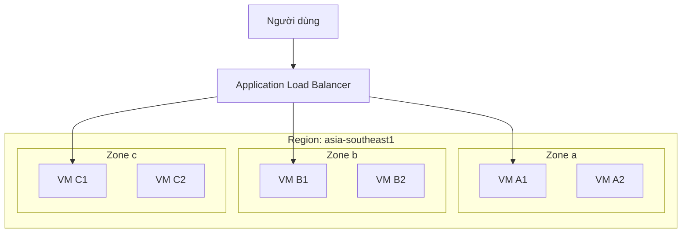
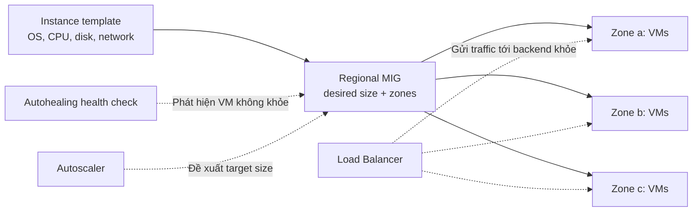
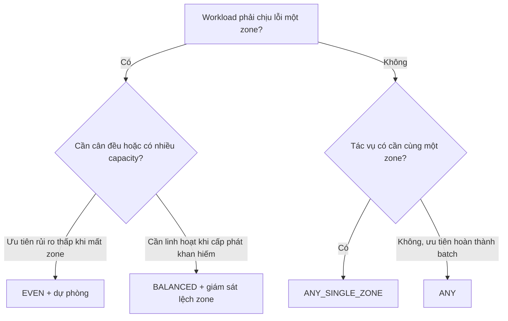
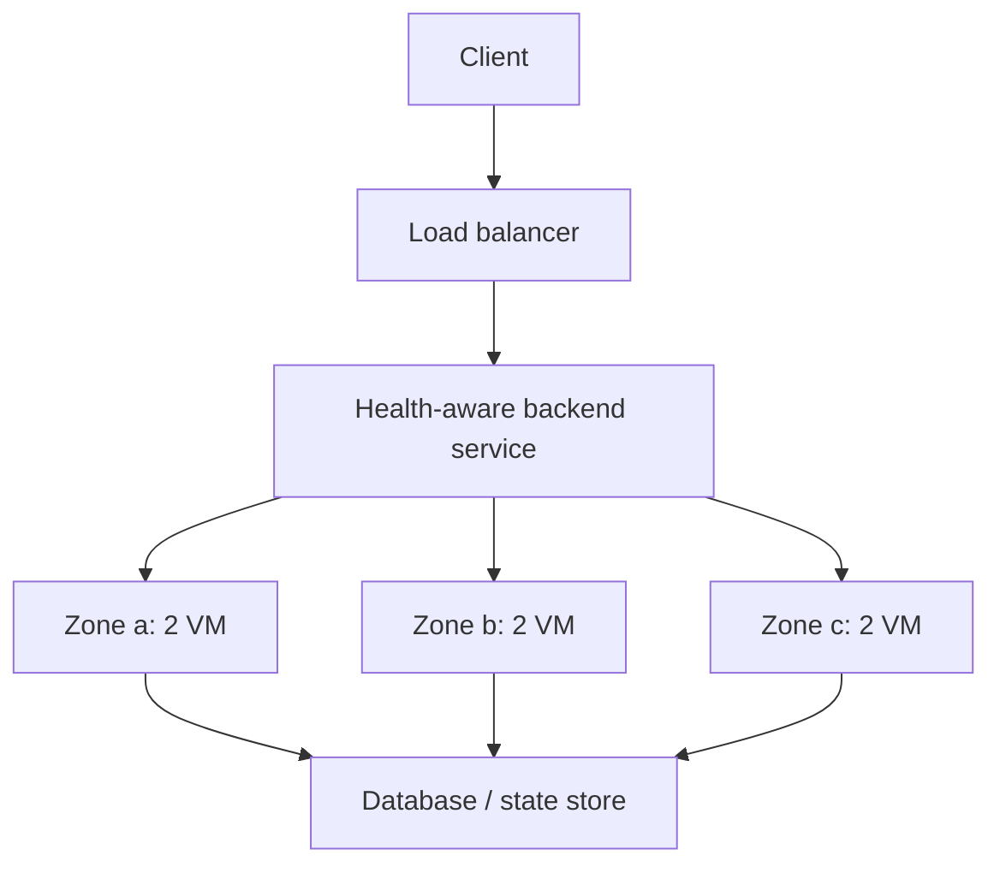

# Phân bố VM, capacity và khả năng chịu lỗi theo zone

Một ứng dụng chạy trên **Compute Engine** có thể hoạt động ổn định trong nhiều tháng nhưng vẫn gián đoạn khi một **zone** gặp sự cố, dù CPU của từng VM còn nhiều tài nguyên. Nguyên nhân thường không phải thiếu autoscaler, mà là **capacity được đặt ở đâu**, **tải được phân phối tới VM nào**, **phần capacity nào còn hoạt động sau khi một zone mất**, và **dịch vụ có thể tự phục hồi bằng VM thay thế hay không**.

Bài học thuộc chương **Nhóm máy ảo và tự động mở rộng** của mô-đun `CLOUD_PROVIDERS_GCP`. Trong hành trình tìm hiểu Google Cloud từ quản trị project, IAM và VPC đến Compute Engine, GKE, Cloud Run, lưu trữ, cơ sở dữ liệu, tự động hóa phát hành và theo dõi độ tin cậy/chi phí, bài này tập trung vào cách sử dụng **Managed Instance Group (MIG)** để đặt VM theo zone, dự trù capacity và thiết kế khả năng chịu lỗi. Trọng tâm không phải “càng nhiều VM càng tốt”, mà là **đáp ứng SLO với nguồn lực hợp lý ngay cả khi một phần hạ tầng không còn sẵn sàng**.

## 1. Mục tiêu học tập

Sau bài học, bạn có thể:

1. Phân biệt **region**, **zone**, **zonal MIG** và **regional MIG**.
2. Hiểu **instance template**, target size, phân bố VM, autoscaler, autohealing và load balancer có những trách nhiệm khác nhau.
3. So sánh **EVEN**, **BALANCED**, **ANY**, **ANY_SINGLE_ZONE** của regional MIG theo nhu cầu chịu lỗi và mức sẵn có của tài nguyên.
4. Tính **capacity còn lại khi mất một zone** và lựa chọn mức dự phòng thay vì dựa vào phép chia đều đơn giản.
5. Phân biệt **quota**, **physical capacity**, **reservations** và **minimum replicas**.
6. Biết khi nào cần **autohealing**, **autoscaling**, **health checks**, **instance redistribution** và **load balancing**.
7. Thực hành bằng `gcloud`: kiểm tra region/zone và quota, tạo một regional MIG nhỏ trải trên ba zone, xem phân bố thực tế và thêm autoscaling có giới hạn.
8. Lập phương án kiểm thử lỗi zone, rollback, theo dõi SLO và dọn tài nguyên sau lab.

**Phạm vi:** ví dụ dùng project lab, VM không chứa dữ liệu nghiệp vụ và ba zone của cùng region. Các lệnh tạo VM, instance template, MIG và autoscaler đều **phát sinh tài nguyên và chi phí**, chỉ chạy trong project được ủy quyền. Bài không thực hiện một sự cố zone thật và không yêu cầu thao tác phá hủy ứng dụng production.

## 2. Region, zone và miền ảnh hưởng sự cố

**Region** là một khu vực địa lý của Google Cloud, chẳng hạn `asia-southeast1`. Một region có nhiều **zone**, ví dụ `asia-southeast1-a`, `asia-southeast1-b` và `asia-southeast1-c`. Zone là một miền triển khai có tính độc lập tương đối về hạ tầng bên trong region.



Sơ đồ thể hiện một ứng dụng **stateless** có nhiều bản sao. Khi zone a mất khả dụng, ta kỳ vọng load balancer dừng gửi traffic tới các VM không healthy và những VM còn lại tiếp tục xử lý. Nhưng điều đó chỉ đúng nếu **frontend, backend health checks, dữ liệu phụ thuộc, firewall, route và capacity của zone b/c** đều đáp ứng.

| Phạm vi sự cố | Điều có thể bị ảnh hưởng | Hướng phòng ngừa |
| --- | --- | --- |
| Một tiến trình ứng dụng | Một VM không trả response | Health check/autohealing, nhiều replica |
| Một VM hoặc host | Một instance trong MIG | MIG tự tạo lại VM phù hợp chính sách |
| Một zone | Tất cả VM hoặc một phần dịch vụ trong zone đó | **Regional MIG** trải nhiều zone, LB và capacity dự phòng |
| Một region | Nhiều zone và dịch vụ phụ thuộc trong region | Thiết kế **multi-region** riêng, không chỉ regional MIG |
| Thành phần dùng chung | Database, bucket, IAM, DNS, network hoặc quota | Xem kiến trúc của từng phụ thuộc và điểm đơn hỏng |

**Điểm quan trọng:** **regional MIG trải nhiều zone trong *một region***. Nó **không** bảo vệ khỏi mất toàn region. Một database chỉ ở một zone vẫn có thể trở thành điểm đơn hỏng dù tầng web trải ba zone.

## 3. Zonal MIG và regional MIG khác nhau thế nào?

**Managed Instance Group (MIG)** quản lý tập các Compute Engine VMs theo cấu hình chung từ **instance template**, hỗ trợ thay mới instance, cập nhật phiên bản, tích hợp autoscaling và autohealing.

| Tiêu chí | Zonal MIG | Regional MIG |
| --- | --- | --- |
| Phạm vi | Một zone | Nhiều zone được chọn trong cùng region |
| Target size | Tổng VM trong một zone | Tổng VM của group phân bổ trên các zone |
| Khi mất zone chứa VM | Toàn group có thể bị ảnh hưởng | Có thể còn VM phục vụ ở zone khác |
| Phân bố VM | Không áp dụng nhiều zone | Có target distribution shape |
| Capacity | Phụ thuộc khả năng cấp phát của một zone | Có thể tận dụng nhiều zone, tùy shape/quota/capacity |
| Autoscaling | Được hỗ trợ cho trường hợp phù hợp | Được hỗ trợ với cách phân phối chịu ảnh hưởng bởi shape |
| Autohealing | Sửa/tạo lại VM trong phạm vi nhóm | Có thể sửa VM trong zone ban đầu; có tùy chọn sửa ở zone khác theo cấu hình |
| Trường hợp điển hình | Dev/test nhỏ, workload cố ý cố định một zone | Web/API stateless cần chịu lỗi ở mức zone |

Dùng **regional MIG** không bắt buộc mọi VM phải có cùng region như dữ liệu; nhưng khoảng cách mạng, nơi đặt database và phí truyền dữ liệu giữa zone/region cần được tính vào thiết kế.

### 3.1. Instance template là “mẫu”, không phải “máy đang chạy”

Một **instance template** mô tả machine type, boot image, disk, network/subnet, labels, service account, startup script và cấu hình VM phù hợp. Nó không tự khởi động máy.



Thay instance template của group là một **thay đổi cấu hình triển khai**, cần chính sách rolling update/canary và giới hạn gián đoạn. Template không tự phân phối traffic và không thay thế backend service của load balancer.

### 3.2. MIG tự “quản lý” những gì?

MIG cố duy trì **target size** và cấu hình instance mong muốn. Nếu một VM bị lỗi hoặc bị xóa trong phạm vi chính sách, MIG có thể tạo lại. Tuy nhiên:

- VM mới có thể **chưa sẵn sàng phục vụ** cho đến khi OS, startup script và ứng dụng khởi động.
- Không có đủ **quota/capacity** thì VM thay thế có thể chưa tạo được.
- VM mới không tự nhận lại dữ liệu ghi trên ephemeral local disk của VM cũ.
- Nếu không cấu hình **health check ứng dụng**, MIG không tự biết rằng tiến trình web đã bị treo nhưng VM vẫn chạy.

## 4. Target distribution shape: cách chọn nơi đặt VM

Regional MIG có bốn target distribution shape. Đây là chính sách **phân bố số VM theo zone**, không phải cấu hình đặt trọng số request trên load balancer.

| Shape | Cách phân bố chính | Phù hợp | Rủi ro chính |
| --- | --- | --- | --- |
| **EVEN** | Cố giữ số VM mỗi zone chênh nhau không quá 1 khi điều kiện cho phép | Serving workload cần HA theo zone | Có thể thiếu target size nếu zone thiếu capacity và chưa có cơ chế linh hoạt phù hợp |
| **BALANCED** | Ưu tiên cấp VM tại zone còn capacity, cố cân đối nhất có thể | Serving/batch cần HA nhưng có hạn chế phân phối tài nguyên | Khi capacity khan hiếm, VM có thể dồn về một số zone |
| **ANY** | Ưu tiên nơi có tài nguyên/quota hoặc reservations phù hợp | Batch, throughput ưu tiên hơn HA theo zone | Tất cả VM có thể nằm ở một zone |
| **ANY_SINGLE_ZONE** | Đặt toàn bộ VM trong **một** zone được chọn | Tác vụ tightly coupled cần độ trễ nội bộ thấp/placement gần nhau | Không có HA khi mất zone đó |

Khi xem Console hoặc CLI, tên shape thường là `EVEN`, `BALANCED`, `ANY`, `ANY_SINGLE_ZONE`; cờ `gcloud` thường dùng chữ thường như `even`, `balanced`, `any`, `any-single-zone`.

### 4.1. EVEN: cân bằng theo số lượng

Giả sử regional MIG có target size 6, gồm 3 zone:

```text
zone a: ● ●       2 VM
zone b: ● ●       2 VM
zone c: ● ●       2 VM
tổng:               6 VM
```

Nếu tăng target size lên 7, một zone có thể có 3 VM và hai zone còn lại có 2 VM. Với **EVEN**, kỳ vọng độ lệch giữa các zone không vượt quá 1 khi group đạt phân bố mong muốn.

Trong điều kiện thiếu capacity, việc cấp VM còn phụ thuộc autoscaling/cơ chế group và quota. **Không coi “target size = 6” là chứng minh “sáu VM đang chạy, khỏe và sẵn sàng”**. Đọc `list-instances` và metrics thực tế.

### 4.2. BALANCED: cân đối nhưng ưu tiên tạo được VM

Nếu zone a không còn machine type phù hợp, group `BALANCED` có thể tạo VM ở b/c thay vì chờ đạt phân bố đúng số. Ví dụ:

```text
zone a: ●         1 VM
zone b: ● ● ●     3 VM
zone c: ● ●       2 VM
tổng:               6 VM
```

Cách này tăng cơ hội đạt **tổng capacity** trong tình huống hạn chế tài nguyên nhưng **giảm khả năng chịu lỗi của zone đang có nhiều VM**. Khi zone b mất, ví dụ trên mất 50% số VM, không phải 1/3.

### 4.3. ANY và ANY_SINGLE_ZONE: tối ưu cấp phát hoặc vị trí

`ANY` có thể tạo VM ở những zone còn quota/capacity, có thể ưu tiên sử dụng zonal reservations chưa tiêu thụ. Tập VM có thể phân bố rất lệch. `ANY_SINGLE_ZONE` thậm chí cố đặt toàn bộ trong một zone, phù hợp mô hình cần các VM ở gần nhau nhưng **không phải lựa chọn HA đa zone**.

Chọn shape theo yêu cầu thực tế:



**Không nên đổi shape tùy tiện trên production.** Một số shape có yêu cầu về proactive instance redistribution, autoscaling và chính sách khác. Ví dụ `BALANCED` và `ANY_SINGLE_ZONE` yêu cầu tắt **proactive redistribution** theo hướng dẫn cấu hình MIG. Trước khi đổi, kiểm tra hành vi scale-in/scale-out, resource reservations và khả năng hỗ trợ của machine type.

## 5. Phân bố zone khác với proactive redistribution

**Proactive instance redistribution** là cơ chế regional MIG chủ động điều chỉnh lại số instance giữa các zone để hướng tới phân bố mong muốn, khi được hỗ trợ và bật. Nó có thể dẫn tới việc VM ở zone dư **bị thay thế** để đạt phân bố đều.

Phân biệt ba thao tác:

- **Thêm VM vì target size tăng:** một quyết định số lượng.
- **Tạo VM ở zone khác do capacity thiếu:** một quyết định vị trí cấp phát.
- **Proactive redistributing:** có thể di chuyển phân bố bằng cách thay đổi VM hiện hữu, ảnh hưởng tới session/stateful workload.

Với **EVEN**, proactive redistribution thường được bật mặc định theo cấu hình được hỗ trợ. Với shape không hỗ trợ, phải dùng lựa chọn khác. Khi autoscaling hoạt động, quyết định phân bố còn theo cơ chế autoscaler và khả năng cấp phát; không giả định việc bật/tắt redistribution giải quyết mọi lỗi capacity.

**Đối với workload có state**, chuyển hoặc thay thế VM có thể làm mất local state nếu không có thiết kế bảo toàn state riêng. Đừng bật redistribution khi chưa hiểu các disk, metadata, session và lifecycle của workload.

### 5.1. Chọn tập zone ngay từ đầu

Một regional MIG được tạo với tập zone cụ thể. **Không thể sửa trực tiếp tập zone của regional MIG sau khi tạo** theo hướng dẫn sản phẩm; nếu muốn thay đổi tập zone, cần chiến lược tạo nhóm mới, chuyển traffic/state và dọn nhóm cũ.

Do đó trước khi triển khai phải kiểm tra:

1. Machine series/type có được cung cấp ở **từng zone** định chọn không?
2. Zone có đủ capacity cho loại GPU, CPU, memory hoặc disk cần dùng không?
3. Subnet nằm trong region phù hợp và IAM/organization policy có cho phép không?
4. Vùng dữ liệu, các backend phụ thuộc và các con đường network có tạo ra điểm nghẽn hoặc chi phí không?
5. Khi mất một zone, phần còn lại có đủ capacity và quota để duy trì SLO không?

## 6. Capacity: ba khái niệm không thể đánh đồng

Trong vận hành Compute Engine, những cụm từ sau hay bị dùng lẫn nhau:

| Khái niệm | Là gì? | Không đảm bảo điều gì? |
| --- | --- | --- |
| **Quota** | Mức giới hạn dùng tài nguyên được cấp cho project, theo scope và loại quota | Không đảm bảo hạ tầng vật lý đang còn đủ máy |
| **Available capacity** | Tài nguyên thực mà Compute Engine có thể cấp ở zone tại thời điểm yêu cầu | Không đảm bảo quota của project cho phép dùng |
| **Reservation** | Cơ chế đặt trước tài nguyên Compute Engine đủ điều kiện theo cấu hình | Không thay thế yêu cầu tương thích, quyền sử dụng, lịch và giới hạn riêng |
| **MIG target size** | Tổng số VM mà group muốn quản lý | Không đảm bảo tất cả đang `RUNNING` hoặc healthy |
| **Autoscaler min replicas** | Mức tối thiểu của target size theo cấu hình autoscaling | Không phải “số VM khỏe đảm bảo tồn tại” |
| **Autoscaler max replicas** | Trần target size do autoscaler có thể đề xuất | Không cấp thêm quota hoặc bảo đảm capacity |

Một VM không tạo được có thể do thiếu quota, thiếu physical capacity, machine type không có ở zone, image/OS không tương thích, policy IAM/organization hoặc một cấu hình instance template không hợp lệ.

### 6.1. Quota region và giới hạn zone

Nhiều quota CPU áp theo **region** và loại CPU/machine family, một số giới hạn có scope khác. Nếu project chỉ có 12 vCPU quota phù hợp ở region và mỗi VM yêu cầu 2 vCPU, tối đa theo giới hạn quota ấy chỉ là 6 VM trước khi xét CPU quota khác và overhead. Nhưng dù quota cho 6 VM, một zone có thể tạm **không còn physical capacity** để nhận machine type đó.

Vì vậy trước khi tạo group cần đọc quota thực tế của project/region và kiểm tra machine types ở từng zone. Không suy từ `machine-types list` rằng capacity đã được đặt trước.

### 6.2. Reservations: dùng để giảm rủi ro thiếu capacity

Reservations có thể giúp đảm bảo khả năng sử dụng các VM khớp cấu hình trong một zone theo điều kiện sản phẩm. Nhưng reservations có **phạm vi zone**, matching rules, phí và yêu cầu quyền riêng. Không nhất thiết một reservation ở zone a có thể tự dùng ở zone b.

Với regional MIG cần chủ động dùng reservations theo tên, tài liệu yêu cầu thiết kế reservations tương ứng ở từng zone liên quan và instance template trỏ đúng các reservations ấy. Khi thiết kế HA, cần **đặt dự phòng hợp lý ở zone sống sót**, không chỉ dự trữ đúng số VM thường ngày.

Không tạo reservation chỉ để chạy lab nhỏ mà chưa có dự toán; tài nguyên đặt trước có thể phát sinh chi phí ngay cả khi không được tiêu thụ.

## 7. Tính đủ capacity khi mất một zone

Đây là phần ra quyết định quan trọng nhất.

Giả sử các VM stateless chạy sau load balancer, mỗi VM chịu được **150 request/giây ở SLO đã xác nhận**, có ba zone, peak load **500 request/giây**.

### 7.1. Số VM nếu không xét lỗi zone

\[
N_{\text{bình thường}}=
\left\lceil\frac{500}{150}\right\rceil=4
\]

Bốn VM đủ throughput danh nghĩa trong điều kiện không lỗi, **nhưng chưa đủ bằng chứng** đáp ứng SLO sau khi mất một zone.

### 7.2. Quy tắc xét zone tệ nhất

Với `EVEN`, có \(N\) VM trải trên \(Z\) zone, zone có nhiều VM nhất có thể có \(\lceil N/Z\rceil\) VM. Nếu chính zone đó mất, số VM còn lại là:

\[
N_{\text{còn lại}}
=
N-\left\lceil\frac{N}{Z}\right\rceil
\]

Muốn duy trì tải \(D\), với năng lực bền vững mỗi VM là \(C\):

\[
\left(N-\left\lceil\frac{N}{Z}\right\rceil\right)\times C
\ge D
\]

Bảng thử với \(Z=3\), \(D=500\) req/s và \(C=150\) req/s/VM:

| Tổng VM \(N\) | Phân bố EVEN có thể có | Mất zone nhiều VM nhất | VM còn lại | Năng lực còn lại |
| --- | --- | --- | --- | --- |
| 4 | 2–1–1 | Mất 2 | 2 | 300 req/s — **thiếu** |
| 5 | 2–2–1 | Mất 2 | 3 | 450 req/s — **thiếu** |
| 6 | 2–2–2 | Mất 2 | 4 | 600 req/s — **đạt về throughput** |
| 7 | 3–2–2 | Mất 3 | 4 | 600 req/s — đạt về throughput |

**Kết luận minh họa:** với ba zone và giả định này, ít nhất **6 VM đang khỏe và phục vụ đúng SLO** cho phép chịu mất một zone mà không phụ thuộc việc tạo VM mới tức thời.

Đó **chưa phải một SLA**: thực tế cần tính session redistribution, độ trễ LB health check, thời gian warm-up/JIT, database, network, zone drift, deploy rollout và dao động tải. Có thể cần dự phòng thêm theo error budget.

### 7.3. Vì sao công thức gần đúng có thể sai?

Một phép gần đúng hay dùng là nhân capacity cần thiết với \(Z/(Z-1)\). Nhưng VM là **số nguyên**, và zone nhiều VM nhất có thể làm mất một phần lớn hơn tỷ lệ \(1/Z\) khi \(N\) nhỏ. Vì thế nên áp dụng trực tiếp công thức **mất zone đông VM nhất** và kiểm tra phân bố thực tế.

Khi chọn `BALANCED` hoặc `ANY`, không thể mặc định mỗi zone có \(N/Z\) VM. Hãy đọc phân bố hiện tại và dùng:

\[
\text{Capacity còn lại (đơn giản)}
=
\sum_{\text{zone còn sống}} \text{VM healthy}_{z}\times C_z
\]

Giá trị \(C_z\) có thể khác nhau nếu dùng machine type linh hoạt hoặc hiệu năng của các zone khác nhau. Sau khi có capacity, tiếp tục xác minh bằng **load test ứng dụng**, không chỉ số lượng VM.

## 8. Autoscaling không tự bảo đảm khả năng chịu lỗi

**Autoscaler** theo dõi tín hiệu sử dụng và đề xuất số VM phù hợp trong giới hạn min/max. Nó giúp đáp ứng **biến động tải**, còn **thiết kế zone resilience** cần capacity sẵn có.

### 8.1. Ba loại tín hiệu phổ biến

- **CPU utilization:** tăng/giảm số VM theo CPU trung bình mong muốn, ví dụ mục tiêu 60%.
- **HTTP load balancing serving capacity:** dựa trên tín hiệu phục vụ của backend load balancer tương thích.
- **Cloud Monitoring custom metric:** dùng metric đại diện khối lượng công việc (ví dụ số job chờ), theo cấu hình autoscaler phù hợp.

Có thể có **scaling schedules** để chuẩn bị capacity trước giờ cao điểm và **predictive autoscaling** cho workload có mô hình tải phù hợp. Các tính năng có yêu cầu về metric, dữ liệu lịch sử và giới hạn sản phẩm; không mặc định mọi MIG đều hỗ trợ như nhau.

### 8.2. Minimum replicas phải được chọn theo fault model

Nếu bình thường cần 4 VM phục vụ 500 req/s và autoscaler được đặt `min=4`, trong trạng thái tải thấp nó có thể giảm group còn 4 VM. Khi mất zone đông VM nhất, chỉ 2 VM tồn tại trong ví dụ EVEN — chưa đủ tải peak 500 req/s.

Nếu yêu cầu **đón peak ngay cả sau mất một zone**, mức tối thiểu/baseline có thể phải gần mức tính N+1 zone, ví dụ `min=6` theo bảng ở phần 7, hoặc phải có công cụ chủ động chuẩn bị capacity trước giờ cao điểm. Đó là quyết định **chi phí đổi lấy tốc độ phục hồi**, không phải giá trị mặc định của Google Cloud.

### 8.3. Autoscaler có độ trễ

Khi zone mất, autoscaler/MIG có thể tạo VM mới ở zone còn hoạt động **nếu quota/capacity cho phép**, nhưng:

1. Autoscaler phải phát hiện tải và tính size phù hợp.
2. Compute Engine phải cấp tài nguyên.
3. VM boot, startup scripts và ứng dụng phải sẵn sàng.
4. Health checks phải đánh dấu backend healthy.
5. Load balancer mới gửi traffic vào VM đó.

Khoảng trống giữa bước 1 và 5 là thời gian ứng dụng có thể **thiếu capacity**. Vì vậy đừng hứa “autoscaling sẽ phục hồi ngay” khi chưa có RTO từ thử nghiệm thực tế.

### 8.4. Scale-in cũng có rủi ro

Scale-in chọn VM để xóa; nếu ứng dụng có long-lived connections hoặc job chưa hoàn thành, có thể gây gián đoạn. Thiết kế graceful shutdown/draining, thời gian ổn định, scale-in controls và checkpoint cho batch. Một group **stateful MIG** có các giới hạn riêng, gồm không thể bật autoscaling/scaling schedules cho nhóm có cấu hình stateful theo tài liệu sản phẩm; nếu ứng dụng cần state trên VM, hãy đánh giá mô hình dữ liệu và chiến lược mở rộng khác.

## 9. Autohealing khác load balancing health checks thế nào?

Hai cơ chế trả lời hai câu hỏi:

| Cơ chế | Câu hỏi | Hành động |
| --- | --- | --- |
| **LB health check** | “VM/backend này có nhận traffic được bây giờ không?” | Ngừng/giảm gửi request tới backend unhealthy |
| **MIG autohealing** | “VM của MIG có cần được sửa/tạo lại không?” | Recreate VM không khỏe theo chính sách |
| **Autoscaler** | “Group cần bao nhiêu VM?” | Điều chỉnh target size |
| **Distribution policy** | “Các VM cần đặt ở những zone nào?” | Điều phối vị trí instances |
| **Monitoring/SLO alert** | “Người dùng có đang gặp lỗi không?” | Cảnh báo để vận hành phản ứng |

Health check của autohealing nên kiểm tra **tình trạng thực sự của ứng dụng** nhưng tránh nhạy cảm với lỗi phụ thuộc ngắn hạn. Nếu endpoint trả unhealthy vì một database ngoài VM tạm ngừng, autohealing tất cả VM có thể tạo *repair storm* mà không chữa được database.

### 9.1. Initial delay và repair limits

Ứng dụng có thể cần thời gian boot, tải thư viện và kết nối database. **Initial delay** giúp MIG không vội đánh dấu VM mới là lỗi khi nó còn khởi động. Nhưng initial delay không có nghĩa mọi lỗi được bỏ qua vô hạn.

Autohealing có **giới hạn đồng thời** khi sửa nhiều VM để giảm tác động vận hành. Vì vậy dù nhiều VM cùng unhealthy, chúng không nhất thiết được thay mới cùng lúc. Một regional MIG **mặc định** cố repair VM trong zone cũ; có khả năng cấu hình repair ở **alternate zone** theo tính năng được hỗ trợ. Không suy rằng mọi autohealing tự động chuyển qua zone sống sót.

### 9.2. Khi mất toàn zone

Ví dụ:

- Zonal MIG ở zone a: nếu zone a không hoạt động, group không thể tự phục vụ bằng VM ở zone b.
- Regional MIG trải a/b/c: VM ở b/c có thể tiếp tục hoạt động, LB có thể loại backend không healthy tại a; phần capacity còn lại là quan trọng nhất.
- Khi zone a phục hồi, MIG có thể bổ sung VM; việc **phân bố lại** tùy shape, redistribution policy và capacity.
- Nếu ứng dụng cần **thay VM ngay ở zone khác**, phải xem tùy chọn alternate-zone repair và khả năng tương thích với chính sách nhóm/disk/state.

Không chủ động dừng một zone production để “thử” nếu chưa có kế hoạch diễn tập và phê duyệt. Ở phần lab, ta **kiểm chứng tính phân bố** và tính toán kịch bản mất zone mà không gây sự cố thật.

## 10. Load balancer và dữ liệu: hai điều kiện để đạt HA

Regional MIG chỉ là **tầng VM**. Người dùng cần frontend có thể chuyển hướng traffic sang VM healthy. Tùy bài toán và protocol, các dạng **Application Load Balancer** hoặc **Network Load Balancer** hỗ trợ instance group làm backend với cấu hình tương ứng.



Khi zone a hỏng, ta cần **đường client → LB → zone b/c → dữ liệu** vẫn hoạt động. Nếu database chỉ chạy trong zone a, app có thể trả 500 dù b/c còn VM khỏe. Một hệ thống đủ điều kiện HA cần:

- **Stateless** cho tầng web hoặc cơ chế chia sẻ session bên ngoài VM.
- Database/queue/storage có **độ bền và khả năng phục hồi** đúng RPO/RTO.
- Firewall rules/health-check sources và VPC routes đúng.
- DNS/load balancer không tạo thêm điểm đơn hỏng.
- Số VM healthy còn lại đủ peak hoặc tải đã giới hạn.
- Rollout giới hạn số VM đồng thời unavailable.

Đừng dùng một VM ở mỗi zone và gọi đó là “HA production” nếu toàn bộ đường dữ liệu, capacity và health check chưa được thử.

## 11. Quy hoạch capacity theo zone, reservation và phiên cập nhật

### 11.1. Capacity cho peak và failure

Một worksheet đơn giản trước khi deploy:

| Hạng mục | Giá trị minh họa | Nguồn xác minh |
| --- | --- | --- |
| Peak request rate | 500 req/s | Monitoring, load test |
| SLO p95 latency | Dưới ngưỡng sản phẩm | SLO chính thức |
| Sustainable capacity/VM | 150 req/s tại SLO | Benchmark ứng dụng |
| Số zone | 3 | Plan vùng |
| VM tối thiểu chịu lỗi zone | 6 | Công thức phần 7 |
| Target distribution | EVEN | Thiết kế regional MIG |
| VM vẫn hoạt động sau mất zone | 4 | 2–2–2 mất một zone |
| Tổng throughput còn lại | 600 req/s | 4 × 150 |
| Buffer thực tế | Cần đánh giá thêm | Peak bursts, lỗi và capacity variability |

### 11.2. Deployment cũng là một “sự cố dự kiến”

Khi rolling update, một phần VM có thể bị thay thế tạm thời. Nếu zone vừa lỗi và pipeline vẫn thay VM ở zone còn hoạt động, capacity giảm nhiều hơn kịch bản chỉ một zone lỗi. Cần có **maxSurge**, **maxUnavailable**, readiness/health checks, canary và khả năng tạm dừng rollout.

Hãy xác định ranh giới: **không tự động triển khai khi đang có incident**, trừ khi thay đổi là biện pháp khắc phục đã được phê duyệt. Nếu vừa rollout vừa autoscale, cần theo dõi thay đổi size/distribution và thời gian khởi động.

### 11.3. Instance flexibility

Một số target distribution shape hỗ trợ **instance flexibility policy**, cho phép nhóm chọn trong các machine types đủ điều kiện để tăng khả năng cấp phát khi một loại máy khan hiếm. Nhưng các máy có cấu hình/hiệu năng khác nhau có thể làm giảm độ chính xác của phép tính “150 req/s mỗi VM”. Khi dùng instance flexibility, benchmark **mỗi machine type** hoặc tính capacity theo cách có trọng số.

## 12. Lab A: kiểm tra region, zone và khả năng cấp VM

Bài lab dùng **một regional MIG gồm ba VM**, chỉ để quan sát phân bố và cấu hình. Nó **không chứng minh** hệ thống web đã có HA; để kiểm chứng failover ứng dụng cần load balancer và dịch vụ thật.

### 12.1. Điều kiện và đặt biến

Cần một project có billing, Compute Engine API, ba zone hỗ trợ machine type `e2-small` và subnet lab trong cùng region. Chỉ làm với project, subnet và tên tài nguyên được ủy quyền.

```bash
PROJECT_ID="YOUR_LAB_PROJECT_ID"
REGION="asia-southeast1"
ZONE_A="asia-southeast1-a"
ZONE_B="asia-southeast1-b"
ZONE_C="asia-southeast1-c"
SUBNET="YOUR_LAB_SUBNET"

TEMPLATE="mig-zone-template-lab"
MIG="mig-zone-lab"
MACHINE_TYPE="e2-small"

gcloud --version
gcloud auth list
gcloud projects describe "$PROJECT_ID" \
  --format="yaml(projectId,projectNumber,lifecycleState)"
```

Các tên trong lab là **placeholder/names thuộc lab**. Trước khi tạo, hãy tìm xem template hoặc MIG cùng tên đã tồn tại chưa; nếu có, **không ghi đè**, hãy làm rõ quyền sở hữu và chọn tên khác.

### 12.2. Kiểm tra region và ba zone (chỉ đọc)

```bash
gcloud compute regions describe "$REGION" \
  --project="$PROJECT_ID" \
  --format="yaml(name,status,quotas)"

gcloud compute zones list \
  --project="$PROJECT_ID" \
  --filter="region:$REGION" \
  --format="table(name,region.basename(),status)"

# Có machine type trong các zone muốn triển khai hay không?
gcloud compute machine-types list \
  --project="$PROJECT_ID" \
  --zones="$ZONE_A,$ZONE_B,$ZONE_C" \
  --filter="name=$MACHINE_TYPE" \
  --format="table(name,zone.basename(),guestCpus,memoryMb)"
```

Giá trị quota phải đọc theo loại CPU/machine family liên quan trong project. Danh sách machine type chỉ cho biết **loại máy có thể hỗ trợ**, không thể dự báo capacity đang trống đúng thời điểm tạo VM.

### 12.3. Kiểm tra mạng và trạng thái tài nguyên (chỉ đọc)

```bash
gcloud compute networks subnets list \
  --project="$PROJECT_ID" \
  --filter="region:$REGION" \
  --format="table(name,network.basename(),region.basename(),ipCidrRange)"

gcloud compute instance-templates list \
  --project="$PROJECT_ID" \
  --filter="name=$TEMPLATE"

gcloud compute instance-groups managed list \
  --project="$PROJECT_ID" \
  --filter="name=$MIG"
```

**Không thực hiện phần tạo VM** nếu subnet không ở đúng region, VPC thuộc Shared VPC chưa có quyền, zone bị chặn bởi Organization Policy, hoặc project thiếu quota/budget.

## 13. Lab B: tạo instance template và regional MIG phân bố EVEN

### 13.1. Tạo instance template (có tác động ghi)

Mẫu sử dụng Debian public image, `e2-small`, không gắn external IP, và không cần service account của ứng dụng vì bài này chỉ quan sát phân bố.

```bash
gcloud compute instance-templates create "$TEMPLATE" \
  --project="$PROJECT_ID" \
  --machine-type="$MACHINE_TYPE" \
  --image-family="debian-12" \
  --image-project="debian-cloud" \
  --boot-disk-size="10GB" \
  --subnet="$SUBNET" \
  --region="$REGION" \
  --no-address \
  --no-service-account \
  --labels="purpose=mig-zone-lab,environment=dev"
```

**Cảnh báo:** không có external IP nên các VM sẽ không tự truy cập Internet thông thường nếu không có Cloud NAT/đường mạng phù hợp. Lab không đòi hỏi tải package hoặc nhận request. Đây là cấu hình giảm bề mặt truy cập, không phải công thức đủ cho app production.

Đọc lại template:

```bash
gcloud compute instance-templates describe "$TEMPLATE" \
  --project="$PROJECT_ID" \
  --format="yaml(name,properties.machineType,properties.disks,properties.networkInterfaces)"
```

Nếu image Debian hoặc machine type không sẵn có theo cấu hình, chọn giải pháp tương thích từ danh mục chính thức. **Không tự cấp quyền Editor** cho một default service account để lệnh tạo máy thành công.

### 13.2. Tạo regional MIG trải ba zone (có tác động ghi)

Sau khi xác minh chính sách và **không có MIG trùng tên**, chạy:

```bash
gcloud compute instance-groups managed create "$MIG" \
  --project="$PROJECT_ID" \
  --template="$TEMPLATE" \
  --size=3 \
  --region="$REGION" \
  --zones="$ZONE_A,$ZONE_B,$ZONE_C" \
  --target-distribution-shape=even
```

Group đặt mục tiêu **3 VM trải ba zone**. Điều mong đợi, khi đủ quota/capacity và group ổn định, là phân bố 1–1–1. Một lệnh create thành công **không đảm bảo** ba VM đã boot và healthy ngay lập tức.

### 13.3. Readback group và liệt kê VM

```bash
gcloud compute instance-groups managed describe "$MIG" \
  --project="$PROJECT_ID" \
  --region="$REGION" \
  --format="yaml(name,targetSize,distributionPolicy,status,instanceTemplate)"

gcloud compute instance-groups managed list-instances "$MIG" \
  --project="$PROJECT_ID" \
  --region="$REGION" \
  --format="table(instance,instanceStatus,currentAction)"

# Có thể xem danh sách VM theo tên để đối chiếu zone.
gcloud compute instances list \
  --project="$PROJECT_ID" \
  --filter="name~'^mig-zone-lab-'" \
  --format="table(name,zone.basename(),status,machineType.basename())"
```

Trong output `list-instances`, đường dẫn `instance` chứa tên zone. Hãy đếm số VM đang `RUNNING` của từng zone, phân biệt với **target size**. VM ở trạng thái đang tạo/đang recreate không được tính như capacity phục vụ ứng dụng.

### 13.4. Bảng ghi kết quả

| Zone | Target khi ổn định | VM thực tế | Trạng thái |
| --- | --- | --- | --- |
| `ZONE_A` | 1 | Điền từ readback | `RUNNING` / khác |
| `ZONE_B` | 1 | Điền từ readback | `RUNNING` / khác |
| `ZONE_C` | 1 | Điền từ readback | `RUNNING` / khác |
| **Tổng** | 3 | Điền từ readback | So với target size |

Nếu chỉ thấy 2 VM, kiểm tra từng VM creation error, quotas, machine capacity và subnet/IAM. **Không mở rộng sang project production** để có đủ 3 VM cho lab.

## 14. Lab C: minh họa autoscaling có giới hạn

Bước này **không bắt buộc**. Trước tiên cần hiểu rằng ba VM của lab không chạy web app và không có CPU load thực; chỉ bật CPU autoscaling có thể không tạo ra sự kiện scale-out đáng kể.

Nếu được phép thử autoscaling trong lab, lệnh sau tạo chính sách với target CPU 60%, min 3, max 6:

```bash
gcloud compute instance-groups managed set-autoscaling "$MIG" \
  --project="$PROJECT_ID" \
  --region="$REGION" \
  --min-num-replicas=3 \
  --max-num-replicas=6 \
  --target-cpu-utilization=0.60 \
  --cool-down-period=120
```

Readback:

```bash
gcloud compute instance-groups managed describe "$MIG" \
  --project="$PROJECT_ID" \
  --region="$REGION"

gcloud compute autoscalers list \
  --project="$PROJECT_ID" \
  --filter="name~'$MIG'"
```

Với regional MIG, autoscaler là tài nguyên điều khiển group và việc quan sát kết quả có thể khác theo region. Kiểm tra cấu hình qua `describe` và Cloud Monitoring trước khi kết luận autoscaler đã hoạt động.

**Nhắc lại:** `min=3` đủ cho *mục tiêu thực hành quan sát phân bố*, **không đủ** cho giả định ứng dụng 500 req/s ở phần 7. Production phải tính min theo fault model và năng lực/VM đã benchmark; max vẫn phải phù hợp quota và budget.

### 14.1. Cách tạo tải phải có giới hạn

Nếu mở rộng lab thành web app, chỉ phát tải lên endpoint **do bạn sở hữu** ở project test, với giới hạn RPS/thời gian và thông báo cho người phụ trách. Không stress test production hay endpoint của người khác. Đo CPU, số instance, phân bố theo zone, cold start và thời gian scale-out, rồi dừng tải và quan sát scale-in.

Lệnh thay đổi target size thủ công là **khác với autoscaling**. Khi autoscaler đã quản lý group, việc chỉnh `--size` trực tiếp có thể bị chính sách autoscaler ghi đè. Muốn kiểm tra phân bố bằng thay đổi size cố định, hãy thực hiện ở nhóm không autoscaled hoặc tắt autoscaling theo kế hoạch.

## 15. Không mô phỏng zone failure bằng cách xóa VM bừa bãi

Nhiều bài lab cố dừng một VM rồi coi như “mất zone”. Đây không phải phép thử tương đương:

- **Dừng VM** chỉ mô phỏng lỗi một instance, không mô phỏng mạng, control plane và backing resources của cả zone.
- **Xóa VM trong MIG** có thể khiến MIG tạo lại VM, nhưng không chứng minh nó khôi phục được khi zone thực sự mất capacity.
- **Đổi firewall** hoặc phá load balancer có thể làm test trở nên nguy hiểm hơn và không phản ánh một sự cố zone thật.

Thay vào đó, trong lab nhỏ hãy làm bài **tabletop exercise**:

1. Đọc phân bố hiện tại từ `list-instances`.
2. Giả sử toàn bộ VM của một zone mất cùng lúc.
3. Tính số VM còn lại theo zone tệ nhất.
4. So với capacity/VM đo từ load test.
5. Liệt kê thứ tự phục hồi: LB health check → traffic chuyển zone → autoscaler → VM boot → app readiness.
6. Đánh giá quota/capacity/reservations, dữ liệu, firewall, DNS và monitoring.
7. Ghi một số điểm cần cải thiện trước khi diễn tập thực tế.

Nếu tổ chức có môi trường diễn tập và quyền tương ứng, có thể đánh giá tính năng mô phỏng zone outage của regional MIG do Google Cloud hỗ trợ; **phải đọc đầy đủ tác động và điều kiện của tính năng** trước khi dùng, không chạy lệnh phá tài nguyên production trong khóa học này.

## 16. Đọc phân bố và sức khỏe trong vận hành

Số VM theo zone có thể thay đổi bởi autoscaling, update, lỗi cấp phát hoặc redistribution. Vì vậy vận hành cần có cả **ảnh chụp hiện tại** và **lịch sử**.

### 16.1. Dashboard và metric nên theo dõi

| Nhóm | Tín hiệu | Vì sao |
| --- | --- | --- |
| **MIG** | Target size, số VM managed, creating/recreating | Nhận ra lệch target |
| **Distribution** | Số VM theo zone và target shape | Phát hiện dồn capacity vào một zone |
| **Health** | Healthy/unhealthy và tỷ lệ backend health | Tính serving capacity thật |
| **Autoscaling** | Recommended size, min/max, các lần scale | Đánh giá phản ứng với peak |
| **Capacity** | Quota utilization, resource availability errors | Truy nguyên thiếu VM |
| **LB** | Request rate, p95/p99, 4xx/5xx, backend latency | Phản ánh tác động tới người dùng |
| **Application** | Ready replicas, in-flight requests, GC, CPU/RAM | Phân biệt app bottleneck với VM count |
| **FinOps** | VM hours, boot disks, network egress, logs | Đảm bảo dự phòng trong ngân sách |

Google Cloud có **instance distribution monitoring** cho MIG. Kết hợp Cloud Monitoring, Audit Logs, Compute Engine operations và load balancer logs để biết thay đổi do autoscaler, người vận hành hay lỗi zone.

### 16.2. Nhận biết trường hợp “mất capacity âm thầm”

Một số tình huống không phải VM crash rõ ràng:

- MIG target 9 nhưng chỉ 7 VM đã tạo vì zone c hết GPU/CPU.
- `BALANCED` đã đặt 6/9 VM tại zone b do shortage, làm rủi ro zone b cao hơn.
- LB trả 5xx dù cả 9 VM `RUNNING` vì readiness/port sai.
- CPU trung bình thấp nhưng một số instance bị hotspot vì kết nối lâu hoặc session affinity.
- Scale-in nhanh khi traffic chưa ổn định, gây tạo/xóa máy liên tục.

Vì thế alert nên bao gồm **healthy serving capacity** và SLO, không chỉ “VM RUNNING”.

## 17. Quy trình xử lý khi zone gặp sự cố

Một runbook tóm tắt:

1. **Xác nhận sự cố:** Cloud Monitoring, LB health, Compute status, logs và thông tin dịch vụ của Google Cloud.
2. **Đánh giá ảnh hưởng:** zone nào, VM nào, backend nào unhealthy, request errors và latency.
3. **Kiểm tra capacity còn lại:** VM healthy ở các zone còn sống, throughput và error budget.
4. **Hạn chế thay đổi nguy hiểm:** tạm dừng rollout/cấu hình xung đột nếu cần; không xóa VM/bản ghi dữ liệu trong lúc điều tra.
5. **Quan sát autoscaler và provisioning:** recommended vs actual, quota/capacity errors, có cần fallback machine type/reservation không.
6. **Bảo vệ dữ liệu và dependency:** database, cache, shared file, regional services có hoạt động không.
7. **Khôi phục lưu lượng:** theo LB/readiness, không buộc traffic về backend chưa khỏe.
8. **Theo dõi phục hồi:** sau khi zone trở lại, giám sát redistribution và không để lần cân bằng lại gây lỗi.
9. **Postmortem:** đối chiếu dự báo capacity với thực tế, cập nhật min/max, health checks, reservation và runbook.

Không có một lệnh “khắc phục zone failure” dùng chung cho mọi ứng dụng. Cần sửa đúng điểm nghẽn: backend health, capacity, BGP/VPC, quota hay database.

## 18. Tình huống: API đặt hàng chạy ba zone

Một dịch vụ đặt hàng có đặc điểm:

- Peak 900 req/s.
- Mỗi VM phục vụ bền vững 200 req/s trong điều kiện p95/p99 đạt SLO.
- Tầng API stateless, session lưu bên ngoài VM.
- Regional MIG ba zone với `EVEN`.
- Database được thiết kế HA theo mục tiêu riêng và có kiểm chứng failover.

**Không xét zone failure:** \(\lceil 900/200\rceil=5\) VM có vẻ đủ danh nghĩa.

**Xét mất một zone nhiều VM nhất**, với N=7, phân bố 3–2–2; mất zone 3 VM → 4 VM còn lại chỉ phục vụ khoảng 800 req/s, **không đủ**.

Với N=8, phân bố 3–3–2; mất zone có 3 VM → 5 VM còn lại, lý thuyết phục vụ 1.000 req/s, đáp ứng 900 req/s nếu các giả định SLO giữ nguyên. Tuy nhiên, margin chỉ là 100 req/s nên cần đánh giá traffic bursts, warm-up, retry storms và cache/database bottleneck. N=9 phân bố 3–3–3 sẽ còn 6 VM (1.200 req/s) sau mất một zone, tạo buffer cao hơn với chi phí tăng.

| Phương án | Bình thường | Mất zone tệ nhất | Capacity còn lại | Nhận xét |
| --- | --- | --- | --- | --- |
| N=5 | 2–2–1 | Còn 3 | 600 req/s | Thiếu |
| N=7 | 3–2–2 | Còn 4 | 800 req/s | Thiếu |
| N=8 | 3–3–2 | Còn 5 | 1.000 req/s | Đạt danh nghĩa, buffer thấp |
| N=9 | 3–3–3 | Còn 6 | 1.200 req/s | Buffer tốt hơn, tốn hơn |

**Chỉ số quyết định không phải số VM tuyệt đối**, mà là **số request đạt SLO được duy trì từ các VM healthy ở zone còn lại**. Nếu khả năng phục vụ VM ở zone còn lại thấp đi do database/traffic cross-zone, phải hiệu chỉnh năng lực/VM.

## 19. Chi phí và đánh đổi: Availability versus Capacity

Multi-zone HA thường cần duy trì capacity dự phòng. Ví dụ sáu VM thay vì bốn VM có thể làm tăng chi phí compute thường trực, nhưng giảm mất doanh thu hoặc thời gian gián đoạn khi có sự cố. Chi phí không chỉ đến từ số VM:

| Khoản chi phí | Yếu tố tác động |
| --- | --- |
| **Compute Engine VM hours** | Số VM, machine series, provisioning model, zone/region, thời gian chạy |
| **Persistent Disk/Hyperdisk** | Disk tạo từ template, IOPS/throughput, loại đĩa |
| **Network** | Egress, cross-zone/region traffic, load balancer, NAT |
| **Reservations** | Cơ chế đặt trước, phí/cam kết theo điều kiện |
| **Monitoring/Logging** | Metrics/log volume và thời gian lưu |
| **Build/deploy** | Image, artifact, CI/CD và quy trình rollout |
| **Vận hành** | Phân tích lỗi, diễn tập HA, nhân sự on-call |

**Spot VMs** có giá giảm nhưng khả năng bị gián đoạn cao hơn, không phải capacity bảo đảm cho phần phục vụ bắt buộc của ứng dụng. Với batch retry được, `ANY` + Spot có thể phù hợp hơn `EVEN` + on-demand; với API có SLO nghiêm ngặt, ưu tiên tính sẵn sàng khi chọn provisioning model.

Budget alerts giúp nhận biết chi phí; chúng không tự đảm bảo group dừng ở đúng số tiền. Autoscaler `max replicas` giới hạn số VM do autoscaler đề xuất, nhưng vẫn có các khoản disk, egress và dịch vụ khác. Không dùng max replicas như “trần hóa đơn”.

## 20. Dọn lab an toàn

Lab này tạo **instance template** và **regional MIG**, cùng autoscaler nếu đã bật. Chỉ xóa tài nguyên khi chắc chắn chúng **do chính lab tạo**, không chứa dữ liệu quan trọng và không được hệ thống nào dùng làm backend.

### 20.1. Xác minh trước khi xóa (chỉ đọc)

```bash
gcloud compute instance-groups managed describe "$MIG" \
  --project="$PROJECT_ID" \
  --region="$REGION"

gcloud compute instance-groups managed list-instances "$MIG" \
  --project="$PROJECT_ID" \
  --region="$REGION"

gcloud compute instance-templates describe "$TEMPLATE" \
  --project="$PROJECT_ID"
```

Nếu group đang gắn với backend service hoặc đang xử lý công việc, cần tháo/lưu dữ liệu theo kế hoạch trước. Không xóa đồng loạt production để tiết kiệm chi phí.

### 20.2. Xóa theo thứ tự có kiểm soát (thao tác phá hủy)

Thứ tự là **tắt autoscaling nếu cần**, **xóa MIG**, rồi **xóa instance template**. Các lệnh bên dưới chỉ dành cho tài nguyên lab đã duyệt:

```bash
# Nếu đã bật autoscaling, dừng autoscaler của lab.
gcloud compute instance-groups managed stop-autoscaling "$MIG" \
  --project="$PROJECT_ID" \
  --region="$REGION"

# Xóa regional MIG và các VM do group quản lý.
gcloud compute instance-groups managed delete "$MIG" \
  --project="$PROJECT_ID" \
  --region="$REGION"

# Cuối cùng xóa global instance template do lab tạo.
gcloud compute instance-templates delete "$TEMPLATE" \
  --project="$PROJECT_ID"
```

Nếu bước autoscaling chưa được bật, lệnh `stop-autoscaling` có thể báo không có policy; **không cần lặp lại**. Khi MIG bị xóa, boot disks có thể được xóa theo `autoDelete`; cần kiểm tra disk và snapshots còn lại theo chính sách lưu trữ. Không xóa VPC/subnet hay project vốn có từ trước.

### 20.3. Xác nhận sau dọn dẹp

- MIG lab không còn trong danh sách regional instance groups.
- Không còn VM tên do group tự tạo trong ba zone.
- Instance template lab đã được xóa.
- Không còn boot disk/snapshot ngoài dự kiến hoặc tài nguyên khác phát sinh phí.
- Chi phí trong Billing có thể cập nhật trễ so với thời điểm xóa; xác minh sau kỳ hạch toán thích hợp.

## 21. Bài tập tự luyện

### Bài 1 — phân biệt zonal và regional MIG

Một dịch vụ API có bốn VM trong một zonal MIG tại `asia-southeast1-a`. Team cho rằng “bốn VM thì đã có HA”.

*Đáp án định hướng:* Có thể chịu lỗi một số VM, nhưng không chịu được mất toàn zone a. Muốn chịu lỗi zone cần regional MIG hoặc kiến trúc đa zone tương đương, LB chuyển traffic, data dependency HA và đủ capacity ở zone khác.

### Bài 2 — kiểm tra EVEN với số VM lẻ

Regional MIG ba zone, `EVEN` và target size 8.

*Đáp án định hướng:* Phân bố mong đợi khi đủ capacity là **3–3–2** theo một thứ tự zone nào đó. Mất zone có 3 VM còn 5 VM; không được mặc định còn \(8\times 2/3\) VM mà không làm tròn.

### Bài 3 — chọn shape

Một batch job không có SLO ứng dụng thời gian thực; ưu tiên dùng reservations có sẵn và hoàn thành càng nhiều job càng tốt.

*Đáp án định hướng:* Cân nhắc `ANY` và checkpoint/retry, nhưng chấp nhận khả năng VM dồn vào một zone. Nếu job cần HA theo zone, `BALANCED`/`EVEN` và dự phòng có thể phù hợp hơn.

### Bài 4 — quota không bằng capacity

Project còn nhiều quota CPU nhưng VM loại GPU lớn không tạo được ở zone b.

*Đáp án định hướng:* Physical capacity của máy/GPU có thể thiếu dù quota cho phép; kiểm tra availability, lỗi cấp phát, zone khác, machine type fallback và reservations. Không tự nâng quota khi lỗi do capacity.

### Bài 5 — autoscaler min quá thấp

Ứng dụng peak 500 req/s; mỗi VM chịu 150 req/s tại SLO. Regional MIG ba zone có autoscaler min 4.

*Đáp án định hướng:* Nếu group ở min=4, phân bố EVEN 2–1–1; mất zone 2 VM chỉ còn 2 VM, năng lực 300 req/s, **không đủ**. Với mô hình lý thuyết, N=6 ở 2–2–2 mới đủ 600 req/s sau mất một zone.

### Bài 6 — autohealing nhầm lỗi database

Cả sáu VM khỏe về OS, nhưng database tạm quá tải làm endpoint health trả 500; autohealing bắt đầu recreate nhiều VM.

*Đáp án định hướng:* Health check autohealing có thể quá phụ thuộc vào external dependency. Cần phân tách liveness với readiness, điều chỉnh check/initial delay phù hợp, xử lý database bottleneck, tránh repair storm.

### Bài 7 — có VM nhưng vẫn lỗi 503

Regional MIG còn đủ VM ở b/c sau khi zone a lỗi, nhưng frontend vẫn báo 503.

*Đáp án định hướng:* Kiểm tra backend service, LB health checks, firewall, route, app readiness, instance registration, dữ liệu phụ thuộc và thực tế capacity; không coi VM `RUNNING` là serving capacity.

### Bài 8 — đổi zone list sau khi tạo

Nhóm tạo regional MIG với hai zone nhưng muốn thêm zone thứ ba trực tiếp bằng update.

*Đáp án định hướng:* Tập zone của regional MIG được chọn khi tạo và không cập nhật trực tiếp theo hướng dẫn sản phẩm. Cần thiết kế MIG mới với ba zone, canary/traffic migration và dọn nhóm cũ.

### Bài 9 — regional MIG có đủ khi region outage?

Ứng dụng trải VM trên ba zone nhưng cả ba thuộc một region; nhóm yêu cầu phục hồi khi mất toàn region.

*Đáp án định hướng:* Chưa đủ. Cần **multi-region architecture**, dữ liệu replicate, DNS/LB failover, quyền/quota/capacity ở region dự phòng và kiểm thử RTO/RPO.

## 22. Checklist thiết kế capacity chịu lỗi zone

- [ ] Đã xác định **SLO**, peak load, RTO/RPO và fault model (VM, zone hay region).
- [ ] Chọn **regional MIG** nếu cần chịu lỗi ở mức zone; hiểu zonal MIG chỉ ở một zone.
- [ ] Chọn target distribution shape theo HA/capacity/reservations, không chỉ mặc định.
- [ ] Đã xác minh machine type, subnet, quota, physical capacity và policy ở từng zone.
- [ ] Tập zone được chọn kỹ **trước khi tạo MIG**, có kế hoạch migration nếu cần đổi.
- [ ] Tính capacity theo **zone có nhiều VM nhất** và số VM healthy còn lại.
- [ ] **Autoscaler min** đủ với fault model; **max** có thể đáp ứng peak trong quota/budget.
- [ ] Không giả định autoscale hoặc autohealing phục hồi tức thời khi zone lỗi.
- [ ] Health checks phân biệt backend readiness và trường hợp cần recreate VM.
- [ ] Load balancer có thể chuyển traffic sang backend healthy, có firewall phù hợp.
- [ ] Data/session/state có cơ chế HA riêng, không chỉ phụ thuộc VM trải zone.
- [ ] Rolling update/canary không làm mất thêm nhiều VM cùng lúc.
- [ ] Có observability cho VM theo zone, target/actual size, healthy capacity, quota và SLO.
- [ ] Nếu dùng `BALANCED`, kiểm tra **phân bố thực tế** thường xuyên.
- [ ] Có phương án rollback/failover và đã làm tabletop exercise hoặc diễn tập được duyệt.
- [ ] Theo dõi chi phí VM, disk, load balancer, egress, reservations và logs.

## 23. Tài liệu Google Cloud chính thức

Đối chiếu tài liệu theo phiên bản và loại MIG bạn dùng, đặc biệt các tùy chọn liên quan tới autoscaling và alternate-zone repair:

- [Instance groups overview](https://cloud.google.com/compute/docs/instance-groups): zonal/regional MIG và các khả năng chính.
- [About regional MIGs](https://cloud.google.com/compute/docs/instance-groups/regional-migs): phân bổ theo zone, autoscaling, updating.
- [Target distribution shape](https://cloud.google.com/compute/docs/instance-groups/regional-mig-distribution-shape): EVEN, BALANCED, ANY, ANY_SINGLE_ZONE và hạn chế.
- [Set target distribution shape](https://cloud.google.com/compute/docs/instance-groups/regional-mig-set-target-distribution-shape): cú pháp tạo/cập nhật group và chọn shape.
- [Create a regional MIG](https://cloud.google.com/compute/docs/instance-groups/distributing-instances-with-regional-instance-groups): tạo group, zone, redistribution, autohealing.
- [Understand autoscaler decisions](https://cloud.google.com/compute/docs/autoscaler/understanding-autoscaler-decisions): recommended size, min/max, stabilization, scale-to-zero.
- [Set up application-based autohealing](https://cloud.google.com/compute/docs/instance-groups/autohealing-instances-in-migs): health checks, initial delay, concurrent repairs.
- [About repairing VMs for HA](https://cloud.google.com/compute/docs/instance-groups/about-repair): repair trong zone gốc và alternate-zone khi được hỗ trợ.
- [Monitor instance distribution](https://cloud.google.com/compute/docs/instance-groups/monitor-instance-distribution): quan sát target shape và phân bố VM theo zone.
- [Troubleshoot resource availability](https://cloud.google.com/compute/docs/troubleshooting/troubleshooting-resource-availability): thiếu quota, thiếu capacity và phân bố fallback.
- [gcloud managed instance groups](https://cloud.google.com/sdk/gcloud/reference/compute/instance-groups/managed): các lệnh create, list-instances, describe và delete.
- [Compute Engine pricing](https://cloud.google.com/compute/all-pricing): VM, disk và yếu tố chi phí.

**Kết luận:** muốn một dịch vụ chịu được lỗi zone, đừng chỉ hỏi “MIG có trải ba zone không?” mà hãy hỏi **“nếu zone đông VM nhất mất ngay lúc tải cao, còn bao nhiêu VM thật sự healthy, chúng có đủ capacity, load balancer có chuyển traffic được, và dữ liệu còn sẵn sàng không?”**. Số lượng, phân bố, phục hồi và khả năng vận hành phải được kiểm chứng cùng nhau để regional MIG trở thành một lớp HA thực sự.
