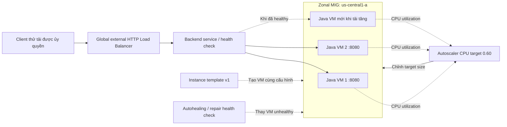
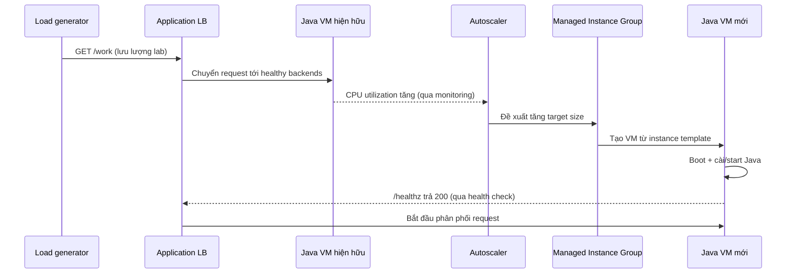
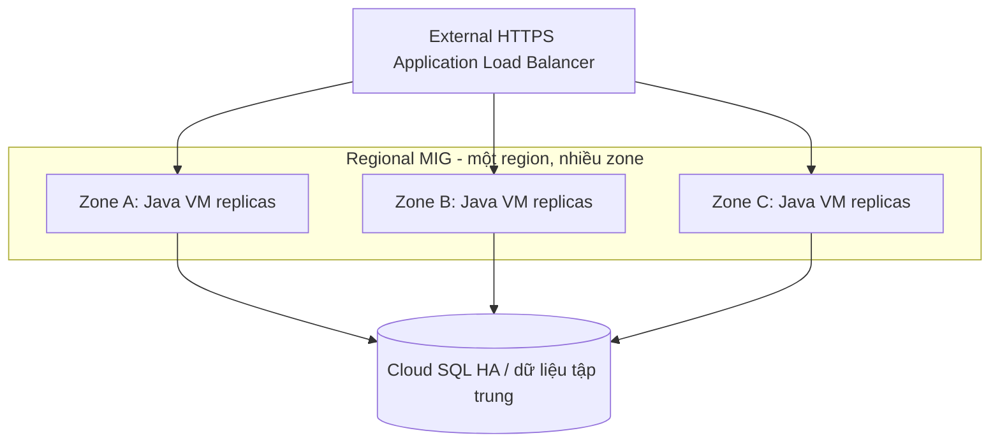
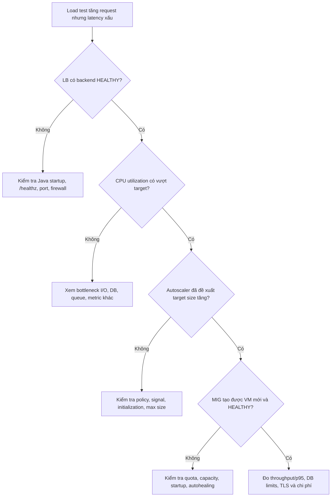

# Thực hành mở rộng ứng dụng Java theo tải

## 1. Bài toán và mục tiêu của bài thực hành

Một REST API Java xử lý đơn hàng chạy trên **Compute Engine** ban đầu chỉ cần hai máy ảo. Khi có chiến dịch khuyến mãi, lưu lượng tăng nhiều lần: CPU vượt ngưỡng, request chậm, connection pool cạn và một máy có thể bị lỗi. Nếu vận hành viên phải tự tạo VM hoặc tự xóa VM sau đợt cao điểm, thời gian phản ứng chậm và dễ gây gián đoạn. Ngược lại, giữ hàng chục VM hoạt động liên tục dù ít khách truy cập làm hóa đơn tăng không cần thiết.

**Managed Instance Group (MIG)** kết hợp với **Compute Engine autoscaler** cho phép nhóm VM được tạo từ một **instance template**, duy trì cấu hình thống nhất và **tự điều chỉnh số bản sao theo tín hiệu tải** trong giới hạn đã định. Khi kết hợp với **Application Load Balancer** và **health checks**, hệ thống có thể đưa VM khỏe vào phục vụ, ngừng gửi request tới VM lỗi, tự thay VM hỏng và mở rộng/thu hẹp công suất.

Trong chương **Nhóm máy ảo và tự động mở rộng** của mô-đun **CLOUD_PROVIDERS_GCP**, bài học này hướng dẫn một lab từ đầu đến cuối: triển khai một **ứng dụng Java HTTP nhỏ** trên Compute Engine, tạo MIG, gắn load balancer, bật CPU autoscaling, phát tải có kiểm soát, đọc metrics và dọn tài nguyên. Sau đó, bài liên hệ các nguyên tắc vừa thực hành với **Spring Boot production**, Cloud SQL, IAM/VPC, tính sẵn sàng đa zone, bảo mật và chi phí.

**Mục tiêu sau bài học**

1. Phân biệt instance template, zonal/regional MIG, health check, autohealing, load balancing và autoscaler.
2. Tạo một ứng dụng Java có endpoint kiểm tra sức khỏe và endpoint mô phỏng CPU load, biết lý do không dùng bài test này trên production.
3. Tạo một **zonal MIG** có tối thiểu hai VM, health check, global external HTTP load balancer và policy autoscale theo CPU.
4. Quan sát chu kỳ **scale-out → ổn định → scale-in**, phân biệt thời gian khởi tạo VM với stabilization period.
5. So sánh CPU autoscaling, load balancing serving-capacity autoscaling, Monitoring/custom metrics và scheduled scaling.
6. Thiết kế kiến trúc production có rollout/rollback, session stateless, database connection limits, kiểm soát IAM/VPC và ngân sách.

> **Phạm vi và an toàn:** ví dụ tạo VM, load balancer, public IP, disk và logging **có thể phát sinh chi phí**. Chỉ chạy trong project lab có quyền, quota, billing và sự cho phép thích hợp. Tải thử chỉ hướng tới **endpoint do bạn sở hữu trong môi trường thử nghiệm**; không sử dụng lab để làm quá tải hoặc thử nghiệm trên dịch vụ của người khác. Bài này chỉ cung cấp các lệnh minh họa; nó không tự triển khai tài nguyên.

## 2. Kiến trúc của lab

Chúng ta sử dụng:

| Thành phần | Cấu hình minh họa | Vai trò |
| --- | --- | --- |
| VPC/subnet | `java-lab-vpc`, `java-lab-subnet`, `10.40.0.0/24` | Nơi các VM nhận private IP |
| Java HTTP app | Port `8080`, `/healthz` và `/work` | Tạo response và tải CPU có giới hạn |
| Instance template | `java-template-v1`, Debian 12, `e2-standard-2` | Mẫu bất biến để tạo VM |
| Zonal MIG | `java-lab-mig` tại `us-central1-a` | Quản lý các VM giống nhau |
| Autohealing health check | `java-repair-hc` | Xác định VM cần sửa/thay khi ứng dụng không khỏe |
| Load balancer health check | `java-lb-hc` | Chỉ đưa backend khỏe vào phục vụ |
| Global external Application Load Balancer | HTTP cổng 80, backend service `java-backend` | Phân phối request đến MIG |
| Autoscaler | Min 2, max 6, target CPU 60% | Tăng/giảm số VM theo tải |
| Cloud Monitoring/Logging | VM CPU, MIG size, LB metrics, serial/startup logs | Đánh giá thay đổi và tìm lỗi |

Các thông số là **ví dụ thử nghiệm**, không phải đề xuất kích cỡ mặc định cho production. Đặc biệt, **zonal MIG chỉ ở một zone** và không bảo đảm tiếp tục phục vụ nếu cả zone hỏng; mục 12 trình bày regional MIG.



**Phân biệt các trách nhiệm:** load balancer **định tuyến request**, health check **đánh giá VM có phục vụ được không**, autohealing **sửa VM lỗi**, autoscaler **đổi số lượng VM vì nhu cầu công suất**. Chúng phối hợp nhưng không phải một cơ chế duy nhất.

## 3. Kiến thức nền trước khi gõ lệnh

### 3.1. Instance template: cấu hình dùng để nhân bản

Instance template định nghĩa loại máy, image hoặc boot disk, network interface, metadata/startup script, service account, tags, labels và tùy chọn VM. **Template là tài nguyên bất biến**: để thay startup script/image, bạn **tạo template phiên bản mới**, không sửa nội dung template cũ rồi mong toàn MIG tự đổi.

Các VM được MIG tạo từ cùng template **không chia sẻ RAM, process Java hoặc local disk**. Nếu một VM bị thay thế, file cục bộ và in-memory session trên VM đó có thể biến mất. Vì vậy, ứng dụng Java muốn scale ngang nên **stateless hoặc dùng trạng thái ngoài VM**, như Cloud SQL, Memorystore, Cloud Storage hoặc Pub/Sub theo nghiệp vụ.

### 3.2. Unmanaged Instance Group khác Managed Instance Group

| Loại | Điểm chính | Autoscaling/autohealing |
| --- | --- | --- |
| **Unmanaged Instance Group** | Bạn tự tạo và tự duy trì danh sách VM; máy có thể khác cấu hình | Không có các cơ chế quản trị tự động đầy đủ của MIG |
| **Zonal MIG** | VM cùng template trong **một zone** | Có autoscaling, autohealing, rolling update |
| **Regional MIG** | VM được phân bố trên nhiều zone thuộc **một region** | Thêm lựa chọn phân phối, cải thiện chịu lỗi zone khi được cấu hình đúng |

Không nhầm regional MIG với một cụm đa region; regional MIG **không tự phủ hai khu vực địa lý**. Để phục hồi khi mất cả region, cần chiến lược đa region và dữ liệu tương ứng.

### 3.3. Autoscaling không phải autohealing

Giả sử group cần bốn VM theo tải. Một VM bị treo:

- **Autohealing** dùng health check để xác định VM lỗi và có thể **recreate** nó, đưa về trạng thái mong muốn.
- **Autoscaler** tính cần bao nhiêu VM dựa trên CPU, load balancing capacity, Monitoring metric hoặc lịch; việc VM treo **không đồng nghĩa** nhu cầu CPU đã tăng. 
- **Load balancer health check** tạm ngừng gửi request tới backend không khỏe, kể cả trong lúc autohealing chưa thay xong.

Nếu gộp cả ba vào một khái niệm “autoscale”, bạn khó phân biệt VM bị thay do lỗi khởi động hay số lượng tăng do tải.

### 3.4. Các tín hiệu autoscaler hỗ trợ

| Tín hiệu | Dùng khi nào? | Hạn chế/cảnh báo |
| --- | --- | --- |
| **Average CPU utilization** | Java xử lý CPU-bound hoặc CPU tương quan với số request | I/O-bound app có thể quá tải mà CPU vẫn thấp |
| **Load balancing serving capacity** | Backend sau Application Load Balancer, muốn dựa vào mức tải trên capacity khai báo | Phải cấu hình backend capacity/balancing mode phù hợp |
| **Cloud Monitoring metrics** | Có metric đại diện công việc như hàng đợi hoặc requests | Cần metric, target semantics và giới hạn tài nguyên phù hợp |
| **Schedule-based scaling** | Biết trước giờ cao điểm | Lịch chỉ là tín hiệu bổ sung, không thay điều chỉnh theo tải thực |
| **Predictive autoscaling** | Có mẫu CPU lặp lại đủ để dự báo | Không tự giải quyết traffic bất thường hoặc cold start quá dài |

Với **nhiều autoscaling signals**, autoscaler thường chọn số VM cần thiết để đáp ứng tín hiệu đòi hỏi **nhiều VM nhất**, trong giới hạn min/max và chính sách hiện hành. Không cộng máy một cách cơ học từ từng tín hiệu.

## 4. Thiết kế ứng dụng Java dành cho bài lab

Để lab dễ lặp lại mà không phải chuẩn bị Maven repository hoặc một JAR bên ngoài, ví dụ sử dụng **Java 17 JDK HttpServer**. Đây là một ứng dụng HTTP **Java thuần**, không phải Spring Boot; phần 11 sẽ giải thích cách chuyển nguyên lý sang Spring Boot. CPU test được tạo bởi một vòng tính toán hữu hạn, **không phải mã khai thác** hay công cụ flood.

| Endpoint | Kết quả | Mục đích |
| --- | --- | --- |
| `GET /healthz` | HTTP 200 khi Java server đã sẵn sàng | Health check của LB và MIG |
| `GET /` | HTTP 200 kèm hostname | Kiểm tra load balancer phân phối qua nhiều VM |
| `GET /work` | Tính toán hữu hạn rồi trả hostname/kết quả | Tăng CPU trong bài test có kiểm soát |

### 4.1. Startup script hoàn chỉnh

Trên **máy quản trị lab**, tạo tệp `startup-java.sh` với nội dung sau. Script này được thực thi lúc VM boot bởi Compute Engine guest agent. Vì script cài JDK qua `apt`, VM phải có **đường outbound đến nguồn package** qua external IP hoặc Cloud NAT/proxy phù hợp; nếu không, startup sẽ lỗi. Trong production nên dùng **golden image** hoặc artifact build sẵn, không phụ thuộc vào tải package ngẫu nhiên lúc scale-out.

```bash
#!/usr/bin/env bash
set -euo pipefail

export DEBIAN_FRONTEND=noninteractive
apt-get update
apt-get install -y openjdk-17-jdk-headless

install -d -m 0755 /opt/java-load-lab

cat > /opt/java-load-lab/LoadApp.java <<'JAVA'
import com.sun.net.httpserver.HttpExchange;
import com.sun.net.httpserver.HttpServer;
import java.io.IOException;
import java.io.OutputStream;
import java.net.InetSocketAddress;
import java.nio.charset.StandardCharsets;
import java.nio.file.Files;
import java.nio.file.Path;
import java.util.concurrent.Executors;

public final class LoadApp {
    private static final String HOST = readHostName();

    private static String readHostName() {
        try {
            return Files.readString(Path.of("/etc/hostname")).trim();
        } catch (IOException e) {
            return "unknown-vm";
        }
    }

    private static void respond(HttpExchange exchange, String content)
            throws IOException {
        byte[] bytes = (content + "\n").getBytes(StandardCharsets.UTF_8);
        exchange.getResponseHeaders().set(
            "Content-Type", "text/plain; charset=utf-8");
        exchange.sendResponseHeaders(200, bytes.length);
        try (OutputStream stream = exchange.getResponseBody()) {
            stream.write(bytes);
        }
    }

    public static void main(String[] args) throws IOException {
        HttpServer server = HttpServer.create(
            new InetSocketAddress("0.0.0.0", 8080), 128);
        server.createContext("/healthz", exchange ->
            respond(exchange, "ok"));
        server.createContext("/work", exchange -> {
            // Khối lượng hữu hạn để minh họa CPU-bound request.
            double total = 0;
            for (int i = 1; i <= 8_000_000; i++) {
                total += Math.sqrt(i);
            }
            respond(exchange, "host=" + HOST + " sum=" + total);
        });
        server.createContext("/", exchange ->
            respond(exchange, "host=" + HOST + " status=ready"));
        server.setExecutor(Executors.newFixedThreadPool(8));
        server.start();
    }
}
JAVA

javac --add-modules jdk.httpserver /opt/java-load-lab/LoadApp.java

cat > /etc/systemd/system/java-load-lab.service <<'UNIT'
[Unit]
Description=Java HTTP load lab
After=network-online.target
Wants=network-online.target

[Service]
Type=simple
WorkingDirectory=/opt/java-load-lab
ExecStart=/usr/bin/java --add-modules jdk.httpserver -cp /opt/java-load-lab LoadApp
Restart=always
RestartSec=3
User=nobody
NoNewPrivileges=true

[Install]
WantedBy=multi-user.target
UNIT

systemctl daemon-reload
systemctl enable --now java-load-lab.service
```

**Vì sao cần `systemd`?** Nếu Java process chết sau startup, systemd có thể khởi động lại trong VM; nếu VM/ứng dụng vẫn không khỏe, **MIG autohealing** là lớp sửa chữa bổ sung. Endpoint `/healthz` chỉ cho biết web server trả lời được, chưa kiểm tra Cloud SQL hoặc nghiệp vụ; trên production cần thiết kế readiness phù hợp, tránh làm chết cả group chỉ vì một dependency tạm thời mất kết nối.

**Hạn chế cố ý của lab:** HTTP không có TLS, không có authentication và `/work` dùng CPU. Chỉ mở qua load balancer test, không gửi dữ liệu nhạy cảm và không giữ cấu hình này để phục vụ Internet production. Nếu lệnh `apt` không cài được JDK vì thiếu egress/quota, sửa network/package source hoặc dùng image Java đã chuẩn bị; không tăng số VM để che lỗi startup.

## 5. Chuẩn bị project, mạng, firewall và quyền

### 5.1. Điều kiện trước khi triển khai

Cần một **Google Cloud project** có Billing đang hoạt động, quota đủ cho ít nhất **2–6 VM `e2-standard-2`** trong zone thử nghiệm và quyền tạo VM, firewall, template, MIG, autoscaler, health checks và load balancer. Bật **Compute Engine API**. Đường quyền thực tế có thể phân tách giữa network administrator, load balancer administrator và người triển khai ứng dụng; không yêu cầu tất cả là project Owner.

Lệnh dưới đây dùng Bash hoặc Cloud Shell. Hãy đổi `PROJECT_ID`, region/zone và CIDR nếu môi trường đã có mạng. Ví dụ cố tình chọn **một VPC mới cho lab** để giảm nguy cơ ảnh hưởng mạng sẵn có.

```bash
gcloud config set project PROJECT_ID
gcloud services enable compute.googleapis.com

gcloud compute networks create java-lab-vpc \
  --subnet-mode=custom

gcloud compute networks subnets create java-lab-subnet \
  --network=java-lab-vpc \
  --region=us-central1 \
  --range=10.40.0.0/24
```

Các IP/dải mạng chỉ là ví dụ. Nếu dự án đã có VPC, **kiểm tra trùng CIDR, firewall, routes và Shared VPC** trước khi tạo; không cần tạo mạng mới chỉ để học.

### 5.2. Chỉ cho các nguồn load balancing/health check đến backend

Đối với **global external Application Load Balancer** dùng instance group backends, tài liệu Google Cloud chỉ định các dải nguồn IPv4 của GFE/health check gồm `35.191.0.0/16` và `130.211.0.0/22` cho những trường hợp tương ứng. Lab cho phép **TCP port 8080** đến VMs mang network tag `java-mig-backend` từ các dải đó:

```bash
gcloud compute firewall-rules create java-lab-allow-lb \
  --network=java-lab-vpc \
  --direction=INGRESS \
  --action=ALLOW \
  --rules=tcp:8080 \
  --source-ranges=35.191.0.0/16,130.211.0.0/22 \
  --target-tags=java-mig-backend
```

**Đừng mở `0.0.0.0/0` tới port 8080**. Load balancer nhận public traffic ở frontend và chuyển request tới VM; nguồn kết nối backend không nhất thiết là IP public gốc của người dùng. Kiểm tra ma trận IP range theo **loại LB** khi đổi sang regional/other type; các dải trên không phải quy tắc chung cho mọi cấu hình.

Trong lab này template có thể tạo VM với **external IPv4 tạm** để cài JDK qua Internet. Trong production, nên ưu tiên **không cấp external IP cho VM** và cung cấp outbound bằng Cloud NAT/proxy phù hợp; firewall vẫn phải được thiết kế riêng. Nếu dùng external IP, không tạo rule SSH công khai tùy ý; dùng OS Login/IAP hoặc quy trình quản trị có kiểm soát.

## 6. Tạo instance template và Managed Instance Group

### 6.1. Tạo template

Tệp `startup-java.sh` ở mục 4 phải tồn tại trong **thư mục chạy lệnh**.

```bash
gcloud compute instance-templates create java-template-v1 \
  --machine-type=e2-standard-2 \
  --image-family=debian-12 \
  --image-project=debian-cloud \
  --network=java-lab-vpc \
  --subnet=java-lab-subnet \
  --tags=java-mig-backend \
  --metadata-from-file=startup-script=./startup-java.sh

gcloud compute instance-templates describe java-template-v1
```

Template khai báo cấu hình VM; **nó chưa tạo VM và chưa chạy Java**. Nếu muốn dùng custom VM service account, khai báo trong template với quyền IAM tối thiểu. Không đặt database password/API key trong startup script hoặc metadata vì có nguy cơ bị đọc bởi người/tác vụ có quyền không phù hợp.

### 6.2. Tạo zonal MIG với hai VM

```bash
gcloud compute instance-groups managed create java-lab-mig \
  --template=java-template-v1 \
  --base-instance-name=java-lab \
  --size=2 \
  --zone=us-central1-a

gcloud compute instance-groups managed list-instances java-lab-mig \
  --zone=us-central1-a
```

Các VM sẽ được tạo từ template và guest startup script chạy để cài Java. Có thể cần thời gian để VM boot, cài JDK và health endpoint bắt đầu trả lời. Nếu một VM vẫn không khỏe, đọc **startup/serial logs**, trạng thái systemd và firewall thay vì tăng số lượng VM.

### 6.3. Thiết lập named port

Application Load Balancer backend service dùng tên cổng để xác định cổng phục vụ trên các instance groups. Trỏ tên `http` đến port `8080`:

```bash
gcloud compute instance-groups managed set-named-ports java-lab-mig \
  --named-ports=http:8080 \
  --zone=us-central1-a

gcloud compute instance-groups managed describe java-lab-mig \
  --zone=us-central1-a
```

Named port **không mở firewall** và không tự khởi động server; nó chỉ là metadata để load balancer/backend service và nhóm VM thống nhất cổng.

## 7. Health check, autohealing và load balancing

### 7.1. Dùng hai health check theo hai mục đích

Google Cloud khuyến nghị **health check autohealing ít nhạy hơn health check load balancing**. Load balancer cần ngừng gửi traffic tới instance không khỏe tương đối nhanh; autohealing không nên recreate VM chỉ vì một lỗi ngắn, để tránh vòng lặp thay VM hàng loạt.

```bash
gcloud compute health-checks create http java-lb-hc \
  --port=8080 \
  --request-path=/healthz \
  --check-interval=10s \
  --timeout=5s \
  --unhealthy-threshold=2

gcloud compute health-checks create http java-repair-hc \
  --port=8080 \
  --request-path=/healthz \
  --check-interval=30s \
  --timeout=10s \
  --unhealthy-threshold=3

gcloud compute instance-groups managed set-autohealing java-lab-mig \
  --health-check=java-repair-hc \
  --initial-delay=300 \
  --zone=us-central1-a
```

**`--initial-delay=300` ở autohealing** là thời gian grace period sau khi VM được tạo, giúp ứng dụng có cơ hội khởi động trước khi bị đánh giá là lỗi. Nó **khác** với `--cool-down-period` của autoscaler (thời gian khởi tạo được dùng khi tính scale-out). Hai giá trị nên dựa trên số đo **VM boot → Java ready**, không lấy nguyên ví dụ vào production.

### 7.2. Tạo global external HTTP load balancer

Lab dùng **HTTP** để tập trung vào autoscaling, **không phù hợp cho hệ thống công khai production**. Với production, cấu hình **HTTPS**, chứng chỉ TLS qua Certificate Manager, chính sách TLS và Cloud Armor khi thích hợp.

```bash
gcloud compute backend-services create java-backend \
  --global \
  --load-balancing-scheme=EXTERNAL_MANAGED \
  --protocol=HTTP \
  --port-name=http \
  --health-checks=java-lb-hc

gcloud compute backend-services add-backend java-backend \
  --global \
  --instance-group=java-lab-mig \
  --instance-group-zone=us-central1-a \
  --balancing-mode=UTILIZATION \
  --max-utilization=0.8

gcloud compute url-maps create java-url-map \
  --default-service=java-backend

gcloud compute target-http-proxies create java-http-proxy \
  --url-map=java-url-map

gcloud compute addresses create java-lb-ip \
  --global \
  --ip-version=IPV4

gcloud compute forwarding-rules create java-http-rule \
  --global \
  --load-balancing-scheme=EXTERNAL_MANAGED \
  --network-tier=PREMIUM \
  --address=java-lb-ip \
  --target-http-proxy=java-http-proxy \
  --ports=80
```

Sau khi cấu hình được áp dụng, xem:

```bash
gcloud compute backend-services get-health java-backend --global
gcloud compute addresses describe java-lb-ip --global \
  --format="get(address)"

# Thay LB_IP bằng IP đã lấy từ lệnh trên:
curl -i http://LB_IP/healthz
curl -i http://LB_IP/
```

Kết quả mong đợi: LB backend có VM `HEALTHY`, URL `/healthz` trả `200 OK`. Nếu trả 502/503, chưa nên tăng tải: kiểm tra startup script, app port, named port, VPC firewall, health check, backend attachment và readiness.

**Chỉ có một zone trong lab:** LB có thể phân phối giữa các VM cùng zone, nhưng không giúp hệ thống sống sót khi **cả zone** mất kết nối.

## 8. Bật autoscaler CPU và hiểu các tham số

### 8.1. Cấu hình một policy CPU target 60%

Google Cloud đo CPU utilization của VM bằng metric hypervisor `compute.googleapis.com/instance/cpu/utilization`. Autoscaler dựa trên **mức sử dụng CPU trung bình của tất cả vCPU trong group**, không dựa vào riêng phần trăm một process Java hiển thị trong `top`.

```bash
gcloud compute instance-groups managed set-autoscaling java-lab-mig \
  --zone=us-central1-a \
  --min-num-replicas=2 \
  --max-num-replicas=6 \
  --target-cpu-utilization=0.60 \
  --cool-down-period=300 \
  --stabilization-period=600

gcloud compute instance-groups managed describe java-lab-mig \
  --zone=us-central1-a
```

Các tham số:

| Tham số | Ý nghĩa | Trong lab |
| --- | --- | --- |
| `min-num-replicas` | Số VM tối thiểu MIG giữ khi autoscaling bật | 2 |
| `max-num-replicas` | Giới hạn số VM tối đa autoscaler tạo | 6 |
| `target-cpu-utilization` | Mục tiêu mức CPU trung bình | 0,60 = 60% |
| `cool-down-period` | Tên flag lịch sử cho **initialization period**: thời gian app cần khởi tạo để autoscaler bỏ qua dữ liệu CPU của VM đang khởi tạo khi tính **scale-out** | 300 giây |
| `stabilization-period` | Khoảng giữ công suất cho **scale-in** nhằm tránh xóa VM quá nhanh khi traffic giảm; default thường 600 giây | 600 giây |

**Không hiểu `cool-down-period` là “autoscaler phải chờ đủ 300 giây mới được scale VM”**. Google Cloud sử dụng nó để đánh giá metrics đúng khi VM đang khởi động, không phải khóa mọi quyết định scale-out. Khi tính scale-in, dữ liệu từ VM trong initialization period vẫn có thể được xem xét. `stabilization-period` chủ yếu ảnh hưởng **scale-in**, không tự ngăn scale-out nhanh khi tải tăng.

### 8.2. Bài toán ước tính số VM

Nếu có `N` VM đang chạy với CPU trung bình `U`, mục tiêu `T`, phép xấp xỉ:

```text
Số VM mong muốn ≈ ceil(N × U / T)
Giới hạn kết quả trong [minReplicas, maxReplicas].

Ví dụ: N=2, U=90%=0,90, T=60%=0,60
ceil(2 × 0,90 / 0,60) = 3 VM.
```

Đây là **mô hình tư duy**, không phải công thức nội bộ đầy đủ của Compute Engine autoscaler: hệ thống còn có window/metrics smoothing, initialization, stabilization, min/max và những tín hiệu khác. Nếu CPU của `/work` tiếp tục cao khi có 3 VM, autoscaler có thể tạo thêm VM đến giới hạn 6.

### 8.3. Tại sao CPU target không đủ cho mọi Java app?

- **CPU-bound Java request** (mã hóa, nén, xử lý JSON lớn, tính toán): CPU có thể là tín hiệu hữu ích.
- **I/O-bound request** (chờ Cloud SQL, HTTP downstream, Pub/Sub): CPU có thể chỉ 20% dù request đã timeout. Cần thêm signal về queue length/requests hoặc giới hạn tải phía DB.
- **Burst ngắn:** spike chỉ vài giây có thể kết thúc trước khi VM mới boot, nên latency vẫn có thể tăng. Cần giữ min capacity dự phòng theo SLO.
- **Slow JVM startup:** tải Maven/JDK/container images lúc boot kéo dài initialization; xem xét baked image, warm-up, Java CDS hoặc startup tối ưu.
- **GC và contention:** CPU lên cao không luôn nghĩa là cần thêm VM; có thể cần sửa cấu hình heap/GC hoặc giảm lock/contention.

## 9. Tạo tải có kiểm soát và quan sát scale-out/scale-in

### 9.1. Kiểm tra baseline trước khi test

Ghi lại các giá trị:

| Chỉ số | Trước tăng tải | Khi tăng tải | Sau khi giảm |
| --- | --- | --- | --- |
| MIG target/actual size | 2 | Có thể tăng | Trở về ngưỡng min sau stabilization |
| CPU utilization trung bình | Thấp khi idle | Cao khi `/work` được gọi liên tục | Giảm dần |
| Healthy VM trong backend | 2 | VM mới chỉ nhận traffic khi healthy | Không có unhealthy bất thường |
| LB request rate và latency | Baseline | Tăng theo request | Về baseline |
| Java errors / VM boot logs | Không lỗi | Không lỗi startup khi scale-out | Graceful shutdown khi scale-in |
| Chi phí dự kiến | 2 VM + LB | VM nhiều hơn | Giảm khi bớt VM, không về 0 do min 2 |

Kiểm tra từ Google Cloud Console **Compute Engine → Instance groups → java-lab-mig → Autoscaling/Monitoring**, **Cloud Monitoring → Metrics Explorer**, và health của backend service. Có thể dùng CLI:

```bash
gcloud compute instance-groups managed list-instances java-lab-mig \
  --zone=us-central1-a

gcloud compute instance-groups managed describe java-lab-mig \
  --zone=us-central1-a

gcloud compute backend-services get-health java-backend --global
```

**Lưu ý:** `list-instances` là số VM hiện tại, không phải tín hiệu autoscaler muốn bao nhiêu VM; kiểm tra cả target size, các tác vụ đang chờ và trạng thái autoscaler riêng.

### 9.2. Gửi request test tới endpoint thuộc quyền kiểm soát

Dùng một **máy thử tải được cấp phép** (có thể là VM riêng trong project test) với `apache2-utils` và `ab`, hoặc công cụ load testing được nhóm chấp thuận. Ví dụ sau chạy tối đa **120 giây** với **concurrency 20**; chỉ dùng khi đã xác nhận `LB_IP` là địa chỉ **lab của bạn**:

```bash
# Chỉ chạy từ máy test và với endpoint mà bạn sở hữu.
# Cài apache2-utils qua package manager nếu chưa có ab.
ab -t 120 -c 20 http://LB_IP/work
```

Đây là **lưu lượng có giới hạn**, không phải bảo đảm autoscaler sẽ tăng từ 2 lên 6 VM trong đúng 120 giây. Kết quả phụ thuộc sức CPU mỗi VM, chi phí thực của `Math.sqrt` trên JIT/CPU, latency, request rate, khả năng load generator và metrics sampling. Nếu VM không tăng, kiểm tra trước xem **CPU trung bình có thực vượt target** và backend có nhận được request, không tự động tăng số client lớn không giới hạn.

Để đánh giá xu hướng ổn định, có thể tổ chức nhiều phiên thử có giới hạn và nghỉ giữa các phiên, với ngân sách/quota đã được phê duyệt. **Không thực hiện tải liên tục ngoài cửa sổ test**.

### 9.3. Thời điểm scale-out

Khi CPU trung bình cao hơn mục tiêu trong khoảng theo dõi phù hợp, autoscaler có thể yêu cầu MIG tạo thêm VM. Trình tự thực tế:



Khi VM mới được tạo nhưng `/healthz` chưa trả 200, LB không nên đưa nó vào nhận traffic; tăng số VM trên Console **không đồng nghĩa công suất ứng dụng đã sẵn sàng**. Theo dõi **time-to-ready** từ lúc instance được tạo đến khi backend healthy.

### 9.4. Sau khi dừng tải: vì sao không scale-in ngay?

Khi ngừng `ab`, CPU giảm và autoscaler tính công suất cần thiết thấp hơn. Tuy vậy, **stabilization period** cố tình giữ đủ công suất theo tải đỉnh được quan sát trong cửa sổ, tránh VM bị xóa rồi lại tạo liên tục (**flapping**). Ngoài ra, các hoạt động MIG như resize/delete, health check và metrics có độ trễ.

**Không chỉnh stabilization về 0 chỉ để nhìn scale-in nhanh** nếu không hiểu tác động tới SLO. Trong production, scale-in phải phối hợp **connection draining**, shutdown grace period, request đang xử lý và consumer của queue; nếu cắt VM đột ngột có thể gây lỗi/duplicate.

### 9.5. Diễn giải kết quả thay vì chỉ đếm VM

Sau bài test, trả lời:

1. CPU tăng từ bao nhiêu đến bao nhiêu? Khi nào autoscaler thay target size?
2. Mất bao lâu mỗi VM mới đến trạng thái backend `HEALTHY`?
3. Khi thêm VM, p95 latency và throughput có tốt hơn không?
4. Có thấy nhiều HTTP 502/503, connection refused hoặc startup failures không?
5. Khi tải giảm, số VM thay đổi theo stabilization như thế nào?
6. Tổng số VM có chạm `max-num-replicas=6`? Nếu có, đó có thể là **điểm giới hạn công suất**, không phải lỗi autoscaling.
7. Nếu CPU vẫn thấp nhưng user latency cao, bottleneck có nằm ở DB/connection pool hoặc downstream không?

## 10. Mở rộng theo load balancing capacity và tín hiệu khác

### 10.1. Autoscale theo load balancing serving capacity

Đối với MIG phía sau external Application Load Balancer, autoscaler có thể dùng **load balancing utilization**. Để tín hiệu này có nghĩa, backend service phải khai báo **capacity** bằng balancing mode thích hợp, chẳng hạn `UTILIZATION` hoặc `RATE`, thay vì chỉ nhìn số request chưa quy đổi.

Ví dụ **thay thế** CPU-only policy bằng LB serving capacity target 70% (không phải cộng hai lệnh và mặc định còn giữ CPU):

```bash
gcloud compute instance-groups managed set-autoscaling java-lab-mig \
  --zone=us-central1-a \
  --min-num-replicas=2 \
  --max-num-replicas=6 \
  --target-load-balancing-utilization=0.70 \
  --cool-down-period=300 \
  --stabilization-period=600
```

**Phân biệt hai số phần trăm:** `--max-utilization=0.8` trên **backend service** biểu diễn cấu hình capacity để phân phối lưu lượng; `--target-load-balancing-utilization=0.70` của **autoscaler** là mục tiêu về mức dùng capacity đó. Không coi cả hai là CPU target 80%/70%.

Nếu cần kết hợp **CPU + LB utilization**, phải khai báo chính xác cả hai signal theo câu lệnh/API/config của autoscaler và xem cách tổng hợp quyết định scale. Trong môi trường có nhiều backend services cùng dùng một MIG, capacity và tín hiệu load balancing còn phụ thuộc cách MIG được gắn và các giới hạn sản phẩm.

### 10.2. Custom Monitoring metric

Đối với API Java chủ yếu chờ database, **CPU không phản ánh backlog**. Có thể xây metric về queue backlog/processing demand thông qua Cloud Monitoring hoặc exporter phù hợp, rồi dùng autoscaler hỗ trợ **Monitoring metrics**. Tuy nhiên:

- Chọn metric có đơn vị rõ (requests, messages, seconds, utilization) và tần suất cập nhật phù hợp.
- Đảm bảo metric là **tín hiệu autoscaler có thể dùng**, được gắn đúng instance group; không phải mọi dashboard metric đều dùng làm autoscaling signal.
- Xác định mức target và trường hợp metric bị thiếu/chậm, tránh xóa hết VM khi collector gián đoạn.
- Đặt min/max theo năng lực DB, API quota và ngân sách.

Ví dụ nghiệp vụ: backlog 5.000 đơn hàng chưa xử lý có thể yêu cầu worker nhiều hơn, nhưng nếu Cloud SQL chỉ cho phép 100 connections, scale thêm worker không giới hạn chỉ làm lỗi tăng.

### 10.3. Scheduled và predictive autoscaling

**Schedule-based scaling** giúp tăng số VM tối thiểu vào giờ khuyến mãi hoặc giờ cao điểm theo lịch. **Predictive CPU autoscaling** có thể dự đoán mẫu tải lặp lại để tạo VM trước khi request tăng, dựa trên lịch sử và initialization period.

Hai cách này bổ sung cho autoscaling phản ứng theo tải: lịch có thể dự đoán sự kiện được biết trước; CPU/LB metrics giải quyết mức tăng thực tế; predictive mode cần dữ liệu phù hợp. Dù chọn cách nào, phải kiểm tra **ngân sách, max capacity, quota và app startup latency**.

## 11. Từ lab Java thuần sang Spring Boot production

### 11.1. Readiness và liveness có ý nghĩa khác nhau

Trong production, ứng dụng Spring Boot nên có **Spring Boot Actuator** để cung cấp health endpoints phù hợp. Một ví dụ cấu hình:

```yaml
server:
  port: 8080
  shutdown: graceful

spring:
  lifecycle:
    timeout-per-shutdown-phase: 30s

management:
  endpoint:
    health:
      probes:
        enabled: true
  endpoints:
    web:
      exposure:
        include: health,info
```

Với cấu hình/phiên bản Spring Boot phù hợp, endpoint như `/actuator/health/readiness` có thể dùng để phân biệt ứng dụng **đã nhận request được** hay chưa; `/actuator/health/liveness` dùng để phát hiện process mất khả năng hoạt động. Kiểm tra đường URL thực tế, actuator dependency, profile, security filters và chính sách phục vụ health endpoint.

**Không biến health check thành truy vấn database quá nặng mỗi vài giây.** Nếu trạng thái downstream bị lỗi tạm thời, hãy cân nhắc hậu quả khi load balancer rút VM hoặc autohealing recreate VM đồng loạt. Nên tách health check **LB** và **MIG autohealing** theo độ nhạy và ý nghĩa.

### 11.2. Stateless API và quản lý phiên

Để scale ngang hiệu quả:

- Không lưu session giỏ hàng hay token một lần duy nhất trong **RAM của một VM** trừ khi có cơ chế chia sẻ/khôi phục.
- Lưu dữ liệu nghiệp vụ trong **Cloud SQL/Firestore** hoặc hệ thống dữ liệu phù hợp; file upload lưu trong **Cloud Storage** thay vì boot disk VM.
- Nếu cần session, dùng cookie/token theo chính sách bảo mật hoặc một session store dùng chung; cân nhắc Cloud Memorystore khi phù hợp.
- Với message consumers, đảm bảo **idempotency** và xử lý lại message an toàn, vì VM có thể bị thay khi scale-in hoặc autohealing.
- Tách background jobs chạy liên tục khỏi API request nếu mô hình scale theo HTTP không phản ánh workload nền.

Một client có thể gửi hai request liên tiếp và được hai VM khác nhau xử lý. Điều này phải **không làm mất trạng thái hoặc tạo giao dịch trùng**.

### 11.3. Giới hạn kết nối tới Cloud SQL khi scale

Giả sử mỗi Spring Boot replica có **HikariCP maximumPoolSize = 10**, số replica tối đa là 6:

```text
Số kết nối DB cực đại do pool tạo ra (xấp xỉ)
  = 6 VM × 10 connections/VM
  = 60 connections
```

Thực tế còn connection của migrations, quản trị, batch jobs, pool khác và overhead. Nếu DB có giới hạn thấp hơn hoặc đang tải cao, tăng MIG size có thể **làm nghẽn database**. Cần đo connection usage, giảm N+1 queries, cache có kiểm soát, pooling phù hợp và autoscaling max gắn với năng lực toàn hệ thống.

### 11.4. Startup nhanh và rollout an toàn

Lệnh apt install trong startup script chỉ phục vụ lab. Trong production:

1. Build ứng dụng bằng CI, kiểm tra artifact và lỗ hổng image/dependencies.
2. Dùng image đã có Java runtime, JAR, Ops Agent và cấu hình cần thiết (**baked image**).
3. Template tham chiếu image/version cố định, startup chỉ làm phần cấu hình nhỏ; tránh tải Maven dependency lúc boot.
4. Bật **readiness** sau khi ứng dụng thật sự sẵn sàng nhận traffic, không ngay khi VM status chuyển thành `RUNNING`.
5. Dùng **MIG rolling update** hoặc canary với instance template mới và giới hạn `max-surge`/`max-unavailable`.
6. Theo dõi error rate, readiness, latency, Cloud SQL và sẵn sàng rollback bằng template cũ.

Ví dụ cấu trúc lệnh rollout sau khi đã tạo template `java-template-v2`:

```bash
gcloud compute instance-groups managed rolling-action start-update java-lab-mig \
  --version=template=java-template-v2 \
  --max-surge=1 \
  --max-unavailable=0 \
  --zone=us-central1-a
```

Đây là ví dụ **khung cập nhật**, không tự tạo template v2 và không đảm bảo mọi cấu hình/loại MIG hỗ trợ cùng chi tiết rolling update. Nếu group đã chạm trần quota hoặc không còn capacity, `max-surge=1` có thể thất bại; cần đủ công suất cho replica tạm.

## 12. Zonal MIG, regional MIG và khả năng chịu lỗi

### 12.1. Lab zonal khác production đa zone

Zonal MIG chỉ có VM trong `us-central1-a`. Nếu zone này gặp sự cố, load balancer không còn backend khỏe dù autoscaler liên tục muốn tạo thêm VM. Một **regional MIG** có thể phân phối VM trên nhiều zone trong cùng region để giảm rủi ro mất một zone, nhưng phải chọn **target distribution shape**, quota và các zone phù hợp.



**Regional MIG không tự giải quyết mất cả region**. Khi cần disaster recovery cross-region, thiết kế phải bao gồm load balancing toàn cầu, dữ liệu sao chép/backup, IAM/secret, DNS và kịch bản recovery.

### 12.2. Min instances phải xét tình huống N-1

Giả sử production cần tối thiểu 4 VM để phục vụ tải trung bình; nếu **một zone bị mất** hoặc một số VM phải update cùng lúc, nhóm còn lại cần đủ công suất. Thiết kế chỉ `min=2` vì lab dùng 2 VM không phải mức an toàn phổ quát.

Các tham số cần tính cùng nhau: `minReplicas`, `maxReplicas`, CPU/LB targets, quota, spare capacity, instance boot time, database limits và SLO. Nếu app khởi tạo 5 phút mà đột ngột tăng gấp 5 lần, autoscaler không thể tạo công suất tức thời; **headroom/caching/queuing/predictive scaling** có thể cần thiết.

## 13. Kiểm soát quyền, VPC, TLS và chi phí

### 13.1. IAM và mạng

- Pipeline được quyền tạo template/MIG/autoscaler theo **least privilege**, không mặc định Project Owner.
- VM dùng **runtime service account riêng** với quyền tối thiểu để gọi Cloud Storage, Secret Manager, Pub/Sub; tránh dùng service account có quyền quản trị toàn project.
- Không đưa database password/token vào metadata hoặc Git; dùng Secret Manager/cơ chế quản lý secret phù hợp.
- Giới hạn ingress backend `8080` chỉ từ nguồn **load balancer và health check được hỗ trợ**. Khi có external IP, tránh mở lối bypass ứng dụng.
- Trong production, dùng HTTPS frontend với Certificate Manager, Cloud Armor nếu cần WAF/rate limits; cấu hình OS Login/IAP, egress/NAT và cập nhật OS.
- Với Shared VPC, network/subnet/firewall thuộc host project; quản trị quyền VM và backend có thể nằm ở service project.

### 13.2. Chi phí tăng theo số VM và thời gian hoạt động

Với MIG, Compute Engine thường tính phí theo **vCPU/RAM, thời gian chạy VM, boot disks, external IP, network egress** và tài nguyên khác theo biểu giá. Autoscaling không có nghĩa VM miễn phí; **minReplicas=2** khiến ít nhất hai VM thường xuyên hoạt động, và scale-out tạo thêm chi phí compute/disk. Load balancing, health check/logging, Cloud NAT và các dịch vụ hậu trường có phí riêng theo điều kiện.

Ví dụ **hoàn toàn giả định**, không phải bảng giá Google Cloud:

```text
Giả sử mỗi VM (CPU+RAM) = 0,12 USD/giờ.
2 VM hoạt động 24 giờ:    2 × 24 × 0,12 = 5,76 USD.
Thêm 4 VM trong 3 giờ:    4 × 3  × 0,12 = 1,44 USD.
Tổng phần compute ví dụ:  7,20 USD, chưa có disk/LB/IP/network/logs.
```

Khi dự toán thực tế, thay giá giả định bằng **đơn giá đúng region, machine type và discount**, kiểm tra [Compute Engine pricing](https://cloud.google.com/compute/all-pricing) và [Cloud Load Balancing pricing](https://cloud.google.com/load-balancing/pricing). Cấu hình **Billing Budgets/alerts** là cảnh báo chi phí, **không nên coi alerts-only budget tự cắt phí khi vượt ngưỡng**.

### 13.3. Bảo vệ trước autoscaling không kiểm soát

1. Đặt `max-num-replicas` dựa trên quota/khả năng DB và ngân sách.
2. Đặt alert khi autoscaler thường xuyên chạm max size hoặc CPU vẫn cao sau scale-out.
3. Rate limiting và Cloud Armor cho traffic bên ngoài nếu dịch vụ hỗ trợ; tránh để bot gây scale-out không giới hạn.
4. Theo dõi số VM, LB requests, database connections, disk usage, egress và Cloud Logging ingestion.
5. Tạo lịch xóa lab và tránh giữ global forwarding rule/static IP/disk mà không cần.

## 14. Chẩn đoán theo triệu chứng

| Triệu chứng | Nguyên nhân có thể | Kiểm tra |
| --- | --- | --- |
| MIG tạo VM nhưng `/healthz` không lên | Startup script lỗi, apt không có egress, Java service lỗi | Serial port/startup logs, systemd, `curl localhost:8080/healthz` |
| VM tự recreate liên tục | Autohealing quá nhạy hoặc Java chưa khởi tạo kịp | Health check, initial delay, application startup time |
| LB trả 502/503 | Backends unhealthy, firewall, named port/port mismatch | `backend-services get-health`, `java-lb-hc`, firewall |
| CPU cao nhưng MIG không scale | Autoscaler chưa bật/metric chưa có, đã chạm max/quota, đang initializing | Autoscaler describe, min/max, operations, CPU metric |
| MIG tăng target size nhưng chỉ có ít VM thật | Không đủ quota/capacity hoặc VM khởi động lỗi | MIG operations/errors, quota, zone capacity |
| VM mới nhận traffic chậm | Download JDK/JAR, warm-up JVM, health check delay | Time to ready, startup logs, health intervals |
| CPU thấp nhưng response chậm | DB/HTTP downstream bottleneck, lock/queue | HikariCP, p95 latency, HTTP metrics, thread dumps |
| Nhiều HTTP 429 khi thử tải | Rate limiter/WAF phía ngoài | Cloud Armor/LB logs, app 429 source |
| Scale-in gây lỗi request | Request draining/graceful shutdown chưa đủ | Backend connection draining, SIGTERM, in-flight requests |
| Không scale-in ngay sau load test | Stabilization period, metrics/scale-in controls | Autoscaler config và timeline CPU |
| Java VM có external IP bị gọi thẳng | Firewall quá rộng hoặc nguồn khác bypass LB | External IP, firewall rules, access logs |
| Bill không giảm về 0 khi dừng tải | VM min size, LB/IP/disk/logging vẫn còn | Billing SKUs, tài nguyên chưa xóa |

**Quy trình debug gợi ý**:



Trong Cloud Logging, phân biệt **HTTP response của frontend**, **systemd/startup failure** và **Spring Boot application errors**. Một tăng trưởng số VM không có nghĩa dịch vụ đã đáp ứng SLO; đo **latency, error rate, throughput và cost per request**.

## 15. Dọn tài nguyên lab để tránh phát sinh chi phí

Trước khi xóa, đảm bảo đây là **project test** và các resource dưới đây chỉ thuộc lab; **không sao chép lệnh vào production**. Ngừng load generator trước, rồi dọn frontend, backend, autoscaler/MIG, templates, checks và network theo thứ tự phụ thuộc.

```bash
# 1. Xóa phần frontend của lab.
gcloud compute forwarding-rules delete java-http-rule --global
gcloud compute target-http-proxies delete java-http-proxy
gcloud compute url-maps delete java-url-map
gcloud compute addresses delete java-lb-ip --global

# 2. Xóa backend service (sau khi không còn URL map dùng nó).
gcloud compute backend-services delete java-backend --global

# 3. Xóa MIG. Chỉ dùng khi đúng MIG lab và muốn xóa mọi VM trong group.
gcloud compute instance-groups managed delete java-lab-mig \
  --zone=us-central1-a

# 4. Xóa template và health checks không còn được tham chiếu.
gcloud compute instance-templates delete java-template-v1
gcloud compute health-checks delete java-lb-hc
gcloud compute health-checks delete java-repair-hc

# 5. Xóa firewall, subnet và VPC chuyên dụng cho lab.
gcloud compute firewall-rules delete java-lab-allow-lb
gcloud compute networks subnets delete java-lab-subnet \
  --region=us-central1
gcloud compute networks delete java-lab-vpc
```

**Kiểm tra sau cleanup:** không còn VM/MIG, forwarding rule/IP tĩnh, backend service, disk riêng, health check, network resources do lab tạo. Nếu đã thử một template v2, load generator VM, Cloud NAT, snapshots hoặc resource bổ sung, phải kiểm tra và dọn **riêng**, không suy từ danh sách mẫu rằng toàn project đã sạch. Đối chiếu Billing theo ngày; chi phí có thể xuất hiện trễ sau khi xóa.

## 16. Bài tập mở rộng và checklist

### Bài A — So sánh policy theo CPU và LB capacity

Với hai VM Java đang có CPU 90%, autoscaler target 60%, tính **số VM xấp xỉ** cần có. Sau đó giả định CPU chỉ 20% nhưng LB latency cao vì Java chờ Cloud SQL: giải thích tại sao CPU policy không tăng đúng kỳ vọng, tín hiệu nào nên theo dõi và vì sao tăng VM chưa chắc sửa được nghẽn DB.

### Bài B — Cố ý làm một VM unhealthy trong lab

Trong môi trường test cho phép, dừng Java systemd service trên **một VM** và quan sát: LB health check rút instance khỏi phục vụ, autohealing phát hiện lỗi sau ngưỡng và thay VM theo policy. Ghi lại **timeline**, phân biệt khôi phục process của systemd với recreate VM của MIG. Không thực hiện trên MIG production.

### Bài C — Regional MIG và dự phòng zone

Thiết kế regional MIG với ba zone trong một region, min/max size, health checks và rolling update. Nếu mất một zone, hai zone còn lại có đủ CPU/VM, Cloud SQL connections, quota và LB capacity không? Đề xuất mức headroom và cơ chế giảm tải theo SLO.

### Bài D — Spring Boot API có trạng thái

Một API lưu shopping cart trong static map của JVM. Khi MIG scale từ 2 lên 5, user thường xuyên mất giỏ hàng. Hãy đề xuất thay đổi kiến trúc để stateless, thiết kế session store/DB, versioning và xử lý idempotency khi tạo đơn. Chỉ ra vì sao dùng sticky session ở LB không phải giải pháp bền vững khi VM bị thay.

### Bài E — Chi phí và biên an toàn

Lập bảng giờ tải thấp/tải cao của một ngày, số VM autoscaler dùng và giá máy giả định. Tính **VM-hours**, disk, LB và egress như các khoản riêng. Giải thích sự khác biệt giữa việc đặt `min=2,max=6` và `min=6,max=6` trong cùng đợt traffic.

### Checklist cuối bài

- [ ] Tôi giải thích được **instance template, zonal/regional MIG, autoscaler, autohealing và load balancing**.
- [ ] Tôi hiểu startup script, `/healthz`, named port, LB health check và firewall nguồn GFE.
- [ ] Tôi tự tạo được MIG và kiểm chứng VM/backend health bằng Console hoặc `gcloud`.
- [ ] Tôi cấu hình đúng `min/max`, target CPU, **initialization period** và **stabilization period**.
- [ ] Tôi không nhầm autoscaler scale-out với autohealing recreate VM.
- [ ] Tôi tạo tải hữu hạn chỉ lên endpoint lab thuộc quyền sở hữu, ghi lại CPU, latency và target size.
- [ ] Tôi biết khi nào cân nhắc LB utilization, Monitoring metric, scheduled/predictive autoscaling.
- [ ] Tôi biết Java stateless/readiness, graceful shutdown, connection pooling và giới hạn Cloud SQL khi scale.
- [ ] Tôi có kế hoạch rolling update, rollback, regional redundancy, quota và max cost guardrails.
- [ ] Tôi có thể xóa đúng tài nguyên thử nghiệm và kiểm tra hóa đơn sau cleanup.

**Kết luận:** tự động mở rộng Java trên Compute Engine không chỉ là bật một ngưỡng CPU. Kiến trúc hoạt động đúng khi **VM khởi động và sẵn sàng đủ nhanh, health check không nhầm lỗi tạm thời với lỗi vĩnh viễn, load balancer đưa traffic tới backend khỏe, autoscaler dựa trên tín hiệu đại diện tải, và Java xử lý được replica bị tạo/xóa bất kỳ lúc nào**. Khi đưa vào production, hãy đo SLO, tách trạng thái khỏi VM, bảo vệ VPC/IAM, chọn vùng triển khai phù hợp và giới hạn chi phí tăng trưởng.

## 17. Tài liệu Google Cloud tham khảo

- [Compute Engine — Managed instance groups](https://cloud.google.com/compute/docs/instance-groups)
- [Create a managed instance group](https://cloud.google.com/compute/docs/instance-groups/creating-groups-of-managed-instances)
- [Instance templates](https://cloud.google.com/compute/docs/instance-templates)
- [MIG autohealing and health checks](https://cloud.google.com/compute/docs/instance-groups/autohealing-instances-in-migs)
- [Autoscaling groups of instances — fundamentals](https://cloud.google.com/compute/docs/autoscaler)
- [Scaling based on CPU utilization](https://cloud.google.com/compute/docs/autoscaler/scaling-cpu)
- [Scaling based on load balancing serving capacity](https://cloud.google.com/compute/docs/autoscaler/scaling-load-balancing)
- [Scaling based on Cloud Monitoring metrics](https://cloud.google.com/compute/docs/autoscaler/scaling-cloud-monitoring-metrics)
- [Autoscaler stabilization period](https://cloud.google.com/compute/docs/autoscaler/understanding-autoscaler-decisions)
- [Global external Application Load Balancer with instance group backends](https://cloud.google.com/load-balancing/docs/https/setup-global-ext-https-compute)
- [Rolling updates to managed instance groups](https://cloud.google.com/compute/docs/instance-groups/rolling-out-updates-to-managed-instance-groups)
- [Compute Engine pricing](https://cloud.google.com/compute/all-pricing)
- [Cloud Load Balancing pricing](https://cloud.google.com/load-balancing/pricing)
