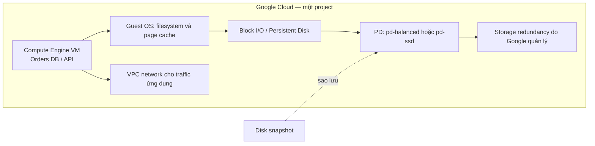
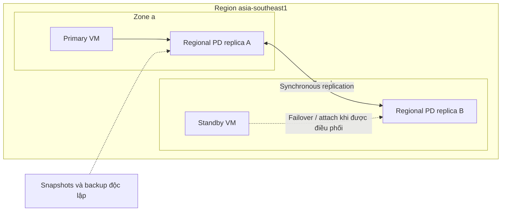
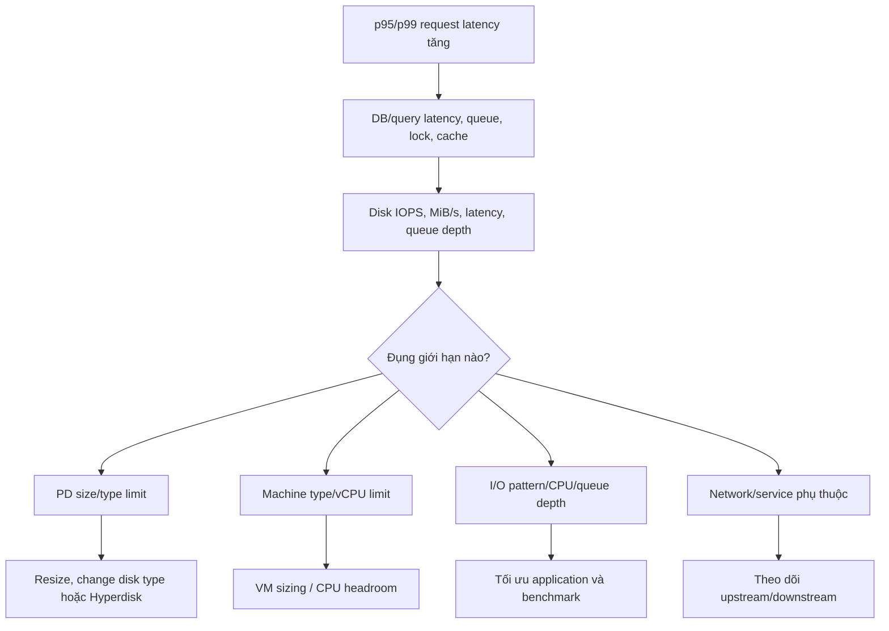

# Persistent Disk và các lựa chọn hiệu năng

Một ứng dụng đặt hàng chạy trên Compute Engine có thể xử lý tốt vài trăm yêu cầu mỗi giây nhưng chậm rõ rệt khi database tăng dữ liệu. CPU chỉ dùng 40%, network còn dư, trong khi độ trễ ghi đĩa tăng và số tác vụ chờ I/O liên tục cao. Vấn đề có thể không nằm ở truy vấn SQL: **loại Persistent Disk, dung lượng được cấp phát, machine type, số vCPU, kích thước I/O và mức song song** đều ảnh hưởng hiệu năng.

**Persistent Disk (PD)** là dịch vụ lưu trữ khối bền vững, kết nối tới VM qua hạ tầng mạng do Google Cloud quản lý. Nó có thể chứa boot disk, dữ liệu ứng dụng hoặc database chạy trên Compute Engine. Dữ liệu disk được duy trì độc lập với vòng đời của tiến trình/VM theo chính sách xóa disk; bạn có thể tách disk rồi gắn vào một VM khác trong phạm vi được hỗ trợ. Tuy nhiên PD **không phải file share tự động**, **không đồng nghĩa backup**, và việc tăng dung lượng **không bảo đảm** ứng dụng đạt mức IOPS tối đa công bố.

Bài thuộc chương **Lưu trữ khối và tệp** của module `CLOUD_PROVIDERS_GCP`. Các quyết định về PD liên quan đến cấu trúc project, IAM, VPC, lựa chọn Compute Engine/GKE/Cloud Run, bảo vệ dữ liệu, tự động hóa phát hành, độ tin cậy và chi phí. Trọng tâm là biết **chọn đúng disk type, thiết kế năng lực phù hợp và đo thực tế trước khi tối ưu**.

## 1. Mục tiêu học tập

Sau bài này, bạn có thể:

1. Giải thích đặc tính của `pd-standard`, `pd-balanced`, `pd-ssd` và `pd-extreme`.
2. Phân biệt Persistent Disk, Hyperdisk, Local SSD, Cloud Storage và các dịch vụ file storage như Filestore.
3. Tính giới hạn IOPS, throughput theo dung lượng và hiểu giới hạn bổ sung từ machine series/vCPU.
4. Phân tích random/sequential I/O, read/write, block size, queue depth, latency và nhu cầu ứng dụng.
5. Tạo và gắn disk vào VM, mount bằng tên ổn định, resize dung lượng, chuyển loại đĩa qua disk mới khi cần.
6. Chọn zonal hoặc regional Persistent Disk theo mức sẵn sàng, backup, RPO/RTO và chi phí.
7. Viết quy trình benchmark/monitor an toàn, xử lý hiệu năng kém và đánh giá phương án nâng cấp lên Hyperdisk.

## 2. Persistent Disk là block storage, không phải “ổ cứng vật lý” của VM

Từ góc nhìn Linux hoặc Windows guest OS, PD xuất hiện như một block device có thể phân vùng, định dạng ext4/XFS/NTFS rồi mount. Tuy vậy dữ liệu **không nằm đơn giản trên ổ cứng cục bộ của host**: Compute Engine quản lý tầng lưu trữ phân tán và truyền I/O qua hạ tầng kết nối tới VM.



Trong mô hình trên, network traffic ứng dụng và disk traffic là hai khái niệm khác nhau nhưng có thể **cạnh tranh năng lực xử lý/băng thông của VM**, tùy machine series. Vì vậy chỉ tăng kích thước disk mà không đo CPU/network và giới hạn per-VM có thể không cải thiện hiệu năng.

### 2.1. Zonal Persistent Disk

Zonal PD thuộc một **zone**; khi sử dụng ở chế độ đọc/ghi thông thường, VM cần ở cùng zone với disk. Disk vẫn tồn tại nếu VM dừng; khi xóa VM, dữ liệu của disk được giữ hay xóa phụ thuộc cấu hình auto-delete của attachment. Disk có thể được gắn lại cho VM khác trong cùng zone theo quy tắc về attachment và sharing.

Đừng nhầm “Google lưu dữ liệu dư thừa trên nhiều thiết bị” với “đĩa zonal chịu được mất toàn bộ zone”. Nếu cả zone không sẵn sàng, VM ở zone khác không thể tự dùng ngay một zonal disk vốn chỉ nằm ở zone cũ.

### 2.2. Regional Persistent Disk

Regional PD sao chép đồng bộ giữa **hai zone trong cùng một region**. Với kiến trúc phù hợp, bạn có thể thực hiện failover sang VM ở replica zone khi một zone gặp sự cố. Nhưng replication của disk chỉ bảo vệ một lớp: VM dự phòng, dịch vụ ứng dụng, database recovery, IP/DNS/load balancer và các phụ thuộc khác vẫn phải được thiết kế.

Regional PD thường phù hợp khi **khả năng chịu lỗi zone** quan trọng hơn mức write throughput cao nhất hoặc chi phí thấp nhất. Nó không phải bản backup chống xóa nhầm: nếu ứng dụng xóa dữ liệu hợp lệ hoặc ransomware ghi đè, thay đổi đó cũng có thể được sao chép tới replica. Cần snapshots/backup độc lập.

## 3. Bốn loại Persistent Disk

| Disk type | Bản chất | Workload phù hợp | Điểm cần cân nhắc |
| --- | --- | --- | --- |
| **Standard PD** (`pd-standard`) | HDD-backed, tối ưu chi phí dung lượng | Dữ liệu dung lượng lớn, truy cập tuần tự, workload không nhạy với random IOPS | Random I/O và latency kém hơn SSD; throughput tăng cùng dung lượng. |
| **Balanced PD** (`pd-balanced`) | SSD-backed, cân bằng hiệu năng và giá | Boot disk, web/API, database mức trung bình, hầu hết workload general purpose | IOPS/throughput theo dung lượng và giới hạn VM; không phải cam kết latency ứng dụng. |
| **SSD (Performance) PD** (`pd-ssd`) | SSD-backed, mức IOPS theo GiB cao hơn | Database có nhiều random reads/writes, ứng dụng cần I/O đều | Giá lưu trữ cao hơn balanced; có thể gặp bottleneck VM trước disk. |
| **Extreme PD** (`pd-extreme`) | SSD-backed, **provision IOPS riêng** với dung lượng | Workload IOPS rất cao trên machine types được hỗ trợ | Chỉ zonal, yêu cầu machine type phù hợp; nhiều hạn chế về sharing, image/backup và điều chỉnh. |

Thứ tự trên không có nghĩa “cứ chọn extreme là nhanh nhất trong mọi điều kiện”. Với ứng dụng ghi tuần tự hàng trăm MiB/s, throughput và queue depth có thể quan trọng hơn random IOPS. Với web server ít tải, `pd-balanced` có thể đã thừa năng lực, trong khi extreme thêm chi phí mà không làm response API nhanh hơn.

### 3.1. Default disk type không giống giữa công cụ

Khi tạo disk qua **Google Cloud Console**, giá trị mặc định thường là `pd-balanced`; khi dùng **gcloud CLI hoặc REST**, mặc định có thể là `pd-standard`. Vì vậy luôn chỉ rõ `--type` trong script/Terraform thay vì dựa vào default. Việc chuyển từ Console sang tự động hóa có thể làm hiệu năng khác dù cùng tên VM/dung lượng.

### 3.2. Giới hạn dung lượng và khả năng hỗ trợ

Ba loại zonal standard/balanced/SSD PD thường bắt đầu từ **10 GiB** và có thể tới **64 TiB cho mỗi disk**. Extreme PD thường từ **500 GiB** đến 64 TiB. Riêng regional `pd-standard` có minimum **200 GiB**; các loại regional balanced/SSD thường từ 10 GiB. Cũng có giới hạn tổng số disk/tổng dung lượng trên VM, và máy shared-core có giới hạn thấp hơn.

Một số machine series hiện đại ưu tiên hoặc chỉ hỗ trợ Hyperdisk, nên **không phải VM nào cũng tạo được mọi PD type**. Trước khi thiết kế, kiểm tra machine series, zone và [Choose a disk type](https://cloud.google.com/compute/docs/disks) của phiên bản Compute Engine đang dùng.

## 4. Đo hiệu năng bằng IOPS, throughput, latency và queue depth

| Chỉ số | Diễn giải | Thường quan trọng cho |
| --- | --- | --- |
| **IOPS** | Số thao tác đọc/ghi block mỗi giây | Database random 4–16 KiB, nhiều truy vấn nhỏ |
| **Throughput** | Lượng dữ liệu truyền qua disk mỗi giây, thường đo MiB/s | Backup, scan file lớn, ETL, đọc/ghi tuần tự |
| **Latency** | Thời gian từ khi phát I/O đến hoàn thành; xem trung bình, p95/p99 | Transaction đồng bộ, commit log, request latency |
| **Queue depth** | Số I/O đang chờ/chạy đồng thời | Đủ concurrency để tận dụng IOPS/bandwidth, tránh queue quá dài |
| **Block size** | Kích thước mỗi I/O | Random 4 KiB khác hoàn toàn sequential 256 KiB |
| **Read/write ratio** | Tỷ trọng I/O đọc/ghi | Chọn disk, tính headroom, benchmark giống workload |

Quan hệ gần đúng:

\[
\mathrm{Throughput\ (MiB/s)}
\approx
\frac{\mathrm{IOPS}\times\mathrm{block\ size\ (KiB)}}{1024}
\]

Ví dụ **10.000 IOPS × 4 KiB ≈ 39,1 MiB/s**, còn **10.000 IOPS × 256 KiB ≈ 2.500 MiB/s** *nếu không vướng giới hạn throughput hoặc tài nguyên khác*. Điều kiện sau rất quan trọng: disk/VM có thể giới hạn 1.200 MiB/s, khiến mức 2.500 chỉ còn là phép nhân lý thuyết.

Một luồng ghi đồng bộ độ trễ thấp có thể bị giới hạn bởi **latency của mỗi I/O**, dù mức IOPS tổng được công bố lớn. Để tăng IOPS đo được, ứng dụng cần đủ thao tác đang bay (*outstanding I/O*) nhưng không được tạo hàng đợi quá lớn khiến p99 latency xấu đi.

## 5. Quy tắc chọn năng lực: disk, VM và workload

Điểm khác biệt cốt lõi của Persistent Disk: với `pd-standard`, `pd-balanced` và `pd-ssd`, mức IOPS/throughput **tăng theo dung lượng được provision**, cho tới các trần của loại disk và VM. Với `pd-extreme`, IOPS được provision riêng theo giới hạn dịch vụ.

Mô hình lập kế hoạch:

\[
\text{Hiệu năng thực tế}
\ \leq\
\min(\text{giới hạn PD theo dung lượng/loại},\ \text{giới hạn VM})
\]

Đây là **giới hạn trên**, không phải SLA/đảm bảo đạt được. CPU bận, network cạnh tranh, workload I/O không đủ concurrency hoặc storage throttling vẫn có thể khiến kết quả đo thấp hơn.

### 5.1. Công thức minh họa cho zonal Persistent Disk

Theo bảng giới hạn hiện hành, gọi `x` là tổng GiB của các disk **cùng loại** gắn vào một VM, trước khi xét cap theo machine type:

| Loại zonal | IOPS theo x, trước VM cap | Throughput MiB/s theo x, trước VM cap |
| --- | --- | --- |
| `pd-standard` | Read ≈ `0,75 × x`; write ≈ `1,5 × x` | Read/write tổng ≈ `0,12 × x` |
| `pd-balanced` | ≈ `3.000 + 6 × x`, không quá trần loại disk | ≈ `140 + 0,28 × x`, không quá trần loại disk |
| `pd-ssd` | ≈ `6.000 + 30 × x`, không quá trần loại disk | ≈ `240 + 0,48 × x`, không quá trần loại disk |
| `pd-extreme` | Cấu hình mức IOPS provision theo yêu cầu, có cap theo machine type | Phụ thuộc provisioned IOPS, kích thước I/O và cap VM |

Các công thức dùng để **ước lượng giới hạn tối đa**, với caps và ngoại lệ theo zonal/regional, loại VM, vCPU. Đừng suy ra 500 GiB pd-ssd luôn đạt 21.000 IOPS vì VM 2–4 vCPU có thể bị giới hạn thấp hơn. Xem [Persistent Disk performance overview](https://cloud.google.com/compute/docs/disks/performance) để chọn đúng dòng bảng.

### 5.2. Ba ví dụ với dung lượng 500 GiB

| Disk | Giới hạn lý thuyết theo dung lượng (chưa xét VM) | Phù hợp đánh giá |
| --- | --- | --- |
| `pd-standard` 500 GiB | Read ≈ **375 IOPS**, write ≈ **750 IOPS**, throughput ≈ **60 MiB/s** | Backup tuần tự có yêu cầu khiêm tốn; không lý tưởng cho DB random I/O |
| `pd-balanced` 500 GiB | ≈ **6.000 IOPS**, ≈ **280 MiB/s** | Ứng dụng general purpose, DB vừa |
| `pd-ssd` 500 GiB | ≈ **21.000 IOPS**, ≈ **480 MiB/s** | DB nhiều truy cập ngẫu nhiên, nhu cầu I/O cao hơn |

Ví dụ phản trực giác: VM N2 **4 vCPU** có thể có giới hạn PD throughput thấp hơn 280 MiB/s (tài liệu nêu trường hợp giới hạn **240 MiB/s**). Khi gắn `pd-balanced` 500 GiB, throughput thực tế dự kiến bị cap ở khoảng **min(280, 240) = 240 MiB/s**, chưa xét workload. Nếu nâng disk lên 1 TiB nhưng giữ VM 4 vCPU, VM vẫn có thể là nút thắt.

### 5.3. Cộng dung lượng cùng loại trên một VM

Google Cloud có cơ chế xét **tổng dung lượng các Persistent Disks cùng loại** gắn vào VM khi tính mức hiệu năng có thể đạt. Ví dụ hai đĩa `pd-ssd` 250 GiB cùng gắn vào một VM có thể chia sẻ năng lực tương ứng tổng 500 GiB trong trường hợp một đĩa đang idle. Tuy nhiên **đây không phải cách cộng tổng năng lực tuyến tính vô hạn**: toàn bộ I/O vẫn phải tuân thủ cap của VM và loại disk, cùng mức cạnh tranh với traffic khác.

Đừng mặc định RAID0 bốn disks sẽ tăng IOPS gấp bốn. Persistent Disk đã phân bố nội bộ; việc stripe thêm disks chỉ để “tăng hiệu năng” thường không cần thiết và làm vận hành/phục hồi phức tạp. Nếu phải dùng RAID cho mục đích đặc biệt, kiểm tra ứng dụng, consistency, snapshots và runbook.

### 5.4. Read/write cùng thời điểm

IOPS của các loại PD được giới hạn **chung cho read và write**, không phải mỗi chiều được toàn bộ mức IOPS tối đa đồng thời. Với `pd-balanced` và `pd-ssd`, read và write throughput có các giới hạn riêng, nhưng cả hai cùng chịu cap IOPS của tổng hỗn hợp. `pd-standard` còn chia sẻ giới hạn throughput tổng. Vì vậy benchmark chỉ đọc rồi kỳ vọng đọc và ghi cùng đạt đỉnh độc lập có thể sai.

## 6. Khi nào nên chọn Hyperdisk, Local SSD, Cloud Storage hoặc Filestore?

Persistent Disk không phải lựa chọn tối ưu cho mọi nhu cầu. Một thiết kế tốt còn phải cân nhắc tính bền vững, kiểu truy cập, khả năng mở rộng và mục tiêu quản trị:

| Dịch vụ/loại lưu trữ | Giao diện | Đặc tính hiệu năng và tồn tại dữ liệu | Tình huống tiêu biểu |
| --- | --- | --- | --- |
| **Persistent Disk** | Block device trên VM | Bền vững; hiệu năng standard/balanced/SSD phụ thuộc dung lượng và VM | Boot/data disk cho VM, DB vừa, ứng dụng cần filesystem riêng |
| **Hyperdisk** | Block device trên VM được hỗ trợ | Tùy loại (Balanced, Extreme, Throughput, ML, Balanced HA...), có thể provision hiệu năng tách biệt dung lượng | DB cần provision IOPS cao, ETL throughput lớn, workload trên machine series hiện đại |
| **Local SSD** | Block local của host/VM | Rất nhanh và độ trễ thấp nhưng **ephemeral**, dữ liệu không bền vững khi mất VM/host theo các trường hợp tài liệu quy định | Scratch space, cache tái tạo được, temp files |
| **Cloud Storage** | Object API (bucket/object) | Độ bền cao, không phải block device thông thường; tải qua API | File ảnh, log archive, backup artifact, data lake |
| **Filestore** | Managed NFS file share | Nhiều client dùng cùng filesystem qua NFS; cấp tier/capacity phù hợp | Shared files, POSIX-like access, ứng dụng cần NFS |

**Đừng gọi Cloud Storage bucket là “ổ đĩa Persistent Disk”.** Mặc dù có công cụ mount object storage như filesystem cho một số workload, semantics của object và POSIX block filesystem khác nhau. Nếu nhiều VM cần **cùng một hệ thống tệp ghi chung**, hãy cân nhắc Filestore hay giải pháp cluster filesystem được hỗ trợ thay vì giả định gắn một PD read-write vào nhiều VM sẽ an toàn.

### 6.1. Hyperdisk không phải Extreme PD

`pd-extreme` là một disk type thuộc **Persistent Disk**, còn `hyperdisk-extreme` thuộc họ **Hyperdisk** với cơ chế provision IOPS và giới hạn machine types khác. Những sản phẩm này không thể hoán đổi tên `--type` rồi kỳ vọng giữ nguyên khả năng backup, sharing, provisioning hoặc chi phí.

Trong các machine series mới, Google Cloud thường khuyên dùng Hyperdisk thay cho Extreme Persistent Disk nếu có hỗ trợ. Đối với Hyperdisk, chọn loại theo yêu cầu random IOPS hay sequential throughput; kiểm tra cách tính phí **capacity và provisioned performance** riêng biệt, các giới hạn thay đổi hiệu năng và số volume per-VM.

### 6.2. Local SSD rất nhanh nhưng không phải nguồn dữ liệu bền vững

Local SSD gắn với host vật lý/VM và được tối ưu latency, IOPS. Hệ thống phải chấp nhận mất dữ liệu trong các trường hợp host/VM bị hủy hoặc xảy ra sự cố theo đặc tính của Local SSD, và thiết kế tái tạo được dữ liệu từ Cloud Storage, database hoặc nguồn bền vững. Không dùng Local SSD làm bản duy nhất của dữ liệu giao dịch quan trọng.

## 7. Zonal PD, Regional PD và tính sẵn sàng

Khi database chạy ở `asia-southeast1-a`, một zonal PD chỉ thuộc zone đó. Chuyển dữ liệu bằng snapshot sang zone khác có thể hỗ trợ khôi phục, nhưng tốn thời gian và RPO theo thời điểm snapshot. **Regional PD** replicate đồng bộ giữa hai zone của cùng region để hỗ trợ HA và failover nhanh hơn khi được cấu hình đúng.



**Replication không tương đương HA ứng dụng.** Bạn vẫn cần một cơ chế quyết định VM nào là writer, tránh split-brain, giám sát health, đảm bảo database/crash recovery và cập nhật endpoint của ứng dụng. Dùng `--force-attach` trong failover có thể có rủi ro khi VM cũ vẫn ghi; chỉ dùng sau khi fencing và xác nhận writer cũ đã bị ngăn truy cập theo runbook.

### 7.1. Giới hạn của Regional PD

- Regional `pd-standard`, `pd-balanced` và `pd-ssd` tồn tại; **không có regional `pd-extreme`**.
- Regional PD chỉ hỗ trợ một tập machine types nhất định, chẳng hạn **E2, N1, N2 và N2D** trong tài liệu hiện hành; không áp dụng cho mọi VM series.
- Regional Standard PD có minimum **200 GiB**; regional balanced/SSD có giới hạn khác.
- Write IOPS/throughput tối đa của regional PD có thể **thấp hơn zonal PD** cùng loại/kích thước vì synchronous replication. Xem giới hạn theo machine series và replica status.
- VM dùng regional disk phải nằm ở một **replica zone** được hỗ trợ và cùng region. Không thể “mang regional disk sang region khác” chỉ bằng attach.
- Regional PD bảo vệ mất **một zone**, không tự bảo vệ mất cả region, xóa nhầm, corrupt database hay ransomware.

### 7.2. Ví dụ tạo Regional PD cho sandbox

```bash
# CÓ THAY ĐỔI / PHÁT SINH CHI PHÍ: cần có hai replica zones hợp lệ.
PROJECT_ID="storage-lab"
REGION="asia-southeast1"

gcloud compute disks create orders-data-regional \
  --project="$PROJECT_ID" \
  --region="$REGION" \
  --replica-zones=asia-southeast1-a,asia-southeast1-b \
  --type=pd-balanced \
  --size=500GB

# CHỈ ĐỌC: kiểm tra trạng thái replication và đặc tính disk.
gcloud compute disks describe orders-data-regional \
  --project="$PROJECT_ID" \
  --region="$REGION"
```

Để attach vào VM hợp lệ trong replica zone:

```bash
# CÓ THAY ĐỔI: attach regional data disk trong cùng region và replica zone.
gcloud compute instances attach-disk orders-standby-test \
  --project=storage-lab \
  --zone=asia-southeast1-b \
  --disk=orders-data-regional \
  --disk-scope=regional \
  --device-name=orders-regional
```

Đây là ví dụ attach disk cho một VM được phép nhận disk. Trong hệ thống database HA, việc force-attach/mount phải thuộc quy trình fencing/failover, không thực hiện ngẫu nhiên khi primary còn hoạt động.

## 8. Tạo và gắn một zonal PD vào Compute Engine VM

Ví dụ sau dành cho **data disk mới, rỗng** trên một VM sandbox đã tồn tại. Không chạy bước format với disk đang chứa dữ liệu.

### 8.1. Tạo disk theo type được chỉ rõ

```bash
PROJECT_ID="storage-lab"
ZONE="asia-southeast1-a"
DISK="orders-data-balanced"
VM="orders-lab-vm"

# CÓ THAY ĐỔI / PHÁT SINH CHI PHÍ:
gcloud compute disks create "$DISK" \
  --project="$PROJECT_ID" \
  --zone="$ZONE" \
  --type=pd-balanced \
  --size=500GB \
  --description="Orders data disk for performance lab"

# CHỈ ĐỌC:
gcloud compute disks describe "$DISK" \
  --project="$PROJECT_ID" --zone="$ZONE"
```

Mặc định tạo disk chưa định dạng. Để gắn:

```bash
# CÓ THAY ĐỔI: attach một zonal disk vào VM cùng zone.
gcloud compute instances attach-disk "$VM" \
  --project="$PROJECT_ID" \
  --zone="$ZONE" \
  --disk="$DISK" \
  --device-name=orders-data
```

Quyền cần thiết thường gồm `compute.disks.create` (tạo), `compute.instances.attachDisk` (gắn) và `compute.disks.use` (sử dụng). Đừng cấp Owner rộng nếu có thể dùng role với quyền tối thiểu.

### 8.2. Nhận diện ổ đĩa đúng trong Linux

Trên VM Linux:

```bash
# CHỈ ĐỌC: kiểm tra các block devices, filesystem và mount points.
lsblk -f
ls -l /dev/disk/by-id/google-*
sudo blkid
```

**Không dựa vào `/dev/sdb` hoặc `/dev/nvme0n2` một cách cứng nhắc:** tên thiết bị có thể thay đổi theo OS/image và thứ tự attach. Sử dụng đường symlink trong `/dev/disk/by-id/google-orders-data` hoặc UUID filesystem và xác minh nó thật sự trỏ tới **disk sandbox mới tạo**.

Định dạng disk chỉ khi **chắc chắn disk rỗng**, đã có bản backup nếu có dữ liệu đáng giữ:

```bash
# PHÁ HỦY DỮ LIỆU NẾU TRỎ NHẦM DISK: chỉ thực hiện cho volume trắng.
sudo mkfs.ext4 -F /dev/disk/by-id/google-orders-data
sudo mkdir -p /mnt/orders-data
sudo mount /dev/disk/by-id/google-orders-data /mnt/orders-data
df -h /mnt/orders-data
```

Khi cấu hình mount tự động, lấy UUID bằng `blkid` rồi khai báo trong `/etc/fstab` theo loại filesystem và yêu cầu khởi động. Kiểm tra cú pháp trước khi reboot; cân nhắc `nofail` cho data disk không thiết yếu để một disk thiếu không ngăn VM boot. Ví dụ *dạng ghi chú*, không sao chép UUID placeholder:

```text
UUID=<UUID_CUA_DISK_DA_XAC_MINH>  /mnt/orders-data  ext4  defaults,nofail  0  2
```

Trên Windows, dùng Disk Management/PowerShell để kiểm tra disk mới, phân vùng và định dạng NTFS/ReFS theo khả năng hỗ trợ. Không áp dụng lệnh `mkfs` Linux cho Windows hoặc disk có dữ liệu.

## 9. Mở rộng dung lượng, thay loại đĩa và khôi phục

### 9.1. Resize chỉ tăng, không giảm trực tiếp

Khi `pd-balanced` 500 GiB thiếu chỗ hoặc cần giới hạn throughput/IOPS cao hơn, có thể tăng dung lượng:

```bash
# CÓ THAY ĐỔI / CHI PHÍ: resize PD zonal từ 500 lên 750 GiB.
gcloud compute disks resize orders-data-balanced \
  --project=storage-lab \
  --zone=asia-southeast1-a \
  --size=750GB
```

Disk có thể được mở rộng trong khi gắn VM chạy theo khả năng hỗ trợ. **Sau resize disk ở GCP, partition và filesystem bên trong guest OS có thể vẫn giữ kích thước cũ**. Với data disk chỉ có ext4 filesystem không phân vùng, sau khi xác minh chính xác block device:

```bash
# CÓ THAY ĐỔI FILESYSTEM: chỉ chạy sau snapshot/backup và xác nhận device.
sudo resize2fs /dev/disk/by-id/google-orders-data
df -h /mnt/orders-data
```

Với XFS dùng `xfs_growfs /mnt/orders-data`; với đĩa có partition phải mở rộng partition đúng cách trước khi mở rộng filesystem, ví dụ `growpart` theo thiết kế. Public OS images có thể tự mở rộng boot filesystem ở một số trường hợp; custom OS images và data disks có thể cần làm thủ công.

**Không thể giảm kích thước PD hiện có trực tiếp.** Để chuyển về disk nhỏ hơn, phải tạo disk khác đủ chỗ và copy dữ liệu có kiểm chứng (ví dụ `rsync` với filesystem phù hợp), cutover có kế hoạch và chỉ xóa disk cũ sau khi đã xác nhận dữ liệu.

### 9.2. Thay loại PD không phải đổi một flag trên disk đang dùng

Bạn không thể đổi trực tiếp disk type từ `pd-standard` sang `pd-ssd` trên cùng disk. Cách tiếp cận:

1. Đo IOPS, throughput, latency để xác định bottleneck thực sự.
2. Chụp snapshot nhất quán phù hợp với workload; với database cân nhắc quiesce/native backup.
3. Tạo disk mới thuộc **type mới**, dung lượng và encryption đúng yêu cầu, từ snapshot hoặc copy dữ liệu.
4. Gắn vào VM test, kiểm tra filesystem và ứng dụng, benchmark có kiểm soát.
5. Lập cửa sổ cutover, ngăn old writer, đổi mount/app config, chạy smoke tests.
6. Giữ disk cũ trong thời gian rollback/retention theo chính sách trước khi xóa.

Ví dụ tạo disk mới từ snapshot:

```bash
# CÓ THAY ĐỔI: cần snapshot có sẵn và cùng phạm vi cho phép.
gcloud compute disks create orders-data-ssd \
  --project=storage-lab \
  --zone=asia-southeast1-a \
  --type=pd-ssd \
  --size=750GB \
  --source-snapshot=ORDERS_DATA_SNAPSHOT
```

Khi migration khác project/region hoặc dùng CMEK, phải kiểm tra quyền trên snapshot/source, service agents/KMS keys và policy dữ liệu. Không ngầm cho rằng bản sao mới tự giữ toàn bộ metadata, snapshots schedule hoặc chính sách mã hóa như disk nguồn.

## 10. Benchmark Persistent Disk bằng workload đại diện

Không nên kết luận một đĩa nhanh/chậm chỉ từ tốc độ copy một file. Benchmark phải phản ánh **kiểu I/O thật**, disk cache và mức song song:

| Biến kiểm thử | Ví dụ | Tác động |
| --- | --- | --- |
| I/O pattern | `randread`, `randwrite`, `randrw`, `read`, `write` | Random I/O thử IOPS; sequential thử throughput |
| Block size | 4 KiB, 16 KiB, 256 KiB, 1 MiB | Block lớn thường tăng MiB/s nhưng giảm số IOPS ở cùng bandwidth |
| Queue depth | 1, 8, 32, 64 | Tăng concurrency cho tới khi chạm trần hoặc độ trễ tăng |
| Number of jobs | 1, 4, 8 | Mô phỏng nhiều clients/threads |
| Read/write mix | 70/30, 90/10 | Phản ánh workload giao dịch và shared IOPS |
| Dataset size | Lớn hơn RAM/page cache khi phù hợp | Tránh chỉ đo cache thay vì PD |
| Time | Warm-up, steady state, thời gian đủ dài | Phân biệt peak ngắn với hiệu năng ổn định |

### 10.1. Đo hệ thống thật trước khi tạo benchmark

Trên Linux VM:

```bash
# CHỈ ĐỌC: xác định CPU, disk, filesystem và mức sử dụng.
lsblk -o NAME,SIZE,TYPE,FSTYPE,MOUNTPOINTS
df -hT
free -h
nproc

# Quan sát per-device latency, utilization và throughput nếu có sysstat.
iostat -xz 1 10
```

Đọc cả metric Cloud Monitoring cho VM, disk IOPS/bytes, VM CPU và network, latency của ứng dụng/database. `iostat` hiển thị `await`, `aqu-sz`, `%util` theo guest; metric Cloud Monitoring và guest có cách lấy mẫu/nhìn nhận khác nhau. `%util` cao **không tự chứng minh** PD đã đạt giới hạn Google công bố; còn phải xem throughput, IOPS, queue depth và CPU.

### 10.2. Thử fio an toàn trên file riêng trong sandbox

Ví dụ đo file I/O trên **filesystem vừa tạo trong môi trường thử nghiệm**, không trỏ fio trực tiếp vào raw block device hoặc data file sản xuất:

```bash
# CHỈ TRONG SANDBOX: ghi tối đa 4 GiB vào file thử nghiệm.
# Thay mount path sau khi đã xác minh disk và chỗ trống.
fio --name=orders-pd-random-mix \
  --filename=/mnt/orders-data/fio-benchmark.tmp \
  --size=4G \
  --rw=randrw \
  --rwmixread=70 \
  --bs=4k \
  --ioengine=libaio \
  --iodepth=32 \
  --numjobs=1 \
  --direct=1 \
  --time_based \
  --runtime=60 \
  --group_reporting
```

Chạy fio **có ghi dữ liệu thực** và có thể bão hòa disk/CPU; chỉ chạy trên disk test được cho phép, không trên filesystem production cùng lúc xử lý giao dịch. Đảm bảo dataset đủ lớn, ổ còn trống, biết rõ file mà benchmark được phép tạo và chỉ dọn file test sau khi xác nhận tên/đường dẫn.

Nên chạy thêm các workload như random read 4 KiB, sequential read/write 256 KiB và queue depth khác nhau, rồi ghi:

```text
Machine series / vCPUs:
Disk type / zonal hay regional / size:
Filesystem / I/O scheduler / mount options:
Fio rw, bs, iodepth, numjobs, direct, runtime:
Read IOPS, write IOPS, read/write MiB/s:
Latency avg/p95/p99 và queue depth:
CPU sử dụng, network throughput, disk metrics:
Giai đoạn ổn định và biến thiên giữa các lần đo:
```

Khi so `pd-balanced` và `pd-ssd`, giữ giống **machine type, số vCPU, kích thước disk hoặc định nghĩa bài test, region và workload**. Mức performance đỉnh có thể không phải mục tiêu cuối: ứng dụng giao dịch có thể cần p99 dưới ngưỡng ngay cả khi IOPS nhỏ hơn một bài benchmark tổng hợp.

## 11. Tối ưu workload trước khi tăng tiền cho đĩa

Một đĩa có thể chưa đạt khả năng được cấp nhưng ứng dụng vẫn chậm. Hãy kiểm tra các tầng sau:

### 11.1. Đủ CPU và queue depth

Xử lý I/O cần CPU guest OS. Nếu VM hết CPU do database query hoặc TLS, hiệu năng disk quan sát cũng giảm. Google hướng dẫn workload random IOPS cao cần CPU headroom và queue depth đủ. Nhưng tăng queue depth đến hàng trăm không phải giải pháp miễn phí: latency cuối hàng đợi và p99 có thể tăng.

### 11.2. Random I/O và tuần tự

`pd-standard` dựa trên HDD phù hợp truy cập tuần tự hơn random I/O. Nếu workload database thực hiện nhiều random 4 KiB writes, nâng sang `pd-balanced`/`pd-ssd` có thể phù hợp hơn chỉ tăng dung lượng HDD. Ngược lại, nếu workload chủ yếu đọc log/backup tuần tự, tối ưu batch size, concurrency và pipeline có thể rẻ hơn nâng lên SSD.

### 11.3. Tối ưu ở tầng ứng dụng

- Database: index, query plans, connection pool, WAL/transaction log, cache, backup pattern.
- Filesystem: phù hợp ext4/XFS/NTFS, mount options, filesystem health, số lượng file và directory traversal.
- OS: I/O scheduler cho loại device, read-ahead và page cache; thay đổi chỉ khi đã đo/hiểu rủi ro.
- Batch/ETL: I/O size lớn, streaming, đọc/ghi tuần tự, phối hợp với CPU và network.
- Kubernetes/GKE: kiểm tra PV/PVC, StorageClass, filesystem, CSI driver, VM node, topology và backup; không coi PVC và disk physical là cùng một khái niệm.

Nếu độ trễ Cloud SQL tăng, không thể “tăng PD của một Compute Engine VM” để sửa trực tiếp: Cloud SQL là managed database có cơ chế storage và cấu hình hiệu năng riêng. Chọn đúng dịch vụ trước khi sử dụng hướng dẫn tối ưu PD.

## 12. Giám sát hiệu năng và xác định nút thắt

Quy trình quan sát thường bắt đầu từ **SLO ứng dụng**, rồi lần xuống DB và disk:



### Dấu hiệu và câu hỏi xác minh

| Dấu hiệu | Điều có thể đang xảy ra | Cách phân biệt |
| --- | --- | --- |
| IOPS gần trần theo dung lượng, CPU còn rảnh | Disk type/size cap | So formula và bảng giới hạn, kiểm tra cùng loại disks |
| IOPS thấp nhưng MiB/s chạm trần | I/O size lớn, throughput cap | Đo average I/O size và bytes/s |
| VM 2–4 vCPU, disk lớn vẫn chậm | VM per-instance cap hoặc CPU headroom thiếu | Xem machine-series PD cap, CPU, chạy workload trên VM phù hợp |
| `await`/p99 tăng khi peak traffic | Queues, concurrent writes, DB locks, throttling | So queue depth, database metrics, disk bytes/s/IOPS |
| Chậm sau backup job | Backup dùng chung disk/network/CPU | So timestamp, disk read/write concurrency và bandwidth |
| Regional disk ghi chậm hơn zonal | Synchronous replication, giới hạn regional | So caps của regional và replica health; không quy toàn bộ cho network Internet |
| Benchmark `fio` cao nhưng app thấp | App không đủ concurrency, query pattern khác, locks | So I/O pattern, threads, block size, app traces |

Phải đo **nhiều khoảng thời gian**, tránh chỉ xem trung bình ngày che mất spike 1 phút làm timeout. Với workload có SLO, quan trọng là headroom trong peak và p99 latency, không chỉ bandwidth lớn nhất tại benchmark.

## 13. Backup, mã hóa và quyền IAM của disk

**Durability không đồng nghĩa backup.** PD có redundancy nhưng vẫn chịu ảnh hưởng bởi xóa nhầm, mã độc, bug ứng dụng hoặc dữ liệu sai. Cần snapshots, snapshot schedules, retention, backup ở cấp ứng dụng/database và diễn tập restore.

| Vấn đề | Cách tiếp cận |
| --- | --- |
| Sao lưu data disk | Snapshot theo RPO/retention, xác nhận backup thành công và restore thử |
| Database nhất quán | Native backups, quiesce/flush hoặc log-based recovery; disk snapshot đơn lẻ thường chỉ crash-consistent |
| Giới hạn xóa | Kiểm tra auto-delete của boot/data disk, IAM, deletion protection cho VM khi phù hợp |
| Mã hóa | Google-managed encryption mặc định hoặc CMEK khi cần kiểm soát key; bảo vệ KMS/service agents |
| Truy cập | Quyền `compute.disks.create/get/use/delete`, `compute.instances.attachDisk` theo vai trò; hạn chế snapshot/export |
| Region/zone | Kiểm soát location, snapshot storage location, backup và data residency |
| Audit | Logs của thao tác disk/snapshot/attach/resize, người vận hành và change ID |

Một snapshot hoặc disk clone có thể chứa **password, khóa, dữ liệu cá nhân và database** trong filesystem. Việc cấp quyền sử dụng snapshot cho project khác cũng có thể là chia sẻ dữ liệu. Quản lý quyền đọc/restore với cùng mức thận trọng như production data.

### 13.1. Snapshot khác regional replication

Snapshot là **điểm khôi phục theo thời gian**, có thể giúp trở lại trạng thái trước xóa nhầm. Regional PD có **replica đồng bộ**, tăng khả năng phục hồi khi một zone gặp sự cố. Các cơ chế giải quyết những failure modes khác nhau và nên phối hợp, không thay thế nhau.

### 13.2. Quy tắc IAM và attachment

- Disk zonal bình thường attach read-write cho VM trong cùng zone theo ràng buộc attachment.
- Shared read-only hoặc multi-writer có điều kiện theo disk type/chế độ; **một filesystem thông thường không tự an toàn khi nhiều writer cùng ghi**. Phải dùng cluster-aware filesystem hoặc giao thức có coordination đúng.
- Disk nằm ở project khác không thể attach trực tiếp cho VM của project hiện tại trong mô hình PD thông thường; muốn chia dữ liệu giữa project có thể dùng snapshot/copy hoặc file/object service phù hợp.
- Regional disk phải được attach theo phạm vi regional và replica zones; khi failover cần fencing để tránh hai writers xung đột.

## 14. Chi phí và cách tránh “mua hiệu năng bằng dung lượng”

Ba yếu tố chi phí hay bị bỏ qua là **dung lượng provisioned**, **phí storage theo khu vực/loại**, và **chi phí hạ tầng liên quan** (VM, replication, snapshots, KMS, transfer, vận hành). PD thường tính phí theo dung lượng provisioned chứ không đơn giản theo bytes dữ liệu thực tế đang sử dụng trong filesystem.

| Quyết định | Lợi ích | Đánh đổi |
| --- | --- | --- |
| `pd-standard` dung lượng lớn | Chi phí/GiB thấp hơn | Random IOPS/latency kém; cần disk size lớn để đạt throughput cao |
| `pd-balanced` | Cân bằng chi phí và hiệu năng cho nhiều workload | Khi cần IOPS cao phải tăng size hoặc đổi loại |
| `pd-ssd` | Random IOPS tốt hơn trên cùng dung lượng | Storage cost cao hơn |
| `pd-extreme` / Hyperdisk | Có thể provision IOPS/throughput theo mục tiêu khi hỗ trợ | Provisioned performance có thể tạo chi phí riêng, giới hạn machine series |
| Regional PD | Replication hai zone, hỗ trợ HA | Storage/replication có chi phí cao hơn, hiệu năng regional cần đánh giá |
| Snapshots | Backup/rollback, lưu trữ incremental | Tăng phí storage/retention và rủi ro giữ snapshot quá lâu |

### 14.1. Tối ưu theo nhu cầu đo được

Giả sử database trên `pd-balanced` 500 GiB đang dùng 150 GiB dung lượng dữ liệu, nhưng cần **15.000 random IOPS** trong peak. Nếu chỉ tăng balanced PD từ 500 GiB để tăng IOPS theo công thức, phải cân nhắc mức dung lượng cần provision, cap của VM và chi phí thêm. Một `pd-ssd` dung lượng nhỏ hơn hoặc Hyperdisk được hỗ trợ có thể đáp ứng IOPS với thiết kế khác; quyết định phải dựa trên **giá tại region, SLO và benchmark thực tế**, không dùng mỗi tên disk type.

Ngược lại, nếu workload chỉ cần 1.000 IOPS thì không nên chi cho `pd-extreme` chỉ vì “hiệu năng cao nhất”. Hãy tính **cost per successful transaction** hoặc cost/GiB-month, so sánh với độ trễ, độ tin cậy và lưu lượng nghiệp vụ.

### 14.2. Giới hạn tối ưu hóa bằng resize

Resize PD **chỉ tăng**. Khi hạ tải và muốn giảm chi phí disk quá lớn, cần migration sang disk nhỏ hơn có kiểm chứng dữ liệu; không thể sửa size từ 2 TiB xuống 500 GiB trực tiếp. Vì vậy nên lập kế hoạch headroom từ đầu, giám sát tăng trưởng và dùng alert thay vì tăng không kiểm soát.

## 15. Case study: Orders trên Compute Engine

Một công ty chạy API Orders trên MIG, database giao dịch legacy trên một Compute Engine VM và hệ thống xuất báo cáo ban đêm. Yêu cầu:

- API phải đáp ứng p95 dưới 200 ms.
- Database thường chạy 2.000–4.000 IOPS nhưng có lúc lên 12.000 random IOPS, latency đuôi cần ổn định.
- Batch export đọc tuần tự 1 TiB dữ liệu vào ban đêm.
- Khi một zone mất, thời gian khôi phục database tối đa 30 phút; dữ liệu được yêu cầu sao lưu định kỳ.

### 15.1. Đề xuất phân lớp disk

| Workload | Đề xuất sơ bộ | Kiểm chứng |
| --- | --- | --- |
| Boot disk API VM trong MIG | `pd-balanced`, image/version đã duyệt | Khởi động nhanh, rolling update, throughput cần vừa đủ |
| Database transaction | `pd-ssd` hoặc Hyperdisk phù hợp machine series | 4–16 KiB randrw, p95/p99 latency, CPU, VM cap |
| Batch export tuần tự | `pd-standard` đủ lớn, `pd-balanced` hoặc Hyperdisk Throughput | Đọc tuần tự 256 KiB+, MiB/s, thời gian hoàn tất |
| HA một region | Regional PD / Hyperdisk Balanced HA theo hỗ trợ | Failover, fencing, write throughput, replica health, restore |
| Backup lâu dài | Disk snapshots + native DB backups nếu phù hợp | RPO, restore test, retention, data location |

Đây là phương án **để kiểm chứng**, không phải kết luận trước khi có benchmark và bảng giá. Ví dụ nếu database có storage size rất nhỏ, việc mở `pd-balanced` đến hàng TiB chỉ để lấy IOPS có thể lãng phí; `pd-ssd`/Hyperdisk đáng được thử.

### 15.2. Quy trình triển khai

1. Thu thập truy vấn chậm, disk metrics, peak/average IOPS và throughput, p99 latency, database wait events, CPU/network.
2. Kiểm tra machine type hiện tại và giới hạn PD theo vCPU; xác định liệu bottleneck do VM hay disk.
3. Chạy benchmark đại diện trên VM sandbox và disk riêng để so `pd-balanced`/`pd-ssd`/Hyperdisk.
4. Chọn dung lượng dựa trên tăng trưởng 6–12 tháng, headroom và RPO/RTO; ước lượng cả snapshots, regional replication và chi phí.
5. Dùng IaC để tạo disk/VM và IAM, kiểm tra CMEK, labels, auto-delete; không chạy `mkfs` trên disk sản xuất.
6. Migration có snapshot/application-aware backup và rollback rõ ràng; test lại DB, API SLO, job ban đêm.
7. Lên kế hoạch DR drill: thử failover, đo thời gian, phục hồi dữ liệu, đảm bảo standby không chạy hai writers cùng lúc.
8. Theo dõi sau phát hành, so sánh cost per transaction và p99 latency trước/sau.

### 15.3. Những quyết định có thể phản tác dụng

Nếu chỉ nâng pd-balanced 500 GiB lên 2 TiB mà VM 4 vCPU đã bị giới hạn throughput, chi phí tăng nhưng ứng dụng có thể không nhanh lên. Nếu chuyển toàn bộ data disk sang Local SSD, batch có thể nhanh hơn nhưng mất tính bền vững cần thiết. Nếu chỉ dùng regional PD mà không snapshot, xóa nhầm dữ liệu vẫn được replicate. Nếu tăng queue depth vô hạn, throughput có thể tăng một chút nhưng p99 latency vượt SLO.

## 16. Bảng chẩn đoán sự cố

| Hiện tượng | Nguyên nhân khả dĩ | Cách xác minh/khắc phục |
| --- | --- | --- |
| Disk lớn mà IOPS thấp | VM vCPU cap, queue depth nhỏ, CPU bận, workload không phát đủ I/O | So size/model với VM limits, `iostat`, CPU, fio workload đại diện |
| `pd-standard` random write rất chậm | HDD random I/O bottleneck | Xem I/O pattern, cân nhắc `pd-balanced`/`pd-ssd`, cache/index |
| IOPS tăng nhưng latency p99 xấu | Queue depth, contention, DB locks | Đo queue/latency theo giây, transaction time, giảm concurrency hoặc tối ưu query |
| Throughput chạm trần trước IOPS | I/O block size lớn, cap MiB/s | So bytes/s và IOPS; kiểm tra PD/VM max throughput |
| Thêm disk không tăng tốc | Cùng loại disks chia cap, VM bottleneck | Đo tổng size cùng loại, cap VM, CPU/network contention |
| Resize xong OS vẫn thấy size cũ | Partition/filesystem chưa được extend | `lsblk`, `df -hT`, mở rộng đúng layer và filesystem |
| Tạo PD mới nhưng không thấy file | Disk chưa format/mount hoặc mount sai | `lsblk -f`, kiểm tra symlink by-id và mountpoint |
| Migration sang SSD thiếu dữ liệu | Dùng disk trắng, copy/snapshot chưa hoàn tất | So checksums/application state, rollback disk cũ |
| Regional PD không attach được | Sai machine type, region/replica zone, disk đang được giữ bởi VM khác | Xem disk scope, replica zones và failover runbook |
| Dữ liệu mất sau xóa VM | Disk attachment có auto-delete hoặc thiếu backup | Kiểm tra cấu hình boot/data disk và thực thi restore drill |
| fio trên VM thử tốt, prod chậm | Workload thực khác, app lock, cache, network hoặc CPU | So patterns, concurrency, working set và thời điểm đo |
| Chi phí disk tăng đột biến | Provision quá lớn, regional replica, snapshots giữ quá lâu | Cloud Billing Reports/BigQuery theo SKU, owner, retention |

## 17. Bài tập thực hành

### Bài A — Tính năng lực theo dung lượng

Một VM gắn một `pd-standard` 500 GiB, một `pd-balanced` 500 GiB và một `pd-ssd` 500 GiB. Tính giới hạn IOPS/throughput lý thuyết theo dung lượng cho từng loại theo công thức mục 5. Tại sao vẫn phải tìm machine series/vCPU trước khi cam kết hiệu năng?

### Bài B — Kiểm tra bottleneck VM

Một N2 4 vCPU có balanced disk 500 GiB, lý thuyết throughput 280 MiB/s nhưng giới hạn PD throughput của VM là 240 MiB/s. Tính max có thể kỳ vọng và phân tích việc nâng disk lên 1 TiB mà giữ nguyên VM. Khi nào nâng machine type có ý nghĩa hơn?

### Bài C — Đĩa cho database so với batch

Database đọc/ghi 4 KiB random 70/30 với peak 15.000 IOPS; batch job đọc file lớn tuần tự và cần 500 MiB/s. Hãy đề xuất hai disk types để benchmark, phương án đo và cách so sánh giá. Vì sao một loại disk không nhất thiết tối ưu cả hai?

### Bài D — HA hai zone

Một ứng dụng legacy phải failover từ zone a sang zone b và yêu cầu tránh hai writers. Hãy vẽ luồng regional PD, standby VM, fencing, health checks, database recovery và backup. Giải thích vì sao regional replication không thay thế snapshot/PITR.

### Bài E — Chọn lưu trữ cho các lớp dữ liệu

Hệ thống có boot disk VM, cache tính toán lại được, ảnh tải lên, file NFS nhiều VM cùng ghi và database transaction. Chọn Persistent Disk, Local SSD, Cloud Storage, Filestore hoặc Hyperdisk tương ứng; chỉ ra các failure modes cần bảo vệ.

### Bài F — Thực hành gcloud an toàn

Trong sandbox có VM được phép sửa, tạo `pd-balanced` 100 GiB, attach với `--device-name` riêng, dùng `lsblk` xác nhận device, định dạng **chỉ disk rỗng**, mount, thử fio trên file riêng rồi resize disk lên 150 GiB và mở rộng filesystem. Viết checklist nào bảo đảm không format nhầm disk?

### Bài G — Tối ưu chi phí

Một team chỉ sử dụng 200 GiB nhưng đang cấp 2 TiB `pd-ssd`. Hãy ước tính bước điều tra: data size, backup, yêu cầu IOPS, VM cap, thời điểm peak và rủi ro migration sang disk nhỏ hơn. Vì sao không thể giảm PD size trực tiếp?

### Câu hỏi tự kiểm tra

1. Persistent Disk khác Local SSD ở điểm nào về độ bền dữ liệu và latency?
2. IOPS và throughput liên quan thế nào khi block size đổi từ 4 KiB sang 256 KiB?
3. Vì sao 500 GiB `pd-balanced` không luôn đạt mức IOPS/throughput tối đa theo dung lượng?
4. Vì sao `pd-extreme` khác `hyperdisk-extreme`?
5. Regional PD bảo vệ điều gì, và không bảo vệ điều gì?
6. Khi nào một đĩa có thể dùng chung cho nhiều VM; vì sao nhiều writer cần filesystem chuyên biệt?
7. Tại sao không benchmark fio trực tiếp lên disk production?
8. Resize PD có tự tăng dung lượng filesystem không?
9. Vì sao snapshot không tương đương replication và application-consistent backup?
10. Khi cần giảm chi phí disk quá lớn, vì sao phải migration thay vì chỉ đổi size?

**Quy trình ghi nhớ:** hiểu workload theo **IOPS–MiB/s–latency–block size** → chọn Persistent Disk type và dung lượng → kiểm tra machine-series/vCPU caps → thử benchmark đại diện → quyết định zonal/regional và backup → cấu hình IAM/KMS/mount đúng → theo dõi p99 và chi phí → nâng cấp bằng dữ liệu đo, không bằng tên tier.

## 18. Tài liệu chính thức

- [Persistent Disk overview](https://cloud.google.com/compute/docs/disks/persistent-disks)
- [Persistent Disk performance overview](https://cloud.google.com/compute/docs/disks/performance)
- [Optimize Persistent Disk performance](https://cloud.google.com/compute/docs/disks/optimizing-pd-performance)
- [Create and attach a Persistent Disk](https://cloud.google.com/compute/docs/disks/add-persistent-disk)
- [Resize a Persistent Disk](https://cloud.google.com/compute/docs/disks/resize-persistent-disk)
- [Change the disk type](https://cloud.google.com/compute/docs/disks/migrate-to-hyperdisk)
- [Regional Persistent Disk](https://cloud.google.com/compute/docs/disks/regional-persistent-disk)
- [About synchronous disk replication](https://cloud.google.com/compute/docs/disks/about-regional-persistent-disk)
- [Extreme Persistent Disk](https://cloud.google.com/compute/docs/disks/extreme-persistent-disk)
- [Choose a disk type](https://cloud.google.com/compute/docs/disks)
- [Disk and image pricing](https://cloud.google.com/compute/disks-image-pricing)
- [Persistent Disk snapshots](https://cloud.google.com/compute/docs/disks/snapshots)

Giới hạn IOPS/throughput, machine series tương thích, loại đĩa hỗ trợ, giá và hành vi replication có thể thay đổi. Trước khi triển khai, đối chiếu tài liệu của **đúng zone, machine type, disk type, dung lượng, nhu cầu RPO/RTO và policy tổ chức**; chỉ coi tối ưu thành công khi ứng dụng thực tế đạt SLO với chi phí đã được kiểm chứng.
