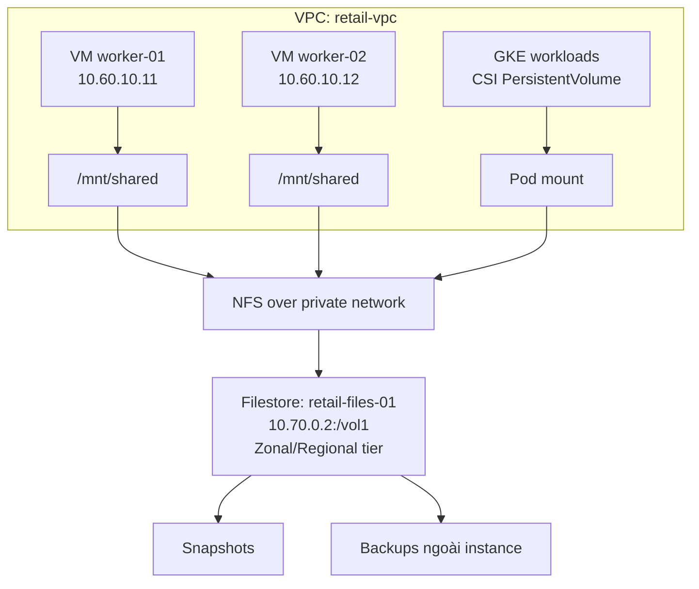
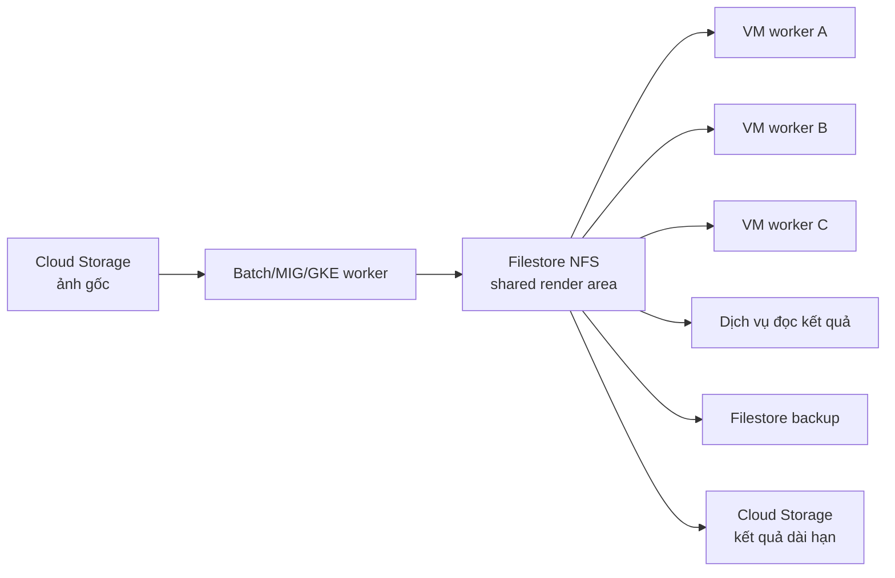

# Filestore và chia sẻ tệp qua NFS

Một ứng dụng xử lý ảnh đang chạy trên nhiều máy ảo Compute Engine. Tất cả worker phải đọc cùng một bộ dữ liệu, ghi kết quả vào các thư mục dùng chung và tiếp tục làm việc khi một VM bị thay thế. Nếu lưu tệp trong boot disk của từng VM, dữ liệu bị phân tán; nếu tự xây dựng máy chủ NFS, đội vận hành phải tự lo hệ điều hành, đĩa, bảo trì và phương án khôi phục. **Google Cloud Filestore** cung cấp **dịch vụ tệp được quản lý**, cho phép nhiều client truy cập một hệ thống tệp chung thông qua **Network File System (NFS)**.

Bài học thuộc chương **Lưu trữ khối và tệp** của module **CLOUD_PROVIDERS_GCP**. Trong bức tranh Google Cloud từ project, IAM và VPC tới Compute Engine, GKE, Cloud Run, lưu trữ, cơ sở dữ liệu và vận hành đáng tin cậy, việc chọn đúng **file storage** quyết định tính nhất quán, khả năng phối hợp giữa ứng dụng, hiệu năng, an toàn dữ liệu và chi phí. Nội dung tập trung vào Filestore, NFSv3/NFSv4.1, mạng riêng, quyền truy cập tệp, triển khai và vận hành.

> Mọi tên project, IP, VM, tên share, dữ liệu và số liệu tải trong bài chỉ là **giả định**. Lệnh tạo/xóa hoặc thay đổi quyền có thể làm phát sinh phí hay mất dữ liệu: chỉ chạy sau khi xác nhận project, phạm vi quyền và phương án sao lưu.

## Mục tiêu học tập

Sau bài học, bạn có thể:

1. Phân biệt **block storage**, **file storage** và **object storage**, nhận diện trường hợp cần Filestore thay vì Persistent Disk, Hyperdisk hoặc Cloud Storage.
2. Giải thích kiến trúc **Filestore instance → NFS file share → VPC → Linux client**, bao gồm các thành phần location, IP, mount point, UID/GID và permission.
3. Lựa chọn giữa **NFSv3** và **NFSv4.1** theo service tier, yêu cầu bảo mật, firewall, file locking và hệ thống danh tính.
4. Tạo và kiểm tra một Filestore instance, mount share từ Compute Engine Linux và cấu hình mount bền vững sau reboot.
5. Áp dụng **IAM cho control plane**, **IP-based export rules** và **POSIX/UID/GID** cho data plane; hiểu rủi ro `no_root_squash`.
6. Chọn tier, capacity và hiệu năng thích hợp; giải thích sự khác nhau giữa **zonal** và **regional availability**.
7. Thiết kế **snapshot, backup, restore, giám sát, kiểm thử phục hồi** và phát hiện lỗi mạng/NFS.
8. Hiểu cách GKE Filestore CSI driver cung cấp `ReadWriteMany` và lập checklist chi phí, quyền và bảo mật cho production.

## 1. Vì sao cần file storage dùng chung?

Google Cloud có ba mô hình lưu trữ phổ biến:

| Loại | Giao diện ứng dụng | Tài nguyên ví dụ | Trường hợp điển hình |
| --- | --- | --- | --- |
| **Block storage** | Block device, filesystem do VM/OS quản lý | Persistent Disk, Hyperdisk | Boot disk, database disk, một hoặc vài VM theo giới hạn multi-writer |
| **File storage** | Thư mục và tệp với đường dẫn, quyền POSIX, locking | **Filestore (NFS)** | Nhiều VM/Pod đọc-ghi chung tệp, shared workspace, rendering, HPC |
| **Object storage** | API/URI, object và metadata | Cloud Storage | Ảnh, backup, archive, static assets, data lake |

Ví dụ một ứng dụng phải đồng thời đọc `/data/catalog/items.csv` từ năm worker. Với Filestore, mỗi worker có thể mount **cùng một export NFS** vào `/mnt/catalog`. Từ góc nhìn ứng dụng, nó thao tác với đường dẫn tệp quen thuộc; thay đổi trên một client có thể được các client khác nhìn thấy theo **ngữ nghĩa cache/consistency của NFS**.

### Điều Filestore mang lại

- Dịch vụ NFS do Google quản lý: không phải tự dựng, patch và giám sát một NFS server trên VM.
- File/directory API quen thuộc, có hỗ trợ POSIX permissions, hard links, file locking và thao tác đồng thời theo giới hạn protocol.
- Có thể dùng cho **Compute Engine**, **GKE**, một số mô hình **Cloud Run**, hệ thống VMware và kết nối on-premises khi mạng được cấu hình phù hợp.
- Có lựa chọn tier, capacity/performance, snapshot, backup, replication và mã hóa dữ liệu theo các giới hạn sản phẩm.

### Điều Filestore **không** tự giải quyết

- Không phải dịch vụ object storage để phát file tới Internet; tệp NFS cần client có đường mạng và quyền mount.
- Không thay thế database transaction hoặc cơ chế khóa phân tán ở tầng ứng dụng.
- Không mặc định mã hóa mọi lưu lượng NFS khi truyền trên mạng.
- Không biến mọi quy trình ghi đồng thời thành an toàn; ứng dụng vẫn phải dùng locking, atomic rename hoặc cơ chế đồng bộ phù hợp.
- Không biến một bản snapshot hoặc một instance zonal thành chiến lược disaster recovery hoàn chỉnh.

## 2. Kiến trúc Filestore instance và NFS share

Filestore có **instance** và **file share**:

- **Filestore instance:** máy chủ tệp được quản lý, tồn tại tại location cụ thể, có service tier, capacity, protocol, cấu hình kết nối mạng và địa chỉ IP riêng.
- **File share:** thư mục export mang tên như `vol1` hoặc `shared`; client dùng cú pháp `SERVER_IP:/SHARE_NAME` để mount.
- **Client:** Compute Engine VM, node GKE/Pod thông qua CSI, hoặc host hỗ trợ NFS có tuyến mạng hợp lệ.
- **Mount point:** đường dẫn thư mục trên client, ví dụ `/mnt/shared`; không nhất thiết giống tên export.



**Địa chỉ `10.70.0.2` chỉ là ví dụ**, không dùng khi triển khai thực tế. Địa chỉ IP và tên share đúng phải lấy từ instance được tạo; không tự chọn IP trong một subnet bất kỳ rồi giả định Filestore sử dụng IP đó.

### Đường đi của một thao tác ghi

```text
Application open("/mnt/shared/result.json")
         ↓
Linux VFS + NFS client
         ↓
VPC route / private connectivity
         ↓
NFS export và kiểm tra client IP
         ↓
Kiểm tra user/group, permissions và locking
         ↓
Filestore xử lý dữ liệu trong file share
```

Việc file nằm trên Filestore không có nghĩa file được copy tự động vào các VM. **Các VM dùng chung một hệ thống tệp qua mạng**. Nếu mạng không đến được NFS server, lệnh đọc/ghi có thể treo hoặc lỗi tùy lựa chọn mount.

## 3. NFSv3 và NFSv4.1 khác nhau thế nào?

Filestore hỗ trợ **NFSv3 trên tất cả service tiers**. **NFSv4.1** được hỗ trợ ở các tier **zonal, regional và enterprise**; không nên giả định một instance basic HDD/SSD có NFSv4.1.

| Tiêu chí | NFSv3 | NFSv4.1 |
| --- | --- | --- |
| Service tiers | Tất cả | Zonal, regional, enterprise |
| Kết nối | Trao đổi hai chiều; nhiều cổng/RPC services | Kết nối khởi tạo từ client; cổng server NFS chính `2049` |
| Quản lý state | Protocol cơ bản stateless, locking qua NLM | Stateful, lease/lock management tích hợp |
| User/Group | Chủ yếu UID/GID với `AUTH_SYS` | Có lựa chọn `AUTH_SYS` và xác thực/nhận diện mạnh hơn |
| File ACL | Không hỗ trợ NFSv4 ACL qua NFSv3 | Có NFSv4.1 ACL theo giới hạn sản phẩm |
| Security flavor | `sys`, tin tưởng thông tin client | `sys`, `krb5`, `krb5i`, `krb5p` khi cấu hình phù hợp |
| Bảo mật khi truyền | Không tự mã hóa payload | Chỉ có mã hóa nội dung nếu dùng `krb5p` và tích hợp xác thực hợp lệ |
| Tình huống | Linux NFS hiện có, cấu hình đơn giản | Tổ chức cần xác thực Kerberos, ACL và firewall đơn giản hơn |

**NFSv4.1 không tự động an toàn hơn chỉ vì số phiên bản lớn hơn.** Nếu dùng `sec=sys`, server vẫn dựa nhiều vào danh tính phía client và dữ liệu không có tính năng privacy như `krb5p`. Filestore hỗ trợ `krb5` (authentication), `krb5i` (integrity) và `krb5p` (privacy/mã hóa) với **LDAP/Kerberos qua Managed Microsoft AD** theo cấu hình sản phẩm.

### Vì sao protocol ảnh hưởng firewall?

NFSv3 dùng nhiều cổng cho các RPC services và **NLM/statd** để locking; cần kiểm tra luồng client-server và các firewall rule tương ứng. NFSv4.1 tổ chức giao tiếp qua cổng NFS `2049`, thuận tiện hơn khi thiết kế mạng bị giới hạn cổng. Với NFSv3, **mở riêng TCP/2049 không bảo đảm mọi tính năng như file locking hoạt động**.

### Ngữ nghĩa ghi đồng thời và tính nhất quán

NFS có cache trên client, locking và cách đồng bộ riêng. Khi hai worker cùng ghi **một file**:

1. Chọn đúng application protocol: lock file, ghi tệp tạm rồi atomic rename (khi phù hợp), hoặc phân vùng output cho từng worker.
2. Không giả định một lần `write()` trên client A đã lập tức xuất hiện đúng thứ tự trên client B trong mọi tình huống.
3. Nếu cần transaction, constraints hoặc cập nhật nhiều record nguyên tử, **database** phù hợp hơn một tập file chia sẻ.
4. Kiểm tra lỗi network/timeout/đứt kết nối trước khi retry để tránh nhân đôi thao tác nghiệp vụ.

## 4. Chọn service tier, location và capacity

Google Cloud Filestore có nhiều **service tiers** với khác biệt về availability, hiệu năng, capacity và tính năng. Tên/giới hạn cụ thể thay đổi theo thời gian; nên chọn tier dựa trên **SLO, protocol, khối lượng file, IOPS, throughput và ngân sách**, không chỉ dung lượng.

| Tier | Availability/đặc tính | Gợi ý sử dụng |
| --- | --- | --- |
| **Basic HDD** (legacy) | Zonal, mức hiệu năng cơ bản, NFSv3 | File share/dev đơn giản, yêu cầu không cao; xem giới hạn capacity |
| **Basic SSD** (legacy) | Zonal, NFSv3 | Workload nhỏ cần độ trễ thấp hơn basic HDD |
| **Zonal** | Phân vùng theo zone, NFSv3/NFSv4.1, tùy chọn hiệu năng | Rendering, batch/HPC, workload ưu tiên throughput hoặc latency |
| **Regional** | Cơ chế độ sẵn sàng ở phạm vi region; NFSv3/NFSv4.1 | Hệ thống production cần resilience tốt hơn sự cố zone |
| **Enterprise** | Regional class, hỗ trợ NFSv3/NFSv4.1, phù hợp GKE multishares khi được hỗ trợ | Nhiều workload cần NFS share được quản lý |

Các nhóm tier còn có biến thể **capacity range** và khả năng **custom performance**. Ví dụ, một instance regional nhỏ trong một số cấu hình cần cung cấp tham số IOPS khi tạo; chọn thông số theo **tài liệu tier và quota hiện tại**, không sao chép cấu hình từ loại khác.

### Zonal và regional không đồng nghĩa backup

- **Zonal:** instance phụ thuộc zone; nếu zone gián đoạn kéo dài, ứng dụng cần phương án tiếp tục hoặc khôi phục từ bản sao/backup.
- **Regional:** có khả năng chống lại các loại sự cố vùng sẵn sàng ở cấp zone theo thiết kế dịch vụ; vẫn cần backup để xử lý **xóa nhầm, sửa nhầm file, ransomware hoặc lỗi logic của ứng dụng**.
- **Cross-region DR:** cần kế hoạch backup ở region khác hoặc replication khi tier hỗ trợ, cùng kiểm thử khả năng mount/khôi phục của ứng dụng.

**Không kết luận “regional = DR multi-region”**. Các SLO/RPO/RTO của doanh nghiệp cần được kiểm chứng bằng tài liệu SLA và diễn tập khôi phục.

### Vị trí của client và Filestore

Đặt Filestore gần workload, thường **cùng region** với client khi được hỗ trợ, để giảm độ trễ và tránh phát sinh phí truyền dữ liệu liên vùng. Với nhiều client ở nhiều vùng, xem xét latency của thao tác metadata và cấu trúc xử lý dữ liệu thay vì bắt tất cả đọc-ghi tập trung qua đường dài.

### Capacity không phải phần trăm dung lượng đã sử dụng

Giả sử ứng dụng đang lưu **650 GiB** dữ liệu nhưng cấp phát **1 TiB** capacity:

```text
Provisioned capacity = 1 TiB = 1.024 GiB
Used capacity        = 650 GiB
Headroom đơn giản    = 1.024 - 650 = 374 GiB
```

Filestore thông thường tính phí theo **capacity provisioned**, không chỉ số GiB đang dùng. Với **custom performance**, còn có các phần phí theo **instance** và **IOPS provisioned**. Trên từng tier, thay đổi capacity và hiệu năng có thể bị ràng buộc bởi bước tăng, khoảng capacity hoặc thao tác không thể đảo ngược; không mở rộng production khi chưa kiểm tra phí và giới hạn.

## 5. Network: kết nối riêng tới máy chủ NFS

Filestore sử dụng **địa chỉ riêng** để phục vụ NFS trong mạng được cấu hình. Khi tạo instance, người quản trị chọn VPC/Shared VPC và phương thức kết nối mạng phù hợp (ví dụ **Private Services Access**, **Private Service Connect** ở mô hình được hỗ trợ hoặc kết nối peering dành cho Filestore).

Các lựa chọn network và support tier thay đổi; không phải mọi cách kết nối đều áp dụng cho tất cả instance. Khi thao tác, kiểm tra:

1. **Filestore IP** được cấp phát và phạm vi VPC/Shared VPC; tránh overlap với IPAM, mạng nhánh hoặc subnet.
2. **Route** từ client đến Filestore và đường quay về; đặc biệt với mạng on-premises qua Cloud VPN/Interconnect.
3. **Firewall** cho phiên bản NFS sử dụng; NFSv4.1 thường cần TCP/2049 ở server, NFSv3 có thêm RPC ports.
4. **IP export rules** của file share: client IP hoặc CIDR phải được phép; NFS không chỉ kiểm tra VPC firewall.
5. **Tên export** trong `SERVER_IP:/EXPORT`, không nhầm tên instance và tên share.
6. **Không có kết nối bắc cầu tự động** qua các mạng đã peering: mô hình peering thông thường không hỗ trợ **transitive peering**.

### Một tình huống kết nối

```text
Project: retail-dev-01
VPC: retail-vpc
Client VM: nfs-client-01, subnet 10.60.10.0/24
Filestore: retail-files-01, private IP giả định 10.70.0.2
Share: /vol1
Client mount: /mnt/shared
NFS version: v3
```

Với mô hình trên, **client không cần external IP để truy cập Filestore** khi tuyến nội bộ hợp lệ. Tuy vậy, nếu client cần cài `nfs-common` bằng Internet, có thể cần Cloud NAT, proxy hoặc repository mirror.

### Shared VPC và network isolation

Trong Shared VPC, project quản lý network (host project) có thể khác project sở hữu Filestore/client (service project). IAM để tạo instance, quyền sử dụng mạng và quyền tạo service connection **không tự tương đương**. Ngoài ra, chia network chung không đồng nghĩa các service projects được cách ly bằng NFS theo mặc định: phải dùng **IP-based access rules**, firewall và quyền OS thích hợp.

## 6. IAM và quyền truy cập file: hai lớp khác nhau

Một điểm thường gây hiểu lầm là **gán `roles/file.editor` không tự cấp quyền đọc/ghi mọi file qua NFS**.

| Lớp | Kiểm soát | Áp dụng vào |
| --- | --- | --- |
| **Google Cloud IAM** | Permissions như `file.instances.create`, `file.instances.get`, `file.instances.delete` | Quản lý vòng đời/config của Filestore instance qua API/Console/CLI |
| **VPC/network** | Routing, firewall, service connection | Client có kết nối tới IP/cổng NFS hay không |
| **NFS export rules** | Client CIDR, READ_ONLY/READ_WRITE, root squash | Host hoặc tập địa chỉ được mount và thao tác |
| **POSIX permissions** | UID, GID, mode bits `rwx`, owner/group | Người dùng/process được đọc/ghi/xóa file nào |
| **NFSv4.1 Kerberos** (khi cấu hình) | `krb5`/`krb5i`/`krb5p`, LDAP/AD | Danh tính và bảo vệ thông điệp theo protocol |
| **Ứng dụng** | Authentication, authorization, tenancy | Business logic và phân quyền dữ liệu cấp cao |

### Default export và quyền của file share

Theo tài liệu Filestore, file share mặc định có:

- Export cho các địa chỉ private phù hợp trong VPC đã chọn;
- Quyền export **read/write**;
- Cấu hình **`no_root_squash`** theo mặc định;
- Mode thư mục gốc thường là **`0755`**: root có thể ghi, user khác chủ yếu đọc/đi vào.

**Đây không phải cấu hình an toàn tối đa cho production.** Nếu một client trong cùng mạng bị chiếm quyền root, `no_root_squash` có thể khiến principal đó thao tác như root trên share. Hãy giảm bề mặt truy cập và quản lý quyền phù hợp.

### IP-based access control

Cấu hình export rules có thể giới hạn những client được truy cập:

- `10.60.10.0/24`: read/write cho nhóm worker.
- `10.60.20.0/24`: read-only cho nhóm analytics.
- Các IP quản trị cụ thể: dùng để thiết lập owner/mode ban đầu, sau đó hạn chế.

Tier hiện hành có quy tắc khác nhau về xử lý CIDR chồng lấn: ở zonal/regional/enterprise có thể áp dụng nguyên tắc **prefix cụ thể hơn** theo tài liệu, còn basic tier có thể không hỗ trợ cấu hình chồng lấn. Luôn kiểm tra export rules thực tế thay vì giả định một rule rộng không ảnh hưởng rule hẹp.

### Root squashing

`ROOT_SQUASH` ánh xạ quyền root từ client thành tài khoản không đặc quyền trên server; `NO_ROOT_SQUASH` cho phép root client giữ quyền mạnh hơn. Khi bật root squash:

1. Chuẩn bị owner/group/mode của thư mục trước, hoặc dành một phạm vi client quản trị có thể cấu hình quyền ban đầu.
2. Dùng `anonUid`/`anonGid` khi tính năng và cấu hình hỗ trợ để kiểm soát danh tính ánh xạ.
3. Đảm bảo process ứng dụng có UID/GID thống nhất trên các VM/Pod.
4. Kiểm tra bằng một **user không phải root**, không chỉ bằng `sudo touch`.

### Ví dụ phân quyền POSIX

Giả sử nhóm worker chạy bằng UID/GID `2000`:

```bash
# CHỈ THỰC HIỆN TRÊN SHARE THỬ NGHIỆM ĐÃ ĐƯỢC CẤP QUYỀN.
# Thay owner/group sau khi xác nhận UID/GID của ứng dụng.
sudo mkdir -p /mnt/shared/jobs
sudo chown 2000:2000 /mnt/shared/jobs
sudo chmod 2770 /mnt/shared/jobs

# Kiểm tra quyền owner/group.
ls -ldn /mnt/shared/jobs
```

`2770` bật **setgid trên thư mục** để file/thư mục con thường kế thừa group phù hợp. Điều đó **không tự giải quyết mọi quyền**, vì `umask`, ACL và cách client tạo file vẫn ảnh hưởng.

## 7. Tạo một Filestore instance bằng Google Cloud CLI

Các ví dụ sau dùng:

```text
Project: retail-dev-01
Region: asia-southeast1
Instance: retail-files-01
Tier: REGIONAL
Share name: vol1
Capacity: 1TB (minh họa)
Network: retail-vpc
Protocol: NFSv3 theo cấu hình mặc định của ví dụ
```

**Tiền đề:** Filestore API `file.googleapis.com` đã bật, project có billing/quota thích hợp, VPC tồn tại, người chạy lệnh có quyền Filestore và cấu hình network hợp lệ. Nhiều project có **quota zonal/regional khởi tạo bằng 0**, phải yêu cầu tăng quota trước khi tạo instance.

### 7.1 Kiểm tra ngữ cảnh trước (chỉ đọc)

```bash
PROJECT_ID="retail-dev-01"
REGION="asia-southeast1"
INSTANCE_ID="retail-files-01"

gcloud auth list
gcloud config get-value project

# API đã bật hay chưa?
gcloud services list --enabled --project="$PROJECT_ID" \
  --filter="config.name:file.googleapis.com"

# Liệt kê Filestore instances hiện có.
gcloud filestore instances list --project="$PROJECT_ID"
```

Nếu API chưa bật, cần `serviceusage.services.enable` và phải có phê duyệt quản trị trước khi dùng `gcloud services enable file.googleapis.com`. Không cấp Owner toàn project chỉ vì một lệnh bị `PERMISSION_DENIED`.

### 7.2 Tạo instance (có phí, làm thay đổi hạ tầng)

```bash
# VPC retail-vpc phải tồn tại và quota cho REGIONAL phải đủ.
# Lệnh TẠO FILestore INSTANCE, phát sinh phí kể cả khi chưa mount.
gcloud filestore instances create retail-files-01 \
  --project="retail-dev-01" \
  --region="asia-southeast1" \
  --tier=REGIONAL \
  --file-share=name="vol1",capacity=1TB \
  --network=name="retail-vpc" \
  --labels=environment=dev,team=retail
```

Lệnh là một ví dụ cho **NFSv3**, không bật Kerberos/NFSv4.1. Với mô hình **Shared VPC**, kết nối qua **Private Service Connect** hay một chế độ network khác, phải dùng flag và cấu hình chuyên biệt theo tài liệu chính thức; không thay `--network` một cách tùy ý.

### 7.3 Xem trạng thái và lấy mount source (chỉ đọc)

```bash
gcloud filestore instances describe retail-files-01 \
  --project="retail-dev-01" \
  --region="asia-southeast1" \
  --format="yaml(name,state,tier,protocol,fileShares,networks)"
```

Chỉ tiếp tục khi instance có trạng thái **`READY`** và các trường network/file share đúng dự kiến. Đọc `networks[].ipAddresses` để lấy **server IP thực**. Đọc `fileShares[].name` để lấy tên export thực.

Ví dụ minh họa kết quả rút gọn:

```yaml
state: READY
tier: REGIONAL
protocol: NFS_V3
fileShares:
  - name: vol1
    capacityGb: "1024"
networks:
  - network: retail-vpc
    ipAddresses:
      - 10.70.0.2  # giả định; phải lấy giá trị thực từ describe
```

## 8. Mount NFS share vào Compute Engine Linux

Giả sử máy `nfs-client-01` ở VPC đúng, có tuyến mạng và quyền truy cập tới Filestore. **Thực hiện những lệnh sau bên trong Linux VM**, không phải trên máy Windows/Cloud Shell trừ khi Cloud Shell chính là client có đường NFS.

### 8.1 Cài NFS client

```bash
# Debian/Ubuntu: cần quyền sudo và đường truy cập repository hợp lệ.
sudo apt-get update
sudo apt-get install -y nfs-common

# Kiểm tra NFS client và phiên bản kernel.
uname -r
command -v mount.nfs
```

Trên RHEL/Rocky/CentOS, package thường là `nfs-utils` và lệnh cài đặt qua `dnf`/`yum`; không áp câu lệnh `apt-get` cho mọi hệ điều hành.

### 8.2 Mount thử NFSv3

```bash
sudo mkdir -p /mnt/shared

# SERVER_IP và vol1 phải đúng dữ liệu từ Filestore instance.
# hard cho phép client retry khi NFS server tạm không phản hồi.
sudo mount -t nfs -o vers=3,tcp,hard \
  10.70.0.2:/vol1 /mnt/shared

# Xác nhận mount source, filesystem và dung lượng.
findmnt /mnt/shared
df -hT /mnt/shared
mount | grep '/mnt/shared'
```

Lưu ý **`hard` mount** giúp client thử lại các I/O khi NFS tạm không phản hồi, nhưng ứng dụng có thể **chờ lâu** trong lúc mất mạng. Không tùy tiện dùng `soft` để “tránh treo”: ứng dụng có thể nhận lỗi I/O mà không được thiết kế xử lý, dẫn đến ghi chưa hoàn tất hoặc nguy cơ dữ liệu sai.

### 8.3 Thử đọc-ghi từ hai VM

Trên **VM A**, khi thư mục có quyền thích hợp:

```bash
echo "created-by-worker-a" > /mnt/shared/probe.txt
sync
stat /mnt/shared/probe.txt
```

Trên **VM B**, đã mount cùng `SERVER_IP:/vol1`:

```bash
cat /mnt/shared/probe.txt
stat /mnt/shared/probe.txt
```

Nếu VM B không đọc được hoặc thấy nội dung không kỳ vọng, kiểm tra **NFS cache/locking, UID/GID, export permissions, đường mạng và lỗi của ứng dụng**. Không dùng bài test này để chứng minh toàn bộ tính đúng đắn của thao tác ghi đồng thời.

### 8.4 Mount tự động sau reboot

Có thể thêm cấu hình vào `/etc/fstab` **trên đúng VM**, sau khi đã thử mount thành công:

```fstab
# SERVER_IP:/SHARE  MOUNT_POINT  TYPE  OPTIONS          DUMP PASS
10.70.0.2:/vol1     /mnt/shared  nfs   vers=3,hard,tcp,_netdev 0 0
```

`_netdev` giúp công cụ init nhận đây là network filesystem, nhưng **không đảm bảo** network luôn sẵn sàng đúng thời điểm dịch vụ ứng dụng khởi động. Với môi trường production, có thể dùng systemd automount hoặc kiểm tra mount readiness trước khi app ghi dữ liệu.

Sau khi sửa `fstab`:

```bash
# Chỉ kiểm tra với một VM thử nghiệm:
sudo mount -a
findmnt /mnt/shared
```

**Tránh reboot production để “thử ngay”** nếu chưa có phương án rollback `fstab`. Một cấu hình lỗi hoặc NFS không phản hồi có thể làm hệ thống boot/service startup bị chậm.

### 8.5 Một số tùy chọn hiệu năng

Tài liệu Filestore khuyến nghị xem `hard`, `timeo`, `retrans`, kích thước `rsize/wsize` và đôi khi `nconnect`. Trên Linux kernel 5.3+ cùng những tier hỗ trợ, `nconnect` mở nhiều TCP connections từ một client nhằm cải thiện parallelism; giá trị cần chọn **theo tier, capacity và benchmark**, không áp một con số cho tất cả.

Với NFSv4.1, mount có thể dùng `vers=4.1` và security flavor như `sec=krb5p` **chỉ khi** Filestore instance, AD/Kerberos, client và ticket đã được cấu hình đúng. Đổi mount option thành `sec=krb5p` **không tự kích hoạt mã hóa** nếu hệ thống xác thực chưa sẵn sàng.

## 9. Dùng Filestore trên GKE với CSI driver

Một ứng dụng trong GKE có nhiều Pod cần đọc-ghi cùng thư mục nên cân nhắc **Filestore CSI driver**, thay vì từng container tự mount NFS bằng quyền đặc biệt.

Kubernetes lưu ba khái niệm:

- **StorageClass:** mô tả cách provision storage phù hợp.
- **PersistentVolume (PV):** tài nguyên lưu trữ được CSI quản lý hoặc được khai báo sẵn.
- **PersistentVolumeClaim (PVC):** yêu cầu của ứng dụng đối với một phần storage.

Filestore cho phép workload tương ứng sử dụng **`ReadWriteMany` (RWX)** khi được CSI driver và tier hỗ trợ, khác với các cấu hình block disk thường giới hạn writer.

### 9.1 Kiểm tra driver và StorageClass

```bash
# Chỉ đọc trong GKE cluster đã chọn:
kubectl get storageclass
kubectl get pvc -A
kubectl get pv
```

Tên StorageClass do GKE cung cấp có thể gồm `zonal-rwx`, `enterprise-rwx` hoặc các class khác **tùy phiên bản cluster**. Không giả định cluster nào cũng có mọi class, và không dùng class không tồn tại trong manifest.

### 9.2 Ví dụ PVC dùng một StorageClass đã tồn tại

```yaml
apiVersion: v1
kind: PersistentVolumeClaim
metadata:
  name: app-shared-data
  namespace: apps
spec:
  accessModes:
    - ReadWriteMany
  storageClassName: zonal-rwx
  resources:
    requests:
      storage: 1Ti
```

Đây là **ví dụ có thể tạo tài nguyên tính phí** nếu CSI driver, class và quota phù hợp. GKE thường dùng `WaitForFirstConsumer` đối với một số Filestore StorageClass: PVC chỉ bắt đầu provision storage khi Pod sử dụng được schedule. Đọc event của PVC/Pod trước khi cho rằng PVC `Pending` là lỗi.

### 9.3 Pod sử dụng PVC

```yaml
apiVersion: apps/v1
kind: Deployment
metadata:
  name: catalog-worker
  namespace: apps
spec:
  replicas: 2
  selector:
    matchLabels:
      app: catalog-worker
  template:
    metadata:
      labels:
        app: catalog-worker
    spec:
      securityContext:
        fsGroup: 2000
      containers:
        - name: worker
          image: example-registry.invalid/catalog-worker@sha256:REPLACE_WITH_REAL_DIGEST
          volumeMounts:
            - name: shared
              mountPath: /data/shared
          securityContext:
            runAsUser: 2000
            runAsGroup: 2000
      volumes:
        - name: shared
          persistentVolumeClaim:
            claimName: app-shared-data
```

Image `example-registry.invalid` chỉ là **placeholder không chạy được**; thay bằng image digest thật đã được review. Thiết lập `runAsUser`/`fsGroup` giúp nhất quán quyền UNIX, nhưng phải khớp export rules, root squashing và owner/group trên share.

### Hai lưu ý về vòng đời PVC

1. Nếu PVC/StorageClass có `persistentVolumeReclaimPolicy: Delete`, xóa PVC/PV theo quy trình có thể **xóa tài nguyên lưu trữ thực** tùy CSI provisioner; trước khi xóa phải kiểm tra policy và backup.
2. Khi CSI dùng một Filestore instance **pre-provisioned**, PV phải có `volumeHandle` và `volumeAttributes` đúng định dạng; đừng tự đặt giống volume AWS/EBS. Với Filestore multishares, policy khác single-share; xem tài liệu đúng mode.

## 10. Snapshot, backup, replication và khôi phục

**Khả năng nhiều máy cùng truy cập tệp không đồng nghĩa dữ liệu được bảo vệ khỏi xóa nhầm.** Thiết kế RPO/RTO cần phân biệt snapshot với backup.

| Cơ chế | Nơi lưu/bản chất | Mục tiêu | Điều phải kiểm tra |
| --- | --- | --- | --- |
| **Snapshot** | Version dữ liệu được quản lý bên trong instance, thường dùng copy-on-write | Khôi phục file/trạng thái gần đây nhanh | Tier có hỗ trợ? Dung lượng snapshot tiêu thụ trong instance? |
| **Backup** | Tài nguyên riêng ngoài instance, có region được chọn | Phục hồi sau xóa/sự cố, DR và nhân bản dữ liệu | Backup location, retention, chi phí, khả năng restore của tier |
| **Replication** (khi tier hỗ trợ) | Duy trì bản sao ở location khác theo cấu hình | DR với mục tiêu RPO/RTO cụ thể | Thời gian trễ replication, failover/failback và chi phí |
| **Application backup** | Dữ liệu được chốt ở trạng thái nhất quán ứng dụng | Khôi phục database/ứng dụng phức tạp | Flush/quiesce, kiểm thử restore và phụ thuộc |

### Snapshot không phải backup tách khỏi instance

Snapshot Filestore giữ các phiên bản dữ liệu qua cơ chế sử dụng dung lượng của instance. Khi tệp gốc đổi, snapshot giữ các block cũ cần thiết nên có thể làm **free capacity giảm**; nếu instance gặp sự cố/xóa, snapshot **không thay thế bản backup độc lập**. Basic tiers không hỗ trợ snapshots theo bảng sản phẩm thông thường.

### Backup có giới hạn restore theo tier

Filestore backup là tài nguyên vùng lưu **ngoài** instance; có thể đặt tại region khác theo khả năng dịch vụ. Với **zonal/regional/enterprise**, tài liệu hiện hành hỗ trợ restore backup vào **instance mới**, không mặc định hỗ trợ in-place restore vào instance hiện tại. Một số **basic tiers** có các lựa chọn khôi phục vào instance hiện có/source theo tài liệu.

Đừng sao chép runbook **restore in-place** từ basic tier sang regional tier: quy trình có thể khác hoàn toàn và có nguy cơ ghi đè dữ liệu production.

### Quy trình backup tối thiểu

1. Xác định tier, file share, project và location của instance.
2. Chọn RPO (mất dữ liệu tối đa chấp nhận) và lịch backup phù hợp.
3. Nếu ứng dụng cần tính nhất quán, **quiesce** ghi hoặc tạo application-consistent checkpoint trước khi snapshot/backup.
4. Lưu bản backup ở location/retention phù hợp với rủi ro; bảo vệ quyền xóa backup.
5. **Kiểm thử restore định kỳ** vào môi trường tách biệt; xác minh owner/group, dữ liệu ứng dụng, file locking và tốc độ phục hồi.
6. Ghi lại thời gian hoàn thành, kích thước, lỗi và bằng chứng đáp ứng RPO/RTO.

### Đọc thông tin backup/snapshot

```bash
# Các lệnh dưới đây chỉ liệt kê, không tạo bản sao.
gcloud filestore backups list --project="retail-dev-01"
gcloud filestore instances snapshots list \
  --project="retail-dev-01" \
  --instance="retail-files-01" \
  --instance-region="asia-southeast1"
```

Tùy loại tier và location, lệnh snapshot có thể dùng `--instance-location` thay cho `--instance-region`; khi chuẩn bị automation, kiểm tra tài liệu `gcloud filestore instances snapshots` và `gcloud filestore backups` tại môi trường thực để xác nhận quyền truy cập.

## 11. Theo dõi hiệu năng và dung lượng

File storage có hai nguồn giới hạn dễ nhầm:

- **Dung lượng:** số GiB đã dùng, số GiB được cấp, snapshot overhead và tốc độ tăng trưởng.
- **Hiệu năng:** IOPS, throughput, latency, số client connections, pattern truy cập và kích thước request.

Ứng dụng render file lớn tuần tự có thể thiên về throughput; hệ thống hàng triệu file nhỏ có thể bị giới hạn bởi **metadata operations, directory listing, open/close** và client concurrency. Tăng provisioned capacity đôi khi tăng hiệu năng ở tier gắn performance với size, nhưng với **custom performance** cần tính theo IOPS được mua.

### Những yếu tố cần đo

| Tín hiệu | Giải thích | Phản ứng vận hành |
| --- | --- | --- |
| Capacity used / free | Share sắp đầy, snapshot giữ block cũ | Tăng capacity hợp lệ hoặc dọn dữ liệu theo retention |
| Read/write throughput | Dữ liệu truyền mỗi giây | So sánh với tier/capacity và mạng client |
| Read/write IOPS | Số thao tác I/O mỗi giây | Kiểm tra request size và workload mix |
| Server/client latency | Thời gian hoàn thành thao tác NFS | Tách mạng, queue, client CPU, metadata |
| Client connections | Số kết nối NFS | Xem giới hạn theo tier và `nconnect` |
| NFS retrans/timeouts | RPC chậm/mất phản hồi | Kiểm tra network, firewall, instance health |
| Snapshot/backup duration | Bảo vệ dữ liệu có đúng lịch không | Xác định ảnh hưởng tới RPO và chi phí |
| Application errors | `EIO`, `ESTALE`, `EACCES`, timeouts | Đối chiếu NFS logs, UID/GID và mount |

### Công cụ trên Linux client (chỉ đọc)

```bash
# Kiểm tra mount, dung lượng và trạng thái filesystem.
findmnt /mnt/shared
df -hT /mnt/shared
df -i /mnt/shared

# Xem kernel NFS messages (cần quyền đọc journal).
sudo dmesg --ctime | grep -i nfs | tail -n 30

# Khi package nfs-common có công cụ này:
nfsstat -m
```

Không nên benchmark bằng cách ghi file hàng chục TiB trực tiếp lên production. Với thử nghiệm hiệu năng, chọn dataset đại diện, giới hạn thời gian/IOPS, không gây nghẽn ứng dụng, và dọn dữ liệu test sau khi đã kiểm chứng.

## 12. Chi phí Filestore: tính theo tài nguyên cấp phát

Một instance **vẫn phát sinh phí dù chưa có client mount hoặc share còn trống**. Google Cloud Filestore pricing phụ thuộc:

1. **Region** và **service tier**.
2. **Capacity provisioned**; đơn vị GiB-giờ/tháng theo bảng giá.
3. Với **custom performance**: có thể thêm **phí instance cố định** và **IOPS provisioned**.
4. **Backups**: dung lượng lưu và chính sách retention/region.
5. Các khoản mạng khác, ví dụ truyền dữ liệu qua region, VPN/Interconnect/Cloud NAT hay hạ tầng client.

### Ví dụ dự toán minh họa (không dùng giá thực)

Giả sử một file share được cấp **2 TiB** và bài tập tự đặt đơn giá **0,20 USD/GiB-tháng** cho capacity:

```text
2 TiB = 2.048 GiB
Capacity charge giả định = 2.048 × 0,20 = 409,60 USD/tháng

Đây CHỈ là phép tính thực hành; không phải báo giá Google Cloud.
```

Nếu có custom performance, cần cộng thêm phí instance và IOPS provisioned. Nếu ứng dụng mới dùng 300 GiB nhưng cấp 2 TiB, vẫn tính capacity theo **2 TiB** với mô hình này. Ngược lại, không nên giảm capacity mà không đo peak usage, snapshot overhead và nhu cầu tăng trưởng.

### Làm sao tối ưu chi phí?

- Chọn tier và capacity dựa trên **SLO thực tế**, không dùng regional cho mọi tài liệu development nếu không có nhu cầu HA.
- Không giữ test instances lâu sau bài thực hành; có quy trình cleanup và backup trước delete.
- Theo dõi instance và backups không còn owner, snapshot retention và tăng trưởng storage.
- Với dữ liệu lạnh, read-mostly, không cần POSIX/NFS, cân nhắc **Cloud Storage** thay vì mount file share luôn online.
- Giữ Filestore gần client để giảm phí chuyển vùng và độ trễ.
- Dùng Cloud Billing budgets/alerts, nhãn owner/environment và xem SKU theo kỳ.

## 13. Case study: Nhiều worker VM xử lý ảnh chung

Doanh nghiệp bán lẻ lưu ảnh gốc trong Cloud Storage. Một lô xử lý tạo thumbnails bằng ba worker Compute Engine; các worker cần ghi chung file kết quả để một dịch vụ khác đọc bằng đường dẫn POSIX.

### Nhu cầu giả định

| Yêu cầu | Ví dụ |
| --- | --- |
| Cloud project | `retail-prod-01` |
| Region worker | `asia-southeast1` |
| Clients | 3 VM chạy worker, sau này có thể dùng MIG/GKE |
| Dữ liệu thường trú | 650 GiB, tăng khoảng 50 GiB/tháng |
| Truy cập | Các worker có thể đọc-ghi chung `/data/render` |
| SLO | Không được mất dữ liệu khi một VM bị recreate |
| Bảo mật | Chỉ subnet worker được RW; nhóm analytics RO |
| Backup | Khôi phục ảnh đã render/metadata theo RPO đã thống nhất |

### Kiến trúc đề xuất



Sơ đồ rút gọn dữ liệu: các worker đều mount cùng NFS share; Cloud Storage là nơi giữ object gốc hoặc kết quả phù hợp để phục vụ lâu dài. Việc export từ Filestore sang Cloud Storage cần job hoặc pipeline riêng, không được Filestore tự thực hiện cho mọi file.

### Quy trình triển khai

1. Chọn tier zonal hoặc regional theo mục tiêu availability và ngân sách. Nếu muốn chống sự cố một zone, xem xét regional, nhưng vẫn bắt buộc backup.
2. Cấp share với capacity đủ dữ liệu hiện tại, tăng trưởng, snapshot headroom và burst trong giờ cao điểm.
3. Tạo network connection và export rules: worker subnet RW, analytics subnet RO, hạn chế client không cần thiết.
4. Tạo directories với owner/group UID/GID nhất quán, tránh cho Pod/VM bất kỳ có root toàn share.
5. Mount cùng `SERVER_IP:/vol1` vào cả ba worker, dùng đường dẫn/permission nhất quán.
6. Thiết kế **file naming/locking**: mỗi job ghi vào thư mục riêng hoặc file tạm rồi rename; không để hai worker ghi chồng cùng output nếu logic không hỗ trợ.
7. Bật metrics/alerts cho capacity, IOPS/throughput, error và latency; đặt lịch backup và diễn tập restore.
8. Với file kết quả lâu dài chỉ cần đọc qua API, upload sang Cloud Storage rồi dùng Cloud CDN nếu có nhu cầu phân phối công khai.

### Khi một VM bị thay thế

Nếu VM A bị recreate trong MIG, **Filestore instance và file share vẫn tồn tại độc lập** với boot disk của VM A. VM mới mount lại share và tiếp tục công việc sau khi ứng dụng xử lý retry/checkpoint. Tuy nhiên:

- Trạng thái **RAM** của VM cũ không được giữ.
- File ghi dở cần được nhận diện; có thể có tệp tạm hoặc lock cần xử lý.
- Mất mạng hoặc restart Filestore có thể làm NFS client retry và ứng dụng bị chậm.
- Nếu worker mới chạy bằng UID/GID khác, nó có thể không đọc/ghi dữ liệu dù mount thành công.

## 14. Chẩn đoán sự cố NFS theo từng lớp

Trước khi sửa quyền hoặc reboot, xác định lỗi ở **control plane, network, export, POSIX, protocol, capacity hay application**.

| Triệu chứng | Nguyên nhân cần kiểm tra | Hành động đề xuất |
| --- | --- | --- |
| Không tạo được instance | Filestore API chưa bật, quota regional = 0, tier/capacity không hợp lệ | Kiểm tra Service Usage, quotas, region/tier |
| `gcloud ... describe` không xem được | Thiếu IAM hoặc nhầm project/location | Kiểm tra danh tính, scope, `file.instances.get` |
| NFS client không kết nối tới server | Sai IP, routing, firewall, export rules | Kiểm tra VPC, `ip route`, CIDR và protocol ports |
| `mount.nfs: access denied by server` | Export rules không cho CIDR, share path sai, security flavor sai | Xác minh server IP, export name, rule và protocol |
| Mount được nhưng `Permission denied` khi ghi | Owner UID/GID, `0755`, `ROOT_SQUASH`, ACL | So sánh `id`, `ls -ln`, export settings |
| Client báo `stale file handle` | Rename/remove/mount state thay đổi | Xác định filesystem lifecycle; reconnect theo runbook |
| I/O `hang` | Hard mount đang retry khi server/network chậm | Xem NFS logs/network/server health; không vội kill ứng dụng |
| Hiệu năng chậm khi nhiều file nhỏ | Metadata/IOPS limit, client concurrency, directory structure | Benchmark workload, giảm metadata contention |
| Dữ liệu xem khác nhau giữa clients | Client cache, locking, write ordering, ứng dụng | Xác minh synchronization và quy tắc file update |
| Instance còn dung lượng nhưng backup lỗi | Quota/backup region/IAM/retention hoặc snapshot overhead | Xem operation logs, free capacity, backup limits |
| Chi phí cao dù chưa dùng nhiều dữ liệu | Capacity provisioned hoặc IOPS provisioned | Xem Billing SKU, giảm overprovisioning theo tier |
| GKE PVC `Pending` | CSI driver/class, quota, `WaitForFirstConsumer`, topology | Đọc `kubectl describe pvc/pod` và events |

### Các lệnh kiểm tra (chỉ đọc)

```bash
# Trên VM client:
ip route
findmnt /mnt/shared
df -hT /mnt/shared
id
ls -ldn /mnt/shared
nfsstat -m

# Test TCP/2049 cho server IP thật nếu nc có sẵn:
nc -vz -w 3 10.70.0.2 2049
```

**Lưu ý:** `nc` thành công trên port 2049 **không chứng minh** NFSv3 sẽ mount được hoặc locking đúng (còn nhiều RPC ports). Ngược lại, `nc` timeout chưa đủ kết luận Filestore down vì firewall/route/client policy cũng có thể chặn. Đọc logs và metrics cả hai phía.

### GKE: phân biệt lỗi provisioning và filesystem

```bash
kubectl describe pvc app-shared-data -n apps
kubectl get events -n apps --sort-by=.metadata.creationTimestamp
kubectl describe pod POD_NAME -n apps
```

Nếu PVC không được bind, kiểm tra CSI, StorageClass/region/quota. Nếu PVC đã bind nhưng Pod lỗi `EACCES`, kiểm tra `fsGroup`/UID/GID/root squashing và export rules. Không giải quyết mọi lỗi Pod bằng cấp IAM Admin cho service account.

## 15. Runbook vận hành và dọn dẹp

### Trước triển khai

- Định nghĩa RPO/RTO, SLO, tier, capacity/IOPS, region và số client.
- Kiểm tra IPAM, VPC/Shared VPC, network connection, VPN/Interconnect nếu dùng.
- Chọn NFSv3 hay NFSv4.1, các cổng cần mở và yêu cầu mã hóa/xác thực.
- Thiết kế export CIDR, root squash, UID/GID, nhóm ứng dụng và quyền NFS.
- Chọn nơi lưu backup, retention, owner và quy trình khôi phục.
- Review IAM và automation để không cấp quyền xóa instance/backup rộng.

### Khi triển khai

- Chỉ tạo instance đúng project, tier, location và share; kiểm tra `READY`.
- Lấy IP/export từ `gcloud describe`, mount thử từ một client được phép.
- Kiểm thử đọc/ghi bằng account ứng dụng, không chỉ bằng root.
- Kiểm tra ứng dụng đồng thời từ hai clients; giới hạn benchmark để không ảnh hưởng production.
- Ghi lại kết quả health/latency, hoạt động NFS, file permissions và quyền truy cập.

### Trong vận hành

- Cảnh báo dung lượng, latency, IOPS, timeout, NFS error và tình trạng backups.
- Kiểm thử phục hồi định kỳ, đặc biệt khi thay tier, mở rộng capacity hoặc thay kiến trúc network.
- Quản lý phiên bản application và UID/GID khi chuyển VM sang MIG/GKE.
- Theo dõi chi phí instance/backups và cleanup tài nguyên thử nghiệm.
- Khi bảo trì/migration, **quiesce writes**, thông báo người dùng và chuẩn bị rollback.

### Khi dừng sử dụng

Xóa Filestore instance là thao tác **có thể làm mất vĩnh viễn dữ liệu đang lưu trong share**. Trước khi delete:

1. Xác nhận instance ID, location, project và các client đang mount.
2. Dừng/drain workload ghi và kiểm tra các file chưa đồng bộ.
3. Tạo/kiểm thử backup hoặc copy dữ liệu sang nơi lưu bền vững theo yêu cầu.
4. Kiểm tra **deletion protection**, replication, snapshot/backups và nghĩa vụ retention.
5. Đổi cấu hình client/PVC/fstab để không tiếp tục mount địa chỉ đã bị xóa.
6. Sau khi delete, đối chiếu tài nguyên/phí còn tồn tại.

Lệnh bên dưới **chỉ minh họa, không chạy trong quy trình học nếu chưa xác nhận dữ liệu**:

```bash
# CẢNH BÁO: xóa Filestore instance và dữ liệu bên trong.
# Chỉ sử dụng sau backup, review và phê duyệt.
gcloud filestore instances delete retail-files-01 \
  --project="retail-dev-01" \
  --region="asia-southeast1"
```

## 16. Những nhầm lẫn cần tránh

| Nhận định sai | Cách hiểu đúng |
| --- | --- |
| “Filestore là Persistent Disk dùng chung” | Filestore là **managed NFS file service**, khác block device |
| “Có quyền `roles/file.editor` thì mọi Pod đều ghi được file” | IAM quản lý control plane; đọc/ghi NFS do network, export và POSIX quyết định |
| “NFS dùng private IP nên nội dung luôn được mã hóa” | NFSv3/`sec=sys` không tự mã hóa; NFSv4.1 `krb5p` cần cấu hình AD/Kerberos phù hợp |
| “NFSv3 và NFSv4.1 dùng firewall y hệt” | NFSv3 dùng thêm RPC ports; NFSv4.1 chủ yếu TCP/2049 |
| “Một file có thể được nhiều writer ghi tùy ý mà vẫn đúng” | Cần application synchronization, locking và hiểu NFS cache semantics |
| “Một Filestore regional không cần backup” | Regional availability không bảo vệ xóa nhầm, ransomware hay lỗi ứng dụng |
| “Snapshot giống bản backup ở region khác” | Snapshot nằm trong instance; backup là tài nguyên riêng |
| “Mount thành công chứng minh người dùng có quyền ghi” | Share có thể `0755`, root squash hoặc UID/GID chưa khớp |
| “NFS `no_root_squash` an toàn vì nằm trong VPC” | Root ở client tin cậy có quyền mạnh, cần hạn chế CIDR và squash khi phù hợp |
| “PVC `Pending` luôn là lỗi Filestore” | Có thể do `WaitForFirstConsumer` chờ Pod được schedule |
| “Filestore chỉ tính tiền dữ liệu thực dùng” | Thường tính **capacity provisioned**, thêm IOPS và instance charge nếu custom performance |
| “Xóa VM đồng nghĩa xóa share” | Filestore tồn tại độc lập với client VM |
| “Xóa Filestore không ảnh hưởng dữ liệu vì client đã mount” | Dữ liệu nằm trên server Filestore; delete có thể gây mất dữ liệu |

## 17. Bài tập thực hành

### Bài 1 — Chọn block, file hay object

Ba VM cần đồng thời ghi các file hình ảnh bằng đường dẫn POSIX; một web frontend chỉ cần tải ảnh công khai qua URL; một database cần block device hiệu năng cao. Chọn loại storage phù hợp cho từng nhu cầu.

<details>
<summary>Gợi ý đáp án</summary>

Các VM chia sẻ đường dẫn POSIX: **Filestore/NFS**. Phát nội dung công khai: **Cloud Storage**, kết hợp Cloud CDN nếu phù hợp. Database cần block I/O: **Persistent Disk/Hyperdisk** hoặc dịch vụ database được quản lý như Cloud SQL.
</details>

### Bài 2 — Xác định mount source

Filestore có IP `10.70.0.2` và share name `vol1`. Linux client muốn mount tại `/mnt/shared`. Viết lệnh mount NFSv3 và giải thích ba thành phần.

<details>
<summary>Gợi ý đáp án</summary>

`sudo mount -t nfs -o vers=3,tcp,hard 10.70.0.2:/vol1 /mnt/shared`. IP là NFS server; `/vol1` là export; `/mnt/shared` là thư mục client. IP chỉ minh họa, khi làm thật phải lấy từ instance `describe`.
</details>

### Bài 3 — IAM không giải quyết lỗi POSIX

Kỹ sư có `roles/file.editor` nhưng ứng dụng trên VM không thể tạo `/mnt/shared/out.csv`; lệnh trả `Permission denied`. Bạn kiểm tra gì?

<details>
<summary>Gợi ý đáp án</summary>

Kiểm tra `id` của tiến trình, `ls -ldn` trên mount, owner/mode `0755`, export CIDR/mode, root squashing và mount read-only hay read/write. Vai trò IAM không tự thay permission Unix. Chỉ thay đổi POSIX/export theo phạm vi ứng dụng đã được phê duyệt.
</details>

### Bài 4 — NFSv3 hay NFSv4.1?

Một hệ thống cần Kerberos authentication và mã hóa NFS payload khi truyền, đồng thời muốn giới hạn các cổng mạng. Có thể chỉ chọn một basic HDD tier rồi thêm `sec=krb5p` trong lệnh mount không?

<details>
<summary>Đáp án</summary>

Không. NFSv4.1 với `krb5p` yêu cầu **tier hỗ trợ NFSv4.1** và cấu hình LDAP/Kerberos/Managed Microsoft AD đúng, cùng credential của client. Basic HDD chỉ hỗ trợ NFSv3. Chỉ thêm `sec=krb5p` không tạo ra authentication/encryption.
</details>

### Bài 5 — Chọn availability

Một ứng dụng production phải tiếp tục truy cập dữ liệu khi một zone gặp sự cố, nhưng cũng cần khôi phục một thư mục bị xóa nhầm. Chọn Filestore regional đã đủ chưa?

<details>
<summary>Gợi ý đáp án</summary>

Regional phù hợp hơn cho resilience đối với một số sự cố zone, nhưng **chưa đủ** để khôi phục xóa nhầm. Cần backup định kỳ, snapshot khi tier hỗ trợ, retention phù hợp và diễn tập restore; kiểm tra RPO/RTO thực tế.
</details>

### Bài 6 — Tính capacity và chi phí

Doanh nghiệp cấp Filestore 3 TiB nhưng dữ liệu chỉ dùng 800 GiB. Đơn giá giả định `0,15 USD/GiB-tháng`. Capacity charge theo mô hình provisioned là bao nhiêu?

<details>
<summary>Đáp án</summary>

3 TiB = 3.072 GiB; phí giả định = 3.072 × 0,15 = **460,80 USD/tháng**. Không dùng đây làm giá Google Cloud thực tế. Với custom performance còn có thể có phí instance và IOPS.
</details>

### Bài 7 — GKE RWX

Ba Pod ở các node GKE khác nhau cần cùng đọc-ghi một thư mục. Cơ chế Kubernetes nào thường dùng để đưa Filestore vào workload, và những cấu hình quyền nào cần chú ý?

<details>
<summary>Gợi ý đáp án</summary>

Dùng **Filestore CSI driver**, StorageClass/PV/PVC với `ReadWriteMany`, đảm bảo topology/quota/driver. Cấu hình `runAsUser`, `fsGroup`, POSIX owner, export rules/root squash và namespace/service account phù hợp.
</details>

### Bài 8 — Backup khác snapshot

Một instance zonal có nhiều snapshots nội bộ. Khi cần khôi phục dữ liệu sang region khác sau sự cố lớn, snapshots có thay được backups không?

<details>
<summary>Gợi ý đáp án</summary>

Không nên. Snapshot lưu lịch sử trong instance và phục vụ phục hồi cục bộ theo giới hạn tier; **Filestore backup** là tài nguyên ngoài instance, có thể đặt ở region phù hợp và restore vào instance mới theo khả năng hỗ trợ. Cần kiểm tra retention và test khôi phục.
</details>

### Bài 9 — Mount treo sau bảo trì mạng

VM vẫn RUNNING nhưng các lệnh `ls /mnt/shared` treo. Tại sao không nên chuyển ngay NFS mount từ `hard` sang `soft` để “sửa nhanh”?

<details>
<summary>Gợi ý đáp án</summary>

Hard mount có thể đang retry do Filestore hoặc network không phản hồi. Soft mount làm ứng dụng nhận I/O error, có rủi ro thao tác ghi không hoàn tất nếu ứng dụng không hỗ trợ. Cần xác minh network, NFS server, timeout, logs và yêu cầu consistency trước khi đổi mount policy.
</details>

## 18. Checklist triển khai Filestore production

- [ ] Đã xác minh workload cần **POSIX/NFS shared filesystem**, không chỉ object API hoặc block disk.
- [ ] Đã chọn tier, availability, NFS version và location theo SLO và nhu cầu ứng dụng.
- [ ] Đã kiểm tra quota, capacity range, custom performance/IOPS và ngân sách.
- [ ] Đã thiết kế VPC/Shared VPC/PSC hoặc PSA phù hợp, IPAM, firewall và đường đi hai chiều.
- [ ] Đã lập export CIDR tối thiểu, READ_ONLY/READ_WRITE và root squashing phù hợp.
- [ ] Có UID/GID nhất quán trên clients, user/group ownership và quyền POSIX đúng.
- [ ] Nếu yêu cầu mã hóa NFS in transit, đã xác minh NFSv4.1 `krb5p`, AD/Kerberos và tier hỗ trợ.
- [ ] Đã mount thử, kiểm tra I/O bằng account ứng dụng và hành vi đồng thời của các clients.
- [ ] Có phương án `/etc/fstab` hoặc CSI mount ổn định sau reboot/Pod reschedule.
- [ ] Đã kiểm tra application locking, consistency, retry và xử lý lỗi NFS.
- [ ] Có kế hoạch snapshot/backup/replication phù hợp, retention và **restore test**.
- [ ] Có dashboard capacity, latency, throughput, IOPS, NFS timeouts, client connections và backup status.
- [ ] Đã xác định quyền IAM quản trị Filestore riêng với quyền truy cập dữ liệu qua NFS.
- [ ] Có runbook sự cố, thay đổi capacity, backup/restore, migration và deletion protection.
- [ ] Đã tính tổng chi phí instance capacity, custom IOPS, backup, client network và kiểm tra Billing SKU.

## Tài liệu tham khảo chính thức

- [Filestore overview](https://cloud.google.com/filestore/docs/overview): kiến trúc managed NFS, use cases và các tier.
- [About service tiers](https://cloud.google.com/filestore/docs/service-tiers): dung lượng, hiệu năng, availability và phạm vi hỗ trợ.
- [Supported file system protocols](https://cloud.google.com/filestore/docs/about-supported-protocols): NFSv3, NFSv4.1, locking và Kerberos.
- [About NFSv4.1](https://cloud.google.com/filestore/docs/configure-nfsv4): `krb5`/`krb5i`/`krb5p` và tích hợp xác thực.
- [Create a Filestore instance](https://cloud.google.com/filestore/docs/creating-instances): Console/gcloud, network, quota và cấp phát file share.
- [Filestore gcloud quickstart](https://cloud.google.com/filestore/docs/create-instance-gcloud): tạo instance, mount từ VM và cleanup.
- [Mounting file shares](https://cloud.google.com/filestore/docs/mounting-fileshares): Linux mount, NFS options, `/etc/fstab` và `nconnect`.
- [Filestore access control](https://cloud.google.com/filestore/docs/access-control): IAM, POSIX, IP-based export rules và root squash.
- [Network/IP requirements](https://cloud.google.com/filestore/docs/network-ip-requirements): các phương án kết nối VPC, VPN/Interconnect và giới hạn peering.
- [GKE Filestore CSI driver](https://cloud.google.com/filestore/docs/csi-driver): Kubernetes PV/PVC/StorageClass, RWX và shared access.
- [Compare snapshots and backups](https://cloud.google.com/filestore/docs/compare-snapshots-and-backups): vị trí lưu, data recovery và giới hạn.
- [About Filestore backups](https://cloud.google.com/filestore/docs/backups): bảo vệ dữ liệu, retention và restore.
- [Filestore quotas and limits](https://cloud.google.com/filestore/docs/limits): instance, clients, snapshots và những ràng buộc khác.
- [Filestore pricing](https://cloud.google.com/filestore/pricing): giá theo tier, region, capacity, custom performance và backup.
- [Google Cloud Pricing Calculator](https://cloud.google.com/products/calculator): lập dự toán và so sánh kiến trúc.

