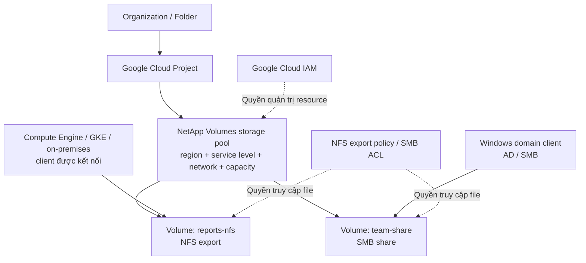
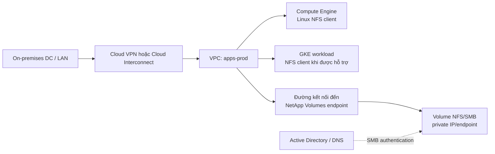
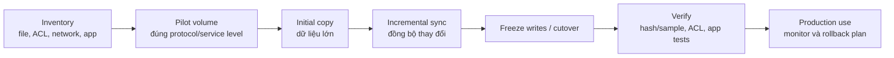

# Google Cloud NetApp Volumes và nhu cầu tệp doanh nghiệp

Khi chuyển hệ thống doanh nghiệp lên Google Cloud, dữ liệu không phải lúc nào cũng là object trong bucket hoặc block device gắn vào một máy ảo. Nhiều ứng dụng cũ cần **hệ thống tệp được chia sẻ**: nhân viên Windows mở cùng một thư mục qua SMB, máy chủ Linux mount NFS, nhiều máy xử lý nội dung truy cập chung một cây thư mục, hoặc phần mềm phân tích bắt buộc dùng đường dẫn POSIX thay vì gọi Object Storage API. Trong những tình huống này, **Google Cloud NetApp Volumes** là một phương án dịch vụ lưu trữ tệp được quản lý đáng đánh giá.

Bài thuộc chương **Lưu trữ khối và tệp** trong module `CLOUD_PROVIDERS_GCP`. Kiến thức liên kết với việc tổ chức project, IAM/VPC, triển khai Compute Engine, GKE, Cloud Run, lưu trữ/cơ sở dữ liệu, đồng thời phục vụ yêu cầu **bảo vệ tài nguyên, tự động hóa phát hành, giám sát độ tin cậy và kiểm soát chi phí**. Trọng tâm không phải học thuộc tên sản phẩm, mà là **xác định nhu cầu file storage**, thiết kế đường truy cập, quyền dữ liệu, hiệu năng, khôi phục và vận hành.

> Phạm vi tính năng NetApp Volumes, service level, giao thức, region/zone, dung lượng và giá có thể khác nhau theo cấu hình được Google Cloud hỗ trợ. Các ví dụ trong bài chỉ mang tính học tập; kiểm tra bảng tính năng và giới hạn hiện hành trước khi triển khai production.

## 1. Mục tiêu học tập

Sau bài này, bạn có thể:

1. Phân biệt **file storage** với **block storage** và **object storage**, nhận biết khi nào ứng dụng cần NFS/SMB.
2. Giải thích mô hình **storage pool → volume → NFS export/SMB share → client** trong Google Cloud NetApp Volumes.
3. Phân tích lựa chọn **service level, capacity, network connectivity, protocol, identity và quyền truy cập**.
4. Hiểu cơ chế quản lý dữ liệu: **snapshot, backup, replication**, cách chúng hỗ trợ RPO/RTO nhưng không tự thay thế thiết kế khôi phục.
5. Phác thảo quy trình tạo một volume NFS hoặc SMB qua Console, kiểm tra kết nối và mount từ Compute Engine/Windows.
6. So sánh NetApp Volumes với **Filestore, Persistent Disk/Hyperdisk và Cloud Storage** theo yêu cầu ứng dụng.
7. Xây dựng checklist bảo mật, giám sát hiệu năng, tính phí, di chuyển dữ liệu và kiểm tra khôi phục cho workload doanh nghiệp.

## 2. Bài toán điển hình: vì sao doanh nghiệp cần dịch vụ lưu trữ tệp?

Giả sử công ty có ba nhóm hệ thống:

- **Phòng thiết kế:** hàng trăm tệp dự án nằm trong cấu trúc thư mục, người dùng Windows cần mở thư mục chia sẻ, ứng dụng sử dụng SMB và quyền file gắn với danh tính nhân viên.
- **Hệ thống Linux xử lý báo cáo:** nhiều Compute Engine VM cần đọc/ghi chung thư mục `/mnt/reports` qua NFS.
- **Ứng dụng web mới trên Cloud Run:** ảnh và tài liệu công khai được truy cập qua HTTP/API, không yêu cầu thư mục mạng truyền thống.

Không nên chọn cùng một loại storage cho cả ba chỉ vì chúng đều chứa “tệp”.

| Mô hình | Giao diện truy cập | Phù hợp khi | Hạn chế cần xét |
| --- | --- | --- | --- |
| **Block storage** (Persistent Disk, Hyperdisk) | Thiết bị block gắn với VM/khối lượng công việc được hỗ trợ; filesystem do OS quản lý. | Boot disk, database disk, filesystem riêng của VM. | Không mặc nhiên có một **NAS share** nhiều client cùng truy cập với ngữ nghĩa NFS/SMB. |
| **File storage** (NetApp Volumes, Filestore) | Share/export NFS hoặc SMB theo sản phẩm, ứng dụng thao tác đường dẫn, file, thư mục. | Ứng dụng có sẵn dùng NAS, nhiều client, POSIX/Windows file access. | Bị ảnh hưởng bởi mạng, đặc tính file locking, metadata I/O và năng lực dịch vụ. |
| **Object storage** (Cloud Storage) | Bucket/object qua API hoặc các giao diện được hỗ trợ. | Asset, dữ liệu không cấu trúc, archival, tích hợp cloud-native và phân phối nội dung. | Object storage không phải filesystem POSIX/SMB thông thường; không giả định rename/lock giống NAS. |

**Quy tắc chọn:** nếu ứng dụng yêu cầu **SMB share, NFS export, file locking, quyền file và tên đường dẫn ổn định**, hãy khảo sát file storage. Nếu ứng dụng chủ yếu tải object qua HTTP, Cloud Storage thường dễ tích hợp hơn. Nếu cần block device với hệ điều hành quản lý filesystem của một VM, xem Persistent Disk/Hyperdisk.

## 3. Google Cloud NetApp Volumes là gì?

**Google Cloud NetApp Volumes** là dịch vụ lưu trữ tệp được quản lý trên Google Cloud, kết hợp khả năng file storage của NetApp với hoạt động quản lý tài nguyên trên Google Cloud. Nó giúp tổ chức cung cấp volume cho client dùng **NFS**, **SMB**, hoặc cấu hình đa giao thức ở phạm vi được hỗ trợ mà không phải tự vận hành một cặp NAS VM, hệ điều hành lưu trữ, dịch vụ file server và cơ chế dự phòng từ đầu.

Những khả năng quan trọng đối với kiến trúc sư:

- **Chia sẻ tệp có cấu trúc:** mount từ VM Linux hoặc truy cập UNC share của Windows, tùy giao thức được chọn.
- **Quản lý tập trung:** tạo storage pool và volume trong môi trường Google Cloud; kiểm soát ai có quyền quản trị qua IAM.
- **Hiệu năng theo service level và capacity:** lựa chọn mức phục vụ phù hợp I/O, throughput, latency và ngân sách.
- **Bảo vệ dữ liệu:** snapshot, backup và replication theo khả năng sản phẩm/cấu hình, phục vụ khôi phục và bảo vệ trước sự cố.
- **Tích hợp môi trường doanh nghiệp:** SMB với Active Directory khi được hỗ trợ; NFS cho workload Linux; quyền ở filesystem khác với quyền quản trị Google Cloud.
- **Kết nối mạng riêng:** client truy cập qua đường mạng VPC/kết nối hybrid theo kiến trúc dịch vụ, thay vì coi volume là một endpoint web công khai.

“Managed service” giảm trách nhiệm quản lý hạ tầng storage bên dưới, **không loại bỏ** trách nhiệm kiểm soát dữ liệu, danh tính, ứng dụng, backup, monitoring, quota và chi phí của khách hàng.

## 4. Mô hình tài nguyên: storage pool và volume

Để thiết kế đúng, phải phân biệt **nơi cung cấp năng lực lưu trữ** và **filesystem mà client thực sự truy cập**.



### 4.1. Storage pool

**Storage pool** là tài nguyên dùng để tổ chức/cung cấp năng lực file storage. Trong thiết kế, cần xác định:

- **Project và location:** project sở hữu, region (và những ràng buộc placement cụ thể theo service level).
- **Service level:** xác định lớp hiệu năng, khả năng và mô hình cung cấp storage.
- **Capacity của pool:** phải đủ cho nhu cầu volume theo quy tắc sizing/overcommit của service level, đồng thời phù hợp quota và ngân sách.
- **Network:** VPC/đường kết nối dịch vụ được cấu hình phù hợp để client truy cập.
- **Quyền quản trị:** chỉ các nhóm được ủy quyền mới tạo/chỉnh pool và các liên kết liên quan.

Không coi pool là một ổ đĩa mà Linux có thể mount trực tiếp. **Client mount volume**, sử dụng endpoint/export/share và giao thức tương ứng.

### 4.2. Volume

**Volume** đại diện cho một filesystem chia sẻ cụ thể. Khi tạo, thông thường phải chọn hoặc cấu hình:

| Thuộc tính | Ví dụ minh họa | Tác động |
| --- | --- | --- |
| Tên volume | `reports-nfs` | Danh tính tài nguyên để quản trị và kiểm toán. |
| Storage pool | `orders-filepool-prod` | Service level/location/network và capacity cung cấp cho volume. |
| Capacity | `1 TiB` | Phải phù hợp dữ liệu hiện tại, tăng trưởng, snapshot và giới hạn dịch vụ. |
| Protocol | NFSv4.1 | Quyết định client, cơ chế identity/file access và mount. |
| Share/export name | `reports` | Đường dẫn NFS export hoặc SMB share theo định dạng dịch vụ cung cấp. |
| Export/SMB policy | Allow những mạng/identity được duyệt | Ngăn client không được phép truy cập dữ liệu. |
| Snapshot/backup policy | Theo RPO/RTO của ứng dụng | Quyết định điểm khôi phục và retention. |

**Không nhầm capacity của volume với số byte dữ liệu đang được ghi.** Storage billing và chính sách provision phụ thuộc service level; snapshot có thể tạo mức sử dụng dung lượng và chi phí riêng theo chính sách. Cần quan sát cả **provisioned size, used space, snapshot usage và khả năng mở rộng**.

### 4.3. Region, zone và phạm vi lỗi

Compute Engine VM được đặt ở **zone**, trong khi volume/pool có những quy tắc location theo **region/service level**. Thiết kế phải kiểm tra:

1. Client và file service ở vùng nào để đạt latency và đáp ứng data residency.
2. Những zone nào có thể truy cập một volume theo khả năng của sản phẩm.
3. Dịch vụ cam kết tính sẵn sàng theo mô hình nào; có cần bản sao **cross-region** không.
4. Kết nối hybrid từ on-premises có đủ latency, thông lượng và tuyến dự phòng không.

Không kết luận rằng “storage thuộc region” đồng nghĩa mọi workload dùng nó tự có **disaster recovery đa region**. Cần tách khả năng chịu lỗi hạ tầng do nhà cung cấp quản lý khỏi kế hoạch replication/khôi phục dữ liệu của ứng dụng.

## 5. Lựa chọn service level và sizing

Các service level thường được nhắc tới khi đánh giá NetApp Volumes gồm **Flex, Standard, Premium và Extreme**, nhưng **khả dụng, tính năng đi kèm, điều kiện tạo pool/volume và mô hình tính phí có thể khác nhau theo location và thời điểm**. Việc so sánh dưới đây nhằm chọn hướng thử nghiệm chứ không phải bảng cam kết IOPS/throughput tuyệt đối.

| Service level | Hướng đánh giá | Workload minh họa | Điều cần xác minh |
| --- | --- | --- | --- |
| **Flex** | Tập trung lựa chọn linh hoạt về năng lực và chi phí theo cấu hình hỗ trợ. | File share tổng quát, nhu cầu hiệu năng vừa phải. | Region, protocol, khả năng backup/replication, dung lượng và giới hạn hiệu năng. |
| **Standard** | Cân bằng năng lực file storage và chi phí trong nhóm cấp hiệu năng truyền thống. | Dữ liệu người dùng, chia sẻ NFS/SMB thông thường. | Capacity tối thiểu, throughput theo capacity, số client/kết nối. |
| **Premium** | Mức năng lực cao hơn cho workload có nhu cầu I/O đáng kể. | Ứng dụng doanh nghiệp nhiều thao tác tệp, xử lý dữ liệu. | Benchmark workload, latency, metadata throughput và chi phí. |
| **Extreme** | Mức hiệu năng cao cho nhu cầu throughput/I/O lớn khi được hỗ trợ. | Xử lý file song song, workload đòi năng lực truy cập cao. | Tương thích, giới hạn tài nguyên, ổn định hiệu năng, giá. |

**Không nên chọn Extreme chỉ vì tên gọi “nhanh nhất”.** Throughput quan sát được còn phụ thuộc:

- Kích thước block và loại I/O: đọc tuần tự file lớn khác với tạo/xóa nhiều file nhỏ.
- Số client và mức song song; một client đơn lẻ có thể không đủ để khai thác năng lực.
- RTT/latency và đường mạng giữa client–volume, đặc biệt qua VPN/Interconnect.
- NFS/SMB version, mount options, SMB session, cơ chế locking và cache.
- Dung lượng cấp phát, giới hạn throughput/IOPS của service level và khả năng mở rộng pool.
- CPU/RAM và network throughput của Compute Engine VM/GKE nodes đang làm client.

### 5.1. Bài toán chọn dung lượng

Ví dụ một hệ thống báo cáo:

| Hạng mục | Ước lượng |
| --- | ---: |
| Dữ liệu hiện tại | 600 GiB |
| Dự kiến tăng trong 12 tháng | 250 GiB |
| Dự phòng cho log, metadata và dao động | 150 GiB |
| **Nhu cầu ban đầu minh họa** | **1.000 GiB** |

Con số 1.000 GiB chỉ là phép cộng để định hướng sizing, **chưa tính đầy đủ phần snapshot/backup, service-level minimum, đơn vị cấp phát, filesystem overhead và quy tắc billing**. Nên dùng dung lượng dự kiến theo **GiB/TiB**, xác nhận trong Console và có kế hoạch theo dõi trước khi volume gần đầy.

### 5.2. Tách workload để tránh tranh chấp tài nguyên

Không nhất thiết đặt file share của người dùng, pipeline build artifact và workload xử lý hàng triệu file nhỏ vào cùng một volume. Các nhóm có đặc tính I/O khác nhau có thể cần **volume hoặc pool riêng**, tùy hạn mức và chi phí:

- **Home directories:** nhiều file nhỏ, nhiều user, yêu cầu ACL và khả năng phục hồi.
- **Media/analytics:** file lớn, throughput tuần tự, số worker song song.
- **Shared configuration:** dung lượng nhỏ nhưng cần consistency và access control chặt.
- **Legacy application data:** file locking, path semantics, tương thích NFS/SMB đặc thù.

Tách volume cũng giúp đặt **snapshot schedule, quota, export policy, SMB permissions và owner** theo nhóm dữ liệu thay vì một cấu hình chung quá rộng.

## 6. NFS cho Linux và workload tính toán

**Network File System (NFS)** cho phép client Unix/Linux mount một filesystem từ file server qua mạng. NetApp Volumes có hỗ trợ các biến thể NFS như NFSv3/NFSv4.1 theo service level và cấu hình; cần chọn phiên bản được workload và volume hỗ trợ.

### 6.1. Quyền NFS gồm nhiều lớp

Một mount thành công thường cần:

1. **Route và kết nối VPC:** client đến được IP/endpoint của volume trên mạng hỗ trợ.
2. **Firewall/đường truyền:** giao thức và port NFS được cho phép theo NFS version và quy tắc của sản phẩm.
3. **Export policy:** địa chỉ hoặc dải nguồn client và quyền read-only/read-write được phép.
4. **Danh tính Unix và filesystem permissions:** UID/GID, mode bits hoặc ACL đúng theo NFS version/cấu hình.
5. **Điều kiện volume:** volume đang hoạt động, đủ dung lượng, không bị read-only do snapshot/replication hay nguyên nhân khác.

**IAM Google Cloud không thay export policy và quyền Unix.** Một người có quyền quản trị NetApp volume trên Console không tự động có quyền đọc tất cả file trong volume qua NFS, và một tiến trình có UID phù hợp trên client không tự có quyền xóa storage pool qua API Google Cloud.

### 6.2. NFSv3 và NFSv4.1

| Tiêu chí | NFSv3 | NFSv4.1 |
| --- | --- | --- |
| Giao thức | Thiết kế NFS cũ, phổ biến với nhiều ứng dụng legacy. | Giao thức NFS thế hệ mới, có cơ chế session/state/locking tích hợp hơn. |
| Port và dịch vụ | Có thể cần thêm dịch vụ RPC/port tùy cấu hình. | Thường tập trung TCP 2049 trong mô hình NFSv4.1 phù hợp. |
| Identity | Thường dựa trên UID/GID và export policy. | Cần chú ý identity mapping/NFSv4 ACL và cấu hình tên miền khi sử dụng. |
| Tương thích | Thích hợp ứng dụng chỉ được chứng nhận NFSv3. | Ưu tiên đánh giá nếu ứng dụng/client hỗ trợ và policy phù hợp. |

Không tự thay đổi từ NFSv3 sang NFSv4.1 trên production mà chưa kiểm thử file locking, permission mapping, ứng dụng và hiệu năng. **Một phiên bản NFS cao hơn không đồng nghĩa mọi ứng dụng đều hoạt động giống nhau**.

### 6.3. Export policy và root access

Export policy xác định client hoặc mạng được phép mount và mức truy cập. Tùy khả năng dịch vụ, cần cân nhắc các tuỳ chọn **read-only/read-write, NFS version, root access/root squash** và nhóm mạng nguồn.

Ví dụ mong muốn:

```text
Volume: reports-nfs
Export path: /reports
Allowed client subnet: 10.20.10.0/24
Access: read/write
Root access: chỉ khi có yêu cầu được phê duyệt
```

Đây là **chính sách mô tả mục tiêu**, không phải cấu hình API có thể áp dụng nguyên xi. Nếu mở export cho `0.0.0.0/0` hoặc cho toàn bộ VPC quá rộng, bất kỳ client nào có đường mạng thích hợp có thể được đưa vào phạm vi xem xét truy cập, làm tăng rủi ro dữ liệu.

Không dùng tài khoản `root` trên client làm biện pháp “sửa nhanh” lỗi permission. Phải xác định UID/GID, owner và mapping có đồng nhất giữa các máy không, rồi cấu hình quyền filesystem đúng mục đích.

## 7. SMB cho Windows và hệ thống doanh nghiệp

**Server Message Block (SMB)** được sử dụng nhiều trong môi trường Windows cho file share, thư mục nhóm, dữ liệu ứng dụng và phân quyền theo danh tính miền.

### 7.1. Active Directory trong mô hình SMB

Với SMB, NetApp Volumes có thể cần **Active Directory (AD) integration** theo cơ chế dịch vụ hỗ trợ. Thiết kế thường phải giải quyết:

- **AD domain và DNS:** client/volume có khả năng phân giải và tiếp cận domain controllers phù hợp.
- **Thông tin AD connection:** cấu hình do dịch vụ yêu cầu, ví dụ domain, DNS server, OU hoặc thông tin dịch vụ được ủy quyền theo phương án được hỗ trợ.
- **Danh tính người dùng/nhóm:** người dùng truy cập bằng account miền, không chỉ bằng Google Cloud IAM principal.
- **SMB share permissions và file/directory ACLs:** quyền ở cấp share và quyền filesystem phải phù hợp; quyền hiệu lực phụ thuộc cả hai lớp theo mô hình SMB.
- **Thời gian và mạng:** DNS, Kerberos/NTLM theo chế độ hỗ trợ, kết nối tới domain controllers và network policies.

**Không đặt password quản trị domain vào script, metadata VM, Terraform state công khai hoặc tài liệu vận hành.** Dùng phương án bí mật/credential management và quyền tối thiểu theo yêu cầu tích hợp AD.

### 7.2. Phân quyền theo nhóm thay vì tài khoản đơn lẻ

Ví dụ nhóm:

| Nhóm AD | Quyền mong muốn trên share `finance` | Lý do |
| --- | --- | --- |
| `Finance-Readers` | Đọc thư mục báo cáo | Nhân viên cần xem nhưng không sửa. |
| `Finance-Editors` | Đọc/ghi thư mục được giao | Nhân viên cập nhật báo cáo. |
| `Finance-Owners` | Quản trị nội dung theo quy trình | Đầu mối xử lý permission và phục hồi. |
| `Everyone` | Không cấp quyền rộng không cần thiết | Tránh phơi dữ liệu sang người dùng khác. |

Khi người dùng báo “Tôi đăng nhập được Windows nhưng mở share bị Access Denied”, hãy kiểm tra cả **domain identity, membership, share permissions, file ACL và connectivity**. **Đăng nhập Windows thành công** không tự chứng minh có quyền trên thư mục cụ thể.

### 7.3. Kết nối SMB từ Windows

Thông thường Windows client truy cập share qua dạng UNC:

```text
\\fileserver.example.internal\finance
```

Tên hostname/share phải lấy từ **thông tin truy cập của volume SMB** và cấu hình DNS/AD thực tế; `fileserver.example.internal` chỉ là ví dụ. Trên Windows PowerShell:

```powershell
# Chỉ đọc: kiểm tra khả năng phân giải và kết nối SMB
Resolve-DnsName fileserver.example.internal
Test-NetConnection fileserver.example.internal -Port 445

# Mở đường dẫn share qua Windows Explorer hoặc kiểm tra quyền từ phiên đăng nhập
Test-Path "\\fileserver.example.internal\finance"
```

Nếu cần map network drive, thực hiện bằng cách được chính sách Windows/AD cho phép và tránh đưa mật khẩu vào dòng lệnh. Với SMB, **không mở TCP 445 công khai ra Internet** chỉ để người dùng ở xa truy cập; sử dụng VPN, Interconnect hoặc phương án kết nối hybrid riêng được duyệt.

## 8. Dual-protocol NFS/SMB: khi nào nên cân nhắc?

Một số doanh nghiệp có cả ứng dụng Linux và người dùng Windows truy cập **cùng tập dữ liệu**. Khả năng **dual-protocol** của NetApp Volumes, khi được service level/volume hỗ trợ và cấu hình đúng, cho phép đánh giá mô hình này.

Tuy nhiên, dual-protocol **không đơn giản là bật cả NFS và SMB rồi mọi user đều có quyền như nhau**:

1. **Identity mapping:** người dùng AD trên Windows và UID/GID trên Linux cần ánh xạ nhất quán.
2. **ACL semantics:** NTFS ACL và quyền POSIX/NFS không giống nhau; cách chuyển đổi/quyền hiệu lực phụ thuộc kiểu security style và cấu hình hỗ trợ.
3. **File locking:** ứng dụng Linux/Windows đồng thời sửa cùng file có thể phụ thuộc hành vi khóa, cache và khả năng tương thích.
4. **Case sensitivity, file naming:** ứng dụng có thể không thống nhất về chữ hoa/chữ thường và ký tự hợp lệ.
5. **Protocol version/features:** không phải mọi service level/region đều có đúng cùng lựa chọn.

**Khuyến nghị thiết kế:** chỉ chọn dual-protocol nếu thực sự cần hai hệ điều hành thao tác chung dữ liệu và đã thử các thao tác **create/read/write/rename/delete/ACL/locking** từ cả hai phía. Nếu hai nhóm chỉ cần trao đổi file theo batch, quy trình đồng bộ hoặc ETL có thể đơn giản và an toàn hơn.

## 9. Network connectivity: dữ liệu đi qua đâu?

NetApp Volumes được dùng qua **kết nối mạng riêng** trong môi trường hỗ trợ. Đối với client Compute Engine, GKE hoặc on-premises, bạn cần kiểm tra **VPC, IP routing, firewall, DNS, phương thức service networking và phạm vi region** của pool/volume.



Sơ đồ **không khẳng định một kiểu VPC service networking cố định cho mọi service level**. Một số mô hình sử dụng các cơ chế như private service connectivity/peering theo tài liệu sản phẩm; cần xác nhận chính xác yêu cầu của service level và cấu hình pool đang chọn.

### 9.1. Checklist đường mạng

1. **Đúng VPC/subnet/region:** xác định client ở mạng nào, volume ở location nào và có đường truy cập hợp lệ không.
2. **Các dải IP không chồng lấn:** đặc biệt với VPC peering, mạng đối tác hoặc on-premises.
3. **Route hai chiều:** client đến được endpoint volume và lưu lượng hồi đáp theo kiến trúc được hỗ trợ.
4. **Firewall:** mở đúng NFS/SMB protocol và cổng tới endpoint, cộng các dịch vụ phụ thuộc như AD/DNS khi dùng SMB.
5. **DNS:** SMB hostname và NFS endpoint được phân giải đúng theo chỉ dẫn mount.
6. **Độ trễ và thông lượng:** client ở vùng xa hoặc on-premises có thể chịu RTT đáng kể; benchmark đường kết nối.
7. **Bảo vệ đường truyền:** mã hóa in transit theo khả năng protocol và mạng; không mặc định mọi NFS traffic đều có encryption cấp ứng dụng.

### 9.2. GKE và filesystem chia sẻ

Ứng dụng container có thể cần shared filesystem, nhưng yêu cầu thực tế phụ thuộc GKE, CSI driver, NetApp Trident hoặc tích hợp lưu trữ được Google Cloud/NetApp hỗ trợ trong phiên bản triển khai. Trước khi quyết định:

- Kiểm tra **StorageClass/CSI driver** được hỗ trợ và cơ chế provision volume.
- Xác nhận kiểu truy cập cần thiết, ví dụ nhiều Pod cùng mount read/write, và tính tương thích của volume.
- Tính tới **Pod/node scheduling, network reachability, UID/GID, fsGroup, NFS mount flags**.
- Tránh tự chia sẻ một volume read-write giữa các Pod nếu ứng dụng/database không hỗ trợ concurrency/locking cần thiết.

Một filesystem NFS chia sẻ **không làm ứng dụng tự trở thành stateless**. Session, database transactions và consistency vẫn phải được thiết kế phù hợp.

### 9.3. Cloud Run, Cloud Storage và hệ thống ứng dụng

Cloud Run là serverless; khả năng gắn storage file qua network mount hay các cơ chế tích hợp được hỗ trợ khác phụ thuộc **tính năng và giới hạn hiện hành**. Không suy diễn rằng mọi lựa chọn CSI/NFS của GKE đều có thể áp dụng trực tiếp cho Cloud Run.

Nếu ứng dụng Cloud Run chỉ cần đọc ảnh, tài liệu hoặc xuất báo cáo qua API, nên đánh giá **Cloud Storage** trước khi thêm phụ thuộc NFS/SMB. Với file storage, phải xác nhận đường mạng, timeout, concurrency, quyền file và hành vi khi instance scale in/out.

## 10. Bảo mật: phân quyền ở hai mặt phẳng

Thiết kế NetApp Volumes an toàn luôn có **management plane** và **data plane**:

| Mặt phẳng | Cơ chế | Câu hỏi |
| --- | --- | --- |
| **Quản trị Google Cloud** | IAM trên project và các tài nguyên liên quan. | Ai được tạo/chỉnh/xóa storage pool, volume, backup, snapshot và replication? |
| **Kết nối mạng** | VPC connectivity, route, firewall, allow client source. | Máy nào có thể tới IP/endpoint của volume? |
| **NFS data access** | Export policy, UID/GID, permission bits/ACL. | Process Linux nào đọc/ghi file nào? |
| **SMB data access** | AD identity, share permissions, filesystem ACL. | Người dùng/nhóm Windows nào có quyền? |
| **Bảo vệ dữ liệu** | Encryption, key policy, snapshot, backup, replica. | Làm sao giữ bí mật và khôi phục dữ liệu khi lỗi? |
| **Quan sát/kiểm toán** | Cloud audit/metrics/logs và logging ở lớp OS/AD. | Ai thay đổi cấu hình; hành vi truy cập tệp có được ghi theo yêu cầu không? |

**Sai lầm phổ biến:** cấp `roles/owner` cho nhóm ứng dụng để khắc phục lỗi mount NFS. Nếu client chưa được export policy cho phép hoặc quyền Unix chưa đúng, thêm IAM Owner **không giải quyết** nguyên nhân và còn tăng rủi ro quản trị.

### 10.1. IAM và separation of duties

Nên tách:

- **Storage Admin:** tạo pool, volume, policy, backup theo quyền được duyệt.
- **Network Admin:** cấu hình VPC connectivity, firewall, routing.
- **Security/IAM Admin:** quản trị quyền, encryption keys và audit policy.
- **Application Owner:** định nghĩa nhu cầu data path, người dùng/nhóm, backup window, hiệu năng và SLO.
- **Backup/DR Operator:** thực hiện restore/failover theo quy trình được kiểm soát.

Role IAM có sẵn cho NetApp Volumes cần được đối chiếu **permission và phạm vi** trước khi gán. Không cấp quyền xóa volume cho pipeline chỉ cần mount/read dữ liệu.

### 10.2. Encryption và khóa

File storage managed thường có cơ chế **encryption at rest**. Với yêu cầu sử dụng **CMEK/Cloud KMS**, phải kiểm tra service level/location, IAM của service agent và khả năng hỗ trợ thực tế. Không cho rằng bật CMEK chỉ là chọn một checkbox mà không có trách nhiệm vòng đời khóa.

Các vấn đề cần quản trị:

1. Chọn phương án mã hóa at rest phù hợp compliance.
2. Bảo vệ **encryption key và quyền sử dụng key**; việc key không khả dụng có thể ảnh hưởng truy cập dữ liệu.
3. Xác định nhu cầu **encryption in transit** cho NFS/SMB hoặc VPN/Interconnect khi truyền xa.
4. Không lưu bí mật AD, access token hoặc khóa KMS vào script rõ chữ.
5. Theo dõi thay đổi IAM, network policy, export policy và chia sẻ dữ liệu.

### 10.3. Ransomware, xóa nhầm và kiểm soát khôi phục

Một file share có quyền ghi rộng có thể bị mã độc hoặc thao tác người dùng làm thay đổi hàng loạt tệp. Biện pháp phòng ngừa cần kết hợp:

- **Least privilege** tại share/export và ACL filesystem.
- Thiết lập snapshots với retention phù hợp, kiểm tra quyền xóa snapshot và chính sách bảo vệ snapshot khi tính năng hỗ trợ.
- Backup độc lập theo nhu cầu RPO/RTO; tránh dựa vào một bản snapshot trong cùng môi trường làm kế hoạch DR duy nhất.
- Có phương án **khôi phục thử** vào môi trường tách biệt, kiểm tra integrity và quyền truy cập sau restore.
- Giám sát sự tăng đột biến của xóa/ghi dữ liệu và thay đổi quyền, tùy công cụ logging/monitoring hiện có.

Không có một snapshot schedule nào bảo đảm chống ransomware hoàn toàn. Nếu account quản trị hoặc hệ thống nguồn bị chiếm quyền, quy trình phục hồi còn phụ thuộc **phân quyền, bản sao tách biệt, retention và khả năng xác thực bản backup sạch**.

## 11. Snapshot, backup và replication: khác nhau ra sao?

Đối với doanh nghiệp, “có NAS managed” chưa đủ. Hãy xác định mục tiêu **RPO (Recovery Point Objective)** và **RTO (Recovery Time Objective)** trước khi chọn cách bảo vệ dữ liệu.

| Cơ chế | Ý nghĩa | Thường phù hợp | Không nên nhầm |
| --- | --- | --- | --- |
| **Snapshot** | Điểm khôi phục theo thời gian của volume/filesystem theo cơ chế sản phẩm. | Khôi phục nhanh file bị sửa/xóa nhầm; phục hồi trạng thái trước thay đổi. | Không mặc nhiên là backup độc lập khỏi toàn bộ phạm vi lỗi. |
| **Backup** | Bản sao dữ liệu theo dịch vụ/đích backup được hỗ trợ, với retention và cách restore riêng. | Bảo vệ dài hạn và khôi phục khi bản chính không dùng được. | Không tự bảo đảm RPO liên tục hoặc restore lập tức. |
| **Volume replication** | Đồng bộ/bảo vệ dữ liệu tới đích khác theo cơ chế replication được hỗ trợ, có thể giữa region. | Khả năng phục hồi sau lỗi khu vực và giảm mất dữ liệu. | Replica không phải backup lịch sử: xóa/sửa dữ liệu có thể được truyền sang phía đích. |

Khả năng snapshot/backup/replication khác nhau theo service level, vùng và điều kiện dịch vụ; xác minh **hướng replication, lịch, vai trò source/destination, quyền quản trị và quy trình failover** trước khi thiết kế.

### 11.1. Ví dụ xác định RPO/RTO

Doanh nghiệp muốn dữ liệu thư mục thiết kế:

- Mất dữ liệu không quá **4 giờ**: `RPO ≤ 4 giờ`.
- Có thể khôi phục truy cập trong **8 giờ**: `RTO ≤ 8 giờ`.

Một lịch snapshot cứ 4 giờ **có thể đóng góp** cho RPO nếu snapshots được tạo đúng hạn và sự cố nằm trong phạm vi snapshot xử lý. Nhưng khi cần phục hồi sau thảm họa ở một region, snapshot tại nguồn **chưa đủ** nếu không truy cập được nguồn. Cần thiết kế backup/replication ở phạm vi đáp ứng DR, và kiểm thử thời gian restore thực tế.

### 11.2. Application-consistent recovery

Snapshot ở mức filesystem có thể không đồng thời đưa mọi ứng dụng đang ghi vào trạng thái nhất quán:

- Database trong filesystem có thể còn transaction/buffer chưa flush.
- Ứng dụng ghi nhiều file liên quan cần khóa/quiesce đúng thời điểm.
- SMB users đang mở file hoặc NFS clients đang thực hiện write có thể có dữ liệu chưa ổn định.

Do đó, với workload cần **application consistency**, hãy phối hợp snapshot với cơ chế ứng dụng (quiesce, flush, database-native backup hoặc backup agent) và kiểm tra phục hồi end-to-end.

### 11.3. Phân biệt high availability và disaster recovery

**High availability** giảm gián đoạn do lỗi thông thường, còn **disaster recovery** liên quan phục hồi khi một miền lỗi lớn (như region, dữ liệu bị phá hủy) không còn dùng được. Managed storage giúp giảm việc tự vận hành lớp lưu trữ, nhưng:

- Một client VM đơn lẻ vẫn có thể là single point of failure.
- Đường VPN/Interconnect đơn tuyến vẫn có thể bị lỗi.
- Ứng dụng có thể cần lại DNS/mount settings nếu chuyển sang replica.
- Quyền NFS/SMB/AD và network route tại DR site cần sẵn sàng, không chỉ có dữ liệu.

Kế hoạch DR phải nêu **ai kích hoạt**, **quy trình đổi client sang đích**, **kiểm tra dữ liệu**, **phản ứng khi failover không hoàn chỉnh** và **cách failback**.

## 12. Thực hành: khảo sát trước khi tạo volume

Ví dụ một tổ chức muốn chuyển thư mục báo cáo NFS từ máy NAS on-premises lên NetApp Volumes cho các VM ở `asia-southeast1`.

### 12.1. Giả định môi trường

| Thành phần | Giá trị minh họa |
| --- | --- |
| Project | `reports-prod` |
| VPC | `reports-vpc` |
| Region client | `asia-southeast1` |
| Volume name | `reports-nfs` |
| Protocol | NFSv4.1 |
| Nhu cầu dung lượng | 1 TiB (sẽ hiệu chỉnh theo limits/billing) |
| Client subnet được phép | `10.20.10.0/24` |
| Nơi mount trên Linux | `/mnt/reports` |
| Người sở hữu | Nhóm Reports Platform |
| RPO/RTO | Ví dụ 4 giờ / 8 giờ, phải kiểm tra tính khả thi |

**Các giá trị là placeholder.** Trước khi bắt đầu cần:

- Project đã được cấp quyền/billing; API dịch vụ cần thiết đã bật.
- Region hỗ trợ NetApp Volumes với service level và protocol mong muốn.
- Pool và volume nằm trong mức quota/capacity được phê duyệt.
- Kết nối network service/VPC phù hợp, không có xung đột CIDR.
- Đã xác định ai quản trị IAM, NFS export policy, snapshot, backup và chi phí.

### 12.2. Tạo storage pool trong Console

1. Mở **Google Cloud Console** và chọn project `reports-prod`.
2. Tìm **NetApp Volumes** trong khu vực storage/services.
3. Mở **Storage pools** và chọn tạo pool mới nếu chưa có pool phù hợp.
4. Chọn **region/location** đúng nhu cầu; kiểm tra service level được hỗ trợ ở đó.
5. Chọn **network/VPC connectivity** theo hướng dẫn loại pool, đặt capacity và những tham số bắt buộc.
6. Kiểm tra điều kiện **encryption, data protection và network configuration**.
7. Xem lại dự toán chi phí, quota và phạm vi ảnh hưởng, rồi tạo pool khi được phê duyệt.

Không nên tạo một pool mới cho từng volume theo thói quen. Nếu mô hình pool cho phép dùng chung mà vẫn đáp ứng isolation, performance và ownership, hãy so chi phí/vận hành của các phương án.

### 12.3. Tạo một volume NFS

1. Trong **NetApp Volumes → Volumes**, chọn **Create volume**.
2. Chọn đúng storage pool `reports-filepool-prod` (ví dụ), đặt tên `reports-nfs`.
3. Nhập dung lượng sau khi kiểm tra giới hạn tối thiểu/tối đa và ngân sách.
4. Chọn **NFS protocol version** phù hợp, ví dụ NFSv4.1 nếu service level và client hỗ trợ.
5. Đặt **share/export name** theo định dạng dịch vụ yêu cầu.
6. Tạo **export policy** giới hạn client source subnet `10.20.10.0/24`, mức quyền read/write đúng nhu cầu và root access theo chính sách.
7. Xem xét snapshot schedule, backup và các cấu hình bảo vệ dữ liệu được cung cấp.
8. Xác nhận tạo volume; khi volume đã sẵn sàng, đọc **mount instructions** để lấy endpoint IP/hostname và export path thực tế.

**Không tự đoán IP NFS từ địa chỉ subnet hoặc tên volume.** Dịch vụ cung cấp endpoint/mount instructions tương ứng; phải dùng đúng thông tin đó. Đối với VM ở Shared VPC hoặc hybrid, cần xác minh tuyến mạng trước khi thử mount.

## 13. Thực hành mount NFS trên Compute Engine Linux

Các lệnh sau thực hiện **trên Linux VM client đã được phê duyệt**, không phải trên hệ thống đang chứa dữ liệu chưa sao lưu. Thay giá trị endpoint/export từ trang **mount instructions** của volume thực tế.

### 13.1. Chuẩn bị NFS client

Ví dụ trên Debian/Ubuntu:

```bash
# Kiểm tra OS, network interface và route (chỉ đọc)
cat /etc/os-release
ip -brief address
ip route

# Cài NFS client nếu VM chưa có; lệnh này thay đổi OS.
sudo apt-get update
sudo apt-get install -y nfs-common

# Tạo thư mục mount nếu chưa có
sudo mkdir -p /mnt/reports
```

Nếu VM private không có đường tải package, cần chuẩn bị repository/proxy/Cloud NAT hoặc image có sẵn NFS client theo chính sách. **Không nên gán external IP tạm chỉ để sửa sự cố package** nếu tổ chức có đường egress được quản lý.

### 13.2. Kiểm tra endpoint và mount

```bash
# Thay bằng địa chỉ và export path được NetApp Volumes cung cấp.
NFS_IP="10.30.40.50"
NFS_EXPORT="/reports"

# Kiểm tra route tới endpoint
ip route get "$NFS_IP"

# Ví dụ mount NFSv4.1, chỉ chạy sau khi policy/đường kết nối cho phép
sudo mount -t nfs -o vers=4.1 \
  "$NFS_IP:$NFS_EXPORT" /mnt/reports

# Xác minh đã mount từ đúng endpoint
findmnt /mnt/reports
df -hT /mnt/reports
mount | grep /mnt/reports
```

`10.30.40.50:/reports` chỉ là **địa chỉ/đường dẫn minh họa**, chưa chắc là cú pháp export của volume thật. Nếu mount thất bại, **so lại chính xác lệnh do Console cung cấp** trước khi sửa filesystem hoặc export policy.

### 13.3. Kiểm tra quyền đọc/ghi an toàn

Nếu nhóm quản trị cho phép ghi lên một thư mục thử nghiệm:

```bash
# Thông tin danh tính Linux hiện tại (chỉ đọc)
id
ls -ld /mnt/reports

# Chỉ kiểm tra đọc
ls -la /mnt/reports | head

# CHỈ ghi trong thư mục lab được cho phép:
# touch /mnt/reports/lab-write-test
# rm /mnt/reports/lab-write-test
```

Nếu thấy `Permission denied` khi tạo file nhưng mount thành công, nguyên nhân có thể nằm ở **export policy, UID/GID, mode bits, ACL hoặc root squashing**, không phải thiếu `roles/owner` trên Google Cloud. Không dùng `chmod 777` toàn bộ filesystem như một cách thử sửa nhanh.

### 13.4. Mount bền vững sau reboot

Khi mount đã hoạt động, có thể thiết kế mục `/etc/fstab` hoặc systemd mount unit theo hướng dẫn hệ điều hành và NetApp Volumes. Mẫu **không nên dán nguyên xi**:

```fstab
# <endpoint>:<export>  <mountpoint>  nfs  <options>  <dump> <pass>
10.30.40.50:/reports  /mnt/reports  nfs  vers=4.1,_netdev  0  0
```

Trước khi đưa vào production:

- Kiểm tra mount options phù hợp với NFS version, service level và kernel.
- Xem xét `_netdev`, timeout/retry và hành vi khi volume tạm thời không truy cập được; **không dùng mount option dễ làm mất dữ liệu chỉ để hệ thống boot nhanh**.
- Thử reboot trong môi trường lab, xác minh ứng dụng chờ mount sẵn sàng trước khi dùng đường dẫn.
- Có kịch bản xử lý lúc mạng/volume không sẵn sàng để tránh treo boot hoặc ghi nhầm dữ liệu vào thư mục local khi NFS chưa mount.

## 14. Thực hành SMB cho nhóm Windows

Với use case thư mục dùng chung `finance`:

1. Xác nhận service level/region hỗ trợ SMB, và cấu hình **AD connection** theo hướng dẫn dịch vụ.
2. Kiểm tra AD DNS, kết nối tới domain controllers, các quyền liên quan và sự phân giải tên.
3. Tạo volume SMB, chọn share name và permission strategy, xác định owner AD group.
4. Từ máy Windows **đã join domain hoặc được cấu hình xác thực phù hợp**, truy cập hostname/share qua UNC path theo mount instructions.
5. Kiểm tra user đọc/ghi đúng phạm vi và người ngoài nhóm bị từ chối.
6. Thiết lập backup/snapshot rồi diễn tập restore một thư mục thử nghiệm.

Ví dụ các kiểm tra Windows:

```powershell
$server = "fileserver.example.internal"
Resolve-DnsName $server
Test-NetConnection $server -Port 445

# Kiểm tra share theo quyền phiên đăng nhập:
Test-Path "\\fileserver.example.internal\finance"
```

**Đừng lưu username/password trong script.** Khi truy cập lỗi, ngoài TCP 445 còn phải kiểm tra **AD, DNS, Kerberos/authentication, share permissions và NTFS-style ACL**. Mở hết firewall rule hoặc thay ACL thành Everyone Full Control sẽ làm tăng bề mặt tấn công.

## 15. Di chuyển dữ liệu từ NAS on-premises lên NetApp Volumes

Migrating file storage khác chuyển một object bucket: ứng dụng có thể phụ thuộc **đường dẫn, inode/file handle, locking, UID/GID/ACL, ownership, file metadata và thời điểm cutover**.

### 15.1. Khảo sát trước migration

Thu thập:

- Tổng dung lượng, số lượng file/thư mục, kích thước file trung bình và phân bố.
- **Data churn**: số file tạo/sửa/xóa theo ngày, giờ cao điểm và yêu cầu downtime.
- Protocol và version NFS/SMB; có app nào dùng đặc tính NFSv3 không?
- UID/GID, AD groups, POSIX/NTFS ACL, symlinks, hard links, timestamps và permission model.
- Peak throughput, IOPS, metadata operations, latency và số client đồng thời.
- Kết nối hybrid: RTT, băng thông, route, firewall và giới hạn data transfer.
- Yêu cầu **RPO/RTO, retention, compliance, data residency**, chi phí egress/ingress khi áp dụng.

### 15.2. Kế hoạch migration theo pha



Một quy trình thực tế:

1. **Pilot:** chuyển một tập dữ liệu nhỏ, kiểm thử mount SMB/NFS, quyền file và hành vi ứng dụng.
2. **Initial copy:** sao chép dữ liệu lớn bằng công cụ phù hợp (ví dụ `rsync` cho Unix file data hoặc công cụ Windows/NetApp được hỗ trợ) trong giới hạn mạng.
3. **Incremental sync:** đồng bộ các thay đổi trong lúc người dùng còn làm việc, ghi nhận tệp lỗi và số lượng file lệch.
4. **Cutover:** lên lịch ngừng ghi hoặc chuyển ứng dụng vào chế độ chỉ đọc; chạy đồng bộ cuối.
5. **Verify:** đối chiếu file count, checksum theo sampling hoặc toàn bộ khi khả thi; xem ACL, owner, timestamps, symlink và ứng dụng thực.
6. **Rollback:** giữ nguồn cũ không bị ghi sai trong cửa sổ phù hợp, có điều kiện quay lại rõ ràng nếu mount/app tests thất bại.
7. **Decommission:** chỉ tắt NAS cũ sau khi đã hoàn tất acceptance, backup và retention yêu cầu.

Không nên chỉ sao chép dữ liệu rồi kết luận migration xong khi **ACL/owner chưa đúng**, path bị thay hoặc app còn trỏ tới share cũ. Với dữ liệu đang mở, cần phương án khóa/quiesce phù hợp để tránh bản sao không nhất quán.

### 15.3. Chuyển dữ liệu NFS với công cụ Unix

Ví dụ lệnh `rsync` **chỉ mang tính minh họa** khi cả nguồn và đích đã mount hợp lệ:

```bash
# KHÔNG chạy trên dữ liệu production nếu chưa có kế hoạch migration/backup.
# Sao chép thử dữ liệu; kiểm tra quyền và symlink theo yêu cầu ứng dụng.
sudo rsync -aHAX --numeric-ids --dry-run \
  /mnt/source-nas/reports/ /mnt/reports/

# Sau khi review kết quả dry-run, có thể bỏ --dry-run
# trong một change window được phê duyệt.
```

Các flag `-aHAX --numeric-ids` có mục tiêu giữ nhiều thuộc tính POSIX, nhưng **không bảo đảm mọi ACL, extended attribute hoặc Windows metadata đều chuyển hoàn hảo** giữa các filesystem/protocol. Cần đánh giá và kiểm thử theo dữ liệu thực.

## 16. Hiệu năng: từ filesystem tới trải nghiệm ứng dụng

Một volume có service level cao vẫn có thể chậm nếu ứng dụng đọc hàng triệu file nhỏ qua đường mạng có RTT lớn.

### 16.1. Các chỉ số quan trọng

| Chỉ số | Nó phản ánh gì? | Kịch bản cần đo |
| --- | --- | --- |
| **Throughput (MiB/s)** | Khối lượng dữ liệu đọc/ghi trên đơn vị thời gian. | Copy file lớn, analytics, media processing. |
| **IOPS** | Số thao tác I/O mỗi giây. | Nhiều request nhỏ và random I/O. |
| **Latency (ms)** | Thời gian đáp ứng mỗi thao tác. | Tệp nhỏ, metadata lookup và ứng dụng tương tác. |
| **Metadata operations** | create/stat/list/rename/delete file/thư mục. | Build pipelines, home directories, thư mục nhiều file. |
| **Concurrent clients** | Mức song song nhiều VM/desktop. | Nhiều job hoặc người dùng cùng giờ cao điểm. |
| **Used/provisioned capacity** | Dung lượng dữ liệu và phần đã cấp phát. | Capacity planning, snapshot usage và chi phí. |

### 16.2. Benchmark phải giống workload thật

Ví dụ ứng dụng ETL ghi tuần tự file 2 GiB khác hẳn ứng dụng tài chính tạo 10.000 file 4 KiB trong một thư mục. Khi benchmark:

1. Chọn số client, VM size, region và protocol tương ứng production.
2. Kiểm tra network bandwidth và RTT từ VM tới endpoint.
3. Dùng tập dữ liệu có kích thước/file count/độ song song đại diện.
4. Tách **read vs write**, sequential vs random, small-file metadata vs large-file throughput.
5. Theo dõi CPU, memory, network và storage metric trên cả client và service.
6. Kiểm tra biến động khi có snapshot/backup hoặc nhiều workload chung pool.

Không dùng một kết quả `dd` hoặc một lần copy file duy nhất để tuyên bố service level đạt/không đạt SLO. Công cụ benchmark filesystem có thể bị ảnh hưởng bởi cache của OS/client; phải kiểm soát phương pháp đo để kết quả có ý nghĩa.

### 16.3. Khi nào tăng service level hoặc tách volume?

Chỉ cân nhắc đổi service level/size sau khi loại trừ:

- Bottleneck CPU/network ở client VM hoặc firewall/routing.
- Mount options chưa phù hợp.
- Latency do on-premises qua VPN/Interconnect hoặc kết nối xuyên region.
- Nhiều ứng dụng cạnh tranh một volume/pool.
- Thiết kế file quá nhỏ hoặc thao tác nhiều metadata không cần thiết.
- Ứng dụng bị giới hạn bởi database hoặc locking chứ không phải storage throughput.

Việc thay đổi size/service level có thể có điều kiện và tác động chi phí; thực hiện theo quy trình change và khả năng hỗ trợ của sản phẩm, không mặc định có thể hạ cấp hoặc giảm dung lượng bất cứ lúc nào.

## 17. Giám sát, cảnh báo và tối ưu chi phí

### 17.1. Dashboard vận hành

Một dashboard tối thiểu nên trả lời:

| Câu hỏi | Tín hiệu cần theo dõi |
| --- | --- |
| Volume gần đầy chưa? | Used capacity, provisioned capacity, tỷ lệ sử dụng và tốc độ tăng. |
| Storage có đáp ứng throughput/latency? | Read/write bytes/s, IOPS/latency theo metric mà service level cung cấp. |
| Client có mount và thao tác thành công không? | Mount errors, NFS timeout, SMB session/auth errors từ client/AD. |
| Snapshot/backup có chạy đúng lịch? | Backup/snapshot status, thời điểm bản thành công cuối và lỗi restore. |
| Replication có đáp ứng RPO? | Replication status, lag/last successful sync theo tính năng được hỗ trợ. |
| Mạng có ổn định không? | RTT, packet loss, VPN/Interconnect state, firewall logs, client network metrics. |
| Chi phí có đúng dự báo? | Pool/volume provisioned capacity, service level, backup/snapshot, network egress và billing. |

Các tên metric chính xác trong Cloud Monitoring phụ thuộc NetApp Volumes và tính năng được hỗ trợ. **Không tự bịa metric type hoặc tên time series**; kiểm tra Metrics Explorer, tài liệu sản phẩm và resource descriptors trước khi tạo alert policy.

### 17.2. Alert có hành động rõ ràng

- **Capacity alert:** nếu dung lượng tăng nhanh và vượt ngưỡng đã phê duyệt, gửi cảnh báo cho Storage Owner trước khi ứng dụng gặp `No space left on device`.
- **Performance alert:** latency tăng kéo dài kèm throughput/IOPS bất thường, điều tra cả client/network và service level.
- **Backup alert:** không có snapshot/backup thành công theo lịch, mở ticket bảo vệ dữ liệu.
- **Replication alert:** độ trễ sync hoặc trạng thái replica không đáp ứng RPO, kích hoạt quy trình DR.
- **Access alert:** mount/authentication errors tăng sau khi đổi export policy/AD/ACL, rollback thay đổi có kiểm soát nếu cần.

Đừng chỉ gửi cảnh báo tới một địa chỉ cá nhân. Cần có **on-call, owner, runbook, ngưỡng ưu tiên và kiểm tra lịch tiếp nhận**.

### 17.3. Chi phí và nguyên tắc dự báo

Một mô hình định hướng:

\[
\text{Tổng chi phí} \approx
\text{file storage được tính phí}
+\text{backup/snapshot/replication}
+\text{network và kết nối}
+\text{logging/monitoring}
\]

Trong đó:

- File storage tính phí theo **service level, capacity và các tiêu chí bảng giá** áp dụng; cần phân biệt provisioned capacity, dung lượng được tính theo pool/volume và mức sử dụng thực.
- Snapshot, backup, replication và storage ở region khác có thể phát sinh phí riêng.
- Kết nối hybrid, egress và các tài nguyên Compute Engine/GKE sử dụng volume vẫn phát sinh phí ngoài dịch vụ NetApp.
- Không phải mọi loại traffic nội bộ đều miễn phí; kiểm tra bảng giá theo region và topology.

**Ví dụ:** một volume ít dữ liệu nhưng được cấp phát capacity lớn ở service level cao có thể gây lãng phí; ngược lại, chọn capacity quá thấp làm ứng dụng gặp sự cố và có thể phải mở rộng khẩn cấp. Cần dự báo tăng trưởng, retention, hiệu năng theo workload và rà soát hàng tháng.

## 18. So sánh lựa chọn kiến trúc theo nhu cầu

| Nhu cầu | Lựa chọn bắt đầu đánh giá | Lý do |
| --- | --- | --- |
| VM Linux cần block device cho OS hoặc filesystem riêng | **Persistent Disk / Hyperdisk** | Block storage phù hợp với OS và disk I/O trực tiếp theo khả năng attach. |
| Linux VM/GKE workload cần NFS share đơn giản | **Filestore** hoặc **NetApp Volumes** | Cả hai là hướng file storage; chọn theo protocol, tính năng dữ liệu, performance và giá. |
| Windows users cần SMB share có AD ACL | **NetApp Volumes** hoặc phương án SMB được quản lý khác | Cần SMB và tích hợp danh tính/ACL, không thể thay bằng NFS-only service một cách tự động. |
| Hệ thống Linux/Windows cùng đọc tập file (dual-protocol) | **NetApp Volumes nếu tính năng hỗ trợ** | NFS/SMB với identity mapping và kiểm thử quyền cross-platform. |
| Ảnh/tài liệu truy cập qua API HTTP và cần lifecycle/archival | **Cloud Storage** | Object storage với hệ sinh thái cloud-native, khác POSIX/SMB. |
| File share cần snapshot, backup/replication và DR phức tạp | **NetApp Volumes** hoặc giải pháp khác thỏa RPO/RTO | Chọn theo tính năng thực tế, tránh coi tên sản phẩm là bảo đảm DR. |
| Database trên Cloud SQL | **Cloud SQL native storage** | Không gắn volume NetApp như một block disk cho Cloud SQL managed database. |
| Application stateless trên Cloud Run chỉ lưu asset | **Cloud Storage** khi phù hợp | Tránh phụ thuộc NFS/SMB không cần thiết trong runtime serverless. |

### 18.1. NetApp Volumes và Filestore: đừng chọn chỉ theo tên

**Filestore** là dịch vụ file storage được quản lý của Google Cloud, thường được đánh giá trong các hệ thống NFS; **NetApp Volumes** mở rộng lựa chọn enterprise file services như SMB/AD, NFS và các khả năng quản lý dữ liệu đặc thù theo tier. Nhưng:

- Tính năng NFS, network, service tier và snapshot/backup của **mỗi sản phẩm** khác nhau và thay đổi theo thời gian.
- Không nên giả định một sản phẩm luôn nhanh hơn hoặc rẻ hơn; phải **benchmark cùng workload và cùng topology**.
- Nếu ứng dụng chỉ cần POSIX filesystem trên một VM và không chia sẻ, block storage có thể kinh tế và đơn giản hơn.
- Nếu chỉ phục vụ file tĩnh công khai qua HTTP, Cloud Storage + CDN thường phù hợp hơn file share.

## 19. Những lỗi triển khai thường gặp

| Hiện tượng | Nguyên nhân có thể | Cách điều tra |
| --- | --- | --- |
| Không tạo được storage pool | Region/service level không hỗ trợ, quota/capacity thiếu, network chưa sẵn sàng, IAM thiếu. | Xem error detail, location, service capability, quota và quyền tạo pool. |
| Volume tạo được nhưng NFS mount timeout | Không có route, sai VPC connectivity, firewall, IP hoặc NFS protocol/port. | Đọc mount instructions, route, firewall, network diagnostics và endpoint thực. |
| NFS mount thành công nhưng ghi `Permission denied` | Export read-only, UID/GID/ACL sai, root access bị hạn chế. | Kiểm tra `id`, owner/mode, export policy và phiên bản NFS. |
| Windows mở SMB share bị Access Denied | Sai AD identity, share/NTFS ACL, DNS hoặc domain trust. | Xác thực user/group, DNS, AD connection, share ACL và file ACL. |
| SMB không kết nối TCP 445 | Route/VPN/Interconnect/firewall hoặc endpoint sai. | `Test-NetConnection`, DNS và network policy. |
| NFS mount bị treo sau reboot | Network chưa sẵn sàng, fstab/mount options sai, volume unreachable. | Xem `journalctl`, `findmnt` và dependency của service sau boot. |
| Throughput thấp hơn kỳ vọng | Client network, metadata-heavy I/O, service level/capacity, RTT cao. | Benchmark song song, Cloud Monitoring, client metrics, xem sizing. |
| Volume đầy dù dữ liệu chính không tăng nhiều | Snapshot/retention/backup policy hoặc file bị giữ mở và metadata. | Kiểm tra dung lượng cấp phát, snapshot usage và growth trend. |
| Restore snapshot không đủ để khôi phục app | Snapshot không application-consistent hoặc thiếu config/DB bên ngoài. | Kiểm thử restore đầy đủ, backup app data và dependency. |
| Replication có nhưng DR không hoạt động | Chưa có runbook failover, network/AD/DNS tại đích không sẵn sàng. | Diễn tập regional outage/cutover, kiểm tra client access. |
| IAM Admin vẫn không đọc được file | IAM quản trị và quyền file/NFS/SMB là hai lớp độc lập. | Kiểm tra export policy/ACL/identity, không cấp IAM Owner tràn lan. |
| Chi phí cao khi ít người dùng | Provisioned capacity/service level quá lớn, backup, replica, hybrid network. | Xem billing theo SKU, dự báo, right-size và retention. |

## 20. Bài tập vận dụng

### Bài tập 1 — Chọn loại storage

Một ứng dụng nội bộ chạy trên 4 VM Linux yêu cầu nhiều VM cùng mount `/shared/jobs`, tạo và đổi tên file, dùng locking; dữ liệu không được truy cập qua Object Storage API.

**Câu hỏi:** Nên bắt đầu với block, object hay file storage?

**Đáp án gợi ý:** **File storage** với NFS là điểm khởi đầu. Đánh giá NetApp Volumes và Filestore, kiểm tra NFS version, locking, client concurrency, latency và snapshot/backup. Persistent Disk riêng của một VM không tự cung cấp NAS semantics tương đương.

### Bài tập 2 — SMB và quyền Windows

Nhóm Finance muốn share cho người dùng Windows thuộc Active Directory. Một nhân viên đăng nhập domain thành công nhưng mở `\\fileserver\finance` bị từ chối.

**Câu hỏi:** Nên cấp Google Cloud IAM Owner cho nhân viên không?

**Đáp án gợi ý:** **Không.** Xác thực domain thành công không tự cấp quyền SMB. Cần kiểm tra share permissions, file ACL, nhóm AD, DNS/kết nối và chính sách access; IAM quản trị NetApp resource là lớp khác.

### Bài tập 3 — RPO và snapshot

Tổ chức cần RPO tối đa 2 giờ và phục hồi sau mất hẳn region. Storage Owner đặt snapshot mỗi 2 giờ trên volume nguồn.

**Câu hỏi:** Có thể kết luận đã đáp ứng DR không?

**Đáp án gợi ý:** **Chưa.** Snapshot tại nguồn có thể hỗ trợ RPO cho một số tình huống, nhưng không bảo đảm dữ liệu còn truy cập được khi mất cả region. Cần backup/replication đích phù hợp, mạng/AD/DNS ở DR site và diễn tập phục hồi để đo RPO/RTO thực.

### Bài tập 4 — Dual-protocol

Một nhóm Linux dùng UID 1001, một nhóm Windows dùng AD group `Engineering-Editors`; cả hai cần cập nhật cùng tệp.

**Câu hỏi:** Chỉ bật NFS + SMB đủ chưa?

**Đáp án gợi ý:** **Không.** Phải thiết kế identity mapping, ACL/security style, file locking, tên file và kiểm thử thao tác từ hai OS. Nếu khó bảo đảm consistency, cân nhắc quy trình trao đổi file tách biệt.

### Bài tập 5 — Tối ưu hiệu năng

Một volume dịch vụ cao cấp vẫn phản hồi chậm với 500.000 tệp 2 KiB; copy một tệp 5 GiB lại nhanh.

**Câu hỏi:** Có chắc cần nâng service level không?

**Đáp án gợi ý:** **Không.** Workload nhiều file nhỏ thường phụ thuộc metadata operations, latency và cấu trúc thư mục; file lớn phản ánh throughput tuần tự. Cần benchmark đúng mẫu I/O, kiểm tra client/network và ứng dụng trước khi nâng capacity/tier.

### Bài tập 6 — Mất kết nối từ on-premises

VM trong cùng VPC mount NFS được, nhưng máy chủ on-premises qua VPN không mount được.

**Câu hỏi:** Ba nguyên nhân cần kiểm tra đầu tiên?

**Đáp án gợi ý:** Kiểm tra đường route **hai chiều** qua VPN, firewall/export policy có cho CIDR on-premises không và DNS/endpoint NFS có đúng từ on-premises không. Sau đó xem NFS version/port, MTU, latency và phạm vi kết nối NetApp Volumes được hỗ trợ.

### Bài tập 7 — Chi phí và retention

Một phòng ban chỉ dùng 300 GiB nhưng duy trì volume cấp phát 4 TiB ở service level cao cùng backup retention dài. Họ dự kiến chuyển sang tier thấp.

**Câu hỏi:** Nên xem những điều gì?

**Đáp án gợi ý:** Xem mô hình tính phí theo pool/volume/tier, dung lượng snapshot/backup, khả năng resize/chuyển tier, performance benchmark và quy trình thay đổi an toàn. Không mặc định có thể giảm kích thước volume hoặc hạ tier bất kỳ lúc nào.

## 21. Checklist trước khi đưa vào production

- [ ] Có yêu cầu rõ về **NFS, SMB hay dual-protocol**; ứng dụng thực sự cần filesystem share.
- [ ] Đã so sánh với **Filestore, Cloud Storage, Persistent Disk/Hyperdisk** theo workload.
- [ ] Đã chọn **region, service level, pool/volume capacity** theo benchmark và tăng trưởng.
- [ ] Kiểm tra các tính năng cần dùng được **region/tier/protocol** hỗ trợ.
- [ ] Có sơ đồ client ↔ VPC ↔ NetApp Volumes, route, firewall, DNS và hybrid networking khi dùng.
- [ ] NFS export policy chỉ cho phép nguồn cần thiết; UID/GID/ACL được kiểm thử.
- [ ] SMB AD, DNS, group và share/filesystem ACL đã được kiểm tra end-to-end.
- [ ] Nếu dual-protocol, identity mapping/locking/metadata semantics đã được kiểm chứng.
- [ ] IAM quản trị, quyền mạng và quyền file được **phân tách trách nhiệm**.
- [ ] Encryption, KMS (nếu dùng), audit và secrets được quản lý an toàn.
- [ ] Snapshot, backup, replication có cấu hình được hỗ trợ và đáp ứng RPO/RTO thực tế.
- [ ] Đã **diễn tập restore/cutover/failback** với dữ liệu đại diện và kiểm tra ứng dụng.
- [ ] Có monitoring capacity, latency, throughput, lỗi mount/auth và trạng thái backup/replica.
- [ ] Có kế hoạch migration/cutover/rollback, xác minh owner/ACL và file consistency.
- [ ] Đã rà soát quota, giá storage, snapshot/backup, network, client VM và chi phí liên quan.
- [ ] Có runbook, owner, người dự phòng và quy trình thay đổi IAM/policy/volume.

## 22. Tổng kết

**Google Cloud NetApp Volumes phù hợp để đánh giá khi workload cần file share doanh nghiệp, nhất là NFS/SMB và các khả năng quản lý dữ liệu** mà block hoặc object storage không cung cấp theo cùng ngữ nghĩa.

Trình tự thiết kế nên là:

1. **Xác định nhu cầu của ứng dụng:** path semantics, giao thức, quyền file, số client, locking, consistency.
2. **Chọn resource:** service level, storage pool, volume, capacity và location.
3. **Thiết kế data path:** VPC/connectivity, firewall, DNS, hybrid network và client mounting.
4. **Bảo vệ danh tính và dữ liệu:** Google Cloud IAM cho quản trị; NFS export/Unix permissions hoặc SMB/AD ACL cho tệp.
5. **Đo hiệu năng và chi phí:** throughput, IOPS, metadata operations, latency, provisioning, backup và network.
6. **Kiểm chứng khôi phục:** snapshots, backups, replication và DR với RPO/RTO có đo thực tế.

Quyết định tốt không phải luôn chọn tier cao nhất, mà là **đáp ứng SLO, bảo mật và khả năng khôi phục của ứng dụng với chi phí có thể dự báo**.

### Tài liệu Google Cloud tham khảo

- [Google Cloud NetApp Volumes overview](https://cloud.google.com/netapp/volumes/docs/discover/overview)
- [Google Cloud NetApp Volumes documentation](https://cloud.google.com/netapp/volumes/docs)
- [Storage pools](https://cloud.google.com/netapp/volumes/docs/configure-and-use/storage-pools/overview)
- [Volumes](https://cloud.google.com/netapp/volumes/docs/configure-and-use/volumes/overview)
- [NFS volume access](https://cloud.google.com/netapp/volumes/docs)
- [SMB and Active Directory integration](https://cloud.google.com/netapp/volumes/docs)
- [Data protection and snapshots](https://cloud.google.com/netapp/volumes/docs)
- [Filestore overview](https://cloud.google.com/filestore/docs/overview)
- [Persistent Disk overview](https://cloud.google.com/compute/docs/disks/persistent-disks)
- [Cloud Storage overview](https://cloud.google.com/storage/docs/introduction)
