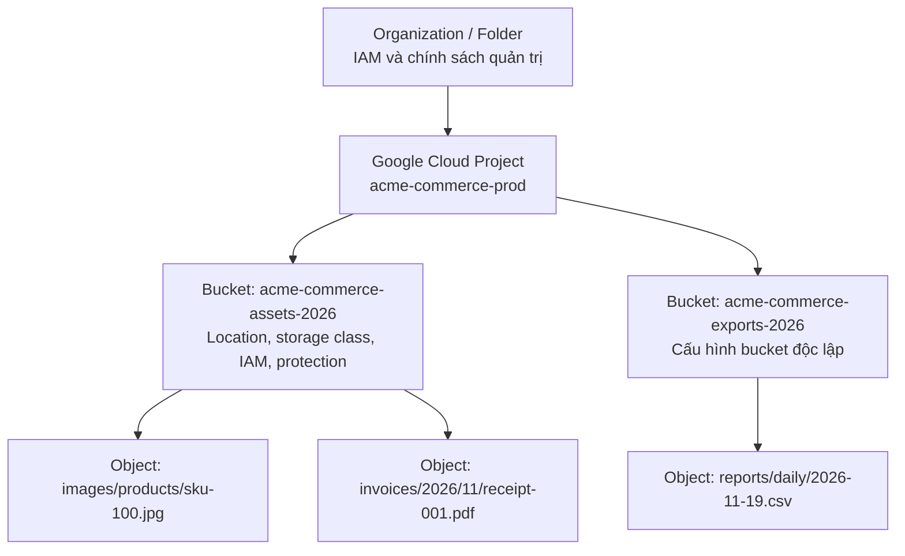
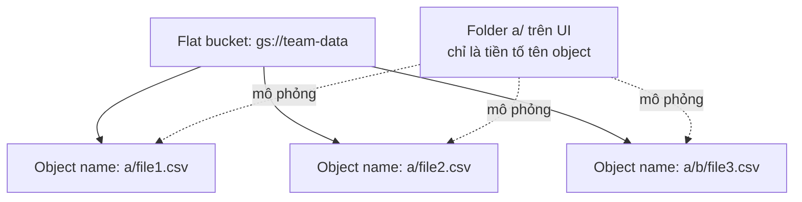
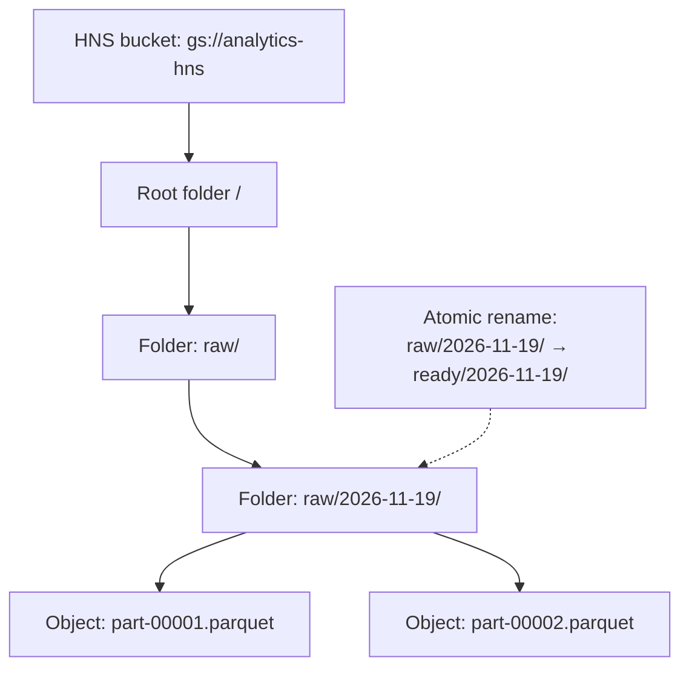
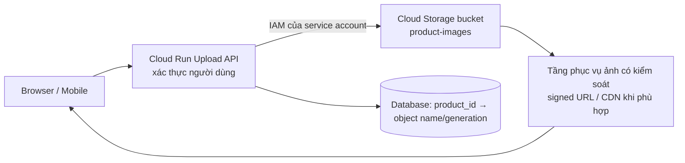

# Buckets, objects và namespace của Cloud Storage

## 1. Cloud Storage lưu dữ liệu theo mô hình nào?

Khi phát triển ứng dụng trên Google Cloud, chúng ta thường phải lưu những dữ liệu không phù hợp với ổ đĩa gắn vào một VM: ảnh người dùng tải lên, tệp báo cáo, log đã xuất, dữ liệu huấn luyện AI, bản sao lưu, dữ liệu thô của hệ thống phân tích hoặc các tệp được chia sẻ giữa nhiều dịch vụ. Một VM bị thay thế hay một container Cloud Run được tạo lại không nên làm mất những dữ liệu này.

**Cloud Storage** là dịch vụ **object storage** do Google Cloud quản lý. Thay vì coi dữ liệu là các khối của một ổ đĩa hoặc các hàng của cơ sở dữ liệu, Cloud Storage tổ chức dữ liệu thành:

- **Bucket:** vùng chứa dữ liệu, có tên và cấu hình quản trị riêng.
- **Object:** đơn vị dữ liệu được lưu trữ trong bucket, gồm nội dung và metadata.
- **Namespace:** cách object được đặt tên và tổ chức trong bucket; có hai chế độ quan trọng là **flat namespace** và **hierarchical namespace**.

Trong module **CLOUD_PROVIDERS_GCP**, Cloud Storage kết nối kiến thức về **Organization/Project, IAM, VPC, Compute Engine, GKE, Cloud Run, lưu trữ, bảo mật, phát hành tự động và kiểm soát chi phí**. Một thiết kế tốt không chỉ chọn nơi upload file mà còn quyết định tên, cấu trúc, quyền truy cập, khả năng khôi phục và cách ứng dụng đọc/ghi an toàn.

Sau bài học, bạn có thể:

1. Mô tả cấu trúc **Project → Bucket → Object** và phân biệt đường dẫn `gs://` với đường dẫn trên filesystem.
2. Giải thích quy tắc đặt tên bucket, object, **generation** và **metageneration**.
3. Phân biệt **simulated folder**, **managed folder** và **folder thật** của hierarchical namespace.
4. Chọn flat hoặc hierarchical namespace theo nhu cầu ứng dụng và những tính năng không tương thích.
5. Sử dụng một số lệnh `gcloud storage` để tạo bucket, upload, liệt kê và xem metadata.
6. Phân tích cách IAM, uniform bucket-level access, public access prevention, soft delete, location và storage class ảnh hưởng thiết kế.
7. Áp dụng các nguyên tắc đặt tên, kiểm soát ghi đè và quản trị chi phí vào tình huống Cloud Run, Compute Engine hoặc pipeline dữ liệu.

> **Giới hạn bài thực hành:** Mọi Project ID, tên bucket và object trong ví dụ đều giả định. Tên bucket phải duy nhất trên toàn cầu, nên bạn cần tự chọn tên chưa được sử dụng. Các lệnh tạo bucket/upload dữ liệu có thể phát sinh chi phí; không thực hiện trên tài khoản hoặc dữ liệu production nếu chưa được phép.

## 2. Cấu trúc tài nguyên: project, bucket và object



Ở đây:

- **Project** là phạm vi quản trị tài nguyên, IAM, API, quota và thường là nơi gắn billing/quy định tổ chức.
- **Bucket** được tạo trong một project nhưng có **tên duy nhất toàn cầu**, không chỉ duy nhất trong project. Nó có location, cấu hình kiểm soát truy cập và các thuộc tính bảo vệ dữ liệu.
- **Object** được định danh bằng **bucket name + object name** và, khi cần nhận diện chính xác một phiên bản nội dung, thêm **generation**.
- **Bucket không lồng trong bucket.** Không có mô hình `bucket-A/bucket-B` như thư mục trên ổ đĩa.

Đường dẫn `gs://acme-commerce-assets-2026/images/products/sku-100.jpg` là một **Cloud Storage URI**:

```text
gs://acme-commerce-assets-2026/images/products/sku-100.jpg
     └──────── bucket ────────┘ └──── object name ────┘
```

Trên một bucket dùng flat namespace, `images/products/` **chỉ là một phần của tên object**; Cloud Storage không bắt buộc phải có một resource thư mục ở giữa.

### So sánh với các dịch vụ lưu trữ khác

| Loại lưu trữ | Dữ liệu tổ chức theo | Khi nên đánh giá |
| --- | --- | --- |
| **Cloud Storage** | Bucket và object | Ảnh, file upload, backup, data lake, tệp phân tích |
| **Persistent Disk / Hyperdisk** | Block device gắn VM | Boot disk, hệ điều hành, dữ liệu đòi hỏi block I/O |
| **Filestore** | File system NFS | Ứng dụng cần ngữ nghĩa chia sẻ file/POSIX phù hợp |
| **Cloud SQL** | Database/schema/table/row | Dữ liệu quan hệ, transaction, truy vấn SQL |
| **BigQuery** | Dataset/table/partition | Phân tích dữ liệu quy mô lớn bằng SQL |

Cloud Storage **không phải** một filesystem POSIX đầy đủ: không mặc định hỗ trợ mở một object rồi append vài byte tại vị trí bất kỳ như file trên ổ đĩa. Nếu cần cập nhật một phần file nhỏ liên tục hoặc locking theo filesystem, hãy xem yêu cầu ứng dụng trước khi chọn object storage.

## 3. Bucket: vùng chứa và ranh giới cấu hình

### 3.1. Thuộc tính thường gặp

| Thuộc tính bucket | Câu hỏi cần trả lời khi thiết kế |
| --- | --- |
| **Name** | Tên có duy nhất toàn cầu, không lộ thông tin nhạy cảm và thuận tiện vận hành? |
| **Project** | Ai sở hữu tài nguyên? Billing, Organization Policy và quyền quản trị ở đâu? |
| **Location** | Dữ liệu lưu ở region, dual-region, multi-region hoặc lựa chọn location được hỗ trợ nào? |
| **Storage class** | Dữ liệu được truy cập thường xuyên hay lưu dài hạn? Có dùng Autoclass không? |
| **Namespace mode** | Flat hay hierarchical namespace? Có cần rename folder nguyên tử? |
| **IAM/UBLA/PAP** | Ai được đọc/ghi/xóa? Có cấm public access không? |
| **Encryption** | Dùng mã hóa mặc định hay CMEK/giải pháp khác theo yêu cầu? |
| **Soft delete/retention/lifecycle** | Khôi phục file xóa nhầm như thế nào và khi nào dọn dữ liệu? |
| **Logging/auditing** | Theo dõi quyền truy cập và những thay đổi quan trọng ra sao? |

**Những gì đặt ở cấp bucket sẽ ảnh hưởng toàn bộ hệ thống sử dụng bucket đó.** Ví dụ, thay đổi retention hoặc cấp quyền đọc rộng tại bucket có thể tác động tới nhiều ứng dụng dù mỗi ứng dụng sử dụng tiền tố object khác nhau.

### 3.2. Tên bucket duy nhất trên toàn cầu

Các bucket Cloud Storage dùng một **namespace chung** cho người sử dụng Cloud Storage. Hai project khác nhau, kể cả thuộc hai công ty không liên quan, **không thể cùng sở hữu hai bucket có cùng tên**.

Ví dụ:

```text
gs://commerce-prod-assets-2026
gs://acme-analytics-ingest-2026
gs://team-data-public-demo-2026
```

Tên trên chỉ để minh họa, có thể đã được sử dụng. Những lưu ý chính:

- Tên bucket phải phù hợp các quy tắc ký tự/độ dài của Google Cloud, chủ yếu dùng chữ thường, số, dấu `-`, `_` và dấu chấm trong các điều kiện được hỗ trợ.
- Không dùng chữ hoa, khoảng trắng, định dạng giống IPv4 address hoặc tiền tố/tên bị Google Cloud cấm.
- Với tên có dấu chấm giống domain, có thể cần **xác minh quyền sở hữu domain**.
- Tên bucket **có thể được nhìn thấy công khai**; không đặt mật khẩu, email cá nhân, mã hồ sơ, tên khách hàng nhạy cảm hoặc dữ liệu nội bộ bí mật trong tên.
- Sau khi xóa bucket, tên của bucket có thể được người khác sử dụng lại. Đừng giữ các đường dẫn/URL cũ trỏ tới một tên đã nhả nếu chưa đánh giá rủi ro.

**Bucket không giống tên thư mục của project.** Khi thấy lỗi “bucket name already exists”, thường phải chọn tên khác, không giải quyết bằng cách chỉ đổi Project ID hoặc region.

## 4. Object: nội dung và metadata

Một **object** có hai nhóm thông tin:

1. **Data**: nội dung tệp/byte của object (ảnh JPEG, CSV, JSON, Parquet, bản sao lưu...).
2. **Metadata**: những thuộc tính mô tả và điều khiển cách lưu hoặc phục vụ dữ liệu.

Ví dụ object `gs://acme-commerce-assets-2026/images/sku-100.jpg` có thể có:

| Thuộc tính | Giá trị minh họa | Ý nghĩa |
| --- | --- | --- |
| `name` | `images/sku-100.jpg` | Tên object trong bucket |
| `bucket` | `acme-commerce-assets-2026` | Bucket chứa object |
| `size` | `245760` | Kích thước byte |
| `contentType` | `image/jpeg` | MIME type dùng khi phục vụ nội dung |
| `storageClass` | `STANDARD` | Storage class của object |
| `generation` | `1760000000000000` | ID phiên bản nội dung, chỉ là số minh họa |
| `metageneration` | `1` | Phiên bản metadata của generation đó |
| `crc32c` | Checksum theo định dạng dịch vụ | Kiểm tra toàn vẹn dữ liệu khi truyền/lưu |
| `custom metadata` | Ví dụ `source=app-upload` | Các trường tùy biến, không lưu secrets |

### 4.1. Nội dung của một object là immutable

Cloud Storage lưu object theo mô hình **immutable content**: sau khi upload thành công, không sửa trực tiếp vài byte ở giữa nội dung hiện hữu.

Nếu ứng dụng upload một object mới với **cùng bucket + object name**, Cloud Storage thực hiện **thay thế nội dung theo cách nguyên tử**: trước khi ghi thành công, người đọc tiếp tục thấy object cũ; sau khi ghi thành công, người đọc thấy object mới. Object mới nhận **generation khác**.

**Metadata có thể được cập nhật** mà không cần thay byte nội dung; khi cập nhật thành công, `metageneration` của generation tương ứng tăng.

> **Không đồng nhất “object name” với một bản dữ liệu bất biến vĩnh viễn.** Tên `reports/latest.csv` có thể lần lượt trỏ tới những generation khác nhau khi hệ thống tạo báo cáo mới.

### 4.2. Generation và metageneration

| Khái niệm | Khi thay đổi | Dùng để làm gì? |
| --- | --- | --- |
| **Object generation** | Khi một phiên bản nội dung mới được tạo | Xác định chính xác phiên bản dữ liệu; kiểm soát overwrite |
| **Object metageneration** | Khi metadata của generation đó được cập nhật | Kiểm soát cập nhật metadata, tránh ghi đè thay đổi đồng thời |

Hai điểm cần nhớ:

- `generation` có tính **duy nhất trong phạm vi cùng object name**, nhưng **không nên xem như một đồng hồ hay số thứ tự toàn cục** của mọi object.
- `metageneration` phải xét **cùng với generation**. Metageneration `2` của object A không có ý nghĩa so sánh với metageneration `2` của object B.

Ví dụ:

```text
gs://bucket/reports/monthly.csv
    generation = 10001, metageneration = 1
       ↓ cập nhật Content-Type
    generation = 10001, metageneration = 2
       ↓ upload dữ liệu mới cùng tên
    generation = 10099, metageneration = 1
```

Các con số `10001` và `10099` chỉ để minh họa sự khác nhau về ID, không phải giá trị sẽ xuất hiện theo đúng khoảng cách đó trong thực tế.

## 5. Quy tắc đặt tên object

Tên object có phạm vi **bên trong một bucket** và **phân biệt chữ hoa/thường**. Ví dụ:

```text
images/logo.png
Images/logo.png
images/Logo.png
```

Đây có thể là **ba object name khác nhau** trong cùng một bucket. Đừng thiết kế ứng dụng phụ thuộc vào việc tên object được tự động đổi về chữ thường hoặc tự chuẩn hóa dấu cách/ký tự Unicode.

### Những quy tắc quan trọng

- Tên object có thể chứa nhiều ký tự Unicode hợp lệ, nhưng **không được chứa ký tự xuống dòng CR/LF** và có một số tiền tố bị hạn chế.
- Trong **flat namespace**, một object name có giới hạn **1.024 byte UTF-8**. Ký tự Unicode nhiều byte khiến số ký tự nhìn thấy có thể nhỏ hơn giới hạn byte.
- Trong **hierarchical namespace**, toàn bộ object name vẫn giới hạn **1.024 byte UTF-8**, đồng thời **folder path và base name có giới hạn riêng 512 byte** mỗi phần theo tài liệu.
- Dấu `/` trong tên được công cụ coi là ký tự phân tách thư mục. Trên flat namespace, `/` **không tự tạo folder resource thật**.
- Dấu `#`, `?`, `*`, khoảng trắng và ký tự escape có thể gây khác biệt trong shell, URI, wildcard hoặc HTTP. Hãy escape/quote đúng và **không nối chuỗi URL từ input chưa kiểm tra**.
- Tránh đường dẫn gây mơ hồ như `foo//bar.txt` hoặc `../foo` nếu code xử lý object name như local filesystem path.

### Đặt tên ổn định cho pipeline dữ liệu

Ví dụ một convention dễ truy vấn:

```text
raw/source=crm/date=2026-11-19/part-00001.jsonl
raw/source=crm/date=2026-11-19/part-00002.jsonl
processed/orders/date=2026-11-19/part-00001.parquet
reports/2026/11/summary.csv
```

Một công cụ có thể lọc những object name **bắt đầu bằng prefix** `raw/source=crm/date=2026-11-19/`, mà không cần query database để tìm từng object. Tránh đặt dữ liệu nhận dạng cá nhân trong object name vì tên có thể xuất hiện trong đường dẫn, logs, sự kiện và thông báo lỗi.

Với hệ thống có **tốc độ ghi rất cao**, hãy đọc hướng dẫn phân bổ request; chuỗi tên hoàn toàn tuần tự có thể tạo hot range. Không áp dụng một quy ước prefix duy nhất cho mọi workload mà chưa đo throughput.

## 6. Flat namespace: danh sách phẳng với tiền tố giống thư mục

Đa số người học ban đầu nhìn Cloud Storage trong Console sẽ thấy các “folder” như `images/`, `reports/`. Trong **flat namespace bucket**, đây là cách giao diện **mô phỏng thư mục**, còn object thực được lưu ở namespace phẳng.



Nếu object `a/file1.csv` được tạo trước, bạn **không cần tạo thư mục `a/`**. Các công cụ tách object name ở dấu `/` để hiển thị dạng cây.

### Hành vi khi “đổi tên thư mục” flat

Giả sử có 1 triệu object bắt đầu bằng `raw/2026/`. Trên flat namespace, đổi prefix thành `archive/2026/` thường yêu cầu **thao tác trên từng object** (copy/move và xóa bản cũ). Đây không phải một lệnh filesystem rename nguyên tử cho cả cây.

Hệ quả:

- Có thể tốn thời gian, sinh operation costs và chi phí truyền/lưu trữ phụ thuộc cách di chuyển.
- Có thể có khoảng thời gian hai prefix cùng chứa dữ liệu hoặc một phần dữ liệu đang được chuyển.
- Ứng dụng cần xử lý retry, quyền xóa và tính idempotent.
- Với pipeline lớn, **tránh phụ thuộc vào việc đổi tên cả “folder”** như một bước commit.

Flat namespace thường phù hợp khi ứng dụng chủ yếu **upload, đọc và liệt kê object**, không cần rename cả cây thư mục lớn.

## 7. Ba kiểu “folder” trong Cloud Storage

Cloud Storage có **ba mô hình folder** khác nhau. Phân biệt chúng giúp tránh nhầm lẫn khi quản lý quyền và viết code.

| Loại folder | Có phải tài nguyên thật? | Mục đích | Dùng với bucket nào? |
| --- | --- | --- | --- |
| **Simulated folder** | **Không**: chỉ là object name prefix | Trình bày cấu trúc giống thư mục, list theo prefix | **Flat namespace** |
| **Managed folder** | **Có**, là resource quản lý IAM | Gán IAM cho nhóm object có cùng prefix hoặc đường folder tương ứng | **Flat và hierarchical** |
| **Hierarchical folder** | **Có**, là folder resource của namespace có thứ bậc | Tổ chức object theo cây thật; hỗ trợ **atomic folder rename** | Chỉ **hierarchical namespace** |

### 7.1. Simulated folder

Với object `finance/2026/report.csv` trong flat bucket, Console có thể hiển thị “finance → 2026 → report.csv”. Nếu xóa object duy nhất, simulated folder có thể **biến mất khỏi giao diện** vì không còn object name có prefix đó.

Một số công cụ tạo object marker như `finance/` để giúp folder trống hiển thị. Object marker **vẫn là object**, không đồng nghĩa một thư mục thật có quyền IAM riêng.

### 7.2. Managed folder

**Managed folder** là resource chủ yếu để **kiểm soát IAM cho những object thuộc prefix**. Ví dụ, tạo managed folder `finance/` rồi cấp quyền đọc cho nhóm Finance trên resource này; IAM policy có thể áp dụng tới `finance/reports/2026.csv`.

Managed folder có thể tồn tại **kể cả khi không có object nào** khớp prefix. Trong flat namespace, nó không biến toàn bộ namespace thành filesystem có thư mục thật.

**Điểm bảo mật:** managed-folder IAM có thể cung cấp quyền trên phạm vi hẹp hơn bucket, nhưng **không thu hồi một allow grant rộng đã cấp ở bucket/project**. Nếu người dùng đã có `roles/storage.objectViewer` trên toàn bucket, việc cấp role hẹp hơn trong managed folder không làm họ chỉ nhìn được folder đó. Cần thiết kế quyền tối thiểu ngay từ cấp trên.

### 7.3. Hierarchical folder

Khi bucket bật **hierarchical namespace (HNS)**, Cloud Storage có **folder resources thật**. Object `finance/2026/report.csv` thuộc folder `finance/2026/`; các folder cha được quản lý như thành phần của cấu trúc cây.

HNS hỗ trợ các thao tác folder như **create, list, delete, rename/move** theo điều kiện hỗ trợ. Đổi tên một folder có thể là **một thao tác nguyên tử** đối với cây object trong folder đó, khác việc copy/delete nhiều object của flat namespace.

Một object có tên `finance/` vẫn có thể là **object riêng** bên trong folder `finance/`; dấu slash cuối không tự biến mọi object thành folder resource.

## 8. Hierarchical namespace (HNS): khi nào cần thư mục thật?

HNS được thiết kế cho các workload cần **ngữ nghĩa thư mục** và thao tác rename/move nhiều object hiệu quả, ví dụ một số pipeline Hadoop, Spark, AI/ML hoặc dữ liệu phân tích tổ chức thành nhiều thư mục.

### 8.1. Cơ chế thư mục và atomic rename



Trong một luồng xử lý batch, pipeline có thể ghi kết quả tạm vào folder `staging/job-123/` rồi đổi thành `ready/job-123/`. Với HNS, thao tác rename được thiết kế **nguyên tử** thay vì copy từng object.

Tuy nhiên, “rename nguyên tử” **không đồng nghĩa** mọi hệ thống nhận dữ liệu, database catalog, Pub/Sub event hoặc downstream cache tự cập nhật chính xác theo logic nghiệp vụ. Ứng dụng vẫn cần quy tắc publish, xử lý retry và theo dõi job.

### 8.2. Những ràng buộc HNS phải quyết định ngay từ đầu

Theo tài liệu Cloud Storage:

- **Chỉ chọn HNS khi tạo bucket**; không bật/tắt trực tiếp tùy chọn này trên một bucket đã tồn tại.
- HNS **yêu cầu uniform bucket-level access**.
- Folder tối đa **50 cấp**; những folder có managed folder đi kèm có giới hạn độ sâu hẹp hơn (**15 cấp**) theo tài liệu.
- Tên object và phần folder/base name có giới hạn byte như đã nêu.
- Một số tính năng **không tương thích với HNS** tại thời điểm tài liệu hiện hành: **Object Versioning**, Bucket Lock, object holds, Object Retention Lock, object-level ACLs, cross-bucket replication và một số phương án bucket relocation.
- Cần kiểm tra lại giới hạn với công cụ/dịch vụ tích hợp (gcloud, Hadoop connector, Storage Transfer Service, backup solution) trước khi chọn HNS.

**Hệ quả lớn:** Nếu yêu cầu ứng dụng bắt buộc **Object Versioning** để giữ nhiều phiên bản object sống trong cùng bucket, không nên tạo HNS bucket rồi giả định có thể bật Object Versioning sau. Cần chọn kiến trúc hoặc chiến lược khôi phục khác.

### 8.3. HNS và managed folder

Managed folder vẫn dùng được với HNS, nhưng có **quan hệ với folder resource tương ứng**. Khi đổi tên folder, managed folder có thể được rename theo; khi xóa folder, managed folder/IAM policy gắn tại đó có thể bị xóa theo quy tắc hệ thống.

Vì vậy, rename/delete folder HNS không chỉ là thao tác trên byte dữ liệu: nó có thể ảnh hưởng **phạm vi IAM**. Cần review quyền `storage.folders.*`, `storage.managedFolders.*` và kết quả truy cập sau thay đổi.

## 9. Chọn flat hay hierarchical namespace

| Yêu cầu ứng dụng | Flat namespace | Hierarchical namespace |
| --- | --- | --- |
| Lưu ảnh, file upload, log, bản sao lưu thông thường | **Phù hợp** | Có thể dùng nhưng thường không bắt buộc |
| Liệt kê object theo prefix | **Có** | **Có** |
| Phân quyền một tiền tố với managed folder | **Có** | **Có** |
| Tạo folder resource độc lập với object | Không theo mô hình simulated folder | **Có** |
| Rename nguyên tử cả cây folder | **Không** theo mô hình flat truyền thống | **Có** |
| Cần **Object Versioning** | **Hỗ trợ** | **Không hỗ trợ** theo giới hạn hiện hành |
| Muốn giữ object ACL riêng lẻ | Có khi không dùng uniform bucket-level access | **Không**, vì HNS yêu cầu UBLA |
| Muốn đổi namespace mode sau khi tạo | Không thể chuyển trực tiếp | Không thể chuyển trực tiếp |
| Pipeline phân tích tệp lớn, thường đổi tên folder | Có thể tốn nhiều tác vụ copy/delete | Thường là lựa chọn đáng đánh giá |

**Cách quyết định:** bắt đầu từ **hành vi ứng dụng**. Nếu ứng dụng chỉ dùng API upload/read/list và các folder chỉ nhằm dễ nhìn, flat namespace thường đủ. Nếu ứng dụng có nhiều thao tác thư mục thực sự và cần atomic rename để công bố dữ liệu, HNS đáng đánh giá — nhưng phải kiểm tra các tính năng không tương thích ngay khi thiết kế bucket.

Nếu đã có bucket flat cần chuyển sang HNS, hướng tiếp cận là **tạo bucket HNS mới và di chuyển dữ liệu** theo kế hoạch, không phải bật một flag trên bucket hiện hữu. Việc di chuyển cần xem xét IAM, metadata, generation, soft delete, client URLs, downtime và phí.

## 10. IAM: ai được xem, tạo và xóa object?

Cloud Storage dùng **IAM** để phân quyền trên bucket, object hoặc managed folder theo các mô hình được hỗ trợ.

| Role thường dùng | Khả năng chính | Phù hợp |
| --- | --- | --- |
| `roles/storage.objectViewer` | Xem nội dung và metadata object; các quyền liệt kê tương ứng | Ứng dụng/chuyên viên chỉ cần đọc |
| `roles/storage.objectCreator` | Tạo object mới; không nên coi là có quyền quản lý/xóa mọi object | Pipeline chỉ gửi dữ liệu đầu vào |
| `roles/storage.objectUser` | Thao tác với object rộng hơn, theo role hiện hành | Worker đọc/ghi/cập nhật dữ liệu theo nhu cầu |
| `roles/storage.admin` | Quản trị bucket và object rộng | Nhóm quản trị lưu trữ, **không** cấp mặc định cho mọi app |

Các role có thể được gắn ở project, bucket hoặc managed folder theo khả năng hỗ trợ. **Principal thực tế** của Cloud Run, GKE hay Compute Engine thường là **service account của workload**, không nhất thiết là nhân viên deploy.

### 10.1. Uniform bucket-level access (UBLA)

**UBLA** tắt việc sử dụng **ACL ở từng object** để kiểm soát truy cập theo **IAM**. Khi UBLA bật, tổ chức có mô hình phân quyền dễ quản trị và audit hơn. HNS **yêu cầu UBLA**, trong khi flat namespace có thể dùng UBLA hoặc cơ chế khác nếu vẫn được hỗ trợ.

Không nhầm “UBLA” với “mọi người trong bucket có quyền như nhau”. IAM vẫn phân quyền được ở cấp bucket hoặc managed folder, theo các role và điều kiện được hỗ trợ.

### 10.2. Public Access Prevention (PAP)

**Public Access Prevention** giúp ngăn việc công khai dữ liệu bằng các principal công khai như `allUsers` hoặc `allAuthenticatedUsers` theo những chính sách áp dụng. Đối với bucket nội bộ chứa file khách hàng, nên đánh giá bật PAP.

**Một URL `gs://...` không làm object tự động công khai.** Quyền đọc vẫn được kiểm soát bằng IAM. Nếu ứng dụng cần phát tệp ra internet, hãy chọn phương án có thiết kế riêng: signed URL với thời hạn ngắn, service backend được xác thực, CDN/load balancer phù hợp hoặc công khai có kiểm soát nếu thật sự cần.

### 10.3. Managed folder không phải “deny folder”

Giả sử nhóm Finance có quyền viewer tại managed folder `finance/`. Nhóm Marketing không được cấp quyền tại đây, nhưng lại được cấp `objectViewer` trên **toàn bucket** qua project IAM. Khi đó Marketing có thể vẫn đọc các object Finance nhờ grant rộng.

Muốn cách ly nhóm, phải xem **mọi IAM binding hiệu lực từ tổ tiên** và cân nhắc tách bucket nếu yêu cầu bảo mật hoặc quản trị khác nhau quá lớn.

### 10.4. Kết hợp ranh giới ứng dụng

Đối với một ứng dụng Cloud Run tải ảnh:

```text
Người dùng ─HTTPS─> Cloud Run
                      │  service account có quyền ghi tối thiểu
                      └─API─> gs://acme-uploads-prod/images/...
```

Cloud Run cần xác minh người dùng và kiểm tra quyền nghiệp vụ **trước khi upload**. Service account của Cloud Run chỉ có các permission Cloud Storage cần thiết. Không đưa service account JSON key vào code hoặc cấp `roles/storage.admin` chỉ để upload một ảnh.

## 11. Bảo vệ dữ liệu: soft delete, versioning, retention

Vì object có thể bị ghi đè hoặc xóa bởi principal được cấp quyền, cần một kế hoạch khôi phục độc lập với việc đặt tên đẹp.

### 11.1. Soft delete

**Soft delete** giữ lại object hoặc bucket vừa bị xóa/ghi đè trong một **khoảng thời gian khôi phục**. Theo cấu hình mặc định hiện hành, đa số bucket hỗ trợ soft delete được bật mặc định với **7 ngày**; có thể cấu hình thời gian khác hoặc tắt theo điều kiện cho phép.

Điểm cần biết:

- Object ở trạng thái soft-deleted **không được đọc/sửa như live object**, nhưng có thể được liệt kê/khôi phục theo API/quyền được hỗ trợ.
- Soft delete **khác với backup**: cùng bucket và chính sách bảo vệ có thể không đáp ứng RPO/RTO hoặc yêu cầu chống lỗi đa vùng.
- Dữ liệu soft-deleted **vẫn có thể phát sinh chi phí lưu trữ** trong thời gian giữ.
- Nếu khôi phục bucket bằng CLI/API, có thể phải **khôi phục object riêng** sau khi khôi phục bucket rỗng; không mặc định một lệnh trả lại mọi file.

### 11.2. Object Versioning

Trong **flat namespace bucket** hỗ trợ Object Versioning, khi upload lại cùng object name hoặc xóa live version theo cơ chế phiên bản, Cloud Storage có thể giữ **noncurrent generations** để bạn truy cập/khôi phục.

Ví dụ:

```text
reports/latest.csv
  generation 100 (noncurrent)
  generation 105 (noncurrent)
  generation 109 (live)
```

**Phân biệt:**

- **Object Versioning** giữ nhiều generation để ứng dụng có thể quản lý lịch sử phiên bản.
- **Soft delete** giữ object/bucket ở trạng thái đã xóa trong thời hạn được cấu hình để khôi phục.
- **HNS** không hỗ trợ Object Versioning theo danh sách giới hạn hiện hành; không thiết kế ứng dụng HNS dựa trên việc bật versioning sau này.

### 11.3. Lifecycle và retention

**Object Lifecycle Management** có thể chuyển storage class hoặc xóa dữ liệu theo age, ngày và các điều kiện được hỗ trợ. **Retention policy/object retention** bảo vệ dữ liệu khỏi xóa trước hạn theo cơ chế tương ứng; chế độ lock có thể làm hạn chế việc thay đổi chính sách.

Đừng đồng nhất các cơ chế:

| Nhu cầu | Công cụ nên đánh giá |
| --- | --- |
| Khôi phục file vừa xóa nhầm | Soft delete |
| Giữ các phiên bản nội dung theo generation | Object Versioning trên bucket hỗ trợ |
| Tự dọn file tạm sau thời hạn | Lifecycle rules |
| Không được xóa dữ liệu trước thời gian tuân thủ | Retention policy/lock theo khả năng hỗ trợ |
| Phục hồi sau lỗi ứng dụng lớn hoặc sự cố vùng | Backup/replication/DR thiết kế riêng |

**Thử nghiệm restore** quan trọng hơn chỉ nhìn một ô cấu hình “đã bật” trong Console.

## 12. Location, storage class và chi phí

### 12.1. Chọn location

Bucket có **location** xác định nơi lưu dữ liệu. Các loại phổ biến gồm:

| Location | Khái niệm | Khi nên đánh giá |
| --- | --- | --- |
| **Region** | Dữ liệu trong một region | Ứng dụng VM/GKE/Cloud Run tập trung gần dữ liệu, residency cụ thể |
| **Dual-region** | Hai region được cấu hình/hỗ trợ | Cần khả năng chịu lỗi region và RPO/replication phù hợp |
| **Multi-region** | Một khu vực địa lý lớn | Nội dung dùng rộng trong khu vực, yêu cầu độ sẵn sàng/chi phí phù hợp |
| **Zone** | Dành cho tính năng/bucket đặc biệt được hỗ trợ, như Rapid Bucket | Workload cần locality trong một zone, phải xem giới hạn riêng |

Ví dụ `asia-southeast1` là một region Google Cloud; chọn region này chỉ có ý nghĩa khi đáp ứng yêu cầu residency, latency và dịch vụ liên quan. **Không mặc định mọi dual-region/multi-region rẻ hơn hoặc luôn có cùng độ trễ**.

### 12.2. Storage class không phải folder

Các lớp lưu trữ thông dụng:

| Storage class | Mẫu truy cập | Lưu ý chi phí |
| --- | --- | --- |
| **Standard** | Đọc thường xuyên, dữ liệu hoạt động | Phù hợp nhiều workload mặc định |
| **Nearline** | Truy cập ít | Có phí truy xuất và thời gian lưu tối thiểu theo bảng giá |
| **Coldline** | Truy cập rất ít | Phí truy xuất/thời gian lưu tối thiểu lớn hơn loại phổ thông |
| **Archive** | Lưu dài hạn, hiếm khi đọc | Cần đánh giá phí truy xuất và thời gian lưu tối thiểu |
| **Rapid** | Lưu trữ cho tính năng Rapid Bucket được hỗ trợ | Chỉ khả dụng với cấu hình location/bucket tương ứng |

**Storage class thuộc object**, bucket có thể đặt default class; việc để object dưới `archive/` trong tên **không tự chuyển** storage class thành Archive. Có thể dùng lifecycle hoặc Autoclass để quản lý chuyển lớp theo cơ chế hỗ trợ.

### 12.3. Các nhóm chi phí

```text
Tổng chi phí Cloud Storage thường gồm:
  dung lượng lưu trữ theo GB/GiB-tháng và class/location
  + operations (Class A/B hoặc loại tương ứng)
  + retrieval/early deletion nếu class yêu cầu
  + network egress/transfer theo đường đi
  + phiên bản/soft-deleted objects vẫn còn giữ
  + các tính năng hoặc dịch vụ liên quan nếu có phí
```

Ví dụ: một bucket giữ 1 TiB file tạm và soft delete 7 ngày. Nếu pipeline liên tục ghi đè/xóa nhiều tệp lớn, **soft-deleted dữ liệu cũng có thể phát sinh phí**, dù ứng dụng không còn nhìn thấy chúng ở danh sách live objects. Đây là lý do cần dự toán theo **đường đời object**, không chỉ cộng kích thước các object đang hiển thị.

Đơn giá thay đổi theo location, storage class, consumption/discount và thời điểm; không tự lấy một mức USD/GB cố định cho mọi bucket. Tra [Cloud Storage pricing](https://cloud.google.com/storage/pricing) và Cloud Billing SKU thực tế.

## 13. Thực hành CLI: bucket flat và object

### 13.1. Chuẩn bị môi trường

Giả sử:

```text
Project ID: acme-storage-lab
Region: asia-southeast1
Bucket flat giả định: acme-storage-lab-unique-2026
Local file: ./sample-report.csv
Object name: reports/2026-11-19/sample-report.csv
```

Đã cài và đăng nhập `gcloud`, Compute Engine/Cloud Run không cần tạo chỉ để làm bài này. Principal phải có quyền Cloud Storage phù hợp và project có billing được thiết lập theo quy định.

Lệnh **chỉ đọc**:

```bash
gcloud auth list
gcloud config get-value project
gcloud storage ls --project=acme-storage-lab
```

### 13.2. Tạo flat bucket

```bash
# THAY ĐỔI TÀI NGUYÊN, có thể phát sinh phí khi lưu dữ liệu
# Tên bucket phải chưa được ai dùng trên toàn Cloud Storage
gcloud storage buckets create gs://acme-storage-lab-unique-2026 \
  --project=acme-storage-lab \
  --location=asia-southeast1 \
  --default-storage-class=STANDARD \
  --uniform-bucket-level-access \
  --public-access-prevention
```

Lệnh đặt **uniform bucket-level access** và **public access prevention** để khởi tạo một bucket lab nội bộ theo mặc định bảo mật hơn; việc cấp quyền ứng dụng sẽ thực hiện sau. Khi cần công bố tệp ra internet phải có một thiết kế kiểm soát riêng.

Kiểm tra bucket:

```bash
gcloud storage buckets describe gs://acme-storage-lab-unique-2026 \
  --format="yaml(name,location,storageClass,iamConfiguration,softDeletePolicy)"
```

Đọc output thực tế và xác nhận location, storage class, UBLA, PAP và soft delete. Tên trường hiển thị có thể khác giữa output dạng CLI chuẩn hóa và JSON API.

### 13.3. Upload, list, đọc metadata và download

```bash
# Upload một file: tạo object có tên chứa nhiều dấu slash
gcloud storage cp ./sample-report.csv \
  gs://acme-storage-lab-unique-2026/reports/2026-11-19/sample-report.csv

# Chỉ đọc: liệt kê object dưới prefix
gcloud storage ls \
  gs://acme-storage-lab-unique-2026/reports/2026-11-19/

# Chỉ đọc: xem metadata của object
gcloud storage objects describe \
  gs://acme-storage-lab-unique-2026/reports/2026-11-19/sample-report.csv

# Download về file mới để kiểm tra nội dung
gcloud storage cp \
  gs://acme-storage-lab-unique-2026/reports/2026-11-19/sample-report.csv \
  ./downloaded-report.csv
```

Sau upload, để ý **object name**, `generation`, `metageneration`, `size`, `contentType` và `storageClass`. Tệp tải xuống có giống bản gốc không? Nếu upload lại một tệp khác **cùng đường dẫn**, generation mới có gì thay đổi?

> **Không upload lại vào một object production chỉ để kiểm chứng generation.** Khi tên đã tồn tại, một lệnh upload có thể thay thế bản live hiện tại; các cơ chế phiên bản, precondition và soft delete quyết định khả năng khôi phục.

### 13.4. Xem trạng thái soft delete

```bash
# Chỉ đọc: policy soft delete trên bucket
gcloud storage buckets describe gs://acme-storage-lab-unique-2026 \
  --format="default(soft_delete_policy)"
```

Không xóa dữ liệu trong bài học. Muốn kiểm thử restore, nên làm với **object thử nghiệm** và quy trình xác định đầy đủ quyền `storage.objects.restore`.

## 14. Thực hành CLI: hierarchical folders và managed folders

### 14.1. Tạo HNS bucket mới

Do HNS chỉ được chọn khi tạo bucket, hãy dùng **bucket khác**:

```bash
# THAY ĐỔI TÀI NGUYÊN: không chạy trên production
gcloud storage buckets create gs://acme-hns-lab-unique-2026 \
  --project=acme-storage-lab \
  --location=asia-southeast1 \
  --uniform-bucket-level-access \
  --enable-hierarchical-namespace
```

Tham số `--enable-hierarchical-namespace` phải đi cùng `--uniform-bucket-level-access` theo quy định của CLI. Không thể bật HNS trên bucket flat đã được tạo.

### 14.2. Tạo folder thật

```bash
# Tạo folder resource trong HNS bucket
gcloud storage folders create \
  gs://acme-hns-lab-unique-2026/datasets/

# Tạo các cấp folder còn thiếu trong một đường dẫn
gcloud storage folders create --recursive \
  gs://acme-hns-lab-unique-2026/datasets/2026/11/
```

Khi upload object `datasets/2026/11/part-001.parquet` vào HNS bucket, các folder chưa có trên đường dẫn cũng có thể được tạo theo hành vi hỗ trợ của dịch vụ. Điều này khác flat namespace: ở HNS, folder **có thực** và có lifecycle/metadata riêng.

### 14.3. Tạo managed folder để quản lý IAM

Managed folder có thể dùng **trong flat bucket lẫn HNS bucket**:

```bash
# TẠO resource phục vụ quản lý IAM trên prefix finance/
gcloud storage managed-folders create \
  gs://acme-storage-lab-unique-2026/finance/

# Chỉ đọc: kiểm tra managed folder
gcloud storage managed-folders describe \
  gs://acme-storage-lab-unique-2026/finance/
```

Sau khi tạo managed folder, người quản trị có thể cấp một IAM policy cho folder đó theo công cụ/permission được hỗ trợ. **Tạo managed folder không tự cấp quyền cho ai**, và cũng không biến simulated folder thành hierarchical folder.

**Một sự khác biệt khi xóa:** managed folder có IAM policy và dữ liệu bên dưới không nên bị xóa bừa bãi. Với HNS, các hoạt động rename/delete folder có thể tác động managed folder gắn cùng đường dẫn; phải review quyền trước.

## 15. Strong consistency, cache và xử lý ghi đồng thời

### 15.1. Strong consistency

Cloud Storage bảo đảm **strong global consistency** cho các thao tác quan trọng như:

- Đọc object sau khi upload hoặc thay thế thành công.
- Đọc metadata object sau cập nhật thành công.
- Liệt kê object và bucket theo tính nhất quán được công bố.
- Đọc sau khi xóa thành công theo mô hình trạng thái tương ứng.

Ví dụ, khi một lệnh upload trả về thành công, một client được cấp quyền có thể **đọc object mới** mà không phải chờ một khoảng trễ đồng bộ tùy ý. Không cần thêm `sleep 30` như một cơ chế đảm bảo consistency cho object write bình thường.

**Ngoại lệ thiết kế cần nhớ:** nếu object được phục vụ qua **CDN, browser cache hoặc cache trung gian**, nội dung đã cache có thể tiếp tục hiển thị theo TTL/cache headers. Đây là hành vi caching, không có nghĩa Cloud Storage không nhất quán. Thay đổi IAM/policy cũng có thời gian lan truyền riêng.

### 15.2. Ghi đè và điều kiện tiên quyết (preconditions)

Giả sử hai worker A và B cùng tạo object `reports/latest.csv`. Nếu cả hai đều upload trực tiếp mà không kiểm tra, có thể xảy ra **lost update**: generation mới nhất ghi đè kết quả của worker khác.

Cloud Storage hỗ trợ **request preconditions**, ví dụ:

| Precondition | Ý nghĩa |
| --- | --- |
| `ifGenerationMatch=0` | Chỉ tạo object nếu chưa có live version cùng tên |
| `ifGenerationMatch=N` | Chỉ thực hiện khi generation hiện tại khớp N |
| `ifMetagenerationMatch=M` | Chỉ cập nhật metadata khi metageneration khớp M |

Ví dụ chuỗi xử lý an toàn:

```text
1. Worker A đọc metadata: generation = 100
2. Worker B đọc metadata: generation = 100
3. Worker A upload với ifGenerationMatch=100 → thành công, generation mới
4. Worker B upload với ifGenerationMatch=100 → thất bại vì điều kiện không còn khớp
5. Worker B quyết định đọc lại, gộp dữ liệu hoặc phát hiện conflict
```

Đây là **mô tả logic API**, không phải các giá trị cố định sẽ có trên Google Cloud. Khi viết code, dùng client library hoặc REST API có hỗ trợ **generation/metageneration preconditions**, và xử lý lỗi precondition (ví dụ HTTP `412 Precondition Failed`) phù hợp.

### 15.3. Thiết kế tên object tránh race

Với output của pipeline, tốt hơn nên tạo tên **bất biến theo job/run**, ví dụ `jobs/run-20261119-001/output.parquet`, sau đó cập nhật một manifest nhỏ hoặc thông tin trong database để trỏ đến generation đã hoàn tất. Cách này:

- Tránh hai job ghi đè một tệp `latest.parquet` mà không biết nhau.
- Cho phép retry có kiểm soát.
- Hỗ trợ audit và xác định object version dùng trong báo cáo.
- Giảm nguy cơ downstream đọc object chưa thuộc một lần xuất bản hoàn chỉnh.

## 16. Tình huống thiết kế 1: ứng dụng ảnh sản phẩm

Một dịch vụ Cloud Run nhận ảnh sản phẩm, lưu ở Cloud Storage và trả URL cho frontend. Dữ liệu cần phục vụ nhiều người dùng, nhưng chỉ người sở hữu sản phẩm mới được cập nhật ảnh.

### Kiến trúc khuyến nghị để đánh giá



Thiết kế:

1. Chọn bucket có location đáp ứng latency/residency và class phù hợp với ảnh được đọc thường xuyên.
2. Chọn **flat namespace** nếu chủ yếu lưu, đọc và liệt kê ảnh, không cần đổi tên cây thư mục nguyên tử.
3. Không lấy email hoặc tên người dùng nhạy cảm làm object prefix; dùng mã product và ID ngẫu nhiên/không đoán được nếu cần.
4. Cloud Run service account chỉ có quyền Cloud Storage cần thiết; API tự kiểm tra ai được update product.
5. Khi thay ảnh, quản lý **generation** hoặc sử dụng URL có version riêng để tránh cache cũ.
6. Bật các biện pháp phù hợp như UBLA, PAP, soft delete và lifecycle cho ảnh cũ.
7. Theo dõi dung lượng, request counts, egress, cache hit rate và hóa đơn.

**Không nên:** cấp quyền public read cho toàn bucket chỉ vì một phần ảnh cần hiển thị công khai; hãy đánh giá signed URL hoặc tầng phân phối có kiểm soát.

## 17. Tình huống thiết kế 2: data lake và batch processing

Một nhóm phân tích chạy pipeline trên GKE/Compute Engine. Mỗi ngày có hàng triệu object dạng Parquet; một job phải tạo toàn bộ bộ dữ liệu cho ngày rồi mới công bố cho người đọc.

### Khi flat namespace đủ dùng

Pipeline ghi object bất biến:

```text
gs://analytics-flat/events/date=2026-11-19/part-00001.parquet
gs://analytics-flat/events/date=2026-11-19/part-00002.parquet
gs://analytics-flat/manifests/date=2026-11-19.json
```

Sau khi mọi part hoàn tất, tạo manifest chứa danh sách object và generation. Người đọc chỉ dùng những object có trong manifest hợp lệ. Cách này không đòi hỏi **rename thư mục** và có thể hoạt động tốt trên flat namespace.

### Khi HNS đáng đánh giá

Một hệ thống xử lý dữ liệu kế thừa kỳ vọng kiểu filesystem:

```text
staging/job-934/
    part-00001.parquet
    part-00002.parquet
        ↓ atomic folder rename
ready/job-934/
    part-00001.parquet
    part-00002.parquet
```

HNS có thể cung cấp atomic folder rename phù hợp. Tuy nhiên phải cân nhắc:

- Những tính năng bị giới hạn ở HNS (đặc biệt **Object Versioning**) có cần cho quy trình không?
- IAM managed folders có thay đổi khi rename không?
- Công cụ Hadoop/Spark và data catalog có hỗ trợ mô hình namespace đã chọn không?
- Ranh giới file output của từng job, idempotency và cách xử lý job bị retry?
- Phí storage, operations, soft delete, egress và lượng dữ liệu tăng trưởng?

**Không có một lựa chọn bắt buộc cho mọi data lake.** HNS giải quyết các nhu cầu thao tác folder, nhưng manifest/transaction layer của ứng dụng vẫn có thể cần thiết.

## 18. Những lỗi thường gặp và cách chẩn đoán

| Triệu chứng | Nguyên nhân thường gặp | Cách xác minh |
| --- | --- | --- |
| Tạo bucket thất bại dù project trống | Bucket name đã được sử dụng ở nơi khác | Chọn tên toàn cầu khác; kiểm tra quy tắc tên |
| `403 Forbidden` khi upload | Service account thiếu `storage.objects.create` hoặc quyền liên quan | Đọc principal thực tế, IAM project/bucket/managed folder |
| Không liệt kê được object nhưng có thể đọc object cụ thể | Principal thiếu quyền `storage.objects.list` | Phân biệt quyền `get` và `list` |
| Vừa upload nhưng Console không thấy folder | Flat prefix chưa có object, lọc UI hoặc đường dẫn nhầm | Liệt kê object name trực tiếp; hiểu simulated folders |
| Folder hiện mất sau khi xóa file cuối | Đó là simulated folder | Không nhầm với managed folder hoặc folder HNS |
| Không bật HNS trên bucket cũ | Namespace mode được chọn khi tạo | Tạo HNS bucket mới và lập kế hoạch migration |
| Không bật được Object Versioning ở HNS bucket | HNS không hỗ trợ Object Versioning theo giới hạn hiện hành | Chọn bucket flat hoặc chiến lược backup/restore phù hợp |
| Rename “thư mục” rất chậm | Flat rename thực hiện nhiều object operations | Xem HNS hoặc workflow manifest không cần rename |
| Người dùng vẫn đọc được data ngoài managed folder | Có allow IAM rộng ở bucket/project | Kiểm tra tất cả IAM bindings hiệu lực |
| File đã xóa vẫn bị tính phí | Soft delete/noncurrent versions/lifecycle/retention | Đọc policy, billing SKU và trạng thái object |
| Đọc URL cũ thấy nội dung cũ | CDN/browser/proxy cache | Kiểm tra Cache-Control, URL version, TTL |
| File `report.csv` bị ghi đè bởi job khác | Không dùng generation precondition hoặc tên theo run | Dùng ifGenerationMatch, manifest và retry an toàn |
| Object name chứa dấu `/` hoạt động khác filesystem | Flat namespace không có hierarchy thật | Kiểm tra raw object name và URL encoding |
| API tải file qua Cloud Run bị lỗi dù CLI admin hoạt động | Cloud Run chạy bằng service account khác | Kiểm tra runtime identity và IAM scope của service |

### Quy trình điều tra ngắn

1. Xác định **project, bucket name, object name, generation** (nếu có).
2. Đọc bucket location, namespace mode, UBLA, PAP và soft delete.
3. Xác định **principal thật** thực hiện lệnh/API (người dùng, VM, Cloud Run hay GKE).
4. Kiểm tra role IAM tại project/bucket/managed folder và các điều kiện liên quan.
5. Phân biệt lỗi **object không tồn tại**, lỗi **không có quyền**, lỗi **cache**, lỗi **đang bị soft-deleted** và lỗi **precondition**.
6. Kiểm tra Cloud Audit Logs, Cloud Monitoring, request/response codes và billing nếu sự cố kéo dài.
7. Chỉ thay đổi quyền hoặc cấu hình nhỏ nhất cần thiết; không tự làm public bucket để thử chữa `403`.

## 19. Bài tập tự đánh giá

### Bài 1: Phân loại đường dẫn

Cho URI:

```text
gs://acme-exports-prod/reports/2026/11/order-summary.csv
```

Hãy xác định bucket name, object name. Trong flat namespace, có bắt buộc tồn tại ba folder thật `reports/`, `2026/`, `11/` không?

**Đáp án:** Bucket là `acme-exports-prod`; object name là `reports/2026/11/order-summary.csv`. Không cần folder resource trong flat namespace.

### Bài 2: Đặt tên và phiên bản

Một ứng dụng upload lại `images/logo.png` ba lần, mỗi lần nội dung khác nhau. Giải thích vì sao cùng object name nhưng có thể có ba generation khác nhau; phân biệt update metadata với upload nội dung mới.

**Gợi ý:** Upload lại tạo content generation mới; update metadata trên một generation làm tăng metageneration. Object Versioning hoặc soft delete quyết định khả năng truy cập/khôi phục generation trước.

### Bài 3: Chọn namespace mode

Một pipeline Spark liên tục đổi tên folder chứa hàng trăm nghìn object như một bước publish. Nhóm cũng muốn bật Object Versioning. Hãy giải thích **xung đột** và đề xuất hai phương án thiết kế.

**Gợi ý:** HNS có atomic folder rename nhưng không hỗ trợ Object Versioning theo hạn chế hiện hành. Có thể chọn HNS và xây backup/version ở lớp ứng dụng; hoặc chọn flat + manifest/commit protocol để không cần rename cả folder, giữ khả năng versioning.

### Bài 4: Phân quyền managed folder

Một nhóm chỉ có viewer trên managed folder `finance/`. Tuy nhiên, nhóm khác có `roles/storage.objectViewer` trên toàn bucket. Có thể kết luận nhóm khác không đọc được `finance/payroll.csv` không?

**Đáp án:** Không. Phải xét toàn bộ allow grants; managed folder không tự từ chối quyền rộng từ bucket/project.

### Bài 5: Ghi đồng thời

Hai worker cùng đọc object generation `500` rồi cùng muốn thay nội dung. Nếu cả hai dùng `ifGenerationMatch=500`, điều gì xảy ra với worker đến sau? Vì sao đây là cách tránh lost update?

**Gợi ý:** Sau khi worker đầu thay thành công và generation đổi, lần ghi dùng generation cũ bị từ chối bởi precondition. Worker sau cần đọc lại và quyết định retry hoặc xử lý xung đột.

### Bài 6: Dự toán lưu trữ

Một bucket chứa 1.000 object live, mỗi object 10 MiB. Hệ thống ghi đè toàn bộ hàng ngày và dùng soft delete 7 ngày. Tại sao hóa đơn storage có thể lớn hơn số byte của 1.000 object đang hiển thị?

**Gợi ý:** Có thể tồn tại nhiều object versions đã ghi đè ở trạng thái soft-deleted và vẫn bị tính phí; còn operations, network và retrieval tùy storage class. Không thể kết luận bill chỉ dựa trên danh sách live objects.

## 20. Checklist thiết kế Cloud Storage

- [ ] Bucket name **duy nhất toàn cầu**, không chứa dữ liệu nhạy cảm hoặc thông tin dễ gây rủi ro.
- [ ] Project/billing owner và Organization Policy đã được xác định.
- [ ] Location đáp ứng residency, độ trễ, yêu cầu đa vùng và chi phí.
- [ ] Storage class/Autoclass phù hợp tần suất truy cập và thời gian giữ dữ liệu.
- [ ] Đã chọn **flat hay HNS trước khi tạo**; hiểu các giới hạn HNS, đặc biệt Object Versioning.
- [ ] Có convention object name rõ ràng, tránh PII, tránh mơ hồ về Unicode/slash.
- [ ] Ứng dụng phân biệt **object name, generation, metageneration**.
- [ ] Các thao tác cập nhật/ghi đè quan trọng có preconditions hoặc thiết kế tránh race.
- [ ] IAM được cấp đúng runtime service account và phạm vi bucket/managed folder.
- [ ] UBLA và public access prevention đã được đánh giá; không có allow grant rộng trái ý định.
- [ ] Có kế hoạch soft delete, versioning/retention/lifecycle và kiểm thử restore.
- [ ] Không coi simulated folder là resource IAM thật; không nhầm managed folder với HNS folder.
- [ ] Nếu HNS rename/delete folder, đã rà soát ảnh hưởng đến managed folder và IAM.
- [ ] Có logs/metrics, đường xử lý lỗi 403/404/412, retry và idempotency.
- [ ] Đã dự toán storage, operations, retrieval, early deletion, soft-deleted/noncurrent data và egress.
- [ ] Đã có phương án migration khi phải thay bucket name, namespace mode hoặc location.

## 21. Tài liệu Google Cloud chính thức

Các liên kết sau dùng để kiểm tra chi tiết và giới hạn hiện hành:

1. [Cloud Storage overview](https://cloud.google.com/storage/docs/introduction)
2. [About Cloud Storage buckets](https://cloud.google.com/storage/docs/buckets)
3. [About Cloud Storage objects](https://cloud.google.com/storage/docs/objects)
4. [Folder types in Cloud Storage](https://cloud.google.com/storage/docs/folder-types)
5. [Hierarchical namespace overview and limitations](https://cloud.google.com/storage/docs/hns-overview)
6. [Folders in hierarchical namespace buckets](https://cloud.google.com/storage/docs/folders-overview)
7. [Create buckets with hierarchical namespace](https://cloud.google.com/storage/docs/create-hns-bucket)
8. [Managed folders](https://cloud.google.com/storage/docs/managed-folders)
9. [Cloud Storage object metadata](https://cloud.google.com/storage/docs/metadata)
10. [Cloud Storage consistency](https://cloud.google.com/storage/docs/consistency)
11. [Object Versioning](https://cloud.google.com/storage/docs/object-versioning)
12. [Soft delete overview](https://cloud.google.com/storage/docs/soft-delete)
13. [Bucket locations](https://cloud.google.com/storage/docs/locations)
14. [Storage classes](https://cloud.google.com/storage/docs/storage-classes)
15. [Cloud Storage pricing](https://cloud.google.com/storage/pricing)
16. [gcloud storage CLI reference](https://cloud.google.com/sdk/gcloud/reference/storage)

**Ghi nhớ:** Bucket là **vùng chứa với cấu hình quản trị riêng**, object là **đơn vị dữ liệu cùng metadata và generation**, còn namespace quyết định **cách tên object được tổ chức**. **Flat namespace** phù hợp nhiều ứng dụng lưu file và mô phỏng thư mục bằng prefix; **hierarchical namespace** cung cấp folder thật cùng atomic folder rename, nhưng có ràng buộc tính năng cần xem xét từ lúc tạo bucket. Quyền IAM, chính sách bảo vệ dữ liệu và vòng đời object quan trọng không kém cách đặt tên.
