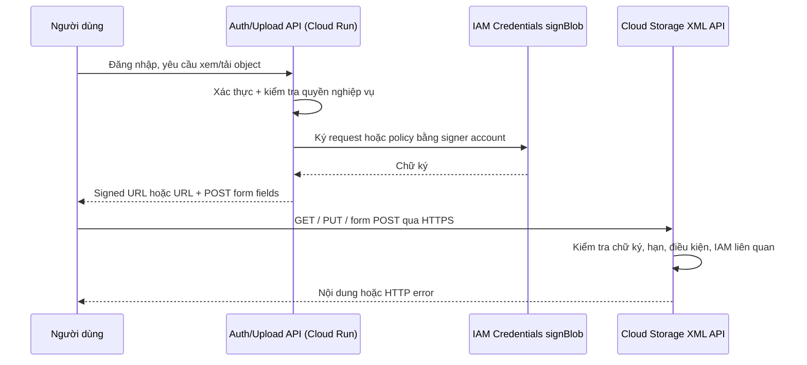
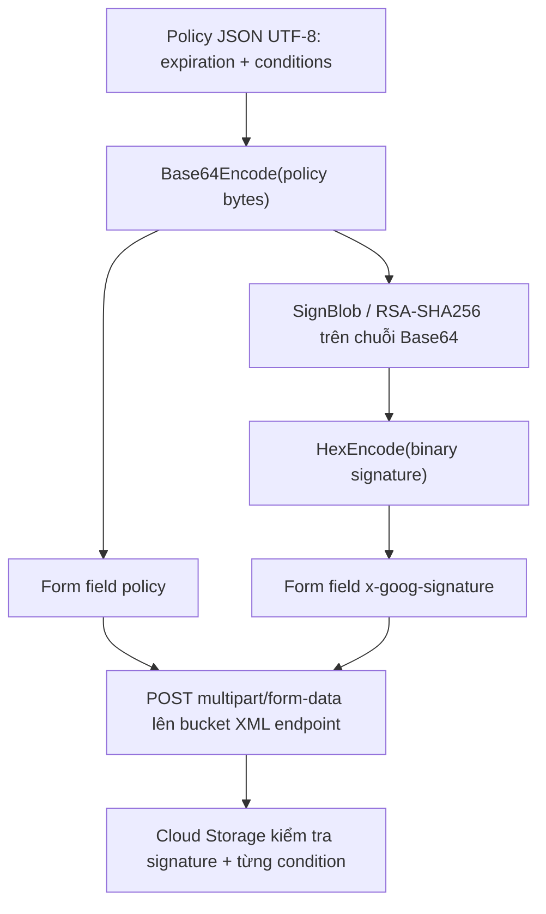
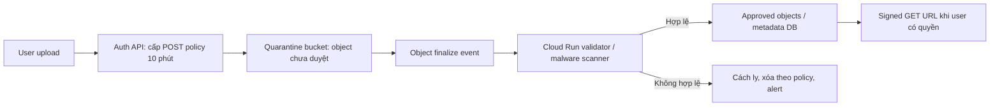

# Signed URLs và signed policy documents

Một ứng dụng bán hàng lưu hóa đơn PDF và ảnh sản phẩm trong Cloud Storage. Khách hàng cần tải hóa đơn qua trình duyệt nhưng **không nên được cấp IAM trực tiếp trên bucket**. Khi gửi ảnh đánh giá, khách hàng lại cần tải file thẳng lên Cloud Storage mà không đi qua máy chủ ứng dụng, đồng thời không được ghi lên tên object bất kỳ hoặc gửi file quá lớn. Hai nhu cầu này có lời giải gần nhau về chữ ký nhưng **không phải cùng một cơ chế**:

- **Cloud Storage signed URL**: cấp quyền tạm thời để thực hiện một HTTP request cụ thể, chẳng hạn `GET` hoặc `PUT`, trên một resource đã xác định.
- **Signed policy document**: mô tả và ký các **điều kiện của HTML form upload** bằng phương thức `POST`, bao gồm bucket, tên/prefix object, content type, kích thước file và thời hạn.

Bài thuộc chương **Cloud Storage** trong module `CLOUD_PROVIDERS_GCP`. Nó kết nối tổ chức project, IAM, VPC, Compute Engine, GKE, Cloud Run, lưu trữ, phát hành và giám sát hệ thống với yêu cầu bảo mật tài nguyên, khả năng mở rộng và chi phí. Mục tiêu là **ủy quyền có giới hạn, không chia sẻ khóa bí mật, không vô tình mở bucket công khai, và kiểm chứng đầy đủ đường upload/download**.

> **Lưu ý bảo mật:** Signed URL và signed policy form là *bearer credentials*. Ai sở hữu token/form fields hợp lệ đều có thể dùng cho tới khi hết hạn hoặc khóa/quyền liên quan mất hiệu lực. Chữ ký không tự kiểm tra phiên đăng nhập của người dùng, không mã hóa object và không ngăn người đã tải dữ liệu lưu/chia sẻ lại.

## 1. Kết quả học tập

Sau bài này, bạn có thể:

1. Phân biệt signed URLs, signed policy documents, IAM OAuth, public access và Cloud CDN signed URLs/cookies.
2. Giải thích các tham số V4 như `X-Goog-Algorithm`, `X-Goog-Credential`, `X-Goog-Date`, `X-Goog-Expires`, `X-Goog-SignedHeaders` và `X-Goog-Signature`.
3. Dùng `gcloud storage sign-url` để cấp URL tải xuống hoặc tải lên bằng `PUT`.
4. Thiết kế V4 POST policy với `expiration`, `conditions`, `eq`, `starts-with` và `content-length-range`.
5. Phân quyền service account ký và service account truy cập object, dùng IAM Credentials API thay cho việc phân phối private keys.
6. Xử lý CORS, object-name collisions, quyền ghi đè, nội dung độc hại, thời hạn token, upload verification và các tình huống lỗi `403`.
7. Phân tích độ tin cậy, hạn chế chi phí, kiểm thử và lựa chọn quy trình triển khai trên Cloud Run, Compute Engine hoặc GKE.

## 2. Mô hình cấp quyền: backend ký, client dùng

Thông thường **người sử dụng cuối không có service account key hoặc access token GCP**. Ứng dụng xác thực, quyết định object nào được phép truy cập, sau đó phát một credential chỉ dùng trong thời gian ngắn.



Trong hệ thống thực, client library có thể gọi IAM Credentials API thay bạn; không nhất thiết tự gửi request `signBlob`. Quyền ký của ứng dụng phải được phân tách khỏi quyền truy cập object:

- **Quyền phát hành chữ ký**: backend được phép gọi `iam.serviceAccounts.signBlob` trên service account ký.
- **Quyền thực hiện thao tác**: service account đứng tên chữ ký phải có `storage.objects.get`, `storage.objects.create` và/hoặc `storage.objects.delete` theo hành động dự kiến.
- **Quyền người dùng trong ứng dụng**: ví dụ chỉ được tải hóa đơn của chính mình, hoặc chỉ upload ảnh vào đường dẫn chứa định danh upload riêng.

Nếu một backend vô tình phát signed URL ghi dữ liệu tới bất kỳ object path nào, việc bucket private không ngăn người sở hữu URL sử dụng **quyền đã được backend ủy quyền**.

### 2.1. So sánh các phương thức truy cập

| Cơ chế | Nơi kiểm tra | Tình huống sử dụng | Giới hạn cần chú ý |
| --- | --- | --- | --- |
| **Cloud Storage V4 signed URL** | Cloud Storage **XML API endpoint** | GET/HEAD/PUT và request được hỗ trợ trên một resource cụ thể | HTTP method, URL, signed headers/query, thời hạn; bearer link có thể bị chia sẻ |
| **Cloud Storage signed policy document** | Cloud Storage XML API **HTML form POST** | Browser gửi một file lên bucket theo nhiều điều kiện | Policy form, prefix/key, size, metadata; mỗi POST upload một object |
| **OAuth 2.0 + IAM** | Cloud Storage API với danh tính client/service | Backend, GKE/Compute Engine job, dịch vụ tin cậy truy cập GCS thường xuyên | Người gọi cần credentials và quyền IAM thật |
| **Cloud CDN signed URL/cookie** | Cloud CDN của load balancer/backend được cấu hình | Phân phối nội dung đã cache, video nhiều segments | Thuật toán/fields và bảo vệ origin khác hoàn toàn Storage V4 |
| **Object public** | Không cần token của người xem | Static assets cố ý public | Không thích hợp với hóa đơn, ảnh chưa duyệt, dữ liệu cá nhân |

Cloud Storage signed URL **chỉ áp dụng cho XML API endpoints**, ví dụ `https://storage.googleapis.com/BUCKET/OBJECT`; không tự biến link của JSON API hay địa chỉ `gs://` thành URL cho người dùng tải trên browser. Đặc biệt, **HTML form POST không dùng signed URL**: cần signed policy document nếu muốn cấp quyền form mà không mở bucket anonymous-write.

## 3. V4 signed URL có những thành phần nào?

Ví dụ minh họa, chữ ký giả không thể thực thi:

```text
https://storage.googleapis.com/orders-private/invoices/INV-1001.pdf
  ?X-Goog-Algorithm=GOOG4-RSA-SHA256
  &X-Goog-Credential=signer%40project.iam.gserviceaccount.com%2F20261119%2Fauto%2Fstorage%2Fgoog4_request
  &X-Goog-Date=20261119T090000Z
  &X-Goog-Expires=900
  &X-Goog-SignedHeaders=host
  &X-Goog-Signature=HEX_SIGNATURE
```

Trong một URL thật, các đoạn được nối thành **một dòng**, ký tự đặc biệt được URL encode chính xác. Các giá trị ngày/giờ chỉ minh họa, không phải quyền truy cập đang còn hiệu lực.

| Tham số | Ý nghĩa | Lỗi thường gặp |
| --- | --- | --- |
| `X-Goog-Algorithm` | Thường là `GOOG4-RSA-SHA256` khi dùng service account signer hoặc `GOOG4-HMAC-SHA256` cho HMAC key | Dùng thuật toán không tương ứng với khóa |
| `X-Goog-Credential` | Danh tính signer và credential scope `DATE/LOCATION/storage/goog4_request` | Scope không khớp ngày, email hoặc encoding |
| `X-Goog-Date` | Mốc thời gian bắt đầu sử dụng theo định dạng UTC `YYYYMMDDTHHMMSSZ` | Server clock lệch, dùng giờ địa phương |
| `X-Goog-Expires` | TTL tính bằng giây từ `X-Goog-Date` | V4 URL cho phép tối đa **604.800 giây (7 ngày)** |
| `X-Goog-SignedHeaders` | Danh sách header đã được ký; phải có `host` | Client không gửi chính xác header đã ký |
| `X-Goog-Signature` | Chữ ký xác thực canonical request | Thay path/query/method sau khi ký |

Google Cloud khuyến nghị TTL **ngắn**, không mặc định chọn mức tối đa. Chữ ký dùng phương thức `signBlob` với Google-managed service account keys còn có lưu ý **key rotation**: nếu phát chữ ký TTL trên 12 giờ, chữ ký có thể hết hiệu lực trước thời hạn dự kiến sau ít nhất 12 giờ. Đối với đường truy cập nhạy cảm, TTL vài phút hoặc vài chục phút phù hợp hơn với khả năng thu hồi và giám sát.

### 3.1. Signed URL bị ràng buộc bởi cả method và headers

Khi backend ký một `GET` URL, client không thể coi đó là `PUT` URL hợp lệ. Một URL ký `PUT` với header `Content-Type: image/png` phải được gửi với header phù hợp; nếu client tự sửa thành `image/jpeg`, chữ ký có thể không hợp lệ.

Các thay đổi sau khi ký dễ làm request trả `403 SignatureDoesNotMatch`:

- Đổi hostname từ `storage.googleapis.com` sang host không nằm trong canonical request;
- Chèn hoặc xóa query parameters đã ký, đổi encoding đường dẫn hoặc object name;
- Dùng sai HTTP method hoặc header đã ký;
- Thêm header `x-goog-*` cần được ký mà không đưa vào canonical request;
- Dùng signed URL qua một proxy tự ý sửa host, query hoặc signed headers.

Ngược lại, một số header **không nằm trong danh sách signed headers** không được chữ ký ràng buộc; đừng ngộ nhận URL tự hạn chế mọi đặc tính request. Muốn hạn chế **dung lượng upload**, chính sách POST có `content-length-range` thường rõ ràng hơn một PUT URL không có hạn chế kích thước phù hợp.

### 3.2. Mô hình canonical request (đọc hiểu, không tự bịa bytes)

V4 signing dựa trên chuỗi canonical request:

```text
HTTP_METHOD
CANONICAL_URI
CANONICAL_QUERY_STRING
CANONICAL_HEADERS

SIGNED_HEADERS
PAYLOAD_HASH
```

Chuỗi này được SHA-256 hash rồi đưa vào **string-to-sign** gồm thuật toán, thời điểm, credential scope và digest. Ký bằng RSA-SHA256 hoặc HMAC-SHA256 tùy cơ chế key. Canonical query được sắp xếp đúng quy tắc, tên header lowercase và giá trị được chuẩn hóa. Nếu tự triển khai, phải xử lý percent encoding, dấu `/` và byte UTF-8 rất chính xác; **nên ưu tiên Google Cloud client library hoặc `gcloud`**.

## 4. Chuẩn bị IAM cho dịch vụ cấp chữ ký

Một thiết kế an toàn có thể dùng:

```text
Project: orders-prod
  Bucket: gs://orders-private
    invoices/  -> đọc bởi signer-download
    uploads/   -> tạo object bởi signer-upload
  Cloud Run: orders-auth-api
    Runtime identity: orders-api-runtime@...
  Signer accounts:
    signer-download@...
    signer-upload@...
```

| Principal | Quyền cần thiết | Phạm vi |
| --- | --- | --- |
| `signer-download` | `storage.objects.get`, ví dụ `roles/storage.objectViewer` | Bucket hoặc phạm vi hẹp phù hợp |
| `signer-upload` | `storage.objects.create`, ví dụ `roles/storage.objectCreator` | Chỉ nơi có quyền tạo object mới |
| Signer cho phép ghi đè | Cần thêm `storage.objects.delete` khi ghi đè object hiện hữu theo quy định Cloud Storage | Tránh cấp trừ khi thực sự cần |
| Runtime phát chữ ký | `iam.serviceAccounts.signBlob` trên từng signer account, thường qua `roles/iam.serviceAccountTokenCreator` | Cấp trực tiếp đúng signer, không mở rộng toàn organization |
| Người dùng cuối | Không cần IAM Cloud Storage nếu dùng signed link/policy | Chỉ cần quyền nghiệp vụ và bearer credential còn hạn |

Trong nhiều cấu hình, role `roles/storage.objectUser` chứa cả đọc/ghi/xóa phù hợp nhưng **rộng hơn** hai vai trò tách biệt ở trên. Cần xem xét IAM Conditions/managed folders hoặc tổ chức bucket riêng theo quyền; ký PUT với tên object có thể ghi đè là rủi ro rõ rệt.

Để ký bằng IAM Credentials API:

1. Bật **Service Account Credentials API** cho project liên quan.
2. Runtime có quyền `iam.serviceAccounts.signBlob` trên service account ký.
3. Service account ký có quyền truy cập object hoặc tạo object tương ứng tại bucket.
4. Sử dụng ADC/workload identity trên Cloud Run/GKE/Compute Engine; không tải private key JSON về lưu trong repository.
5. Giữ hệ thống cấp token có authentication, rate limits, logging đã che thông tin nhạy cảm và chống abuse.

**Phân biệt hai kiểm tra quyền:** runtime có `signBlob` không tự có `storage.objects.get`; signer có `storage.objects.get` không tự cấp cho runtime quyền ký thay signer.

## 5. Phát signed GET URL bằng gcloud

Giả định bucket private `orders-private` đã tồn tại và chứa object `invoices/INV-1001.pdf`. Lệnh sau **chỉ phát hành một bearer URL**, không sửa IAM/bucket và không tự tải file:

```bash
gcloud storage sign-url \
  gs://orders-private/invoices/INV-1001.pdf \
  --impersonate-service-account=signer-download@orders-prod.iam.gserviceaccount.com \
  --duration=10m
```

Điều kiện: người chạy có quyền ký qua IAM Credentials API và signer có quyền đọc object. Output chứa URL thật, nên **không paste vào CI log, issue, analytics, trình theo dõi lỗi hoặc chat công khai**.

Client nhận URL có thể dùng:

```bash
# SANDBOX: đặt biến trong session riêng, không commit bearer URL.
SIGNED_URL="SIGNED_GET_URL_FROM_BACKEND"

# Tải object đúng URL được cấp; không sửa query, method hoặc hostname.
curl --fail --show-error --location \
  --output invoice.pdf \
  "$SIGNED_URL"
```

Lệnh tải file vào máy client, nhưng chỉ thành công nếu URL còn hạn, đối tượng tồn tại, signer có quyền và request giữ nguyên những thành phần đã ký. Với tài liệu nhạy cảm, xác minh đích lưu file an toàn.

## 6. Signed PUT URL: upload một object cụ thể

Khác GET, PUT có thể tạo hoặc cập nhật object. Ví dụ cấp quyền upload một ảnh PNG có tên do backend sinh sẵn:

```bash
# CHỈ PHÁT URL: sign; cần signer được quyền storage.objects.create.
gcloud storage sign-url \
  gs://orders-private/uploads/user-42/9d4e8b2c.png \
  --impersonate-service-account=signer-upload@orders-prod.iam.gserviceaccount.com \
  --http-verb=PUT \
  --duration=10m \
  --headers=content-type=image/png
```

Client dùng URL do server cấp:

```bash
SIGNED_PUT_URL="SIGNED_PUT_URL_FROM_BACKEND"

# GHI OBJECT TRÊN CLOUD STORAGE: chỉ thử ở bucket/object sandbox được phép.
curl --fail --show-error \
  --request PUT \
  --header "Content-Type: image/png" \
  --upload-file ./picture.png \
  "$SIGNED_PUT_URL"
```

**Không dùng `-F file=@...` với signed PUT URL**: cách đó tạo `multipart/form-data` cho form POST, không phải body bytes thô của PUT Object. Nếu server đã ký `Content-Type`, client phải gửi đúng giá trị.

### 6.1. Tránh ghi đè và lạm dụng upload

Đối tượng đã có cùng tên có thể bị thay thế bởi upload mới nếu signer có quyền phù hợp. Phương án an toàn:

- Backend sinh object name **ngẫu nhiên, khó đoán, riêng cho mỗi upload**, không cho client chọn path trực tiếp.
- Đặt namespace `uploads/USER_ID/UPLOAD_ID`, gắn record server-side để đối chiếu người sở hữu.
- Dùng signer chỉ có `storage.objects.create` nếu workflow **không cần overwrite**; với điều kiện generation/preconditions được API hỗ trợ, cân nhắc `ifGenerationMatch=0` hoặc logic tương ứng để phòng race/overwrite và kiểm thử thực tế.
- Giới hạn TTL, số lần phát token và quota ứng dụng; bearer URL có thể được dùng nhiều lần trong thời hạn nếu request và quyền cho phép.
- Kiểm tra kích thước, MIME thực tế, malware scanning và nội dung độc hại **sau upload** trước khi cho object vào khu vực công khai.

Ký `Content-Type: image/png` ràng buộc **metadata header** mà client gửi; nó không chứng minh bytes thực sự là PNG an toàn. Signed PUT URL cũng không phải cơ chế giới hạn file size đa điều kiện giống POST policy.

## 7. Ví dụ backend Python tạo signed URLs

Google Cloud Storage client library có phương thức `blob.generate_signed_url()`. Ví dụ ngắn sau minh họa đúng **V4 GET** và **V4 PUT** trong môi trường có credentials hỗ trợ signing:

```python
from datetime import timedelta
from google.cloud import storage


def make_get_url(bucket_name: str, object_name: str) -> str:
    client = storage.Client()
    blob = client.bucket(bucket_name).blob(object_name)
    return blob.generate_signed_url(
        version="v4",
        expiration=timedelta(minutes=10),
        method="GET",
    )


def make_put_url(bucket_name: str, object_name: str) -> str:
    client = storage.Client()
    blob = client.bucket(bucket_name).blob(object_name)
    return blob.generate_signed_url(
        version="v4",
        expiration=timedelta(minutes=10),
        method="PUT",
        content_type="image/png",
    )
```

Đây là ví dụ giao diện API, **không tự chạy**. Credentials phải có khả năng ký: một số local ADC chỉ chứa user access token **không đủ để ký trực tiếp**. Trên Cloud Run/Compute Engine với keyless service account, cấu hình signer qua IAM `signBlob`/service account impersonation hoặc các tham số signing được client library hỗ trợ; kiểm tra kỹ phiên bản thư viện. Tài liệu chính thức có cả mẫu bằng `gcloud`, Go, Java, Node.js và C#.

Để tránh cấp signed URLs sai quyền trong API sản xuất, **xác thực và kiểm tra ownership trước khi gọi hàm ký**. Khi trả URL qua JSON, đừng đưa toàn bộ response vào log và đừng cấu hình CDN/proxy cache API phản hồi chứa token riêng.

## 8. Signed policy document: chữ ký cho HTML form POST

V4 **signed policy document** dùng để cấp quyền upload một object qua HTML form lên Cloud Storage **XML POST Object API**. Khác với signed URL, server không ký một `PUT` URL cố định mà ký **policy JSON định nghĩa những điều kiện form phải thỏa mãn**.

Một form upload có ký có:

1. `action` tới XML API bucket endpoint, ví dụ `https://storage.googleapis.com/orders-private`;
2. `method="post"` và `enctype="multipart/form-data"`;
3. field `key` là tên object đích;
4. field `policy` chứa base64 của JSON policy UTF-8;
5. các trường ký `x-goog-algorithm`, `x-goog-credential`, `x-goog-date`, `x-goog-signature`;
6. field `file` chứa nội dung file và **phải là field cuối của form request**.

Form POST xử lý **một object mỗi request**. Nó không phải multipart upload protocol theo nghĩa chia một file lớn thành nhiều parts có upload ID, cũng không phải Cloud Storage JSON API multipart upload. Tên “multipart/form-data” chỉ mô tả encoding HTTP form.

### 8.1. Policy JSON minh họa

Ví dụ policy chỉ cho phép upload ảnh PNG vào một **tên object chính xác**, kích thước từ 1 byte đến 5 MiB:

```json
{
  "expiration": "2027-01-10T12:00:00Z",
  "conditions": [
    {"bucket": "orders-private"},
    ["eq", "$key", "uploads/user-42/9d4e8b2c.png"],
    ["eq", "$Content-Type", "image/png"],
    ["content-length-range", 1, 5242880],
    {"success_action_status": "201"},
    {"x-goog-algorithm": "GOOG4-RSA-SHA256"},
    {
      "x-goog-credential": "signer-upload@orders-prod.iam.gserviceaccount.com/20270110/auto/storage/goog4_request"
    },
    {"x-goog-date": "20270110T115000Z"}
  ]
}
```

Ngày tháng, bucket và credential là giá trị minh họa và **không phải policy đã được ký**. Trong production, backend tạo ngày UTC và expiry gần thời điểm request. Chỉ phát cho user sau khi xác thực và kiểm tra quyền, không ký trước hàng tháng.

| Thành phần | Vai trò | Sai sót cần tránh |
| --- | --- | --- |
| `expiration` | Hạn policy (UTC timestamp) | Hết hạn thì upload bị từ chối |
| `conditions` | **Tất cả điều kiện phải đúng** | Bỏ condition cho một field form đã thêm |
| `{"bucket": "..."}` | Ràng buộc bucket đích, bắt buộc có trong policy | Không có bucket condition tạo rủi ro chuyển upload tới bucket ngoài dự kiến |
| `["eq","$key", "..."]` | Cho phép đúng object name | Cho client tự thay key nếu muốn hạn chế một object |
| `["starts-with","$key","uploads/user-42/"]` | Cho phép một prefix nếu có chủ đích | Prefix quá rộng gây upload vào namespace khác |
| `["eq","$Content-Type","image/png"]` | Bắt field MIME khai báo một giá trị | Không xác minh bytes file đúng chuẩn ảnh |
| `["content-length-range",1,5242880]` | Giới hạn dung lượng object được upload | Thiếu có thể mở đường upload file rất lớn |
| `success_action_status` | Mã trả về khi upload thành công, ví dụ `201` | Field form có nhưng policy không có điều kiện tương ứng |

**Không đưa đồng thời cả `eq` và `starts-with` khác nhau cho cùng một field** theo cách tự chế; nếu cần biểu diễn nhiều dạng quyền, tạo các policy/form riêng cho mỗi phạm vi. Đối với điều kiện `Content-Length`, dùng `content-length-range` thay vì tự so chuỗi `Content-Length`.

Cloud Storage quy định **mỗi field trong form cần có điều kiện tương ứng**, trừ `policy`, `file` và `x-goog-signature`. Dù không có field tên `bucket` trong form, policy **vẫn bắt buộc** có điều kiện xác định bucket.

### 8.2. Chữ ký policy được tính ra sao?

Quy trình V4 RSA-based signing:



Chi tiết quan trọng: **policy JSON được base64 chuẩn** (không phải base64url của CDN), và **chữ ký V4 được hex encode**. Với RSA signer, chữ ký là kết quả RSA-SHA256 trên **chuỗi base64 của policy**, không phải SHA-256 của raw JSON trước khi base64, cũng không phải HMAC-SHA1 của Cloud CDN.

Có thể dùng HMAC signing theo V4 khi triển khai với Cloud Storage HMAC keys, sử dụng `GOOG4-HMAC-SHA256` và derived key theo credential scope. Tuy nhiên HMAC key secret đòi quy trình bảo vệ/rotation riêng; trong hầu hết ứng dụng Google Cloud, nên dùng service account signing qua IAM Credentials API để không tạo private key lâu hạn.

### 8.3. Form HTML tương ứng

Ví dụ cấu trúc form; mọi chữ `SIGNED_...` là placeholder từ server, **không thể upload nếu chưa được ký đúng**:

```html
<form action="https://storage.googleapis.com/orders-private"
      method="post" enctype="multipart/form-data">
  <input type="hidden" name="key"
         value="uploads/user-42/9d4e8b2c.png">
  <input type="hidden" name="Content-Type" value="image/png">
  <input type="hidden" name="success_action_status" value="201">
  <input type="hidden" name="policy" value="SIGNED_POLICY_BASE64">
  <input type="hidden" name="x-goog-algorithm" value="GOOG4-RSA-SHA256">
  <input type="hidden" name="x-goog-credential"
         value="SIGNED_CREDENTIAL_SCOPE">
  <input type="hidden" name="x-goog-date" value="SIGNED_UTC_TIMESTAMP">
  <input type="hidden" name="x-goog-signature" value="SIGNED_POLICY_HEX">
  <input type="file" name="file" accept="image/png">
  <button type="submit">Upload</button>
</form>
```

Ở biểu mẫu thực tế, không tự ghép `x-goog-credential`/`policy` bằng giá trị người dùng; backend ký toàn bộ điều kiện và trả các trường đúng. HTML có thể được render server-side hoặc từ JSON response bằng cách tạo DOM theo quy tắc escaping an toàn. `accept="image/png"` chỉ hướng dẫn giao diện browser, **không phải** validation bảo mật.

Field `file` phải là field cuối được gửi trong multipart/form-data body. Nếu frontend tạo `FormData`, cần thêm tất cả signed fields trước, rồi mới thêm field `file`. Nếu có nhiều file, mỗi object phải có request riêng hoặc thiết kế multi-upload workflow được hỗ trợ.

### 8.4. HTTP response sau POST

Với `success_action_status=201`, Cloud Storage trả một XML response có thông tin object đã tạo; với `200` hoặc `204`, body có thể rỗng. Đây là cơ chế phản hồi của **XML POST Object API**, khác với JSON API response.

Upload POST với cùng `key` **có thể ghi đè object hiện hữu** nếu signer có quyền. Vì vậy backend nên sinh upload ID duy nhất, cấp policy trong thời gian ngắn và chỉ cung cấp create permission khi không cần overwrite. Trong kiến trúc có yêu cầu không ghi đè tuyệt đối, kiểm tra semantics IAM, preconditions và workflow riêng trước khi đưa vào production.

## 9. Sinh signed POST policy bằng Python client library

Thư viện `google-cloud-storage` cung cấp `Client.generate_signed_post_policy_v4()`. Ví dụ tạo policy cho một file PNG với giới hạn 5 MiB:

```python
from datetime import timedelta
from google.cloud import storage


def create_post_policy(bucket_name: str, object_name: str) -> dict:
    client = storage.Client()
    policy = client.generate_signed_post_policy_v4(
        bucket_name,
        object_name,
        expiration=timedelta(minutes=10),
        fields={
            "Content-Type": "image/png",
        },
        conditions=[
            ["eq", "$Content-Type", "image/png"],
            ["content-length-range", 1, 5 * 1024 * 1024],
        ],
    )
    # Response: {"url": "...", "fields": {"policy": "...", ...}}
    # Chỉ gửi response cho user đã được cấp quyền upload object_name.
    return policy
```

Đoạn này minh họa API và **cần credentials có khả năng ký**, giống V4 signed URL. Với keyless runtime, cấu hình IAM `signBlob` và service account signer phù hợp; phương thức hỗ trợ các tham số `service_account_email` và `access_token` theo tài liệu phiên bản thư viện, nhưng phải quản lý token và quyền thật chính xác. Không đưa JSON service account private key vào source code chỉ để chạy ví dụ.

Thư viện có thể tự đưa các trường ký mặc định vào policy/form. **Client phải gửi đầy đủ giá trị `fields` do thư viện trả**, không tự bỏ trường “không dùng đến” hoặc đổi thứ tự/vị trí file. Khi cần một prefix cho nhiều object names, đọc kỹ API `conditions` và semantics của `blob_name`; cách an toàn mặc định là **một upload ID → một object key cố định**.

### 9.1. Frontend xây FormData từ response

Backend gửi JSON gồm `url` và `fields` sau khi kiểm tra đăng nhập/ownership. JavaScript frontend:

```javascript
async function uploadWithPolicy(signedPost, file) {
  const body = new FormData();

  for (const [name, value] of Object.entries(signedPost.fields)) {
    body.append(name, value);
  }
  // Trường file là cuối cùng trong multipart form.
  body.append("file", file);

  const response = await fetch(signedPost.url, {
    method: "POST",
    body,
  });
  if (!response.ok) {
    throw new Error("Upload failed: HTTP " + response.status);
  }
  return response.status;
}
```

**Không tự đặt header `Content-Type: multipart/form-data`** cho lời gọi `fetch` này; browser sẽ đặt boundary tương ứng với body. Nếu tự đặt thiếu boundary, Cloud Storage không parse được form.

Với frontend khác origin với `storage.googleapis.com`, còn cần cấu hình **CORS trên bucket**, đúng origin, methods và response headers. CORS xử lý quyền đọc response của trình duyệt chứ không thay thế signature/IAM; thử upload bằng `curl` thành công không đảm bảo browser vượt qua preflight.

## 10. Signed PUT vs signed POST policy: quyết định nhanh

| Tình huống | Khuyến nghị | Lý do |
| --- | --- | --- |
| Tải file hóa đơn riêng | `GET` signed URL | Chỉ cấp quyền đọc một object, không cấp bucket IAM cho khách |
| Mobile app upload ảnh với tên cố định | `PUT` signed URL | Gửi body raw, dễ tích hợp app/curl |
| Browser form upload ảnh, cần ràng buộc MIME, max 5 MiB | **Signed POST policy** | Điều kiện `eq`, `starts-with`, `content-length-range` được Cloud Storage kiểm tra |
| Dịch vụ backend xử lý hàng nghìn object mỗi giờ | IAM OAuth / client library | Backend đã có workload identity, không nhất thiết phát bearer links |
| Tải object rất lớn, mạng không ổn định | Xem **resumable upload** có signed initiation hoặc API phù hợp | Tránh upload lại từ đầu khi đường truyền mất, cân nhắc lifecycle của session URI |
| Phát video nhiều segments qua CDN | Cloud CDN signed cookies/URLs khi phù hợp | CDN có hệ chữ ký/thuật toán riêng và origin protection riêng |
| Upload dữ liệu cực kỳ nhạy cảm, cần xử lý/AV trước khi lưu chính thức | Quarantine bucket + scanning + promote | Signed policy chỉ xác minh metadata/điều kiện, không đảm bảo file an toàn |

Signed URL và signed POST policy đều **ủy quyền theo signer identity** và có thời hạn, nhưng mức ràng buộc khác nhau. Không dùng policy POST để cấp quyền download và không dùng signed GET URL làm form upload.

## 11. Bảo vệ bucket và dữ liệu sau khi upload

Việc Cloud Storage chấp nhận một chữ ký chỉ có nghĩa request đáp ứng **quyền của signer và các ràng buộc đã ký**. Nó không bảo đảm file phù hợp quy trình nghiệp vụ, không bị giả MIME type, không chứa mã độc và không trùng dữ liệu người khác.

### 11.1. Giữ bucket private

- **Uniform bucket-level access** giúp quản trị quyền bằng IAM thay vì ACL object rời rạc khi phù hợp.
- **Public access prevention** giúp chặn việc mở public ngoài ý muốn theo chính sách.
- Tách bucket **quarantine/raw uploads** khỏi bucket **approved/public assets** nếu file do người dùng cung cấp.
- Tách service account cấp signed GET với service account cấp signed PUT/POST; giới hạn quyền ở bucket/managed folder hoặc phạm vi phù hợp.
- Không thêm `allUsers`/`allAuthenticatedUsers` chỉ để signed upload hoặc signed download hoạt động.
- Xem xét Object Versioning, soft delete, retention, lifecycle policies và dữ liệu cần lưu/khôi phục theo RPO/RTO.

Ví dụ đường dữ liệu:



Đây là workflow logic. Event processing có thể **at least once**; worker phải idempotent theo **bucket + object name + generation**, tránh xử lý lặp, đua trạng thái hoặc chọn sai generation khi người dùng upload lại. Bảo đảm scanner không làm lộ file qua temporary URL và giữ audit trail của kết quả kiểm tra.

### 11.2. Không tin tên file, MIME hay metadata do client tự khai báo

Một policy ép field `Content-Type=image/png` chỉ kiểm tra *giá trị do request gửi*, chưa xác minh byte stream là PNG. Ứng dụng phải tự kiểm tra magic bytes, decode file bằng thư viện an toàn, dung lượng thực, resolution, archive bombs hoặc nội dung macro/executable nếu loại tài liệu liên quan.

Tên object trong Cloud Storage là một chuỗi, dấu `/` thường tạo cảm giác thư mục nhưng không bảo đảm an toàn qua việc nối chuỗi. Không dùng trực tiếp tên file do người dùng đặt để tạo path, ví dụ `../../tenant-b/private.pdf`. Hãy sinh object name server-side từ **upload ID được ràng buộc với user**, có kiểm tra cú pháp và tránh ký quyền rộng ở prefix nhiều tenant.

Metadata `owner_user_id` trên object cũng không thay thế bảng quyền trong ứng dụng: nếu form cho client tự gửi metadata, client có thể giả owner. Chỉ tin metadata được backend đã xác minh/ghi lại hoặc đối chiếu với record server-side.

### 11.3. Ghi đè và replay

Signed URL hoặc policy còn hạn **không có thuộc tính dùng một lần mặc định**. Người cầm token có thể gửi lại cùng request nếu IAM/điều kiện cho phép. Để hạn chế:

1. Mỗi upload có tên object random duy nhất và record trạng thái `PENDING` trong database.
2. Signer chỉ được **create**, không có quyền overwrite/delete nếu không cần.
3. Hoàn tất ở ứng dụng qua transaction/compare-and-set khi đã thấy object generation được tạo.
4. Kiểm tra precondition/generation semantics của giao thức upload đang dùng nếu yêu cầu chặn ghi đè tuyệt đối.
5. Sau khi kiểm tra/duyệt, chuyển trạng thái để không phát thêm signed upload cho cùng object ID.

Không dựa vào việc URL hết hạn nhanh để phòng replay trong toàn bộ thời gian hiệu lực; hãy kết hợp IAM tối thiểu và trạng thái nghiệp vụ.

### 11.4. TTL và thu hồi quyền

V4 signed URL có TTL tối đa 7 ngày, nhưng thường chỉ nên ký vài phút. Nếu user bị thu hồi quyền sau khi URL đã được phát hành, backend có thể **ngừng cấp URL mới** nhưng URL cũ vẫn có thể được dùng đến hết hạn theo quyền và khóa signer còn hiệu lực.

Các biện pháp thu hồi tức thì thường có **blast radius**:

- Đổi/xóa quyền của signer trên object/bucket có thể tác động tới các URLs khác cùng signer;
- Disable/delete service account hoặc thay khóa ký có thể ảnh hưởng nhiều token và hệ thống;
- Xóa/đổi tên object khiến URL cũ không còn lấy đúng dữ liệu, nhưng có thể phá quy trình hợp lệ;
- Dùng phiên bản object riêng, áp điều kiện generation khi được hỗ trợ, hoặc chuyển nội dung nhạy cảm qua backend kiểm tra quyền ở mỗi request nếu cần thu hồi theo người dùng tức thì.

Khi dùng IAM `signBlob` với khóa Google-managed, còn phải tính tới vòng đời/rotation của khóa ký; không giả định mọi URL dài 7 ngày luôn tồn tại đúng đủ bảy ngày. Điều chỉnh TTL theo khả năng sử dụng, không chỉ giới hạn API.

## 12. Trình duyệt, CORS, upload lớn và đường mạng

### 12.1. CORS không phải authentication

Browser app ở `https://app.example.com` dùng `fetch` tới `https://storage.googleapis.com` là request cross-origin. Với PUT, các header như `Content-Type` có thể tạo **CORS preflight OPTIONS**. Bucket cần cấu hình CORS với đúng origin, phương thức và response headers theo workflow.

Ví dụ **cấu hình minh họa**, chỉ áp dụng khi đã review domain và nhu cầu upload:

```json
[
  {
    "origin": ["https://app.example.com"],
    "method": ["GET", "PUT", "POST", "HEAD"],
    "responseHeader": ["Content-Type", "ETag", "x-goog-generation"],
    "maxAgeSeconds": 3600
  }
]
```

Không mở `origin=["*"]` chỉ vì browser gặp CORS error, đặc biệt với ứng dụng có identity. CORS **không thay thế IAM, chữ ký, hạn token hoặc firewall**, và không ngăn `curl`/server ngoài browser gửi request. Cần kiểm tra giao diện Console/CLI và loại endpoint thực tế vì XML/JSON API có hành vi CORS khác nhau.

Nếu người dùng không đọc được response sau upload nhưng object đã xuất hiện trong bucket, có thể **request đã thành công ở server mà browser chặn đọc response do CORS**. Hãy xác minh trạng thái object theo upload ID/generation thay vì lập tức cấp token mới rồi upload đè.

### 12.2. Tải lên file lớn và resumable uploads

PUT và signed POST form thường thích hợp với uploads đơn giản. Khi file rất lớn hoặc kết nối di động chập chờn, nên đánh giá **Cloud Storage resumable upload**. Có thể ký **request khởi tạo resumable session** theo quy trình hỗ trợ hoặc để backend đã xác thực khởi tạo, sau đó client upload từng phần qua **session URI**.

Session URI cũng là một dạng credential nhạy cảm: ai sở hữu URI có thể tiếp tục upload trong phạm vi session. Vì vậy không log hoặc chia sẻ công khai và thiết kế quota/timeout phù hợp. Đừng trộn POST form policy của HTML upload với API hoàn tất multipart upload theo `uploadId`.

### 12.3. VPC và đường đi dữ liệu

Một Cloud Run signer ở project GCP có thể ký URL cho browser ở Internet; **dữ liệu object đi trực tiếp từ browser đến Cloud Storage**, không phải qua service Cloud Run. Điều này giảm egress/bandwidth và CPU trên signer nhưng có yêu cầu rõ về CORS, truy cập client và quan sát từng upload.

Trường hợp Compute Engine/GKE/on-prem cần truy cập GCS private từ VPC có thể cân nhắc Private Google Access, Private Service Connect cho Google APIs hoặc đường hybrid phù hợp. Cơ chế network **không thay** IAM và signature; signed URL vẫn phải trỏ tới endpoint được hỗ trợ và host phải khớp chữ ký.

## 13. Đối soát sau upload và kiểm soát trạng thái

Trong production, **không coi một HTTP 201/200/204 là kết thúc quy trình nghiệp vụ**. Sau khi client nhận thành công, backend nên:

1. Nhận thông báo hoàn tất có **upload ID** do server cấp.
2. Dùng IAM của backend đọc object metadata qua Cloud Storage client library/JSON API để kiểm tra **bucket, object name, generation, size, content type, checksum nếu cần**.
3. Xác minh object chưa bị xử lý trước đó, không có race giữa hai lần upload.
4. Chạy kiểm tra file như scan, giải mã, kiểm tra schema/virus theo loại nội dung.
5. Ghi trạng thái `VERIFIED`, `REJECTED` hoặc `PROCESSING` và thông báo người dùng theo workflow.
6. Chỉ cho phép đọc công khai/phân phối CDN sau khi object được duyệt và đảm bảo đúng owner.

Thông tin có thể lưu trong database:

```text
upload_id | user_id | bucket | object_name | generation
created_at | policy_expires_at | content_type_claimed
size_verified | checksum_verified | scan_status
state=PENDING|UPLOADED|APPROVED|REJECTED
```

Nếu một object có nhiều generations do ghi đè, xử lý bằng **generation cụ thể** để tránh scanner đọc một bản mà app lại công bố bản khác. Khi dùng object versioning, lifecycle và retention, phải tính thêm phí lưu nhiều versions.

## 14. Logging, reliability và chi phí

| Hạng mục | Rủi ro / chi phí | Đối sách |
| --- | --- | --- |
| API ký token | Traffic tăng, IAM `signBlob` rate limits, latency | Caching đúng phạm vi ngắn hạn nếu được phép; rate limit theo user; alert lỗi signer |
| Cloud Storage operations | GET/PUT/POST requests, storage class operations | Theo dõi request rate và chi phí theo SKU; chống phát token vô hạn |
| Data transfer | Khách tải file nhiều lần hoặc upload dữ liệu lớn | Dự báo theo vùng người dùng, egress, lifecycle và CDN khi phù hợp |
| Quarantine/scan | Upload file độc hại, scan CPU/memory, lưu object tồn đọng | Quota, size limit, TTL cleanup, malware scanning isolation |
| Object versions | Upload đè nhiều lần hoặc rollback/soft delete | Retention/soft delete/versioning có chủ đích; xem chi phí |
| Audit/logs | Log vô tình chứa query signature, POST policy fields, URL | Redact tokens, chỉ ghi upload ID, object key đã phù hợp privacy và status |
| Client failures | Timeout, 403 hết hạn, CORS error, retry sai | Có endpoint refresh, idempotent workflow và error handling theo từng giai đoạn |

Các đường gọi signed URL/policy đi thẳng tới Cloud Storage; log của **ứng dụng cấp token** không chứng minh client đã tải/upload file thành công. Cần quan sát Cloud Storage metrics/audit logs, upload metadata, event processing và giao diện người dùng để xác định trạng thái toàn hệ thống.

Để cải thiện hiệu quả chi phí, tận dụng việc payload không đi qua backend, nhưng đừng quên **request charges, storage bytes, data retrieval và egress** tùy storage class/location. Signed URL không có nghĩa mọi lần tải file đều miễn phí.

## 15. Case study: ứng dụng ảnh đánh giá và hóa đơn riêng

Giả sử nhóm Commerce có project `orders-prod` và bucket `orders-private` (không public). Ứng dụng chạy Cloud Run:

- Người mua tải hóa đơn PDF của chính mình;
- Người mua upload ảnh PNG/JPEG đánh giá đơn hàng, tối đa 5 MiB;
- Hình ảnh chỉ được public sau khi đã quét/duyệt;
- Team vận hành muốn tránh service account keys lưu trên disk/container.

### 15.1. Luồng đọc hóa đơn

1. Người dùng gửi request `GET /orders/{orderId}/invoice-download` có session.
2. Auth API kiểm tra orderId thuộc user và hóa đơn có trạng thái phù hợp.
3. Backend sinh signed **GET** URL cho đúng object `invoices/ORDER_ID.pdf`, TTL 5–10 phút, signer có quyền đọc nhưng không quyền xóa.
4. Browser tải PDF từ Cloud Storage XML endpoint, không cần IAM GCP.
5. Khi URL hết hạn, client phải yêu cầu cấp link mới; không thêm URL vào analytics hoặc browser log công khai.

### 15.2. Luồng upload ảnh

1. Người dùng yêu cầu `POST /reviews/{reviewId}/upload-token`.
2. Backend kiểm tra ownership và số ảnh được phép, sinh object key `quarantine/user-42/UPLOAD_ID.png` không trùng.
3. Backend phát V4 **signed POST policy** với condition bucket, key, Content-Type, max 5 MiB, TTL 10 phút.
4. Browser gửi form `multipart/form-data` trực tiếp đến Cloud Storage theo `url` và `fields` được server trả.
5. Cloud Storage nhận request nếu các conditions, signature và quyền signer hợp lệ.
6. Backend nhận finalize event hoặc client completion request, kiểm tra generation/size, scan nội dung và đánh dấu `APPROVED`.
7. Khi người khác xem ảnh, ứng dụng cấp signed GET hoặc công bố bản ảnh đã duyệt sang khu vực phân phối riêng.

### 15.3. Quyết định bảo mật cần review

| Quyết định | Phương án | Điều cần xác minh |
| --- | --- | --- |
| Giới hạn namespace | Backend sinh tên object từ user ID và random upload ID | Không để người dùng đổi path sang namespace user khác |
| Giới hạn file | POST condition max 5 MiB và MIME khai báo | Sau upload decode bytes, malware scan, kiểm tra loại file thật |
| Quyền signer | Read signer chỉ viewer, upload signer chỉ create | Không vô tình cấp overwrite/delete toàn bucket |
| Keyless signing | Cloud Run workload identity + IAM `signBlob` | IAM Credentials API và quyền signer, tránh JSON key |
| CORS | Chỉ `https://app.example.com` hoặc origin đã duyệt | Browser nhận response, không mở wildcard vô cớ |
| Chống trùng/replay | Unique object key + trạng thái upload và generation | Không public file chưa scan, không chấp nhận finalize trùng |
| Giám sát | Cloud Storage + Cloud Run + event scanner | SLO upload success, 4xx, latency, số object tồn quarantine |

### 15.4. SLO và kiểm chứng phát hành

Theo dõi tỷ lệ upload thành công trong 5 phút, latency p95/p99 của endpoint cấp token, tỷ lệ `403` do signer/expiry, tỷ lệ scan thất bại và thời gian từ upload đến khi ảnh được duyệt. Trước khi thay đổi IAM/CORS hoặc key rotation, thực hiện canary với GET/PUT/POST trên object thử nghiệm và kiểm tra direct object access bằng anonymous user **phải bị chặn**.

## 16. Bảng chẩn đoán lỗi theo tầng

| Hiện tượng | Nguyên nhân khả dĩ | Hướng kiểm tra |
| --- | --- | --- |
| Không thể tạo signed URL ở backend | ADC không hỗ trợ signing, thiếu `signBlob`, IAM Credentials API tắt | Xem principal của runtime, signer account và quyền `iam.serviceAccounts.signBlob` |
| Có URL nhưng GET trả `403` | Signer thiếu `storage.objects.get`, hạn, chữ ký sai, org policy | Xác minh IAM trên bucket/object, `X-Goog-Date`, scope và canonical request |
| PUT trả `SignatureDoesNotMatch` | HTTP method, `Content-Type`, host hoặc query khác lúc ký | Đối chiếu `--headers`, client headers và URL nguyên vẹn |
| PUT vào object cũ bị `403` | Signer create-only không có quyền overwrite/delete | Dùng unique key, chỉ cấp quyền overwrite khi được duyệt |
| POST form báo thiếu trường/invalid policy | Field không có condition, base64 JSON sai, `x-goog-*` không khớp | In policy **đã redacted** trong môi trường an toàn, so toàn bộ fields và conditions |
| POST lỗi dù file đúng loại | Client khai `Content-Type` khác, file size vượt condition | So form field, size thực, expiry, constraints |
| Browser báo CORS, curl thành công | Bucket thiếu CORS origin/method/response header hoặc preflight fail | Xem Network/OPTIONS, CORS config, không thay signature để sửa CORS |
| HTTP upload thành công nhưng app chưa thấy file | Event chưa xử lý, object key/generation khác, scanner lỗi | Kiểm tra metadata qua backend, event retries và trạng thái DB |
| File đúng MIME header nhưng scan không hợp lệ | Nội dung không đúng định dạng hoặc chứa payload | Kiểm tra bytes/thực thể file sau upload |
| Signed URL hết hạn trước 7 ngày | IAM signer key rotation, quyền thay đổi hoặc mốc thời gian | Xem phương thức signBlob, TTL thực, audit thay đổi signer |
| Browser sửa URL/path và bị 403 | Canonical request không còn khớp | Không re-encode sau ký; ký trên URL cuối cùng |
| Khách truy cập trực tiếp bucket không cần chữ ký | Bucket/object public hoặc path khác đang mở | Rà IAM/ACL, Public Access Prevention, test anonymous |

**Trình tự điều tra:** xác định lỗi xảy ra ở **bước phát token**, **request từ client**, **Cloud Storage verify**, **CORS browser** hay **scanner/post-processing**. Không mở `allUsers` hoặc cấp role Owner để “sửa nhanh” khi chưa xác định lớp lỗi.

## 17. Những sai lầm thường gặp

1. **Nhầm signed URL của Cloud Storage với Cloud CDN signed URL:** khác nơi kiểm tra, cấu trúc, thuật toán và phạm vi sử dụng.
2. **Dùng signed PUT URL cho HTML form POST:** HTTP method và request body không giống nhau; POST form cần policy.
3. **Ký với account không có quyền object:** có quyền `signBlob` chưa đủ nếu signer không có `storage.objects.get/create` tương ứng.
4. **Tải service account JSON key vào frontend:** lộ private key dài hạn, có thể phát hành URL tùy ý.
5. **Để thời hạn dài vì giới hạn cho phép 7 ngày:** tăng thời gian bearer link có thể bị chia sẻ, khó revoke.
6. **Bỏ ràng buộc bucket/key/size trong POST policy:** cho phép upload ngoài phạm vi, tốn storage và tạo rủi ro bảo mật.
7. **Tin Content-Type từ browser:** content type không xác nhận nội dung file thật.
8. **Không xử lý object name collision:** upload có thể ghi đè hoặc tạo bất nhất dữ liệu.
9. **Coi mã `201`/`204` là bằng chứng file an toàn:** còn cần scan, xác minh generation và trạng thái ứng dụng.
10. **Lẫn CORS với authentication:** CORS không bảo vệ bucket khỏi `curl` hoặc server-side requests.
11. **Log signed URLs hoặc toàn bộ form fields:** làm lộ bearer credentials trong tracing, issue, referrer hoặc analytics.
12. **Cho rằng upload policy chỉ được dùng một lần:** replay trong thời hạn còn hiệu lực cần được hạn chế bằng IAM, object key và workflow.

## 18. Bài tập thực hành

### Bài A — Chọn cơ chế cấp quyền

Ứng dụng cần tải hóa đơn PDF, upload ảnh đánh giá 5 MiB qua browser, upload video 2 GiB từ ứng dụng di động và phát video qua Cloud CDN. Chọn signed GET URL, PUT signed URL, POST signed policy, resumable upload hoặc Cloud CDN signed cookies khi phù hợp. Nêu method, nơi verify và token scope.

### Bài B — Đọc URL V4

Giả sử signed URL có `X-Goog-Date=20261119T090000Z`, `X-Goog-Expires=900` và `X-Goog-SignedHeaders=content-type%3Bhost`. Hãy tính thời điểm hết hạn theo UTC, giải thích tại sao client thiếu `Content-Type` đã ký có thể bị `403` và lý do không đổi hostname sau khi ký.

### Bài C — Thiết kế POST policy

Viết JSON policy chỉ cho phép upload vào bucket `orders-private`, key chính xác `quarantine/user-42/UPLOAD_ID.png`, `Content-Type=image/png`, size 1 byte đến 5 MiB, thành công trả HTTP 201 và expires sau 10 phút. Liệt kê đủ các form fields cần ký và giải thích vì sao phải có bucket condition ngay cả khi action URL đã chứa bucket.

### Bài D — Bảo mật IAM

Cloud Run runtime chỉ có `roles/iam.serviceAccountTokenCreator` trên `signer-upload`, nhưng signer không có `storage.objects.create` tại bucket. Ký có thể thành công không, upload có thành công không? Đề xuất IAM tối thiểu cho read signer, upload signer và runtime. Khi nào signer cần quyền `storage.objects.delete`?

### Bài E — Lỗ hổng ghi đè

Một trang upload cho client tự chọn key `reviews/file.png`; người khác đã tải file cùng tên. Hãy mô tả nguy cơ overwrite/replay, đề xuất unique server-generated object names, IAM create-only, preconditions khi được hỗ trợ, tracking generation và quy trình chuyển ảnh từ quarantine sang approved.

### Bài F — Lỗi browser nhưng curl chạy

Form upload POST thành công khi thử `curl` nhưng browser báo CORS. Liệt kê request Origin, preflight, CORS config, response headers và cách xác nhận object đã được ghi. Vì sao không mở bucket public hay bỏ policy để chữa lỗi?

### Bài G — Vòng đời token và chi phí

Ứng dụng phát 5.000 signed URLs/giây, TTL 7 ngày, và khách có thể tải lại video nhiều lần. Hãy xác định tác động lên IAM signing, khả năng lộ URL, storage operations, egress và logging; đề xuất rate limiting, TTL ngắn, download telemetry và cân nhắc CDN với cơ chế ký riêng.

### Câu hỏi tự kiểm tra

1. Signed URL khác signed policy document về HTTP method và mục đích ra sao?
2. Vì sao cả hai là bearer credentials và không thay thế session auth?
3. Tại sao signed URL dùng XML API endpoint?
4. V4 signed URL có TTL tối đa bao lâu và vì sao signBlob dài hạn cần thận trọng?
5. `iam.serviceAccounts.signBlob` khác `storage.objects.create` như thế nào?
6. Vì sao trường `file` trong HTML form POST phải là field cuối?
7. Ba loại condition `eq`, `starts-with`, `content-length-range` hoạt động thế nào?
8. Signed policy ép Content-Type có thay thế kiểm tra bytes/malware không?
9. CORS khác authorization và IAM như thế nào?
10. Làm sao ngăn người dùng ghi đè object hoặc lợi dụng lại token còn hạn?
11. Vì sao cần kiểm tra object generation sau upload?
12. Khi nào nên dùng Cloud CDN signed cookies thay cho GCS signed GET URLs?

**Quy trình ghi nhớ:** xác thực user và kiểm tra ownership → chọn **GET/PUT signed URL** hoặc **POST signed policy** → dùng signer có quyền IAM tối thiểu và keyless signing → ràng buộc object/method/header, TTL, size/prefix → client gửi đúng XML API endpoint → kiểm tra response và trạng thái object → scan/approve → giám sát, xử lý lỗi và thu hồi quyền.

## 19. Tài liệu chính thức

- [Cloud Storage Signed URLs](https://cloud.google.com/storage/docs/access-control/signed-urls)
- [V4 signing with Cloud Storage tools](https://cloud.google.com/storage/docs/access-control/signing-urls-with-helpers)
- [V4 signing process with your own program](https://cloud.google.com/storage/docs/access-control/signing-urls-manually)
- [Cloud Storage signatures và policy documents](https://cloud.google.com/storage/docs/authentication/signatures)
- [Create signatures bằng signBlob](https://cloud.google.com/storage/docs/authentication/creating-signatures)
- [XML API: Upload object with HTML forms](https://cloud.google.com/storage/docs/xml-api/post-object-forms)
- [Python Client.generate_signed_post_policy_v4](https://cloud.google.com/python/docs/reference/storage/latest/google.cloud.storage.client.Client#google_cloud_storage_client_Client_generate_signed_post_policy_v4)
- [Cloud Storage IAM](https://cloud.google.com/storage/docs/access-control/iam)
- [CORS cho Cloud Storage](https://cloud.google.com/storage/docs/cross-origin)
- [Cloud Storage resumable uploads](https://cloud.google.com/storage/docs/resumable-uploads)
- [Cloud CDN signed URLs](https://cloud.google.com/cdn/docs/using-signed-urls)
- [Cloud Storage pricing](https://cloud.google.com/storage/pricing)

API, cách ký, IAM roles, khả năng upload, CORS, giới hạn thời gian và cách Cloud Storage tính phí có thể thay đổi. Trước khi triển khai production, đối chiếu tài liệu cho **đúng API XML, signer identity, quyền bucket/object, upload method và browser environment**, thử toàn bộ đường hợp lệ/sai/hết hạn và chỉ công bố nội dung sau khi được xác minh.
