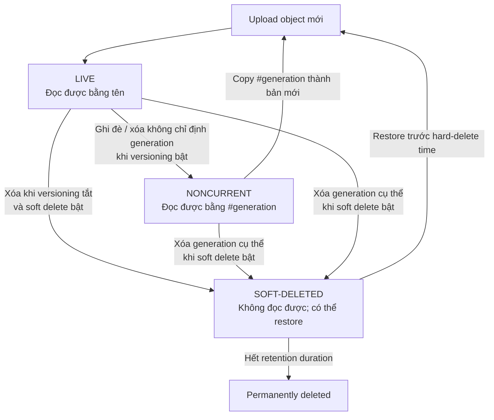
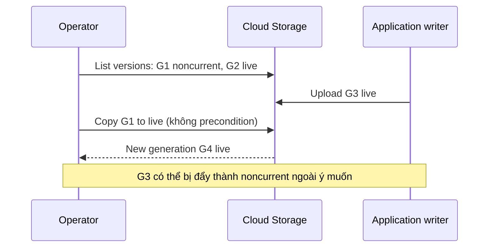

# Object versioning, soft delete và phục hồi đối tượng

Một đội backend lưu cấu hình triển khai, ảnh sản phẩm, tài liệu và dữ liệu xuất báo cáo trong **Google Cloud Storage**. Một ngày, pipeline vô tình ghi đè `config.json` bằng phiên bản sai; hôm sau một người xóa nhầm ảnh quan trọng. Dù Cloud Storage có độ bền dữ liệu rất cao, điều đó **không tự ngăn thao tác xóa hoặc ghi đè hợp lệ nhưng ngoài ý muốn**. Muốn phục hồi, đội ngũ cần biết object đang ở trạng thái **live**, **noncurrent** hay **soft-deleted**, và khả năng khôi phục được kiểm soát bằng chính sách nào.

Bài học thuộc chương **Cloud Storage** của mô-đun `CLOUD_PROVIDERS_GCP`. Mô-đun tìm hiểu Google Cloud từ project, IAM, VPC, Compute Engine, GKE, Cloud Run đến dịch vụ lưu trữ, cơ sở dữ liệu, tự động phát hành và theo dõi độ tin cậy/chi phí. Bài này kết nối các kỹ năng đó thông qua **Object Versioning**, **soft delete**, cách chọn đúng **generation** và các bước phục hồi an toàn bằng `gcloud storage`.

## 1. Mục tiêu học tập

Sau bài học, bạn có thể:

1. Phân biệt **bucket, object name, generation, metageneration** và các trạng thái **live**, **noncurrent**, **soft-deleted**.
2. Giải thích Object Versioning giữ lại nội dung cũ khi object bị ghi đè/xóa, còn soft delete bảo vệ dữ liệu khỏi việc bị loại khỏi tập object đang truy cập được.
3. Hiểu **Object Versioning và soft delete có thể bật đồng thời**, với hành vi khác nhau tùy bạn xóa tên object hay xóa một generation cụ thể.
4. Chọn cách phục hồi chính xác: **copy noncurrent generation** hoặc **restore soft-deleted generation**.
5. Sử dụng `gcloud storage buckets`, `objects describe`, `ls --all-versions`, `ls --soft-deleted`, `cp` và `restore` trên bucket lab được ủy quyền.
6. Tính đến **retention duration, lifecycle rules, object holds, IAM, chi phí và khả năng phát hiện thao tác nguy hiểm**.
7. Xây dựng runbook cho sự cố ghi đè hàng loạt, xóa nhầm hoặc xóa bucket; tránh khôi phục sai thời điểm khiến mất bản live mới.
8. Thiết kế bài kiểm thử phục hồi với tiêu chí xác minh dữ liệu, quyền truy cập và thời gian khôi phục.

**Phạm vi thực hành:** toàn bộ lệnh ghi chỉ dành cho **bucket lab mới** và các object **do bài lab tạo**. Tên bucket `YOUR_GLOBALLY_UNIQUE_LAB_BUCKET` chỉ là placeholder; bạn phải sở hữu project, quyền Cloud Storage và ngân sách phù hợp. Không áp dụng lệnh xóa, đổi retention hay restore ghi đè lên dữ liệu production khi chưa có review.

## 2. Object trong Cloud Storage không giống file trên ổ đĩa VM

Cloud Storage là dịch vụ **object storage**. Một object gồm nội dung bytes, tên object (ví dụ `reports/2026-11/orders.csv`), metadata và định danh phiên bản. Nó nằm trong **bucket** có location, storage class và chính sách truy cập/lưu giữ.

| Thành phần | Vai trò | Ví dụ |
| --- | --- | --- |
| **Bucket** | Không gian quản lý object và policies | `gs://demo-recovery-bucket` |
| **Object name** | Tên của object trong bucket; dấu `/` thường mô phỏng cấu trúc thư mục | `app/config.json` |
| **Live generation** | Bản object được truy cập khi chỉ định tên mà không thêm generation | `gs://.../app/config.json` |
| **Noncurrent generation** | Một bản cũ vẫn được lưu và có thể truy cập khi biết generation | `gs://.../app/config.json#123456789` |
| **Soft-deleted generation** | Bản đã bị loại khỏi danh sách object khả dụng, còn được giữ để khôi phục trong retention window | Xem bằng `--soft-deleted` |
| **Object metadata** | Content-Type, Cache-Control, create/update time, storage class, custom metadata… | `Content-Type: application/json` |
| **Bucket protection** | Versioning, soft delete, retention, holds, IAM, lifecycle | Ví dụ soft delete 7 ngày |

Từ “folder” trong tên `app/config.json` ở bucket thông thường không có nghĩa có một hệ thống file POSIX đầy đủ. Bucket bật **hierarchical namespace** có cơ chế quản lý folder riêng; bài lab dùng bucket thông thường để tập trung vào các phiên bản object.

### 2.1. Độ bền cao không có nghĩa chống xóa nhầm

Cloud Storage bảo vệ dữ liệu trước nhiều lỗi hạ tầng, nhưng yêu cầu `DELETE` được xác thực vẫn có thể là hành động hợp lệ. Nếu muốn phục hồi nội dung bị ghi đè, xóa bởi người vận hành, lifecycle hoặc mã ứng dụng, cần chính sách khôi phục **được thiết kế từ trước**.

Tương tự, **backup** không đồng nghĩa Object Versioning hoặc soft delete. Với yêu cầu phục hồi sau sự cố vùng, ransomware, xóa project, thay đổi IAM/khóa mã hóa hoặc yêu cầu lưu trữ độc lập, có thể cần **bản sao ở bucket/project khác với ranh giới IAM riêng** và kế hoạch DR được kiểm thử.

## 3. Generation và metageneration: nền tảng để khôi phục đúng bản

### 3.1. Generation là định danh phiên bản nội dung

Mỗi lần ghi lại nội dung của cùng object name, Cloud Storage tạo **generation** mới. Generation là số định danh có ý nghĩa trong phạm vi object; không nên đoán số này từ thời gian hiển thị hoặc sắp thứ tự chỉ bằng tên file.

Ví dụ minh họa:

| Thời điểm | Hành động | Generation | Trạng thái sau hành động |
| --- | --- | --- | --- |
| T1 | Upload `config.json` chứa `version=1` | `1711000000000000` | Live |
| T2 | Ghi đè cùng tên với `version=2` | `1711000000000123` | Mới là live; bản T1 thành noncurrent nếu bật versioning |
| T3 | Copy bản T1 trở lại cùng tên | Generation mới | Bản T1 cũ vẫn có thể còn noncurrent |

**Lưu ý:** số generation trong bảng là ví dụ, không phải kết quả CLI thực. Khi lập runbook, ghi lại **object name + generation + checksum/version mong muốn**, không chỉ “bản của ngày hôm qua”.

Đối với object đang live, URL `gs://BUCKET/OBJECT` không chứa generation sẽ chọn bản live hiện tại. Với bản noncurrent hoặc soft-deleted, phải dùng generation khi muốn trỏ chính xác vào một bản:

```text
gs://BUCKET_NAME/app/config.json#1711000000000000
```

Đặt đường dẫn có dấu `#` trong dấu nháy của shell để tránh cách shell diễn giải khác nhau. Trong URL HTTP/JSON API, generation được đưa vào query parameter tương ứng; cách biểu diễn `#generation` là tiện ích của Google Cloud CLI, **không phải** một path segment trong bucket.

### 3.2. Metageneration theo dõi thay đổi metadata

**Metageneration** thay đổi khi metadata của *cùng generation* được cập nhật. Ví dụ sửa `Cache-Control` hoặc custom metadata có thể tăng metageneration mà **không tạo một content generation mới**.

| Định danh | Thay đổi khi | Dùng cho |
| --- | --- | --- |
| **generation** | Nội dung object được ghi thành một phiên bản mới | Xác định bản dữ liệu, điều kiện tránh ghi đè nhầm |
| **metageneration** | Metadata của generation hiện tại được sửa | Điều kiện tránh đè cập nhật metadata đồng thời |

Một ứng dụng muốn bảo vệ thao tác **read–modify–write** có thể dùng điều kiện API như `ifGenerationMatch` hoặc `ifMetagenerationMatch` thay vì cứ ghi đè bản mới nhất. Điều kiện `ifGenerationMatch=0` dùng cho tình huống **chỉ tạo object khi chưa có live object cùng tên** theo API; cần dùng đúng trong client library và thao tác thực tế. Không coi Object Versioning là lý do bỏ qua kiểm soát ghi đồng thời.

## 4. Ba trạng thái object: live, noncurrent, soft-deleted



Sơ đồ rút gọn các hành vi phổ biến; **object hold**, bucket/object retention, IAM và constraint có thể chặn thao tác trước khi trạng thái thay đổi. Nếu **không bật soft delete**, hành động xóa phù hợp có thể loại dữ liệu vĩnh viễn ngay khỏi bucket.

### 4.1. Bảng hành vi theo cấu hình bảo vệ

| Object Versioning | Soft delete | Thao tác | Kết quả |
| --- | --- | --- | --- |
| Tắt | Tắt | Xóa live | Object bị loại khỏi bucket, không có cửa sổ phục hồi theo hai tính năng này |
| Tắt | Bật | Xóa live | Live thành **soft-deleted**, có thể restore trong thời gian giữ |
| Bật | Tắt | Xóa live **không chỉ định generation** | Live thành **noncurrent**, vẫn đọc/copy được |
| Bật | Bật | Xóa live **không chỉ định generation** | Live thành **noncurrent**, **chưa phải soft-deleted** |
| Bật | Bật | Xóa **một generation cụ thể** | Generation đó thành **soft-deleted** |
| Bật | Bật | Ghi đè live bằng upload mới | Bản cũ thành **noncurrent**, bản mới live |
| Bật | Bật | Xóa một noncurrent generation | Noncurrent thành **soft-deleted** |

Đây là chỗ dễ nhầm nhất: bật soft delete **không** làm lần xóa thông thường của live object trong bucket có versioning bỏ qua trạng thái noncurrent. Phải phân biệt **xóa tên** và **xóa #generation**.

## 5. Object Versioning hoạt động như thế nào?

Bật **Object Versioning** ở cấp bucket khiến Cloud Storage giữ các bản cũ dưới dạng **noncurrent** khi bạn ghi đè hoặc xóa live object (không chỉ định generation). Những bản noncurrent có thể được đọc theo generation, tải về hoặc copy để phục hồi.

```mermaid
sequenceDiagram
  participant APP as Ứng dụng
  participant GCS as Cloud Storage
  APP->>GCS: PUT settings.json (v1)
  GCS-->>APP: Generation G1 LIVE
  APP->>GCS: PUT settings.json (v2)
  GCS-->>APP: G1 NONCURRENT; G2 LIVE
  APP->>GCS: Copy G1 -> settings.json
  GCS-->>APP: G1 NONCURRENT; G2 NONCURRENT; G3 LIVE (nội dung v1)
```

**Restore bản noncurrent không “quay đồng hồ” của generation.** Cloud Storage tạo **bản copy với generation mới** thành live. Nếu versioning vẫn bật và đã có live, bản live cũ sẽ thành noncurrent; bản G1 nguồn vẫn tồn tại trừ khi bị xóa bởi thao tác khác. Vì thế thao tác restore có thể **tăng** dung lượng lưu trữ, không giảm.

### 5.1. Versioning không bảo vệ bucket bị xóa

Object Versioning chỉ quản lý phiên bản **trong bucket đang tồn tại**; không bảo vệ đầy đủ trước xóa bucket. Với nhu cầu phục hồi **bucket** bị xóa, Cloud Storage khuyến nghị sử dụng **soft delete** khi tính năng được hỗ trợ. Các trường hợp mất project hoặc lỗi khóa mã hóa vẫn cần đánh giá chiến lược backup/DR rộng hơn.

### 5.2. Tắt versioning không tự xóa lịch sử

Khi chạy `--no-versioning`, bucket không tạo thêm noncurrent versions theo cơ chế versioning mới, **nhưng các bản noncurrent trước đó không tự biến mất**. Chúng tiếp tục tồn tại, có thể được tính phí và chịu các lifecycle/soft-delete rules liên quan.

### 5.3. Khi nào cần giữ version history?

- Rollback cấu hình ứng dụng sau deploy.
- So sánh file dữ liệu đầu vào trước/sau chạy batch.
- Khôi phục báo cáo/asset sau ghi đè.
- Giữ một số bản gần nhất để phục vụ điều tra, trong giới hạn chi phí.

Nếu chỉ cần chống xóa nhầm trong một cửa sổ ngắn và không có yêu cầu truy cập nhiều phiên bản lịch sử, **soft delete** có thể phù hợp hơn việc bật versioning dài hạn cho mọi bucket.

## 6. Soft delete: “vùng chờ” khôi phục khi object/bucket bị xóa

**Soft delete** giữ lại object hoặc bucket bị xóa theo **retention duration**. Khi một object đã soft-deleted, nội dung **không thể đọc trực tiếp**, không chỉnh metadata hoặc ghi đè bản soft-deleted; tác vụ chính là **liệt kê** và **restore**.

Theo cấu hình Cloud Storage phổ biến hiện hành:

- Soft delete được **bật mặc định** cho các bucket hỗ trợ, thời gian giữ mặc định **7 ngày**.
- Có thể đặt thời gian giữ từ **3 đến 90 ngày**; đặt `0` hoặc dùng tùy chọn disable để tắt cho các lần xóa sau.
- Khi thay thời gian giữ, giá trị mới chỉ ảnh hưởng những object/bucket **bị xóa sau khi thay đổi có hiệu lực**. Bản đã soft-deleted vẫn có thời hạn ban đầu.
- Khi hết thời hạn giữ, object có thể bị **permanently deleted**; không nên giả định có thể restore sau mốc đó.
- Một số bucket/tính năng chuyên biệt không hỗ trợ soft delete, vì vậy luôn đọc cấu hình thực tế trước khi lập kế hoạch.

### 6.1. Soft-deleted object không tương đương noncurrent object

| Khía cạnh | Noncurrent (Object Versioning) | Soft-deleted |
| --- | --- | --- |
| Có thể đọc nội dung trực tiếp bằng generation? | **Có**, nếu đủ IAM | **Không**, phải restore |
| Xuất hiện trong danh sách mặc định? | Không | Không |
| Cách xem | `gcloud storage ls --all-versions` | `gcloud storage ls --soft-deleted` |
| Cách phục hồi | `gcloud storage cp` từ `#generation` sang tên live | `gcloud storage restore` generation |
| Có tự hết hạn không? | Không chỉ vì là noncurrent; cần xóa/lifecycle | Có theo thời gian giữ soft delete |
| Chi phí | Tiếp tục tính phí lưu trữ | Tiếp tục tính phí lưu trữ trong retention window |
| Bảo vệ bucket deletion? | Không | Có thể, với điều kiện và ngoại lệ |

**Lệnh `gcloud storage cp` không phải công cụ để tải nội dung của soft-deleted object trước khi restore.** Ngược lại, `gcloud storage restore` không phải cách khôi phục một noncurrent version đang đọc được; dùng `cp` để tạo live copy.

### 6.2. Restore soft-deleted object tạo generation mới

Khôi phục một soft-deleted generation tạo **live object mới**, với generation mới và storage class **Standard**, ngay cả khi bản nguồn trước đó ở storage class khác. Bản soft-deleted gốc **vẫn được giữ** cho tới hết thời hạn, và tiếp tục được tính phí.

Nếu đã có live object cùng tên, restore có thể làm bản live bị ghi đè; hành vi giữ bản bị ghi đè còn phụ thuộc cấu hình versioning. **Không khôi phục ghi đè trên production nếu chưa kiểm tra live generation hiện có.** CLI có cơ chế kiểm soát overwrite như `--allow-overwrite` cho những tình huống cụ thể; bài lab sẽ chọn tên không xung đột để tránh dùng tùy chọn này.

## 7. So sánh các cơ chế bảo vệ dữ liệu liên quan

Cloud Storage có nhiều cơ chế đều nhắc đến “retention” nhưng không thay thế nhau.

| Cơ chế | Mục tiêu | Điều cần nhớ |
| --- | --- | --- |
| **Object Versioning** | Giữ bản cũ khi nội dung bị thay đổi/xóa | Noncurrent version vẫn đọc được, không có expiry tự động chỉ vì versioning |
| **Soft delete** | Có cửa sổ phục hồi cho object/bucket đã bị xóa | Soft-deleted object không đọc được, giữ 3–90 ngày khi bật |
| **Bucket retention policy** | Ngăn xóa/ghi đè object trước thời gian tối thiểu | Là hạn chế thao tác, không chỉ là cơ chế “có thể restore” |
| **Object holds** | Tạm chặn xóa/thay thế theo yêu cầu quản trị | Phải được giải phóng hợp lệ trước khi xóa |
| **Object Retention Lock** | Giữ theo thời hạn gắn với object | Có chế độ/giới hạn riêng, cần kiểm tra tác động pháp lý |
| **Bucket Lock** | Khóa retention policy ở bucket | Có thể **không thể rút ngắn/gỡ** sau khi lock; không dùng trong lab |
| **Object Lifecycle Management** | Tự động đổi storage class/xóa theo điều kiện | Khi soft delete bật, bản bị xóa theo lifecycle có thể chuyển vào soft-deleted |
| **IAM + UBLA + public access prevention** | Kiểm soát ai được đọc/sửa/xóa dữ liệu | Không thay thế history/recovery |
| **Backup/replication độc lập** | Phục hồi trước sự cố rộng hơn và sai cấu hình/identity | Cần ranh giới truy cập và thử phục hồi độc lập |

Ví dụ một bucket chứa chứng từ phải **không được xóa trong 7 năm** cần thiết kế retention/lock theo yêu cầu pháp lý, không thể chỉ cấu hình soft delete 7 ngày rồi gọi đó là lưu giữ 7 năm.

## 8. Chọn kết hợp Versioning, soft delete và Lifecycle

| Tình huống | Cấu hình cân nhắc | Lý do |
| --- | --- | --- |
| Ảnh sản phẩm, nguy cơ xóa nhầm | Soft delete với retention phù hợp | Có cửa sổ khôi phục khi xóa |
| File cấu hình dễ ghi đè và cần rollback nhanh | Object Versioning + soft delete | Đọc/copy bản cũ; thêm lớp bảo vệ khi một generation bị xóa |
| Object tạm thời (scratch/cache) được tạo/xóa liên tục | Đánh giá soft delete duration và chi phí; có thể tắt trong scope phù hợp | Soft-deleted bytes tích lũy có thể đắt hơn dữ liệu live |
| Dữ liệu báo cáo cần vài phiên bản gần nhất | Versioning + lifecycle cleanup, soft delete theo risk model | Hạn chế lưu hàng trăm noncurrent generations |
| Dữ liệu pháp lý phải bất biến | Retention policy/lock kết hợp cơ chế phù hợp | Versioning/soft delete đơn lẻ không phải WORM guarantee |
| Sao lưu disaster recovery | Bản sao/backup có ranh giới IAM và location thích hợp | Không phụ thuộc duy nhất vào một bucket/project |

**Mẫu chiến lược:** với bucket chứa cấu hình cần rollback 30 ngày, có thể bật versioning, thêm lifecycle xóa các noncurrent cũ theo điều kiện, và bật soft delete để những bản bị lifecycle xóa vẫn có cửa sổ phục hồi cuối cùng. Nhưng quá trình này làm tăng số bản object phải trả phí, nên phải dự toán trước.

## 9. Quyền IAM để đọc, khôi phục và quản trị policy

Các thao tác này không nên dùng cùng một service account toàn quyền:

| Hành động | Permission chính cần xem | Vai trò ví dụ có thể phù hợp |
| --- | --- | --- |
| Liệt kê object/generation | `storage.objects.list` | Role xem hoặc role chuyên biệt |
| Đọc nội dung noncurrent | `storage.objects.get` | Role đọc object được giới hạn scope |
| Copy noncurrent thành live | `storage.objects.get`, `storage.objects.create`; có thể cần `delete` nếu overwrite | `roles/storage.objectUser` hoặc custom role theo yêu cầu |
| Liệt kê soft-deleted | `storage.objects.list` | Xem thêm quyền thao tác theo công cụ |
| Restore soft-deleted | `storage.objects.restore` và `storage.objects.create` | `roles/storage.admin` có đủ các quyền theo tài liệu; có thể dùng custom role |
| Restore ghi đè object đang live | Bổ sung `storage.objects.delete` khi cần | Chỉ cấp cho người đã được duyệt |
| Chỉnh bucket versioning/soft delete | `storage.buckets.get`, `storage.buckets.update` | Quản trị bucket |
| Khôi phục bucket/bulk restore | Quyền bucket restore và long-running operations tương ứng | Quản trị viên có quyền phù hợp với phạm vi |

Không cấp `roles/storage.admin` toàn project chỉ để một ứng dụng đọc ảnh. **Tách quyền thường ngày và quyền phục hồi**: pipeline ghi object chỉ cần quyền tạo/đọc liên quan; người làm recovery có thể dùng danh tính quản trị được audit và được cấp đúng phạm vi bucket.

Quản trị viên nên bật **uniform bucket-level access** để ưu tiên IAM thống nhất, cấu hình **public access prevention** nếu dữ liệu phải private, giám sát thay đổi IAM và định kỳ thử quyền khôi phục. Các tình huống ACL, managed folder hoặc hierarchical namespace có yêu cầu khác; không suy từ role name rằng mọi thao tác luôn được phép.

## 10. Lab A — tạo bucket riêng và đọc cấu hình bảo vệ

### 10.1. Chuẩn bị

Bài lab dùng **Bash** trong Cloud Shell hoặc Linux/macOS có `gcloud`. Tất cả file `v1.txt`, `v2.txt` được tạo **trong thư mục lab của người học**, không phải trong repository tài liệu. Không dùng dữ liệu cá nhân hoặc production.

```bash
PROJECT_ID="YOUR_LAB_PROJECT_ID"
LOCATION="asia-southeast1"
BUCKET="YOUR_GLOBALLY_UNIQUE_LAB_BUCKET"

gcloud --version
gcloud auth list

# Chỉ đọc: xác nhận project.
gcloud projects describe "$PROJECT_ID" \
  --format="yaml(projectId,projectNumber,lifecycleState)"

# Chỉ đọc: xem bucket trong project.
gcloud storage buckets list --project="$PROJECT_ID"
```

**Tên bucket phải duy nhất toàn cục**, không chọn tên trùng hoặc có thông tin nhạy cảm; đặt theo chính sách đặt tên của tổ chức. Lab cần billing, quyền tạo bucket, API liên quan đã được bật và region không bị Organization Policy cấm. Nếu project không đủ quyền, không tự đổi sang project khác để bỏ kiểm soát.

### 10.2. Tạo bucket có soft delete và không công khai (thao tác ghi)

Chỉ chạy sau khi xác minh tên bucket **chưa tồn tại** và được ủy quyền:

```bash
gcloud storage buckets create "gs://$BUCKET" \
  --project="$PROJECT_ID" \
  --location="$LOCATION" \
  --default-storage-class=STANDARD \
  --uniform-bucket-level-access \
  --public-access-prevention \
  --soft-delete-duration=7d
```

Lệnh tạo bucket Standard regional, bật UBLA và public access prevention, soft delete 7 ngày. Không tạo retention lock hoặc object hold trong lab; những cơ chế đó có thể khiến không xóa được dữ liệu sau buổi học.

Readback:

```bash
gcloud storage buckets describe "gs://$BUCKET"

# Chỉ xem phần soft delete.
gcloud storage buckets describe "gs://$BUCKET" \
  --format="default(soft_delete_policy)"
```

Kiểm tra bucket name, location, storage class, quyền public và cấu hình soft delete. Soft delete mặc định 7 ngày cho bucket hỗ trợ, nhưng **không dùng mặc định làm bằng chứng**: phải xem chính sách bucket thật.

### 10.3. Bật Object Versioning (thao tác ghi)

```bash
gcloud storage buckets update "gs://$BUCKET" --versioning

gcloud storage buckets describe "gs://$BUCKET"
```

Ở kết quả, tìm **Object Versioning enabled**. Sau khi đổi policy versioning, chờ **ít nhất 30 giây** trước khi thực hiện thao tác ghi đè/xóa để tránh hành vi chịu ảnh hưởng cấu hình cũ trong khoảng lan truyền.

## 11. Lab B — ghi hai phiên bản và quan sát generations

### 11.1. Upload bản đầu

```bash
printf 'release=1\nfeature=stable\n' > v1.txt

gcloud storage cp ./v1.txt \
  "gs://$BUCKET/lab/config/release.txt"

# Đọc metadata live và lưu generation của bản đầu.
gcloud storage objects describe \
  "gs://$BUCKET/lab/config/release.txt"

G1="$(gcloud storage objects describe \
  "gs://$BUCKET/lab/config/release.txt" \
  --format='value(generation)')"

echo "G1=$G1"
```

Không tiếp tục nếu `G1` rỗng, CLI lỗi hoặc object name không đúng bucket lab. Ghi giá trị generation thực vào nhật ký thử nghiệm vì sẽ dùng nó để chọn bản cũ.

### 11.2. Ghi đè bằng bản thứ hai

```bash
printf 'release=2\nfeature=experimental\n' > v2.txt

gcloud storage cp ./v2.txt \
  "gs://$BUCKET/lab/config/release.txt"

G2="$(gcloud storage objects describe \
  "gs://$BUCKET/lab/config/release.txt" \
  --format='value(generation)')"

echo "G1=$G1"
echo "G2=$G2"

# Liệt kê cả live và noncurrent.
gcloud storage ls --all-versions \
  "gs://$BUCKET/lab/config/release.txt"
```

**Kỳ vọng:** `G2` là live và `G1` trở thành noncurrent. Hai generation khác nhau; liệt kê bình thường chỉ thấy live. Đây là lý do các sự cố “file cũ biến mất” cần kiểm tra `--all-versions` trước khi kết luận dữ liệu đã bị xóa hoàn toàn.

### 11.3. Xác minh nội dung từng bản, không thay live

```bash
# Tải bản noncurrent về máy lab để so sánh an toàn.
gcloud storage cp \
  "gs://$BUCKET/lab/config/release.txt#$G1" \
  ./recovered-v1.txt

cat ./recovered-v1.txt

# Tải bản live để đối chiếu.
gcloud storage cp \
  "gs://$BUCKET/lab/config/release.txt" \
  ./current-v2.txt

cat ./current-v2.txt
```

Các lệnh trên **chỉ đọc object từ bucket**, ghi vào file lab cục bộ. Kiểm tra `release=1` và `release=2` đúng theo generation trước khi chọn thao tác phục hồi. Với dữ liệu thật, nên kiểm tra **checksum/hash, metadata và source-of-truth**, không chỉ đọc một vài dòng đầu.

## 12. Phục hồi một noncurrent generation bằng cách copy

Giả sử bản `release=2` làm ứng dụng lỗi và cần rollback về `release=1`. Có hai lựa chọn:

- **Khôi phục vào tên mới** để thẩm định mà không đụng live.
- **Khôi phục vào cùng tên** để trở thành live, chỉ sau phê duyệt và biết chính xác generation.

### 12.1. Cách an toàn hơn: copy ra tên khác

```bash
gcloud storage cp \
  "gs://$BUCKET/lab/config/release.txt#$G1" \
  "gs://$BUCKET/lab/review/release-v1.txt"

gcloud storage objects describe \
  "gs://$BUCKET/lab/review/release-v1.txt"
```

Hãy tải `lab/review/release-v1.txt` hoặc dùng tooling kiểm tra. Đây là object name mới và generation mới, không làm mất live của `lab/config/release.txt`. Cách này hữu ích khi operator cần xác nhận file cũ còn tương thích với code/database mới.

### 12.2. Copy trở lại cùng tên (thay live)

Nếu chỉ đang làm lab và đã xác nhận G1 chính xác:

```bash
# CÓ TÁC ĐỘNG: bản G1 được copy thành một LIVE generation mới.
gcloud storage cp \
  "gs://$BUCKET/lab/config/release.txt#$G1" \
  "gs://$BUCKET/lab/config/release.txt"

gcloud storage ls --all-versions \
  "gs://$BUCKET/lab/config/release.txt"

gcloud storage objects describe \
  "gs://$BUCKET/lab/config/release.txt"
```

Trong bucket vẫn bật versioning, kết quả có thể gồm **G1 noncurrent, G2 noncurrent và G3 live** (G3 là bản copy nội dung từ G1). Đừng giả định một lệnh copy “trả object về generation G1”; **G3 là generation mới**. Bản G2 chưa biến mất, nhưng trạng thái và số phiên bản lưu trữ ảnh hưởng chi phí.

**Production:** việc copy vào cùng tên có thể ghi đè một bản live được upload sau khi bạn kiểm kê. Với hệ thống nhiều writer, sử dụng **generation preconditions** ở API/client library hoặc tạm dừng write theo quy trình, rồi đọc lại live generation ngay trước khi restore. Tránh race condition.

## 13. Lab C — tạo soft-deleted generation có kiểm soát

Bật cả versioning và soft delete khiến xóa `gs://BUCKET/name` thông thường đưa live thành **noncurrent**, chưa phải soft-deleted. Để quan sát soft delete trên bucket lab có versioning, ta sẽ **chỉ định chính xác generation** của một object thứ hai, tránh làm lẫn lịch sử `release.txt`.

### 13.1. Tạo object lab thứ hai

```bash
printf 'important=test-only\n' > recover-me.txt

gcloud storage cp ./recover-me.txt \
  "gs://$BUCKET/lab/trash/recover-me.txt"

G_TRASH="$(gcloud storage objects describe \
  "gs://$BUCKET/lab/trash/recover-me.txt" \
  --format='value(generation)')"

echo "Generation about to be tested: $G_TRASH"
```

Chỉ tiếp tục khi đường dẫn nằm đúng bucket lab và generation thực sự do bước trên tạo.

### 13.2. Xóa generation cụ thể (thao tác ghi có rủi ro)

```bash
# CHỈ DÀNH CHO OBJECT LAB vừa tạo.
gcloud storage rm \
  "gs://$BUCKET/lab/trash/recover-me.txt#$G_TRASH"
```

Vì **soft delete bật**, generation vừa xóa sẽ vào trạng thái soft-deleted. **Không dùng** `--all-versions` hoặc `--recursive` khi chỉ cần kiểm tra một object; lệnh dạng đó có thể ảnh hưởng toàn bộ dữ liệu trong một prefix/bucket.

Nếu bạn thay bằng:

```bash
# CHỈ ĐỂ SO SÁNH; KHÔNG CHẠY LỆNH NÀY CHO DATA THẬT.
gcloud storage rm \
  "gs://$BUCKET/lab/config/release.txt"
```

thì trong bucket bật versioning, thao tác xóa **không có generation** chuyển bản live của `release.txt` thành **noncurrent**, khác với soft delete. Đó là lý do cú pháp của lệnh xóa phải là một phần của runbook và được review.

### 13.3. Liệt kê soft-deleted object

```bash
# Chỉ liệt kê soft-deleted generations của object lab.
gcloud storage ls --soft-deleted \
  "gs://$BUCKET/lab/trash/recover-me.txt"

# Có thể xem metadata soft-deleted khi biết generation.
gcloud storage objects describe \
  "gs://$BUCKET/lab/trash/recover-me.txt#$G_TRASH" \
  --soft-deleted
```

Bạn cần thấy generation có thể khôi phục và các trường trạng thái/timestamp liên quan, ví dụ **softDeleteTime** hoặc **hardDeleteTime** theo cách CLI hiển thị. Một lệnh `gcloud storage cp` đọc object đó như bản live/noncurrent sẽ không hoạt động như cách đọc noncurrent: nội dung đã bị giữ ở trạng thái soft-deleted.

## 14. Phục hồi soft-deleted generation

### 14.1. Khôi phục đúng generation đã xóa

```bash
# Thao tác GHI khôi phục: tạo một LIVE generation mới.
gcloud storage restore \
  "gs://$BUCKET/lab/trash/recover-me.txt#$G_TRASH"

# Đọc lại live metadata và nội dung.
gcloud storage objects describe \
  "gs://$BUCKET/lab/trash/recover-me.txt"

gcloud storage cp \
  "gs://$BUCKET/lab/trash/recover-me.txt" \
  ./restored-recover-me.txt

cat ./restored-recover-me.txt
```

Kỳ vọng: nội dung `important=test-only` đã quay lại dưới **generation live mới**. Bản soft-deleted gốc vẫn được giữ cho tới hết thời hạn, không phải được chuyển nguyên trạng thành live, và có thể tiếp tục xuất hiện trong `--soft-deleted`.

**Với workload thật**, ngoài nội dung bytes, cần xác minh metadata, storage class (bản restore từ soft delete dùng **Standard**), quyền truy cập, encryption context, cache/HTTP headers, ứng dụng đọc object và chi phí phát sinh.

### 14.2. Nếu cùng tên đã có live object?

Nếu một object mới cùng tên đã được tạo sau khi xóa, restore có nguy cơ **ghi đè bản mới**. Tài liệu CLI có `--allow-overwrite` cho những tình huống cần khôi phục ghi đè có chủ đích, nhưng **đừng thêm flag này mặc định**. Trước tiên:

1. Liệt kê live, noncurrent và soft-deleted generations.
2. Xác định phiên bản nào người dùng cần, cùng checksum/giờ thao tác.
3. Tạm dừng hoặc phối hợp các writer để tránh đua phiên bản.
4. Cân nhắc xuất bản dữ liệu phục hồi vào **tên khác** bằng phương án phù hợp với trạng thái/loại restore; soft-deleted object phải được restore trước khi copy nếu cần.
5. Nếu bắt buộc ghi đè cùng tên, chỉ thực hiện sau khi có phê duyệt và phương án rollback.

**Không nên dùng `gcloud storage restore gs://BUCKET/OBJECT` không chỉ định generation** khi nhiều bản soft-deleted cùng tên tồn tại và cần khôi phục một bản chính xác: lệnh đó có thể lấy bản mới nhất, không phải bản đúng nghiệp vụ.

## 15. Khôi phục hàng loạt sau lỗi xóa nhầm

Một sự cố production có thể xóa hàng nghìn object trong một khoảng thời gian. Khôi phục từng object bằng tay khó kiểm soát, nên Cloud Storage có **bulk restore** cho soft-deleted objects.

### 15.1. Đọc và khoanh vùng trước khi thực thi

Xác định:

- Bucket, prefix và phạm vi thời gian **deletion window**.
- Những object thật sự bị xóa nhầm; phân biệt thao tác lifecycle theo kế hoạch.
- Có live object mới trùng tên sau sự cố không.
- Có cần giữ lại mọi generation hay chỉ một generation được chọn.
- RTO/RPO và thứ tự ưu tiên ứng dụng.
- Quyền restore, quyền quản lý **long-running operations** và người chịu trách nhiệm.

Liệt kê soft-deleted object bằng:

```bash
gcloud storage ls --soft-deleted \
  "gs://$BUCKET/lab/**"
```

Trong Bash nên đặt biểu thức wildcard trong dấu nháy nếu shell có thể tự mở rộng. Với bucket lớn, việc liệt kê cần xử lý paging, thời gian chạy và API costs; một lệnh không in gì không đủ để kết luận dữ liệu đã bị xóa vĩnh viễn.

### 15.2. Mẫu bulk restore có giới hạn thời gian

**Không thực thi ví dụ dưới đây nếu chưa thay placeholder và duyệt phạm vi.** Đây là thao tác ghi hàng loạt, tạo các object live và có thể gây ghi đè nếu tùy chọn đó được bật.

```bash
# CHỈ MINH HỌA: xác định cửa sổ delete thực tế trước khi chạy.
DELETED_AFTER="2026-11-01T00:00:00Z"
DELETED_BEFORE="2026-11-01T02:00:00Z"

gcloud storage restore \
  "gs://$BUCKET/lab/**" \
  --async \
  --deleted-after-time="$DELETED_AFTER" \
  --deleted-before-time="$DELETED_BEFORE"
```

`--async` khởi tạo **long-running operation**. Một kết quả “submitted” **không** có nghĩa hàng nghìn object đã được restore xong. Phải lưu operation ID, theo dõi tiến độ/lỗi và làm readback sau cùng. Nếu muốn cho phép ghi đè, cần xem lại ý nghĩa `--allow-overwrite` và đánh giá toàn bộ các object trùng tên trước khi chạy.

### 15.3. Khi cần giảm rủi ro khôi phục nhầm

Quy trình khuyến nghị:

1. Dừng pipeline/lifecycle rule gây lỗi hoặc làm rõ điều kiện tạo lỗi.
2. Tạo **manifest** các object cần phục hồi từ logs/inventory và phạm vi đã được phê duyệt.
3. Restore nhóm nhỏ ưu tiên cao trước, đọc lại checksum/metadata.
4. Mở rộng theo lô, theo dõi error rate, số lượng và chi phí.
5. Chỉ đưa ứng dụng đọc tập dữ liệu vừa restore khi validation hoàn tất.
6. Ghi lại số object thành công/thất bại, generation mới và các trường hợp conflict.

Nếu dữ liệu đã quá hạn hard delete, hoặc encryption key không còn dùng được, chỉ có soft delete không bảo đảm phục hồi.

## 16. Bucket bị xóa: vì sao không thể chỉ restore object?

Nếu **bucket** đang ở trạng thái soft-deleted, phải **khôi phục bucket trước**, sau đó mới khôi phục object khi sử dụng cách CLI/API tương ứng.

Những lưu ý:

- Soft-deleted bucket có thời hạn giữ; cần biết **bucket generation** để trỏ chính xác nếu dùng CLI.
- Nếu đã có **bucket live khác trùng tên**, không thể restore soft-deleted bucket cho tới khi xử lý xung đột theo quy trình.
- **Console** có quy trình restore bucket cùng object; với **gcloud CLI/JSON API**, restore bucket có thể đưa bucket trở về trạng thái **rỗng**, và object cần restore riêng.
- Xóa cả project có cơ chế/giới hạn recovery khác. Không dùng soft delete như lời hứa “xóa project rồi lúc nào cũng lấy lại được”.
- Bucket versioning **không phải** cơ chế bảo vệ trước bucket deletion.

Lệnh `gcloud storage restore gs://BUCKET#BUCKET_GENERATION` có ngữ nghĩa dành cho soft-deleted bucket; **không chạy nếu bạn chưa xác nhận bucket đang bị xóa và generation chính xác**. Đây không phải thao tác trong lab để tránh phá hủy bucket.

## 17. Lifecycle Management: tự dọn bản cũ, nhưng không xóa được soft-deleted ngay

Một bucket bật versioning có thể chứa nhiều noncurrent generations và tích lũy phí lưu trữ. **Object Lifecycle Management** cho phép tự xóa noncurrent object theo điều kiện, sau đó soft delete cung cấp thêm một cửa sổ phục hồi.

Ví dụ JSON minh họa (lưu thành file **ở máy quản trị**, sau khi được review):

```json
{
  "rule": [
    {
      "action": {
        "type": "Delete"
      },
      "condition": {
        "isLive": false,
        "age": 30,
        "numNewerVersions": 3
      }
    }
  ]
}
```

Quy tắc này chỉ là **ví dụ thiết kế**: muốn xóa bản noncurrent phải thỏa **tất cả điều kiện**: không phải live, ít nhất 30 ngày tuổi và có tối thiểu 3 phiên bản mới hơn. Không có nghĩa “luôn giữ chính xác ba bản” ở mọi thời điểm.

Có thể triển khai rule vào bucket được ủy quyền bằng `gcloud storage buckets update gs://... --lifecycle-file=...`, nhưng **không nên áp ví dụ trực tiếp lên bucket thật** khi chưa đọc policy hiện có, kiểm tra hành vi và tránh ghi đè lifecycle rules của nhóm khác.

**Quan trọng:** lifecycle rule không thể trực tiếp xóa ngay hoặc đổi storage class của một object đã **soft-deleted**. Nếu lifecycle xóa một noncurrent version trong bucket có soft delete bật, bản đó có thể chuyển tiếp vào soft-deleted và tiếp tục phát sinh phí tới khi retention window kết thúc.

### 17.1. Phân biệt tuổi của version và tuổi soft delete

Một noncurrent object có thể được giữ lâu năm; khi nó bị lifecycle xóa, thời hạn soft delete bắt đầu theo thời điểm **soft deletion** chứ không dựa trên tuổi ban đầu của content. Vì vậy tổng storage cost có thể bao gồm cả **thời gian sống noncurrent** lẫn **retention soft-deleted**.

### 17.2. Không dùng lifecycle thay quyền phục hồi

Lifecycle được cấu hình để giảm chi phí/vòng đời. Khi điều tra sự cố, đội vận hành cần biết:

- Rule nào vừa chạy hoặc bị thay đổi.
- Có khoảng thời gian để ngừng xóa nhầm trước khi các object khác bị xử lý không.
- Tài nguyên nào đã thành noncurrent và tài nguyên nào đã soft-deleted.
- Những bản nào phải restore trước khi retention window hết.

## 18. Thay soft-delete duration và hệ quả chi phí

### 18.1. Chính sách giữ bản bị xóa

Ví dụ quản trị viên chọn soft delete **14 ngày** sau khi đánh giá yêu cầu phục hồi và ngân sách:

```bash
# CÓ TÁC ĐỘNG: thay policy ở bucket được ủy quyền.
gcloud storage buckets update \
  "gs://YOUR_APPROVED_BUCKET" \
  --soft-delete-duration=14d
```

Một số rủi ro cần hiểu:

- Thay đổi có thể mất ít thời gian để lan truyền (tài liệu đề cập đến khoảng chờ ở mức giây).
- **Object đã soft-deleted trước khi thay đổi** vẫn giữ thời hạn ban đầu; không kéo dài/rút ngắn hàng loạt.
- Không có cách “giải phóng ngay” các bản đang soft-deleted chỉ bằng cách đổi duration thành 0.
- Sau khi hết retention, object bị hard delete; phải đo **RTO thực tế** để chọn duration, không chỉ chọn theo mong muốn.

**Không dùng lệnh tắt soft delete trong lab này** để dọn phí một cách tùy tiện, vì nó không xóa các bản soft-deleted đã tồn tại và có thể khiến lần xóa tiếp theo không còn cơ chế phục hồi.

### 18.2. Chi phí của Versioning và soft delete

| Thành phần | Điều gì phát sinh phí |
| --- | --- |
| **Live objects** | Dung lượng theo storage class/location và thời gian |
| **Noncurrent objects** | Các phiên bản cũ vẫn được lưu, thường tính phí tương tự khi chúng live |
| **Soft-deleted objects** | Dung lượng vẫn tính trong retention duration |
| **Restore** | Tạo object live mới, operations và storage/egress theo tính năng |
| **Lifecycle và API requests** | Operations, request volume; quy trình restore có thể tốn request |
| **Network egress** | Đọc/tải dữ liệu về khác region/Internet theo bảng giá |
| **Minimum storage duration** | Storage class như Nearline/Coldline/Archive có điều kiện và phí early deletion |

Một ví dụ chi phí đơn giản (không phải bảng giá Cloud Storage): bucket có file 10 GiB bị ghi đè mỗi ngày, giữ 30 bản noncurrent, sẽ lưu nhiều lần dung lượng file gốc. Nếu lifecycle xóa các bản cũ và soft delete giữ thêm 7 ngày, tổng bytes tính phí có thể còn cao hơn. Vì vậy cần đặt **budget/alert**, theo dõi noncurrent và soft-deleted bytes thay vì chỉ nhìn kích thước live data.

### 18.3. Trường hợp bucket tạm thời

Bucket chứa file trung gian 1 GiB tạo/xóa hàng nghìn lần mỗi ngày có thể chiếm rất ít **live storage** nhưng soft-deleted storage tăng nhanh. Nếu tổ chức cho phép, cần đánh giá chính sách riêng cho **scratch/cache buckets** và mức bảo vệ hợp lý thay vì áp một retention giống hệt cho backup/chứng từ.

## 19. Khôi phục an toàn trong hệ thống có nhiều writer

Các dịch vụ như Cloud Run, GKE, Compute Engine hoặc pipeline CI/CD có thể ghi cùng tên object. Nếu người vận hành vừa kiểm tra G1 rồi vài giây sau copy G1 trở lại live, một writer khác có thể đã upload G3 và bị ghi đè.

### 19.1. Rủi ro race condition



Giảm rủi ro:

- Xác định **application owner** và dừng/giới hạn write đúng phạm vi trong maintenance window.
- Ghi nhận current generation và **expected generation** ngay trước thao tác.
- Dùng **generation-match preconditions** của Cloud Storage API/client libraries khi tác vụ hỗ trợ, để thao tác bị từ chối nếu object đã đổi.
- Nếu không thể đóng băng writer, **restore vào tên staging** rồi triển khai cutover có kiểm soát.
- Sau restore, dùng checksum/application tests để xác nhận nội dung, không chỉ kiểm tra object có tồn tại.
- Lưu audit trail: người thao tác, source generation, new generation, thời điểm và lý do.

Cơ chế versioning giúp giữ lịch sử, nhưng một bản live sai vẫn có thể làm ứng dụng lỗi trong lúc chờ rollback.

### 19.2. Phân biệt metadata với content

Object có thể đúng nội dung bytes nhưng sai `Content-Type`, `Cache-Control`, custom metadata, ACL hoặc encryption-related metadata. Sau khi phục hồi, cần kiểm tra cả metadata, đặc biệt khi object được CDN phục vụ qua load balancer. Một object phục hồi từ soft delete được ghi như **object mới ở storage class Standard**, ảnh hưởng cách tính giá và chính sách quản trị.

## 20. Quy trình vận hành khi có sự cố mất dữ liệu

| Bước | Việc cần làm | Bằng chứng hoàn thành |
| --- | --- | --- |
| 1. Xác nhận scope | Bucket, prefix, object names, thời điểm ghi đè/xóa | Incident ticket + object manifest |
| 2. Khoanh vùng | Dừng job/pipeline xóa nhầm nếu được phép; giữ evidence | Không còn thao tác xóa tiếp diễn ngoài dự kiến |
| 3. Kiểm tra policy | Versioning và soft delete đang bật? retention còn bao lâu? | Bucket describe, thay đổi policy gần nhất |
| 4. Liệt kê versions | Live, noncurrent, soft-deleted + generation | `--all-versions`, `--soft-deleted` |
| 5. Chọn phương án | Noncurrent → copy; soft-deleted → restore | Runbook nêu source generation |
| 6. Kiểm tra xung đột | Có live mới hoặc writer đang chạy? | Current generation và kế hoạch precondition |
| 7. Khôi phục nhỏ | Restore/copy một vài object và kiểm chứng | Checksum, metadata, ứng dụng test |
| 8. Mở rộng | Batch, operation monitoring, hạn chế lỗi ghi đè | Manifest đối chiếu success/fail |
| 9. Khôi phục dịch vụ | Bật đọc/ghi trở lại khi dữ liệu hợp lệ | Health check, app logs, SLO |
| 10. Rút kinh nghiệm | IAM, lifecycle, alert, tập huấn restore | Postmortem, cập nhật tài liệu |

**Không khôi phục chỉ theo “bản mới nhất trong soft delete” khi không biết nguyên nhân sự cố.** Nếu nhiều bản bị xóa liên tiếp, bản mới nhất có thể chính là dữ liệu sai.

## 21. Giám sát, kiểm toán và tập dượt

### 21.1. Các tín hiệu nên thu thập

- Số lượng và kích thước live/noncurrent/soft-deleted data theo các công cụ hỗ trợ, tránh chỉ xem bytes live.
- Những thay đổi `versioning`, `soft delete duration`, lifecycle rules, retention/holds và IAM.
- Tần suất ghi đè và xóa object theo prefix hoặc danh tính ứng dụng.
- Sự tăng đột biến của lỗi `403`/`404`, `NotFound` và lỗi read sau deployment.
- Chi phí Cloud Storage theo SKU/location/storage class, gồm phần bị xóa nhưng còn giữ.
- Kết quả restore drills: thời gian phục hồi, số lỗi, tính đúng checksum/metadata.

**Cloud Audit Logs** có Admin Activity cho nhiều thao tác quản trị; **Data Access logs** cho thao tác dữ liệu cần kiểm tra bật/thu thập/chi phí và phạm vi hỗ trợ. Muốn phát hiện xóa hàng loạt, có thể kết hợp audit logs, Cloud Monitoring và workflow phát hiện bất thường, nhưng không mặc định mọi object delete đều xuất hiện trong log nếu chưa cấu hình chính sách phù hợp.

### 21.2. Drill phục hồi có ý nghĩa

Một lần drill nên có:

1. Bucket/prefix lab không chứa dữ liệu nhạy cảm, người chịu trách nhiệm.
2. File mẫu kèm checksum, generation và metadata.
3. Một tình huống ghi đè và một tình huống soft delete riêng biệt.
4. Đo RTO từ lúc phát hiện đến khi ứng dụng đọc được bản đúng.
5. Bản báo cáo permissions, lỗi và chi phí phát sinh.
6. Readback bucket state sau drill và kế hoạch cleanup.

Chỉ xem lệnh `restore` trả “success” chưa đủ; hệ thống cần đọc đúng nội dung, dùng đúng quyền và hoạt động ở downstream service.

## 22. Các tình huống thiết kế thực tế

### 22.1. Deploy nhầm cấu hình của Cloud Run

Pipeline viết `services/orders/config.json` mới chứa endpoint database sai. Vì bucket bật Object Versioning, bản trước có generation G1 ở trạng thái noncurrent. Đội vận hành có thể **tải G1 ra kiểm tra**, tạo một bản staging, chạy smoke test rồi copy làm live sau khi kiểm soát writer.

**Không nên** tắt Cloud Run service bừa bãi hoặc xóa tất cả generations; lựa chọn rollback phải phối hợp với release đang chạy và database schema compatibility.

### 22.2. Xóa nhầm ảnh sản phẩm

Một người dùng hoặc job xóa `products/images/a123.jpg`. Nếu bucket không bật versioning nhưng soft delete 7 ngày đang hoạt động, ảnh chuyển thành **soft-deleted**. Operator có thể tìm bằng `--soft-deleted` và restore generation. Phải kiểm tra ảnh không bị **đổi tên** hoặc thay bằng ảnh hợp lệ mới để tránh ghi đè.

### 22.3. Lifecycle rule xóa hàng loạt

Quy tắc lifecycle bị chỉnh sai khiến nhiều noncurrent versions bị soft-deleted. Cần **ngừng nguyên nhân xóa**, đọc object manifest, áp bulk restore theo delete-time window và theo dõi operation. Retention window ngắn nghĩa là sự cố phải được phát hiện đủ sớm.

### 22.4. Yêu cầu chống ransomware hoặc xóa project

Soft delete giúp một lớp phục hồi, nhưng không thay cho phân quyền tách biệt, backup ở project/location khác, retention/lock phù hợp và kiểm thử khôi phục đầy đủ. Khi người tấn công kiểm soát danh tính quản trị, một chính sách chỉ nằm trong cùng domain quyền có thể không đủ cho mục tiêu DR.

## 23. Troubleshooting

| Hiện tượng | Nguyên nhân khả dĩ | Hướng xử lý |
| --- | --- | --- |
| `gcloud storage ls` không thấy bản đã xóa | Noncurrent/soft-deleted bị ẩn mặc định | Thử `--all-versions` hoặc `--soft-deleted` phù hợp |
| Xóa live nhưng không thấy soft-deleted | Versioning đang bật; bản live chuyển noncurrent | Xem `--all-versions` và generation |
| Xóa `#generation` rồi đọc bằng `cp` thất bại | Version đã thành soft-deleted | Dùng `restore` trong retention window |
| Restore một noncurrent bằng `gcloud storage restore` lỗi | Noncurrent chưa soft-deleted | Dùng `gcloud storage cp` từ `#generation` |
| `403 Permission denied` | Thiếu `storage.objects.restore`/`create` hoặc quyền khác | Xem IAM trên bucket, không xin Owner mặc định |
| `404 Not Found` khi restore | Generation sai, quá hạn retention, bucket sai hoặc không còn soft-deleted | Đối chiếu `--soft-deleted`, bucket và timestamps |
| Lỗi duplicate/live conflict khi restore | Đã có live object cùng tên | Đánh giá overwrite policy, source generation và rollback |
| Object restored nhưng ứng dụng vẫn sai | Metadata, cache/CDN, quyền, nội dung generation hoặc downstream state | Kiểm tra checksum, HTTP headers, application logs |
| Bản restored nằm trong Standard class | Hành vi bình thường của soft-delete restore | Xem chi phí/tier và lifecycle, không coi là lỗi |
| Tắt versioning mà vẫn còn bản cũ | Existing noncurrent versions được giữ | Lập lifecycle/cleanup theo chính sách |
| Tắt soft delete nhưng phí vẫn phát sinh | Soft-deleted versions cũ giữ retention gốc | Xem hard-delete time và phí tồn đọng |
| Lifecycle không xóa bản soft-deleted | Lifecycle không tác động lên soft-deleted object | Chờ retention/hard delete, không cố force-delete |
| Không xóa được object | Object hold hoặc bucket/object retention | Kiểm tra retention policy/hold, quy trình quyền |
| Không restore được soft-deleted bucket | Trùng tên, chưa có bucket generation hoặc quyền | Khảo sát bucket state và hướng dẫn bucket restore |
| Bulk restore trả operation ID nhưng chưa thấy object | Công việc bất đồng bộ chưa hoàn tất | Xem trạng thái long-running operation và error report |
| Tổng phí cao hơn lượng live storage | Noncurrent + soft-deleted bytes, nhiều restore copies | Xem Billing và storage breakdown |

## 24. Dọn lab và hạn chế chi phí tồn đọng

Khác nhiều lab Compute Engine, **xóa object không nhất thiết xóa ngay dữ liệu tính phí** trong bucket có versioning/soft delete. Vì vậy cleanup phải được thực hiện bằng kế hoạch, không chỉ một lệnh xóa recursive.

### 24.1. Kiểm kê các object đã tạo (chỉ đọc)

```bash
gcloud storage ls --all-versions "gs://$BUCKET/lab/**"

gcloud storage ls --soft-deleted "gs://$BUCKET/lab/**"

gcloud storage buckets describe "gs://$BUCKET"
```

**Không xoá một bucket nếu nó chứa dữ liệu ngoài bài lab hoặc nếu còn người dùng cần khôi phục.** Không dùng `gcloud storage rm --recursive gs://...` nếu chưa hiểu chính xác những object và bucket nào sẽ bị ảnh hưởng.

### 24.2. Kế hoạch cleanup an toàn

1. Xác nhận bucket và toàn bộ object dưới prefix `lab/` **chỉ do lab tạo**.
2. Kiểm tra những generation vẫn noncurrent và những bản đã soft-deleted.
3. Xác định người được quyền quyết định **giữ retention** hay tắt bảo vệ cho các lần xóa tiếp theo.
4. Nếu muốn dừng phát sinh thêm noncurrent versions, quản trị viên có thể tắt versioning **cho các thao tác sau** bằng `--no-versioning`, không xóa lịch sử cũ.
5. Nếu tổ chức cho phép tắt soft delete trên bucket lab, `--clear-soft-delete` chỉ thay **policy cho những lần xóa tiếp theo**, **không** loại ngay các bản đã soft-deleted.
6. Dọn những object live/noncurrent còn lại theo **manifest có generation** để tránh xóa nhầm và lưu bản cần phục hồi.
7. Đánh giá xóa bucket lab theo tài liệu Google Cloud. Bucket/objects đã soft-deleted có thể tiếp tục tồn tại và bị tính phí đến khi retention/hard-delete hoàn tất.
8. Theo dõi Billing sau dọn vì dữ liệu hóa đơn có độ trễ.

Các lệnh **có tác động**, chỉ minh họa khi được phê duyệt và đã kiểm kê:

```bash
# Chỉ trên bucket lab riêng: ngừng tạo noncurrent versions mới.
gcloud storage buckets update \
  "gs://YOUR_GLOBALLY_UNIQUE_LAB_BUCKET" \
  --no-versioning

# Chỉ trên bucket lab riêng: tắt soft delete cho lần xóa về sau.
# KHÔNG xóa các bản soft-deleted đã có.
gcloud storage buckets update \
  "gs://YOUR_GLOBALLY_UNIQUE_LAB_BUCKET" \
  --clear-soft-delete
```

**Không buộc phải thực hiện hai lệnh này để hoàn thành phần học**. Việc xóa những bản đã soft-deleted trước đó không thể tăng tốc chỉ bằng các lệnh này. Bucket tạm nên dùng object rất nhỏ trong lab để chi phí còn giữ lại thấp.

## 25. Bài tập tự luyện

### Bài 1 — phân biệt trạng thái

Bucket bật versioning và soft delete. Bạn chạy `gcloud storage rm gs://bucket/config.json` **không có generation**.

*Đáp án định hướng:* Bản live thành **noncurrent**, không tự chuyển ngay thành soft-deleted. Liệt kê bằng `--all-versions`.

### Bài 2 — xóa generation cụ thể

Trong bucket trên, bạn chạy `gcloud storage rm "gs://bucket/config.json#123"` với generation noncurrent có thật.

*Đáp án định hướng:* Bản đó thành **soft-deleted** nếu policy đang bật và retention còn hiệu lực. Liệt kê `--soft-deleted`, rồi dùng `gcloud storage restore` với generation chính xác.

### Bài 3 — restore bản noncurrent

Bạn có G1 noncurrent và G2 live. Muốn rollback về nội dung G1 mà vẫn giữ lịch sử G2.

*Đáp án định hướng:* Dùng `gcloud storage cp` từ `gs://bucket/object#G1` sang `gs://bucket/object` sau khi kiểm soát writer. Bucket tạo G3 live chứa nội dung G1; G2 trở thành noncurrent.

### Bài 4 — không thể tải soft-deleted trực tiếp

Operator cố dùng `gcloud storage cp gs://bucket/object#G1 ./backup`, nhưng G1 đã soft-deleted.

*Đáp án định hướng:* Soft-deleted data không đọc trực tiếp được. Dùng `gcloud storage restore` trước khi tải từ live version mới; kiểm tra không ghi đè live không mong muốn.

### Bài 5 — thay thời hạn giữ

Một object bị soft-deleted khi bucket giữ 7 ngày. Hôm sau admin đổi soft delete duration thành 30 ngày.

*Đáp án định hướng:* Bản đã soft-deleted giữ **thời hạn 7 ngày cũ**; cấu hình mới chỉ áp dụng cho dữ liệu bị soft-deleted sau khi thay đổi có hiệu lực. Cần khôi phục kịp thời nếu muốn lưu lại.

### Bài 6 — lifecycle và chi phí

Bucket tạo phiên bản mới của object 1 GiB mỗi ngày. Versioning bật, không có lifecycle, soft delete 7 ngày.

*Đáp án định hướng:* Noncurrent versions tăng liên tục và vẫn tính phí; soft delete không tự giới hạn số noncurrent. Đề xuất lifecycle dọn bản cũ theo yêu cầu rollback và xem chi phí cộng thêm do thời gian soft delete.

### Bài 7 — race condition

Operator liệt kê G1/G2 rồi bắt đầu copy G1. Cùng lúc, app vừa tạo G3. Điều gì có thể xảy ra?

*Đáp án định hướng:* Restore thiếu precondition có thể đưa bản cũ thành G4 live, làm G3 mới bị thay khỏi live. Cần kiểm soát writer, dùng generation preconditions hoặc restore vào staging để thẩm định.

### Bài 8 — vì sao bucket deletion khó hơn?

Object Versioning đã bật từ lâu nhưng bucket bị xóa; nhóm mong `--all-versions` tìm toàn bộ object.

*Đáp án định hướng:* Versioning không bảo vệ bucket bị xóa. Cần đánh giá khả năng **restore soft-deleted bucket** trong retention window, rồi khôi phục object theo quy trình CLI/Console tương ứng.

### Bài 9 — chọn cơ chế bảo vệ

Dữ liệu hợp đồng phải không bị xóa trong 5 năm vì tuân thủ pháp lý.

*Đáp án định hướng:* Soft delete 7 ngày hoặc versioning không đủ. Cần thiết kế bucket/object retention và lock theo yêu cầu thực sự, phân quyền và xem các tác động không thể đảo ngược trước khi triển khai.

### Bài 10 — cost của lab sau cleanup

Bạn đã tắt soft delete nhưng vẫn thấy phí soft-deleted storage vài ngày sau.

*Đáp án định hướng:* Những object đã soft-deleted khi policy còn bật tiếp tục được giữ tới hard-delete time của chính chúng. Tắt policy không tự xóa data cũ; chờ retention và đối chiếu dữ liệu Billing cập nhật.

## 26. Checklist vận hành Versioning và Soft Delete

- [ ] Bucket có **owner**, scope IAM và chính sách phục hồi đã xác nhận.
- [ ] Biết **versioning enabled/disabled** và soft delete retention duration thực tế.
- [ ] Phân biệt **live / noncurrent / soft-deleted**.
- [ ] Ghi đầy đủ **object name + generation + checksum** cho bản cần phục hồi.
- [ ] Không nhầm `gcloud storage cp` (noncurrent) với `gcloud storage restore` (soft-deleted).
- [ ] Biết cách tìm `--all-versions` và `--soft-deleted`.
- [ ] Chưa khôi phục ghi đè khi có live mới hoặc writer chưa được kiểm soát.
- [ ] Đã kiểm tra quyền `storage.objects.restore`, `create` và `delete` khi cần.
- [ ] Biết soft delete retention áp dụng tại **thời điểm xóa**, không tự đổi hồi tố.
- [ ] Biết restore soft-deleted tạo **generation mới, storage class Standard**.
- [ ] Có lifecycle policy cho noncurrent generations nếu cần kiểm soát chi phí.
- [ ] Không dùng lifecycle để cố xóa soft-deleted object trước retention.
- [ ] Phân biệt soft delete với retention policy, holds, Bucket Lock và backup độc lập.
- [ ] Có audit, alert và quy trình phát hiện xóa/ghi đè bất thường.
- [ ] Bulk restore có manifest, filter thời gian và theo dõi long-running operation.
- [ ] Có kế hoạch restore bucket trước object khi bucket bị soft-deleted.
- [ ] Đã tập dượt RTO/RPO, checksum, metadata và quyền truy cập sau restore.
- [ ] Dọn lab theo manifest; hiểu phí lưu trữ có thể còn tới hard-delete time.

## 27. Tài liệu chính thức

Các tài liệu Google Cloud dưới đây giúp đối chiếu CLI, hành vi policy, permission và mức hỗ trợ trước khi áp dụng trên production:

- [Object Versioning](https://cloud.google.com/storage/docs/object-versioning): hành vi live/noncurrent, khuyến nghị kết hợp soft delete.
- [Use versioned objects](https://cloud.google.com/storage/docs/using-versioned-objects): `--all-versions`, xem/copy/xóa theo `#generation`.
- [Soft delete overview](https://cloud.google.com/storage/docs/soft-delete): duration mặc định, ngoại lệ, trạng thái và chi phí.
- [Use soft-deleted objects](https://cloud.google.com/storage/docs/use-soft-deleted-objects): `--soft-deleted`, phục hồi một bản hoặc hàng loạt.
- [Set and manage soft delete policies](https://cloud.google.com/storage/docs/use-soft-delete): cập nhật/chứng thực duration.
- [Use soft-deleted buckets](https://cloud.google.com/storage/docs/use-soft-deleted-buckets): điều kiện restore bucket và xung đột tên.
- [Object immutability](https://cloud.google.com/storage/docs/objects): generation và metageneration.
- [Object Lifecycle Management](https://cloud.google.com/storage/docs/lifecycle): quy tắc chuyển lớp lưu trữ/xóa object.
- [Bucket Lock](https://cloud.google.com/storage/docs/bucket-lock): retention policy và rủi ro khóa không thể đảo ngược.
- [Object holds](https://cloud.google.com/storage/docs/object-holds): hold để ngăn xóa theo chính sách.
- [gcloud storage restore](https://cloud.google.com/sdk/gcloud/reference/storage/restore): flags và long-running operations.
- [gcloud storage buckets update](https://cloud.google.com/sdk/gcloud/reference/storage/buckets/update): `--versioning`, `--no-versioning` và `--soft-delete-duration`.
- [Cloud Storage pricing](https://cloud.google.com/storage/pricing): phí data live, noncurrent, soft-deleted, operations và minimum storage duration.
- [Cloud Audit Logs for Cloud Storage](https://cloud.google.com/storage/docs/audit-logging): đối tượng thao tác, quyền và cấu hình log.

**Kết luận:** “khôi phục một file đã mất” không phải một thao tác duy nhất. Trước tiên phải tìm **trạng thái và generation** chính xác; sau đó chọn **copy từ noncurrent** hoặc **restore từ soft-deleted**, kiểm soát writer và xung đột live, kiểm chứng dữ liệu sau khi phục hồi, rồi mới mở lại ứng dụng. Kết hợp Versioning, soft delete, lifecycle và IAM theo mục tiêu nghiệp vụ sẽ giúp tăng khả năng phục hồi mà vẫn kiểm soát được chi phí.
