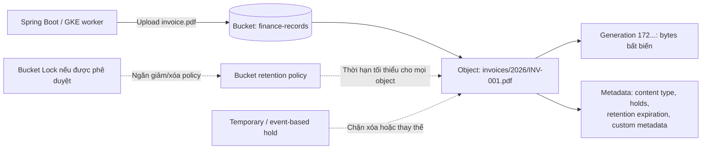
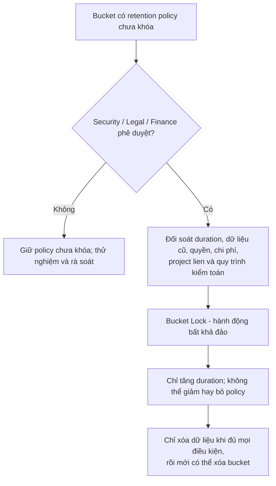
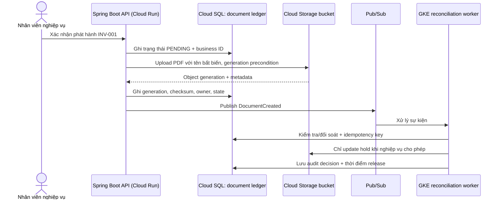
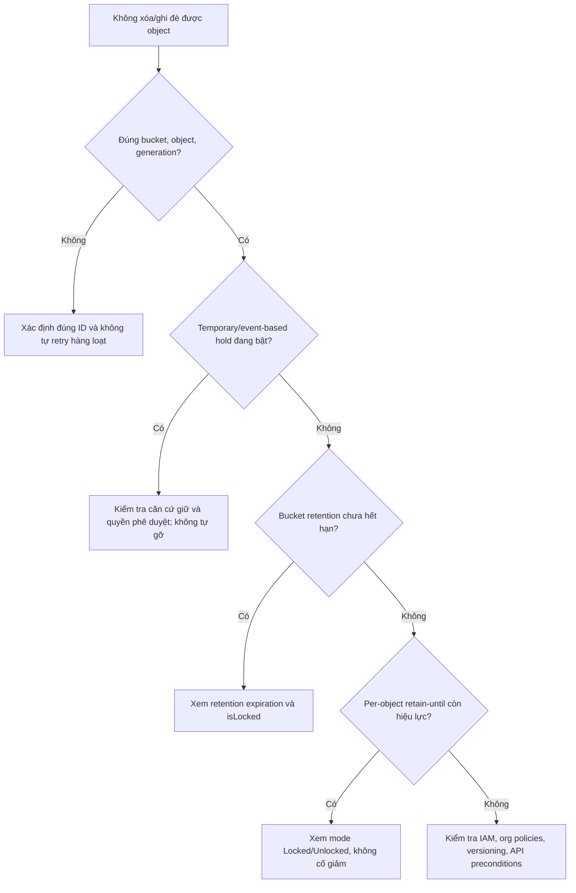

# Retention policies, Bucket Lock và object holds

## 1. Bài toán: lưu chứng từ không bị xóa hoặc thay thế quá sớm

Một hệ thống **Java/Spring Boot** ghi hóa đơn PDF, file đối soát, nhật ký giao dịch và hợp đồng vào **Google Cloud Storage**. API chạy trên **Cloud Run**, một worker trên **GKE** nhận sự kiện qua **Pub/Sub**, còn nhóm kiểm toán cần truy xuất chứng từ sau nhiều tháng hoặc nhiều năm. Một thao tác `DELETE` nhầm, một lần cập nhật object cùng tên, hay một lifecycle rule không được kiểm soát có thể xóa dữ liệu trước hạn lưu trữ mà tổ chức yêu cầu.

**Retention** là yêu cầu **giữ dữ liệu trong thời gian tối thiểu**, thường nhằm bảo vệ chứng từ, đáp ứng quy trình kiểm toán hoặc yêu cầu tuân thủ. Trong Cloud Storage, ba cơ chế chính của bài học là:

1. **Bucket retention policy:** đặt thời gian giữ tối thiểu cho **mọi object hiện có và mới** trong một bucket.
2. **Bucket Lock:** khóa retention policy của bucket để **không bao giờ giảm thời hạn hoặc xóa policy**; đây là thao tác **không thể đảo ngược**.
3. **Object holds:** gắn cờ **temporary hold** hoặc **event-based hold** cho **từng object**, ngăn xóa/thay thế trong khi hold có hiệu lực.

Bài học cũng phân biệt **Object Retention Lock** (cấu hình giữ riêng từng object), **Object Versioning**, **soft delete** và **Object Lifecycle Management** để tránh nhầm các tính năng có tên gần giống nhau.

Trong chương **Cloud Storage** của mô-đun **CLOUD_PROVIDERS_GCP**, mục tiêu là giúp người phát triển Java lựa chọn chế độ lưu giữ, bảo vệ tài nguyên bằng IAM, tích hợp tác vụ phát hành/đối soát, theo dõi chi phí và biết **khi nào không nên bật khóa vĩnh viễn**.

### Kết quả học tập

Sau bài học, bạn có thể:

- Giải thích sự khác biệt giữa `retention period`, `retention expiration time`, `effective time`, `temporary hold` và `event-based hold`.
- Xác định chính xác điều gì xảy ra với thao tác **delete, overwrite, upload cùng tên, sửa metadata** và chuyển object sang **noncurrent generation**.
- Hiểu hậu quả không thể đảo ngược của **Bucket Lock**, cả đối với bucket lẫn việc xóa project.
- Cấu hình bucket retention policy **chưa khóa**, quản lý holds bằng `gcloud storage` và kiểm chứng kết quả trong môi trường lab.
- Phân biệt Bucket Lock với **Object Retention Lock** ở cấp object và các ràng buộc không tương thích.
- Tích hợp Java client library theo nguyên tắc **generation preconditions**, IAM least privilege, audit logging và quản trị vòng đời dữ liệu.
- Thiết kế kiểm thử, vận hành và dự toán chi phí lưu trữ dài hạn mà không vô tình tạo bucket không thể xóa.

> **Cảnh báo ngay từ đầu:** khóa bucket retention policy hoặc đặt một object retention configuration ở chế độ `Locked` có thể khiến tài nguyên không thể xóa trong **nhiều năm**, tiếp tục gây chi phí, và ảnh hưởng quyền xóa project. **Không thực hiện thao tác khóa trong lab thông thường.** Ví dụ khóa trong bài chỉ để hiểu cơ chế; muốn triển khai thật phải có phê duyệt riêng của bộ phận dữ liệu/pháp chế/compliance và ngân sách dài hạn.

## 2. Mô hình dữ liệu: bucket, object, generation và metadata

Cloud Storage là **object storage**. Một bucket chứa các object; object có **tên (name)**, nội dung (data), **generation** cho phiên bản nội dung và **metageneration** cho phiên bản metadata. Khi ghi một nội dung mới cùng tên, hành vi phụ thuộc Object Versioning, retention policy và holds.



**Generation** quan trọng vì một tên object như `reports/current.csv` có thể đại diện cho nhiều phiên bản. Nếu Object Versioning được bật, phiên bản cũ có thể thành **noncurrent** khi ghi phiên bản mới. Bảo vệ retention áp dụng cho **dữ liệu của từng generation**, không có nghĩa URL/tên object vĩnh viễn hiển thị một phiên bản duy nhất.

### 2.1. Các mốc thời gian

| Khái niệm | Diễn giải | Ảnh hưởng |
| --- | --- | --- |
| **Creation time** | Thời điểm một generation của object được tạo | Điểm xuất phát thông thường để tính bucket retention period |
| **Retention period** | Thời lượng tối thiểu được cấu hình ở bucket, tính theo giây | Ví dụ `30 ngày`, mỗi ngày là 86.400 giây |
| **Retention expiration time** | Metadata cho thời điểm object đáp ứng yêu cầu lưu giữ ở bucket | Trước thời điểm này, xóa/thay thế nội dung bị từ chối |
| **Effective time** | Mốc mà bucket retention policy được đảm bảo có hiệu lực theo metadata của bucket | Dùng khi kiểm toán thay đổi policy |
| **Retain-until time** | Mốc cụ thể của **per-object retention configuration**, nếu có | Bảo vệ object theo thiết lập riêng |
| **Event-based hold release time** | Thời điểm bỏ event-based hold | **Đặt lại thời gian tính bucket retention** cho object đó |

Ví dụ bucket có retention `30 ngày`. Object được upload ngày 01/01 (giả sử không có hold); nó chỉ đủ điều kiện xóa sau khi hết 30 ngày theo metadata thực tế. Nếu object có **event-based hold**, thời gian lưu giữ theo bucket được tính lại từ **lúc release event-based hold**, không đơn giản từ lúc upload.

### 2.2. Retention không phải TTL và không tự xóa dữ liệu

Một retention policy trả lời câu hỏi **“Sớm nhất khi nào có thể xóa/thay thế?”**, không trả lời **“Chính xác khi nào tự xóa?”**. Để xóa khi đến hạn, dùng thao tác chủ động được ủy quyền hoặc **Object Lifecycle Management** với điều kiện phù hợp. Ngược lại, lifecycle `Delete` **không thể** vượt qua retention policy hoặc hold đang có hiệu lực.

## 3. Bucket retention policy: giữ tối thiểu cho toàn bucket

Khi đặt retention policy cho bucket, Cloud Storage áp dụng thời gian tối thiểu cho **object đã tồn tại** và **object mới**, không chỉ các file sẽ upload từ ngày cấu hình. Đây là khác biệt quan trọng khi bật policy trên bucket lưu dữ liệu nhiều năm.

Ví dụ một bucket có 2 object:

- Object A được tạo **1 tháng trước**, còn thiếu khoảng 11 tháng để đáp ứng policy **1 năm**.
- Object B được tạo **2 năm trước**, đã đáp ứng policy **1 năm**, có thể được xóa nếu **không bị hold hoặc cấu hình bảo vệ khác**.

Để đảm bảo thời hạn, Cloud Storage từ chối xóa/ghi đè khi object chưa đủ hạn, thường trả lỗi **`403 retentionPolicyNotMet`**. Một số thao tác metadata **vẫn có thể thực hiện**; retention bảo vệ **bytes của generation**, không tự khóa mọi trường metadata.

### 3.1. Bucket chưa khóa và bucket đã khóa

| Thao tác | Policy **chưa khóa** | Policy **đã Bucket Lock** |
| --- | --- | --- |
| Tạo policy | Có, nếu đủ quyền | Đã có policy trước khi khóa |
| Tăng retention period | Có | **Có** |
| Giảm retention period | **Có** nếu đủ quyền | **Không** |
| Xóa retention policy | **Có** nếu đủ quyền | **Không** |
| Xóa object chưa đủ hạn | **Không** nếu policy còn hiệu lực | **Không** |
| Xóa bucket đang có object chưa đủ hạn | Không, khi policy đang hiệu lực | Không; policy không thể hạ/xóa để giải phóng sớm |
| Xóa bucket sau khi mọi object đã đáp ứng và được xóa | Có, theo quy tắc thông thường | Có, nhưng phải giải quyết object/hold/versioning và điều kiện project liên quan |

**Không nhầm “policy đã đặt” với “policy đã khóa”.** Một retention policy chưa khóa vẫn bảo vệ object trong lúc có hiệu lực, nhưng **người có quyền cập nhật bucket có thể giảm hoặc xóa nó**. Bucket Lock khiến hành vi giảm/xóa bị chặn ở phía dịch vụ ngay cả với người quản trị thông thường.

### 3.2. Độ dài retention và đơn vị

Theo tài liệu Cloud Storage, thời hạn tối đa có thể lên tới **100 năm** (3.155.760.000 giây). Một ngày là 86.400 giây; một tháng trong quy ước của công cụ có thể tương đương **31 ngày**, còn năm là **365,25 ngày**. Nếu yêu cầu pháp lý nói “7 năm tính từ ngày chấm dứt hợp đồng”, hãy làm rõ cách xác định **mốc bắt đầu**, timezone và quy tắc tính thời gian, đừng mặc định “7 × 365 ngày từ ngày upload”.

Ở `gcloud storage`, có thể dùng thời lượng như `3600s`, `30d` hoặc định dạng ISO-8601 được hỗ trợ. **Đọc lại giá trị thực tế** của bucket/object sau khi cập nhật; không lấy cách nhập thời lượng trên giao diện làm bằng chứng duy nhất.

## 4. Bucket Lock: điều gì thực sự không thể đảo ngược?

**Bucket Lock** khóa chính sách giữ dữ liệu **cho toàn bucket**. Sau khi khóa:

1. Không thể **xóa** retention policy.
2. Không thể **giảm** thời gian retention; chỉ có thể **tăng**.
3. Không thể xóa bucket nếu còn các object/generations chưa đáp ứng thời gian giữ hoặc đang bị giữ bởi cơ chế khác.
4. Cloud Storage đặt **project lien** gắn với bucket đã khóa, nhằm ngăn xóa project thông thường trong khi lien còn hiệu lực; quy trình xử lý lien cần được quản trị độc lập và có trách nhiệm pháp lý.



**Ví dụ lệnh nhận diện, tuyệt đối không chạy trong lab thông thường:**

```text
# KHÔNG CHẠY LỆNH SAU TRONG LAB:
gcloud storage buckets update gs://BUCKET_NAME --lock-retention-period
```

Đây **không phải** bước dọn lab hay thao tác test vô hại. Nếu một người thực hiện lệnh trong project demo với policy 7 năm, họ có thể phải duy trì object, bucket và trách nhiệm thanh toán trong thời gian dài. **Không có “unlock” tương ứng.** Project lien không làm cho việc xóa bucket hợp lệ trước hạn; gỡ lien để xóa project **không phải một phương án bỏ qua bảo vệ dữ liệu**.

### 4.1. Cần phê duyệt gì trước khi khóa?

- **Pháp lý/tuân thủ:** đối tượng dữ liệu, quy định áp dụng, thời hạn và ngày bắt đầu tính, ngoại lệ/đề nghị hủy dữ liệu.
- **Data owner:** chính xác bucket nào, object hiện hữu có phù hợp với cùng thời hạn hay không; có cần tách bucket theo loại hồ sơ không.
- **Security/IAM:** tài khoản nào được sửa retention, người nào được phê duyệt lock, ai được gỡ holds.
- **Finance/FinOps:** dự báo tăng dung lượng, storage class, replication, soft delete/versioning và thời gian giữ tối thiểu.
- **Operations:** kế hoạch monitoring, lifecycle, migration, project lien, backup, incident response và bằng chứng kiểm toán.

**Bucket Lock giúp đáp ứng một phần nhu cầu WORM**, nhưng không tự chứng nhận tổ chức tuân thủ FINRA/SEC/CFTC, quy định ngành hay luật quốc gia. Compliance còn phụ thuộc quy trình, audit, quyền truy cập, dữ liệu đúng và hợp đồng với nhà cung cấp.

## 5. Object holds: temporary và event-based

**Object hold** là cờ metadata trên **từng object/generation**. Trong khi có hold, object không thể bị **xóa hoặc thay thế**, nhưng các metadata được phép cập nhật vẫn có thể sửa. Hai loại hold có thể đồng thời tồn tại trên một object nếu không vướng giới hạn của per-object retention.

| Đặc tính | **Temporary hold** | **Event-based hold** |
| --- | --- | --- |
| Mục tiêu | Giữ lại khi điều tra, tranh chấp hoặc lệnh legal hold chưa có ngày kết thúc | Đợi sự kiện nghiệp vụ xảy ra rồi bắt đầu chu kỳ retention |
| Cách kích hoạt | Đặt cờ cho object | Đặt cờ cho object, hoặc bật **default event-based hold** trên bucket cho object mới |
| Trong lúc đang hold | Không thể xóa/ghi đè generation | Không thể xóa/ghi đè generation |
| Khi gỡ hold và có bucket retention policy | **Không thay đổi** mốc retention của object | **Bắt đầu lại** thời gian tính retention của bucket từ lúc release |
| Khi không có retention policy hay per-object retention | Gỡ hold → có thể xóa nếu không còn ràng buộc khác | Gỡ hold → có thể xóa nếu không còn ràng buộc khác |
| Tương thích với per-object retention configuration | Có thể cùng tồn tại | **Không thể** cùng tồn tại trên một object |

### 5.1. Ví dụ dễ nhầm: hai file được giữ 1 năm

Bucket có policy **1 năm**. Ngày 01/01/2026, upload **A** với event-based hold và **B** với temporary hold.

```text
01/01/2026          A và B được tạo, đều có hold.
01/01/2027          Một năm trôi qua, cả hai vẫn không thể xóa vì hold.
01/03/2027          Bỏ hold cho A và B.

A (event-based):    bắt đầu đếm thêm 1 năm từ 01/03/2027;
                    chưa được xóa ngay.
B (temporary):      mốc retention cũ vẫn giữ;
                    có thể xóa nếu không còn điều kiện bảo vệ khác.
```

Đây là lý do **event-based hold phù hợp với hồ sơ cần lưu X năm kể từ khi một sự kiện xảy ra** (ví dụ khoản vay kết thúc), còn **temporary hold** phù hợp với điều tra chưa rõ thời điểm kết thúc, không muốn đặt lại retention period của hồ sơ.

### 5.2. Default event-based hold của bucket

Bạn có thể bật **default event-based hold** để **mọi object được tạo sau đó** mặc định mang cờ event-based hold. Phù hợp pipeline nghiệp vụ “upload trước, chờ phê duyệt/sự kiện sau, rồi giữ tiếp 7 năm”. Tùy cấu hình, thao tác này **không hồi tố cho toàn bộ object cũ**: nếu cần thêm hold cho object đã có, phải thực hiện riêng, có thể bằng Storage batch operations.

Nếu pipeline quên release hold, object có thể **nằm lại vô thời hạn** trong lúc hold còn bật, dù lifecycle delete đã đến hạn. Vì vậy phải có **sổ theo dõi business event, người phê duyệt release và cảnh báo các holds quá lâu**. Bật default hold có thể khiến quy trình xóa file tạm hoặc xử lý dữ liệu cá nhân gặp khó khăn nếu bucket trộn nhiều loại object.

### 5.3. Giới hạn cần nhớ

- **Object holds không được hỗ trợ trong bucket dùng hierarchical namespace** theo tài liệu Cloud Storage hiện hành. Kiểm tra khả năng tương thích **trước khi tạo bucket**.
- Không thể đặt **event-based hold** lên object đã có **per-object retention configuration**, và ngược lại.
- **Temporary hold** có thể cùng tồn tại với per-object retention configuration; bỏ temporary hold **không thay đổi retain-until**.
- Các cờ hold được quản lý qua các giao diện được hỗ trợ như Console, `gcloud storage` hoặc JSON API; **XML API không quản lý hold flags** mặc dù thao tác xóa qua XML API vẫn bị chặn nếu object đang hold.

## 6. Phân biệt Object Retention Lock với Bucket Lock và holds

Ngoài ba cơ chế chính, **Object Retention Lock** cho phép mỗi object có một **retain-until time** và một **retention mode** riêng. Để dùng tính năng này, bucket phải bật **per-object retention**; một khi đã bật, khả năng đó **không thể tắt** trên bucket. Với bucket hiện hữu, việc bật phải thực hiện qua **Google Cloud console** theo quy trình được hỗ trợ.

| Cơ chế | Phạm vi | Chỉnh sửa hoặc gỡ? | Khi nào chọn? |
| --- | --- | --- | --- |
| Bucket retention policy **unlocked** | Mọi object bucket, cả cũ và mới | Quản trị có quyền có thể giảm/xóa policy | Đặt chuẩn lưu giữ tối thiểu nhưng chưa khóa governance |
| **Bucket Lock** | Khóa policy giữ của **toàn bucket** | **Không thể** giảm/xóa policy | Hồ sơ đồng nhất thời hạn, yêu cầu khóa bất khả đảo đã được phê duyệt |
| **Temporary hold** | Một object | Có thể gỡ nếu đủ quyền | Điều tra/đình chỉ xóa, chưa biết ngày kết thúc |
| **Event-based hold** | Một object; có thể mặc định cho object mới | Có thể gỡ; release làm đặt lại đồng hồ bucket retention | Lưu X năm kể từ sự kiện nghiệp vụ |
| Per-object retention **Unlocked** | Một object có `retain-until` riêng | Có thể điều chỉnh/gỡ nếu có quyền phù hợp | Mỗi hồ sơ có hạn giữ khác nhau, còn linh hoạt |
| Per-object retention **Locked** | Một object có `retain-until` riêng | **Không thể** rút ngắn/gỡ; chỉ có thể kéo dài | WORM cấp object, yêu cầu lưu khác nhau và đã có phê duyệt |

Trong JSON/XML API, per-object mode `Unlocked` tương ứng **GOVERNANCE**, còn `Locked` tương ứng **COMPLIANCE** ở các giao diện liên quan. Cần phân biệt **mode Locked của object** với **Bucket Lock của retention policy**: hai cơ chế khác nhau, phạm vi khác nhau.

### 6.1. Nhiều lớp retention cùng áp dụng

Một object có thể đồng thời chịu **bucket retention policy** và **per-object retain-until time**. Khi đó nó chỉ đủ điều kiện xóa sau khi **cả hai** điều kiện thời gian được đáp ứng, đồng thời **không còn hold** và không có ràng buộc khác.

Ví dụ:

```text
Bucket retention hết hạn:     01/02/2028
Object retain-until riêng:    01/07/2028
Temporary hold:              đang bật

=> Không thể xóa trước 01/07/2028.
=> Sau 01/07/2028 vẫn không xóa được khi temporary hold còn bật.
=> Chỉ khi mọi ràng buộc đã được thỏa mãn/gỡ hợp lệ mới xóa được.
```

**Cảnh báo:** không tự chuyển object retention mode sang `Locked` để thử API. Không thể chuyển lại thành `Unlocked` hay giảm retain-until; deadline tối đa lên tới **100 năm**. Bật per-object retention cũng có thể tạo **project lien** để ngăn xóa project theo cơ chế của tính năng.

## 7. Tương tác với Versioning, soft delete và Lifecycle

### 7.1. Object Versioning: noncurrent không đồng nghĩa đã xóa vĩnh viễn

Khi **Object Versioning** được bật, ghi đè object cùng tên có thể làm generation cũ trở thành **noncurrent**; generation cũ vẫn còn trong bucket và còn bị ràng buộc retention. Tài liệu Cloud Storage cho biết **live version chưa hết hạn retention vẫn có thể chuyển thành noncurrent** theo mô hình versioning, nhưng **không thể xóa vĩnh viễn generation đó** trước khi đáp ứng retention.

Điều này đặc biệt quan trọng với `invoices/INV-001.pdf`: tên object hiện hành có thể trỏ tới **bản sửa đổi** trong khi bản cũ còn được giữ. Nếu hệ thống kiểm toán cần truy xuất đúng chứng từ đã phát hành, hãy lưu **generation ID, checksum và business document ID** trong database, thay vì chỉ lưu đường `gs://bucket/name`.

### 7.2. Soft delete: khôi phục sau khi đã cho phép xóa

**Soft delete** lưu một object đã bị xóa/ghi đè ở trạng thái có thể phục hồi thêm một khoảng thời gian. Theo cấu hình thông thường hiện hành, soft delete **bật mặc định 7 ngày** với các bucket hỗ trợ; có thể thay đổi theo giới hạn và chính sách. **Soft delete không phải retention policy**: nó chủ yếu là cơ chế **khôi phục sau xóa**, còn retention policy **ngăn xóa trước hạn**.

Một object đã đủ retention và được xóa có thể tiếp tục tồn tại trong trạng thái **soft-deleted** rồi bị xóa vĩnh viễn sau thời hạn soft delete. Dữ liệu soft-deleted vẫn có thể phát sinh **phí lưu trữ**. Đừng nhìn giao diện object thường không còn file rồi kết luận hóa đơn lưu trữ bằng 0.

### 7.3. Lifecycle: tự dọn đúng thời điểm, không vượt được bảo vệ

**Object Lifecycle Management** có thể tự thực hiện `Delete` hoặc `SetStorageClass` khi thỏa điều kiện. Rule `Delete` sẽ không có hiệu lực khi object đang có hold hoặc chưa đáp ứng retention policy; sau khi đủ điều kiện, hệ thống có thể xóa theo quy trình của dịch vụ.

Một quy tắc ví dụ:

```json
{
  "rule": [
    {
      "action": {"type": "Delete"},
      "condition": {"age": 90}
    }
  ]
}
```

Đây là cấu hình minh họa của `lifecycle.json`: “đủ 90 ngày” **không bỏ qua** hold hoặc retention dài hơn 90 ngày. Khi kết hợp với Versioning, cần hiểu rõ action trên **live/noncurrent generation** và điều kiện generation age/numNewerVersions; đừng dùng rule đơn giản này trên bucket có yêu cầu lưu trữ khác nhau mà chưa mô phỏng.

### 7.4. Lưu ý chi phí khi chọn storage class

Nearline, Coldline và Archive có mức phí storage, retrieval, operation và **minimum storage duration** khác Standard. Đặt retention dài hạn không có nghĩa cứ chuyển Archive là tối ưu: phải tính **tần suất truy xuất chứng từ, retrieval, network egress, phí xóa sớm**, soft delete và số generations được giữ. Dùng bảng giá Cloud Storage theo region/dual-region/multi-region thực tế.

### 7.5. Những tổ hợp dễ tạo “tài nguyên mắc kẹt”

| Tổ hợp | Rủi ro |
| --- | --- |
| Bucket Lock 7 năm + upload file tạm mỗi giờ | File tạm không thể xóa sớm, chi phí tăng liên tục |
| Default event-based hold + không có workflow release | File giữ mãi, lifecycle không dọn được |
| Object Versioning + retention dài | Nhiều noncurrent generations cùng tính phí và không xóa được |
| Soft delete + retention + nhiều bản sao | Sau thời hạn retention còn một giai đoạn soft-delete tính phí |
| CMEK key version mã hóa object bị lock | Không thể tùy tiện destroy key version khi object vẫn thuộc bảo vệ locked retention |
| Per-object retention Locked + chọn ngày sai | Không sửa ngắn lại được; phải chờ đến retain-until đã chọn |

## 8. Kiến trúc nghiệp vụ: Spring Boot, Pub/Sub và hồ sơ cần lưu giữ

Giả sử hệ thống thu phí phát hành chứng từ:



Với chứng từ bắt đầu tính thời hạn **từ khi phát hành**, có thể đặt bucket retention policy theo thời gian pháp lý. Với hồ sơ **đợi sự kiện hoàn tất**, cân nhắc event-based hold và release sau khi sự kiện đã được xác minh. Với hồ sơ bị điều tra, đặt **temporary hold** theo quyết định được phê duyệt. Không tự cho mọi worker quyền gỡ hold hoặc thay bucket retention.

### 8.1. Các thuộc tính cần lưu trong bảng nghiệp vụ

| Field gợi ý | Mục đích |
| --- | --- |
| `document_id` | Định danh nghiệp vụ độc lập với tên file |
| `bucket`, `object_name`, `generation` | Truy xuất chính xác generation cần đối soát |
| `crc32c` hoặc checksum được kiểm chứng | Phát hiện dữ liệu khác mong đợi |
| `retention_category`, `retention_basis` | Căn cứ xác định thời hạn giữ |
| `hold_type`, `hold_reason`, `hold_approved_by` | Truy vết quyết định giữ/gỡ hold |
| `event_at`, `release_at` | Xác định mốc bắt đầu/kết thúc nghiệp vụ |
| `retention_expiration_time` | Đối chiếu với metadata thực tế của Cloud Storage |
| `storage_class`, `location` | Theo dõi chi phí, phạm vi dữ liệu và policy |

**Cloud Storage metadata là nguồn cần kiểm chứng**, không chỉ bảng Cloud SQL. Nếu trạng thái trong DB nói “đã gỡ hold” nhưng object metadata vẫn có `eventBasedHold=true`, thao tác xóa vẫn bị Cloud Storage chặn. Cần thiết kế xử lý lỗi, retry idempotent và quy trình đối soát khi có tình trạng chưa đồng bộ.

## 9. Thực hành gcloud an toàn: retention chưa khóa và temporary hold

Lab này **không thực hiện Bucket Lock**, **không bật per-object retention Locked** và chỉ dùng bucket mới dành riêng cho thử nghiệm. Thực hiện trên **project được cấp phép**, có billing/Cloud Storage API/quyền tương ứng và không có yêu cầu pháp lý thực tế. Các lệnh dùng cú pháp **Bash** và `gcloud` đã đăng nhập; PowerShell có cú pháp tiếp dòng khác.

### Bước 1 — Tạo bucket lab mới

Chọn một tên bucket **duy nhất toàn cầu**, ví dụ theo mô hình `gcs-retention-lab-UNIQUE_SUFFIX`. Không dùng bucket production hay tên miền của người khác:

```bash
gcloud config set project PROJECT_ID
gcloud services enable storage.googleapis.com

gcloud storage buckets create gs://BUCKET_NAME \
  --project=PROJECT_ID \
  --location=us-central1 \
  --uniform-bucket-level-access

gcloud storage buckets describe gs://BUCKET_NAME
```

**UBLA** giúp quyền truy cập quản lý nhất quán bằng IAM, thay vì phụ thuộc đồng thời ACL object. Kiểm tra `soft delete` mặc định (nếu bật) để biết object sau khi xóa có thể còn tồn tại ở trạng thái phục hồi và tính phí.

### Bước 2 — Đặt retention policy **chưa khóa** trong 1 giờ

```bash
gcloud storage buckets update gs://BUCKET_NAME \
  --retention-period=3600s

gcloud storage buckets describe gs://BUCKET_NAME \
  --format="default(retention_policy)"
```

Đây là **retention có hiệu lực dù chưa khóa**. Trong lab, việc gỡ policy ở cuối cho phép dọn tài nguyên; nếu bạn cố tình đặt policy 1 năm hoặc Bucket Lock, mọi thứ sẽ hoàn toàn khác. Xem `isLocked`/`retention_policy` và `effectiveTime` nếu metadata cung cấp.

### Bước 3 — Upload file và quan sát object metadata

```bash
printf 'Document for retention lab\n' > lab-record.txt

gcloud storage cp lab-record.txt gs://BUCKET_NAME/lab-record.txt
gcloud storage objects describe gs://BUCKET_NAME/lab-record.txt

# Thao tác này dự kiến KHÔNG thành công khi retention đang hiệu lực:
gcloud storage rm gs://BUCKET_NAME/lab-record.txt
```

Kết quả kỳ vọng là **lỗi do retention policy**, không phải xóa thành công. Nếu xóa thành công, dừng và kiểm tra lại bucket/project/policy trước khi kết luận. **Không dùng `--force` hoặc cấp Owner** để “vượt” retention: đây là bảo vệ được thực thi bởi Cloud Storage.

### Bước 4 — Thử temporary hold

```bash
gcloud storage objects update gs://BUCKET_NAME/lab-record.txt \
  --temporary-hold

gcloud storage objects describe gs://BUCKET_NAME/lab-record.txt

# Vẫn bị chặn khi object đang có hold:
gcloud storage rm gs://BUCKET_NAME/lab-record.txt
```

Trong lab, object bị bảo vệ bởi **hai nguyên nhân**: bucket retention và temporary hold. Một lỗi xóa có thể chỉ ra một nguyên nhân trước, nhưng không vì thế nguyên nhân còn lại biến mất.

### Bước 5 — Gỡ temporary hold và tháo retention policy chưa khóa

```bash
gcloud storage objects update gs://BUCKET_NAME/lab-record.txt \
  --no-temporary-hold

gcloud storage buckets update gs://BUCKET_NAME \
  --clear-retention-period

gcloud storage buckets describe gs://BUCKET_NAME \
  --format="default(retention_policy)"
```

Lệnh `--clear-retention-period` **chỉ hợp lệ vì policy chưa khóa** và nếu không có chính sách tổ chức nào ngăn thao tác. Sau khi gỡ policy, object vẫn có thể bị giữ bởi **một hold khác hoặc per-object retention** nếu bạn đã thêm trong lab mở rộng.

### Bước 6 — Cleanup và đối soát sau xóa

```bash
gcloud storage rm gs://BUCKET_NAME/lab-record.txt
gcloud storage buckets delete gs://BUCKET_NAME
```

Chỉ xóa **bucket lab** đã xác nhận chính xác. Nếu bucket có soft delete enabled, tài nguyên đã xóa có thể được giữ trong thời gian phục hồi theo policy và vẫn phát sinh phí. Nếu gặp `403` khi cleanup, **không xóa project và không thử xóa project lien** để né lỗi; kiểm tra `retention_policy`, holds, object generations và IAM. Nếu bucket có các object/version khác chưa được xóa, nó vẫn chưa rỗng.

## 10. Lab mở rộng: event-based hold và thời điểm bắt đầu retention

Nên dùng **bucket lab riêng** hoặc tạo lại bucket sau phần 9. Đặt retention **chưa khóa** ngắn để kiểm chứng quy trình. Để tránh phải đợi theo thời gian thật, trước hết xem **sơ đồ mốc thời gian** và metadata thay vì cố tình giữ một object nhiều năm.

```bash
# Bật mặc định event-based hold cho object TẠO SAU thời điểm này.
gcloud storage buckets update gs://BUCKET_NAME \
  --default-event-based-hold

printf 'Loan closed event demonstration\n' > loan-record.txt
gcloud storage cp loan-record.txt gs://BUCKET_NAME/loan-record.txt
gcloud storage objects describe gs://BUCKET_NAME/loan-record.txt

# Chỉ gỡ hold khi sự kiện nghiệp vụ đã được xác minh:
gcloud storage objects update gs://BUCKET_NAME/loan-record.txt \
  --no-event-based-hold

gcloud storage objects describe gs://BUCKET_NAME/loan-record.txt
```

Khi gỡ event-based hold, **bucket retention clock bắt đầu lại**. Nếu bucket retention là `3600s`, object tiếp tục được giữ thêm khoảng 1 giờ, dù nó đã được upload trước đó. Để cleanup lab, trước tiên tắt default hold cho uploads mới, gỡ retention chưa khóa và chỉ xóa object sau khi đã kiểm tra các trạng thái:

```bash
gcloud storage buckets update gs://BUCKET_NAME \
  --no-default-event-based-hold

gcloud storage buckets update gs://BUCKET_NAME \
  --clear-retention-period

gcloud storage rm gs://BUCKET_NAME/loan-record.txt
gcloud storage buckets delete gs://BUCKET_NAME
```

**Không chạy lệnh mẫu này trên bucket có hồ sơ thật**: release event-based hold có thể làm khởi động chu kỳ retention pháp lý, và việc xóa policy chưa khóa có thể xung đột với governance. Một approval ticket hoặc business event là điều kiện để release trong production, không phải một cron job chạy theo suy đoán.

## 11. Object Retention Lock: ví dụ riêng, không trộn vào lab cleanup

Object Retention Lock yêu cầu bucket **đã bật per-object retention**. Khi tạo bucket mới, có thể bật khả năng này bằng cờ `--enable-per-object-retention`. **Khả năng được bật không thể tắt**; vì thế **không dùng lại bucket lab thông thường để thử bừa**.

Ví dụ cách khai báo trong môi trường đã được phê duyệt (chỉ minh họa, **không chạy nếu chưa đánh giá tác động**):

```text
# Tạo bucket có khả năng lưu retention riêng cho từng object:
gcloud storage buckets create gs://APPROVED_BUCKET \
  --project=PROJECT_ID \
  --location=us-central1 \
  --enable-per-object-retention

# Chỉ dùng mode Unlocked ở giai đoạn xác minh:
gcloud storage objects update gs://APPROVED_BUCKET/record.pdf \
  --retain-until=2028-02-15T05:30:00Z \
  --retention-mode=Unlocked

# Tuyệt đối không đổi thành Locked chỉ để làm lab.
```

Ngày `2028-02-15T05:30:00Z` là ví dụ cú pháp RFC 3339, **không phải thời hạn đúng cho tài liệu của tổ chức**. Thao tác giảm/gỡ một retention configuration **Unlocked** cần quyền đặc biệt và xác nhận `--override-unlocked-retention` theo yêu cầu CLI. Không có tùy chọn tương tự nào cho phép giảm mode **Locked**.

Để xem cấu hình:

```bash
gcloud storage buckets describe gs://APPROVED_BUCKET \
  --format="default(per_object_retention)"

gcloud storage objects describe gs://APPROVED_BUCKET/record.pdf \
  --format="default(retention_settings)"
```

**Không thể áp dụng event-based hold và per-object retention configuration cho cùng object.** Nếu nghiệp vụ cần giữ theo một sự kiện rồi đếm N năm, chọn **event-based hold + bucket retention**; nếu cần retain-until khác nhau từng hồ sơ, cân nhắc **per-object retention** (và temporary hold nếu cần một lệnh tạm dừng riêng).

## 12. Java client library: đặt hold có điều kiện và đọc metadata

Trong ứng dụng **Spring Boot** hoặc worker Java, có thể dùng **Cloud Storage Client Library for Java** (`com.google.cloud:google-cloud-storage`) và **Application Default Credentials (ADC)**. Trên Cloud Run/GKE/Compute Engine, ưu tiên runtime identity/service account được cấp quyền phù hợp, không đưa service account JSON key vào code hoặc image.

Ví dụ sau cố tình **không cung cấp HTTP endpoint công khai để bỏ hold**. Một thao tác thay đổi dữ liệu lưu trữ có thể ảnh hưởng compliance phải được gọi từ quy trình nghiệp vụ đã xác thực và có audit.

```java
package dev.example.documents;

import com.google.cloud.storage.Blob;
import com.google.cloud.storage.BlobId;
import com.google.cloud.storage.Storage;
import com.google.cloud.storage.StorageOptions;
import java.util.Objects;

/** Chỉ thao tác trên object của bucket do tổ chức cho phép. */
public final class DocumentHoldService {
    private final Storage storage = StorageOptions.getDefaultInstance().getService();

    /** Đọc đúng generation; quan trọng khi Object Versioning được bật. */
    public void inspect(String bucket, String name, long generation) {
        Blob blob = requireBlob(bucket, name, generation);
        System.out.println("generation=" + blob.getGeneration());
        System.out.println("temporaryHold=" + blob.getTemporaryHold());
        System.out.println("eventBasedHold=" + blob.getEventBasedHold());
        System.out.println("bucketRetentionExpires=" +
                blob.getRetentionExpirationTimeOffsetDateTime());
    }

    /** Chỉ gọi sau khi hồ sơ đã được xác định cần legal/investigation hold. */
    public void placeTemporaryHold(String bucket, String name, long generation) {
        Blob blob = requireBlob(bucket, name, generation);
        if (Boolean.TRUE.equals(blob.getTemporaryHold())) {
            return; // Idempotent: hold đã được đặt.
        }
        blob.toBuilder()
            .setTemporaryHold(true)
            .build()
            .update(Storage.BlobTargetOption.generationMatch());
    }

    private Blob requireBlob(String bucket, String name, long generation) {
        Objects.requireNonNull(bucket);
        Objects.requireNonNull(name);
        Blob blob = storage.get(BlobId.of(bucket, name, generation));
        if (blob == null) {
            throw new IllegalArgumentException("Object generation not found");
        }
        return blob;
    }
}
```

**Giải thích đoạn mã:**

- `BlobId.of(bucket, name, generation)` tránh tình trạng thao tác nhầm bản hiện hành khi object có nhiều generation.
- `generationMatch()` giúp tránh ghi update trên một generation khác do race condition; với hệ thống nhiều worker đồng thời sửa metadata, cần xét thêm **metageneration precondition** theo API và version Java client library đang dùng.
- `getTemporaryHold()` và `getEventBasedHold()` có thể trả `null` nếu field không được trả về; nếu cần bảo đảm, fetch metadata với field selection phù hợp và đừng coi null luôn có nghĩa false khi không biết fields đã được chọn.
- `placeTemporaryHold` là **thao tác có quyền**. Release hold nên là **một workflow riêng**, phải xác thực actor, kiểm tra phê duyệt, ghi audit event và kiểm chứng metadata sau cập nhật.
- Java Cloud Storage SDK **không tự vượt được** retention policy, IAM deny hoặc hold: thao tác bị cấm sẽ ném `StorageException` với lỗi API tương ứng.

### 12.1. Đăng ký service account và quyền ứng dụng

Worker tạo chứng từ chỉ cần **quyền tạo object** phù hợp; không nên có `storage.buckets.update` hay quyền quản trị retention. Worker đặt hold cần quyền cập nhật object metadata thích hợp. Một dịch vụ **retention administration** riêng mới nên có quyền thay đổi bucket policy hoặc release holds sau phê duyệt.

Với ứng dụng production, nên dùng **uniform bucket-level access**, **public access prevention**, IAM Conditions khi phù hợp, VPC Service Controls trong phạm vi được hỗ trợ và **Cloud Audit Logs Data Access** đã cấu hình theo nhu cầu kiểm toán. Tách danh tính **Cloud Run runtime service account** khỏi người quản trị bucket/compliance.

## 13. IAM, Organization Policies, audit và bằng chứng tuân thủ

### 13.1. Phân tách trách nhiệm

| Vai trò công việc | Năng lực cần thiết | Không nên có mặc định |
| --- | --- | --- |
| Java uploader | Tạo object và đọc metadata thuộc phạm vi được phép | Quyền giảm/xóa bucket retention hoặc gỡ holds |
| Case investigation officer | Đề nghị/duyệt temporary hold và release | Quyền thay policy toàn bucket nếu không cần |
| Compliance retention admin | Quản trị retention policy và quy trình lock có phê duyệt | Truy cập nội dung dữ liệu nhạy cảm ngoài nhiệm vụ |
| Infrastructure operator | Xem trạng thái bucket, lifecycle, cost, health | Quyền xóa policy locked vốn không thể thực hiện |
| Auditor | Đọc audit logs, inventory, retention state | Quyền ghi đè object hoặc cấp IAM rộng |

Các permission gợi ý gồm `storage.buckets.get`, `storage.buckets.update`, `storage.objects.get`, `storage.objects.update`; đối với per-object retention có thêm `storage.objects.setRetention` và `storage.objects.overrideUnlockedRetention`. **Không cấp `roles/storage.admin` cho mọi service account** chỉ để đơn giản hóa triển khai. Kiểm tra quyền cụ thể theo tác vụ và loại API đang sử dụng.

### 13.2. Organization Policy và quản lý thay đổi

Organization Policy Service có thể dùng các **constraints về bucket retention policy** để yêu cầu một thời hạn tối thiểu hoặc dải thời gian phù hợp khi tạo/thay đổi bucket, tùy cấu hình. Đây là một lớp governance giúp ngăn team tạo bucket ngoài tiêu chuẩn, nhưng **không thay thế quyết định Bucket Lock** cho dữ liệu WORM và không tự tạo cơ chế phê duyệt nghiệp vụ.

Khi thay retention period (kể cả policy chưa khóa), nên có:

1. Mục đích/căn cứ dữ liệu và phạm vi bucket.
2. Đánh giá các object hiện có sẽ bị ảnh hưởng **hồi tố**.
3. Dự toán byte-hours và yêu cầu soft delete/versioning.
4. Pull request/IaC plan hoặc change ticket được review.
5. Người phê duyệt tách khỏi người thực hiện.
6. Xác minh policy/hold sau thay đổi và lưu evidence không thể sửa tùy ý.

### 13.3. Audit logging

Theo dõi **Admin Activity** cho thay đổi cấu hình bucket/IAM và bật **Data Access logs** phù hợp cho hoạt động đọc/ghi object theo chính sách kiểm toán. Cloud Storage còn hỗ trợ **Detailed audit logging mode** giúp bổ sung chi tiết request/response khi dùng các cơ chế phục vụ compliance. Lưu ý Data Access logging không phải lúc nào cũng được bật mặc định cho mọi loại thao tác và có thể phát sinh chi phí.

Không lưu access token, signed URL, private key, tài liệu chứa dữ liệu cá nhân hoặc nội dung object vào log debug. Giữ **generation ID, timestamp, principal, action, request ID, change ticket** và kết quả theo quy trình cho phép.

## 14. Chi phí và kế hoạch vận hành dài hạn

Retention là **giới hạn xóa**, nên tăng duration có thể làm dữ liệu tích tụ. Cần ước tính **data intake**, retention, replication/storage class, versioning, soft delete, retrieval và operations.

### 14.1. Bài toán capacity minh họa

Giả sử mỗi ngày hệ thống tạo **10 GiB** chứng từ; lưu tối thiểu **365 ngày**, không có xóa sớm và bỏ qua compression, growth, versioning:

```text
Lưu trữ ở trạng thái ổn định xấp xỉ:
10 GiB/ngày × 365 ngày = 3.650 GiB ≈ 3,56 TiB.

Nếu bật Object Versioning và trung bình mỗi object có thêm 1 generation:
Dung lượng có thể tăng đáng kể tùy tỷ lệ rewrite và lifecycle của noncurrent.
```

Nếu có event-based holds chưa release hoặc các vụ điều tra kéo dài, kích thước có thể **tiếp tục tăng ngoài mô hình 365 ngày**. Nếu có soft delete, dữ liệu sau xóa có thể phát sinh phí trong thời gian giữ phục hồi. Đây là **mô hình dung lượng**, không phải đơn giá Google Cloud.

### 14.2. Những khoản cần đặt trong ngân sách

- **Storage GiB-month** theo region, class và location type.
- **Object Versioning**: phí các noncurrent generations.
- **Soft delete**: phí dữ liệu đang ở trạng thái soft-deleted.
- **Class minimum storage duration và retrieval** khi dùng Nearline/Coldline/Archive.
- **Operations, Class A/B requests**, data retrieval và network egress; cross-region replication nếu cấu hình.
- **Cloud Logging/Data Access** và các dịch vụ Cloud Run/GKE/Cloud SQL chạy xung quanh.

Để giảm chi phí, tách buckets theo **nhóm retention**, dùng Lifecycle Management đúng điều kiện, chọn storage class theo tần suất đọc và tạo **Cloud Billing budgets/alerts**. **Budget alert không tự xóa object hay ngắt billing**. Không dùng việc gỡ một retention policy đã khóa làm “phương án tối ưu chi phí”, vì điều đó không được Cloud Storage hỗ trợ.

## 15. Chẩn đoán lỗi retention và holds

| Triệu chứng | Nguyên nhân có thể | Hướng kiểm tra |
| --- | --- | --- |
| `403 retentionPolicyNotMet` khi xóa object | Bucket retention chưa hết hạn | Bucket policy, object `retentionExpirationTime`, event-based hold history |
| `400` khi giảm retention period | Bucket retention policy đã khóa | `retention_policy.isLocked`, change history; không có unlock |
| Gỡ temporary hold nhưng vẫn xóa không được | Retention chưa hết, event-based hold hoặc per-object retention còn áp dụng | Kiểm tra **tất cả** trạng thái bảo vệ |
| Gỡ event-based hold rồi object phải giữ thêm nhiều năm | Bucket retention clock bắt đầu lại tại release | Retention period và thời điểm release thực tế |
| Ghi cùng tên thất bại | Object vẫn bị hold/retention; hoặc generation precondition | Kiểm tra versioning, source generation và API error |
| Lifecycle `Delete` không dọn object đã quá `age` | Hold hoặc retention vẫn còn, hoặc lifecycle execution chưa chạy | Object metadata, rule conditions, event timeline |
| Không xóa được bucket | Còn objects/noncurrent generations/retained objects hoặc bucket soft-delete workflow | Liệt kê versions, holds, retention, soft-delete settings |
| Không xóa được project | Project lien do locked bucket/object retention hoặc policy khác | List project liens, change approvals; không gỡ chỉ để “fix nhanh” |
| `403` khi tạo/sửa policy | Thiếu IAM hoặc Organization Policy constraint | IAM permissions, project/bucket policy, org constraints |
| Gắn event-based hold thất bại | Object đã có per-object retention configuration | Kiểm tra `retention_settings`, chọn cơ chế phù hợp |
| Hold flags không hiển thị qua XML API | Giao diện XML API không quản lý flags | Dùng Console, `gcloud storage` hoặc JSON API |
| Hóa đơn lớn sau khi xóa | Soft-delete retention, generations, storage class hoặc request charges | Billing SKUs, soft-deleted inventory và data growth |

### Quy trình điều tra không phá dữ liệu



**Không dùng `--force`, tăng IAM lên Owner hay chạy script xóa nhiều objects trước khi biết nguyên nhân.** Với dữ liệu thuộc điều tra/pháp lý, việc một lệnh bị từ chối có thể là hành vi đúng theo yêu cầu lưu giữ.

## 16. Bài tập và checklist

### Bài A — Chọn công cụ đúng

Phân loại năm tình huống:

1. Hóa đơn phải giữ **ít nhất 7 năm từ ngày phát hành** → bucket retention policy, cân nhắc Bucket Lock **sau khi được phê duyệt**.
2. Hợp đồng phải giữ **5 năm từ ngày kết thúc** → event-based hold + retention policy, release sau khi xác minh sự kiện.
3. Một file đang bị cơ quan điều tra yêu cầu giữ **không rõ ngày kết thúc** → temporary hold.
4. Mỗi khách hàng có ngày hủy riêng, các file có retain-until khác nhau → cân nhắc Object Retention Lock cấp object.
5. Người dùng xóa nhầm file và muốn khôi phục trong 7 ngày → soft delete/Versioning theo trường hợp, không đồng nhất với retention bắt buộc.

Giải thích vì sao các cơ chế có thể cùng tồn tại và điều kiện nào quyết định việc **được xóa cuối cùng**.

### Bài B — Tính retention và hold release

Bucket có retention **1 năm**. File A/B được upload cùng ngày và cùng được giữ một năm; A có event-based hold, B có temporary hold. Sau **18 tháng**, cả hai holds được gỡ. Hãy giải thích file nào được phép xóa ngay, file nào phải giữ thêm 1 năm, và vì sao.

### Bài C — Lab policy chưa khóa

Trong project test được cấp phép, tạo bucket, đặt `--retention-period=3600s` **chưa khóa**, upload file, thử xóa, đặt temporary hold, gỡ hold, **clear policy** rồi dọn bucket. Ghi lại metadata trước/sau và mã lỗi. Không chạy lệnh Bucket Lock hoặc tạo retention mode Locked.

### Bài D — Thiết kế Java ingestion

Đề xuất API/phần luồng xử lý nhận PDF hóa đơn từ Cloud Run, upload sang Cloud Storage, ghi **generation, checksum** vào Cloud SQL, publish sự kiện Pub/Sub và đối soát bởi GKE worker. Thiết kế idempotency, quyền runtime, generation-match preconditions và audit khi thay đổi hold.

### Bài E — Dự toán dài hạn và compliance

Với 10 GiB chứng từ mới/ngày, thời hạn giữ 365 ngày, tính lượng dữ liệu xấp xỉ ở trạng thái ổn định. Bổ sung các giả định về Versioning, soft delete, class minimum storage duration, audit logs và yêu cầu phê duyệt trước Bucket Lock. Giải thích vì sao chọn nhầm 10 năm thay vì 10 ngày là rủi ro vận hành nghiêm trọng.

### Checklist trước khi triển khai thật

- [ ] Tôi xác định rõ **loại dữ liệu, người sở hữu, thời hạn và mốc bắt đầu giữ**.
- [ ] Tôi phân biệt bucket retention policy chưa khóa với **Bucket Lock bất khả đảo**.
- [ ] Tôi hiểu release event-based hold **đặt lại đồng hồ bucket retention**, khác temporary hold.
- [ ] Tôi biết không thể đồng thời dùng event-based hold và per-object retention trên cùng object.
- [ ] Tôi phân biệt per-object `Unlocked/Locked` với bucket policy lock.
- [ ] Tôi kiểm tra Object Versioning, soft delete, lifecycle, storage class và hold compatibility.
- [ ] Tôi biết quy trình IAM ít quyền nhất, phê duyệt độc lập, audit logging và project lien.
- [ ] Java service của tôi lưu object `generation`, dùng concurrency preconditions và có workflow gỡ hold được phê duyệt.
- [ ] Tôi đã thử tình huống `403`, cleanup trong **bucket lab chưa khóa** và xác minh metadata.
- [ ] Tôi đã dự toán tăng trưởng byte-hours, phiên bản cũ, soft-delete và audit logs.
- [ ] Tôi **không khóa** retention policy hoặc object mode chỉ vì muốn thử tính năng.

**Kết luận:** Retention policies, Bucket Lock và object holds cho phép Cloud Storage bảo vệ hồ sơ khỏi việc xóa hoặc thay thế trước thời điểm hợp lệ, nhưng **mỗi cơ chế có ranh giới và hậu quả khác nhau**. Với hệ thống Java trên GCP, thiết kế tốt kết hợp dữ liệu có **generation ID**, workflow nghiệp vụ có phê duyệt, IAM tách quyền, audit logging, Lifecycle Management và ngân sách lưu trữ. Đặc biệt, **chỉ khóa vĩnh viễn khi thời hạn, phạm vi dữ liệu và trách nhiệm vận hành đã được xác nhận đầy đủ**.

## 17. Tài liệu Google Cloud tham khảo

- [Bucket Lock — khái niệm, retention policies và tính bất khả đảo](https://cloud.google.com/storage/docs/bucket-lock)
- [Use and lock retention policies — Console, gcloud và Java](https://cloud.google.com/storage/docs/using-bucket-lock)
- [Object holds — temporary vs event-based, reset retention clock](https://cloud.google.com/storage/docs/object-holds)
- [Use object holds — default event-based và lệnh CLI](https://cloud.google.com/storage/docs/holding-objects)
- [Object Retention Lock — per-object Locked/Unlocked](https://cloud.google.com/storage/docs/object-lock)
- [Enable and use object retention configurations](https://cloud.google.com/storage/docs/using-object-lock)
- [Object Versioning](https://cloud.google.com/storage/docs/object-versioning)
- [Soft delete overview](https://cloud.google.com/storage/docs/soft-delete)
- [Object Lifecycle Management](https://cloud.google.com/storage/docs/lifecycle)
- [Cloud Storage Audit Logs](https://cloud.google.com/storage/docs/audit-logging)
- [Cloud Storage IAM roles](https://cloud.google.com/storage/docs/access-control/iam-roles)
- [Cloud Storage pricing](https://cloud.google.com/storage/pricing)
