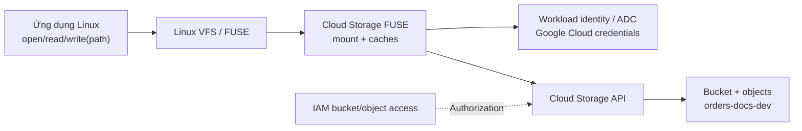
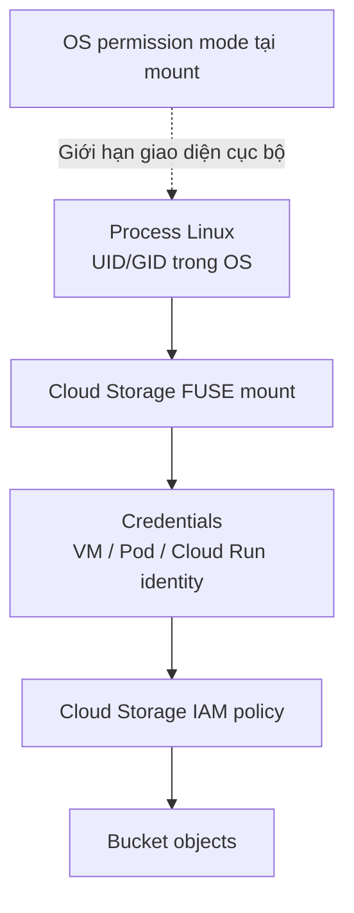
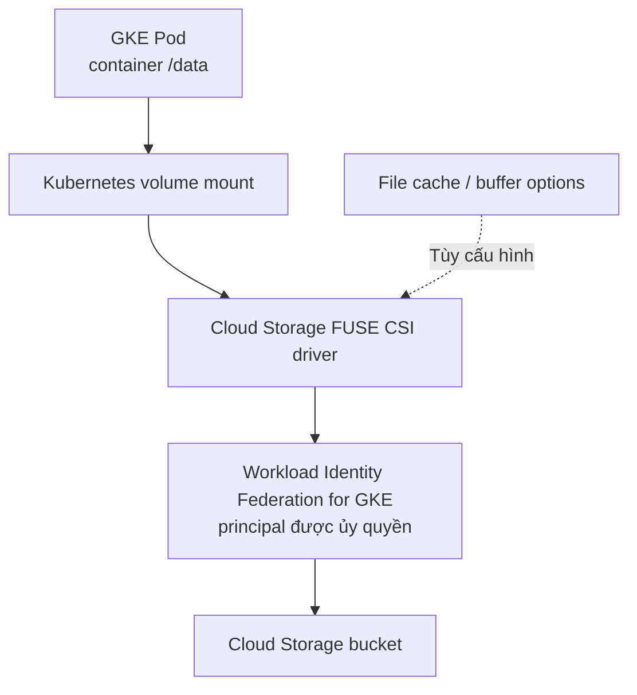

# Cloud Storage FUSE và giới hạn khi dùng như filesystem

Nhiều ứng dụng chỉ biết đọc và ghi theo đường dẫn tệp như `/data/images/product-001.jpg`, trong khi Google Cloud Storage cung cấp **object storage** với bucket, object và API. **Cloud Storage FUSE** (thường gọi là `gcsfuse`) giúp một tiến trình trên Linux hoặc một môi trường tích hợp được hỗ trợ truy cập object trong bucket thông qua **đường dẫn giống hệ thống tệp**. Khả năng này rất tiện khi chuyển ứng dụng lên Google Cloud, nhưng **giao diện mount không biến Cloud Storage thành một filesystem POSIX đầy đủ**.

Bài học thuộc chương **Cloud Storage** của module `CLOUD_PROVIDERS_GCP`. Kiến thức kết nối với project/IAM, VPC, Compute Engine, GKE, Cloud Run và các hệ thống xử lý dữ liệu. Người học cần biết khi nào dùng Cloud Storage FUSE để tái sử dụng ứng dụng, khi nào nên dùng Cloud Storage API trực tiếp hoặc chuyển sang block/file storage, và cách bảo vệ dữ liệu, tự động hóa phát hành, theo dõi độ tin cậy cùng chi phí.

> Các lệnh và tên tài nguyên dưới đây sử dụng project, bucket, service account giả định. Chỉ thực thi trong môi trường được phép và xác nhận phiên bản Cloud Storage FUSE, hình thức mount, quyền IAM, khả năng tính năng, quota và giá hiện hành trước khi triển khai production.

## 1. Mục tiêu học tập

Sau bài này, bạn có thể:

1. Phân biệt **Cloud Storage object** với **file, directory và inode** của filesystem truyền thống.
2. Giải thích cách Cloud Storage FUSE ánh xạ **bucket/object name** thành **mount point/path** và gửi yêu cầu tới Cloud Storage.
3. Nhận diện giới hạn về **POSIX semantics, rename, ghi sửa tại chỗ, file locking, concurrent writes, metadata và directory behavior**.
4. Hiểu khác biệt giữa **tính nhất quán của Cloud Storage** và **độ mới dữ liệu quan sát qua FUSE caches**.
5. Thiết kế **xác thực qua Application Default Credentials (ADC)/workload identity**, IAM, bucket access và đường mạng.
6. Thực hành mount bucket trên Compute Engine, xác minh upload/read, unmount và chẩn đoán lỗi phổ biến.
7. Phân tích việc dùng **Cloud Storage FUSE CSI driver trên GKE**, và các hình thức volume mount được Cloud Run hỗ trợ.
8. Quyết định khi nào dùng **Cloud Storage FUSE, Cloud Storage client library/API, Filestore/NetApp Volumes hoặc Persistent Disk/Hyperdisk**.
9. Dự trù hiệu năng, request costs, egress, cache và bảo vệ dữ liệu trước khi đi vào vận hành.

## 2. Cloud Storage là object storage, không phải ổ đĩa POSIX

Cloud Storage lưu object trong **bucket**. Một object có **tên (name/key)**, nội dung (bytes), metadata và generation; thông thường bạn thao tác qua API như create/upload, read/download, list và delete. Hình thức tên `reports/2026/q4.csv` trông như đường dẫn nhiều thư mục nhưng về bản chất là **tên object** theo mô hình bucket đang sử dụng.

Trong một filesystem Linux, ứng dụng quen thuộc với:

- `open()`, `read()`, `write()`, `close()`.
- Các directory, symbolic link, permission bits, ownership và đôi khi extended attributes.
- `rename()`, `append`, thay một đoạn file hoặc mở nhiều file descriptors.
- File locks và phối hợp nhiều tiến trình, thậm chí nhiều máy.
- Các kỳ vọng về **độ trễ thấp** và metadata operations cục bộ.

Trong Cloud Storage, mỗi object được lưu trữ qua dịch vụ phân tán, với **API semantics và network round trips**. Cloud Storage FUSE phải ánh xạ các thao tác POSIX-like sang các thao tác object. Vì thế, **không phải thao tác file nào cũng có ánh xạ tương đương**, và ứng dụng không thể giả định mount Cloud Storage hoạt động như ext4, XFS, NFS hay SMB.

### 2.1. Ví dụ ánh xạ tên

Giả sử bucket chứa:

```text
gs://orders-docs-dev/
├── images/product-001.jpg
├── images/product-002.jpg
└── reports/2026/q4.csv
```

Khi mount bucket vào `/mnt/orders-docs` trên Linux, ứng dụng có thể nhìn thấy:

```text
/mnt/orders-docs/
├── images/
│   ├── product-001.jpg
│   └── product-002.jpg
└── reports/
    └── 2026/
        └── q4.csv
```

Ở bucket dùng **flat namespace**, những “thư mục” có thể được suy ra từ tiền tố tên object hoặc được biểu diễn bằng marker theo hành vi công cụ. Bucket bật **hierarchical namespace** hỗ trợ khái niệm folder theo khả năng dịch vụ tương ứng; đây là một cấu hình bucket khác và không tự biến toàn bộ Cloud Storage API thành POSIX filesystem.

### 2.2. So sánh ba cách dùng dữ liệu

| Cách truy cập | Ví dụ thao tác | Phù hợp khi | Điểm cần nhớ |
| --- | --- | --- | --- |
| **Cloud Storage API/SDK** | `storage.Client().bucket(...).blob(...).upload_from_file(...)` | Ứng dụng cloud-native thao tác object và cần kiểm soát retries, generations, metadata. | Phản ánh rõ object semantics, dễ quản lý concurrency/preconditions. |
| **Cloud Storage FUSE** | `open("/mnt/orders-docs/images/a.jpg")` | Ứng dụng có sẵn yêu cầu file path, đọc dữ liệu lớn, ML/data processing hoặc công cụ chưa tích hợp API. | Tiện tương thích nhưng không đảm bảo mọi POSIX operation. |
| **File/block storage** | Mount NFS/SMB hoặc gắn disk vào VM. | Cần file locking, shared POSIX/Windows file semantics hoặc sửa nội dung trên disk ở độ trễ thấp. | Có mô hình hiệu năng, quản trị và khả năng chia sẻ khác object storage. |

## 3. Cloud Storage FUSE hoạt động như thế nào?

Cloud Storage FUSE sử dụng cơ chế **Filesystem in Userspace (FUSE)** để đưa các thao tác truy cập file từ ứng dụng vào tiến trình/tích hợp FUSE, rồi trao đổi dữ liệu với Cloud Storage thông qua các API được hỗ trợ.



Luồng đọc/ghi có thể khác nhau theo phiên bản và cấu hình caching/streaming. Không nên coi mỗi lệnh `read()` là đúng một API request, hoặc mỗi `write()` lập tức tạo một object có thể đọc từ máy khác.

### 3.1. Vai trò của các lớp

| Lớp | Nhiệm vụ | Hệ quả vận hành |
| --- | --- | --- |
| Ứng dụng | Đọc/ghi path như file Linux. | Có thể cần sửa ứng dụng nếu dựa vào POSIX features không hỗ trợ. |
| Kernel FUSE/VFS | Chuyển yêu cầu filesystem sang userspace daemon/tích hợp. | Có overhead chuyển ngữ cảnh và hành vi hệ điều hành khác disk thật. |
| Cloud Storage FUSE | Ánh xạ path và thao tác, sử dụng cache/temporary files khi cấu hình. | Cache ảnh hưởng hiệu năng, memory/disk và độ mới dữ liệu. |
| Cloud Storage API | Đọc/tạo/list/xóa object theo quyền và điều kiện của dịch vụ. | Chịu network latency, request quotas, retry và chi phí operation. |
| Bucket/IAM | Lưu object và kiểm soát identity của caller. | OS user/UID trên VM không tự có quyền IAM ở bucket. |

### 3.2. Đây không phải đồng bộ hai chiều toàn bộ thư mục cục bộ

Một mount FUSE **không phải** công cụ `rsync` tự động sao chép hết bucket về máy. Nó trình bày một đường dẫn; các operation sẽ gọi dịch vụ theo nhu cầu và cache policy. Ngược lại, tháo mount không xóa bucket hay object trên Google Cloud.

Khi ứng dụng ghi file mới, cơ chế hoàn tất upload/cập nhật object phụ thuộc **phiên bản FUSE, chế độ ghi và các giới hạn API**; phải đóng và xác minh file, kiểm tra lỗi upload và không suy luận rằng dữ liệu đã bền vững chỉ vì một tiến trình gọi `write()` thành công.

## 4. Giới hạn filesystem quan trọng nhất

### 4.1. Cloud Storage FUSE không có đầy đủ POSIX semantics

Nên coi FUSE là một **lớp tương thích file path** cho object storage, không phải filesystem thay thế ext4/XFS/NFS/SMB trong mọi ứng dụng.

| Hành vi ứng dụng kỳ vọng | Điều cần lưu ý với Cloud Storage FUSE | Hệ quả |
| --- | --- | --- |
| **Ghi sửa một đoạn của file có sẵn** | Cloud Storage không cập nhật một khoảng byte bất kỳ ngay bên trong object bằng kiểu block write thông thường. | Việc thay đổi có thể cần upload lại object hoặc qua cơ chế cache/writeback; tốn băng thông và operations. |
| **Append file nhỏ liên tục** | Mỗi lần đóng/commit có thể dẫn tới thay đổi toàn object thay vì append in-place. | Không phù hợp các tệp log ghi liên tục như local disk. |
| **Rename file** | Trong flat namespace, rename object thường đòi copy/rewrite và xóa tên cũ; không mặc nhiên atomic. | Consumer có thể thấy trạng thái trung gian; không dùng rename như atomic commit nếu chưa xác minh. |
| **Rename cả thư mục** | Flat namespace thường có nhiều object cần xử lý; hierarchical namespace có những khả năng folder operations riêng khi được hỗ trợ. | Cần kiểm tra loại bucket và phiên bản FUSE, không mặc định atomic toàn thư mục. |
| **File locking đa client** | Cloud Storage FUSE không cung cấp semantics file lock phân tán tương đương shared POSIX filesystem. | Không để hai writer dựa vào `flock()`/`fcntl()` làm cơ chế đồng bộ duy nhất. |
| **Nhiều tiến trình cùng sửa một path** | Không mặc nhiên có cơ chế phối hợp ghi tương tự NFS/SMB. | Có nguy cơ ghi đè hoặc mất cập nhật, cần ownership/precondition ở cấp object/app. |
| **Ownership, chmod/chown, ACL, xattrs** | Metadata POSIX có thể chỉ được mô phỏng hoặc không có khả năng lưu/áp dụng như filesystem thật. | Bảo mật thực sự dựa trên IAM và chính sách dịch vụ, không dựa duy nhất vào permission bits hiển thị tại mount. |
| **Filesystem watcher/inotify** | Thay đổi object từ client khác không nhất thiết tạo sự kiện watcher theo kỳ vọng filesystem cục bộ. | Không dựa vào inotify làm cơ chế thông báo object changes đáng tin cậy. |
| **Random I/O, mmap, hard link, symlink** | Một số syscall/hành vi có thể không được hỗ trợ hoặc có đặc điểm khác tùy phiên bản. | Kiểm thử ứng dụng với đúng syscall thay vì chỉ kiểm tra `ls`/`cp`. |
| **Low-latency metadata lookups** | `stat`, `list` hoặc mở nhiều file có thể cần API/network nếu cache miss. | Workload hàng triệu file nhỏ có thể chậm hoặc tốn request fees. |

Không nên dựa vào một bảng đặc tính chung để suy ra mọi syscall luôn thất bại: **mỗi tính năng và phiên bản Cloud Storage FUSE có phạm vi hỗ trợ riêng**. Điều cốt lõi là phải kiểm chứng các yêu cầu POSIX đặc thù trên nền tảng thực tế trước khi chuyển production.

### 4.2. Tình huống nguy hiểm: dùng rename làm atomic commit

Trên filesystem truyền thống, một pattern phổ biến:

```text
1. Ghi vào report.tmp
2. fsync/close
3. rename(report.tmp, report.csv)
4. Reader đọc report.csv
```

Nhiều ứng dụng dựa vào ý tưởng: **rename là điểm chuyển trạng thái atomic**. Khi file được đại diện bởi object trong Cloud Storage, việc rename có thể là chuỗi thao tác **copy + delete**, nên không mặc định có cùng bảo đảm.

**Thiết kế thay thế:** ghi object với **tên version bất biến**, ví dụ `reports/2026/q4/v0007.csv`; khi hoàn tất, cập nhật một **manifest/pointer** bằng cơ chế kiểm soát generation hoặc giao dịch ở hệ thống metadata phù hợp. Reader chỉ dùng object version được manifest chỉ đến. Cách này cũng cần thiết kế cho trường hợp một writer bị lỗi giữa chừng.

### 4.3. Tình huống nguy hiểm: database đặt trên FUSE mount

Các cơ sở dữ liệu như PostgreSQL, MySQL hoặc SQLite thường phụ thuộc:

- Random writes và fsync/durability theo filesystem semantics.
- Locking, rename atomic, transaction log/WAL.
- Độ trễ thấp và consistency khi nhiều tiến trình thao tác.

**Không đặt thư mục dữ liệu đang hoạt động của database lên Cloud Storage FUSE** nếu ứng dụng yêu cầu các bảo đảm POSIX/block storage đó. Đối với managed relational database, ưu tiên **Cloud SQL** hoặc giải pháp database phù hợp; nếu tự vận hành database trên Compute Engine thì chọn **Persistent Disk/Hyperdisk** theo hướng dẫn của database. Cloud Storage vẫn có thể dùng để chứa **backup/export file** của database khi được thực hiện đúng quy trình.

### 4.4. Tình huống nguy hiểm: ghi log liên tục

Một dịch vụ ghi thêm một dòng vào `app.log` mỗi vài mili giây sẽ tạo nhiều thao tác nhỏ. Cloud Storage FUSE không phải một đích local append-log tối ưu. Tốt hơn:

- Gửi stdout/stderr hoặc structured logs vào **Cloud Logging**.
- Nếu cần lưu file log, gom/chốt file thành những **object bất biến** theo thời gian hoặc batch.
- Dùng Cloud Storage lifecycle và retention phù hợp cho log archive, không nhầm với real-time log streaming.

## 5. Directory semantics: flat namespace và hierarchical namespace

### 5.1. Flat namespace

Với bucket có flat namespace, object tên `assets/icons/logo.svg` **không nhất thiết** được lưu như một entry bên trong thư mục thật `assets/icons`. Công cụ file listing suy diễn cấu trúc theo dấu `/` trong object name và những quy tắc marker liên quan.

Điều này dẫn tới các câu hỏi:

- Thư mục rỗng có được trình bày/giữ lại theo cơ chế hiện tại không?
- Xóa/rename “thư mục” có nghĩa gì khi bên dưới có hàng nghìn object?
- Chương trình có cần phân biệt folder thực và prefix không?
- Tool có dùng `--implicit-dirs` hoặc cơ chế directory tương đương khi mount không?

Không giả định `mkdir empty-dir` trên bucket flat namespace có kết quả giống tạo directory inode trên ext4 trong mọi cấu hình.

### 5.2. Hierarchical namespace (HNS)

Cloud Storage có **hierarchical namespace-enabled buckets** hỗ trợ các thao tác quản lý folder theo cơ chế riêng. Một số thao tác folder, bao gồm khả năng rename folder hiệu quả/atomic trong những phạm vi được hỗ trợ, khác với mô hình prefix của bucket flat namespace.

Tuy vậy:

- Phải **tạo bucket với cấu hình HNS phù hợp**; không suy luận bucket hiện có đều hỗ trợ.
- Cloud Storage FUSE/driver phải có phiên bản và tính năng tương thích.
- HNS **không xóa toàn bộ giới hạn POSIX** về locking, sửa byte ngẫu nhiên hoặc file ownership.
- Hãy kiểm tra location, khả năng sản phẩm tích hợp và tổ chức dữ liệu trước khi chọn HNS chỉ vì một chức năng rename.

### 5.3. Managed folders, IAM và filesystem directory

**Managed folders** là cơ chế Cloud Storage quản lý quyền trên nhóm object theo prefix trong những cấu hình IAM được hỗ trợ. Chúng phục vụ quản lý access policy, **không có nghĩa** tự cung cấp đầy đủ directory semantics cho chương trình Linux.

Phân biệt ba khái niệm:

1. **Prefix** trong tên object.
2. **Folder** trong hierarchical namespace.
3. **Managed folder** dùng cho phân quyền.

Đừng coi ba thứ đó hoàn toàn tương đương với một thư mục POSIX có owner/mode bits.

## 6. Tính nhất quán dữ liệu và tác động của caches

### 6.1. Cloud Storage nhất quán, FUSE mount có thể quan sát cache cũ

Cloud Storage cung cấp các bảo đảm **strong consistency** cho những thao tác object được tài liệu dịch vụ mô tả, bao gồm object read, list và metadata sau những cập nhật thành công trong phạm vi hỗ trợ.

Nhưng ứng dụng truy cập qua Cloud Storage FUSE còn gặp **caches trong FUSE và hệ điều hành**. Ví dụ:

1. VM A `stat`/đọc object `config.json` và lưu cache.
2. VM B thay object bằng Cloud Storage API.
3. VM A đọc lại trong khoảng cache còn hiệu lực.
4. VM A **có thể vẫn thấy metadata/nội dung cũ** theo chính sách cache, dù Cloud Storage đã có version mới.

**Vì vậy “Cloud Storage strongly consistent” không đồng nghĩa “mọi FUSE mount thấy thay đổi ngay lập tức trong mọi cấu hình”.**

### 6.2. Những loại cache thường gặp

| Loại cache | Hữu ích cho | Rủi ro/chi phí |
| --- | --- | --- |
| **Stat cache** | Giảm request đọc metadata khi nhiều lần `stat`/`open` cùng path. | Có thể giữ kích thước/thời gian sửa đổi cũ; tốn bộ nhớ tùy cấu hình. |
| **Type cache** | Giảm request xác định path là file hay directory. | Có thể thấy trạng thái cũ sau create/delete/rename. |
| **List cache** (khi hỗ trợ) | Tăng tốc liệt kê directory/prefix lặp lại. | Directory listing có thể không phản ánh ngay object mới. |
| **File cache** (khi bật) | Tái sử dụng dữ liệu object đọc nhiều lần, giảm tải network. | Tốn local disk; cần quản lý dung lượng, eviction, invalidation. |
| **Kernel/page cache** | Giảm số lần đọc dữ liệu từ userspace/network. | Có thể thêm một lớp cache ảnh hưởng đến tính mới dữ liệu. |

**Trade-off:** TTL dài tăng hiệu năng và giảm API requests nhưng tăng nguy cơ stale reads. TTL ngắn tăng khả năng nhìn thấy cập nhật mới nhưng có thể phát sinh nhiều request metadata, latency và chi phí hơn.

### 6.3. Khi nào giảm caching?

Nếu nhiều writer thay cùng một object và reader cần nhìn thấy gần thời gian thực, giảm TTL hoặc tắt những cache liên quan theo cấu hình được hỗ trợ có thể giúp quan sát trạng thái mới hơn, **nhưng không cung cấp distributed locking hay transaction semantics**.

Thiết kế tốt hơn là:

- **Object bất biến/versioned names:** writer tạo object mới, reader không cần tranh chấp ghi vào tên cũ.
- **Object generation preconditions:** khi dùng Cloud Storage API, ngăn cập nhật trái kỳ vọng bằng điều kiện như `ifGenerationMatch`.
- **Manifest hoặc metadata DB:** quản lý tên version hiện hành bằng hệ thống có quy tắc concurrency rõ.
- **Event-driven pipeline:** xử lý thay đổi object thông qua sự kiện được hỗ trợ, kèm idempotency/retry.

Không sử dụng `sleep 2` hay xóa cache thủ công làm cơ chế đồng bộ duy nhất trong luồng nghiệp vụ quan trọng.

## 7. Hiệu năng: điều gì làm FUSE mount nhanh hoặc chậm?

### 7.1. Workload phù hợp

Cloud Storage FUSE có thể phát huy giá trị khi:

- Nhiều tiến trình **đọc file lớn hoặc object bất biến** qua tên file, ví dụ tập dữ liệu machine learning và inference assets.
- Ứng dụng batch đọc một tập file, xử lý rồi **ghi object kết quả riêng**.
- Pipeline dữ liệu cần tái sử dụng thư viện nhận **filesystem path** nhưng dữ liệu thực nằm trong Cloud Storage.
- Workload có thể **cache dữ liệu đọc lại**, gom nhiều thao tác và chịu được độ trễ mạng.

### 7.2. Workload cần cân nhắc rất kỹ

- Ứng dụng gọi `stat` hoặc `readdir` trên hàng triệu file nhỏ.
- Database, queue state, Git repository active, package cache yêu cầu low-latency random write hoặc atomic rename.
- Trình biên dịch tạo/xóa hàng nghìn file nhỏ liên tục.
- Nhiều VM cùng cập nhật một file cấu hình/manifest mà không có giao thức phối hợp.
- Workload xử lý file bằng cách ghi một đoạn giữa file, sync liên tục hoặc dùng file locks.
- Ứng dụng trông chờ **permission bits/ACL của filesystem** thay thế IAM.

### 7.3. Các chỉ số phải đo

| Chỉ số | Ý nghĩa | Cần so với |
| --- | --- | --- |
| **Read throughput (MiB/s)** | Tốc độ đọc dữ liệu từ bucket qua mount. | Tốc độ đọc cần thiết, VM network/CPU, cache hit. |
| **Write throughput (MiB/s)** | Tốc độ tạo/hoàn tất upload object. | Kích thước file, tốc độ commit, quota/API limits. |
| **Latency open/stat/list** | Overhead metadata và network. | Nhu cầu ứng dụng nhiều file nhỏ. |
| **Object operations/s** | Lượng request API do FUSE tạo. | Quota, giới hạn dịch vụ và chi phí operation. |
| **Cache hit ratio** | Tỉ lệ dữ liệu/metadata phục vụ từ cache. | Local disk/memory và yêu cầu độ mới. |
| **Mount errors/retries** | Vấn đề xác thực, network, quota và sự cố dịch vụ. | Logs/metrics của FUSE và app. |
| **Time-to-first-byte / p95 latency** | Độ trễ đuôi thực tế của người dùng. | SLO và yêu cầu xử lý batch. |

Đừng dùng một benchmark `dd` ngắn với dữ liệu đã cache để kết luận đường truyền tới Cloud Storage đạt throughput thực. Cần đo cả **cache cold**, **cache warm**, file nhỏ và file lớn theo pattern của ứng dụng.

### 7.4. Vị trí, mạng và chi phí request

Compute Engine VM/GKE cluster gần location bucket thường giảm độ trễ và có thể giảm một số chi phí network so với thiết kế xuyên vùng, tùy chính sách giá. Nhưng việc gọi Cloud Storage **vẫn thông qua các cơ chế API/network**, không phải một disk attach cục bộ.

Các yếu tố:

1. Bucket location: region/dual-region/multi-region theo nhu cầu dữ liệu.
2. Workload location: VM zone/region hoặc GKE cluster nơi ứng dụng chạy.
3. Object size và request pattern.
4. Cache hit và nhu cầu cập nhật file.
5. IAM, DNS, Private Google Access/Private Service Connect cho Google APIs hoặc Cloud NAT khi đường mạng thực tế yêu cầu.
6. Quota, retry/backoff và request rates đối với bucket/prefix.

Không coi cache là cách duy nhất để giải quyết performance; nếu ứng dụng bản chất cần file system có lock và random write, **đổi loại storage** có thể hợp lý hơn việc tiếp tục tuning FUSE.

## 8. Bảo mật: danh tính mount và quyền thật ở bucket

### 8.1. Cloud Storage FUSE dùng identity của workload

Trên Compute Engine, tiến trình FUSE có thể dùng **Application Default Credentials (ADC)** từ service account gắn với VM, theo cấu hình xác thực Google Cloud. Trên GKE và Cloud Run, nên dùng phương thức **workload identity/service identity** được nền tảng hỗ trợ.

Một sơ đồ quyền:



**Điểm cần nhớ:** `chmod` hoặc chạy bằng `sudo` trên VM **không cấp thêm IAM permission** đối với Cloud Storage API. Quyền truy cập Cloud Storage quyết định bởi **principal đang xác thực** và policy phù hợp.

### 8.2. Thiết kế role tối thiểu

| Vai trò workload | Quyền thường xét | Phạm vi nên cấp |
| --- | --- | --- |
| Reader chỉ đọc object | `roles/storage.objectViewer` | Bucket dữ liệu cần đọc. |
| Producer chỉ tạo object mới, không cần xem/xóa | `roles/storage.objectCreator` | Bucket upload theo nhu cầu; lưu ý ứng dụng có thể yêu cầu list/read để hoạt động. |
| Workload cần đọc, tạo, sửa và xóa object | `roles/storage.objectUser` hoặc bộ permission thích hợp | Bucket riêng cho workload; đánh giá cụ thể chức năng của mount. |
| Quản trị bucket/IAM | Role quản trị tương ứng do nền tảng cấp | Nhóm platform/storage admin, không mặc nhiên cho runtime. |

**Cần phân biệt "ứng dụng chỉ cần upload object mới" với "ứng dụng mount read-write".** Các operation mà FUSE thực hiện (lookup/list/read/replace/delete) có thể yêu cầu thêm permission ngoài `storage.objects.create`. Không cấp `roles/storage.admin` chỉ để giải quyết một lỗi `403`; xác minh API operation bị từ chối, principal và scope trước.

### 8.3. Uniform bucket-level access và ACL

Với thiết kế mới, cân nhắc **Uniform bucket-level access (UBLA)** để kiểm soát truy cập object theo **IAM**, tránh phân quyền object ACL rời rạc khi không cần. Chính sách IAM có thể xét thêm điều kiện và resource scope được hỗ trợ.

**Quyền POSIX hiển thị trên FUSE mount không thay thế Cloud Storage IAM hoặc bucket policy.** Việc đặt `uid`/`gid`/`file-mode`/`dir-mode` trong mount options chủ yếu phục vụ tương thích ứng dụng và kiểm soát giao diện local theo hỗ trợ. Quyền API ở backend vẫn phải được giới hạn bằng IAM.

### 8.4. Bảo vệ dữ liệu và endpoint

Thiết kế production nên xem:

- **Encryption at rest**, CMEK nếu yêu cầu và được hỗ trợ.
- IAM least privilege, service account chuyên cho workload, không gắn khóa JSON dài hạn trong repository hay metadata.
- **Public access prevention** và chính sách public/uniform access thích hợp.
- **Versioning, soft delete/retention, lifecycle** nếu ứng dụng cần khả năng phục hồi.
- **Audit logs** theo phạm vi tính năng; Data Access logs có thể cần cấu hình/chi phí riêng.
- Đường kết nối tới Cloud Storage APIs: VM private không cần external IP nếu có phương án truy cập Google APIs được hỗ trợ và cấu hình DNS/routing phù hợp.
- Rủi ro dữ liệu tạm trong **local cache**: file cache trên VM/Pod có thể lưu object nhạy cảm; phải bảo vệ và dọn theo chính sách.

**Không nhầm:** gắn bucket qua FUSE không mã hóa hay tự kiểm soát dữ liệu tốt hơn Cloud Storage API. Bạn vẫn đang truy cập cùng object, nhưng có thêm một tầng cache/local filesystem cần được quản trị.

## 9. Thực hành Compute Engine: mount bucket bằng gcsfuse

Bài lab dùng:

```text
Project ID        : orders-dev
Bucket            : gs://orders-docs-dev
Compute Engine VM : orders-worker-01 (Linux)
Mount point       : /mnt/orders-docs
Runtime identity  : orders-worker@orders-dev.iam.gserviceaccount.com
Access            : thử nghiệm đọc/ghi trên bucket lab
```

Các giá trị là placeholder. Giả sử bucket đã tồn tại, Compute Engine API/Cloud Storage API đã dùng được, VM có quyền truy cập mạng tới Google Cloud APIs, và người vận hành được phép tạo mount trong OS.

### 9.1. Kiểm tra nguồn dữ liệu và quyền

Từ terminal `gcloud` của người quản trị được ủy quyền:

```bash
PROJECT_ID="orders-dev"
BUCKET_NAME="orders-docs-dev"
VM_SA="orders-worker@$PROJECT_ID.iam.gserviceaccount.com"

# Các lệnh chỉ đọc: xem bucket và policy (cần quyền tương ứng)
gcloud storage buckets describe "gs://$BUCKET_NAME" \
  --project="$PROJECT_ID"

gcloud storage buckets get-iam-policy "gs://$BUCKET_NAME"

# Kiểm tra service account workload
gcloud iam service-accounts describe "$VM_SA" \
  --project="$PROJECT_ID"
```

Nếu bucket này chỉ dùng cho một workload, có thể cấp role hẹp ở cấp bucket. Ví dụ nếu workload lab thật sự cần thao tác đọc/ghi/xóa object:

```bash
# CẤP QUYỀN THẬT: chỉ chạy trong lab sau khi được phê duyệt.
gcloud storage buckets add-iam-policy-binding "gs://$BUCKET_NAME" \
  --member="serviceAccount:$VM_SA" \
  --role="roles/storage.objectUser"
```

Với ứng dụng read-only, thay bằng role chỉ đọc phù hợp. Không cấp quyền trên toàn project nếu bucket riêng đã đủ. Xác nhận VM đang chạy **đúng runtime service account**; đăng nhập `gcloud` bằng một người có quyền không chứng minh service account trên VM cũng có quyền ấy.

### 9.2. Chuẩn bị VM Linux

Đăng nhập vào VM theo cơ chế SSH được tổ chức phê duyệt, ví dụ IAP, rồi kiểm tra:

```bash
cat /etc/os-release
id
which gcsfuse || true
gcsfuse --version

# Tạo thư mục mount khi chưa có
sudo mkdir -p /mnt/orders-docs
sudo chown "$(id -u):$(id -g)" /mnt/orders-docs
```

Nếu chưa cài Cloud Storage FUSE, **sử dụng hướng dẫn cài đặt chính thức cho đúng distribution/version**. Trên Debian/Ubuntu, việc cài thường liên quan tới repository/package `gcsfuse`; cần làm theo tài liệu hiện hành, không thêm một apt source không xác minh chỉ để chạy thử.

Lưu ý:

- Người chạy FUSE cần quyền mount FUSE phù hợp và thư mục đích phải sẵn sàng.
- VM không có external IP vẫn có thể sử dụng Google APIs qua **Private Google Access** hoặc phương án egress được hỗ trợ; cài packages từ repository bên ngoài có thể cần Cloud NAT/proxy riêng.
- Service account của VM và OAuth access scopes (nếu dùng) phải tương thích với các API cần gọi; IAM role là lớp authorization chính.

### 9.3. Mount bucket

Trong shell của **VM Linux**:

```bash
BUCKET_NAME="orders-docs-dev"
MOUNT_POINT="/mnt/orders-docs"

# Lệnh này tạo FUSE mount trên VM; không tạo hoặc xóa bucket.
gcsfuse --implicit-dirs "$BUCKET_NAME" "$MOUNT_POINT"

# Kiểm tra mount và đọc vài path
findmnt "$MOUNT_POINT"
ls -lah "$MOUNT_POINT"
```

Tùy phiên bản và loại bucket, việc sử dụng `--implicit-dirs` và những options khác có thể khác nhau. Với bucket flat namespace chứa các object có dấu `/` trong tên nhưng không có folder markers, `--implicit-dirs` giúp trình bày những directory suy ra từ prefix. Hãy xem `gcsfuse --help` hoặc tài liệu version đang cài trước khi chốt cấu hình production.

**Quan trọng:** `ls` chạy được chứng minh mount hoạt động ở một mức độ, **không bảo đảm** đọc/ghi mọi file, nhất quán đa client hay đáp ứng SLO.

### 9.4. Thử ghi một object nhỏ và xác nhận bằng API

Chỉ kiểm tra ghi ở **bucket lab**, nơi service account được cấp quyền phù hợp:

```bash
BUCKET_NAME="orders-docs-dev"
MOUNT_POINT="/mnt/orders-docs"

# Ghi file mới với tên riêng; đóng file khi command kết thúc.
printf 'cloud-storage-fuse-lab\n' > "$MOUNT_POINT/fuse-check.txt"

# Đọc file qua mount
cat "$MOUNT_POINT/fuse-check.txt"

# Kiểm tra object qua API bằng principal có quyền đọc bucket.
gcloud storage objects describe \
  "gs://$BUCKET_NAME/fuse-check.txt"

# Đọc object qua API nếu cần đối chiếu nội dung
gcloud storage cat "gs://$BUCKET_NAME/fuse-check.txt"
```

Khi xác minh, lưu ý **FUSE có thể dùng cache, buffering hoặc streaming writes tùy cấu hình**. Để chứng minh dữ liệu đã được lưu thành công, kiểm tra **object qua Cloud Storage API từ một client độc lập** và xem lỗi từ tiến trình FUSE. Không kết luận chỉ từ dữ liệu còn nằm trong page cache của cùng VM.

Nếu lệnh ghi báo `Permission denied` hoặc API trả `403`, kiểm tra **identity thực sự**, bucket, IAM role và operation. Nếu operation là overwrite/delete, role chỉ tạo mới có thể không đủ.

### 9.5. Tháo mount và cleanup

Sau khi đóng mọi tiến trình đang sử dụng mount:

```bash
MOUNT_POINT="/mnt/orders-docs"

# Tháo FUSE mount (tùy OS có thể dùng fusermount3 hoặc fusermount).
fusermount3 -u "$MOUNT_POINT"

# Chỉ kiểm tra directory local sau khi unmount:
findmnt "$MOUNT_POINT" || true
```

Lệnh unmount **không xóa object**. Nếu muốn xóa object thử nghiệm, cần dùng lệnh Cloud Storage riêng với quyền phù hợp, xác nhận object chính xác và chỉ thao tác trên dữ liệu của lab:

```bash
# XÓA OBJECT THẬT trong bucket lab, chỉ chạy khi được phép.
gcloud storage rm gs://orders-docs-dev/fuse-check.txt
```

Với sản xuất, không chạy unmount/xóa dữ liệu khi ứng dụng đang ghi; cần đảm bảo các upload chưa hoàn tất được xử lý và hệ thống đã quiesce theo quy trình. Nếu OS dùng `fusermount` thay vì `fusermount3`, tra tài liệu distro thay vì giả định cả hai đều tồn tại.

## 10. Mount trong GKE và Cloud Run: khác biệt về vòng đời workload

### 10.1. GKE Cloud Storage FUSE CSI driver

Trong GKE, **Cloud Storage FUSE CSI driver** là phương án tích hợp được hỗ trợ để container mount bucket vào Pod theo cấu hình của cluster/driver. Đây không giống tự SSH vào từng node rồi chạy `gcsfuse` thủ công.

Một luồng điển hình:



Những điểm phải kiểm tra:

1. **GKE version/mode** có hỗ trợ add-on/driver mong muốn không, và cách bật driver đúng cho cluster.
2. **Workload Identity Federation for GKE** đã được cấu hình để Pod dùng đúng principal, không dựa vào key JSON trong Kubernetes Secret.
3. Tài khoản/identity của Pod có quyền đọc/ghi bucket thích hợp.
4. **Volume/CSI configuration** và mount options hỗ trợ nhu cầu của ứng dụng; không tự suy luận rằng mọi Pod đều có quyền read-write.
5. Bộ nhớ tạm, ephemeral disk/file cache, node resource và **lifecycle của Pod** ảnh hưởng performance.
6. Nhiều Pod cùng mount một bucket **không có shared POSIX file locking**; ứng dụng phải tránh concurrent mutation không được phối hợp.

Khi scale Pod, mỗi Pod có thể dùng caches riêng. Vì vậy cấu hình cache phù hợp với trường hợp **một writer – nhiều readers** khác với trường hợp **nhiều writers thay cùng object**.

### 10.2. Cloud Run volume mounts

Cloud Run có các hình thức **volume mounts** tới Cloud Storage được hỗ trợ, dựa trên tích hợp Cloud Storage FUSE theo khả năng sản phẩm. Không nên lấy nguyên cấu hình daemon/systemd mount từ Compute Engine áp vào Cloud Run.

Khi dùng Cloud Run:

- Xác minh **dịch vụ hoặc job**, phiên bản execution environment và các giới hạn của volume mount ở thời điểm triển khai.
- Xác định Cloud Run **service identity** dùng truy cập bucket và role IAM của nó.
- Xem nhu cầu **concurrency, thời gian xử lý request, vùng dữ liệu và timeout**.
- Không coi mount là local disk có thể chia sẻ file lock giữa nhiều Cloud Run instances.
- Kiểm thử tình huống instance bị scale in, request bị hủy, upload chưa hoàn tất hoặc bộ nhớ/cache đầy.
- Nếu ứng dụng đơn giản chỉ tải/upload object, **client library/API trực tiếp** thường dễ kiểm soát retries, generation và durability hơn.

**Sự khác biệt quan trọng:** GKE và Cloud Run đều có thể trình bày bucket dưới dạng file path khi tích hợp hỗ trợ, nhưng **vòng đời container, quyền identity, giới hạn mount và cơ chế caching** không nhất thiết giống Compute Engine.

## 11. Chọn đúng dữ liệu và chiến lược ghi

### 11.1. Pattern tốt: immutable inputs, versioned outputs

Một hệ thống ML batch có dataset bất biến và ghi kết quả theo job ID:

```text
Bucket: gs://ml-data-prod
├── datasets/v2026-11/part-00001.parquet
├── datasets/v2026-11/part-00002.parquet
└── results/job-7d42/output.json
```

Reader mount dữ liệu và chỉ đọc các file dataset đã hoàn tất. Writer tạo object kết quả **ở path mới, duy nhất**, sau đó công bố kết quả cho downstream qua manifest hoặc job status. Cách này:

- Tránh tranh chấp sửa cùng object.
- Cho phép cache file input nhiều lần.
- Đơn giản hóa rollback và lineage theo version.
- Dễ chuyển từ FUSE sang API trực tiếp khi cần.

### 11.2. Pattern rủi ro: file điều khiển ghi chung

Một hệ thống có 20 VM đọc/ghi đồng thời `/mnt/shared/current-state.json` và dùng `rename` để thay đổi trạng thái. Trên POSIX filesystem nó có thể trông hợp lý nếu còn có lock/transaction logic. Qua Cloud Storage FUSE, đây là thiết kế có rủi ro **lost updates và trạng thái trung gian**.

Phương án thay:

- Lưu state mutable trong **Cloud SQL, Firestore** hoặc một dịch vụ dữ liệu có transaction/concurrency phù hợp.
- Dùng object version riêng cho payload lớn.
- Sử dụng **Cloud Storage generation preconditions** qua API khi cập nhật một pointer/object đòi optimistic concurrency.
- Không sử dụng file locks của local mount làm khóa phân tán giữa VM/Pod.

### 11.3. Pattern rủi ro: tập dữ liệu nhiều file nhỏ

Một dataset chứa 10 triệu file JSON kích thước 1 KiB. Ứng dụng gọi `listdir`, `stat` và `open` cho từng file. Mỗi operation có thể dẫn đến request object metadata, nhiều round trips và chi phí. Ngay cả khi bytes đọc ít, tổng thời gian xử lý có thể lớn.

Các hướng tối ưu:

1. **Gộp file** thành tập định dạng phù hợp (Parquet, Avro, archive hoặc shard) khi workload cho phép.
2. Tạo **manifest/shard index** để tránh quét toàn bộ prefix mỗi lần.
3. Thiết kế **local file cache** và warm-up có kiểm soát nếu dữ liệu ít thay đổi.
4. Đọc theo batch và parallelism được giới hạn để không gây throttling.
5. Đánh giá **Cloud Storage API/SDK** hoặc data pipeline phù hợp khi cần streaming trực tiếp.

## 12. Tính phí và giới hạn vận hành

### 12.1. Đừng chỉ tính giá dung lượng lưu trữ

Một workload FUSE có thể phát sinh chi phí ở nhiều nơi:

| Thành phần | Chi phí/tác động có thể có | Ví dụ |
| --- | --- | --- |
| **Storage capacity** | Object bytes được lưu trong bucket theo storage class và region. | Dataset 2 TiB. |
| **Operations/API requests** | Đọc/list/write/metadata requests tùy loại thao tác và storage class. | Ứng dụng `stat` hàng triệu file. |
| **Network transfer** | Egress/cross-region và thành phần mạng theo bảng giá. | VM ở vùng khác bucket. |
| **Local cache/temporary storage** | Disk/ephemeral storage trên VM/node, I/O và memory. | Cache 200 GiB để tăng throughput. |
| **Compute** | VM/GKE/Cloud Run vẫn tính phí theo tài nguyên sử dụng. | Batch readers, workers. |
| **Data protection** | Versioning, soft delete, retention, replication hoặc backup theo thiết kế. | Nhiều thế hệ object cũ. |
| **Observability** | Cloud Logging/Monitoring và lưu trữ log. | Debug FUSE errors, API traffic. |

**Storage class quan trọng:** với các class có đặc tính truy xuất không thường xuyên, còn phải tính **retrieval charges, minimum storage duration, early deletion charges** theo bảng giá hiện hành. Việc ứng dụng FUSE thường xuyên liệt kê/đọc object có thể làm lựa chọn class lạnh kém kinh tế.

Cloud Storage FUSE không phải một bộ tăng tốc miễn phí: nếu workload sinh nhiều request API hoặc cache cần disk lớn, tổng chi phí có thể cao hơn dùng SDK trực tiếp hoặc một storage khác.

### 12.2. Mô hình dự toán đơn giản

Ví dụ giả định:

```text
Dataset:                 500 GiB
File count:              2.000.000 objects
Batch jobs/ngày:         20
Trung bình metadata ops: 1 lần stat + 1 lần list/look-up mỗi object/job
Cache hit:               phụ thuộc thời gian sống cache và phân bổ VM
```

Nếu mỗi job phát sinh rất nhiều lookup không cache, **request operations** có thể chiếm phần đáng kể, dù tổng bytes đọc không lớn. Không thể tính bill chính xác từ dữ liệu trên vì cần biết:

- Loại API request và phân loại phí.
- Cache hit thực tế và thao tác FUSE phát sinh.
- Storage class/location, retrieval và network.
- Số lần retry/throttling.
- Dung lượng disk cache và compute giờ hoạt động.

Hãy load-test trên mẫu đại diện rồi đọc **Cloud Billing**, Cloud Storage request metrics và logs ở mức thích hợp trước khi quyết định.

### 12.3. Kịch bản sai cấu hình phổ biến

Một nhóm bật cache TTL cực ngắn để tránh stale data, sau đó chạy một công cụ quét cây thư mục lặp lại mỗi giây. Việc này có thể làm tăng API requests và latency. Đổi TTL sang rất dài có thể giảm operations nhưng lại khiến pipeline không nhìn thấy object mới kịp thời.

**Quyết định đúng** cần xác định yêu cầu độ mới dữ liệu bằng SLO: ví dụ “dataset chỉ đổi theo phiên bản sau mỗi batch” hay “cấu hình phải cập nhật trong vài giây”. Từ đó chọn object naming, cache policy và cách ứng dụng nhận biết version mới.

## 13. Giám sát, xử lý lỗi và xác minh dữ liệu

### 13.1. Checklist chẩn đoán

Khi `gcsfuse` không mount, đọc lỗi theo thứ tự:

1. **Client OS/driver:** đã cài FUSE, version phù hợp, có quyền mount và mount point chưa có mount khác không?
2. **Bucket name/location:** bucket có tồn tại và tên được nhập đúng, không thêm `gs://` vào tham số khi lệnh yêu cầu chỉ bucket name?
3. **Identity:** mount đang dùng VM service account, GKE workload identity hay credentials người dùng?
4. **IAM permission:** thiếu `storage.objects.list`, `get`, `create` hoặc `delete` tương ứng với operation?
5. **Network/DNS:** client có truy cập Google Cloud Storage APIs không; private VM có đường Google APIs hợp lệ không?
6. **Cache/temp disk:** thiếu memory, disk tạm hoặc quyền ghi local cache không?
7. **Concurrency/semantics:** file có bị process khác ghi và cache đã làm dữ liệu cũ chưa?
8. **Quota/throttling/API errors:** có nhiều request, retry hoặc lỗi 429/5xx không?

### 13.2. Bảng lỗi thường gặp

| Triệu chứng | Khả năng | Cách xử lý |
| --- | --- | --- |
| `403 AccessDenied` khi `ls` | Thiếu quyền list bucket/object hoặc principal sai. | Xác nhận ADC/SA, IAM policy trên bucket, role scope. |
| `403` khi ghi/đổi tên | Thiếu quyền create/delete/overwrite cần cho pattern. | Xác định API operation, cấp role tối thiểu hoặc đổi phương án ghi. |
| Mount point trống dù có object | Flat namespace/prefix, implicit directories, filter/cache. | Kiểm tra bằng `gcloud storage ls`, mount options, type/list cache. |
| File mới ghi không thấy ở client khác | Upload chưa commit, cache khác còn dữ liệu cũ hoặc lỗi operation. | Đóng file, xác minh object bằng API độc lập, kiểm tra FUSE logs. |
| Rename thư mục rất chậm | Nhiều object bị copy/rewrite trong flat namespace. | Thiết kế object version/prefix bất biến, cân nhắc HNS nếu phù hợp. |
| Ghi file lớn chậm hoặc hết disk | Buffer/file cache trên local disk nhỏ, network/VM throughput thấp. | Đo cache usage, disk space, read/write pattern và tuning. |
| Ứng dụng báo lỗi lock/atomic rename | Dựa vào semantics không được FUSE bảo đảm. | Dùng file storage POSIX/NFS hoặc sửa giao thức ứng dụng. |
| GKE Pod không mount được | CSI driver/WIF/IAM/version hoặc volume config sai. | Xem Pod events, CSI logs, KSA/IAM principal, driver support. |
| Cloud Run không truy cập được bucket mount | Service identity, mount config, ingress/egress hoặc giới hạn nền tảng. | Xem service revision/volume mounts, IAM và logs. |
| Bill tăng bất thường | Quá nhiều metadata/list requests, retrieval charges, egress/cache cost. | Phân tích Billing + request patterns, điều chỉnh workload/cache. |

### 13.3. Quan sát ở hai phía

**Phía client/FUSE:**

- Thời gian của `open`, `read`, `write`, `stat`, `list`, close/flush.
- Lỗi permission, timeout, retry, mount availability.
- CPU, memory, local cache disk usage và số open files.
- Số job thành công/thất bại và p95/p99 thời gian xử lý.

**Phía Cloud Storage:**

- Request rate, latency, error rate theo metric được dịch vụ cung cấp.
- Object count, bucket bytes, storage class, retrieval, versioning/retention.
- Audit logs nếu bật và được hỗ trợ, IAM policy thay đổi.
- Chi phí theo SKU/operation/network và xu hướng.

Không tự suy ra tên metric Cloud Monitoring nếu chưa kiểm tra Metrics Explorer hoặc tài liệu resource. FUSE log và Cloud Storage service metrics đo **những lớp khác nhau**; cần ghép theo thời gian và principal để tìm nguyên nhân.

## 14. Khi nào nên chọn phương án khác?

| Yêu cầu chính | Lựa chọn cần đánh giá | Vì sao |
| --- | --- | --- |
| Ứng dụng cloud-native thao tác object, cần optimistic concurrency | **Cloud Storage client library/API** | Có API generation preconditions và ngữ nghĩa object rõ ràng. |
| Ứng dụng legacy cần path để đọc dữ liệu ít thay đổi | **Cloud Storage FUSE** | Giảm sửa code, tận dụng bucket và cache khi phù hợp. |
| Nhiều Linux VM cần shared file locking và NFS semantics | **Filestore** hoặc **NetApp Volumes** | Là file storage có giao thức chia sẻ tệp, cần kiểm tra đặc tính cụ thể. |
| Windows users cần SMB/AD ACL | **NetApp Volumes** hoặc hệ thống SMB tương thích | Cần Windows share/security semantics, không phải FUSE object mount. |
| VM cần filesystem cho database/WAL/random writes | **Persistent Disk/Hyperdisk** hoặc DB managed như Cloud SQL | Phù hợp block/durability/locking requirements. |
| GKE batch đọc dataset object theo file path | **Cloud Storage FUSE CSI driver**, sau khi test | Kubernetes integration có thể giảm thao tác sửa app. |
| Cloud Run tải object theo request HTTP | **SDK/API trực tiếp** hoặc Cloud Storage volume mount nếu có lợi | Chọn theo lifecycle, concurrency, consistency và khả năng nền tảng. |
| Nội dung tĩnh phân phối toàn cầu cho người dùng | **Cloud Storage + CDN/Load Balancer** theo thiết kế | Không cần FUSE mount chỉ để phục vụ object qua web. |

**Không nên cố biến FUSE mount thành một NAS** bằng cách tăng cache vô hạn hoặc thêm VM mạnh hơn. Nếu tính đúng yêu cầu đòi file locks, atomic rename và sửa tại chỗ, cần chọn một giải pháp cung cấp những bảo đảm đó.

## 15. Ba tình huống kiến trúc

### 15.1. Tình huống A — Dữ liệu huấn luyện mô hình

Nhóm ML cần huấn luyện trên hàng trăm GiB dữ liệu ảnh được cập nhật theo batch. Code hiện tại nhận đường dẫn file và không muốn chuyển ngay sang Cloud Storage SDK.

**Phương án:** mount một bucket dữ liệu bằng Cloud Storage FUSE trong môi trường hỗ trợ, dùng **versioned/immutable dataset** và file cache đã benchmark.

Checklist:

1. Bucket nằm ở location phù hợp với training compute.
2. Workload identity có quyền chỉ đọc dataset.
3. Dữ liệu được chia thành sharded files nếu số file nhỏ quá lớn.
4. Cache size đủ cho hot working set nhưng không làm đầy disk node/VM.
5. Benchmark cold/warm reads và thời gian epoch, đo request costs.
6. Dataset version không bị ghi đè trong lúc job đang chạy.

Đây thường là trường hợp FUSE phát huy giá trị: **read-heavy, immutable, app cần file path**.

### 15.2. Tình huống B — Nhiều API cùng ghi `status.json`

Ba Cloud Run services cùng mount một bucket và cập nhật `jobs/current/status.json` mỗi giây. Khi deploy tăng concurrency, trạng thái bị ghi đè.

**Vấn đề:** Cloud Storage FUSE không cung cấp distributed transaction/file lock để đồng bộ việc cập nhật path ấy. Tắt cache có thể giảm stale reads nhưng **không tự loại bỏ race conditions**.

**Phương án:** lưu state mutable trong Firestore/Cloud SQL hoặc một store có concurrency phù hợp; dùng object bất biến chứa kết quả lớn; cập nhật manifest theo generation preconditions nếu dùng Cloud Storage API.

### 15.3. Tình huống C — Ứng dụng báo cáo tạo file và đổi tên

Một job chạy trên Compute Engine ghi `monthly.csv.tmp` rồi rename thành `monthly.csv` để đánh dấu hoàn tất. Ứng dụng thứ hai quét thư mục `/mnt/reports` và chỉ đọc `monthly.csv`.

**Rủi ro:** rename không được bảo đảm atomic như local POSIX filesystem trong mô hình object flat namespace. Reader có thể thấy kết quả không như kỳ vọng nếu dựa trên atomic commit từ rename.

**Phương án:** ghi object version `reports/2026-11/v2.csv`, đợi upload thành công, sau đó ghi một **manifest** công bố generation/name đã được kiểm tra. Reader chỉ đọc version được công bố. Nếu cần thao tác POSIX thật, cân nhắc Filestore/NetApp Volumes.

## 16. Bài tập thực hành và đáp án

### Bài tập 1 — Nhận diện giới hạn POSIX

Một ứng dụng SQLite dùng `/mnt/gcs/mydb.sqlite` làm database file và yêu cầu các process cùng ghi, lock rồi fsync.

**Câu hỏi:** Cloud Storage FUSE có phải lựa chọn phù hợp không? Tại sao?

**Đáp án:** Không nên dùng vì cơ chế database đòi random write, khóa và durability/atomicity kiểu filesystem; FUSE trình bày object storage nên không bảo đảm cùng semantics. Cân nhắc Cloud SQL/DB managed hoặc Persistent Disk/Hyperdisk với kiến trúc database phù hợp.

### Bài tập 2 — Quyền truy cập

VM mount bucket được nhưng `ls` một số prefix báo `403`. Người tạo VM có `roles/owner` trên project nhưng runtime SA chỉ có `roles/storage.objectCreator` ở bucket.

**Câu hỏi:** Vì sao? Cần kiểm tra gì?

**Đáp án:** FUSE dùng identity của runtime, không mượn IAM của người tạo VM. `objectCreator` không mặc nhiên bao gồm quyền list/get. Xác định API operation/principal, cấp role chỉ đọc hoặc role cần thiết tại bucket theo nhu cầu thay vì thêm Editor/Owner rộng.

### Bài tập 3 — Caches và độ mới dữ liệu

VM A đọc `config.json` qua FUSE, VM B thay object bằng API. VM A tiếp tục thấy nội dung cũ trong một khoảng thời gian.

**Câu hỏi:** Cloud Storage có mất strong consistency không?

**Đáp án:** Không thể kết luận như vậy. FUSE và OS có **metadata/file caches** với TTL. Cần đọc object qua Cloud Storage API độc lập, kiểm tra cache policy và tránh sửa cùng object nếu workload cần tính nhất quán mạnh giữa nhiều reader.

### Bài tập 4 — Rename và atomicity

Một ứng dụng muốn ghi file tạm và đổi tên để “commit” dữ liệu theo cơ chế POSIX.

**Câu hỏi:** Rủi ro gì ở bucket flat namespace? Có thiết kế thay thế nào?

**Đáp án:** Rename object thường là copy/rewrite + delete, không có bảo đảm atomic POSIX. Tạo object version bất biến, cập nhật manifest bằng generation precondition/API hoặc dùng file storage nếu cần rename atomically theo filesystem.

### Bài tập 5 — Performance

Một job gọi `os.listdir()` và `os.stat()` trên 5 triệu file nhỏ mỗi lần chạy. Dù bytes đọc ít, job chậm và chi phí operation tăng.

**Câu hỏi:** Ba hướng tối ưu?

**Đáp án:** Giảm số file bằng sharding/packaging, dùng manifest/index thay vì listing toàn bộ prefix, benchmark stat/list cache thích hợp, hoặc chuyển sang SDK/API batch/stream phù hợp. Đo cả cache miss/hit và request count.

### Bài tập 6 — GKE CSI

Hai Pod GKE cùng mount bucket; một Pod ghi một tệp lớn trong khi Pod kia liên tục đọc cùng path. Sau đó Pod thứ ba nhìn thấy dữ liệu không như mong đợi.

**Câu hỏi:** Có nên dựa vào file lock để sửa không?

**Đáp án:** Không. CSI driver/FUSE không tự cung cấp distributed POSIX lock. Cần thiết kế single writer/immutable version, kiểm tra upload commit và caches ở mỗi Pod, hoặc dùng storage/DB có concurrency semantics cần thiết.

### Bài tập 7 — Chọn Cloud Storage FUSE hay Filestore

Hệ thống CRM legacy yêu cầu chia sẻ thư mục qua NFS, có file locking, append liên tục và rename atomically. Một nhóm đề xuất Cloud Storage FUSE để giảm phí lưu trữ.

**Câu hỏi:** Quyết định thế nào?

**Đáp án:** Đánh giá **Filestore hoặc NetApp Volumes** trước, vì yêu cầu chính là shared filesystem semantics. Không chọn FUSE chỉ dựa trên đơn giá GB; tính cả ứng dụng, độ tin cậy, chi phí operation và rủi ro mất dữ liệu.

### Bài tập 8 — Chi phí

Workload xử lý 20 triệu object ở storage class có retrieval fee, thường xuyên `stat`/`read` các object đã dùng trước đó.

**Câu hỏi:** Những hạng mục chi phí ngoài dung lượng cần xem?

**Đáp án:** API operations, retrieval charges theo class, network egress/cross-region, cache disk/memory, VM/GKE/Cloud Run compute, logging, retries và minimum storage duration/early deletion theo chính sách áp dụng.

## 17. Checklist trước khi dùng trong production

- [ ] Ứng dụng **thật sự cần file path** và đã thử các syscall/file semantics quan trọng.
- [ ] Phân biệt object storage với POSIX filesystem; không đặt database/WAL hoặc lock-dependent state lên FUSE.
- [ ] Đã chọn bucket **flat/HNS** phù hợp, hiểu directory/rename semantics và giới hạn.
- [ ] Dữ liệu được thiết kế **immutable/versioned** khi có nhiều readers/writers.
- [ ] Đã xác định cache policy (stat/type/list/file) theo yêu cầu độ mới và throughput.
- [ ] Có identity riêng cho VM/GKE/Cloud Run và role IAM **least privilege** tại bucket.
- [ ] Không dựa vào `chmod/chown` hay local UID/GID thay cho Cloud Storage IAM.
- [ ] Public access prevention, retention/soft delete/versioning và encryption được kiểm soát.
- [ ] Có route/DNS/Google APIs access cho workloads private, không mở public IP không cần thiết.
- [ ] Dùng driver/tích hợp được nền tảng hỗ trợ thay vì cài FUSE tùy tiện trong mọi container.
- [ ] Đã benchmark số lượng file, metadata ops, cold/warm cache, latency và throughput theo workload thực.
- [ ] Đã tính storage, operation, retrieval, egress, local cache, compute và monitoring costs.
- [ ] Có kiểm tra upload commit bằng Cloud Storage API độc lập, không chỉ kiểm tra local mount.
- [ ] Có dashboards/alerts cho FUSE errors, API errors, latency, quota và chi phí.
- [ ] Đã thử tình huống **pod/VM bị dừng, cache bị xóa, network timeout, upload chưa hoàn tất, concurrent writers**.
- [ ] Có kế hoạch chuyển sang API/SDK hoặc NFS/block storage nếu không đạt tính nhất quán và SLO.

## 18. Tổng kết

**Cloud Storage FUSE là cầu nối giữa giao diện file path và thế giới object storage**. Nó hữu ích khi ứng dụng trên Compute Engine/GKE/Cloud Run cần dùng dữ liệu trong Cloud Storage mà không muốn viết lại toàn bộ luồng đọc tệp.

Để sử dụng đúng, hãy giữ năm nguyên tắc:

1. **Không coi Cloud Storage FUSE là POSIX filesystem đầy đủ.** Locking, rename, append, random updates và metadata permissions có giới hạn.
2. **Thiết kế dữ liệu theo object:** ưu tiên immutable objects, versioned paths và generation preconditions cho phối hợp cập nhật.
3. **Phân biệt Cloud Storage consistency với FUSE caching:** TTL và cache layers có thể khiến client nhìn thấy dữ liệu cũ.
4. **Quản lý IAM và networking theo workload identity:** quyền đọc/ghi thật nằm ở Cloud Storage API, không tự xuất hiện từ quyền Linux.
5. **Đo performance và tổng chi phí:** throughput, latency, metadata/list API requests, retrieval/egress và local cache có thể quyết định lựa chọn kiến trúc.

Nếu ứng dụng cần một **NAS chia sẻ** với NFS/SMB/locking, xem Filestore hoặc NetApp Volumes. Nếu cần **random writes và transaction log**, dùng block storage hoặc dịch vụ database thích hợp. Nếu ứng dụng mới chỉ cần upload/download object, **Cloud Storage API/SDK trực tiếp** thường giúp kiểm soát ngữ nghĩa, concurrency và lỗi rõ ràng hơn.

### Tài liệu Google Cloud tham khảo

- [Cloud Storage FUSE overview](https://cloud.google.com/storage/docs/cloud-storage-fuse/overview)
- [Cloud Storage FUSE filesystem semantics](https://cloud.google.com/storage/docs/cloud-storage-fuse/overview#differences)
- [Install Cloud Storage FUSE](https://cloud.google.com/storage/docs/cloud-storage-fuse/install)
- [Mount Cloud Storage buckets](https://cloud.google.com/storage/docs/cloud-storage-fuse/mount-bucket)
- [Cloud Storage FUSE caching](https://cloud.google.com/storage/docs/cloud-storage-fuse/caching)
- [Cloud Storage consistency](https://cloud.google.com/storage/docs/consistency)
- [Cloud Storage hierarchical namespace](https://cloud.google.com/storage/docs/hierarchical-namespace)
- [GKE Cloud Storage FUSE CSI driver](https://cloud.google.com/kubernetes-engine/docs/concepts/cloud-storage-fuse-csi-driver)
- [Cloud Run Cloud Storage volume mounts](https://cloud.google.com/run/docs/configuring/services/cloud-storage-volume-mounts)
- [Cloud Storage IAM permissions](https://cloud.google.com/storage/docs/access-control/iam-roles)
- [Cloud Storage pricing](https://cloud.google.com/storage/pricing)
