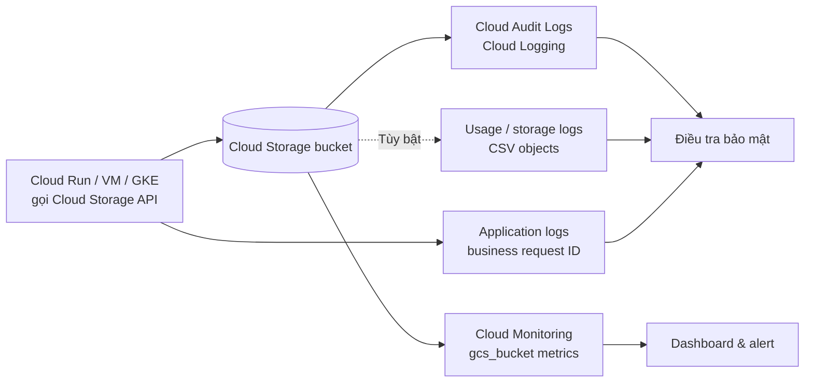
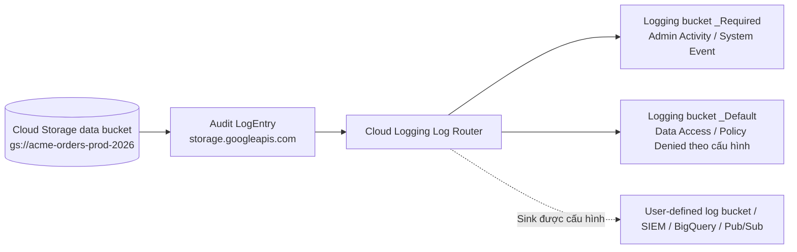

# Logging, metrics và kiểm toán truy cập bucket

## 1. Vì sao cần quan sát và kiểm toán Cloud Storage?

Một ứng dụng có thể chạy ổn định trên **Compute Engine**, **GKE** hoặc **Cloud Run**, nhưng dữ liệu trong **Cloud Storage** vẫn gặp những rủi ro khó thấy: một service account tải hàng nghìn object ngoài giờ làm việc, một nhân viên vô tình xóa dữ liệu, quyền truy cập bucket bị mở rộng, pipeline ghi đè các bản xuất dữ liệu hoặc chi phí tăng do lưu lượng tải xuống bất thường.

Chỉ kiểm tra bucket còn tồn tại hay không là chưa đủ. Người vận hành cần trả lời được:

- **Ai** đã tạo, đọc, sửa hoặc xóa dữ liệu và cấu hình bucket?
- **Hành động nào** xảy ra trên **bucket/object nào**, vào **thời điểm nào**?
- Có bao nhiêu request **thành công, bị từ chối hoặc lỗi phía dịch vụ**?
- Dung lượng **live, noncurrent, soft-deleted** và lưu lượng ingress/egress thay đổi ra sao?
- Khi sự cố xảy ra, có đủ bằng chứng để phân biệt **lỗi ứng dụng, IAM, policy, thao tác quản trị** và một hoạt động bất thường không?

Google Cloud cung cấp ba nhóm tín hiệu quan trọng:

1. **Cloud Audit Logs / Cloud Logging:** sự kiện kiểm toán, giúp xác định hoạt động đã được ghi nhận.
2. **Cloud Monitoring metrics:** số liệu định lượng và chuỗi thời gian, giúp theo dõi tình trạng vận hành, tốc độ request, byte truyền và dung lượng.
3. **Cloud Storage usage logs / storage logs và công cụ bổ sung:** dữ liệu truy cập hoặc lưu trữ dạng CSV, hữu ích trong một số trường hợp không được Cloud Audit Logs bao phủ đầy đủ.

Trong module **CLOUD_PROVIDERS_GCP**, chủ đề này kết nối quản trị **project, IAM, mạng VPC, Compute Engine, GKE, Cloud Run, lưu trữ, CI/CD, giám sát độ tin cậy và chi phí**. Thiết kế logging tốt phải bảo đảm vừa có **khả năng điều tra**, vừa tránh lưu thông tin nhạy cảm và chi phí log không cần thiết.

### Mục tiêu học tập

Sau bài học, bạn có thể:

1. Phân biệt **Admin Activity**, **Data Access**, **System Event** và **Policy Denied** audit logs.
2. Biết rõ những trường hợp cần **bật Data Access logs**, và những trường hợp Cloud Audit Logs **không ghi nhận**.
3. Đọc các trường chính trong log: `timestamp`, `protoPayload.methodName`, `authenticationInfo.principalEmail`, `resourceName`, `status` và thông tin người gọi.
4. Dùng **Logs Explorer** và `gcloud logging read` để tra cứu thay đổi bucket hoặc thao tác object.
5. Phân tích những metrics như `storage.googleapis.com/api/request_count`, `storage/total_bytes` và `storage/v2/total_bytes`.
6. Thiết kế dashboard, logs-based metric, cảnh báo, quyền xem log và thời hạn lưu giữ.
7. Điều tra các tình huống xóa object, truy cập bất thường, lỗi 403/404, tăng dữ liệu lưu trữ và chi phí egress.

> **Quy ước ví dụ:** `acme-storage-prod` là Project ID, `acme-orders-prod-2026` là bucket và mọi principal/email, object name, số liệu đều là **giả định**. Các lệnh chỉ đọc có thể dùng trong môi trường được cấp quyền; các lệnh thay đổi policy/logging chỉ thực hiện sau khi đánh giá phạm vi và chi phí.

## 2. Ba góc nhìn: logs, metrics và dữ liệu nghiệp vụ

| Câu hỏi | Công cụ chính | Dữ liệu nhận được | Giới hạn |
| --- | --- | --- | --- |
| Ai sửa IAM bucket lúc 10:05? | **Cloud Audit Logs – Admin Activity** | Principal, method, resource, thời điểm, kết quả | Cần quyền xem log và chọn đúng project |
| Ai đọc `exports/report.csv`? | **Data Access audit logs** nếu đã bật | Request đọc object, principal khi được ghi nhận | Không ghi đầy đủ truy cập tài nguyên công khai theo `allUsers`/`allAuthenticatedUsers` |
| API get/put có tăng lỗi không? | **Cloud Monitoring** | Request count theo method/response code | Không phải danh sách từng người dùng |
| Dung lượng soft-deleted tăng bao nhiêu? | **Cloud Monitoring storage/v2 metrics** | Bytes/count theo storage class và loại object | Metric về dung lượng thường cập nhật theo ngày, không phải tức thời |
| Người truy cập public website tải bao nhiêu? | **Cloud Storage usage logs** khi có cấu hình | Request metadata, URL, trạng thái, kích thước, độ trễ | Có độ trễ và không bảo đảm đầy đủ/timely tuyệt đối |
| Một đơn hàng cụ thể đã tạo tệp nào? | **Application logs + business IDs** | Request/trace/order ID và tên object/generation | Cloud Audit Logs không thay thế log nghiệp vụ |
| Tại sao hóa đơn tăng? | **Cloud Billing + Monitoring** | SKU, location, storage class, operations, egress | Một metric request count không phải bảng giá |

Một ứng dụng Cloud Run có thể ghi log `upload_success` cùng `request_id` và `object_generation`. Cloud Storage có thể có Data Access audit log cho thao tác tạo object đó. Monitoring lại cho thấy request write tăng trong phút ấy. **Ba nguồn bổ trợ nhưng không phải cùng một dữ liệu**.



**Nguyên tắc quan trọng:** Không có một trường log duy nhất đủ trả lời mọi câu hỏi. Điều tra tốt cần đặt thông tin trong **ngữ cảnh thời gian, danh tính, cấu hình IAM, phiên bản object, trạng thái ứng dụng** và hạn chế của từng nguồn.

## 3. Cloud Audit Logs: các loại log liên quan Cloud Storage

Cloud Audit Logs trả lời câu hỏi **“Ai đã làm gì, ở đâu và khi nào?”**. Với Cloud Storage, service name là `storage.googleapis.com`; monitored resource type thường là `gcs_bucket`.

### 3.1. Admin Activity: thay đổi cấu hình và quyền quản trị

**Admin Activity audit logs** luôn được tạo và không cần bật thủ công. Với Cloud Storage, các thao tác điển hình:

- Tạo hoặc xóa bucket.
- Thay đổi metadata/cấu hình bucket, retention hoặc một số thiết lập bảo vệ.
- Thay đổi **IAM policy** trên bucket hoặc managed folder.
- Tạo/xóa managed folder, tạo/xóa tag binding trên bucket.
- Một số thay đổi cấp quản trị khác theo bảng audited operations của dịch vụ.

Ví dụ `storage.buckets.setIamPolicy` hoặc `storage.buckets.update` là những method có thể xuất hiện khi người quản trị thay đổi chính sách/cấu hình. **Xem methodName thực tế trong log trước khi viết điều kiện chính xác**, vì các API có thể ghi nhiều dạng hoạt động hoặc kiểm tra nhiều permission.

### 3.2. Data Access: đọc/ghi/xóa nội dung object

**Data Access audit logs** của Cloud Storage **bị tắt mặc định** và phải được **bật rõ ràng** nếu muốn ghi nhận các thao tác dữ liệu. Có ba nhóm:

| Nhóm | Hoạt động minh họa | Vì sao cần quan tâm? |
| --- | --- | --- |
| `ADMIN_READ` | Đọc bucket metadata, đọc bucket IAM policy, liệt kê bucket | Phát hiện hành vi thăm dò cấu hình quản trị |
| `DATA_READ` | Đọc object, đọc metadata object, liệt kê objects/folders | Điều tra truy xuất dữ liệu nhạy cảm và hoạt động đọc bất thường |
| `DATA_WRITE` | Tạo, cập nhật metadata, xóa, khôi phục object; rename folder trong HNS | Điều tra dữ liệu bị ghi đè, xóa hoặc thay đổi |

**Chú ý dễ nhầm:** Xóa **object data** thông thường là **Data Access – DATA_WRITE**, không phải Admin Activity. Nếu bạn chỉ đọc Admin Activity logs, **không thể kết luận đã có đầy đủ bằng chứng về việc ai xóa object**. Một thao tác copy/compose có thể sinh log cho cả hoạt động đọc và ghi.

### 3.3. System Event và Policy Denied

- **System Event:** một số hoạt động do hệ thống Google Cloud thực hiện, chẳng hạn bắt đầu/kết thúc quy trình di chuyển vị trí bucket (*bucket relocation*) theo danh sách được công bố. Đây không phải log cho từng object được lifecycle tự xóa.
- **Policy Denied:** những trường hợp dịch vụ từ chối vì chính sách an ninh theo khả năng ghi log; giúp phát hiện yêu cầu bị chặn. **Một lỗi 403 thông thường không nhất thiết tương ứng một Policy Denied log**; có thể do thiếu IAM permission hoặc cơ chế khác.

**System Event không tự ghi đầy đủ mọi thay đổi do dịch vụ tự động tạo ra.** Đặc biệt, Cloud Storage Audit Logs **không theo dõi các thay đổi do Object Lifecycle Management hoặc Autoclass**. Cần nguồn bổ sung nếu nghiệp vụ phải kiểm toán nhóm thao tác này.

### 3.4. Bảng tóm tắt

| Loại audit log | Bật mặc định? | Phân loại ví dụ | Chi phí/đọc log |
| --- | --- | --- | --- |
| **Admin Activity** | Có, không tắt được | Bucket create/delete, IAM/config update | Thuộc nhóm audit logs bắt buộc, lưu trong `_Required` |
| **Data Access** | **Không** đối với Cloud Storage | Object get/list/create/delete, bucket metadata read | Có thể tạo khối lượng lớn và phí lưu/định tuyến |
| **System Event** | Có | Một số thay đổi do hệ thống thực hiện | Phạm vi hoạt động cụ thể, không thay usage logs |
| **Policy Denied** | Sinh theo hành vi/chính sách hỗ trợ | Request bị security policy chặn | Có thể phát sinh phí; kiểm tra log sink/exclusions |

## 4. Giới hạn của Cloud Audit Logs cần biết trước khi thiết kế

Google Cloud công bố một số giới hạn rất quan trọng:

1. **Không ghi nhận truy cập công khai** khi quyền được cấp qua `allUsers` hoặc `allAuthenticatedUsers`, kể cả khi Data Access audit logs đã bật. Để nghiên cứu luồng truy cập này, xem **Cloud Storage usage logs**, CDN/LB logs hoặc ứng dụng.
2. **Không ghi các thay đổi do Object Lifecycle Management hoặc Autoclass**; kiểm tra usage logs, lifecycle policy, lịch sử lưu trữ và các tín hiệu bổ sung.
3. Đối với một số **authenticated browser downloads ngoài Google Cloud Console**, `principalEmail` và `callerIp` có thể bị **ẩn** trong Data Access log.
4. Một request có thể kiểm tra nhiều permissions hoặc thực hiện cả đọc và ghi, do đó **số audit entries có thể khác số HTTP requests**.
5. Log không có nghĩa đã được giữ **vĩnh viễn**. Retention, log routing và quyền truy cập quyết định bạn có còn đọc được bản ghi sau vài tháng hay không.
6. **Bật Data Access từ hôm nay không làm xuất hiện lại log cho những thao tác trước đó** chưa được ghi.

Một ví dụ: bucket chứa ảnh sản phẩm có **public read**. Data Access audit log không phải nguồn đáng tin để thống kê danh tính từng người tải ảnh. Đối với dữ liệu riêng tư được đọc bằng service account, bật Data Access logs sẽ hữu ích hơn, nhưng vẫn cần kiểm tra những yêu cầu bị lược/ẩn danh theo quy tắc.

> **Không suy ra rằng “không thấy audit log” nghĩa là “không có truy cập” hoặc “không có xóa dữ liệu”.** Phải kiểm tra **loại log, thời điểm bật, phạm vi resource, quyền đọc, routing, retention và giới hạn sản phẩm**.

## 5. Bật Data Access audit logs cho Cloud Storage

### 5.1. Xác định phạm vi cấu hình

Data Access audit logging có thể cấu hình ở **Organization, Folder hoặc Project**. Với Cloud Storage, service là:

```text
storage.googleapis.com
```

Các cấu hình kế thừa qua hierarchy theo nguyên tắc **hợp nhất (union)**. Project có thể bật thêm loại log nhưng **không thể vô hiệu hóa** những loại đã được bật ở cấp Organization/Folder cha. Những danh sách **exempted principals** cũng cần xem xét trong ngữ cảnh kế thừa.

Vì Data Access thường được bật theo **service ở cấp Project/Folder/Organization**, đừng mặc định có thể chọn chỉ một bucket trong Project để bật tất cả Data Access audit logs của Cloud Storage mà không ảnh hưởng những bucket khác. Nếu cần theo dõi riêng một bucket, có thể dùng **Logging filters/sinks** hoặc cân nhắc **Cloud Storage usage logs** theo bucket tùy yêu cầu.

### 5.2. Bật qua Google Cloud Console

Quy trình nên dùng:

1. Chọn đúng **Project** hoặc phạm vi quản trị đã phê duyệt.
2. Mở **IAM & Admin → Audit Logs**.
3. Tìm dịch vụ **Cloud Storage / Google Cloud Storage (`storage.googleapis.com`)**.
4. Bật các nhóm cần thiết: **Admin Read**, **Data Read** và/hoặc **Data Write**. Không nhất thiết phải bật toàn bộ nếu nhu cầu được giới hạn rõ.
5. Xem lại các **exempted principals**, nếu tổ chức sử dụng ngoại lệ.
6. Lưu thay đổi theo quy trình IAM policy của dự án.
7. Phát sinh một request thử nghiệm được phép trong môi trường lab và kiểm tra log.

### 5.3. Mảnh IAM AuditConfig để hiểu API

Tại API IAM, audit configuration có thể mang dạng:

```json
{
  "auditConfigs": [
    {
      "service": "storage.googleapis.com",
      "auditLogConfigs": [
        { "logType": "ADMIN_READ" },
        { "logType": "DATA_READ" },
        { "logType": "DATA_WRITE" }
      ]
    }
  ]
}
```

Đây là **đoạn JSON minh họa**, **không phải toàn bộ IAM policy** được phép gửi bằng một lệnh ghi đè. IAM policy thực tế còn có `bindings`, `etag`, `version` và có thể có audit configs của dịch vụ khác. Khi cập nhật bằng API hoặc Terraform phải **merge có kiểm soát**, bảo toàn những thiết lập hiện có; **không thay cả policy bằng đoạn mẫu**.

Để đọc IAM policy hiện tại:

```bash
# CHỈ ĐỌC: xem IAM bindings và audit configs của Project
gcloud projects get-iam-policy acme-storage-prod \
  --format=json
```

Không tự ý thay đổi `auditConfigs` ở cấp Organization khi chưa ước tính **khối lượng log cho mọi project con**, quyền quản trị và quy định compliance.

### 5.4. Kiểm chứng sau khi bật

Giả sử một service account trong project thử nghiệm tải object `reports/demo.csv`:

1. Xác nhận IAM Data Access thực sự bật ở scope hiệu lực.
2. Thực hiện **một request hợp lệ** dưới principal biết trước.
3. Vào **Logging → Logs Explorer**, lọc `resource.type="gcs_bucket"`, `protoPayload.serviceName="storage.googleapis.com"` và đúng bucket.
4. Kiểm tra `data_access` log, thời gian request, method, principal và resource.
5. Xác nhận **log đã xuất hiện** trước khi kết luận pipeline kiểm toán hoạt động.

Lỗi phổ biến là chỉ thấy **bucket Admin Activity** rồi cho rằng **object reads** cũng đã được ghi nhận; phải kiểm chứng đúng loại **Data Access**.

## 6. Cấu trúc một Cloud Storage audit log

Cloud Audit Logs được lưu dưới dạng `LogEntry`; phần nội dung kiểm toán thường nằm trong `protoPayload`.

```json
{
  "logName": "projects/acme-storage-prod/logs/cloudaudit.googleapis.com%2Fdata_access",
  "resource": {
    "type": "gcs_bucket",
    "labels": {
      "bucket_name": "acme-orders-prod-2026"
    }
  },
  "timestamp": "2026-11-19T02:15:00Z",
  "protoPayload": {
    "@type": "type.googleapis.com/google.cloud.audit.AuditLog",
    "serviceName": "storage.googleapis.com",
    "methodName": "storage.objects.get",
    "resourceName": "projects/_/buckets/acme-orders-prod-2026/objects/reports%2Fdemo.csv",
    "authenticationInfo": {
      "principalEmail": "app-reader@acme-storage-prod.iam.gserviceaccount.com"
    },
    "requestMetadata": {
      "callerIp": "198.51.100.20"
    }
  }
}
```

**Đây là log mô phỏng**, dùng tên/email/IP minh họa. Trường thực tế thay đổi theo API method, caller, status, chế độ detailed audit logging và điều kiện ẩn danh; **không phải mọi entry đều có đủ tất cả trường**.

| Trường | Vai trò | Lưu ý khi điều tra |
| --- | --- | --- |
| `timestamp` | Thời điểm sự kiện được ghi nhận | Dùng UTC khi đối chiếu nhiều hệ thống; chú ý timezone |
| `logName` | Resource sở hữu log và loại log | `activity` khác `data_access`; dấu `/` trong tên log được URL-encode thành `%2F` |
| `resource.type` | Loại monitored resource | Với Cloud Storage audit logs thường là `gcs_bucket` |
| `resource.labels.bucket_name` | Bucket được theo dõi | Phân biệt bucket mục tiêu với Logging log bucket |
| `protoPayload.serviceName` | Dịch vụ sinh log | `storage.googleapis.com` |
| `protoPayload.methodName` | API operation hoặc audited permission path | Có thể khác tên công cụ CLI mà người dùng chạy |
| `protoPayload.resourceName` | Resource bị tác động | Có thể chứa object name đã encode; không giả định luôn có một format |
| `protoPayload.authenticationInfo.principalEmail` | Principal được nhận diện | Có thể là service account; một số tình huống bị redacted/không có |
| `protoPayload.requestMetadata.callerIp` | IP được ghi nhận của caller | Có thể bị ẩn hoặc là IP của trung gian; không mặc định là người cuối |
| `protoPayload.status.code` | Mã trạng thái gRPC nếu có | `7` thường là PERMISSION_DENIED; phải xem message/chi tiết request |

### Principal và danh tính người dùng cuối

Nếu Cloud Run dùng service account `app-reader@...` để đọc Cloud Storage thay mặt khách hàng, audit log có thể ghi **service account**, **không phải email của khách hàng**. Muốn điều tra người dùng nào đã yêu cầu tải tệp:

- Ứng dụng phải có xác thực người dùng phù hợp.
- Ghi **request/correlation ID**, người dùng nội bộ đã được chuẩn hóa và `objectName/generation` vào **application logs**, với chính sách bảo vệ PII.
- Đối chiếu thời gian/request ID nếu có bằng chứng liên kết; không suy diễn từ `principalEmail` của service account rằng đó là người dùng cuối.

## 7. Truy vấn Logs Explorer cho bucket

Mở **Google Cloud Console → Logging → Logs Explorer**, chọn đúng Project chứa bucket và nhập bộ lọc.

### 7.1. Xem mọi Cloud Storage audit logs

```text
resource.type="gcs_bucket"
protoPayload.serviceName="storage.googleapis.com"
```

### 7.2. Chỉ xem Admin Activity

```text
resource.type="gcs_bucket"
logName="projects/acme-storage-prod/logs/cloudaudit.googleapis.com%2Factivity"
protoPayload.serviceName="storage.googleapis.com"
```

Đây là điểm xuất phát để tìm thay đổi IAM/bucket; nên thêm khoảng thời gian, bucket và method sau khi xem kết quả.

### 7.3. Chỉ xem Data Access của bucket

```text
resource.type="gcs_bucket"
resource.labels.bucket_name="acme-orders-prod-2026"
logName="projects/acme-storage-prod/logs/cloudaudit.googleapis.com%2Fdata_access"
protoPayload.serviceName="storage.googleapis.com"
```

**Nếu không có kết quả**, kiểm tra Data Access đã bật **trước thời điểm cần tra** hay chưa và request có nằm trong các giới hạn audit đã mô tả không.

### 7.4. Truy tìm một principal cụ thể

```text
resource.type="gcs_bucket"
protoPayload.serviceName="storage.googleapis.com"
protoPayload.authenticationInfo.principalEmail="app-reader@acme-storage-prod.iam.gserviceaccount.com"
```

Kết hợp với bucket, thời gian và method. Nếu principal bị redacted, filter theo email sẽ bỏ qua entry đó; không coi kết quả rỗng là bằng chứng không truy cập.

### 7.5. Tra cứu thao tác xóa object

```text
resource.type="gcs_bucket"
resource.labels.bucket_name="acme-orders-prod-2026"
logName:"cloudaudit.googleapis.com%2Fdata_access"
protoPayload.serviceName="storage.googleapis.com"
protoPayload.methodName:"storage.objects.delete"
```

Filter trên dùng **so khớp chuỗi một phần** cho method. Hãy xem `methodName` thực tế của entry trong dự án vì xóa nhiều object, HNS folder operations hoặc các API khác có thể có tên/kiểu log khác. Nếu dùng chính xác equality nhưng API khác, điều tra có thể bỏ sót.

### 7.6. Lọc request bị từ chối

```text
resource.type="gcs_bucket"
protoPayload.serviceName="storage.googleapis.com"
protoPayload.status.code=7
```

`7` là mã gRPC **PERMISSION_DENIED**; bộ lọc giúp tìm sự kiện có trường `status.code` phù hợp, **không đảm bảo mọi lỗi HTTP 403 đều được ghi thành Data Access audit log**.

> **Mẹo:** Xem một entry mẫu trong Logs Explorer trước, rồi dùng chức năng **Copy/Show similar entries** hoặc chọn trường trực tiếp để tạo filter đúng schema thực tế. Không xây alert chỉ bằng suy đoán tên trường.

## 8. Dùng gcloud để đọc audit logs

Giả sử project `acme-storage-prod` có log được phép truy cập.

### 8.1. Đọc log Storage trong 24 giờ gần đây

```bash
# CHỈ ĐỌC: audit logs của Cloud Storage
gcloud logging read \
  'resource.type="gcs_bucket" AND protoPayload.serviceName="storage.googleapis.com"' \
  --project=acme-storage-prod \
  --freshness=1d \
  --limit=50 \
  --format=json
```

### 8.2. Đọc Data Access cho một bucket

```bash
gcloud logging read \
  'resource.type="gcs_bucket" AND resource.labels.bucket_name="acme-orders-prod-2026" AND logName:"cloudaudit.googleapis.com%2Fdata_access"' \
  --project=acme-storage-prod \
  --freshness=7d \
  --limit=100 \
  --format="table(timestamp,protoPayload.methodName,protoPayload.authenticationInfo.principalEmail,protoPayload.resourceName)"
```

### 8.3. Đọc log từ thời điểm cụ thể

```bash
gcloud logging read \
  'resource.type="gcs_bucket" AND protoPayload.serviceName="storage.googleapis.com" AND timestamp>="2026-11-19T00:00:00Z" AND timestamp<"2026-11-20T00:00:00Z"' \
  --project=acme-storage-prod \
  --limit=100 \
  --format=json
```

Khi đọc log cũ hơn mặc định, đặt `--freshness` và thời gian phù hợp. Lệnh có thể trả số dòng bị giới hạn bởi `--limit`; **không lấy 100 entries đầu tiên làm tổng số hoạt động trong ngày**.

### 8.4. Ghi chú cho PowerShell

Trong Windows PowerShell, có thể viết truy vấn trên **một dòng**:

```powershell
gcloud logging read 'resource.type="gcs_bucket" AND protoPayload.serviceName="storage.googleapis.com"' --project=acme-storage-prod --freshness=1d --limit=50 --format=json
```

Những ví dụ nhiều dòng ở trên dùng dấu `\` của Bash; đừng chép dấu xuống dòng Bash vào PowerShell rồi giả định cú pháp giống nhau.

## 9. Cấp quyền xem log và giới hạn dữ liệu nhạy cảm

### 9.1. Vai trò cho người đọc

| Role | Quyền dùng phổ biến | Lưu ý |
| --- | --- | --- |
| `roles/logging.viewer` | Đọc Admin Activity, System Event, Policy Denied ở log buckets mặc định | **Không đủ** để xem Data Access logs trong `_Default`/`_Required` |
| `roles/logging.privateLogViewer` | Bao gồm quyền xem Data Access logs trong `_Default`/`_Required` | Quyền nhạy cảm; không cấp rộng nếu không cần |
| Vai trò/log view permissions theo log bucket tùy biến | Đọc đúng tập log do tổ chức cho phép | IAM/log views của bucket tùy biến có mô hình riêng |
| `roles/monitoring.viewer` | Xem metrics và dashboards trong Monitoring | Không tự cấp quyền đọc nội dung audit logs |

**Lưu ý:** vai trò có thể được gắn ở project hoặc resource tùy mô hình. Nếu Data Access audit logs được **route sang user-defined Logging bucket**, ai có quyền đọc log bucket/view đó có thể đọc được dữ liệu theo chính sách đã cấp. Không dựa hoàn toàn vào mặc định của `privateLogViewer` khi thiết kế hệ thống lưu log tập trung.

### 9.2. Log có thể chứa gì nhạy cảm?

Tên object có thể chứa:

- ID khách hàng, đơn hàng, đường dẫn nội bộ.
- Tên hồ sơ, mã nhân viên hoặc nhãn dữ liệu.
- Danh tính của service account.
- Caller IP, user agent, thông tin request metadata.

**Không ghi access token, signed URL đầy đủ, private key hoặc dữ liệu hồ sơ gốc vào log ứng dụng**. Cloud Audit Logs vốn có thể bao gồm thông tin kiểm toán nhạy cảm; quyền đọc log cần được **phân quyền theo nhu cầu điều tra**.

### 9.3. Bảo vệ log trước sửa/xóa

Cloud Audit Logs là bằng chứng điều tra; nên cân nhắc:

1. Tách quyền **đọc log** và **quản trị log routing/sink**.
2. Chọn retention theo yêu cầu pháp lý hoặc chính sách nội bộ.
3. Sử dụng log bucket riêng hoặc route tới một project bảo mật nếu tổ chức cần phân tách trách nhiệm.
4. Kiểm tra IAM của destination, quyền của sink writer identity và nguy cơ sửa policy.
5. Không ghi đè/xóa artifacts điều tra khi chưa có phê duyệt.

**Không coi việc có audit logs là một hệ thống bất biến tuyệt đối** trong mọi cấu hình. Quyền quản trị log, chính sách lưu giữ và sink exclusions đều có thể ảnh hưởng khả năng điều tra về sau.

## 10. Log Router, log buckets và retention

Cloud Logging dùng **log buckets** để lưu dữ liệu log. **Logging bucket** khác hoàn toàn **Cloud Storage data bucket** mặc dù cùng từ “bucket”.



### Cần kiểm tra gì?

- **`_Required`:** lưu những audit logs bắt buộc như Admin Activity và System Event theo nguyên tắc Cloud Logging; không có tác dụng tắt ghi những loại bắt buộc này bằng sink thông thường.
- **`_Default`:** thường nhận Data Access khi đã bật và Policy Denied; cấu hình sink/exclusions quyết định dữ liệu được lưu.
- **User-defined log bucket:** có thể dùng để tách vùng dữ liệu, retention, quyền truy cập và phân tích.
- **Log sink:** chuyển log đến destination được hỗ trợ, chẳng hạn Logging bucket, BigQuery, Cloud Storage hoặc Pub/Sub; phải cấp quyền ghi cho sink identity.

### Hai nguồn chi phí và một rủi ro

1. **Cloud Logging ingestion/storage:** có thể phát sinh phí cho Data Access/Policy Denied và retention tùy mức sử dụng.
2. **Cloud Storage usage log objects:** nếu bật hệ thống log CSV, dữ liệu log được lưu thành **objects** trong một Cloud Storage bucket và tính phí lưu trữ/operations/egress tương ứng.
3. **Bật hết logs rồi quên quản trị:** có thể tạo chi phí lớn hoặc lưu dữ liệu nhạy cảm quá hạn cần thiết.

Một số audit logs bắt buộc được lưu miễn phí theo chế độ bắt buộc, nhưng **đừng suy rộng rằng mọi Data Access log, sink, Log Analytics hoặc lưu trữ ngoài đều miễn phí**. Tra bảng giá Logging và Storage hiện hành.

## 11. Cloud Monitoring: các metrics Cloud Storage quan trọng

Metrics dùng cho **đếm, vẽ biểu đồ, theo dõi xu hướng và cảnh báo**; chúng không chứa danh sách mọi principal đã truy cập.

Cloud Storage cung cấp metrics ở namespace `storage.googleapis.com/`, thường gắn với monitored resource:

```text
resource.type = "gcs_bucket"
resource.labels.bucket_name = "acme-orders-prod-2026"
```

### Các metric types thường dùng

| Metric type đầy đủ | Mục đích | Đặc điểm đáng nhớ |
| --- | --- | --- |
| `storage.googleapis.com/api/request_count` | Số request API theo method và response code | `DELTA`, mẫu khoảng 60 giây, hiển thị có độ trễ |
| `storage.googleapis.com/network/received_bytes_count` | Byte đi **vào** bucket qua mạng | Có thể lọc method/response code |
| `storage.googleapis.com/network/sent_bytes_count` | Byte **gửi ra** từ bucket | Hữu ích phân tích tăng tải xuống/egress, không phải trực tiếp giá tiền |
| `storage.googleapis.com/storage/object_count` | Số object theo storage class | Báo cáo gần theo **ngày**, không tính soft-deleted trong metric cũ |
| `storage.googleapis.com/storage/total_bytes` | Dung lượng object theo storage class | Cập nhật theo ngày; **không bao gồm soft-deleted objects** |
| `storage.googleapis.com/storage/v2/total_bytes` | Tổng bytes có phân loại live/noncurrent/soft-deleted/multipart | Dùng để hiểu phân rã lưu trữ chi tiết hơn |
| `storage.googleapis.com/storage/v2/total_count` | Số object/multipart theo trạng thái | Phân loại theo `type` và `storage_class` |

**Cập nhật không đồng đều:** request/traffic metrics được lấy mẫu khoảng **mỗi phút** và có thể cần vài phút để hiển thị; nhiều storage size/count metrics được **đo một lần mỗi ngày**. Không dùng một datapoint “dung lượng chưa tăng” ngay sau upload để kết luận upload thất bại.

### 11.1. Metric labels

Metric `api/request_count` thường có nhãn:

- `method`: tên API method như `ReadObject` (phụ thuộc client/API).
- `response_code`: trạng thái request theo cách Monitoring biểu diễn.

Metrics v2 liên quan lưu trữ có các nhãn:

- `storage_class`: Standard, Nearline, Coldline, Archive... theo metric thực tế.
- `type`: `live-object`, `noncurrent-object`, `soft-deleted-object` hoặc `multipart-upload`.

**Cần chọn đúng nhãn trước khi cộng số liệu.** Nếu muốn đo live bytes nhưng cộng cả soft-deleted/noncurrent, kết quả sẽ không khớp danh sách live objects.

### 11.2. Metrics không phải request log

`api/request_count` cho biết số request theo label và thời gian, **không chứng minh ai thực hiện request đó**. Để điều tra principal phải dùng audit logs hoặc application logs phù hợp. Ngược lại, audit entries không phải phương pháp tốt nhất để đo real-time storage bytes, vì Storage Monitoring đã có metrics chuyên dụng.

### 11.3. Độ trễ ứng dụng

Cloud Storage **không có metric latency cấp bucket tổng quát cho từng request** tương đương latency từ góc nhìn ứng dụng trong bảng metrics được dùng làm SLI. Nếu mục tiêu là p95 upload/download latency của API người dùng, hãy **instrument client/Cloud Run/VM** và đo end-to-end request latency trong ứng dụng. **Usage logs** có thể chứa thông tin độ trễ từng HTTP request nhưng có độ trễ giao hàng và không đảm bảo đầy đủ.

## 12. Tạo dashboard Cloud Storage có ý nghĩa

Trong **Cloud Monitoring → Metrics Explorer** hoặc **Dashboards**, bắt đầu từ những câu hỏi vận hành, không chọn hàng chục biểu đồ không có người dùng.

| Biểu đồ | Metric và bộ lọc | Giá trị sử dụng |
| --- | --- | --- |
| Read requests/phút | `api/request_count`, filter `method` đọc object | Phát hiện tăng đọc bất thường |
| Write requests/phút | `api/request_count`, method ghi object | Theo dõi pipeline ingestion |
| Tỷ lệ lỗi request | `api/request_count` chia theo `response_code` | Phát hiện vấn đề 4xx/5xx và xu hướng |
| Byte tải xuống/phút | `network/sent_bytes_count` | Dấu hiệu egress hoặc download đột biến |
| Byte upload/phút | `network/received_bytes_count` | Phát hiện ingestion bất thường |
| Live bytes | `storage/v2/total_bytes` với `type=live-object` | Tăng trưởng dữ liệu hiện sử dụng |
| Soft-deleted bytes | `storage/v2/total_bytes` với `type=soft-deleted-object` | Phân tích chi phí/khôi phục dữ liệu |
| Noncurrent bytes | `storage/v2/total_bytes` với `type=noncurrent-object` | Theo dõi versioned data |

### Ví dụ thiết kế cho bucket báo cáo

Bucket `acme-orders-prod-2026` nhận file báo cáo mỗi giờ. Nhóm SRE có thể:

1. Vẽ `api/request_count` theo `method`, `response_code` và bucket.
2. Vẽ `network/sent_bytes_count` để phát hiện tải xuống lớn ngoài lịch.
3. Theo dõi `storage/v2/total_bytes` theo `type` và `storage_class` hàng ngày.
4. Tạo dashboard ở project chứa bucket hoặc monitoring scoping project được cấp phép.
5. Thêm **application metric** như “số file báo cáo tạo đúng hạn” vì Cloud Storage chỉ biết object operations, **không biết báo cáo có đúng nghiệp vụ hay không**.

**Một dashboard tốt có trách nhiệm rõ ràng:** mỗi biểu đồ phải trả lời một câu hỏi và có runbook nếu giá trị bất thường.

## 13. SLI, SLO và phân tích lỗi request

**Service Level Indicator (SLI)** biểu diễn một thuộc tính của dịch vụ, ví dụ tỷ lệ request thành công. **Service Level Objective (SLO)** là mục tiêu nội bộ cho SLI trong một khoảng thời gian.

### 13.1. SLI availability cho đọc object

Một SLI minh họa:

```text
SLI đọc object =
   số ReadObject requests được xem là "good"
 / tổng số ReadObject requests trong kỳ
```

Với Cloud Storage Monitoring, bạn có thể dùng `storage.googleapis.com/api/request_count` lọc:

```text
metric.type = "storage.googleapis.com/api/request_count"
resource.type = "gcs_bucket"
resource.label.bucket_name = "acme-orders-prod-2026"
metric.label.method = "ReadObject"
```

Khi cấu hình thực trong Metrics Explorer/API, cú pháp nhãn cụ thể phải theo schema hiện hành (ví dụ `resource.label."bucket_name"` và `metric.label."method"` trong Monitoring filter). Đoạn trên là **biểu diễn logic**, chưa phải một alerting policy JSON hoàn chỉnh.

Để xác định numerator, chọn những `response_code` được định nghĩa là thành công (ví dụ `OK` trong hướng dẫn SLI của Google Cloud). **Không tự coi mọi 4xx là lỗi dịch vụ**: 403 do IAM và 404 do object không tồn tại có thể là lỗi client hoặc logic ứng dụng.

### 13.2. Ví dụ tính tỷ lệ lỗi

Giả sử trong 5 phút có 20.000 request đọc:

```text
Successful reads   = 19.700
Failed reads       =    300
Success rate       = 19.700 / 20.000 = 98,5%
Failure rate       =    300 / 20.000 =  1,5%
```

Đây là số học **giả định**, không phải SLO do Google Cloud cam kết. Ngưỡng SLO phải được quyết định theo ứng dụng và bao gồm cả đường truy cập người dùng đến backend, không chỉ Cloud Storage.

### 13.3. Phân tách 4xx và 5xx

- **401/403:** kiểm tra authentication/IAM, uniform bucket-level access, public access prevention, signed URL hoặc VPC Service Controls nếu có.
- **404:** sai tên bucket/object, generation không còn, object đã bị xóa hoặc lỗi logic key/prefix.
- **409/412:** xung đột cập nhật hoặc precondition không còn thỏa; có thể là kết quả **đúng** của cơ chế chống ghi đè đồng thời.
- **429/5xx:** xem quota/rate, retry/backoff, trạng thái dịch vụ và client behavior.

Giám sát nên tách **request thất bại đúng dự kiến** (ví dụ thử dùng quyền không được cấp) với **sự cố ảnh hưởng người dùng thực**.

## 14. Logs-based metrics và alert bảo mật

Nếu muốn phát hiện sự kiện rời rạc như **xóa object nhạy cảm**, **thay bucket IAM policy** hoặc **tăng request PERMISSION_DENIED**, hãy cân nhắc **logs-based metric** hoặc **log-based alert**.

### 14.1. Counter metric là gì?

Một **counter logs-based metric** đếm số log entries khớp Logging filter. Khi Data Access log có event xóa object, counter metric có thể tăng để Cloud Monitoring tạo cảnh báo.

Ví dụ bộ lọc trước khi tạo metric:

```text
resource.type="gcs_bucket"
resource.labels.bucket_name="acme-orders-prod-2026"
protoPayload.serviceName="storage.googleapis.com"
logName:"cloudaudit.googleapis.com%2Fdata_access"
protoPayload.methodName:"storage.objects.delete"
```

**Điều kiện tiên quyết:** Data Access `DATA_WRITE` đã bật **trước sự kiện**; nếu không có log nguồn, logs-based metric không thể đếm event. Cần thử filter trong Logs Explorer và xem methodName thực tế.

### 14.2. Ví dụ tạo counter bằng gcloud

```bash
# THAY ĐỔI CẤU HÌNH MONITORING/LOGGING
# Chỉ chạy sau khi filter đã được xác minh và được phê duyệt
gcloud logging metrics create storage_object_delete_count \
  --project=acme-storage-prod \
  --description="Dem so audit entries xoa object trong bucket don vi" \
  --log-filter='resource.type="gcs_bucket" AND resource.labels.bucket_name="acme-orders-prod-2026" AND protoPayload.serviceName="storage.googleapis.com" AND logName:"cloudaudit.googleapis.com%2Fdata_access" AND protoPayload.methodName:"storage.objects.delete"'
```

Metric được Cloud Monitoring trình bày theo:

```text
logging.googleapis.com/user/storage_object_delete_count
```

**Đọc lại định nghĩa**:

```bash
gcloud logging metrics describe storage_object_delete_count \
  --project=acme-storage-prod
```

Khi metric được tạo, dùng Cloud Monitoring để thiết lập alert policy, notification channel và thời gian đánh giá. **Tạo metric không tự tạo alert**.

### 14.3. Ví dụ chính sách cảnh báo

Một chính sách mẫu có thể là:

```text
Nguồn: logging.googleapis.com/user/storage_object_delete_count
Điều kiện: > 0 events trong cửa sổ 5 phút
Phạm vi: bucket acme-orders-prod-2026
Notify: Security on-call
Runbook: kiểm tra principal, method, object generation và change ticket
```

Đây chỉ là **nguyên tắc thiết kế**, không phải lệnh tạo alert hoàn chỉnh. Để tránh false positives, cần phân biệt hoạt động xóa hợp lệ của pipeline với hành vi ngoài lịch, và lưu lại event details để điều tra.

### 14.4. Hai hình thức alert

- **Log-based alert:** phù hợp một mẫu log cần phản ứng nhanh, ví dụ IAM bucket mở công khai trái quy định.
- **Alert trên logs-based metric:** phù hợp đếm xu hướng theo cửa sổ thời gian, nhiều buckets hoặc principal.

Cân nhắc **cardinality của labels** khi trích xuất thông tin vào metric; không đưa object name ngẫu nhiên, request ID hoặc email người dùng làm metric label có cardinality không giới hạn. Log entries dùng cho điều tra chi tiết, metric labels dùng cho phân tích tổng hợp.

## 15. Cloud Storage usage logs và storage logs

Cloud Storage có cơ chế **usage logs** và **storage logs** dạng CSV, khác Cloud Audit Logs:

| Đặc tính | Usage logs | Storage logs |
| --- | --- | --- |
| Mục đích | Thông tin HTTP requests đối với bucket | Mức lưu trữ tiêu thụ của bucket |
| Tần suất tạo | Theo **giờ** khi có hoạt động | **Hằng ngày** |
| Nơi lưu | Object trong **một Cloud Storage bucket đích** | Object trong bucket đích |
| Dữ liệu đáng chú ý | URL, response, request/response bytes, latency và trường giao thức | Dung lượng lưu trữ theo thông tin báo cáo |
| Có phù hợp alert gần real time? | **Không**; phát sinh/giao hàng có độ trễ | **Không** |
| Google khuyến nghị thay thế bằng gì trong phần lớn trường hợp? | **Cloud Audit Logs** cho audit API operations | **Cloud Monitoring** cho storage consumption |

Google Cloud nhấn mạnh **không bảo đảm timeliness và completeness tuyệt đối** của usage/storage logs. Usage logs có thể đến trễ, một số entry có thể lặp; nếu phân tích để đếm chính xác, có thể dùng trường `s_request_id` để xử lý duplicate theo logic dữ liệu.

### Khi nào usage logs thực sự hữu ích?

- Cần điều tra truy cập **công khai** qua `allUsers`/`allAuthenticatedUsers` mà Cloud Audit Logs không ghi.
- Cần quan sát thay đổi liên quan **Object Lifecycle Management hoặc Autoclass** qua nguồn bổ sung.
- Cần thông tin **latency, request/response size, đường dẫn URL và query parameters** ở mức request.
- Chỉ muốn thu usage logs của **một số bucket**, không bật Data Access audit logs cho toàn bộ Cloud Storage trong project.

**Usage logs không phải lựa chọn mặc định cho mọi hệ thống:** chúng lưu dữ liệu thô thành object, cần quyền ghi log bucket, quản lý lifecycle, chi phí và pipeline xử lý CSV/BigQuery.

## 16. Cấu hình usage/storage logs vào bucket đích

Giả sử:

```text
Bucket được theo dõi: gs://acme-orders-prod-2026
Bucket nhận CSV logs: gs://acme-storage-usage-logs-2026
Prefix log objects: orders-prod
```

### 16.1. Điều kiện log destination

Trước khi bật:

1. Bucket nhận logs đã tồn tại, trong **cùng Organization** với bucket nguồn; nếu nguồn không thuộc Organization thì theo quy định phải cùng project.
2. Hai buckets phải có **cùng location** (region/dual-region/multi-region tương ứng).
3. Nếu dùng **VPC Service Controls**, log destination phải ở **cùng security perimeter** theo tài liệu.
4. IAM cho phép nhóm Cloud Storage analytics ghi object log vào destination.
5. Destination có chính sách **lifecycle/retention và access control** phù hợp; không công khai logs vì chúng có thể chứa thông tin URL/khách truy cập.

### 16.2. Cấp quyền writer cho Cloud Storage analytics

Theo hướng dẫn Google Cloud:

```bash
# THAY ĐỔI IAM trên log destination bucket
gcloud storage buckets add-iam-policy-binding \
  gs://acme-storage-usage-logs-2026 \
  --member=group:cloud-storage-analytics@google.com \
  --role=roles/storage.objectCreator
```

Không nhầm nhóm `cloud-storage-analytics@google.com` với principal của ứng dụng Cloud Run. Đây là danh tính được tài liệu chỉ định để dịch vụ ghi usage/storage log objects.

### 16.3. Bật logging cho source bucket

```bash
# THAY ĐỔI BUCKET CONFIG: chỉ chạy khi đã duyệt IAM và chi phí
gcloud storage buckets update gs://acme-orders-prod-2026 \
  --log-bucket=gs://acme-storage-usage-logs-2026 \
  --log-object-prefix=orders-prod
```

Kiểm tra trạng thái:

```bash
# CHỈ ĐỌC
gcloud storage buckets describe gs://acme-orders-prod-2026 \
  --format="default(logging_config)"
```

Lệnh `describe` phải chỉ ra `logBucket` và `logObjectPrefix`. Cloud Storage **không xác minh thay bạn rằng log bucket đích tồn tại khi đặt cờ**, nên cấu hình thành công **chưa bảo đảm CSV logs sẽ được ghi** nếu destination/permission sai.

### 16.4. Đọc log objects

Tên log objects thường có tiền tố:

```text
orders-prod_usage_YYYY_MM_DD_HH_MM_SS_<ID>_v0
orders-prod_storage_YYYY_MM_DD_HH_MM_SS_<ID>_v0
```

Lệnh chỉ đọc:

```bash
gcloud storage ls gs://acme-storage-usage-logs-2026/orders-prod*
```

Để tải một log object đã chọn về máy, dùng:

```bash
gcloud storage cp \
  gs://acme-storage-usage-logs-2026/ACTUAL_LOG_OBJECT_NAME \
  ./storage-usage-log.csv
```

Log CSV có thể mang thông tin nhạy cảm của hệ thống; không tải lên công cụ công khai hoặc chia sẻ trong ticket không được bảo vệ.

### 16.5. Vô hiệu hóa nếu không còn nhu cầu

```bash
# THAY ĐỔI cấu hình, không chạy khi đang có yêu cầu kiểm toán
gcloud storage buckets update gs://acme-orders-prod-2026 \
  --clear-log-bucket
```

Tắt logging **không tự xóa những CSV objects đã lưu**. Chính sách lifecycle/retention của log destination tiếp tục quyết định việc dữ liệu cũ còn tồn tại và chi phí.

## 17. Phân tích access logs bằng BigQuery

Với hệ thống có hàng triệu requests, việc mở từng CSV bằng spreadsheet không phù hợp. Có thể:

1. Tạo dataset BigQuery trong vùng tuân thủ yêu cầu vị trí dữ liệu.
2. Tạo bảng theo schema **usage log CSV** được tài liệu công bố (hoặc external table nếu phù hợp).
3. Nạp logs theo giờ/ngày, xử lý entry đến trễ và duplicate `s_request_id` khi cần.
4. Phân tích theo thời gian, URL prefix, response status, bytes transferred và request latency.
5. Hạn chế quyền đọc bảng và áp retention vì URL/query parameters có thể chứa dữ liệu nhạy cảm.

Ví dụ SQL **mang tính minh họa** sau khi đã chuẩn hóa schema về các cột `event_time`, `object_path`, `response_code` và `response_bytes`:

```sql
SELECT
  TIMESTAMP_TRUNC(event_time, HOUR) AS hour_utc,
  response_code,
  COUNT(*) AS requests,
  SUM(response_bytes) AS bytes_sent
FROM `acme_audit.storage_usage_normalized`
WHERE event_time >= TIMESTAMP('2026-11-19')
  AND event_time < TIMESTAMP('2026-11-20')
GROUP BY hour_utc, response_code
ORDER BY hour_utc, response_code;
```

**Đây không phải schema CSV gốc.** Trường dữ liệu thực có tên kiểu `s_*` theo tài liệu Cloud Storage, cần mapping/ETL trước khi chạy SQL. SQL chỉ minh họa mục tiêu phân tích; **không tạo bảng hoặc query dữ liệu thực trong bài này**.

Nếu dùng **Log Analytics** của Cloud Logging cho audit logs, cần chọn đúng Logging bucket, log view và khả năng SQL của sản phẩm; đừng nhầm với bảng BigQuery chứa CSV usage logs.

## 18. Tình huống điều tra: object quan trọng bị xóa

Một tối thứ Năm, ứng dụng không tìm thấy object:

```text
gs://acme-orders-prod-2026/exports/2026-11-19/orders.parquet
```

Service trả 404; nhóm trực phát hiện thiếu dữ liệu đầu ra. **Kịch bản điều tra**:

### Bước 1: Xác nhận sự cố

- Đọc đúng bucket, object name, generation và thời điểm ứng dụng báo lỗi.
- Kiểm tra ứng dụng có dùng **generation precondition** hoặc object version cụ thể không.
- Kiểm tra **soft delete**, Object Versioning (nếu dùng) hoặc retention; phân biệt object đã xóa với IAM làm ứng dụng không được phép xem.
- Không ghi đè object bằng dữ liệu thử trước khi xác định khả năng khôi phục.

### Bước 2: Truy Data Access audit logs

```text
resource.type="gcs_bucket"
resource.labels.bucket_name="acme-orders-prod-2026"
logName:"cloudaudit.googleapis.com%2Fdata_access"
protoPayload.serviceName="storage.googleapis.com"
protoPayload.methodName:"storage.objects.delete"
```

Xem `timestamp`, `principalEmail`, `resourceName`, `status.code` và các metadata liên quan. Đối chiếu với **Cloud Run revision**, VM logs hoặc scheduler job.

### Bước 3: Xem các nguyên nhân không được audit log bao phủ

- **Object Lifecycle Management** có thể đã xóa object theo policy, không xuất hiện như một Data Access deletion audit thông thường.
- Đã bật Data Access **trước khi xóa** hay chưa?
- Có thao tác copy/rename/HNS folder hoặc batch delete qua API khác?
- Có signed URL hoặc luồng public access khiến danh tính bị hạn chế?
- Có log routing exclusions hoặc retention làm log không còn?

### Bước 4: Khôi phục và ngăn lặp lại

Nếu soft delete hoặc versioning có thể khôi phục, làm theo runbook với người được quyền, xác minh checksum, thế hệ object và tính nhất quán ứng dụng. Sau đó:

1. Sửa IAM hoặc pipeline logic gây xóa nhầm.
2. Đánh giá khả năng thêm **preconditions** khi ghi/xóa.
3. Cài logs-based alert cho thao tác xóa ngoài lịch.
4. Rà lifecycle/retention, backup và quyền xóa dữ liệu.
5. Ghi postmortem có timeline và bằng chứng thay vì chỉ ghi “Cloud Storage mất file”.

## 19. Tình huống điều tra: lưu lượng đọc và chi phí egress tăng

Một project có hai ứng dụng, Cloud Run API và một website tĩnh công khai. Sau một ngày, dashboard báo:

```text
Read request rate:      tăng 8 lần (giả định)
Network sent bytes:     tăng 12 lần (giả định)
Storage total bytes:    gần như không đổi
Estimated cost:         tăng bất thường
```

**Cách phân tích hợp lý:**

1. Xem `api/request_count` và `network/sent_bytes_count` theo bucket/method/response code.
2. Phân biệt tăng tải hợp lệ theo chiến dịch marketing với bot, crawler, cache miss hoặc ứng dụng retry lỗi.
3. Dùng **Cloud Billing theo SKU** để xác định loại phí thực: storage operation, network egress, data processing, Logging hay dịch vụ khác.
4. Nếu bucket đang public, đừng chờ Data Access logs ghi đầy đủ public requester identity; xem **usage logs**, CDN/load balancer logs và application analytics.
5. Kiểm tra thiết kế Cache-Control/CDN, signed URLs, rate limiting ở lớp frontend được hỗ trợ, permissions và cách client tải file.
6. Đưa ra thay đổi nhỏ có kiểm chứng; không chặn tất cả public read nếu website cần phục vụ người dùng thật.

**Hai phép đo khác nhau:** bytes **gửi ra khỏi bucket** chưa phải chính xác bytes **bị tính phí internet egress**. Billing phụ thuộc tuyến dữ liệu, vị trí, cache, sản phẩm và SKU. Phải đối chiếu giá thực thay vì lấy network metric nhân một đơn giá suy đoán.

## 20. Tình huống điều tra: tăng đột biến 403 sau khi deploy

Một phiên bản Cloud Run mới bắt đầu báo `403 PermissionDenied` khi upload object. Dữ liệu chưa bị mất, nhưng pipeline dừng.

### Các giả thuyết ưu tiên

- Cloud Run revision mới dùng **service account khác** hoặc mất quyền `storage.objects.create`.
- Bucket đã bật **uniform bucket-level access** hoặc public access prevention làm thay đổi mô hình cấp quyền cũ.
- Managed folder IAM không bao phủ prefix đích, hoặc Organization Policy/VPC Service Controls chặn yêu cầu.
- Application thay object name, bucket/project hoặc dùng precondition sai; không phải mọi lỗi đều là IAM.
- Data Access logging chưa bật hoặc log có những trường được redacted.

### Kết hợp nguồn dữ liệu

1. **Application logs:** xem request ID, service account identity, bucket/object, lỗi cụ thể.
2. **Cloud Audit Logs:** tìm method ghi object bị từ chối, principal và status nếu request được ghi.
3. **Cloud Monitoring:** xác định thời điểm rate của request lỗi tăng và những API method liên quan.
4. **IAM policy và service config:** xác định binding hiệu lực, các thay đổi trong Admin Activity.
5. **Triển khai thử có giới hạn:** dùng một object test không nhạy cảm để kiểm chứng sau khi sửa.

**Không khắc phục bằng `roles/storage.admin` cho toàn service account hoặc cấp `allUsers`**. Những thay đổi đó có thể che lỗi nhưng làm tăng đáng kể quyền truy cập và rủi ro dữ liệu.

## 21. Quy trình quan sát chủ động cho production

### Thiết kế theo lớp

| Lớp | Mục tiêu | Người chịu trách nhiệm gợi ý |
| --- | --- | --- |
| **Bucket configuration audit** | Phát hiện IAM/retention/PAP/UBLA thay đổi | Security/Platform |
| **Object data audit** | Truy vết đọc/ghi/xóa dữ liệu khi được bật và hỗ trợ | Data owner/Security |
| **Request/traffic metrics** | Nhận diện lỗi và tải tăng | SRE/Platform |
| **Storage v2 metrics** | Dung lượng live/noncurrent/soft-deleted, kiểm soát chi phí | Data/FinOps |
| **Application audit logs** | Liên kết người dùng nghiệp vụ với object/generation | Application team |
| **Usage logs khi cần** | Public access/lifecycle/latency request và một số giới hạn audit | Security/Data platform |
| **Alert & runbook** | Phát hiện rồi phản ứng có kiểm soát | On-call team |

### Các bước triển khai

1. **Kiểm kê:** lập danh sách các buckets quan trọng, project, owner, location, loại dữ liệu, retention và IAM.
2. **Định nghĩa yêu cầu kiểm toán:** cần truy ai, thao tác nào, bao lâu và ở scope nào?
3. **Bật Data Access có chọn lọc:** đánh giá lưu lượng và tác động kế thừa trước khi bật ở scope lớn.
4. **Thiết kế log routing/retention/IAM:** bảo vệ thông tin nhạy cảm và bảo đảm đủ dữ liệu cho điều tra.
5. **Lập dashboards:** requests/errors/network, storage v2 và application SLIs.
6. **Tạo alerts:** thay IAM ngoài lịch, xóa object quan trọng, lỗi 403/5xx tăng, egress bất thường.
7. **Kiểm chứng end-to-end:** phát sinh request lab, kiểm tra audit entry, metric update, alert channel và runbook.
8. **Định kỳ diễn tập:** xóa nhầm object thử nghiệm, mất quyền IAM, tăng tải, khôi phục dữ liệu.
9. **Rà chi phí:** Cloud Logging ingestion, log buckets, export sinks, Storage log objects và Billing SKU.

### Chọn retention theo nhu cầu

Không có một thời hạn phù hợp cho mọi dữ liệu. Ví dụ:

- Logs vận hành ngắn hạn cần điều tra lỗi trong vài tuần.
- Audit bảo mật cần giữ lâu hơn tùy pháp lý, chính sách tổ chức và chi phí.
- Usage log CSV chứa URL/IP có thể phải hạn chế thời gian lưu để giảm rủi ro thông tin cá nhân.

**Retention phải nhất quán với khả năng đọc:** logs được giữ 1 năm nhưng đội bảo mật không có quyền truy cập đúng Log View hoặc dữ liệu đã route sai project thì vẫn không đáp ứng yêu cầu kiểm toán.

## 22. Những nhầm lẫn thường gặp

| Nhầm lẫn | Cách hiểu đúng |
| --- | --- |
| “Admin Activity đã bật nên biết ai xóa mọi object.” | Xóa object thuộc **Data Access – DATA_WRITE**; cần bật và kiểm chứng log này. |
| “Bật Data Access cho một bucket trong Project là đủ.” | Data Access audit configuration thường ở service/scope Project/Folder/Organization; phải đánh giá tất cả buckets chịu tác động. |
| “Không thấy audit log nghĩa là không có truy cập.” | Có giới hạn public access, lifecycle/Autoclass, bật muộn, redaction, routing và retention. |
| “Metrics cho biết email người tải object.” | Monitoring tổng hợp request/bytes; dùng audit/application logs cho principal nếu có. |
| “`storage/total_bytes` bằng mọi byte bị tính phí.” | Metric cũ không gồm soft-deleted; dùng `storage/v2/total_bytes` và Billing. |
| “Đã upload xong nhưng storage metric chưa tăng, chắc upload hỏng.” | Dung lượng metrics thường được đo theo ngày và có độ trễ hiển thị. |
| “Usage logs là real-time security alert.” | Usage logs tạo theo giờ, có thể đến trễ và không bảo đảm completeness. |
| “Mở rộng `logging.viewer` là xem được mọi Data Access logs.” | Dữ liệu trong `_Default`/`_Required` cần `privateLogViewer` hoặc quyền theo log bucket/view tương ứng. |
| “Log Router sink là một Cloud Storage bucket.” | **Logging log bucket** khác **Cloud Storage data bucket**; sink có thể route tới nhiều loại destination. |
| “Mỗi request API luôn tạo đúng một audit entry.” | Một request có thể kiểm tra nhiều permissions hoặc gồm đọc và ghi; số log entries có thể khác request count. |
| “Lỗi 403 chỉ là Storage service outage.” | Thường liên quan IAM/policy hoặc principal; phải đọc lỗi và trạng thái ứng dụng. |
| “Bật hết log chắc chắn tốt hơn.” | Cần cân bằng chi phí, thông tin nhạy cảm, quyền đọc và nhu cầu thực tế. |

## 23. Bài tập thực hành và câu hỏi kiểm tra

### Bài 1: Phân loại log theo thao tác

Hãy chọn loại audit log phù hợp:

1. Admin sửa IAM policy của bucket.
2. Pipeline đọc nội dung `reports/monthly.csv`.
3. Service account xóa một live object.
4. Admin xem bucket IAM policy.
5. Lifecycle policy tự xóa object hết hạn.

**Đáp án gợi ý:** (1) Admin Activity; (2) Data Access – DATA_READ; (3) Data Access – DATA_WRITE; (4) Data Access – ADMIN_READ; (5) không được Cloud Audit Logs ghi như thao tác object bình thường, cần nguồn bổ sung.

### Bài 2: Viết Logs Explorer filter

Cho project `acme-storage-prod` và bucket `acme-orders-prod-2026`. Viết filter tìm mọi Data Access log của bucket và giải thích vì sao không đủ để đo lượng download public.

**Gợi ý:**

```text
resource.type="gcs_bucket"
resource.labels.bucket_name="acme-orders-prod-2026"
logName:"cloudaudit.googleapis.com%2Fdata_access"
protoPayload.serviceName="storage.googleapis.com"
```

Truy cập public qua `allUsers`/`allAuthenticatedUsers` không được Cloud Audit Logs ghi đầy đủ.

### Bài 3: Chọn metric phù hợp

Chọn metric để:

- Đếm số ReadObject requests trong mỗi phút.
- Đo network bytes gửi ra từ bucket.
- Đo soft-deleted bytes theo storage class.
- Biết chính xác email service account đã xóa object.

**Đáp án:** `api/request_count`; `network/sent_bytes_count`; `storage/v2/total_bytes` với `type=soft-deleted-object`; và **Data Access audit log** cho principal (không phải một Monitoring metric).

### Bài 4: Điều tra một sự cố giả định

Object `exports/invoices-2026-11-19.csv` không còn. Data Access audit logs chưa từng được bật trong project. Có thể truy hồi từ Cloud Audit Logs ai đã xóa object cách đây một tuần không? Bạn sẽ thu thập những nguồn nào khác?

**Gợi ý:** Không thể khôi phục những Data Access audit entries chưa được ghi. Kiểm tra application logs, CI/CD, Cloud Storage usage logs nếu trước đó đã bật, lifecycle policy, object generation, soft delete/retention, billing/Monitoring và timeline.

### Bài 5: Đọc metrics không nhầm tốc độ cập nhật

Một job upload thêm 50 GiB lúc 10:00, nhưng `storage/v2/total_bytes` tại 10:05 chưa thay đổi. `api/request_count` đã ghi nhiều successful writes. Điều gì cần kiểm tra và vì sao?

**Gợi ý:** Storage size/count metrics đo theo ngày và có độ trễ; kiểm tra object metadata/live list và upload generation, không kết luận chỉ từ datapoint storage. API metrics cũng có vài phút độ trễ.

### Bài 6: Thiết kế cảnh báo

Đội bảo mật muốn biết khi nào quyền bucket thay đổi trái lịch và khi nào có hàng chục object bị xóa trong 5 phút. Hãy chọn:

1. Audit log type của từng hoạt động.
2. Logs-based metric hoặc log-based alert.
3. Cách tránh false positives từ workflow được phê duyệt.
4. Ai nhận cảnh báo, được xem Data Access logs và có quyền khôi phục object.

### Bài 7: Quan sát read-only

Trong project được cấp quyền, dùng:

```bash
gcloud logging read \
  'resource.type="gcs_bucket" AND protoPayload.serviceName="storage.googleapis.com"' \
  --project=PROJECT_ID \
  --freshness=7d \
  --limit=20 \
  --format=json
```

Chọn một event, xác định `timestamp`, log type, method, resource và principal nếu có. Nếu không đọc được Data Access, **không yêu cầu cấp Owner**; kiểm tra role `privateLogViewer` hoặc quyền log bucket theo quy trình.

## 24. Checklist kiểm toán và giám sát bucket

- [ ] Có danh sách buckets, project, owner, classification và mục tiêu lưu giữ.
- [ ] Biết **Admin Activity được bật mặc định**, còn **Data Access cần cấu hình riêng**.
- [ ] Đã bật chính xác `ADMIN_READ`, `DATA_READ`, `DATA_WRITE` theo nhu cầu và phạm vi tổ chức.
- [ ] Hiểu các ngoại lệ **public access, lifecycle/Autoclass, redaction** và khi nào cần usage logs.
- [ ] Có filter Logs Explorer/gcloud chuẩn cho `storage.googleapis.com` và `gcs_bucket`.
- [ ] Kiểm chứng thực tế rằng những hành động đọc/ghi/xóa được kỳ vọng đã sinh log.
- [ ] Phân quyền xem Admin Activity và Data Access riêng, bảo vệ log nhạy cảm.
- [ ] Log Router, log buckets, sinks, retention và IAM được kiểm tra end-to-end.
- [ ] Dùng Monitoring `api/request_count` và network byte metrics cho vận hành.
- [ ] Dùng `storage/v2/total_bytes` và `storage/v2/total_count` để phân biệt live/noncurrent/soft-deleted khi cần.
- [ ] Không dùng storage size metric cập nhật theo ngày để xác nhận upload tức thời.
- [ ] Logs-based metrics/alerts chỉ được tạo khi nguồn log thực sự tồn tại và filter đã kiểm chứng.
- [ ] Có cảnh báo IAM thay đổi, object deletes, lỗi truy cập, egress tăng và file export thiếu.
- [ ] Application logs có correlation ID/object generation, không ghi secrets hoặc URL token.
- [ ] Usage logs nếu bật có log destination đúng location/organization/perimeter và IAM writer.
- [ ] Có quy trình xử lý CSV logs đến trễ/duplicate và dữ liệu nhạy cảm.
- [ ] Có runbook khôi phục soft delete/versioning, phân quyền phục hồi và kiểm thử.
- [ ] Dự toán phí Cloud Logging, storage log objects, BigQuery, Monitoring, network và các SKU liên quan.
- [ ] Định kỳ kiểm tra alert noise, thời gian truy vấn, quyền truy cập và thời hạn lưu logs.

## 25. Tài liệu Google Cloud chính thức

Hãy đối chiếu thông tin theo tính năng và phiên bản tại thời điểm triển khai:

1. [Cloud Audit Logs with Cloud Storage](https://cloud.google.com/storage/docs/audit-logging) – loại audit logs, audited operations, giới hạn và quyền đọc.
2. [Cloud Audit Logs overview](https://cloud.google.com/logging/docs/audit) – `_Required`/`_Default`, log types, retention và routing.
3. [Enable Data Access audit logs](https://cloud.google.com/logging/docs/audit/configure-data-access) – cấu hình project/folder/organization và kế thừa.
4. [Cloud Storage usage logs and storage logs](https://cloud.google.com/storage/docs/access-logs) – những trường hợp cần usage logs, cách bật và giới hạn giao hàng.
5. [Overview of monitoring in Cloud Storage](https://cloud.google.com/storage/docs/monitoring) – biểu đồ requests, dung lượng và network traffic.
6. [Google Cloud metrics for Storage](https://cloud.google.com/monitoring/api/metrics_gcp_p_z#storage) – metric types, labels, sampling và độ trễ.
7. [Cloud Monitoring metric model](https://cloud.google.com/monitoring/api/v3/metric-model) – metric/resource labels, delta/gauge và đơn vị.
8. [Cloud Storage availability SLI metrics](https://cloud.google.com/stackdriver/docs/solutions/slo-monitoring/sli-metrics/data-storage-metrics) – tính tỷ lệ successful ReadObject requests.
9. [Build queries in Logs Explorer](https://cloud.google.com/logging/docs/view/building-queries) – cú pháp filter.
10. [gcloud logging read](https://cloud.google.com/sdk/gcloud/reference/logging/read) – truy vấn audit logs bằng CLI.
11. [Logs-based metrics](https://cloud.google.com/logging/docs/logs-based-metrics) – tạo counter/distribution metrics và alerts.
12. [Log-based metric creation CLI](https://cloud.google.com/sdk/gcloud/reference/logging/metrics/create) – ví dụ `gcloud logging metrics create`.
13. [Configure Cloud Storage usage logging](https://cloud.google.com/storage/docs/access-logs) – `gcloud storage buckets update --log-bucket`.
14. [Cloud Logging pricing](https://cloud.google.com/stackdriver/pricing) – phí lưu và định tuyến dữ liệu log.
15. [Cloud Storage pricing](https://cloud.google.com/storage/pricing) – storage, operations, retrieval và network.

**Ghi nhớ:** **Audit logs** trả lời câu hỏi **ai làm gì**, **Monitoring metrics** trả lời **mức độ sử dụng và xu hướng thay đổi**, còn **usage/storage logs** bổ sung những trường hợp cụ thể như public access và thông tin HTTP request. Để kiểm toán bucket đáng tin cậy, phải đồng thời quản lý **phạm vi Data Access logging, quyền xem log, giới hạn ghi nhận, retention, cảnh báo, correlation với ứng dụng và chi phí**. Không có một cài đặt “bật log” duy nhất thay thế toàn bộ những bước đó.
