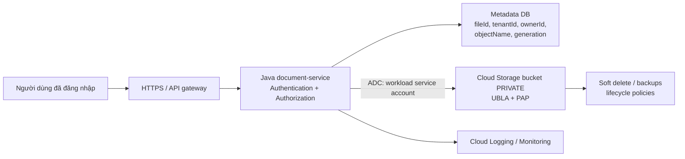
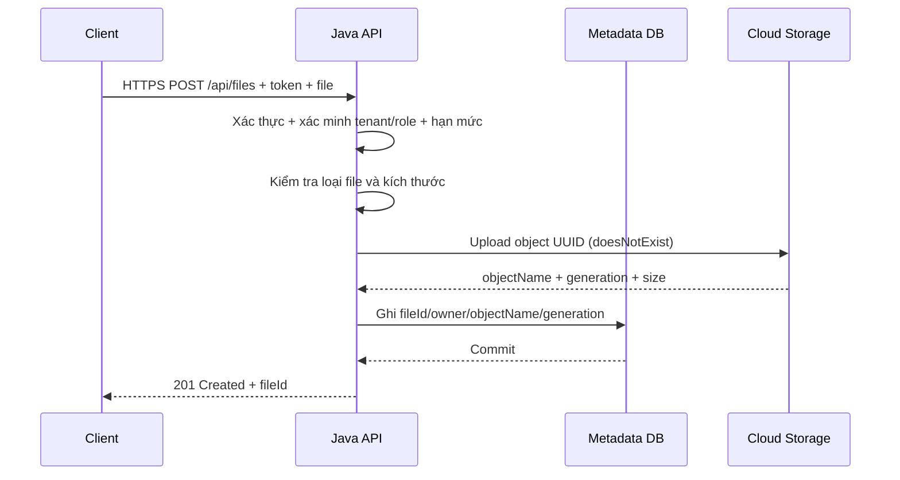

# Thực hành kho tệp riêng tư cho ứng dụng Java

Ứng dụng Java thường cần lưu hóa đơn, hợp đồng, tệp đính kèm hoặc tài liệu do khách hàng tải lên. Nếu đặt các tệp đó trong thư mục của một VM, chúng có thể biến mất khi VM bị thay thế; nếu để trong một bucket công khai, chỉ cần đoán được URL là người khác có thể tải dữ liệu. Bài thực hành này xây dựng **kho tệp riêng tư trên Google Cloud Storage**, nơi **ứng dụng Java xác thực người dùng, quyết định ai được xem tệp và thay mặt người dùng truy cập Cloud Storage** bằng danh tính workload có quyền tối thiểu.

Bài thuộc chương **Cloud Storage** của module **CLOUD_PROVIDERS_GCP**, kết nối tổ chức project/IAM, VPC, Compute Engine, GKE/Cloud Run, lưu trữ, tự động hóa triển khai, giám sát độ tin cậy và chi phí. Người học sẽ tạo bucket private, cấu hình bảo mật, viết mã Java để upload/download/list/delete đối tượng, rồi kiểm thử việc từ chối truy cập trái phép và khả năng phục hồi sau thao tác nhầm.

> Project, bucket, địa chỉ service account, tenant, đường dẫn và người dùng bên dưới là **giả định**. Các lệnh có thể tạo tài nguyên tính phí hoặc xóa dữ liệu được đánh dấu. Không ghi service-account private key, access token hay dữ liệu cá nhân thật vào source code hoặc terminal log.

## Mục tiêu học tập

Sau bài này, bạn có thể:

1. Giải thích cấu trúc **bucket, object, object name, generation và metadata** trong Cloud Storage và vì sao “private bucket” chưa đủ bảo vệ dữ liệu nhiều người dùng.
2. Tạo bucket với **Uniform bucket-level access (UBLA)** và **Public Access Prevention (PAP)**, xác minh không có IAM binding `allUsers`/`allAuthenticatedUsers`.
3. Tạo và gắn **service account riêng cho Java workload**, dùng **Application Default Credentials (ADC)** thay vì key JSON dài hạn.
4. Dùng **Google Cloud Storage Client Library for Java** để upload, download, liệt kê theo prefix và xóa tệp.
5. Định danh object bằng khóa ngẫu nhiên, lưu metadata nghiệp vụ riêng, kiểm tra quyền tenant/owner và sử dụng **generation preconditions** để tránh ghi đè/xóa nhầm.
6. Phân tích lựa chọn **proxy download** so với **V4 signed URL**, giới hạn của PAP và các rủi ro về token/URL bị lộ.
7. Lập chiến lược **soft delete, Object Versioning, lifecycle, retention, encryption, audit logs và chi phí**.
8. Xây dựng checklist kiểm thử quyền, xử lý lỗi, giám sát và dọn dẹp môi trường thực hành.

## 1. Yêu cầu và ranh giới tin cậy của bài lab

Ứng dụng minh họa `document-service` chạy bằng Java 17. Người dùng của hai tenant, `tenant-a` và `tenant-b`, đăng nhập qua một cơ chế xác thực do ứng dụng quản lý. Mỗi người chỉ được truy cập tài liệu mà nghiệp vụ cho phép.

| Yêu cầu | Phương án |
| --- | --- |
| Tệp không public | Bucket áp dụng **UBLA + PAP**, không gán principal công khai |
| Java gọi Cloud Storage | Service account chuyên biệt; production dùng **ADC** trên workload |
| Người dùng cuối | Xác thực qua ứng dụng, tra bảng ownership/ACL nghiệp vụ |
| Tên object | `tenants/{tenantId}/files/{UUID}` do **server tự tạo** |
| Upload | Giới hạn kích thước/loại file; dùng `doesNotExist()` |
| Download | Kiểm tra **owner/tenant** trước khi đọc; trả qua backend hoặc signed URL được cấp có kiểm soát |
| Delete | Soft delete ở bucket, cân nhắc lưu lịch sử và **generation match** |
| Nhật ký | Log request ID, principal nghiệp vụ, object ID/generation, loại thao tác, kết quả; không ghi nội dung file |
| Khôi phục | Chính sách soft delete/retention/backup phù hợp và diễn tập restore |

### Phân tách ba kiểu danh tính

1. **Người dùng ứng dụng**: ví dụ `user-123`, có thể thuộc `tenant-a`. Phải qua authentication/authorization nghiệp vụ.
2. **Workload identity của Java**: ví dụ `sa-documents@retail-dev-01.iam.gserviceaccount.com`, có quyền gọi Storage API trên bucket cụ thể.
3. **Cloud administrator/deployer**: tạo bucket, cấu hình IAM/PAP, gắn service account. Người này không nhất thiết là người đọc tệp.

**Điểm sống còn:** Cloud Storage thấy Java service account là principal thực hiện API call. Nó **không biết tự động** user cuối đang là Alice hay Bob. Nếu ứng dụng cho người dùng tự truyền một `objectName` rồi đọc bằng quyền của service account, kẻ tấn công có thể lợi dụng lỗ hổng **IDOR/BOLA** để đọc tài liệu người khác.

## 2. Sơ đồ kiến trúc đề xuất



Một luồng tải tệp:

```text
GET /api/files/FILE_ID
  -> xác thực session/JWT của người dùng cuối
  -> lấy metadata FILE_ID từ database
  -> kiểm tra tenantId/ownerId/permission tải xuống
  -> đọc objectName + generation từ database
  -> Java Cloud Storage client dùng ADC tải object
  -> trả response HTTPS an toàn tới người dùng
```

Ứng dụng không được dựa chỉ vào `objectName.startsWith("tenants/tenant-a/")` nếu `tenant-a` do HTTP client tự khai báo. **Tenant và owner phải được suy ra từ danh tính đã xác minh và dữ liệu nghiệp vụ đáng tin cậy**. Prefix chỉ là cách tổ chức key, không phải một lớp phân quyền thay cho ứng dụng.

### Cloud Storage không phải filesystem POSIX

Cloud Storage là **object storage**: mỗi object có tên và metadata, không phải file trên ổ đĩa local. Trong bucket thông thường, dấu `/` trong tên là **prefix logic**; `tenants/tenant-a/files/abc` không tự tạo ba thư mục có ACL riêng. Với bucket dùng hierarchical namespace hoặc managed folders có thể có thêm mô hình folder/IAM đặc thù, nhưng bài lab dùng bucket object thông thường.

## 3. Chuẩn bị lab và ngân sách

### Điều kiện cần có

- Project Google Cloud đã bật billing theo chính sách tổ chức.
- **Cloud Storage API** `storage.googleapis.com` khả dụng trong môi trường.
- Google Cloud CLI được cài và đăng nhập, hoặc dùng Cloud Shell.
- Java Development Kit **17+**, Maven và một IDE/terminal để chạy ví dụ.
- Danh tính quản trị có quyền tạo bucket, service account và đặt IAM trên bucket; các quyền này không được cấp sẵn cho ứng dụng.
- Một tệp vô hại (ví dụ `hello.txt`) để upload; **không dùng tệp chứa PII thật**.

Ví dụ đầu vào:

```bash
PROJECT_ID="retail-dev-01"
LOCATION="asia-southeast1"
BUCKET="retail-dev-private-docs-UNIQUE-SUFFIX"
SA_NAME="sa-documents"
SA_EMAIL="$SA_NAME@$PROJECT_ID.iam.gserviceaccount.com"
```

**Đổi `UNIQUE-SUFFIX`** thành một chuỗi không trùng. Tên bucket phải **duy nhất trên toàn bộ Cloud Storage namespace**, không chỉ duy nhất trong project. Không đưa email cá nhân, tên khách hàng, mã bí mật hoặc số tài khoản vào bucket name vì tên tài nguyên có thể xuất hiện trong log và metadata quản trị.

### Kiểm tra ngữ cảnh — chỉ đọc

```bash
gcloud auth list
gcloud config get-value project
gcloud projects describe "$PROJECT_ID" \
  --format="table(projectId,projectNumber,name)"

gcloud services list --enabled \
  --project="$PROJECT_ID" \
  --filter="config.name:storage.googleapis.com"
```

**`gcloud auth list` và ADC không nhất thiết dùng cùng credentials.** Google Cloud CLI có credential riêng; Java client thường dùng Application Default Credentials. Đăng nhập CLI thành công không chứng minh Java sẽ có quyền.

## 4. Tạo bucket thực sự private

### Bốn lựa chọn cấu hình ban đầu

| Cấu hình | Lựa chọn cho bài lab | Lý do |
| --- | --- | --- |
| **Location** | `asia-southeast1` | Gần nơi triển khai ứng dụng minh họa; đánh giá data residency và giá |
| **Storage class** | `STANDARD` | Phù hợp truy cập thường xuyên trong lab |
| **Uniform bucket-level access** | **Enabled** | Vô hiệu hóa ACL của bucket/object; dùng IAM làm cơ chế phân quyền |
| **Public Access Prevention** | **Enforced** | Ngăn tạo quyền public bằng `allUsers` hoặc `allAuthenticatedUsers` |

### Lệnh tạo bucket — thay đổi hạ tầng, có thể tính phí

```bash
gcloud storage buckets create "gs://$BUCKET" \
  --project="$PROJECT_ID" \
  --location="$LOCATION" \
  --default-storage-class=STANDARD \
  --uniform-bucket-level-access \
  --public-access-prevention
```

Lệnh `gcloud storage buckets create` không tự tạo service account hoặc gán quyền đọc/ghi cho Java app. Bucket mới có thể còn chịu IAM kế thừa từ project/folder/organization; phải xem quyền hiệu lực, không chỉ IAM gắn trực tiếp trên bucket.

### Kiểm tra bucket sau khi tạo — chỉ đọc

```bash
gcloud storage buckets describe "gs://$BUCKET"
gcloud storage buckets get-iam-policy "gs://$BUCKET"
```

Xác minh:

- `uniformBucketLevelAccess.enabled` là `true` (tên trường hiển thị có thể khác theo phiên bản CLI).
- `publicAccessPrevention` là `enforced` hoặc policy tổ chức đã thực thi tương đương.
- IAM không cho `allUsers` và `allAuthenticatedUsers` truy cập tệp.
- Không có role rộng cấp ở project/folder khiến những principal ngoài nhu cầu lab có thể đọc bucket.

**UBLA và PAP giải quyết hai vấn đề khác nhau.** UBLA tắt ACL để thống nhất kiểm soát bằng IAM; PAP chặn cấp quyền công khai. UBLA **không tự bảo đảm** bucket private nếu IAM vẫn cấp quyền quá rộng. PAP **không chặn signed URL hợp lệ**, vì signed URL là hình thức truy cập theo chữ ký được cấp có thời hạn. Xem thêm tài liệu chính thức ở cuối bài.

### Một kiểm thử truy cập anonymous

Với object đã upload và bạn biết tên, thử request **không có Authorization**:

```bash
# Chỉ kiểm tra, KHÔNG cung cấp access token.
# Thay OBJECT_NAME bằng object đã tạo trong lab.
curl -I "https://storage.googleapis.com/$BUCKET/OBJECT_NAME"
```

Kỳ vọng request anonymous **không được phép lấy nội dung**; API có thể trả `401`, `403` hoặc `404` tùy endpoint/phương thức và cơ chế che giấu thông tin. **Không dùng riêng một mã HTTP để kết luận**: kiểm tra response body, object path, IAM và xác thực. HEAD không phải GET; khi cần, kiểm tra GET không token bằng một đối tượng thử nghiệm.

## 5. Tạo service account và quyền tối thiểu

Ứng dụng Java cần identity riêng:

```bash
# Thay đổi IAM: tạo user-managed service account cho workload.
gcloud iam service-accounts create "$SA_NAME" \
  --project="$PROJECT_ID" \
  --display-name="Private document service"
```

### Quyền Cloud Storage cần thiết

| Hành động Java | IAM permission | Vai trò tham khảo |
| --- | --- | --- |
| Upload object mới | `storage.objects.create` | `roles/storage.objectCreator` |
| Download object | `storage.objects.get` | `roles/storage.objectViewer` |
| Liệt kê object theo prefix | `storage.objects.list` | `roles/storage.objectViewer` |
| Xóa object | `storage.objects.delete` | `roles/storage.objectUser` hoặc custom role |
| Đọc/sửa bucket IAM/config | Quyền `storage.buckets.*` tương ứng | **Chỉ IAM admin**, không phải app |

Một ứng dụng thực sự cần CRUD có thể dùng `roles/storage.objectUser` ở **scope bucket** cho bài lab. Vai trò này có nhiều permission hơn chỉ create/get/list/delete; với production hãy cân nhắc **custom role** hoặc tách quyền writer/reader và API delete sau quy trình phê duyệt.

### Gán quyền CRUD tại bucket — thay đổi IAM

```bash
gcloud storage buckets add-iam-policy-binding "gs://$BUCKET" \
  --member="serviceAccount:$SA_EMAIL" \
  --role="roles/storage.objectUser"
```

Không gán `roles/storage.admin`, `roles/editor` hay `roles/owner` cho ứng dụng chỉ để upload/download tệp. Kiểm tra IAM sau khi gán:

```bash
gcloud storage buckets get-iam-policy "gs://$BUCKET"
```

Trong thiết kế đa tenant, **một service account được cấp `objectUser` trên cả bucket có khả năng đọc/ghi/xóa object của mọi tenant trong bucket đó**. Việc cách ly dữ liệu cuối cùng **phụ thuộc vào authorization trong Java**. Nếu cần ranh giới IAM độc lập, nghiên cứu **bucket riêng**, **managed folders với IAM** hoặc các service accounts tách biệt theo tenant/tài nguyên theo chính sách tổ chức.

## 6. Application Default Credentials (ADC) cho Java

**ADC** là cơ chế để Google Cloud Java client library tìm credentials từ môi trường mà không yêu cầu code lưu private key JSON. Đường tìm kiếm phổ biến gồm:

1. Đường dẫn cấu hình từ `GOOGLE_APPLICATION_CREDENTIALS` nếu được đặt.
2. Credential cục bộ do `gcloud auth application-default login` cung cấp.
3. Danh tính service account **được gắn với môi trường Google Cloud**, lấy qua metadata server.

**Trên production**, ưu tiên attached user-managed service account ở Cloud Run/Compute Engine/GKE với Workload Identity phù hợp. Không mount service account key JSON vào container, Git repository hay môi trường CI nếu có cách xác thực không dùng khóa dài hạn.

### Môi trường local

```bash
# Chỉ dùng trên máy development đáng tin cậy.
gcloud auth application-default login

# Khi lỗi quota project và bạn có quyền phù hợp:
gcloud auth application-default set-quota-project "$PROJECT_ID"
```

Đăng nhập local bằng danh tính developer **không đồng nghĩa** đang chạy dưới `sa-documents`. Nếu muốn thử quyền giống production, dùng **service account impersonation** theo hướng dẫn ADC và quyền `iam.serviceAccounts.getAccessToken` thích hợp; không tải file key. Các policy/permission để developer impersonate phải được cấp có thời hạn/phù hợp nhu cầu.

### Khi triển khai lên Cloud Run

Minh họa một phần lệnh deploy; image và service phải có thật, ingress/authorization của service vẫn phải được kiểm soát:

```bash
# Chỉ dùng sau khi đã kiểm tra image, IAM và môi trường production.
gcloud run deploy document-service \
  --project="$PROJECT_ID" \
  --region="$LOCATION" \
  --image="REGION-docker.pkg.dev/PROJECT/REPO/IMAGE:PINNED-TAG" \
  --service-account="$SA_EMAIL" \
  --no-allow-unauthenticated \
  --set-env-vars="PRIVATE_BUCKET=$BUCKET"
```

Lệnh trên chỉ thể hiện **workload identity**, không phải ứng dụng đầy đủ để xác thực người dùng cuối. Nếu frontend web cần gọi API với tài khoản khách hàng, phải thiết kế IAM invocation/IAP/API Gateway hoặc OAuth/JWT/session theo kiến trúc cụ thể. Không bật `--allow-unauthenticated` rồi nghĩ rằng bucket private tự ngăn người ngoài truy cập tất cả API.

## 7. Thêm Cloud Storage Java Client Library

Bài lab dùng **Java 17** và Maven, thư viện:

```xml
<dependency>
  <groupId>com.google.cloud</groupId>
  <artifactId>google-cloud-storage</artifactId>
  <version>2.75.0</version>
</dependency>
```

Phiên bản `2.75.0` là ví dụ tương ứng với API reference được đối chiếu khi soạn bài. Khi triển khai thật, dùng **Google Cloud Java libraries BOM** và phiên bản đã được nhóm kiểm thử; đừng dùng dynamic version `LATEST` hoặc vô điều kiện tự nâng dependency trong production.

### Maven project tham khảo

```text
private-storage-lab/
├── pom.xml
└── src/
    └── main/
        └── java/
            └── example/
                └── PrivateStorageLab.java
```

Nội dung `pom.xml` tối giản:

```xml
<?xml version="1.0" encoding="UTF-8"?>
<project xmlns="http://maven.apache.org/POM/4.0.0"
         xmlns:xsi="http://www.w3.org/2001/XMLSchema-instance"
         xsi:schemaLocation="http://maven.apache.org/POM/4.0.0 https://maven.apache.org/xsd/maven-4.0.0.xsd">
  <modelVersion>4.0.0</modelVersion>
  <groupId>example</groupId>
  <artifactId>private-storage-lab</artifactId>
  <version>1.0.0-SNAPSHOT</version>
  <properties>
    <maven.compiler.release>17</maven.compiler.release>
    <project.build.sourceEncoding>UTF-8</project.build.sourceEncoding>
  </properties>
  <dependencies>
    <dependency>
      <groupId>com.google.cloud</groupId>
      <artifactId>google-cloud-storage</artifactId>
      <version>2.75.0</version>
    </dependency>
  </dependencies>
  <build>
    <plugins>
      <plugin>
        <groupId>org.apache.maven.plugins</groupId>
        <artifactId>maven-compiler-plugin</artifactId>
        <version>3.13.0</version>
      </plugin>
      <plugin>
        <groupId>org.codehaus.mojo</groupId>
        <artifactId>exec-maven-plugin</artifactId>
        <version>3.5.0</version>
      </plugin>
    </plugins>
  </build>
</project>
```

Đây là ứng dụng console để làm lab, **không phải REST service công khai**. Trong production, hãy đưa logic lưu trữ vào lớp service/repository và chỉ gọi sau khi bộ phận application authorization đã cho phép.

## 8. Mô hình object key và metadata nghiệp vụ

Giả sử user `u-123` của `tenant-a` upload `contract.pdf`. **Không dùng tên file do user cung cấp** làm object name trực tiếp:

```text
Bucket: retail-dev-private-docs-UNIQUE-SUFFIX
Object name: tenants/tenant-a/files/83b346f9-2dcc-4a45-91ad-7e1a1cf9270c
Content-Type: application/pdf
Cache-Control: private, no-store
Object generation: 1730000000000000  (giá trị minh họa)
```

Lưu metadata vào **database của ứng dụng**:

| Thuộc tính | Ý nghĩa |
| --- | --- |
| `fileId` | ID public/opaque do ứng dụng cấp, không phải object path |
| `tenantId` | Tenant được xác định bằng danh tính đã xác minh |
| `ownerId` | Chủ sở hữu hoặc đối tượng nghiệp vụ gắn với file |
| `bucketName` | Bucket được cấu hình server-side, không do client gửi |
| `objectName` | Tên opaque do server tạo |
| `generation` | Phiên bản nội dung object do Cloud Storage trả |
| `fileSize` | Số byte được lưu |
| `contentType` | Loại nội dung đã kiểm tra |
| `scanStatus` | Trạng thái kiểm tra mã độc, nếu ứng dụng yêu cầu |
| `createdAt`/`deletedAt` | Phục vụ audit/retention/soft delete nghiệp vụ |

**Không nhúng PII vào object name** (email, số căn cước, họ tên, mã đơn hàng nhạy cảm). Object names xuất hiện trong logs, monitoring và metadata dù bucket vẫn private. Dùng ID ngẫu nhiên rồi ánh xạ trong database giúp giảm rò rỉ thông tin và dễ thay đổi cấu trúc lưu trữ.

### Prefix không phải access policy

`tenants/tenant-a/files/` hỗ trợ quản lý danh sách và truy vấn theo prefix. Với bucket thông thường và một service account có `roles/storage.objectUser` toàn bucket, principal này **có thể truy cập cả các prefix khác**. Chỉ application authorization hoặc một cơ chế IAM thực sự (managed folders, bucket tách biệt...) mới tạo ranh giới an ninh.

## 9. Java demo: upload, download, list và delete

Mã dưới đây dùng API chính thức của `com.google.cloud:google-cloud-storage`. Nó cố ý chỉ nhận **tenant key từ môi trường đáng tin cậy** và **file local của lab**. Trong API thật, hãy thay đối số tenant bằng tenant được suy ra từ JWT/session đã xác minh, kiểm tra quyền owner trong DB và không lộ object key cho người dùng trái phép.

```java
package example;

import com.google.api.gax.paging.Page;
import com.google.cloud.storage.Blob;
import com.google.cloud.storage.BlobId;
import com.google.cloud.storage.BlobInfo;
import com.google.cloud.storage.Storage;
import com.google.cloud.storage.StorageOptions;
import java.io.IOException;
import java.nio.file.Files;
import java.nio.file.Path;
import java.util.ArrayList;
import java.util.List;
import java.util.Objects;
import java.util.UUID;

public final class PrivateStorageLab {
  private static final long MAX_UPLOAD_BYTES = 10L * 1024 * 1024;
  private final Storage storage;
  private final String bucket;

  public record StoredObject(String objectName, long generation, long size) {}

  public PrivateStorageLab(String bucket) {
    this.bucket = Objects.requireNonNull(bucket);
    if (bucket.isBlank()) throw new IllegalArgumentException("bucket missing");
    // ADC: local gcloud application-default login hoặc attached service account.
    this.storage = StorageOptions.getDefaultInstance().getService();
  }

  private static String prefix(String trustedTenantId) {
    // Tenant ID chỉ được lấy sau bước authentication/authorization ở application.
    if (trustedTenantId == null
        || !trustedTenantId.matches("[A-Za-z0-9_-]{1,48}")) {
      throw new IllegalArgumentException("invalid tenant");
    }
    return "tenants/" + trustedTenantId + "/files/";
  }

  private static void checkObject(String trustedTenantId, String objectName) {
    if (objectName == null || !objectName.startsWith(prefix(trustedTenantId))) {
      throw new SecurityException("Object outside authorized tenant prefix");
    }
  }

  public StoredObject upload(
      String trustedTenantId, Path sourceFile, String approvedContentType)
      throws IOException {
    if (!Files.isRegularFile(sourceFile)) {
      throw new IllegalArgumentException("not a regular file");
    }
    long fileSize = Files.size(sourceFile);
    if (fileSize <= 0 || fileSize > MAX_UPLOAD_BYTES) {
      throw new IllegalArgumentException("file size outside lab limit");
    }
    // Lab chỉ nhận text/plain hoặc application/pdf.
    if (!"text/plain".equals(approvedContentType)
        && !"application/pdf".equals(approvedContentType)) {
      throw new IllegalArgumentException("unsupported content type");
    }

    String objectName = prefix(trustedTenantId) + UUID.randomUUID();
    BlobInfo info =
        BlobInfo.newBuilder(BlobId.of(bucket, objectName))
            .setContentType(approvedContentType)
            .setCacheControl("private, no-store")
            .build();

    // Điều kiện không tồn tại -> không ghi đè nếu trùng tên/cạnh tranh.
    Blob created =
        storage.createFrom(
            info, sourceFile, Storage.BlobWriteOption.doesNotExist());
    return new StoredObject(
        created.getName(), created.getGeneration(), created.getSize());
  }

  public void download(
      String trustedTenantId, String objectName, long generation, Path output) {
    checkObject(trustedTenantId, objectName);
    if (generation <= 0) throw new IllegalArgumentException("bad generation");
    BlobId id = BlobId.of(bucket, objectName, generation);
    Blob metadata = storage.get(id);
    if (metadata == null) throw new IllegalArgumentException("object not found");

    // Đọc đúng version đã lưu, không âm thầm đổi sang generation mới.
    storage.downloadTo(
        id, output, Storage.BlobSourceOption.generationMatch(generation));
  }

  // Chỉ trả trang đầu; production cần truyền pageToken để phân trang.
  public List<String> listFirstPage(String trustedTenantId) {
    String keyPrefix = prefix(trustedTenantId);
    Page<Blob> page =
        storage.list(
            bucket,
            Storage.BlobListOption.prefix(keyPrefix),
            Storage.BlobListOption.pageSize(50));
    List<String> result = new ArrayList<>();
    for (Blob blob : page.getValues()) result.add(blob.getName());
    return result;
  }

  public boolean delete(
      String trustedTenantId, String objectName, long generation) {
    checkObject(trustedTenantId, objectName);
    if (generation <= 0) throw new IllegalArgumentException("bad generation");
    // Chỉ xóa nếu live object vẫn có generation mà app đã ghi nhận.
    return storage.delete(
        BlobId.of(bucket, objectName),
        Storage.BlobSourceOption.generationMatch(generation));
  }

  public static void main(String[] args) throws Exception {
    if (args.length < 3 || args.length > 4) {
      System.err.println(
          "Usage: BUCKET TRUSTED_TENANT LOCAL_FILE [--delete]");
      System.exit(2);
    }
    PrivateStorageLab repo = new PrivateStorageLab(args[0]);
    // Đây là local demo: trong production không nhận tenant từ HTTP input.
    StoredObject file = repo.upload(
        args[1], Path.of(args[2]), "text/plain");
    System.out.println("Uploaded: " + file.objectName());
    System.out.println("Generation: " + file.generation());
    System.out.println("First page: " + repo.listFirstPage(args[1]));

    Path destination = Path.of("downloaded-lab-file.txt");
    repo.download(args[1], file.objectName(), file.generation(), destination);
    System.out.println("Downloaded to " + destination.toAbsolutePath());

    // Delete KHÔNG tự chạy; phải thêm --delete rõ ràng.
    if (args.length == 4 && "--delete".equals(args[3])) {
      boolean deleted = repo.delete(args[1], file.objectName(), file.generation());
      System.out.println("Deleted: " + deleted);
    }
  }
}
```

### Những điều mẫu Java cố ý làm

| Biện pháp | Lý do |
| --- | --- |
| `StorageOptions.getDefaultInstance().getService()` | Dùng ADC, không đưa khóa vào code |
| `UUID.randomUUID()` | Không dùng tên file do user gửi làm object name và giảm collision |
| `Storage.BlobWriteOption.doesNotExist()` | Tạo mới có điều kiện, trả `412` nếu tên đã tồn tại |
| `getGeneration()` | Ghi nhận phiên bản chính xác của object |
| `BlobId.of(bucket, objectName, generation)` | Tránh đọc nhầm bản khác khi tên bị thay/ghi đè |
| `generationMatch(generation)` khi delete | Không xóa một bản live khác với version đã xác nhận |
| `setCacheControl("private, no-store")` | Giảm nguy cơ shared cache của nội dung nhạy cảm |
| `pageSize(50)` | Giới hạn kích thước một trang; tránh trả toàn bộ danh sách trong một request |

**Giới hạn của đoạn demo:** Trong code, `trustedTenantId` chỉ là giả định caller đã xác thực, **không phải chức năng xác thực thật**. Nó không có HTTP controller, database ACL, anti-malware, magic-byte validation, upload quota theo user, streaming HTTPS response, idempotency record, audit trail hoặc transaction xử lý metadata. Không copy nguyên vào production mà không bổ sung các lớp đó.

### Đọc đúng generation và versioning

Cloud Storage gán `generation` cho mỗi phiên bản nội dung object. Nếu object live bị ghi đè hoặc xóa, một generation cũ có thể không còn đọc được trừ khi cơ chế Object Versioning/soft delete lưu giữ và cho phép restore phù hợp. Trong bài lab, tên object là UUID nên không dự kiến ghi đè. **Ứng dụng phải ghi metadata vào DB sau khi upload thành công**, xử lý trường hợp object đã tạo nhưng transaction DB thất bại bằng cleanup job an toàn và idempotent.

## 10. Chạy lab bằng Maven

Tạo một file `hello.txt` **không có dữ liệu nhạy cảm**:

```bash
printf 'Private document storage lab\n' > hello.txt

# Chạy bằng ADC đã cấu hình ở local, tệp <= 10 MiB.
mvn -q compile exec:java \
  -Dexec.mainClass=example.PrivateStorageLab \
  -Dexec.args="$BUCKET tenant-a hello.txt"
```

Kết quả kỳ vọng (chỉ minh họa):

```text
Uploaded: tenants/tenant-a/files/83b346f9-2dcc-4a45-91ad-7e1a1cf9270c
Generation: 1730000000000000
First page: [tenants/tenant-a/files/83b346f9-2dcc-4a45-91ad-7e1a1cf9270c]
Downloaded to .../downloaded-lab-file.txt
```

Xác minh:

```bash
cat downloaded-lab-file.txt

gcloud storage ls "gs://$BUCKET/tenants/tenant-a/files/"

# Xem metadata bằng tên OBJECT_NAME lấy từ output thật.
gcloud storage objects describe "gs://$BUCKET/OBJECT_NAME"
```

Lệnh `gcloud storage ls` dùng **CLI principal** hiện tại, không nhất thiết là service account Java. Nếu Java upload được nhưng `gcloud ls` bị 403, có thể đơn giản do **hai principal có vai trò khác nhau**.

### Tùy chọn xóa object đã tạo

Chỉ khi muốn thử delete, thêm `--delete`:

```bash
# Tạo tệp MỚI rồi xóa đúng generation được trả ngay trong cùng chương trình.
mvn -q compile exec:java \
  -Dexec.mainClass=example.PrivateStorageLab \
  -Dexec.args="$BUCKET tenant-a hello.txt --delete"
```

Đây không phải xóa toàn bộ bucket. Nếu soft delete được bật, object vừa xóa có thể còn được khôi phục trong thời hạn cấu hình và tiếp tục tính phí lưu trữ soft-deleted.

## 11. Từ lab console tới REST API Java an toàn

Mục tiêu production thường là:

```text
POST   /api/files           upload, auth, kiểm tra quyền tenant
GET    /api/files/{fileId}  download có kiểm tra ownership
GET    /api/files           list file thuộc user/tenant
DELETE /api/files/{fileId}  đánh dấu xóa + xóa object có điều kiện
```

Không ánh xạ `/{objectName}` trực tiếp thành đường đọc bucket với quyền service account rộng. Thay bằng **opaque fileId** do ứng dụng tạo và tra trong database.

### Luồng upload nên có những bước nào?



Nếu upload Cloud Storage thành công nhưng ghi DB thất bại, **không trả 201**. Ghi event/ticket để dọn object mồ côi sau khi xác minh chưa có bản ghi nào tham chiếu; không xóa thiếu điều kiện hoặc tự động xóa cả prefix. Cân nhắc **outbox/saga** hoặc quy trình reconcile nếu business yêu cầu độ tin cậy cao.

### Luồng download

```text
1. Verify JWT/session -> authenticatedUserId, tenantId.
2. Query DB by fileId AND tenantId (và kiểm tra owner/role).
3. Kiểm tra file chưa bị xóa/khóa/quarantine.
4. Lấy objectName và generation từ metadata tin cậy.
5. Cloud Storage downloadTo/read stream theo generation.
6. Trả HTTPS response với Content-Type đã kiểm tra,
   Content-Disposition: attachment khi cần.
7. Audit: ai đọc file nào, khi nào, kết quả gì.
```

**Không trả đường dẫn local chứa objectName do user nhập** để tạo filename output; nếu server dùng file tạm phải chuẩn hóa đường dẫn, giới hạn disk, dọn sau response và tránh path traversal. Với file lớn, stream qua output thay vì load toàn bộ vào `byte[]`.

### Cách xử lý lỗi API

| Lỗi phía Storage/API | Trạng thái ở lớp ứng dụng nên cân nhắc | Ý nghĩa |
| --- | --- | --- |
| Object không tồn tại | `404 Not Found` | Không tiết lộ dữ liệu của tenant khác |
| User cuối không sở hữu file | `403 Forbidden` hoặc `404` theo chính sách che giấu | Lỗi authorization **của ứng dụng**, không do bucket |
| Service account thiếu `storage.objects.get` | Lỗi 403 từ Cloud Storage; backend trả 5xx/503 phù hợp | Lỗi IAM vận hành, không đổ lỗi cho người dùng |
| Preconditions không thỏa | `412 Precondition Failed` ở Storage, chuyển `409 Conflict` hoặc `412` | Có race/version thay đổi |
| Vượt kích thước upload | `413 Payload Too Large` | Reject trước khi upload toàn bộ |
| Loại file không được hỗ trợ | `415 Unsupported Media Type` hoặc `422` | MIME/format không hợp lệ |
| Hết quota/tạm lỗi | `429`, `503` hoặc lỗi gốc được phân loại | Retry có backoff/idempotency |
| Retention/hold ngăn delete | `403` hoặc lỗi tương ứng từ API | Không cố vượt policy; cần owner dữ liệu xử lý |

Không trả nguyên thông báo nội bộ có object key, service account, request signature, access token hoặc stack trace ra response HTTP cho người dùng.

## 12. Ghi và xóa an toàn với generation preconditions

Cloud Storage có **strong consistency** đối với nhiều thao tác object (tạo, đọc, xóa, listing) theo mô hình được tài liệu công bố. Tuy vậy, **hai client độc lập vẫn có thể race** khi cùng sửa cùng một object name. Strong consistency không thay thế **optimistic concurrency control**.

| Ý định | Preconditions | Kết quả |
| --- | --- | --- |
| Chỉ tạo khi chưa có live object | `ifGenerationMatch=0` / `doesNotExist()` | Tránh overwrite khi có key trùng |
| Chỉ ghi đè nếu đúng live generation | `generationMatch(oldGeneration)` | Tránh ghi đè thay đổi mới của client khác |
| Chỉ xóa nếu live generation chưa đổi | `BlobSourceOption.generationMatch(oldGeneration)` | Tránh xóa bản mới |
| Cập nhật metadata có kiểm soát | `metagenerationMatch(...)` kết hợp generation | Tránh lost update metadata |

Nếu precondition không đúng, API trả **`412 Precondition Failed`**. Đây không phải lỗi mạng tạm thời có thể retry y nguyên vô hạn; ứng dụng phải đọc lại state hoặc báo conflict cho caller.

### Java: chỉ ghi đè object nếu đúng generation

Đoạn sau dành cho một tình huống **cần version cố định** (khác thiết kế UUID trong demo):

```java
import com.google.cloud.storage.BlobId;
import com.google.cloud.storage.BlobInfo;
import com.google.cloud.storage.Storage;
import java.nio.charset.StandardCharsets;

BlobId id = BlobId.of(bucketName, "shared/config.json");
BlobInfo info = BlobInfo.newBuilder(id)
    .setContentType("application/json")
    .setCacheControl("private, no-store")
    .build();

long versionReadEarlier = 1730000000000000L; // giả định từ metadata đã đọc
storage.create(
    info,
    "{\"enabled\":true}".getBytes(StandardCharsets.UTF_8),
    Storage.BlobTargetOption.generationMatch(versionReadEarlier));
```

Nếu `shared/config.json` đã đổi generation, thao tác sẽ bị từ chối thay vì âm thầm ghi đè. Không dùng một generation hard-coded trong ứng dụng thật; lấy từ database/metadata tin cậy theo quy trình đồng bộ.

## 13. Signed URL: khi nào nên dùng và khi nào không?

Có hai cách phổ biến trả nội dung từ bucket private:

| Phương án | Luồng | Điểm mạnh | Rủi ro/điều kiện |
| --- | --- | --- | --- |
| **Java backend proxy** | Client → Java API → Cloud Storage → Java → Client | Kiểm soát authZ/headers/logging tại mỗi request | Tăng băng thông/CPU/latency trên backend |
| **V4 signed URL** | Java xác thực user, tạo URL có chữ ký → client tải trực tiếp từ Storage | Giảm tải backend, hợp file lớn | URL là **bearer capability**: ai có URL còn hiệu lực đều có thể dùng trong scope |

**Public Access Prevention không chặn V4 signed URL hợp lệ**. Signed URL không phải IAM role public; quyền được cấp qua chữ ký tài khoản đủ quyền. Vì vậy một bucket `PAP=enforced` vẫn có thể cho người có signed URL tải object trong thời hạn cho phép.

### Khi cấp signed URL

1. Xác thực user và kiểm tra **fileId → ownership/tenant** trong DB.
2. Ký **đúng object name, đúng HTTP method** (GET hoặc PUT), thời hạn ngắn (ví dụ 5–15 phút) và điều kiện request cần thiết.
3. Với upload, cân nhắc content type, size validation và kiểm tra sau upload; signed PUT đơn giản không thay thế mọi chính sách kích thước/scan.
4. Không ghi signed URL vào logs, analytics, referrer, error tracking hoặc tin nhắn công khai.
5. Nếu cần thu hồi ngay, signed URL có thể tiếp tục được dùng đến hạn nếu điều kiện ký vẫn hợp lệ; phải thiết kế chiến lược revoke bằng thay đổi object/generation, chính sách tài khoản ký hoặc cơ chế phù hợp. **Không giả định xóa session ứng dụng sẽ vô hiệu hóa signed URL đã phát.**
6. Với browser upload, cấu hình **CORS** đúng origin và HTTP method; CORS **không phải cơ chế authorization**.

### Lưu ý Java khi ký URL

Ở một số môi trường, attached service account thông qua ADC **không có private key local để ký**. Có thể cần IAM Credentials API và quyền `iam.serviceAccounts.signBlob` của danh tính ký, hoặc cấu hình signer phù hợp với thư viện. **Không khắc phục bằng cách xuất JSON private key** cho Cloud Run/GKE nếu có cơ chế ký không dùng khóa.

Với file thực sự nhạy cảm cần revoke từng request hoặc không cho chia sẻ capability link, **backend proxy** có thể phù hợp hơn.

## 14. Kiểm thử an ninh theo tenant và người dùng

Một bucket private vẫn có thể bị lộ thông qua **lỗi logic của Java API**. Thiết kế test trước khi nối frontend:

| Test | Hành động | Kết quả kỳ vọng |
| --- | --- | --- |
| `T1` | Không có token gọi `GET /api/files/file-a` | `401` |
| `T2` | User tenant A truy cập file thuộc tenant B | `403`/`404`, **không trả nội dung** |
| `T3` | User tenant A list files | Chỉ các file được phép theo DB |
| `T4` | Client gửi `objectName=tenants/tenant-b/...` | App bỏ qua objectName do client gửi; chỉ tra fileId |
| `T5` | Anonymous gọi Storage URL của object thật | Bị từ chối, không tải được payload |
| `T6` | Upload tệp `.pdf` nhưng bytes là executable | Bị phát hiện/quarantine theo loại file và chính sách scan |
| `T7` | Upload 50 MiB trong lab giới hạn 10 MiB | Bị từ chối trước khi lưu |
| `T8` | Hai luồng cùng ghi object key | Một luồng thất bại `412` khi dùng precondition đúng |
| `T9` | User yêu cầu delete object không sở hữu | Không thực thi Storage delete |
| `T10` | User rời tenant hoặc bị khóa account | Không còn đọc được từ API; xử lý signed URLs đã cấp nếu dùng |
| `T11` | Tắt quyền Storage của service account | Java nhận 403; alert vận hành, không lộ details |
| `T12` | DB ghi metadata lỗi sau upload | Có cơ chế reconciliation cho object mồ côi |

Đối với dữ liệu chưa kiểm tra, **upload vào vùng quarantine** rồi quét AV/content policies trước khi cho tải xuống. Chỉ kiểm tra MIME dựa trên filename hoặc header `Content-Type` do client gửi **không đủ**; có thể kết hợp magic bytes, file parser an toàn, quota theo user và rate limiting.

### Kiểm soát download ở browser

- Trả `Content-Disposition: attachment; filename="sanitized-name.ext"` khi không muốn browser thực thi nội dung.
- Dùng `X-Content-Type-Options: nosniff` và Content Security Policy nếu phục vụ tệp qua web.
- Không cho user điều khiển trực tiếp response headers gây CRLF injection.
- Xem rủi ro HTML/SVG/PDF upload có thể chứa active content; tránh phát từ origin có cookie auth của ứng dụng nếu có thể.
- Không cache shared nội dung cá nhân hóa ở Cloud CDN khi chưa có thiết kế authZ/cache key phù hợp.

## 15. Data protection: soft delete, versioning, lifecycle, retention

Kho private không chỉ cần ngăn người lạ đọc file mà còn phải giảm thiểu mất dữ liệu do xóa nhầm, lỗi ứng dụng hoặc tài khoản bị chiếm quyền.

### 15.1 Soft delete

**Soft delete** giữ object/bucket đã bị xóa hoặc ghi đè trong khoảng retention đã cấu hình để có thể restore. Với bucket thông thường hỗ trợ tính năng, **mặc định hiện hành là 7 ngày**; có thể điều chỉnh hoặc tắt tùy chính sách. Soft-deleted objects **không được đọc như object live**; phải thực hiện quy trình restore.

Ưu điểm: phục hồi xóa nhầm và giảm nguy cơ mất dữ liệu vĩnh viễn. Chi phí: dữ liệu soft-deleted vẫn có thể tính phí, đặc biệt ở bucket nhiều file tạm hoặc churn cao.

### 15.2 Object Versioning

**Object Versioning** giữ các **noncurrent generations** khi một live object được thay hoặc xóa theo cơ chế của dịch vụ. Những generation cũ có thể được truy cập và quản lý khi còn tồn tại. Versioning **không tự bảo vệ xóa bucket** như soft delete.

Trong thiết kế object UUID, nhu cầu overwrite thấp; có thể **không cần bật Object Versioning** nếu soft delete và backup đã đạt RPO/RTO. Với file người dùng cho phép sửa liên tục, cần kiểm soát version lịch sử và chi phí rõ ràng.

### 15.3 Object Lifecycle Management

Lifecycle rules có thể xóa object quá hạn hoặc chuyển storage class theo điều kiện. Một rule xóa **không bảo đảm dữ liệu biến mất ngay lập tức**: khi soft delete áp dụng, object có thể chuyển sang trạng thái soft-deleted trước khi hết retention.

Ví dụ về yêu cầu nghiệp vụ:

```text
Quarantine objects: kiểm tra và dọn sau 14 ngày
Temporary exports: xóa live objects sau 30 ngày
Invoices: giữ theo chính sách pháp lý riêng
Audit logs: retention và quyền truy cập riêng
```

**Không áp rule 30 ngày cho toàn bucket nếu chứa cả hợp đồng phải giữ nhiều năm.** Phân biệt bucket/prefix, đối tượng chịu retention/hold và quy định lưu giữ, rồi review trước khi chạy.

### 15.4 Retention policies và holds

Bucket retention policy, object retention và holds có thể **ngăn xóa object** trong thời hạn bắt buộc. Đây là tính năng phục vụ compliance, khác soft delete. Một khi khóa retention policy theo cơ chế Bucket Lock, việc thay đổi hoặc rút ngắn có thể không còn thực hiện được. Cần phê duyệt pháp lý/bảo mật trước khi bật lock trong production.

## 16. Mã hóa, mạng và bảo vệ dữ liệu nhạy cảm

### Encryption at rest và in transit

- Cloud Storage **mã hóa dữ liệu at rest theo mặc định** bằng cơ chế của Google Cloud.
- Java client kết nối Storage API qua **HTTPS/TLS** để bảo vệ dữ liệu in transit.
- Nếu chính sách yêu cầu quyền kiểm soát khóa độc lập, cân nhắc **CMEK qua Cloud KMS**; service agent cần quyền trên key và phải lập kế hoạch rotation/availability.
- **Customer-supplied encryption keys** hoặc client-side encryption có trách nhiệm quản trị khóa khác, không cần cho bài lab.

Không tự tạo “mã hóa” bằng cách lưu secret key trong object metadata hoặc đặt private key trong nguồn code.

### Private bucket không đồng nghĩa private network

Cloud Storage là dịch vụ Google APIs; **bucket private** nghĩa là IAM và access policies hạn chế ai được truy cập object. Điều này **khác** việc API endpoint có thể được định tuyến qua Internet hay private network.

Nếu Compute Engine không có external IP, có thể cần **Private Google Access** hoặc cơ chế egress thích hợp để gọi Storage API. Nếu yêu cầu chống rò rỉ dữ liệu ở phạm vi perimeter, nghiên cứu **VPC Service Controls**, Private Service Connect for Google APIs, Cloud NAT, proxy và Organization Policy tùy kiến trúc. Những kiểm soát mạng này **không thay thế** application authorization cho từng tenant.

### Bucket IP filtering và perimeter

Cloud Storage hỗ trợ tính năng bucket IP filtering ở những mô hình được sản phẩm hỗ trợ, nhưng có thể làm ứng dụng/Cloud Shell/CI bị khóa nếu khai báo sai. Chỉ bật sau khi kiểm tra đường vào thực tế, network/VPC resource identifiers và quy tắc ngoại lệ cần thiết.

## 17. Logs, giám sát, alert và xử lý sự cố

Ứng dụng nên đo:

| Chỉ số / log | Tại sao cần |
| --- | --- |
| Upload/download/delete success rate | Nhận biết lỗi ứng dụng, IAM và kết nối |
| `401`/`403`/`404` trên API | Phát hiện truy cập trái phép và BOLA/IDOR |
| Storage API `403`/`412`/`429`/`5xx` | Tách thiếu quyền, race, rate limit và lỗi tạm thời |
| P95/P99 latency | Trải nghiệm tải file và throughput |
| Bytes uploaded/downloaded | Phục vụ quota và chi phí |
| Orphaned object count | DB transaction/reconciliation bị lỗi |
| Soft-deleted bytes/version count | Phát hiện tăng phí do file churn |
| IAM changes, bucket config changes | Phát hiện cấp quyền công khai hoặc làm yếu PAP/UBLA |

### Cloud Audit Logs

Cloud Storage có Admin Activity và Data Access logs theo loại operation. **Data Access logs cho nhiều hoạt động đọc/ghi đối tượng không bật mặc định** và có thể làm tăng chi phí log; cần bật trước khi cần điều tra, đặt retention/sink và quyền xem phù hợp.

Ví dụ Logs Explorer:

```text
protoPayload.serviceName="storage.googleapis.com"
protoPayload.resourceName:"retail-dev-private-docs"
```

Đây chỉ là bộ lọc gợi ý; resource name/methodName thực tế tùy operation và API. Thêm timestamp, principalEmail, request ID và status để phân tích sự kiện. Không log toàn bộ signed URLs, bearer tokens, nội dung tài liệu hoặc PII trong bucket name/objectName.

### Lỗi thường gặp

| Triệu chứng | Nguyên nhân hay gặp | Cách kiểm tra |
| --- | --- | --- |
| Java báo `401 UNAUTHENTICATED` | ADC chưa có hoặc token hết hạn | `gcloud auth application-default login` local; attached SA production |
| Java báo `403 PERMISSION_DENIED` | SA không có quyền bucket hoặc đang dùng principal khác | Xem SA trên runtime, IAM kế thừa, Policy Troubleshooter |
| `gcloud ls` được nhưng Java 403 | CLI và ADC khác danh tính | So sánh `gcloud auth list` với ADC/runtime SA |
| `412 Precondition Failed` khi upload | Object key live đã tồn tại | Kiểm tra UUID/collision; không retry ghi đè mù |
| `412` khi delete | Generation đã đổi | Đọc metadata mới, đối chiếu DB, quyết định conflict |
| Upload được, API không thấy file | DB commit lỗi hoặc tenant lookup sai | Reconcile object/DB; không bỏ qua authZ |
| User A tải được file tenant B | Lỗi BOLA/IDOR ở backend | Dừng truy cập, sửa authZ, audit và xử lý sự cố an ninh |
| Không upload được file lớn | Memory, timeout, body limit/proxy, quota | Streaming/resumable, giới hạn và timeout |
| Đã delete nhưng vẫn tính phí | Soft delete, noncurrent versions, retention | Xem policy và Billing SKU |
| Signed URL bị dùng sau logout | URL vẫn hiệu lực trong TTL | TTL ngắn, xử lý revoke riêng, không log URL |
| Cloud Run không truy cập Storage | SA/ADC, API, VPC/egress hoặc policy | Kiểm tra config IAM, network và audit |
| Object bị browser cache sau thay | HTTP Cache-Control, CDN, signed URL | Xem header, cache keys, versioned URL và invalidation |

### Retry và idempotency

Chỉ retry lỗi tạm thời phù hợp như `429`, `503` với exponential backoff/jitter và giới hạn tổng thời gian. **Đối với upload**, dùng precondition hoặc object ID theo idempotency key để tránh tạo file trùng khi client retry sau timeout. `403` do quyền thiếu hay `412` do conflict không nên retry vô hạn.

## 18. Case study: Kho hóa đơn riêng tư trong ứng dụng Java

Giả sử hệ thống bán hàng có hai tenant và khách hàng tải hóa đơn PDF:

| Thuộc tính | Giá trị giả định |
| --- | --- |
| Project | `retail-prod-01` |
| Bucket | `retail-prod-invoices-unique` |
| Java runtime | Cloud Run với user-managed service account |
| Object key | `tenants/{tenant}/invoices/{UUID}` |
| Storage class | Standard nếu truy cập thường xuyên |
| Dữ liệu | Hóa đơn PDF chứa PII |
| Access | Người mua, nhân viên được phân quyền và auditor |
| Retention | Theo yêu cầu pháp lý đã phê duyệt |
| Download | Backend proxy có kiểm tra owner mỗi request |
| Logs | Audit nghiệp vụ + Cloud Audit Logs theo chính sách |

### Quy trình tạo hóa đơn

1. Ứng dụng xác thực merchant/service tạo hóa đơn và kiểm tra lệnh thuộc tenant được phép.
2. Render PDF từ dữ liệu đã kiểm chứng, giới hạn size, không tin filename.
3. Tạo opaque `fileId` và objectName ngẫu nhiên.
4. Upload PDF với `Content-Type: application/pdf`, `Cache-Control: private, no-store` và `doesNotExist()`.
5. Ghi `fileId`/owner/generation/size vào DB cùng trạng thái `AVAILABLE`.
6. Chỉ trả `fileId` về frontend; không trả nguyên object path cho client không cần biết.
7. Khi khách hàng tải, API xác thực, kiểm tra ownership, sau đó đọc từ Storage.
8. Khi yêu cầu xóa, kiểm tra retention pháp lý trước khi gọi Cloud Storage API và ghi audit.

### Tình huống cần điều tra

Một ngày, khách hàng `tenant-a` gửi request có `fileId` của `tenant-b`:

```text
GET /api/files/file-b-456
Authorization: Bearer <TOKEN_DA_XAC_MINH>
```

Kết quả đúng: ứng dụng trả `403` hoặc `404`, **không gọi Storage API với objectName tenant-b**. Nếu backend gọi Storage rồi trả bytes vì service account có quyền toàn bucket, thì private bucket **vẫn có lỗ hổng dữ liệu**. Cần sửa thứ tự authorization trước storage, thêm negative tests và audit các download trái phép.

## 19. Chi phí và giới hạn khi triển khai

Cloud Storage tính phí theo các thành phần khác nhau:

- **Storage bytes**: lượng dữ liệu thực lưu, class và location.
- **Operations**: số upload, list, get metadata, copy, delete và các thao tác được định giá.
- **Data transfer/egress**: số byte tải từ Cloud Storage về client/region khác/Internet.
- **Retrieval/early deletion**: có thể áp dụng với Nearline/Coldline/Archive và class có yêu cầu thời gian lưu tối thiểu.
- **Soft delete, Object Versioning và backups**: dữ liệu giữ thêm vẫn có thể tính phí.
- **Cloud KMS, Logging/Monitoring và Cloud Run/network**: chi phí hỗ trợ nếu dùng.

### Bài toán ước tính minh họa

Giả sử có:

```text
10.000 hóa đơn/tháng × 200 KiB/hóa đơn
= 2.000.000 KiB ≈ 1,91 GiB dữ liệu upload/tháng.

Nếu mỗi hóa đơn được download trung bình 2 lần:
20.000 downloads × 200 KiB ≈ 3,81 GiB body download/tháng.
```

Đây **không phải giá Google Cloud**. Để dự toán, cần cộng request cost, egress theo vị trí, dữ liệu còn lưu qua nhiều tháng, bản soft-deleted, lifecycle/retention và các dịch vụ khác. Dùng bảng giá Cloud Storage hiện hành và Google Cloud Pricing Calculator, rồi so sánh với Cloud Billing theo SKU.

### Dọn dẹp lab

Sau khi hoàn thành, nếu không còn nhu cầu:

1. Xác minh mọi object trong bucket là dữ liệu thử nghiệm, không chứa tài liệu khách hàng.
2. Kiểm tra soft delete/retention/object holds và versioning; không cố xóa vượt retention.
3. Gỡ bucket IAM binding của service account sau khi workload không còn dùng.
4. Chỉ khi đã xác nhận dữ liệu có thể bỏ và có quyền, xóa object/bucket theo tài liệu chính thức.
5. Rà soát Cloud Run service, service account, logs, snapshots/soft delete và chi phí còn tồn tại.

Không chèn `gcloud storage rm -r gs://...` vào pipeline tự động nếu chưa có confirmation và kiểm tra bucket name nghiêm ngặt. Hãy giữ bản backup/restore test theo quy định trước khi hủy tài nguyên.

## 20. Các nhầm lẫn thường gặp

| Nhận định sai | Cách hiểu đúng |
| --- | --- |
| “Bucket không public thì user A không thể xem file user B” | App dùng SA toàn bucket vẫn có thể có lỗi BOLA; phải kiểm tra ownership |
| “UBLA đồng nghĩa không ai truy cập được nếu không có ACL” | UBLA **tắt ACL**, còn IAM có thể cấp quyền rất rộng |
| “PAP sẽ chặn mọi signed URL” | PAP không chặn signed URL hợp lệ |
| “IAM theo prefix tự tồn tại vì tên có dấu `/`” | Prefix chỉ là chuỗi object name; cần managed folder IAM/bucket riêng hoặc app ACL |
| “`gcloud auth login` đủ để Java có ADC” | `gcloud auth application-default login` khác hệ credential CLI |
| “Service account key JSON là cách bắt buộc ở Cloud Run” | Attached SA/Workload Identity và ADC được ưu tiên |
| “Content-Type của file do client gửi luôn đáng tin” | Cần kiểm tra file signature/parser an toàn |
| “Dùng UUID nghĩa là không cần precondition” | UUID giảm collision, precondition chặn overwrite/race nếu có |
| “Upload trả 200 là DB metadata chắc chắn đã commit” | Hai dịch vụ có transaction khác nhau, cần reconcile |
| “Xóa object ngay lập tức làm dữ liệu biến mất vĩnh viễn” | Soft delete/versioning/retention có thể giữ dữ liệu |
| “Cache-Control: no-store đủ giải quyết IAM” | Header chỉ điều khiển cache, không quyết định quyền xem |
| “Một signed URL rò rỉ chỉ dùng được bởi user đã đăng nhập” | Ai có URL có thể dùng trong thời hạn và phạm vi chữ ký |
| “Storage class Archive phù hợp mọi tài liệu ít đọc” | Cần xem retrieval và early deletion charges |
| “Cloud Storage private nghĩa request không qua Internet” | IAM/PAP và đường mạng là hai lớp khác nhau |

## 21. Bài tập thực hành

### Bài 1 — Thiết kế access control

Một ứng dụng Java lưu tài liệu của 10 tenant vào cùng bucket. Service account có `roles/storage.objectUser` trên bucket. Tenant A gửi `fileId` của tenant B. Chính sách nào phải từ chối request?

<details>
<summary>Gợi ý đáp án</summary>

**Authorization của Java application** phải tra metadata theo fileId và tenant/owner đã xác minh, từ chối trước khi gọi Storage. IAM của service account không tự biết người dùng cuối thuộc tenant nào. Nếu cần boundary mạnh hơn, cân nhắc bucket/service account tách riêng hoặc managed-folder IAM phù hợp.
</details>

### Bài 2 — UBLA và PAP

Vì sao bật Uniform bucket-level access chưa đảm bảo bucket không bị public?

<details>
<summary>Đáp án</summary>

UBLA vô hiệu hóa ACL và thống nhất bằng IAM; IAM binding `allUsers` có thể làm dữ liệu public nếu không bị chặn. PAP ngăn tạo/áp dụng quyền công khai qua `allUsers` và `allAuthenticatedUsers`. Cần kết hợp cả hai, kiểm tra IAM hiệu lực và chính sách tổ chức.
</details>

### Bài 3 — Local credentials

Bạn chạy `gcloud storage ls` thành công nhưng `PrivateStorageLab` báo 403. Hãy nêu ba nguyên nhân và cách xác minh.

<details>
<summary>Gợi ý đáp án</summary>

CLI và ADC có thể dùng hai danh tính khác nhau; local ADC chưa login/quota project chưa đúng; Java identity thiếu `storage.objects.*` trên bucket. Kiểm tra `gcloud auth list`, `gcloud auth application-default login`/attached SA và bucket IAM, dùng Policy Troubleshooter khi phù hợp.
</details>

### Bài 4 — Generation precondition

Một object `shared/config.json` đang có generation 100. Client A và B đều đọc generation 100. A cập nhật thành generation 101; B cố ghi với `generationMatch(100)`. Điều gì xảy ra?

<details>
<summary>Đáp án</summary>

Cloud Storage từ chối thao tác B với `412 Precondition Failed`, không ghi đè generation 101. B phải đọc lại state, giải quyết conflict hoặc báo người dùng; không retry vô hạn cùng precondition.
</details>

### Bài 5 — Signed URL và đăng xuất

Ứng dụng cấp signed GET URL 15 phút, sau đó user đăng xuất ngay. URL có tự bị vô hiệu hóa không?

<details>
<summary>Đáp án</summary>

Không mặc định. Signed URL là capability theo chữ ký/thời hạn; người giữ link có thể dùng cho tới khi hết hạn hoặc một điều kiện xác thực chữ ký/tài nguyên thay đổi. Cần TTL ngắn, hạn chế lưu log và thiết kế revoke riêng nếu nghiệp vụ yêu cầu.
</details>

### Bài 6 — Chọn chiến lược xóa và phục hồi

Kho tài liệu hay gặp trường hợp user xóa nhầm nhưng không cần nhiều phiên bản của cùng object name. Nên xem soft delete hay Object Versioning trước?

<details>
<summary>Gợi ý đáp án</summary>

**Soft delete** thường là điểm bắt đầu hợp lý để phục hồi xóa/overwrite nhầm và có thể bảo vệ ở cấp bucket. Versioning hữu ích nếu cần truy cập nhiều noncurrent generations, nhưng tăng chi phí và không bảo vệ bucket deletion tương tự soft delete. Quyết định theo RPO/RTO, retention và chi phí.
</details>

### Bài 7 — Cơ chế bảo vệ khi upload

Người dùng đặt tên `../admin/secret.pdf` rồi upload. Vì sao không nên dùng chuỗi này làm objectName hoặc local temporary path?

<details>
<summary>Gợi ý đáp án</summary>

Tên file là input không tin cậy, có thể gây path traversal khi thao tác local và rò rỉ dữ liệu/nhầm prefix trong object namespace. Server nên tự sinh UUID object key, lưu tên hiển thị đã sanitize riêng và kiểm tra quyền nghiệp vụ.
</details>

### Bài 8 — Giá theo storage và egress

Hệ thống có 10.000 PDF × 200 KiB và 20.000 lượt tải xuống. Tính data body upload và download xấp xỉ, nêu ít nhất ba khoản phí khác phải xét.

<details>
<summary>Đáp án</summary>

Upload khoảng **1,91 GiB**, download khoảng **3,81 GiB**. Còn phí storage qua nhiều tháng, operations, egress theo region/Internet, soft delete/versioning, logging/KMS/Cloud Run. Không dùng số byte body đơn giản làm hóa đơn chính thức.
</details>

### Bài 9 — Không lộ dữ liệu qua MIME

Java API nhận upload `.png` nhưng nội dung là HTML có JavaScript. Những bước bảo vệ nào cần thiết?

<details>
<summary>Gợi ý đáp án</summary>

Không chỉ tin filename/Content-Type do client gửi; kiểm tra magic bytes/parser, giới hạn size, quarantine/scan, trả file với `Content-Disposition: attachment` khi thích hợp, `X-Content-Type-Options: nosniff` và tách origin/cookie domain để tránh thực thi active content.
</details>

### Bài 10 — Khắc phục lỗi 412 khi delete

Ứng dụng DB lưu generation 42, object live hiện đã được cập nhật sang generation 43. Code gọi `delete(... generationMatch(42))`. Cần xử lý thế nào?

<details>
<summary>Gợi ý đáp án</summary>

Từ chối thao tác với conflict; đọc metadata lại, xác minh ai cập nhật và đối chiếu DB. Không bỏ precondition rồi xóa generation 43 một cách mù quáng. Nếu cần xóa version cụ thể, phải dùng API/versioning và chính sách retention phù hợp.
</details>

## 22. Checklist triển khai kho private Java production

- [ ] Bucket có tên không chứa dữ liệu nhạy cảm, location/storage class đúng nhu cầu.
- [ ] UBLA bật, PAP enforced, không có quyền công khai qua IAM/kế thừa.
- [ ] Tách danh tính bucket administrator, deployer và workload service account.
- [ ] Java dùng ADC/attached service account, không lưu JSON private key.
- [ ] Vai trò Storage cấp ở bucket/managed folder scope phù hợp, không cấp Editor/Owner rộng.
- [ ] API xác thực người dùng, kiểm tra tenant/owner/role **trước khi gọi Storage**.
- [ ] Server tạo opaque `fileId` và random `objectName`, không dựa vào filename do client đưa.
- [ ] Database lưu mapping fileId → bucket/object/generation/owner/scan status.
- [ ] Upload giới hạn size/type, chống malware, kiểm tra MIME thực tế và rate limit.
- [ ] Ghi có `doesNotExist()` hoặc generation preconditions để tránh race.
- [ ] Download trả HTTPS an toàn, chặn cross-tenant và tùy tình huống dùng attachment/nosniff.
- [ ] Signed URL (nếu dùng) ngắn hạn, không log và có chiến lược revoke phù hợp.
- [ ] Có soft delete, retention/lifecycle/backup phù hợp và diễn tập restore.
- [ ] Có audit logs, metrics, alert cho lỗi 403/412/5xx, egress và object mồ côi.
- [ ] Đã thử anonymous GET, user khác tenant, user bị khóa và key/SA thiếu quyền.
- [ ] Có reconciliation khi upload thành công nhưng DB commit thất bại.
- [ ] Đã dự toán storage, operations, egress, soft delete, KMS, network và Cloud Run.
- [ ] Có runbook khôi phục, rollback, chi phí và cleanup, không xóa bucket production bừa bãi.

## Tài liệu tham khảo chính thức

- [Cloud Storage overview](https://cloud.google.com/storage/docs/introduction): bucket, object, storage classes và khái niệm chính.
- [Create buckets](https://cloud.google.com/storage/docs/creating-buckets): bucket location, UBLA, PAP, soft delete.
- [Uniform bucket-level access](https://cloud.google.com/storage/docs/uniform-bucket-level-access): IAM thay object ACL.
- [Public Access Prevention](https://cloud.google.com/storage/docs/public-access-prevention): chặn public IAM/ACL và giới hạn.
- [Cloud Storage IAM roles](https://cloud.google.com/storage/docs/access-control/iam-roles): `storage.objectCreator`, `objectViewer`, `objectUser` và permissions.
- [Application Default Credentials](https://cloud.google.com/docs/authentication/application-default-credentials): trình tự tìm credentials cho Java.
- [ADC with attached service accounts](https://cloud.google.com/docs/authentication/set-up-adc-attached-service-account): xác thực production không dùng key.
- [Google Cloud Storage Java client](https://cloud.google.com/java/docs/reference/google-cloud-storage/latest/com.google.cloud.storage.Storage): `createFrom`, `downloadTo`, `list`, `delete` và options.
- [Upload objects](https://cloud.google.com/storage/docs/uploading-objects): uploads từ filesystem và Java examples.
- [Download objects](https://cloud.google.com/storage/docs/downloading-objects): Java downloads và permissions.
- [Request preconditions](https://cloud.google.com/storage/docs/request-preconditions): generation/metageneration và mã `412`.
- [Signed URLs](https://cloud.google.com/storage/docs/access-control/signed-urls): V4 signed URL, thời hạn và rủi ro.
- [Soft delete](https://cloud.google.com/storage/docs/soft-delete): phục hồi xóa nhầm, retention và chi phí.
- [Object Versioning](https://cloud.google.com/storage/docs/object-versioning): generations và noncurrent objects.
- [Object Lifecycle Management](https://cloud.google.com/storage/docs/lifecycle): xóa/chuyển class theo điều kiện.
- [Cloud Storage audit logging](https://cloud.google.com/storage/docs/audit-logging): các logs và cấu hình Data Access.
- [Cloud Storage pricing](https://cloud.google.com/storage/pricing): dung lượng, operations, retrieval, network và soft delete.
- [Google Cloud Pricing Calculator](https://cloud.google.com/products/calculator): lập dự toán ứng dụng.

