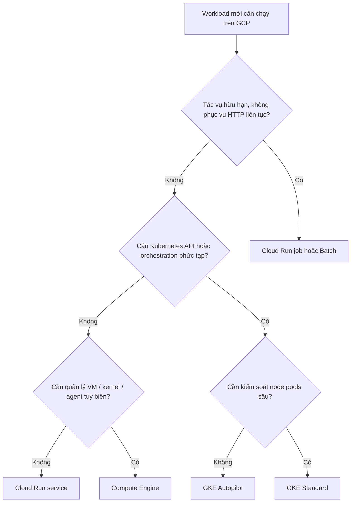
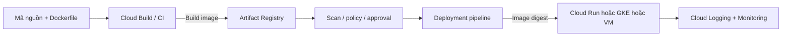
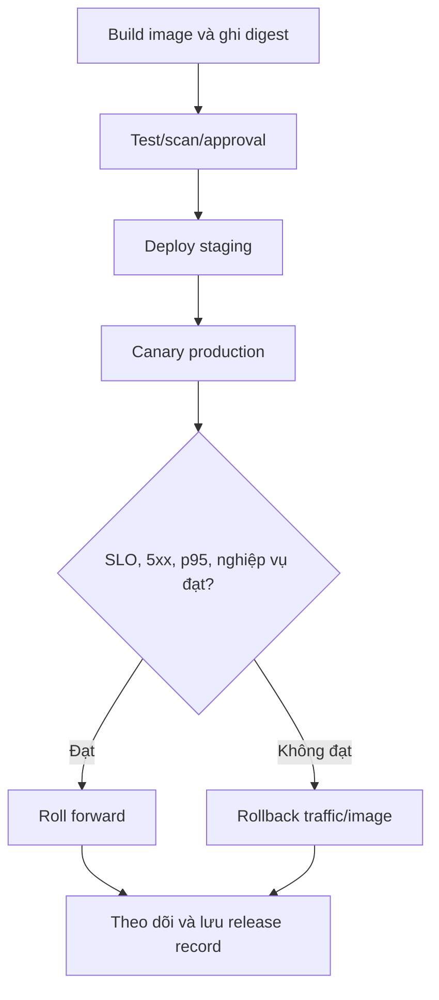

# Tổ chức container workloads trong hệ sinh thái GCP

> **Chương:** Container và Artifact Registry  
> **Module:** CLOUD_PROVIDERS_GCP  
> **Phạm vi module:** Khám phá Google Cloud từ tổ chức project, IAM và VPC đến Compute Engine, GKE, Cloud Run, dịch vụ lưu trữ và cơ sở dữ liệu. Qua các tình huống triển khai, người học biết lựa chọn dịch vụ, bảo vệ tài nguyên, tự động hóa phát hành và theo dõi độ tin cậy cùng chi phí.

Container giúp đóng gói ứng dụng và những thành phần cần để chạy ứng dụng thành **image** có thể phân phối qua nhiều môi trường. Trên Google Cloud, image được lưu trong **Artifact Registry**, có thể được xây dựng bằng **Cloud Build** hoặc công cụ CI khác, rồi chạy trên **Cloud Run**, **Google Kubernetes Engine (GKE)**, Compute Engine hoặc những dịch vụ xử lý batch phù hợp. Mỗi dịch vụ giải quyết một mức độ quản lý hạ tầng, thời gian sống của workload và yêu cầu mạng khác nhau.

Một kiến trúc container thành công không dừng ở lệnh `docker build`. Nhóm phát triển cần trả lời: **image nào là bản phát hành đáng tin**, **ai được build và deploy**, **workload chạy bằng danh tính nào**, **dịch vụ nhận request từ đâu**, **dữ liệu có tồn tại qua lần thay container không**, và **làm sao quan sát, cập nhật, rollback với chi phí hợp lý**.

Bài học này xây dựng một bức tranh tổng thể, rồi thực hành quy trình **mã nguồn → Cloud Build → Artifact Registry → Cloud Run** với một ứng dụng HTTP nhỏ, mặc định **yêu cầu xác thực** để tránh vô tình mở dịch vụ ra Internet.

## Mục tiêu học tập

Sau bài này, bạn có thể:

1. Phân biệt **container image**, **container instance**, **registry**, **revision**, **pod**, **service** và **job**.
2. Chọn giữa **Cloud Run services/jobs**, **GKE Autopilot/Standard**, **Compute Engine chạy container** và **Google Cloud Batch** theo nhu cầu thực.
3. Giải thích vai trò Artifact Registry, Cloud Build, image tag/digest, repository location và promotion giữa các môi trường.
4. Thiết kế ranh giới IAM cho **build identity**, **deployment identity**, **runtime identity** và client gọi dịch vụ.
5. Nhận diện ingress, egress, VPC, DNS, load balancing, secret, cấu hình và lưu trữ dữ liệu cho container workloads.
6. Triển khai một service Cloud Run từ image trong Artifact Registry bằng những bước có thể kiểm tra và dọn tài nguyên.
7. Thiết lập tư duy phát hành an toàn: version bất biến, health/readiness, rollout, giám sát, rollback và tối ưu chi phí.

## 1. Các khái niệm nền tảng

### 1.1. Container image khác container đang chạy

Một **image** là gói bất biến theo nội dung, gồm filesystem layers, metadata, chương trình và các chỉ dẫn khởi chạy. **Container** là một lần thực thi image với process, filesystem writable tạm thời, biến môi trường và tài nguyên CPU/memory được cấp.

```text
Mã nguồn + Dockerfile
       │
       ▼
OCI/Docker image  ──push──>  Artifact Registry
       │                          │
       │                          └── image:tag hoặc image@sha256:digest
       ▼
Cloud Run revision / GKE Pod / VM container
       │
       ├── Process ứng dụng
       ├── Biến môi trường và secret ở runtime
       ├── CPU, memory, network
       └── Writable filesystem tạm thời (không coi là database)
```

**Image không phải VM image.** Image container thường chứa ứng dụng và phần user-space cần thiết nhưng dùng kernel được môi trường chạy cung cấp. VM image của Compute Engine mô tả đĩa hệ điều hành cho một máy ảo. Cả hai có thể được phiên bản hóa nhưng cơ chế thực thi và trách nhiệm vận hành khác nhau.

### 1.2. Những thuật ngữ dễ nhầm

| Thuật ngữ | Ý nghĩa | Ví dụ |
|---|---|---|
| **Repository** | Nơi quản lý các artifact/image theo định dạng | Docker repository `services-dev` trong Artifact Registry |
| **Image path** | Định danh image trong repository | `asia-southeast1-docker.pkg.dev/PROJECT/services-dev/hello-api` |
| **Tag** | Nhãn có thể thay đổi trỏ tới một image digest | `:v1.0.0`, `:commit-abc123`, `:latest` |
| **Digest** | Định danh theo nội dung image | `@sha256:...` |
| **Cloud Run service** | HTTP service được quản lý, có revisions và khả năng scale | `hello-api` |
| **Cloud Run job** | Chạy tác vụ để hoàn tất rồi kết thúc; không phục vụ HTTP liên tục | Xử lý báo cáo hằng ngày |
| **Kubernetes Pod** | Đơn vị chạy một hoặc nhiều container cùng network/lifecycle | Pod của ứng dụng trong GKE |
| **Kubernetes Deployment** | Điều khiển số replicas và rollout Pods | Deployment `web-api` |
| **Kubernetes Service** | Endpoint ổn định/địa chỉ ảo đến tập Pod theo selector | `web-api.default.svc.cluster.local` |
| **Compute Engine VM** | Máy ảo do đội vận hành quản lý | VM chạy container runtime/agent riêng |

Tên **“service”** trong Cloud Run và Kubernetes Service không có cùng ngữ nghĩa. Cloud Run service là đơn vị deploy một ứng dụng HTTP với revisions; Kubernetes Service là cơ chế mạng ổn định để tiếp cận Pods.

### 1.3. Stateless và stateful

Một container nên được xem là **có thể bị thay thế** bất cứ lúc nào khi runtime scale, sửa lỗi hoặc triển khai revision mới. Dữ liệu cần sống lâu phải được quản lý tách khỏi filesystem tạm thời của container.

- **Stateless:** HTTP API, web frontend, worker idempotent, consumer có checkpoint bên ngoài.
- **Stateful:** cơ sở dữ liệu, hệ thống cần ổ đĩa bền vững và thứ tự khởi động/khôi phục đặc biệt.
- **Shared data:** Cloud Storage (object), Cloud SQL/AlloyDB (relational), Memorystore (cache), Pub/Sub (message), Filestore/NFS hoặc Persistent Disk qua giải pháp có hỗ trợ.

**Lưu ý:** Cloud Run cho phép một số cơ chế mount volume/in-memory và các tùy chọn kết nối dữ liệu theo tính năng đang hỗ trợ, nhưng không mặc nhiên làm writable container filesystem thành đĩa bền vững. Trong GKE, PersistentVolume/PersistentVolumeClaim cùng CSI drivers được sử dụng khi cần storage theo vòng đời workload, với ràng buộc zone, access mode và loại disk.

## 2. Bản đồ dịch vụ container trên Google Cloud

Không có một dịch vụ chạy container phù hợp cho mọi loại workload. Điểm khác biệt chủ yếu là **ai quản lý máy chủ**, **ứng dụng phục vụ request hay chạy tác vụ**, **mức kiểm soát hệ thống**, và **mô hình mở rộng/chi phí**.

| Dịch vụ | Phù hợp nhất | Google Cloud quản lý | Đội ứng dụng vẫn chịu trách nhiệm |
|---|---|---|---|
| **Cloud Run services** | HTTP APIs, webhooks, backend request-driven, microservices không cần kiểm soát node | Hạ tầng chạy container, revisions, scale theo tải | Image, IAM/ingress, app health, data, chi phí |
| **Cloud Run jobs** | Batch hữu hạn, cron, migration hoặc xử lý file theo đợt | Thực thi task, retries/parallelism theo cấu hình | Idempotency, thời hạn job, đầu vào/đầu ra, quyền |
| **GKE Autopilot** | Ứng dụng cần Kubernetes API, nhiều service/Pods, policy/orchestration | Phần lớn vận hành node và provisioning theo mô hình Autopilot | Kubernetes objects, image, security, resources, app SLO |
| **GKE Standard** | Cần điều khiển node pools, machine type, daemon/driver và cấu hình sâu | Control plane theo mô hình GKE | Node pools, capacity, nâng cấp, cấu hình workload và ứng dụng |
| **Compute Engine + container runtime** | Phụ thuộc OS/VM cụ thể, legacy agents, chế độ tùy biến đặc biệt | Hạ tầng VM | OS patch, runtime, scheduling, HA, rollout và scaling |
| **Google Cloud Batch** | Batch nhiều task, HPC hoặc data processing có yêu cầu về máy/queue | Điều phối batch jobs lên tài nguyên Compute Engine | Task code/image, giới hạn tài nguyên, kết quả và retry |

Ngoài ra, **Cloud Run functions** (mô hình functions) phục vụ nhu cầu event-driven nhỏ và cũng nằm trong hệ sinh thái runtime/build hiện đại của Google Cloud. Hãy phân biệt nhu cầu **viết function** với nhu cầu **quản lý service/container image**; giới hạn triển khai và trigger của mỗi sản phẩm có thể khác.

### 2.1. Cây quyết định nhanh



Cây trên là **khung tham khảo**, không phải quyết định bắt buộc. Ví dụ, một ứng dụng chạy tác vụ batch có thể phù hợp với GKE Jobs nếu cả doanh nghiệp đã xây dựng nền tảng Kubernetes, hoặc phù hợp với Cloud Run jobs khi ưu tiên giảm vận hành. Quyền quản trị, vùng hỗ trợ, tuân thủ và các giới hạn kỹ thuật có thể thay đổi lựa chọn.

### 2.2. Cloud Run services

Cloud Run service tiếp nhận HTTP/HTTPS qua endpoint được quản lý, có khái niệm **revision**. Khi deploy thay image hoặc cấu hình, service tạo một revision mới; bạn có thể chia traffic giữa các revisions, quay về revision cũ và tùy chỉnh một số tham số như concurrency, min/max instances theo giới hạn dịch vụ.

Ứng dụng thường phải **lắng nghe trên `0.0.0.0` và cổng được biến môi trường `PORT` cung cấp**. Một service chạy bằng container không nhất thiết cần load balancer riêng để có URL HTTPS được quản lý; cần ALB khi có yêu cầu cụ thể như host/path routing tập trung, policy hoặc kiến trúc nhiều backend.

### 2.3. Cloud Run jobs

Cloud Run job **không cung cấp endpoint HTTP liên tục như service**. Bạn khởi chạy execution, có thể điều chỉnh số task, parallelism và retry theo loại công việc. Job phù hợp với công việc hữu hạn, ví dụ mỗi đêm tổng hợp báo cáo hoặc xử lý dữ liệu nhận từ Cloud Storage.

Job phải hỗ trợ **chạy lại an toàn**: một task có thể bị retry nếu thất bại. Không coi “chạy một lần” là bảo đảm side effect chỉ xảy ra đúng một lần; dùng idempotency key, checkpoint và transaction khi tương tác dữ liệu.

### 2.4. GKE Autopilot và Standard

GKE sử dụng Kubernetes: Deployment, Service, Ingress/Gateway, ConfigMap, Secret, HorizontalPodAutoscaler, StatefulSet, CronJob và các thành phần khác. **Autopilot** giảm trách nhiệm vận hành node và có các giới hạn/kiểm soát riêng về tài nguyên và bảo mật. **Standard** cho phép điều chỉnh node pools và nhiều tùy chọn hệ thống hơn, đổi lại là nhiều việc quản trị.

Đừng chọn GKE chỉ vì ứng dụng được đóng gói thành container. Nếu nhu cầu chỉ là một API HTTP stateless đơn giản, Cloud Run có thể giảm đáng kể khối lượng vận hành.

## 3. Đường đi từ mã nguồn tới workload chạy thật



Chuỗi này gồm bốn ranh giới cần quản lý riêng:

1. **Nguồn tin cậy:** mã, dependency và Dockerfile được review; CI không dùng secret bừa bãi.
2. **Artifact tin cậy:** image được lưu trong repository có IAM và chính sách lưu giữ phù hợp, có thể gắn provenance/chứng cứ build.
3. **Đơn vị triển khai:** Cloud Run revision, GKE Deployment/Pod hoặc VM chạy image đã được chọn.
4. **Runtime trust:** workload dùng đúng service account, network policy, secret và hệ thống giám sát.

**Một image có thể chạy ở nhiều nơi**, nhưng YAML manifest, service account, storage volume, cổng và networking của Cloud Run/GKE/VM **không tự động hoán đổi** cho nhau.

## 4. Artifact Registry: tổ chức và phân phối image

**Artifact Registry** quản lý nhiều loại artifact; đối với container, bạn dùng **Docker-format repository** và URL dạng:

```text
LOCATION-docker.pkg.dev/PROJECT_ID/REPOSITORY/IMAGE:TAG
LOCATION-docker.pkg.dev/PROJECT_ID/REPOSITORY/IMAGE@sha256:DIGEST
```

Ví dụ minh họa:

```text
asia-southeast1-docker.pkg.dev/demo-apps/services-dev/hello-api:lab-v1
```

Trong đó:

- `asia-southeast1`: repository location, cần được hỗ trợ và phù hợp vị trí workload, latency và data residency.
- `demo-apps`: project sở hữu Artifact Registry repository.
- `services-dev`: repository Docker; IAM và cleanup policy có thể quản lý tại phạm vi repository.
- `hello-api`: tên image bên trong repository.
- `lab-v1`: tag. Tag giúp con người nhận diện release nhưng **có thể được trỏ lại** sang digest khác.

### 4.1. Tag và digest không giống nhau

| Tham chiếu | Ưu điểm | Rủi ro/hạn chế |
|---|---|---|
| `:latest` | Ngắn, tiện thử trên máy cá nhân | Mơ hồ, dễ thay đổi; khó audit/rollback |
| `:v1.4.2` | Dễ đọc phiên bản | Tag vẫn có thể được cập nhật nếu không có kiểm soát |
| `:commit-a1b2c3d` | Truy được về commit | Cần ràng buộc rõ CI và commit; tag vẫn có tính di động |
| `@sha256:...` | Gắn với nội dung image đã build, giúp tái lập deployment | Ít dễ đọc; cần release metadata để biết digest thuộc bản nào |

**Khuyến nghị triển khai production:** lưu cả **release version/commit** và **image digest** trong manifest/IaC hoặc hồ sơ phát hành. Đừng giả định mọi lần dùng một tag sẽ luôn chạy cùng bytes.

### 4.2. Repository location, quyền và vòng đời

Khi tạo repository, cần quyết định:

- **Region hoặc multi-region:** gần Cloud Run/GKE/CI và đáp ứng yêu cầu vị trí dữ liệu, giảm rủi ro truyền dữ liệu qua vùng không mong muốn.
- **Phạm vi theo môi trường:** một hoặc nhiều repositories cho `dev`, `staging`, `prod` tùy nhu cầu cách ly IAM.
- **Ai được push/pull/delete:** dùng roles Artifact Registry Reader/Writer/Repo Admin đúng phạm vi; không cấp quyền admin cho runtime chỉ để kéo image.
- **Retention/cleanup policies:** giữ image còn được dùng bởi deployment, bản dùng để rollback, và bằng chứng kiểm toán; dọn image không còn cần theo quy trình.
- **Vulnerability scanning:** cân nhắc Artifact Analysis và các tính năng scanning được hỗ trợ, có thể phát sinh chi phí và cần bật/cấu hình.

**Không tự động xóa digest cũ** chỉ vì image được build thành công. Một Cloud Run revision hoặc GKE release có thể cần digest đó để phục hồi hoặc scale lại; lưu giữ phải tính cả thời gian rollback.

### 4.3. So sánh Artifact Registry với Container Registry

Artifact Registry là dịch vụ repository được khuyến nghị cho workflow artifact hiện đại trên GCP. Những hệ thống từng dùng Container Registry (`gcr.io`) cần hiểu lộ trình chuyển đổi/migration và **repository thực sự lưu trữ image ở đâu**. Không giả định mọi URL `gcr.io` đều có chung IAM, network hoặc tính năng với một repository `pkg.dev` do nhóm mới tạo.

## 5. Build image: Dockerfile, Cloud Build và CI

### 5.1. Dockerfile là hợp đồng build

Dockerfile ghi rõ base image, file được đưa vào, các bước cài dependency và command chạy ứng dụng. Một Dockerfile tốt thường:

- Dùng image nền tin cậy và phiên bản được kiểm soát, lý tưởng là pin **digest** trong production.
- Không thêm `.env`, JSON private keys, token hoặc dữ liệu nội bộ vào image layers.
- Giữ image nhỏ, loại bỏ công cụ build nếu không cần ở runtime; cân nhắc multi-stage build.
- Chạy bằng **non-root user** khi image và platform hỗ trợ.
- Dùng build có thể tái lập, phụ thuộc được cố định version và có khả năng scan.
- Phân biệt **build-time arguments** với **runtime environment/secrets**; cả hai đều không phải nơi tùy tiện lưu mật khẩu.

### 5.2. Cloud Build và image registry

Cloud Build có thể chạy một build từ source, thực thi các bước build và đẩy image lên Artifact Registry. Các nền tảng CI khác cũng có thể build/push nếu dùng danh tính và quyền phù hợp. Không bắt buộc phải sử dụng Cloud Build cho mọi container.

**Lưu ý quyền:** danh tính **Cloud Build thực sự dùng** có thể khác giữa project cũ/mới và cấu hình trigger/organization. Đừng mặc định một địa chỉ service account mặc định luôn tồn tại và có quyền Editor/Writer. Trước khi build, xác định build service account hoặc chỉ định service account phù hợp theo policy, rồi cấp **Artifact Registry Writer trên repository** cho đúng build identity.

Nếu build từ GitHub/GitLab hoặc CI ngoài Google Cloud, ưu tiên **Workload Identity Federation** hoặc cơ chế short-lived credentials được hỗ trợ thay vì tạo JSON private key cố định rồi lưu trong CI variables.

### 5.3. Phát hành theo digest, không chỉ theo tag

Quy trình an toàn:

1. Mỗi lần build gắn tag chứa **commit SHA hoặc release ID**.
2. CI kiểm tra test, dependency scan, image vulnerability và chính sách được yêu cầu.
3. CI ghi lại **digest thật** mà Artifact Registry đã lưu.
4. Deploy staging bằng digest; chạy integration test và quan sát.
5. Promote **cùng digest** đã được xác minh sang production theo quy trình của nhóm; nếu phải copy image sang repository khác, theo dõi digest/manifest tương ứng.
6. Lưu release metadata gồm commit, digest, runtime config, SA và thời điểm.

Không build lại cùng source rồi tự giả định image digest giống hệt: base image, dependency, timestamp hoặc toolchain có thể khiến kết quả khác.

## 6. Thiết kế ranh giới project, môi trường và nhóm dịch vụ

Container workload cần nằm trong một **cấu trúc có thể quản trị**, không phải một danh sách image và service đặt tên ngẫu nhiên.

```text
Organization / Folder
└── Nhóm ứng dụng
    ├── Project dev
    │   ├── Artifact Registry: services-dev
    │   ├── Cloud Run/GKE: api-dev, worker-dev
    │   └── SA: api-dev-runtime
    ├── Project staging
    │   ├── Artifact Registry hoặc quyền pull từ repo trung tâm
    │   ├── Cloud Run/GKE: api-staging
    │   └── SA: api-staging-runtime
    └── Project prod
        ├── Repository được kiểm soát hoặc pull qua cross-project IAM
        ├── Cloud Run/GKE: api-prod
        └── SA: api-prod-runtime
```

Các quyết định tổ chức:

| Trục quản lý | Câu hỏi cần trả lời | Gợi ý |
|---|---|---|
| **Project boundary** | Dev có được đọc dữ liệu prod không? | Tách môi trường và IAM/billing khi cần |
| **Repository** | Build ở đâu, ai được push/pull? | Tách build identity khỏi runtime; áp repository IAM |
| **Naming/labels** | Ai sở hữu image, service và chi phí? | Có owner, application, environment, version |
| **Artifact promotion** | Prod dùng đúng build đã test chứ? | Ghi digest, approval và release record |
| **Deployment config** | Tham số nào khác giữa môi trường? | IaC/manifest riêng, không hard-code secrets |
| **Runtime SA** | Workload được quyền tới resource nào? | Một SA theo ứng dụng/môi trường, least privilege |
| **Network** | Client nào được vào, workload đi ra đâu? | Ingress, egress, VPC, DNS, private service |
| **Observability** | Làm sao nối request tới revision/digest? | Logs/metrics/trace có version và service label |

**Một repository trung tâm** có thể phù hợp nếu tổ chức quản trị image tập trung; **nhiều repository theo môi trường** phù hợp khi cần chính sách ghi/đọc, retention và phê duyệt khác nhau. Không có một cách chia project/repo bắt buộc cho mọi doanh nghiệp.

## 7. IAM và danh tính: build, deploy, runtime và caller

Một lỗi phổ biến là dùng **một service account rất mạnh** cho tất cả các bước: build, push, deploy và truy cập database. Khi bước build hoặc runtime bị xâm nhập, phạm vi ảnh hưởng sẽ lớn.

### 7.1. Bốn danh tính có vai trò riêng

| Danh tính | Làm gì? | Role/permission cần cân nhắc |
|---|---|---|
| **Build identity** | Lấy source, build image, push repository | Artifact Registry Writer trên repo, quyền build/log/storage cần thiết |
| **Deployment identity** | Tạo/sửa Cloud Run service hoặc Kubernetes objects | Cloud Run Developer/Admin theo nhu cầu; quyền `actAs` trên runtime SA; GKE/Kubernetes deploy permissions |
| **Runtime identity** | Container gọi Cloud Storage, Cloud SQL, Pub/Sub, Secret Manager | Chỉ role cần thiết trên **resource đích**, không mặc định Writer/Owner |
| **Caller identity** | Client gọi endpoint Cloud Run/private API | `roles/run.invoker` hoặc xác thực ứng dụng và kết nối mạng theo thiết kế |

**IAM của người deploy không tự chuyển sang runtime.** Ngược lại, service account được gắn cho Cloud Run revision không nên có quyền ghi vào repository chỉ để service đọc image.

### 7.2. Kéo image từ Artifact Registry

Trong cùng project, Cloud Run/GKE có các **service agents, node identities và cơ chế pull** riêng. Với repository ở **project khác**, thường phải cấp **Artifact Registry Reader** cho đúng identity mà dịch vụ sử dụng để kéo image.

Ví dụ kiến trúc:

```text
CI project: ci-project
  Build SA -> push -> Artifact Registry repo (artifacts-project)

Runtime project: prod-project
  Cloud Run service agent hoặc GKE pull identity
       -> read image từ Artifact Registry
  App runtime SA
       -> chỉ truy cập Cloud SQL / Secret Manager / Pub/Sub theo nhu cầu
```

Đừng cấp Artifact Registry Reader cho một principal tùy đoán khi pull thất bại. Cần đọc lỗi, xác định **repo project**, **service agent hoặc node identity thực tế**, quyền trên repo và khả năng sử dụng image thuộc tổ chức.

### 7.3. GKE Workload Identity Federation

Trong GKE, workload nên dùng **Workload Identity Federation for GKE** để xác thực tới Google Cloud APIs, thay vì mount JSON key dài hạn vào Pod.

- Kubernetes service account (KSA) xác định danh tính workload trong cluster.
- IAM cho phép một KSA/workload principal truy cập resource Google Cloud được phê duyệt, hoặc sử dụng mô hình impersonation service account theo thiết kế.
- **Node service account** không phải lúc nào cũng là danh tính của ứng dụng trong Pod; đừng dùng node SA đặc quyền thay cho per-workload identity.

Cách cấu hình cụ thể khác giữa Autopilot/Standard, namespace, cluster workload pool và chế độ liên kết. Trong production, dùng ví dụ hiện hành từ tài liệu chính thức và kiểm tra KSA/permission đúng namespace.

## 8. Mạng: ingress, egress, VPC và DNS

Container có thể chạy thành công nhưng vẫn không được client truy cập nếu mạng hoặc IAM không đúng. Cần phân biệt **ingress** (request đi vào) và **egress** (workload gọi ra).

### 8.1. Cloud Run ingress

Cloud Run cho phép cấu hình **ingress settings** như nhận traffic từ mọi nguồn, chỉ internal hoặc internal và Cloud Load Balancing theo các lựa chọn hỗ trợ. Bên cạnh ingress, **Cloud Run IAM** quyết định endpoint có cho phép caller không xác thực hay không.

- **Ingress=all** không có nghĩa service phải công khai cho anonymous; service vẫn có thể yêu cầu IAM authentication.
- **Allow unauthenticated** là quyết định mở quyền gọi không xác thực; cần chấp thuận riêng khi thật sự muốn public endpoint.
- **Ingress=internal** không đơn giản là “chỉ cùng project”; đường truy cập được phép phụ thuộc các quy tắc Cloud Run và tổ chức, VPC, mạng kết nối.
- Với public domain, Cloud Run cung cấp URL mặc định và có cách gắn custom domain/load balancer. Chọn theo yêu cầu certificate, URL routing và chính sách bảo mật.

### 8.2. Cloud Run egress tới tài nguyên riêng

Khi Cloud Run cần gọi dịch vụ có private IP trong VPC, cần chọn giải pháp **Direct VPC egress** hoặc **Serverless VPC Access connector** theo hỗ trợ của môi trường. Quyết định gồm:

- VPC/subnet nào chứa hoặc có route đến tài nguyên cần gọi.
- Chỉ đưa **private ranges** qua VPC hay mọi traffic theo yêu cầu.
- Firewall/network policy và route đến đích.
- NAT/egress Internet khi traffic được định tuyến qua VPC, cùng chi phí liên quan.
- DNS riêng (Cloud DNS private zones/forwarding) có được phân giải từ đúng nguồn không.

**Gắn một service account có quyền truy cập Cloud SQL không tự tạo đường mạng đến database**, cũng như có VPC egress không tự cấp IAM/database credentials.

### 8.3. GKE networking

GKE đặt Pod trong mạng cluster/VPC theo chế độ IP allocation được hỗ trợ. Các thành phần:

- **Kubernetes Service:** địa chỉ truy cập nội bộ ổn định tới các Pods.
- **Ingress/Gateway + load balancing:** nhận request HTTP(S) từ ngoài hoặc trong tùy cấu hình.
- **NetworkPolicy hoặc cơ chế network policy hỗ trợ:** giới hạn giao tiếp giữa workloads.
- **Cloud DNS/Kubernetes DNS:** phân giải tên service và các tên ngoài cluster.
- **Private cluster/NAT/Private Google Access:** kiểm soát đường tới Google APIs, container registry và Internet theo hình thức triển khai.

Không đồng nhất **Kubernetes namespace** với **VPC network**. Namespace giúp tổ chức Kubernetes objects và RBAC; nó **không tự tạo ranh giới mạng hoàn chỉnh** nếu thiếu network policies và những cơ chế bảo vệ khác.

## 9. Cấu hình, secrets và dữ liệu lâu dài

### 9.1. Tách config khỏi image

Cùng một digest có thể chạy trong dev/staging/prod với:

- Biến môi trường không nhạy cảm: `LOG_LEVEL`, `FEATURE_FLAG`.
- Cấu hình hệ thống qua Cloud Run/GKE hoặc config management phù hợp.
- **Secret Manager** cho API keys, mật khẩu/credential mà ứng dụng bắt buộc phải dùng.
- Identity-based access để tránh hard-code key khi SDK có thể dùng ADC/Workload Identity Federation.

**Không đặt secrets trong `Dockerfile ENV`, image layers, build arguments, Git hoặc log CI**. Với Secret Manager, runtime SA chỉ được cấp `secretmanager.versions.access` thông qua role phù hợp trên **secret cụ thể**. Việc mount/đọc secret, phiên bản secret và xử lý rotation cần thiết kế theo từng runtime.

### 9.2. State không đi theo revision

| Loại dữ liệu | Phương án phù hợp hơn container filesystem |
|---|---|
| Session/short-lived cache cần chia sẻ | Memorystore hoặc store được hỗ trợ |
| File upload | Cloud Storage |
| Transactional SQL | Cloud SQL hoặc AlloyDB theo yêu cầu |
| Message/event cần xử lý | Pub/Sub, Eventarc hoặc queue phù hợp |
| Persistent block storage cho Pod | GKE PersistentVolume + CSI driver / disk tương thích |
| Shared POSIX file system | Filestore hoặc volume được runtime hỗ trợ |

Với Cloud Run, process có thể bị dừng/scale về 0; **file tạm bên trong container không phải nơi lưu dữ liệu nghiệp vụ**. Với GKE, khi Pod bị reschedule, dữ liệu trong container filesystem không được xem là persistent volume nếu không có cấu hình riêng.

### 9.3. Health và graceful shutdown

Ứng dụng nên:

1. Có một endpoint hoặc cơ chế kiểm tra **readiness/startup** có ý nghĩa, nếu runtime hỗ trợ.
2. Xử lý **SIGTERM** theo giới hạn thời gian của platform: ngừng nhận việc mới, flush log/checkpoint và đóng connection.
3. Không tạo side effect trùng lặp khi request/job được retry.
4. Đọc cổng `PORT` khi chạy Cloud Run service.
5. Đảm bảo logic migration database tương thích với cả revision cũ và mới trong rollout.

Không xem “container process RUNNING” là bằng chứng mọi dependency đã sẵn sàng.

## 10. Bảo mật chuỗi cung ứng phần mềm

Container image là một phần của **software supply chain**. Một image có thể chứa dependency lỗi thời, package không cần thiết, executable đáng ngờ hoặc secret vô tình được COPY vào layer.

### 10.1. Những lớp kiểm soát

| Lớp | Ví dụ kiểm soát | Rủi ro được giảm |
|---|---|---|
| Source | Code review, branch protection, secret scanning | Code độc hại hoặc lộ credential |
| Dependencies | Pin versions/digests, lock file, SBOM | Dependency thay đổi không kiểm soát |
| Build | CI identity riêng, build logs/provenance | Pipeline không thể audit hoặc quá quyền |
| Artifact Registry | IAM Reader/Writer tách biệt, retention | Push/pull/xóa image trái phép |
| Image | Vulnerability scanning qua Artifact Analysis theo cấu hình | Dependency/OS package có CVE đã biết |
| Deploy | Approval, image digest, Binary Authorization nếu platform hỗ trợ | Image chưa được kiểm tra chạy ở prod |
| Runtime | Least privilege, sandboxing, network restrictions, secret management | Tăng phạm vi thiệt hại khi app bị khai thác |
| Observability | Logs, tracing, alerts, audit | Không phát hiện được thay đổi hoặc lỗi |

**Vulnerability scan không đồng nghĩa image an toàn tuyệt đối.** CVE database có độ trễ, không phát hiện mọi lỗi logic của mã riêng, và có false positives. Các kết quả scanning cần được triage theo ảnh hưởng thực tế.

### 10.2. Root trong container không phải root toàn hệ thống — nhưng vẫn là rủi ro

Container isolation không thay IAM, network boundary hoặc hardening của runtime. Một image chạy bằng user root có thể làm tăng tác động nếu lỗ hổng ứng dụng cho phép truy cập filesystem/khả năng runtime. Dùng non-root user, giảm Linux capabilities, hạn chế writable paths và cấu hình security context theo platform có hỗ trợ.

Trong GKE, cân nhắc Pod Security Admission, Workload Identity Federation, NetworkPolicy, namespaces/RBAC và cập nhật node images. Trong Cloud Run, phần lớn host isolation do nền tảng quản lý, nhưng **mã ứng dụng, dependencies và runtime identity** vẫn là trách nhiệm của nhóm triển khai.

## 11. Thực hành: Cloud Build → Artifact Registry → Cloud Run

**Mục tiêu lab:** build một container HTTP nhỏ, lưu image trong Artifact Registry, deploy thành Cloud Run service **yêu cầu xác thực**, thử gọi service và dọn đúng tài nguyên lab. Không tạo GKE cluster nên chi phí và phạm vi vận hành nhỏ hơn.

**Giới hạn:** các lệnh `gcloud` bên dưới là ví dụ **chỉ thực thi khi người học chủ động chạy** trong project sandbox. Bài viết này không tạo tài nguyên GCP. Việc bật API, build, lưu image và triển khai service có thể phát sinh chi phí; Cloud Run/Cloud Build/Artifact Registry có free tier hoặc ưu đãi tùy điều kiện nhưng **không được mặc định là miễn phí**.

### 11.1. Thông số lab

| Biến | Giá trị minh họa | Vai trò |
|---|---|---|
| `PROJECT_ID` | `my-gcp-containers-lab` | Project được phép thực hành |
| `REGION` | `asia-southeast1` | Vùng của Artifact Registry và Cloud Run |
| `REPO` | `containers-lab` | Docker-format repository riêng |
| `IMAGE_NAME` | `hello-api` | Image trong repository |
| `IMAGE_TAG` | `lab-v1` | Tag lab, có thể thay bằng commit SHA |
| `RUN_SERVICE` | `hello-api-lab` | Cloud Run service |
| `RUNTIME_SA_NAME` | `hello-api-runtime` | SA runtime quyền tối thiểu |

**Preflight:** xác định project thực, region hỗ trợ, quyền IAM, quota, billing, tài nguyên đã tồn tại và người chịu trách nhiệm dọn. Không dùng tên trong ví dụ để xóa service đang có của người khác.

### 11.2. Kiểm tra môi trường trước khi tạo

Chạy trong **Cloud Shell (Bash)** hoặc terminal có gcloud:

```bash
PROJECT_ID="my-gcp-containers-lab"
REGION="asia-southeast1"
REPO="containers-lab"
IMAGE_NAME="hello-api"
IMAGE_TAG="lab-v1"
RUN_SERVICE="hello-api-lab"
RUNTIME_SA_NAME="hello-api-runtime"
RUNTIME_SA="$RUNTIME_SA_NAME@$PROJECT_ID.iam.gserviceaccount.com"
IMAGE_URI="$REGION-docker.pkg.dev/$PROJECT_ID/$REPO/$IMAGE_NAME:$IMAGE_TAG"

# Chỉ đọc: danh tính, project, repositories và Cloud Run services
gcloud auth list --filter="status:ACTIVE"
gcloud projects describe "$PROJECT_ID" \
  --format="table(projectId,name,lifecycleState)"
gcloud artifacts repositories list --project="$PROJECT_ID"
gcloud run services list --project="$PROJECT_ID" --region="$REGION"
gcloud iam service-accounts list --project="$PROJECT_ID"
```

Nếu chưa có quyền liệt kê resource hoặc API chưa bật, **dừng thao tác tạo** và xác minh IAM/quyền quản trị. Không tự nâng quyền lên Owner/Editor để né lỗi.

### 11.3. Các quyền cần chuẩn bị

Tách các principal:

1. **Người quản trị project/repository:** được phép bật API và tạo repository.
2. **Cloud Build service account:** có quyền chạy build, ghi log/lưu artifact cần thiết và **`roles/artifactregistry.writer` trên repository**.
3. **Người deploy:** có quyền deploy Cloud Run, quyền **`iam.serviceAccounts.actAs`** trên runtime SA và quyền đọc image phù hợp.
4. **Runtime SA:** trong lab này ứng dụng không truy cập Google Cloud API khác, **không cần cấp role editor, storage admin hay Artifact Registry Writer**.
5. **Người thử service:** cần `roles/run.invoker` nếu service yêu cầu xác thực.

Danh tính Cloud Build mặc định **phụ thuộc cấu hình project/organization**. Trước khi chạy `gcloud builds submit`, hãy xác định build SA thực sự và cách thiết lập logging theo yêu cầu; dự án có chính sách custom build SA có thể yêu cầu chỉ định `--service-account`, cấu hình bucket/log hoặc trigger.

### 11.4. Bật các API cần thiết (nếu được phép)

```bash
# Bật trong đúng project sandbox khi được chủ project cho phép
gcloud services enable \
  artifactregistry.googleapis.com \
  cloudbuild.googleapis.com \
  run.googleapis.com \
  iam.googleapis.com \
  --project="$PROJECT_ID"
```

Đây là thao tác thay đổi project. Việc bật API và quyền thực thi phải phù hợp chính sách tổ chức.

### 11.5. Tạo Docker repository

```bash
# Chỉ tạo khi repository chưa tồn tại và được phép tạo tại region này
gcloud artifacts repositories create "$REPO" \
  --repository-format=docker \
  --location="$REGION" \
  --description="Container learning lab" \
  --project="$PROJECT_ID"

gcloud artifacts repositories describe "$REPO" \
  --location="$REGION" \
  --project="$PROJECT_ID"
```

Khi muốn giới hạn build identity, quản trị viên repository có thể cấp quyền theo ví dụ sau, **chỉ sau khi đã xác định chính xác build SA**:

```bash
# Điền email SA THỰC SỰ chạy Cloud Build, không đoán theo project number
BUILD_SA="build-worker@my-gcp-containers-lab.iam.gserviceaccount.com"

gcloud artifacts repositories add-iam-policy-binding "$REPO" \
  --location="$REGION" \
  --member="serviceAccount:$BUILD_SA" \
  --role="roles/artifactregistry.writer" \
  --project="$PROJECT_ID"
```

Nếu build SA có quyền Writer sẵn trên repository theo policy được phê duyệt, không cần tạo binding trùng. Hành động cấp quyền đòi IAM admin thích hợp; **không cấp role Writer cho Cloud Run runtime SA**.

### 11.6. Viết ứng dụng HTTP cực nhỏ

Trong một thư mục lab **riêng trên máy phát triển/Cloud Shell**, tạo ba file mẫu sau. Chúng được trình bày trong bài học, không phải file được tạo trong repository học liệu.

**`app.py`**

```python
from http.server import BaseHTTPRequestHandler, ThreadingHTTPServer
import os


class Handler(BaseHTTPRequestHandler):
    def do_GET(self):
        if self.path not in ("/", "/healthz"):
            self.send_error(404, "Not found")
            return

        body = b"hello from cloud run - lab-v1\n"
        self.send_response(200)
        self.send_header("Content-Type", "text/plain; charset=utf-8")
        self.send_header("Content-Length", str(len(body)))
        self.end_headers()
        self.wfile.write(body)


if __name__ == "__main__":
    port = int(os.environ.get("PORT", "8080"))
    ThreadingHTTPServer(("0.0.0.0", port), Handler).serve_forever()
```

**`Dockerfile`**

```dockerfile
FROM python:3.12-slim
WORKDIR /app
COPY app.py /app/app.py
ENV PYTHONDONTWRITEBYTECODE=1 \
    PYTHONUNBUFFERED=1
USER 65532:65532
EXPOSE 8080
CMD ["python", "/app/app.py"]
```

**`.dockerignore`** (ví dụ tối thiểu)

```text
.git
.env
*.json.key
__pycache__
*.pyc
.venv
venv
```

Ứng dụng đọc `PORT` và lắng nghe `0.0.0.0` theo yêu cầu Cloud Run. Nó không lưu dữ liệu và không gọi API khác nên phù hợp với một runtime SA **không có role ứng dụng nào** trong lab.

Trong production, cố định **base image theo digest**, dùng dependency pinning, scan và tự động cập nhật bản vá. Ngoài `.dockerignore`, khi dùng `gcloud builds submit` cần kiểm tra **`.gcloudignore`** hoặc danh sách file được upload làm source; đừng coi `.dockerignore` là cơ chế duy nhất bảo vệ secrets khỏi build context.

### 11.7. Build và push image bằng Cloud Build

Chạy trong thư mục chứa `app.py` và `Dockerfile`:

```bash
# Tên image đã được thiết lập ở bước 11.2
printf 'Building: %s\n' "$IMAGE_URI"

# Cloud Build build theo Dockerfile và push image tới Artifact Registry
gcloud builds submit . \
  --tag="$IMAGE_URI" \
  --project="$PROJECT_ID"
```

Nếu lỗi `PERMISSION_DENIED`:

- Kiểm tra **principal chạy build** và Artifact Registry Writer trên repo.
- Kiểm tra API, quota, org policies, logging/bucket settings và quyền service account.
- Không gán Owner/Editor cho build SA để “thử cho qua”.

Sau build, kiểm tra image trong repository:

```bash
gcloud artifacts docker images list \
  "$REGION-docker.pkg.dev/$PROJECT_ID/$REPO" \
  --project="$PROJECT_ID" \
  --include-tags
```

**Kết quả kỳ vọng:** repository có image `hello-api` cùng tag `lab-v1` và một **digest**. Ghi digest thật vào kết quả lab, không tự tạo chuỗi SHA-256 giả. Nên dùng digest đó trong các release quan trọng.

### 11.8. Tạo runtime service account riêng

Với quyền tạo SA trong project sandbox:

```bash
gcloud iam service-accounts create "$RUNTIME_SA_NAME" \
  --display-name="Runtime identity for hello-api lab" \
  --project="$PROJECT_ID"

gcloud iam service-accounts describe "$RUNTIME_SA" \
  --project="$PROJECT_ID" \
  --format="yaml(email,displayName,disabled)"
```

**Không cấp role rộng** cho SA chỉ để container trả về “hello”. Nếu image nằm ở project khác, cấu hình quyền cho đúng **pull identity** theo tài liệu Cloud Run cross-project Artifact Registry, không đánh đồng nó với quyền của runtime SA khi ứng dụng đang chạy.

### 11.9. Deploy Cloud Run service yêu cầu xác thực

```bash
# Chỉ deploy khi service lab chưa tồn tại hoặc bạn là owner được phép cập nhật
gcloud run deploy "$RUN_SERVICE" \
  --image="$IMAGE_URI" \
  --region="$REGION" \
  --project="$PROJECT_ID" \
  --platform=managed \
  --service-account="$RUNTIME_SA" \
  --no-allow-unauthenticated \
  --memory=512Mi \
  --cpu=1 \
  --concurrency=20 \
  --max-instances=2 \
  --min-instances=0

# Đọc lại URL, revision và cấu hình service
gcloud run services describe "$RUN_SERVICE" \
  --region="$REGION" \
  --project="$PROJECT_ID" \
  --format="yaml(metadata.name,status.url,status.latestReadyRevisionName,spec.template)"
```

**Giải thích:**

- `--image` là image đã push. Trong production ưu tiên tham chiếu **`@sha256:digest`** sau khi kiểm chứng.
- `--service-account` chọn **runtime SA** mà ứng dụng sẽ sử dụng.
- `--no-allow-unauthenticated` giữ service yêu cầu IAM authentication; không cấp `allUsers` làm Invoker.
- `--min-instances=0` cho phép scale về 0 khi phù hợp; lần gọi sau thời gian nhàn rỗi có thể phát sinh cold start.
- `--max-instances=2` giới hạn số instances nhưng cũng có thể gây throttling/rejection khi vượt capacity; không phải công cụ hạn chế chi phí tuyệt đối.
- Các giới hạn CPU, memory, concurrency và scale cần điều chỉnh dựa trên tải thực, quota và khả năng xử lý của ứng dụng.

**Quan trọng:** để deploy thành công, operator cần quyền deploy Cloud Run và `actAs` trên runtime SA. Đừng thay bằng default SA có quyền Editor để né lỗi IAM.

### 11.10. Thử gọi service có xác thực

Người kiểm thử cần được cấp `roles/run.invoker` thích hợp trên service; service được thiết kế **không cho phép anonymous**. Một cách thuận tiện cho người đã có quyền là chạy proxy bằng gcloud.

Ở terminal A:

```bash
gcloud run services proxy "$RUN_SERVICE" \
  --region="$REGION" \
  --project="$PROJECT_ID" \
  --port=8080
```

Ở terminal B **trên cùng môi trường**, khi proxy đã sẵn sàng:

```bash
curl --fail --silent --show-error http://127.0.0.1:8080/
curl --fail --silent --show-error http://127.0.0.1:8080/healthz
```

Nếu thông báo `403 Forbidden`, xác minh Invoker IAM và danh tính caller. Không bật unauthenticated cho toàn bộ Internet chỉ để thử response. Khi không thể dùng proxy, người có quyền có thể lấy ID token phù hợp và gọi URL Cloud Run theo hướng dẫn authenticated request của sản phẩm.

**Kết quả mong đợi:** response chứa `hello from cloud run - lab-v1`. Nếu URL trả `404` ở đường dẫn khác, đây là hành vi ứng dụng ví dụ, không nhất thiết là lỗi triển khai.

## 12. Khi nào triển khai cùng image sang GKE?

Khi ứng dụng phát triển thành nhiều service cần Kubernetes primitives như namespace/RBAC, Job/CronJob, sidecar, StatefulSet, custom scheduling hoặc ingress đa service, GKE có thể phù hợp.

Ví dụ một **Deployment manifest minh họa**, chưa phải cấu hình production hoàn chỉnh:

```yaml
apiVersion: apps/v1
kind: Deployment
metadata:
  name: hello-api
  labels:
    app: hello-api
spec:
  replicas: 2
  selector:
    matchLabels:
      app: hello-api
  template:
    metadata:
      labels:
        app: hello-api
    spec:
      serviceAccountName: hello-api
      containers:
        - name: http-server
          image: asia-southeast1-docker.pkg.dev/PROJECT_ID/REPO/hello-api@sha256:IMAGE_DIGEST
          ports:
            - containerPort: 8080
          resources:
            requests:
              cpu: "100m"
              memory: "128Mi"
            limits:
              memory: "512Mi"
          readinessProbe:
            httpGet:
              path: /healthz
              port: 8080
            initialDelaySeconds: 2
            periodSeconds: 5
```

**Các placeholder `PROJECT_ID`, `REPO` và `IMAGE_DIGEST` phải thay bằng giá trị thực.** Manifest cũng đòi Kubernetes service account tên `hello-api` đã được tạo trong namespace và cluster có quyền pull từ Artifact Registry. Đừng copy-paste vào production mà không đánh giá thêm securityContext, image architecture, resource limits, liveness/startup probes, network policies và cách ứng dụng thực hiện graceful shutdown.

**Service/Ingress riêng:** Deployment ở trên chỉ tạo Pods. Muốn client truy cập qua endpoint Kubernetes Service hoặc HTTP(S) Load Balancer, cần cấu hình Kubernetes Service và Gateway/Ingress thích hợp. Đừng nhầm một Deployment `replicas: 2` là một ALB hoặc DNS name tự xuất hiện.

### 12.1. Cloud Run revisions khác GKE rollout

| Tiêu chí | Cloud Run | GKE |
|---|---|---|
| Đơn vị phiên bản | Revision của service | Deployment revision/ReplicaSet và image trong Pod template |
| Chia traffic | Có thể phân bổ phần trăm giữa các revisions | Thường thông qua Gateway/service mesh hoặc cách tổ chức service/backends |
| Liveness/startup/readiness | Theo các probe và cơ chế Cloud Run hỗ trợ | Kubernetes probes trong Pod |
| Scale | Theo yêu cầu/instance concurrency và cấu hình Cloud Run | HPA, node autoscaling và controller liên quan |
| Rollback | Điều chỉnh traffic/redeploy revision đã kiểm chứng | Rollout undo/apply manifest/image cũ, cùng dữ liệu và dependency |

**Rollback container không rollback database.** Khi v2 thay schema hoặc format dữ liệu, quay lại revision/image v1 có thể không phục hồi hành vi. Cần thiết kế backward compatibility và backup theo chính sách.

## 13. Triển khai theo hướng sự kiện và batch

Trong một nền tảng thực tế, không phải workload nào cũng là HTTP server.

### 13.1. Ví dụ: xử lý file mới

```text
Cloud Storage nhận object
        │
        ▼
Eventarc / cơ chế event được hỗ trợ
        │
        ▼
Cloud Run service hoặc trigger workflow
        │
        ├── Đọc object bằng workload identity
        ├── Xử lý dữ liệu
        └── Ghi kết quả vào Cloud Storage/DB
```

Ứng dụng phải chịu được **event gửi lại** và xử lý trùng. Dùng object generation, event ID hoặc khóa idempotency và chỉ ghi kết quả khi transaction đạt yêu cầu.

### 13.2. Ví dụ: báo cáo ban đêm

Sử dụng **Cloud Scheduler + Cloud Run jobs** hoặc mô hình scheduler/workflow được hỗ trợ để tạo báo cáo hằng đêm. Job có thể chạy nhiều task song song; cần quản lý quota, timeout, retry, credentials và checkpoint.

Nếu workload đòi hỏi hàng nghìn CPU core, lịch chạy phức tạp hoặc GPU/machine type đặc biệt, cân nhắc **Batch** hoặc GKE/Compute Engine tùy hỗ trợ hiện hành. Chỉ chọn mô hình sau khi đối chiếu dung lượng dữ liệu, thời hạn xử lý và tổng chi phí.

## 14. Rollout, canary và rollback

### 14.1. Quy trình phát hành có kiểm soát



Với Cloud Run, có thể chia tỷ lệ traffic giữa revisions theo tính năng sản phẩm. Với GKE, một Deployment rolling update **thay Pods dần**, nhưng không tự bảo đảm phần trăm request chính xác theo version. Nếu cần traffic splitting theo tỷ lệ cụ thể, thiết kế theo Gateway/service mesh/load balancer hoặc cơ chế tương đương được hỗ trợ.

### 14.2. Các tiêu chí cần theo dõi

| Nhóm tín hiệu | Ví dụ | Quyết định |
|---|---|---|
| Application | HTTP 5xx, request latency p95/p99 | Dừng mở rộng nếu vượt guardrail |
| Health | Startup/readiness, restart, crash loops | Kiểm tra image và dependencies |
| Capacity | Concurrency, max instances, CPU/memory | Điều chỉnh scale hoặc rollback |
| Business | Số giao dịch thành công, data consistency | Rollback nếu sai chức năng dù health xanh |
| Security | Quyền SA, image digest, lỗi scanning policy | Không cho phép image chưa đủ điều kiện |
| Cost | Egress, build minutes, image storage, runtime | Đối chiếu ngân sách và thực tế |

**Canary một ít VM/Pod khác canary một ít requests.** Với Cloud Run có routing theo revision, có thể đo traffic gần theo tỷ lệ cấu hình; nhưng request và hệ quả nghiệp vụ vẫn phải được giám sát, không chỉ nhìn giá trị phần trăm trong Console.

## 15. Observability và vận hành

### 15.1. Logs, metrics và traces

Google Cloud cung cấp **Cloud Logging**, **Cloud Monitoring** và **Cloud Trace** để theo dõi workload theo cấu hình/tính năng được hỗ trợ.

- **Cloud Run:** request logs và application logs, revision/instance metadata, latency, request count, error rate.
- **GKE:** workload/cluster logs, container restart, Pod events, resource utilization, HPA và trạng thái node.
- **Cloud Build:** build logs, trạng thái build, identity và artifact được push.
- **Artifact Registry:** image metadata, IAM/audit và chi phí lưu trữ.

Để tìm lỗi có hệ thống, log cần có **service name, environment, version/digest, request ID hoặc trace ID**, nhưng **không ghi secret, access token, mật khẩu, nội dung nhạy cảm không cần thiết**.

### 15.2. SLO, readiness và autoscaling

Một service có thể trả HTTP 200 cho `/healthz` nhưng business operation vẫn lỗi. Chỉ số tốt nên đo:

1. **Availability** theo tỷ lệ request hợp lệ.
2. **Latency** theo p95/p99 của endpoint quan trọng.
3. **Error budget** theo SLO đã thống nhất.
4. **Saturation**: CPU, memory, concurrency, queue, throttling.
5. **Dependencies**: Cloud SQL connection pool, Pub/Sub backlog hoặc Cloud Storage latency.

Khi service scale về 0 hoặc scale ra nhiều instances, ứng dụng cần tránh dựa vào memory local để giữ trạng thái phiên người dùng và phải hạn chế connection storms tới database.

### 15.3. Giám sát chi phí

| Thành phần | Chi phí có thể phát sinh |
|---|---|
| Artifact Registry | Lưu trữ image, data transfer và tính năng liên quan |
| Cloud Build | Build compute minutes, logs/artifacts theo cấu hình |
| Cloud Run | CPU/memory/runtime hoặc request theo chế độ tính phí, min instances, data transfer |
| GKE | Cluster management, node resources hoặc pod resources theo chế độ/tier |
| Compute Engine/Batch | VM, disk, egress, GPU hoặc những tài nguyên phụ trợ |
| Cloud Logging/Monitoring | Lưu giữ, ingest và phạm vi quan sát theo bảng giá |
| VPC/NAT/ALB/Cloud CDN | Network processing, egress, connector/NAT/LB nếu cấu hình |

**Budget alerts chỉ cảnh báo, không tự chặn chi phí.** Khi chỉ muốn làm quen với container, dùng lab Cloud Run tối giản thay vì tạo cluster GKE Standard với nhiều node rồi bỏ quên.

## 16. Dọn tài nguyên bài lab

**Chỉ xóa những tài nguyên đã tạo riêng ở bước 11**. Kiểm tra project, region, service, repository và SA; không xóa repository đang chứa image của người khác, không xóa service shared hoặc SA dùng chung.

### 16.1. Kiểm kê trước khi xóa

```bash
printf 'Project=%s Region=%s Repo=%s Service=%s SA=%s\n' \
  "$PROJECT_ID" "$REGION" "$REPO" "$RUN_SERVICE" "$RUNTIME_SA"

gcloud run services describe "$RUN_SERVICE" \
  --project="$PROJECT_ID" --region="$REGION"

gcloud artifacts repositories describe "$REPO" \
  --project="$PROJECT_ID" --location="$REGION"

gcloud iam service-accounts describe "$RUNTIME_SA" \
  --project="$PROJECT_ID"
```

### 16.2. Xóa Cloud Run service của riêng lab

```bash
# Sau khi chắc chắn service không nhận traffic cần giữ
gcloud run services delete "$RUN_SERVICE" \
  --region="$REGION" \
  --project="$PROJECT_ID"
```

Xóa Cloud Run service dừng vòng đời revisions/instances của service đó, nhưng **không tự xóa image trong Artifact Registry**, dữ liệu ứng dụng bên ngoài hay Cloud Build logs. Nếu có custom domain, ALB, event trigger, schedule hoặc các kết nối khác do lab tạo, cần quản lý vòng đời riêng theo quyền sở hữu.

### 16.3. Repository: chỉ xóa nếu thuộc riêng lab

```bash
# Kiểm tra repository có image/artefact ngoài phạm vi lab hay không
gcloud artifacts docker images list \
  "$REGION-docker.pkg.dev/$PROJECT_ID/$REPO" \
  --project="$PROJECT_ID" \
  --include-tags

# CHỈ xóa repository riêng lab sau khi được phép xóa toàn bộ image bên trong
gcloud artifacts repositories delete "$REPO" \
  --location="$REGION" \
  --project="$PROJECT_ID"
```

**Xóa repository là hành động phá hủy**, có thể xóa tất cả image trong repository, làm hỏng các triển khai khác đang pull từ đó. Nếu repository dùng chung, không xóa; thay vào đó làm việc với chủ repo để dọn riêng image/tag/digest theo retention policy được phê duyệt.

### 16.4. Service account và IAM bindings

Chỉ xóa SA lab sau khi đã xác nhận không còn Cloud Run service, job, GKE workload hoặc pipeline nào sử dụng SA đó.

```bash
gcloud iam service-accounts delete "$RUNTIME_SA" \
  --project="$PROJECT_ID"

# Kiểm kê sau khi dọn
gcloud run services list --project="$PROJECT_ID" --region="$REGION"
gcloud artifacts repositories list --project="$PROJECT_ID"
gcloud iam service-accounts list --project="$PROJECT_ID"
```

**Không xóa Cloud Build service agent**, default Compute Engine service account hoặc SA do tổ chức quản trị vì chúng có thể được dịch vụ khác sử dụng. Một IAM binding Writer mà bạn cấp cho build SA trên repository sẽ biến mất theo repository nếu repository lab bị xóa; không tự thu hồi quyền trên repository khác.

### 16.5. Billing sau lab

Kiểm tra Cloud Billing Reports cho Artifact Registry, Cloud Build, Cloud Run và Cloud Logging. Số liệu chi phí có thể cập nhật trễ. Nếu build thất bại, Cloud Build vẫn có thể tiêu thụ thời gian build/log; cần xem chính sách chi phí thay vì giả định “không deploy được thì không tính phí”.

## 17. Troubleshooting theo lớp

| Triệu chứng | Khả năng gây lỗi | Cách kiểm tra |
|---|---|---|
| `gcloud builds submit` lỗi không push được | Build SA thiếu Artifact Registry Writer hoặc sai image path/location | Xác định build identity, repo IAM và URL `LOCATION-docker.pkg.dev` |
| Build dùng nhầm mã/secret | Build context upload sai hoặc `.gcloudignore` chưa đúng | Kiểm tra source upload, Dockerfile COPY và quy trình secret |
| `docker pull` hoặc runtime pull image thất bại | Sai tag/digest, repo project/region hoặc thiếu Reader cho pull identity | Kiểm tra image tồn tại và identity thực kéo image |
| Cloud Run deploy lỗi `actAs` | Deployer thiếu Service Account User trên runtime SA | Kiểm tra `iam.serviceAccounts.actAs` ở đúng SA |
| Cloud Run service trả `403` | Caller thiếu Invoker hoặc request không có ID token hợp lệ | Kiểm tra IAM và cách tạo authenticated request |
| Service không ready/start được | App không lắng nghe `0.0.0.0:$PORT`, crash hoặc image architecture không đúng | Đọc revision logs, lệnh CMD, runtime memory/port |
| Service chạy nhưng không gọi được DB private | Chưa có Direct VPC egress/connector, route, DNS hoặc firewall | Kiểm tra ingress/egress riêng, VPC và Cloud SQL connectivity |
| Runtime SA không đọc được secret | Thiếu Secret Manager accessor hoặc config secrets sai | Kiểm tra resource IAM, secret version, logs không lộ token |
| GKE Pod ở `ImagePullBackOff` | Image không tồn tại, pull identity thiếu quyền, network không phù hợp | Xem `kubectl describe pod` events, Artifact Registry IAM/network |
| GKE Pod `CrashLoopBackOff` | Process lỗi, probe cấu hình sai, resource thiếu | Xem `kubectl logs`, `describe`, exit code và resource requests/limits |
| GKE service không truy cập được | Thiếu Service/Ingress/Gateway, selectors sai, firewall/network policy | Kiểm tra endpoints, health, DNS, route |
| Cloud Run nhận quá nhiều `429`/`503` | Max instances/concurrency/capacity, downstream limit hoặc quota | Đọc Cloud Run metrics, revision logs và service config |
| Build được nhưng prod chạy sai version | Tag bị di chuyển hoặc image chưa promote đúng | So image digest và release record giữa môi trường |
| Xóa service rồi vẫn mất phí | Image/repository, Cloud Build/Logging hoặc resource khác còn tồn tại | Kiểm kê resources và Billing Reports |

### Quy trình chẩn đoán tám bước

1. **Source:** commit và build context có đúng không?
2. **Build:** job và Dockerfile chạy thành công, dùng SA nào?
3. **Artifact:** repository/image/tag/digest có tồn tại đúng project/location không?
4. **Pull:** runtime platform dùng identity nào, đã có Reader chưa?
5. **Runtime:** process có start, lắng nghe đúng `PORT`, image architecture hỗ trợ không?
6. **Access:** ingress/IAM caller, DNS, TLS và VPC egress có đúng không?
7. **Application:** dependencies, secret, database, retries và nghiệp vụ có hoạt động không?
8. **Operations:** logs/metrics, rollback plan, quota, cost và tài nguyên bỏ quên?

## 18. Bốn tình huống lựa chọn dịch vụ

### Tình huống A — API đặt hàng có traffic biến động

Một API xử lý HTTPS request, gần như stateless, cần deploy nhanh và scale theo tải. **Cloud Run service** thường là lựa chọn đầu tiên đáng cân nhắc. Image được build bởi Cloud Build, lưu Artifact Registry, deploy revision mới và theo dõi 5xx/latency. Cloud SQL giữ dữ liệu giao dịch; application runtime SA chỉ có quyền cần thiết.

**Không chọn GKE chỉ để chạy một image** khi không cần Kubernetes features. Nếu có yêu cầu routing/Cloud Armor phức tạp, có thể tích hợp external Application Load Balancer theo khả năng sản phẩm.

### Tình huống B — Nền tảng microservices cần Kubernetes

Đội có hàng chục services, yêu cầu network policies, service discovery, CronJobs và rollout phức tạp. **GKE Autopilot** có thể giảm vận hành node; **Standard** phù hợp nếu cần tùy chỉnh node pools hoặc workloads đặc biệt. Artifact Registry và CI vẫn đóng vai trò nguồn image.

**Không coi Kubernetes là giải pháp tự động an toàn**: RBAC, runtime identity, resource quotas, probes, network và secrets phải được thiết kế.

### Tình huống C — Pipeline tạo báo cáo sau nửa đêm

Batch xử lý dữ liệu, không phục vụ HTTP liên tục. **Cloud Run jobs** thường phù hợp nếu thời gian chạy, số task và cấu hình tài nguyên trong giới hạn hỗ trợ; **Batch** phù hợp hơn khi cần queue lớn hoặc VM/GPU cụ thể. Nếu doanh nghiệp đã có GKE nền tảng ổn định, **Kubernetes Jobs/CronJobs** cũng là phương án hợp lệ.

**Điểm quan trọng:** checkpoint, retry và idempotency quan trọng hơn framework điều phối khi công việc có side effects.

### Tình huống D — Ứng dụng cần agent ở cấp host

Một workload cần kernel module, driver hoặc sidecar hoạt động ở cấp node mà Cloud Run không cung cấp. Đội cân nhắc **GKE Standard** hoặc **Compute Engine VM** với runtime phù hợp. Họ chấp nhận trách nhiệm patch OS, quản lý image, bảo mật, log và nâng cấp.

**Đánh đổi:** quyền kiểm soát càng sâu thì chi phí vận hành, khả năng mắc lỗi cấu hình và gánh nặng an ninh thường càng lớn.

## 19. Checklist thiết kế container workload

| Hạng mục | Câu hỏi cần được trả lời |
|---|---|
| **Workload type** | HTTP service, event handler, batch job hay stateful app? |
| **Runtime** | Cloud Run, GKE Autopilot/Standard, Batch hay VM phù hợp nhất? |
| **Image** | Có Dockerfile rõ ràng, pin dependency/base image, scan và ghi digest? |
| **Repository** | Repo location, project, IAM, retention, owner rõ ràng? |
| **Build identity** | CI đang chạy bằng principal nào; quyền push giới hạn đúng repo? |
| **Deployment identity** | Chỉ có quyền deploy và `actAs` trên runtime SA cần thiết? |
| **Runtime identity** | SA có quyền tối thiểu trên DB/bucket/secret/queue? |
| **Pull identity** | Cloud Run/GKE có quyền đọc image đúng project/repo? |
| **Ingress** | Public/private/authenticated; host, path, TLS, Cloud Armor nếu cần? |
| **Egress** | Cloud SQL/private VPC, DNS, NAT, API endpoints và firewall? |
| **Configuration** | Secret Manager/IaC; không nhúng key vào image? |
| **State** | Dữ liệu bền vững được lưu ngoài filesystem container? |
| **Reliability** | Startup/readiness, retries, scaling, rollback và SLO? |
| **Observability** | Logs, traces, metrics, release version và cảnh báo? |
| **Costs** | Build, registry, runtime, traffic, logs và budget? |
| **Cleanup** | Có kế hoạch giữ digest rollback và dọn resources của riêng lab? |

## 20. Câu hỏi tự kiểm tra

**1. Artifact Registry có tự chạy container không?**  
**Trả lời:** Không. Artifact Registry lưu và quản lý image; container được thực thi bởi Cloud Run, GKE, Compute Engine hoặc runtime khác.

**2. Khi nào Cloud Run job phù hợp hơn Cloud Run service?**  
**Trả lời:** Khi tác vụ có điểm bắt đầu/kết thúc, ví dụ xử lý file theo đợt hoặc batch hằng đêm, thay vì phục vụ HTTP liên tục.

**3. Tag `:v1` có bảo đảm image mãi mãi không đổi không?**  
**Trả lời:** Không. Tag có thể trỏ tới digest khác; triển khai tái lập nên ghi digest.

**4. Vì sao không dùng một service account có Editor cho build, deploy và runtime?**  
**Trả lời:** Vì mỗi giai đoạn có quyền khác nhau; một danh tính quá quyền làm tăng tác động khi CI hoặc ứng dụng bị xâm nhập.

**5. `--no-allow-unauthenticated` trên Cloud Run có tác dụng gì?**  
**Trả lời:** Không cấp quyền gọi service cho caller anonymous; người gọi phải có quyền và cơ chế xác thực phù hợp.

**6. Cloud Run runtime SA có bắt buộc được Artifact Registry Writer không?**  
**Trả lời:** Không. Runtime SA cần quyền **ứng dụng gọi API**; quyền pull image thường thuộc một identity khác của dịch vụ. Không cấp Writer nếu ứng dụng không cần push image.

**7. Vì sao filesystem bên trong container không phù hợp để lưu database lâu dài?**  
**Trả lời:** Container có thể bị thay/tháo bất kỳ lúc nào; cần dịch vụ dữ liệu hoặc persistent volume được hỗ trợ.

**8. Có image chạy trên Cloud Run thì tự động chạy được trên GKE không?**  
**Trả lời:** Image tương thích có thể tái sử dụng, nhưng cần Kubernetes Deployment, service account, image pull permissions, Service/Ingress và thiết lập tài nguyên riêng.

**9. Bật Direct VPC egress cho Cloud Run có tự cấp IAM đọc Cloud SQL không?**  
**Trả lời:** Không. Đường mạng và quyền ứng dụng/database là các điều kiện khác nhau.

**10. Vì sao canary một Pod không tương đương 10% request?**  
**Trả lời:** Số replica không tự cố định tỷ lệ request; load balancing, health, session affinity và tải quyết định luồng thật.

**11. Sau khi xóa Cloud Run service, image trong Artifact Registry có tự xóa không?**  
**Trả lời:** Không. Image/repository, build logs và tài nguyên khác có vòng đời độc lập; phải kiểm kê riêng.

**12. Nếu vulnerability scanner không báo CVE, image chắc chắn an toàn không?**  
**Trả lời:** Không. Scanner không bao phủ mọi lỗi logic, cấu hình, secret hoặc lỗ hổng chưa được biết; cần nhiều lớp kiểm soát.

## Ghi nhớ

- **Container image là artifact**, không phải runtime. Artifact Registry lưu image; Cloud Build/CI xây dựng image; Cloud Run/GKE/VM/Batch thực thi workload.
- **Chọn runtime theo loại công việc và trách nhiệm vận hành**: Cloud Run cho HTTP/job managed, GKE cho Kubernetes, Batch cho batch phức tạp, VM khi cần kiểm soát sâu.
- **Image tag có thể thay đổi**; lưu digest, commit và release metadata để deploy và rollback tái lập.
- **Build, deploy, runtime và caller là các danh tính khác nhau**, mỗi danh tính cần IAM tối thiểu và phạm vi riêng.
- **Ingress, egress, VPC, IAM và DNS không thay thế nhau**; phân biệt khả năng kết nối mạng với quyền gọi API.
- **Không nhúng secret hoặc state bền vững vào image/container filesystem**; sử dụng Secret Manager và dịch vụ lưu trữ phù hợp.
- **Vận hành an toàn cần logs, metrics, SLO, readiness, rollback và theo dõi chi phí**, không chỉ thấy một container ở trạng thái RUNNING.
- **Thực hành xong dọn đúng service/repo/SA lab**, giữ artifact còn cần rollback và không xóa resource dùng chung.

## Tài liệu tham khảo chính thức

- [Google Cloud — Containers on Google Cloud](https://cloud.google.com/containers)
- [Google Cloud — Artifact Registry overview](https://cloud.google.com/artifact-registry/docs/overview)
- [Google Cloud — Store Docker container images](https://cloud.google.com/artifact-registry/docs/docker)
- [Google Cloud — Artifact Registry access control](https://cloud.google.com/artifact-registry/docs/access-control)
- [Google Cloud — Cloud Build overview](https://cloud.google.com/build/docs/overview)
- [Google Cloud — Build container images](https://cloud.google.com/build/docs/building/build-containers)
- [Google Cloud — Cloud Run overview](https://cloud.google.com/run/docs/overview/what-is-cloud-run)
- [Google Cloud — Deploy container images to Cloud Run](https://cloud.google.com/run/docs/deploying)
- [Google Cloud — Cloud Run authentication](https://cloud.google.com/run/docs/authenticating/overview)
- [Google Cloud — GKE overview](https://cloud.google.com/kubernetes-engine/docs/concepts/kubernetes-engine-overview)
- [Google Cloud — Workload Identity Federation for GKE](https://cloud.google.com/kubernetes-engine/docs/concepts/workload-identity)
- [Google Cloud — Batch documentation](https://cloud.google.com/batch/docs)
- [Google Cloud — Secure the software supply chain](https://cloud.google.com/software-supply-chain-security/docs/overview)
