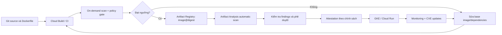
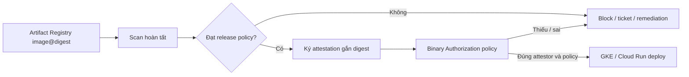

# Container image scanning và xử lý lỗ hổng

Một ứng dụng Orders đã được đóng gói thành container và chạy ổn định trên Cloud Run. Vài ngày sau, nhà cung cấp công bố lỗ hổng nghiêm trọng trong thư viện hoặc base image mà ứng dụng sử dụng. **Code của nhóm có thể không thay đổi, nhưng rủi ro của image đã thay đổi**. Nếu pipeline chỉ kiểm tra unit tests và cho phép triển khai bất kỳ image nào, ứng dụng có thể tiếp tục chạy phiên bản có lỗ hổng mà không ai biết.

Google Cloud cung cấp **Artifact Registry** để lưu trữ image và **Artifact Analysis** để phát hiện, lưu metadata và theo dõi lỗ hổng trong container images. Tuy nhiên, quét image chỉ là một phần của phòng vệ chuỗi cung ứng phần mềm: nhóm vẫn phải **đánh giá mức độ ảnh hưởng, sửa lỗi, xây dựng image mới, kiểm chứng bản vá và thực thi cổng kiểm soát trước khi triển khai**.

Bài học thuộc chương **Container và Artifact Registry** trong module `CLOUD_PROVIDERS_GCP`. Kiến thức này kết nối project và IAM, VPC, Compute Engine, GKE, Cloud Run, dịch vụ dữ liệu, phát hành CI/CD, quan sát độ tin cậy và chi phí. Mục tiêu cuối cùng là biến các kết quả quét thành **quy trình xử lý lỗ hổng có thể truy vết**, không chỉ là bảng đếm CVE.

> **Lưu ý:** Các project, image và ngưỡng cảnh báo dưới đây đều là ví dụ giả định. Lệnh tạo repository, bật API, build, push hoặc deploy có thể thay đổi tài nguyên và phát sinh phí; chỉ chạy trên môi trường được phép. Bài này mô tả kỹ thuật, không thực thi lệnh trên Google Cloud.

## 1. Kết quả học tập

Sau bài học, bạn có thể:

1. Phân biệt image tag, **digest**, OS package, application dependency, vulnerability note và occurrence.
2. Giải thích vai trò của **Artifact Registry**, **Artifact Analysis**, **Container Scanning API**, **On-Demand Scanning API**, **Security Command Center** và **Binary Authorization**.
3. Bật automatic scanning cho các Docker repositories phù hợp và kiểm tra cấu hình scanning ở từng repository.
4. Dùng `gcloud` để đọc vulnerability occurrences của image hoặc thực hiện on-demand scan trong một CI pipeline.
5. Đánh giá CVE theo severity, fix availability, khả năng bị khai thác, mức tiếp xúc và tính quan trọng của workload.
6. Cải thiện Dockerfile, base image và dependencies; phát hành **digest mới** rồi kiểm tra lại.
7. Thiết kế release gate, ngoại lệ có hạn, attestation, giám sát liên tục, rollback, quản lý quyền và chi phí scanning.

## 2. Mô hình rủi ro của container image

Một container image thường có các lớp:

```text
Image orders-api@sha256:...
  ├─ Base image: hệ điều hành, libc, OpenSSL, CA certificates...
  ├─ Runtime: Java/Node.js/Python/Go nếu ứng dụng yêu cầu
  ├─ Application dependencies: JAR, npm/pip modules, thư viện native...
  ├─ Application code và assets
  └─ Image metadata: entrypoint, user, environment, labels...
```

Không phải lỗ hổng nào cũng đến từ code bạn viết. Một CVE có thể xuất hiện trong base image, thư viện transitive dependency, runtime hoặc hệ thống build. Việc container chạy được cũng **không chứng minh** các package đã được cập nhật.

| Tình huống | Rủi ro | Biện pháp cần kết hợp |
| --- | --- | --- |
| Base image chứa package dễ bị tấn công | Một image cũ ảnh hưởng nhiều dịch vụ | Pin nguồn tin cậy, cập nhật base digest, rebuild và scan |
| Thư viện ứng dụng có CVE | Endpoint có thể sử dụng code chứa lỗ hổng | Cập nhật dependency, test chức năng và kiểm tra khả năng khai thác |
| Lộ API key trong image layer | Ai có quyền pull image có thể đọc bí mật | Không bake secret, thay/thu hồi key, rà soát build history và scanning secrets |
| Tag `latest` trỏ sang image mới | Tên deploy không phản ánh chính xác artifact đã kiểm tra | Lưu và deploy bằng **immutable digest** |
| Image scan sạch nhưng runtime cấu hình sai | Pod/VM chạy privileged, network quá rộng, quyền IAM cao | Kết hợp policy, runtime security, workload identity và network controls |
| Đã phát hiện CVE nhưng không triển khai bản vá | Các workload vẫn chạy digest cũ | Gắn SLA, owner, deploy pipeline, theo dõi fleet đang chạy |

**Tag là con trỏ có thể đổi**, ví dụ `orders-api:prod` hôm nay và ngày mai có thể trỏ đến hai digests khác nhau. **Digest `sha256:...` định danh nội dung image** và thích hợp để truy vết scan, promotion và deploy. Tái gắn tag không tạo nội dung image mới và không tự kích hoạt một lần quét mới dựa trên digest.

## 3. Các dịch vụ Google Cloud và vị trí trong chuỗi cung ứng

| Thành phần | Vai trò | Không tự làm |
| --- | --- | --- |
| **Artifact Registry** | Lưu Docker images và các artifact khác trong repository có IAM/location | Không tự sửa package chứa CVE |
| **Artifact Analysis** | Trích xuất package, đối chiếu dữ liệu lỗ hổng, quản lý metadata theo image | Không chứng minh mọi đường khai thác hoặc cấu hình runtime đều an toàn |
| **Container Scanning API** | Kích hoạt automatic vulnerability scanning đối với image/repository được hỗ trợ | Không mặc định chặn push hoặc deploy chỉ vì thấy CRITICAL |
| **On-Demand Scanning API** | Quét image local hoặc remote theo yêu cầu, phục vụ kiểm tra trước/pipeline | Không giám sát liên tục kết quả một lần quét |
| **Security Command Center** | Tập hợp một số findings về rủi ro cloud, gồm vulnerability assessment khi được cấu hình | Không thay thế công việc owner xác minh và vá CVE |
| **Binary Authorization** | Thực thi policy deploy dựa trên nguồn image, attestation/quy tắc được cấu hình | Không tự quyết định image “đã vá” chỉ vì scanning bật |
| **Cloud Build / CI** | Build, test, gọi scanner, đánh giá release policy, phát artifact | Không tự tạo chính sách risk acceptance cho doanh nghiệp |
| **Cloud Run / GKE / Compute Engine** | Chạy image trong môi trường sản xuất | Không tự nâng digest đang chạy chỉ vì Artifact Analysis tìm CVE mới |

Một quy trình đầu-cuối có thể là:



Sơ đồ minh họa luồng có kiểm soát, **không phải tất cả bước tự được Google Cloud thiết lập**. CI gate, attestation, Binary Authorization policy, người phê duyệt và giám sát phải được tổ chức cấu hình riêng.

## 4. Automatic scanning và continuous analysis

Khi **Container Scanning API** được bật, Artifact Analysis có thể tự quét các image mới được push tới các **standard và remote Docker repositories** được hỗ trợ trong Artifact Registry; từng repository cũng có lựa chọn bật/tắt scanning. **Virtual repositories không hỗ trợ scanning** theo tài liệu hiện hành.

Các bước chính:

1. Image được push vào Docker repository.
2. Artifact Analysis phân tích package OS và các language packages được hỗ trợ.
3. Kết quả được lưu dưới dạng metadata gắn với image **digest**.
4. Khi nguồn vulnerability feeds cập nhật, Artifact Analysis có thể tạo/cập nhật/xóa findings của digest đã quét trong cửa sổ giám sát.
5. Người vận hành xem findings, đánh giá rủi ro và phát hành digest mới khi cần.

### 4.1. Quét theo digest, không theo lần tag thay đổi

Nếu cùng một digest được gắn thêm tag `staging` hoặc `prod`, đó vẫn là **một image**; đổi tag không làm image được quét mới. Nếu bạn rebuild Dockerfile hoặc dependencies và nội dung thay đổi, image nhận **digest mới** — pipeline cần kiểm tra chính digest đó.

### 4.2. Kết quả liên tục có thời hạn cập nhật

Tài liệu Artifact Analysis quy định việc theo dõi metadata của image đã quét liên quan đến **lần pull gần đây**. Cửa sổ giám sát mặc định là khoảng **30 ngày**; khi image không được pull trong cửa sổ này, kết quả có thể trở nên *stale* và không tiếp tục cập nhật. Metadata stale trên **90 ngày** có thể bị archive và cần dùng API để xem; hướng làm mới phụ thuộc trạng thái image/package và có độ trễ.

Điều này có nghĩa **không nên dùng kết quả scan một năm trước làm bằng chứng production hiện tại an toàn**. Đối với các image dùng lâu hoặc ít pull, tổ chức cần cơ chế giữ monitoring phù hợp và có phương án đánh giá lại theo tài liệu; không giả định một scan ban đầu sẽ cập nhật mãi mãi.

### 4.3. Những gì scanner nhìn thấy và không nhìn thấy

Automatic scanning hỗ trợ nhiều hệ điều hành Linux và một tập language ecosystems theo bảng hỗ trợ chính thức. Kết quả phụ thuộc **khả năng nhận diện package và nguồn thông tin bảo mật công khai**. Có thể không phát hiện một thư viện tự biên dịch, binary tùy biến, dependency vendored không nhận diện được, logic flaw của ứng dụng hoặc vấn đề cấu hình runtime.

Một số khả năng quét malware packages, dependency/licenses và phát hiện secret được Google bổ sung theo phạm vi hỗ trợ; **secret scanning có thành phần Preview** nên không thay thế secret scanning trong Git/CI hoặc biện pháp chống lộ credentials.

Đối với manifest list nhiều kiến trúc, scanner lựa chọn một image manifest trong danh sách theo quy tắc hỗ trợ; đừng kết luận mọi kiến trúc đã được quét độc lập khi chỉ thấy một kết quả tổng quát. Container scanning không hỗ trợ Windows Server containers theo tài liệu hiện hành.

## 5. Kích hoạt và quản lý automatic scanning

Điều kiện tiên quyết: project đã có Billing phù hợp, Artifact Registry API, IAM quản lý repository/service usage, và CLI đã xác thực. Các lệnh dưới đây **thay đổi hạ tầng** nếu thực thi.

```bash
# LỆNH CÓ THAY ĐỔI CẤU HÌNH: chỉ chạy trong project sandbox được duyệt.
PROJECT_ID="orders-container-lab"
REGION="asia-southeast1"
REPOSITORY="orders-images"

# Bật Artifact Registry và Container Scanning API cho project.
gcloud services enable artifactregistry.googleapis.com \
  containerscanning.googleapis.com \
  --project="$PROJECT_ID"

# Tạo một standard Docker repository mới để thử nghiệm.
gcloud artifacts repositories create "$REPOSITORY" \
  --project="$PROJECT_ID" \
  --location="$REGION" \
  --repository-format=docker \
  --description="Sandbox container images for Orders"

# Cho phép vulnerability scanning trên repository.
gcloud artifacts repositories update "$REPOSITORY" \
  --project="$PROJECT_ID" \
  --location="$REGION" \
  --allow-vulnerability-scanning
```

Enabling Container Scanning API còn kích hoạt dịch vụ quản lý metadata **Container Analysis API**. Đối với Docker standard/remote repositories, automatic scanning thường được bật khi API đã bật, trừ khi bị vô hiệu hóa ở repository. Với package repositories như Maven/npm/Python, cài đặt scanning theo repository có thể mặc định **tắt** và cần bật riêng; không đánh đồng package scanning với container scanning.

**Các lệnh đọc trạng thái mà không thay đổi hạ tầng:**

```bash
gcloud services list --enabled \
  --project=orders-container-lab \
  --filter="name:containerscanning.googleapis.com"

gcloud artifacts repositories describe orders-images \
  --project=orders-container-lab \
  --location=asia-southeast1

gcloud artifacts repositories list \
  --project=orders-container-lab \
  --location=asia-southeast1
```

Để giảm phí hoặc nhiễu phát hiện, có thể **tắt scanning trên repository cụ thể** thay vì tắt API cho toàn project:

```bash
# THAY ĐỔI CẤU HÌNH: không chạy trên production nếu chưa review.
gcloud artifacts repositories update orders-images \
  --project=orders-container-lab \
  --location=asia-southeast1 \
  --disable-vulnerability-scanning
```

Tắt scanning có thể khiến không phát hiện CVE mới cho các image liên quan; hãy ghi lại owner, lý do, môi trường, phương án scanner thay thế và thời gian review lại. Không dùng tắt scanning để làm dashboard không còn báo CRITICAL.

## 6. Push image vào Artifact Registry và đọc kết quả

Một image có tên dạng:

```text
asia-southeast1-docker.pkg.dev/orders-container-lab/orders-images/orders-api:v1.2.0
```

Trên một máy phát triển hoặc runner Linux có Docker và IAM phù hợp, ví dụ:

```bash
# LỆNH TẠO/PUSH IMAGE, có thể phát sinh phí và thay đổi registry.
PROJECT_ID="orders-container-lab"
REGION="asia-southeast1"
IMAGE="$REGION-docker.pkg.dev/$PROJECT_ID/orders-images/orders-api"

gcloud auth configure-docker "$REGION-docker.pkg.dev"

# Chỉ build Dockerfile đã được phê duyệt, không chứa bí mật.
docker build --tag "$IMAGE:v1.2.0" .
docker push "$IMAGE:v1.2.0"
```

Tài khoản push cần quyền repository thích hợp như `roles/artifactregistry.writer`; runtime deploy/pull thường chỉ cần `roles/artifactregistry.reader` trên repository. Không dùng cùng một tài khoản rộng quyền cho build, scan, deploy và workload nếu không cần.

Sau push, tra image và vulnerability occurrences qua CLI:

```bash
# CHỈ ĐỌC: liệt kê digests và metadata của một image name.
gcloud artifacts docker images list \
  asia-southeast1-docker.pkg.dev/orders-container-lab/orders-images/orders-api

# CHỈ ĐỌC: lọc những occurrences loại VULNERABILITY.
# Positional argument là IMAGE NAME không kèm :tag, theo CLI reference.
gcloud artifacts docker images list \
  --show-occurrences \
  --occurrence-filter='kind="VULNERABILITY"' \
  --format=json \
  asia-southeast1-docker.pkg.dev/orders-container-lab/orders-images/orders-api
```

Trong Console, vào Artifact Registry → repository → Docker image → digest → **Vulnerabilities** để xem severity, package, phiên bản, fix availability và thông tin CVE. Kết quả quét có thể đến **sau** khi push; nếu dashboard chưa có findings ngay lập tức, phải kiểm tra trạng thái **discovery/scan**, không kết luận “không có CVE”.

Đối với pipeline tự động, luôn ghi lại digest đầy đủ `@sha256:...` của image đã đẩy lên và chỉ đánh giá/promotion đúng digest đó. Đừng đánh dấu tag `prod` được duyệt rồi sau đó cho phép push nội dung mới lên cùng tag mà không chạy lại gate.

## 7. On-demand scanning: quét trước hoặc ngoài lúc push

**On-Demand Scanning API** cho phép quét container images trên máy local hoặc từ registry theo lệnh gọi. Đây là lựa chọn tốt khi CI cần đánh giá trước khi image được đưa vào repository production.

| Đặc tính | Automatic scanning | On-demand scanning |
| --- | --- | --- |
| Điểm kích hoạt | Sau khi push image mới vào repository hỗ trợ | Người dùng/CI chủ động gọi scan |
| Nguồn image | Image trong Artifact Registry được hỗ trợ | Image local hoặc remote có URI phù hợp |
| Lưu kết quả | Metadata gắn với digest, được giám sát/cập nhật trong cửa sổ hỗ trợ | Scan snapshot; kết quả chỉ giữ trong thời gian ngắn |
| Thời gian tồn tại | Theo chính sách monitoring/stale/archive | **Tối đa 48 giờ sau khi quét xong** |
| Mục đích | Theo dõi tồn kho image và phát hiện CVE mới | Pre-push check, kiểm soát CI và đánh giá có chủ đích |

On-demand scanning CLI local hỗ trợ **Linux và macOS**, không hỗ trợ Windows theo tài liệu hiện hành. Có thể chạy trên Linux CI runner hoặc Cloud Build thay vì ép dev Windows phải quét local. Dịch vụ có tính phí theo chính sách pricing.

### 7.1. Scan một local image trong CI Linux

```bash
# THỰC HIỆN QUÉT: gửi thông tin package lên dịch vụ, có thể tính phí.
gcloud services enable ondemandscanning.googleapis.com \
  --project=orders-container-lab

gcloud artifacts docker images scan orders-api:v1.2.0 \
  --location=asia
```

Lệnh `scan` đồng bộ sẽ trả về operation và, khi hoàn tất, một trường `response.scan` chứa tên resource scan như:

```text
projects/orders-container-lab/locations/asia/scans/SCANNER_GENERATED_ID
```

Đọc các findings (thay đúng scan name mà lệnh trả về):

```bash
# CHỈ ĐỌC: kết quả on-demand theo scan resource đã hoàn tất.
gcloud artifacts docker images list-vulnerabilities \
  projects/orders-container-lab/locations/asia/scans/SCANNER_GENERATED_ID
```

Nếu dùng `--async`, lệnh trả về **long-running operation**; cần gọi `gcloud artifacts docker images get-operation OPERATION_RESOURCE` và đợi `done: true`, sau đó mới dùng giá trị `response.scan`. Không dùng operation name thay cho scan name.

### 7.2. Scan image trong registry

```bash
# ON-DEMAND remote scan: tham chiếu đúng image digest khi có thể.
gcloud artifacts docker images scan \
  asia-southeast1-docker.pkg.dev/orders-container-lab/orders-images/orders-api@sha256:IMAGE_DIGEST \
  --remote \
  --location=asia
```

Với Artifact Registry, remote URI cần đủ `LOCATION-docker.pkg.dev/PROJECT/REPOSITORY/IMAGE`; có thể dùng tag hoặc digest theo CLI nhưng **digest thích hợp cho release evidence**. `--location=asia` là **địa điểm thực hiện on-demand scan**, không phải region của repository và không có nghĩa đổi vị trí lưu image.

**Quan trọng:** kết quả on-demand không được cập nhật liên tục; khi phát hành CVE mới hoặc build digest mới, phải quét lại. Không coi bản scan 48 giờ trước là bằng chứng duy nhất cho runtime hiện tại, và không quên xuất kết quả/decision record vào hệ thống audit được bảo vệ theo chính sách trước khi hết hạn.

## 8. Đọc kết quả quét: CVE, note, occurrence và discovery

Artifact Analysis dùng mô hình metadata:

- **Note** mô tả một loại sự kiện hoặc phát hiện bảo mật, chẳng hạn lỗ hổng được định danh bởi CVE.
- **Occurrence** là một lần note được áp dụng cho artifact cụ thể (image và digest).
- **Discovery occurrence** chứa thông tin về kết quả/quá trình phát hiện package của image.
- **Vulnerability occurrence** cho biết lỗ hổng liên quan, package ảnh hưởng, phiên bản và các trường mức độ nghiêm trọng/khả năng có bản vá tùy nguồn dữ liệu.

Ví dụ **dữ liệu minh họa đã giản lược** (không phải output nguyên dạng của API):

```yaml
image: asia-southeast1-docker.pkg.dev/orders-prod/orders-api/orders-api@sha256:EXAMPLE_DIGEST
scanStatus: FINISHED
findings:
  - id: CVE-EXAMPLE-0001
    package: libexample
    installedVersion: "1.2.0"
    fixedVersion: "1.2.3"
    effectiveSeverity: HIGH
    fixAvailable: true
  - id: CVE-EXAMPLE-0002
    package: liblegacy
    installedVersion: "0.8.4"
    fixedVersion: null
    effectiveSeverity: CRITICAL
    fixAvailable: false
```

Trường của API/Grafeas thật có cấu trúc lồng nhau và có thể phân biệt `severity`, `effectiveSeverity`, `packageIssue`, `fixedLocation`, `cvssScore` hoặc các trường khác. **Đừng viết script parse output bằng cách giả định JSON thật trùng với bảng minh họa này.** Trước khi lập gate, kiểm tra schema trả về của phiên bản Artifact Analysis đang sử dụng.

### 8.1. Ý nghĩa của các trường trong thực hành

| Trường | Câu hỏi giúp trả lời | Giới hạn suy luận |
| --- | --- | --- |
| CVE / advisory ID | Lỗ hổng đã được nguồn tin cậy mô tả ở đâu? | Có thể có nhiều advisory cho cùng vấn đề hoặc chưa có CVE |
| Package + installed version | Thành phần nào trong image bị ảnh hưởng? | Một tên package không chứng minh code vulnerable được gọi |
| Effective severity | Scanner đánh giá mức độ nguy hiểm thế nào? | Không phải bằng chứng đầy đủ về khai thác thực tế trong workload |
| CVSS score/vector | Độ nghiêm trọng và điều kiện tấn công ở mức mô hình | CVSS không tự biết Internet exposure, secret và tài sản của tổ chức |
| Fix available / fixed version | Có hướng nâng version hay patch không? | Distributor có thể backport fix dù upstream version trông vẫn cũ |
| Discovery status | Scan có hoàn tất và xác định được packages không? | Không có finding khi scan chưa hoàn tất không đồng nghĩa an toàn |
| Image digest | Đây có đúng artifact được deploy không? | Nếu chạy digest khác, kết quả này không đại diện cho runtime |
| Update time | Findings được làm mới gần đây không? | Có thể stale nếu image không còn trong cửa sổ theo dõi |

### 8.2. Không đếm CVE một cách mù quáng

Một CVE có thể xuất hiện ở nhiều package/paths; một package có thể chứa nhiều CVE; nhiều nguồn có thể có cách đánh giá severity khác nhau. Việc so sánh “image A có 27 findings, B có 24” không đủ để chọn image B. Cần xem **những findings nào có thể khai thác trong kiến trúc thật**, có fix hay không, và có phát sinh chức năng/bảo mật mới khi nâng base image.

Ví dụ một thư viện network bị ảnh hưởng trong container public-facing có thể ưu tiên cao hơn một chương trình command-line chỉ có trong build stage (vốn không nằm ở final image), ngay cả khi số lượng findings ít hơn. Tuy vậy, một package không được ứng dụng gọi trực tiếp vẫn có thể bị dùng gián tiếp hoặc bởi công cụ khác; phải chứng minh điều kiện không ảnh hưởng trước khi hạ ưu tiên.

### 8.3. Dùng digest để đối chiếu image đang chạy

Image tag có thể bị đổi sau khi scan, còn digest là định danh cụ thể. Trên môi trường GKE, có thể xem image ID/digest của container thực tế chạy trong Pod thông qua trạng thái workload; trên Cloud Run, cần kiểm tra image digest của revision đã triển khai theo công cụ hỗ trợ.

```bash
# CHỈ ĐỌC: xem Pod đang chạy image gì trong namespace được giao.
kubectl get pods -n orders \
  -o jsonpath='{range .items[*]}{.metadata.name}{" "}{range .status.containerStatuses[*]}{.imageID}{" "}{end}{"\n"}{end}'

# CHỈ ĐỌC: xem Cloud Run service/revisions để đối chiếu artifact.
gcloud run services describe orders-api \
  --project=orders-prod \
  --region=asia-southeast1 \
  --format=yaml
```

Lệnh ví dụ cần quyền đọc GKE/Cloud Run thích hợp. Đối với Cloud Run, cấu trúc field có thể khác theo API/version; luôn đối chiếu revision/template/digest với artifact đã được kiểm tra trước khi kết luận service đang chạy bản đã vá.

## 9. Đánh giá rủi ro và ưu tiên sửa lỗ hổng

Quy tắc “mọi CVE CRITICAL đều chặn” dễ truyền đạt và có thể hợp với một số hệ thống, nhưng trong vận hành phải xử lý tình huống **không có bản vá**, false positive, package không thực thi và độ ưu tiên bị ảnh hưởng bởi mức exposure. Cần chính sách rõ và có người chịu trách nhiệm, thay vì mỗi developer tự quyết.

Một ma trận **minh họa**, không phải tiêu chuẩn bắt buộc của Google Cloud:

| Điều kiện | Mức ưu tiên đề xuất | Hành động |
| --- | --- | --- |
| CVE đang bị khai thác tích cực, đường tấn công reachable, dữ liệu nhạy cảm | Khẩn cấp | Chặn release, giảm exposure ngay, cập nhật/bảo vệ/rollback theo runbook |
| CRITICAL/HIGH có fix cho service internet-facing | Cao | Pin/fix dependency, rebuild, test, scan, phát hành ưu tiên |
| HIGH không có fix nhưng workload reachable | Cao, cần đánh giá riêng | Biện pháp tạm thời: network isolation, WAF phù hợp, disable feature, hạn ngoại lệ |
| MEDIUM có fix trong công cụ chạy nội bộ | Theo SLA của team | Lập backlog, xử lý trong sprint/cửa sổ release |
| Lỗ hổng xác minh không ảnh hưởng runtime | Chấp nhận tạm có bằng chứng | VEX/risk acceptance, expiry và review lại khi hoàn cảnh thay đổi |
| Scan chưa xong hoặc image digest không xác định | **Không có đủ bằng chứng** | Giữ release lại hoặc chuyển qua quy trình ngoại lệ được phê duyệt |

### 9.1. Chỉ số để xem xét cùng severity

1. **Exploit availability:** có exploit công khai hoặc bằng chứng bị khai thác thực tế không? Đối chiếu nguồn đáng tin như CISA KEV và advisories.
2. **Attack surface:** container có endpoint Internet, chạy privileged, mount secrets hoặc có quyền IAM rộng không?
3. **Reachability:** package/function chứa lỗ hổng có được gọi với input người dùng không? Chứng minh bằng code path, testing hoặc SBOM/VEX.
4. **Asset criticality:** ảnh hưởng đến thanh toán, dữ liệu cá nhân, availability và compliance nào?
5. **Fix maturity:** có bản fix trên distro được hỗ trợ, patch đã backport hay cần thay major runtime?
6. **Compensating controls:** mTLS, authentication, egress policy, Cloud Armor hoặc runtime isolation thực sự giảm rủi ro nào?
7. **Time factor:** image được deploy bao lâu, còn trong cửa sổ monitoring không, và giới hạn xử lý theo SLA?

CVSS severity là điểm khởi đầu, **không phải quyết định duy nhất**. Những hệ thống có quy định compliance nghiêm ngặt có thể áp release gate cứng; đội an ninh phải công bố ngưỡng và quy trình ngoại lệ rõ ràng.

### 9.2. Hồ sơ xử lý một CVE

```text
Finding ID / advisory: CVE-...
Image digest: sha256:...
Package, version, layer/nguồn phụ thuộc:
Services đang chạy digest này:
Scan completed / updated_at / nguồn dữ liệu:
Severity, CVSS vector, exploitation evidence:
Có bản vá hay distro backport không:
Reachability và ảnh hưởng nghiệp vụ:
Owner và hạn xử lý:
Giải pháp và pull request:
Artifact mới + scan evidence:
Kết quả rollout/canary:
Ngoại lệ (nếu có), reviewer, expiry, compensating controls:
```

Ticket phải gắn **digest và runtime deployment**, không chỉ tag `latest` hoặc tên package. Nếu có nhiều project dùng chung image, chia sẻ kết quả triage nhưng xác minh phạm vi triển khai ở từng project.

## 10. Sửa lỗ hổng: thay đổi image, không “chữa bằng tag”

Một số phương pháp xử lý theo thứ tự:

1. **Cập nhật base image:** dùng bản OS/runtime được nhà cung cấp tiếp tục hỗ trợ, ưu tiên digest đã kiểm tra. Rebuild để tạo digest mới.
2. **Cập nhật package ứng dụng:** nâng Maven/npm/pip/Go dependencies, lockfile và transitive dependencies theo advisory.
3. **Loại package không cần:** dùng multi-stage builds để compilers/test tools không tồn tại trong image runtime.
4. **Giảm quyền runtime:** non-root user, read-only filesystem khi phù hợp, không privileged, service account tối thiểu, giới hạn capabilities/secrets.
5. **Đổi thiết kế hoặc cô lập:** khi chưa có fix, disable phần chức năng bị ảnh hưởng hoặc giảm network exposure; xin ngoại lệ có thời hạn và bằng chứng.
6. **Quét lại final image:** đừng chỉ scan build stage hoặc commit thay đổi rồi xem là xong; digest cuối mới là artifact production.

### 10.1. Multi-stage Dockerfile và pin image

Ví dụ **khung minh họa** cho ứng dụng Java:

```dockerfile
# Minh họa cú pháp; thay hai digest bằng giá trị thật đã xác minh.
FROM eclipse-temurin:21-jdk@sha256:APPROVED_BUILD_DIGEST AS build
WORKDIR /workspace
COPY . .
RUN ./gradlew --no-daemon clean build -x test

FROM eclipse-temurin:21-jre@sha256:APPROVED_RUNTIME_DIGEST
WORKDIR /app
COPY --from=build /workspace/build/libs/app.jar /app/app.jar
USER 10001
EXPOSE 8080
ENTRYPOINT ["java", "-jar", "/app/app.jar"]
```

Ví dụ không chạy được cho đến khi thay digest, đường build và file JAR tương ứng; tham số `-x test` được dùng **chỉ để minh họa giai đoạn build image** và **không có nghĩa được bỏ tests trong CI**. Pipeline production phải chạy tests ở giai đoạn riêng, bảo đảm `app.jar` đúng artifact, verify base image signatures/source và quét image kết quả.

Các điểm cải tiến:

- Dùng runtime image gọn hơn builder, không mang compiler và cache của build tool vào production.
- Pin **digest** để build có khả năng tái lập, đồng thời có automation phát hiện bản digest mới có bản vá; pin cứng mãi mãi cũng có thể gây tồn đọng CVE.
- Dùng `USER` không phải root khi ứng dụng và filesystem cho phép; đặc biệt chú ý quyền ghi vào thư mục log/tmp nếu cần.
- Không đưa `ARG PASSWORD`/`ENV TOKEN` vào Dockerfile hoặc cache layer; sử dụng secret injection của build system, workload identity/Secret Manager khi chạy.
- Giảm quyền đọc secrets của CI và tránh vô tình upload SBOM, scan artifacts hoặc build logs chứa dữ liệu nhạy cảm.

### 10.2. Cập nhật dependency chưa chắc có phiên bản cao hơn ở upstream

Với Debian/Ubuntu/RHEL và các nhà phân phối, một bản vá bảo mật có thể được **backport vào cùng major/minor version**. Công cụ so sánh `vulnerable_version < fixed_version` dựa trên chuỗi đơn giản có thể báo sai. Dùng advisory của distribution, package release metadata và kết quả scanner đã cập nhật để xác minh.

Ngược lại, sửa một `pom.xml`/`package-lock.json` nhưng không rebuild final image sẽ không thay đổi digest đang chạy. Bước cuối phải luôn là **build → scan digest mới → test → rollout → xác nhận các Pod/revisions đang chạy digest mới**.

### 10.3. Khi không có bản fix

Không tự xóa CVE khỏi dashboard. Ghi rõ rủi ro, đánh giá tiếp xúc, biện pháp bù trừ, người duyệt ngoại lệ và thời gian kiểm tra lại; cân nhắc thay thế package, tắt endpoint, giới hạn egress/ingress, dời workload hoặc cô lập quyền. Một ngoại lệ có thời hạn không đồng nghĩa tình trạng kỹ thuật đã được vá.

## 11. SBOM, VEX và giới hạn của quét lỗ hổng

**Software Bill of Materials (SBOM)** liệt kê các thành phần phần mềm và quan hệ phụ thuộc. Nó giúp biết các artifact nào bị ảnh hưởng khi xuất hiện CVE mới. **Vulnerability Exploitability eXchange (VEX)** ghi trạng thái đánh giá ảnh hưởng của một vulnerability đối với sản phẩm cụ thể, có thể hỗ trợ workflow triage khi được cấu hình.

| Bằng chứng | Trả lời câu hỏi | Không chứng minh |
| --- | --- | --- |
| Scan findings | Những package/CVE nào scanner nhận diện? | Code không có lỗi logic hoặc runtime chắc chắn an toàn |
| SBOM | Image chứa những thành phần nào? | Mọi thành phần đã được scan hoặc mọi dependency đều an toàn |
| VEX statement | Nhà cung cấp/owner đánh giá vulnerability ảnh hưởng thế nào, với lý do gì? | Lỗ hổng đã được sửa nếu chỉ ghi `not_affected` không có bằng chứng |
| Build provenance | Artifact được build từ source/config/tool nào? | Artifact không chứa bất kỳ CVE nào |
| Attestation | Quy trình kiểm thử/scan/phê duyệt đã được signer xác nhận | CVE không thể xuất hiện sau khi attestation được tạo |

Do đó cần kết hợp scan, SBOM, code review, SAST/DAST khi phù hợp, secret scanning, IaC/runtime policy và chứng cứ phát hành. Bản scan không tìm thấy CVE có thể do image chưa được phân tích, package không nằm trong phạm vi hỗ trợ hoặc dữ liệu vulnerability chưa cập nhật.

Khi tạo VEX/ngoại lệ, phải ghi **image digest, CVE, lý do, bằng chứng reachability, owner và thời hạn**. Một ngoại lệ cho `orders-api@sha256:A` không tự áp dụng cho digest B vì thành phần và đường thực thi có thể đã thay đổi.

## 12. Thiết kế release gate trong CI/CD

**Automatic scanning không mặc định chặn deploy.** Nếu tổ chức cần “không cho chạy image chưa được phê duyệt”, phải thêm gate vào build/promotion và có thể dùng Binary Authorization ở lớp triển khai.

Ví dụ chính sách **nội bộ giả định**, không phải cấu hình có thể áp dụng trực tiếp:

```yaml
releasePolicy:
  requireImmutableDigest: true
  requireScanStatus: FINISHED
  maxScanAgeHours: 24
  failOn:
    criticalFixAvailable: true
    highReachableAndFixAvailable: true
  exceptions:
    requireSecurityApproval: true
    maxLifetimeDays: 7
  requireTestsPassed: true
  requireSignedAttestation: true
```

Các field là **pseudocode của chính sách** do tổ chức tự triển khai. Không gửi YAML này cho `gcloud` và mong Binary Authorization tự hiểu; Binary Authorization có schema/policy resource riêng.

### 12.1. Luồng kiểm soát đề xuất

1. CI build image với Dockerfile/version được review, chạy tests và scan secrets.
2. Chạy **on-demand scan** hoặc push vào staging repository có automatic scanning, đợi **scan FINISHED**.
3. Lấy kết quả theo digest hoặc scan resource, parse đúng API schema và đánh giá chính sách (severity, fix, exploitability, ngoại lệ).
4. Nếu không đạt: **fail closed**, không gắn tag/promote production, tạo ticket với owner.
5. Nếu đạt: tạo release record/attestation gắn vào **digest**, chuyển hoặc cho phép dùng artifact được duyệt.
6. Triển khai GKE/Cloud Run bằng **digest**, không chỉ `:latest`.
7. Kiểm chứng runtime digest, errors, latency, rollback; tiếp tục theo dõi CVE mới.

Một pipeline **không nên** chuyển sang production chỉ vì command quét trả exit code 0: điều đó có thể chỉ chứng minh scan request thành công, không chứng minh findings đã được đánh giá hoặc ngưỡng bảo mật được đáp ứng.

### 12.2. Binary Authorization: attestation mới là cổng deploy

Binary Authorization hỗ trợ chính sách kiểm soát image được triển khai trên các nền tảng được hỗ trợ như GKE và Cloud Run. Nhóm xây dựng có thể tạo **attestation** cho digest sau khi quét và được review; policy yêu cầu attestation từ attestor được tin cậy trước khi cho deploy.



Chữ ký attestation chứng nhận một **quy trình hoặc kết luận kiểm tra tại thời điểm tạo**, không bảo đảm image vĩnh viễn không có CVE. Khi nguồn vulnerability công bố lỗ hổng mới, cần cơ chế re-evaluation và redeploy; Binary Authorization không thay thế giám sát liên tục.

Trước khi bật enforcement toàn production, thử **dry-run** khi nền tảng/policy hỗ trợ, xác minh các image bootstrap, hệ thống monitoring/agent và đường rollback. Đặt ngoại lệ có giới hạn phạm vi/thời hạn và audit, không dùng “allow all” kéo dài để làm pipeline xanh.

### 12.3. Trạng thái cần phân biệt

| Trạng thái | Ý nghĩa | Hành động phù hợp |
| --- | --- | --- |
| `SCAN_PENDING` | Image chưa có kết quả hoàn chỉnh | Đợi/điều tra; không coi là không CVE |
| `SCAN_FINISHED_WITH_FINDINGS` | Có kết quả để triage | Đánh giá theo policy, không chỉ đếm |
| `APPROVED` | Owner/security đã duyệt digest theo ngưỡng | Ghi attestation và evidence |
| `EXCEPTION_APPROVED` | Chấp nhận rủi ro có hạn | Theo dõi SLA và ngày hết hạn |
| `DEPLOYED` | GKE/Cloud Run đang chạy digest | Theo dõi runtime, CVE mới và config |
| `REMEDIATED` | Digest mới đã vá và deploy được xác minh | Kiểm chứng digest cũ không còn chạy ở scope mục tiêu |

Các trạng thái là mô hình của **release workflow doanh nghiệp**, không phải các giá trị enum bắt buộc của Google Cloud APIs.

## 13. IAM, supply-chain security và quản trị nhiều project

Nhóm Platform có thể sở hữu repository trong project `platform-artifacts`, trong khi các ứng dụng Orders chạy ở `orders-dev` và `orders-prod`. Thiết kế này giúp tách **người tạo artifact** và **người sử dụng artifact**, nhưng phải cấp quyền đúng trên repository và các dịch vụ scanning.

| Danh tính | Trách nhiệm | Quyền tối thiểu để xem xét |
| --- | --- | --- |
| CI builder | Build, push image vào repository staging | `roles/artifactregistry.writer` trên repository cần push, quyền build/runtime đúng phạm vi |
| Security reviewer | Xem findings/metadata | Artifact Registry Reader và Container Analysis occurrence/note viewer theo tài liệu |
| CI scan job | Gọi On-Demand Scanning API, đọc kết quả | On-Demand Scanning Admin hoặc custom role đúng API action; không cần Owner toàn project |
| Cloud Run/GKE pull identity | Pull image đã duyệt khi deploy/chạy | `roles/artifactregistry.reader` trên repository nguồn khi cần |
| Release controller | Phê duyệt/promote digests, tạo attestations | Quyền ghi metadata/attestation phù hợp, không nhất thiết sửa repository hoặc deploy |
| Deployment identity | Deploy revision/Pod/VM được duyệt | Quyền GKE/Cloud Run theo scope, quyền actAs service account phù hợp |
| Google-managed scanning service agent | Thực hiện tác vụ scanner do dịch vụ quản lý | Service agent role theo tài liệu, **không tự cấp role service agent cho người dùng thông thường** |

Đối với Artifact Analysis, các ví dụ chính thức có nhắc `roles/containeranalysis.occurrences.viewer` và `roles/containeranalysis.notes.viewer`; việc xem tất cả metadata còn phụ thuộc phạm vi project và cách quản lý repositories. Khi cấp quyền cross-project, cần phân biệt **scanner service agent**, **người đọc scan results** và **runtime image pull identity**.

### 13.1. Bảo mật lúc build

- Dùng build context nhỏ và `.dockerignore` để tránh đưa `.git`, `.env`, private keys, test data và các file nhạy cảm vào image layers.
- Dùng Workload Identity Federation hoặc workload identity của Cloud Build/GitHub runner theo khả năng hỗ trợ, tránh tải file JSON service account key vào CI.
- Chỉ lấy base images từ nguồn được phê duyệt; dùng digest pin, attestations/provenance và chính sách repository phù hợp.
- Không lưu secrets trong `ARG`/`ENV` hoặc command `RUN` có thể xuất hiện trong image history; dùng secret mount trong build khi phù hợp.
- Đặt thông tin owner, source revision, build ID, release version và SBOM liên kết với digest để truy vết.
- Tách quyền tạo key/attestation khỏi quyền sửa policy Binary Authorization; giảm rủi ro một runner bị chiếm có thể tự cấp phép mọi image.

### 13.2. Bảo mật lúc chạy

Image đã quét vẫn cần:

1. Runtime chạy **non-root** khi ứng dụng hỗ trợ; filesystem read-only hoặc giới hạn writable paths theo yêu cầu.
2. Service account có quyền tối thiểu, không trao Cloud Storage hoặc IAM Admin cho ứng dụng chỉ vì cần đọc một bucket.
3. Egress/ingress VPC có kiểm soát; với GKE cân nhắc NetworkPolicy, Pod Security Standards và workload identity.
4. Cloud Run ingress và authentication theo thiết kế; không mở public nhầm vì image “không CVE”.
5. Ghi log/metrics, patch/deploy mới khi có CVE; không coi image vulnerability scanning thay thế runtime threat detection.

### 13.3. Ngoại lệ cho supply chain không phải ngoại lệ IAM

Một ngoại lệ có thể cho phép deploy digest với một CVE chưa có fix theo thời hạn, nhưng **không có nghĩa** pipeline được quyền bỏ scanning, bỏ attestation hoặc cấp IAM rộng. Ngoại lệ phải gắn chính xác digest/CVE/workload/owner và được đánh giá lại khi source advisory đổi.

## 14. Continuous monitoring sau khi triển khai

Image được scan hôm nay có thể phát sinh finding mới ngày mai. Vì vậy quản trị lỗ hổng cần một vòng kín **detect → triage → remediate → verify → deploy → monitor**, không kết thúc khi CI hiển thị màu xanh.

### 14.1. Những nguồn sự kiện nên kết hợp

| Nguồn | Câu hỏi | Ví dụ hành động |
| --- | --- | --- |
| Artifact Analysis occurrence changes | Có CVE mới/fix mới trong một digest không? | Tạo ticket có dedup theo CVE + digest + package |
| Registry inventory | Image nào đang lưu, ai sở hữu, thời gian scan? | Dọn image không dùng theo retention policy |
| GKE/Cloud Run deployment inventory | Findings có ảnh hưởng image **đang chạy** không? | Ưu tiên digest có production exposure |
| Security Command Center (khi được bật) | Các rủi ro liên quan container có cần gom chung security posture? | Triaging security findings và liên kết vulnerability cases |
| CI/build logs & provenance | Image được build từ source nào, lúc nào và bởi ai? | Truy nguyên dependency update và rollback |
| Cloud Billing | Storage/scanning/egress tăng ở đâu? | Tối ưu repository scanning và retention mà không tạo lỗ hổng giám sát |

Artifact Analysis tự cập nhật vulnerability occurrences trong phạm vi hỗ trợ; **không tự redeploy image** khi có thông tin mới. Nên tích hợp thông báo tới hệ thống công việc của đội phù hợp và phân biệt finding mới với bản ghi được cập nhật.

### 14.2. Các chỉ số nên đưa vào dashboard

- Tỷ lệ **production image digests có scan hoàn chỉnh và còn mới**;
- Số CVEs CRITICAL/HIGH đang mở, tách theo **có fix/không fix** và exposed/non-exposed;
- **Mean time to acknowledge** và **mean time to remediate** theo severity;
- Số digest đang chạy có finding mới sau thời điểm deploy;
- Số ngoại lệ còn hạn/quá hạn; % exception có compensating controls được kiểm chứng;
- Tỷ lệ release bị chặn, nguyên nhân bị chặn (CVE, scan pending, thiếu attestation);
- Số images stale, thời gian kể từ lần pull, repository không bật scanning;
- Số workload đã chạy digest mới sau khi PR remediation merge và rollout.

Chỉ số **“0 CVE”** một mình không phải KPI đầy đủ: kết quả có thể thiếu do scanner chưa hoàn tất hoặc image không hỗ trợ. Cần thêm coverage/scan freshness và xác minh runtime inventory.

### 14.3. Duy trì độ mới của metadata

Tài liệu có quy tắc **30 ngày theo lần pull** và archive metadata stale quá **90 ngày**, nhưng chi tiết phục hồi khi stale/archived khác nhau theo loại artifact. Với image tĩnh ít thay đổi (ví dụ sidecar hoặc proxy), đội Platform phải có lịch kiểm tra lại và quy trình đánh giá thay vì cho phép artifact cũ đi vào production chỉ vì lần quét trước sạch.

Nếu image đã quá cũ, cách an toàn là **rebuild từ base/dependencies được duyệt và scan digest mới**, thay vì chỉ đổi tag để cố làm mới một kết quả gắn với digest cũ.

## 15. Chi phí và năng lực vận hành scanning

Artifact Registry phát sinh phí liên quan storage và data transfer; Artifact Analysis có **phí quét vulnerability** theo loại dịch vụ và usage. On-demand scans, scans tự động và các tính năng bổ sung có chính sách tính phí riêng theo bảng giá hiện hành; đừng tự suy giá từ một lần build.

| Hạng mục | Điều có thể làm tăng chi phí | Cách kiểm soát |
| --- | --- | --- |
| Image storage | Nhiều tags/digests giữ lâu, images lớn | Multi-stage/small base, cleanup policies, retention không phá rollback |
| Automatic scanning | Nhiều digests mới được push, repository scanning không cần thiết | Chọn repository thật sự cần, theo dõi billing SKU, tránh build vô ích |
| On-demand scanning | CI quét nhiều lần cùng một artifact, nhiều branches | Chính sách scan theo change/digest, rate limiting/caching evidence có hạn |
| Data transfer | CI runner, GKE/Cloud Run khác region hoặc pull liên tục | Đặt repository gần workload khi khả thi, xem cross-region egress |
| Security metadata | Logs, findings exports, BigQuery hoặc SCC integration | Quản lý retention, redaction và budget |
| Remediation workload | Rebuild/test/redeploy liên tục, scan pending lâu | Cân bằng yêu cầu bảo mật với quy trình release có SLA |

**Không tắt scanning trên repository production để “tiết kiệm” mà không có phương án thay thế được duyệt.** Nếu workload không cần scanning tự động, phải ghi phạm vi, người chịu trách nhiệm, lịch quét khác và chỉ số cảnh báo.

### 15.1. Cần xem quota và độ trễ dịch vụ

Khi nhiều build chạy đồng thời:

- On-demand scanning có quota/rate limits và có thể trả long-running operations.
- Findings automatic scanning có độ trễ sau push; pipeline không được giả định luôn xuất hiện ngay.
- Service account của CI có thể bị giới hạn API calls/IAM; không fix bằng Owner nếu không cần.
- Image registry có thể bị chặn bởi network, VPC Service Controls, Organization Policy hoặc quyền pull/push.

Thiết kế retries có backoff, giới hạn concurrency và phân loại rõ **API error**, **scan pending** và **vulnerability policy fail**. Quá tải hoặc lỗi scanner không nên biến thành “được phép deploy”.

## 16. Case study: Orders triển khai từ Artifact Registry lên GKE và Cloud Run

Giả sử công ty vận hành một hệ thống đặt hàng:

| Thành phần | Môi trường | Rủi ro cần kiểm soát |
| --- | --- | --- |
| Orders public API | Cloud Run, kết nối Cloud SQL | Internet-facing, phụ thuộc Java runtime và TLS libraries |
| Orders worker | GKE private cluster | Xử lý các job batch, có quyền truy cập bucket nội bộ |
| Registry | Artifact Registry repository tại `asia-southeast1` | Nhiều images/dev teams, cần IAM và retention |
| Build | Cloud Build / CI runner | Build Java, chạy tests, dependency scanner, push image |
| Security | Artifact Analysis + Binary Authorization khi cấu hình | CVE triage, release gate, attestation và ngoại lệ |

### 16.1. Một CVE mới trong runtime image

Image `orders-api:v2.4.0` đã được build, scan và phát hành bằng digest A. Vài ngày sau Artifact Analysis cập nhật finding mới cho package crypto ở image A. Cách phản ứng:

1. **Xác định image A có đang chạy ở production không** bằng revision/digest thực tế, không chỉ tag.
2. Đọc CVE, package, fixed version, distro advisory và khả năng khai thác; so với public endpoint và các quyền mà runtime đang có.
3. Nếu mức độ cao, áp tạm thời network/feature controls phù hợp; tạo ticket và cập nhật SLA.
4. Nâng base image digest hoặc package, chạy tests, build image mới nhận digest B.
5. Quét digest B, đợi kết quả hoàn thành; kiểm chứng CVE đã được khắc phục hoặc có bằng chứng ngoại lệ được duyệt.
6. Tạo attestation cho B khi quy trình yêu cầu; triển khai canary Cloud Run/GKE.
7. Quan sát errors, latency, DB connections, memory; rollout dần và rollback về digest được duyệt nếu cần.
8. Xác nhận các revisions/Pods không còn dùng digest A trong phạm vi mục tiêu; cập nhật ticket.

Việc sửa Dockerfile trên Git chưa đủ. Đội cần kiểm tra **image đang chạy** đã đổi từ A sang B và kết quả bảo mật của B tương ứng với artifact đã được phát hành.

### 16.2. Một dependency chưa có fix

Giả sử scanner phát hiện CRITICAL trong một dependency và chưa có fixed version. Đội bảo mật không thể đơn giản yêu cầu “update ngay”. Quy trình phù hợp:

- Kiểm tra có thật dependency bị tác động trong final runtime image không;
- Xác định đường khai thác có reachable từ request/user hoặc dữ liệu không đáng tin;
- Nếu có, thử disable feature, cô lập network, tăng xác thực, giới hạn quyền workload, hoặc thay thư viện;
- Nếu vẫn phải vận hành, lập **exception** cụ thể cho digest/CVE, owner, expiry, người phê duyệt và bằng chứng;
- Theo dõi nguồn advisory và rebuild khi fix xuất hiện.

Không xóa occurrence hay đổi tên tag để khiến dashboard trông sạch. Không đánh đồng `fixAvailable=false` với “rủi ro có thể bỏ qua”.

### 16.3. Mẫu quyết định release

| Câu hỏi trước deploy | Điều kiện chấp nhận |
| --- | --- |
| Image có đúng digest được kiểm tra không? | CI, Artifact Registry, attestation và manifest đều cùng digest |
| Scan đã hoàn thành không? | Có bằng chứng completed hoặc ngoại lệ đúng quy trình, không chỉ thấy zero findings |
| CRITICAL/HIGH có fix chưa? | Không vượt ngưỡng hoặc có biện pháp và reviewer được duyệt |
| Image đã pass tests không? | Unit/integration/smoke và các kiểm tra cần thiết |
| Runtime privilege có phù hợp không? | Non-root, IAM/network đúng service |
| Quy trình rollback có thể chạy không? | Còn artifact an toàn, hướng dẫn triển khai cũ và kiểm tra dữ liệu |
| Có owner theo dõi sau deploy không? | Alert nhận finding mới và xử lý theo SLA |

## 17. Xử lý lỗi thường gặp

| Hiện tượng | Nguyên nhân khả dĩ | Cách kiểm tra |
| --- | --- | --- |
| Push image thành công nhưng không thấy vulnerabilities | Container Scanning API tắt, repo scanning disabled, scan chưa chạy/hoàn thành | Đọc API status, repository settings và discovery occurrence |
| Tắt/bật repo scanning rồi tag lại image mà không được quét mới | Quét theo digest, tag không tạo image mới | Kiểm tra digest và cơ chế trigger; không coi tag là scan event |
| CLI báo permission denied khi xem findings | Thiếu Artifact Registry Reader, occurrence/note viewer | Xác minh principal, project scope và role thích hợp |
| On-demand local scan không chạy trên Windows | Local scan CLI hiện không hỗ trợ Windows | Dùng Linux/macOS runner hoặc scan image remote theo workflow hỗ trợ |
| Local scan báo thiếu component | Chưa cài gcloud local-extract / Docker runtime/config phù hợp | Kiểm tra CLI component và điều kiện nền tảng trong tài liệu |
| On-demand scan trả operation mà chưa có findings | Đang xử lý asynchronous LRO | Poll `get-operation` đến `done: true`, lấy `response.scan` |
| `list-vulnerabilities` không thấy kết quả cũ | On-demand result quá 48 giờ hoặc sai scan resource | Quét lại và lưu evidence vào hệ thống audit phù hợp |
| Scanner thấy CVE nhưng team bảo đã patch | Backport distro, kết quả stale, package còn tồn tại trong layer hoặc digest cũ | Đối chiếu installed version, distro advisory, scan update time, runtime digest |
| Build mới nhưng production vẫn có CVE | VM/Pod/Cloud Run revision vẫn chạy digest cũ | Đối chiếu runtime image ID và pipeline rollout |
| CI pass scanner nhưng Binary Authorization block | Thiếu attestation, sai digest/attestor, policy mismatch | Xem policy deployment, audit log và attestations thực tế |
| CI gate bị fail khi không có CVE | Scan chưa hoàn thành, metadata lỗi/không được hỗ trợ, parser sai JSON | Phân biệt unknown/pending với scan sạch và lỗi kết nối |
| Bị scan findings rất nhiều từ base image | Base image cũ hoặc chứa package không cần thiết | Chọn nguồn base đang hỗ trợ, multi-stage, giảm dependency, rebuild |
| GKE/Cloud Run không pull image | Sai repository IAM, service agent, image URI, location hoặc VPC-SC | Kiểm tra registry reader, error logs, project và digest |
| Scanning chi phí tăng mạnh | Nhiều digests/repositories/branches, on-demand bị lặp | Phân tích Cloud Billing theo scanning SKU, review chiến lược build và retention |

**Thứ tự điều tra gợi ý:** (1) đúng artifact/digest? → (2) repo/API hỗ trợ và scanning bật? → (3) scan complete? → (4) quyền đọc results? → (5) findings và policy gate? → (6) runtime đã dùng digest được duyệt? Không khắc phục `403` bằng cách cấp Owner cho tất cả CI runners.

## 18. Bài tập thực hành

### Bài A — Tìm digest và đọc findings

Trong sandbox có một Docker image đã push vào Artifact Registry, hãy dùng `gcloud artifacts docker images list` để xác định digest, dùng `--show-occurrences --occurrence-filter` lấy vulnerability metadata, rồi lập bảng package, CVE, severity, fix version và scan time. Nếu chưa thấy findings, mô tả cách kiểm tra discovery/scan status trước khi kết luận.

### Bài B — So sánh automatic và on-demand

Một team muốn scan image **trước khi push**, team khác cần biết nếu CVE mới xuất hiện **hai tuần sau deployment**. Hãy đề xuất loại scan phù hợp cho từng nhu cầu, thời hạn lưu kết quả, cách scan theo digest và chi phí cần tính. Vì sao đổi tag không kích hoạt quét lại?

### Bài C — Ưu tiên xử lý CVE

Giả sử image Orders có ba findings: (1) CRITICAL có fix trên thư viện đang dùng ở API public; (2) HIGH không có fix ở package CLI chỉ dùng trong build stage; (3) MEDIUM có fix ở thư viện ORM chạy trong worker nội bộ. Hãy chọn thứ tự xử lý, lập luận dựa trên reachability/exposure/fix và nêu bằng chứng cần thu thập trước khi xin exception.

### Bài D — Rebuild golden base image

Dockerfile Java hiện dùng một base image rất cũ và chạy root. Hãy thiết kế multi-stage build với runtime image gọn, pin digest đã được duyệt, chạy tests trước release, cập nhật packages, chuyển sang non-root, build digest mới và quét lại. Tại sao chỉ thay tag `latest` không được xem là remediation?

### Bài E — Policy gate và Binary Authorization

Mô tả một workflow fail-closed: image có scan completed, không có CRITICAL có fix, có attestation cho digest, được deploy lên GKE. Nếu mất kết nối đến scanner hoặc chưa có result, pipeline xử lý ra sao? Nêu điều kiện ngoại lệ thời hạn ngắn và mục đích thử dry-run trước khi bật enforcement.

### Bài F — CVE xuất hiện sau deployment

Cloud Run đang chạy digest A đã được duyệt. Artifact Analysis công bố finding mới, pipeline tạo digest B. Viết runbook gồm xác minh exposure, ticket, build/test/scan B, rollout canary, kiểm tra request latency, rollback và xác minh A đã rời production.

### Bài G — IAM và chi phí

Một project có 30 repositories, mỗi ngày push 500 image digests và CI còn chạy on-demand scan nhiều lần cho mỗi commit. Hãy liệt kê các danh tính cần IAM gì, chi phí storage/scanning/egress nào phải theo dõi, cách giảm quét dư thừa, và vì sao không được tắt scanning production chỉ để hạ số findings.

### Câu hỏi tự kiểm tra

1. Container image scanning khác runtime security ở đâu?
2. Vì sao image tag không phải định danh bất biến cho release?
3. Automatic scanning phát hiện CVE mới sau lúc push bằng cơ chế nào?
4. On-demand scan khác automatic scan về thời hạn kết quả và thời điểm kích hoạt thế nào?
5. Vì sao scan chưa hoàn thành không thể xem là “0 CVE”?
6. Note và occurrence khác nhau ra sao trong Artifact Analysis?
7. CVSS CRITICAL có đồng nghĩa ứng dụng chắc chắn khai thác được không?
8. Khi không có bản vá, đội kỹ thuật nên làm gì?
9. Việc tạo attestation và việc Artifact Analysis có findings khác nhau thế nào?
10. Vì sao phải scan **final runtime image** và kiểm tra digest sau deploy?
11. Tại sao một digest đã sạch tuần trước có thể bị finding mới?
12. Vì sao VEX cần evidence và expiry, không phải một cách xóa CVE?

**Quy trình ghi nhớ:** xác định image **theo digest** → bật/quản trị scanning → đợi kết quả hoàn tất → phân loại CVE theo package/fix/exposure → vá ở base image hoặc dependency → rebuild, test và scan digest mới → gate và attestation → deploy có kiểm soát → giám sát findings mới, ngoại lệ và chi phí.

## 19. Tài liệu chính thức

- [Artifact Registry và Artifact Analysis](https://cloud.google.com/artifact-registry/docs/analysis)
- [Container scanning overview](https://cloud.google.com/artifact-analysis/docs/container-scanning-overview)
- [Enable or disable automatic scanning](https://cloud.google.com/artifact-analysis/docs/enable-automatic-scanning)
- [Automatically scan container images](https://cloud.google.com/artifact-analysis/docs/scan-os-automatically)
- [Scan container images on demand](https://cloud.google.com/artifact-analysis/docs/scan-os-on-demand)
- [gcloud artifacts docker images scan](https://cloud.google.com/sdk/gcloud/reference/artifacts/docker/images/scan)
- [gcloud artifacts docker images list-vulnerabilities](https://cloud.google.com/sdk/gcloud/reference/artifacts/docker/images/list-vulnerabilities)
- [Artifact Analysis metadata overview](https://cloud.google.com/artifact-analysis/docs/metadata-storage)
- [Create and manage VEX statements](https://cloud.google.com/artifact-analysis/docs/create-vex)
- [Software Bill of Materials on Google Cloud](https://cloud.google.com/artifact-analysis/docs/sbom-overview)
- [Binary Authorization overview](https://cloud.google.com/binary-authorization/docs/overview)
- [Binary Authorization attestations](https://cloud.google.com/binary-authorization/docs/attestations)
- [Artifact Registry pricing](https://cloud.google.com/artifact-registry/pricing)
- [Artifact Analysis pricing](https://cloud.google.com/artifact-analysis/pricing)

Danh sách OS/language packages hỗ trợ, thời gian lưu metadata, các trường JSON, chế độ scan, giá và tính năng Preview có thể thay đổi. Trước khi áp dụng vào production, kiểm tra tài liệu chính thức cho **đúng project, loại repository, image digest, package ecosystem, runner OS, deployment platform và yêu cầu compliance**; không coi bài học hoặc một scan riêng lẻ là bằng chứng image luôn an toàn.
