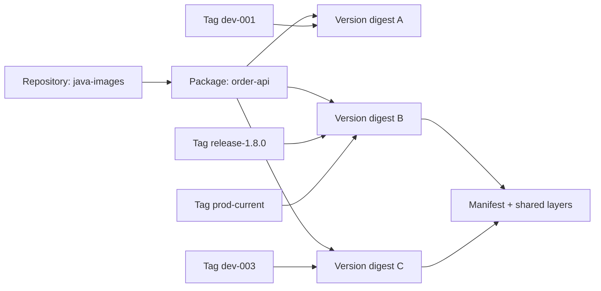
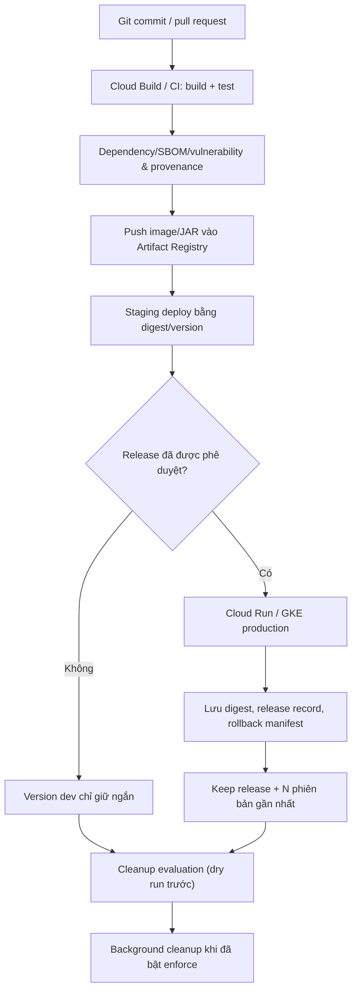
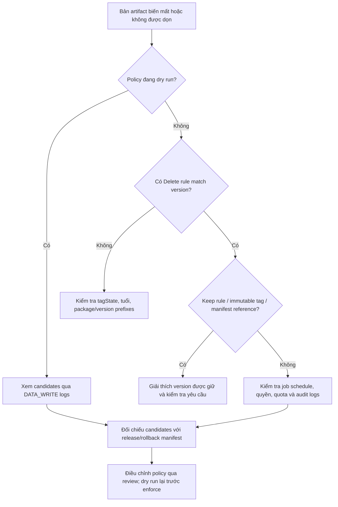

# Cleanup policies và vòng đời artifact

## 1. Bài toán: giữ bản phát hành cần thiết, dọn bản build không còn dùng

Một nhóm phát triển **Spring Boot** có pipeline **Cloud Build → Artifact Registry → Cloud Run/GKE**. Mỗi commit tạo một container image mới; mỗi bản release có thể được gắn thêm tag như `release-1.8.0`, `prod-2026-11` hoặc `commit-a1b2c3`. Đồng thời, nhóm xuất bản các thư viện Java nội bộ dạng **Maven packages** để nhiều dự án dùng chung.

Sau vài tháng, repository chứa hàng nghìn artifact versions:

- Bản build thử nghiệm và bản pull request không còn được triển khai.
- Bản đã đưa vào production cần **giữ để khởi động thêm replica, khôi phục hoặc rollback**.
- Một vài release cũ vẫn cần cho kiểm toán/sự cố.
- Một số phiên bản không còn tag nhưng vẫn chiếm dung lượng.
- Các package Java có quan hệ phụ thuộc: xóa JAR cũ có thể khiến một ứng dụng legacy không build được nữa.

Xóa thủ công từng version vừa tốn công vừa dễ nhầm. **Artifact Registry cleanup policies** tự đánh giá tiêu chí **delete** và **keep** trên các versions được lưu trong repository, giúp giảm chi phí nhưng vẫn bảo vệ những artifacts quan trọng.

Trong chương **Container và Artifact Registry** của mô-đun **CLOUD_PROVIDERS_GCP**, bài này đi sâu vào **vòng đời artifact**: tạo → gắn định danh → kiểm tra → phát hành → triển khai → giữ/luân chuyển → dọn, kết hợp các yêu cầu IAM, độ tin cậy, triển khai Java, chi phí và kiểm toán. Trọng tâm không chỉ là một file JSON, mà là **quy trình triển khai cleanup có thể giải thích và kiểm chứng trước khi thật sự xóa dữ liệu**.

### Mục tiêu học tập

Sau bài học, bạn có thể:

1. Phân biệt **repository**, **package/image**, **version/digest**, **tag**, **manifest/layer** và **repository attachment**.
2. Thiết kế vòng đời artifact riêng cho **dev**, **staging**, **production**, **rollback** và **Maven releases/snapshots**.
3. Viết cleanup policies với các action **Delete**, **Keep có điều kiện** và **Keep most recent versions**.
4. Giải thích quy tắc **Keep thắng Delete**, các điều kiện match và lưu ý về **immutable tags**.
5. Sử dụng `gcloud artifacts repositories set-cleanup-policies --dry-run` và **Cloud Audit Logs** để kiểm tra ứng viên xóa mà không xóa thật.
6. Dùng **Terraform/IaC**, IAM, kiểm toán và cost monitoring để áp dụng chính sách có phê duyệt.
7. Chẩn đoán vì sao một version **không được xóa** hoặc **bị xóa ngoài mong đợi**, đồng thời bảo vệ khả năng rollback của Java workloads.

> **Nguyên tắc an toàn:** Cleanup policy khi chuyển khỏi **dry run** có thể **xóa không thể khôi phục** các versions phù hợp. Không áp dụng policy thử nghiệm lên repository production, không bật xóa thật để “xem điều gì xảy ra”, và không cho rằng tag `prod` tự bảo vệ version nếu không có **Keep policy** tương ứng.

## 2. Mô hình dữ liệu trong Artifact Registry

### 2.1. Repository, package, version, tag

**Artifact Registry** là kho quản lý artifacts cho nhiều định dạng như Docker/OCI images, Maven, npm, Python, Go, Apt, Yum và những định dạng được hỗ trợ khác. Mỗi repository có **location**, **format**, **mode** và chính sách truy cập riêng.

Một container image thường có dạng:

```text
us-central1-docker.pkg.dev/PROJECT_ID/java-images/order-api:release-1.8.0
|--------- host ---------| | project | |  repo   | package |   tag     |

us-central1-docker.pkg.dev/PROJECT_ID/java-images/order-api@sha256:DIGEST
                                                              ^ digest/version
```

- **Repository** `java-images`: vùng lưu artifacts thuộc một định dạng và location.
- **Package/image** `order-api`: tên phần mềm/ảnh container trong repository.
- **Version**: một artifact cụ thể; với Docker image thường được xác định bằng **digest** `sha256:...`.
- **Tag**: tên thân thiện trỏ tới một version, chẳng hạn `dev-42`, `release-1.8.0` hoặc `prod-2026-11`.
- **Manifest**: mô tả thành phần image; multi-platform image có thể dùng một **parent/index manifest** tham chiếu các platform manifests.
- **Layer/blobs**: nội dung được lưu/tái sử dụng giữa các images; việc xóa version **không đồng nghĩa** mọi layer lập tức biến mất.



**Điểm mấu chốt:** cleanup xóa **artifact versions**, không đơn giản chỉ xóa dòng text của tag. Một version có thể có **nhiều tags**. Xóa một tag không nhất thiết xóa version hoặc giải phóng dung lượng. Ngược lại, xóa version có thể làm mất **mọi tag** còn trỏ tới version đó.

### 2.2. Mutable và immutable tags

Trong repository Docker **mutable tags** (thường là mặc định), cùng tag `latest` hoặc `prod-current` có thể được chuyển sang digest mới. Khi chuyển, digest cũ có thể mất tag và trở thành **untagged**, dù trước đây từng là bản production.

Nếu bật **immutable tags**, một tag đã gắn vào digest sẽ không được chuyển sang digest khác theo cách thông thường. Theo quy tắc cleanup hiện hành, **Docker version có tag trong repository bật immutable tags sẽ không bị cleanup policy xóa**. Vì vậy cần kiểm tra cấu hình này trước khi dự báo hiệu quả dọn kho.

Immutable tags giúp chống thay đổi định danh phát hành bất ngờ nhưng không phải **backup, retention lock pháp lý hay xác thực nguồn gốc build**. Với triển khai production, nên **pin bằng digest** và lưu bằng chứng build/provenance độc lập thay vì chỉ tin `latest`.

### 2.3. Repository modes và phạm vi policy

| Mode | Chức năng | Cần nhớ khi thiết kế cleanup |
| --- | --- | --- |
| **Standard** | Nhóm tự push/publish artifacts rồi các runtime kéo về | **Mô hình của toàn bộ lab**; cleanup cho artifacts do nhóm sở hữu |
| **Remote** | Cache artifacts từ upstream như Docker Hub/Maven Central | Xử lý cache, tuổi artifacts và khả năng tải lại khác standard; cần xác nhận hỗ trợ theo tài liệu/version |
| **Virtual** | Một endpoint tổng hợp nhiều upstream repositories | Không lưu/cleanup versions theo cách của một standard repository |

Tài liệu tổng quan hiện liệt kê cleanup cho **standard và remote repositories**, trong khi một số hướng dẫn thao tác **set policies** mô tả phạm vi **standard**. Vì tính khả dụng có thể khác mode/CLI và thay đổi theo release, hãy **xác nhận trực tiếp trên repository/định dạng được chọn**; tuyệt đối không thử policy xóa trên remote production chỉ vì ví dụ standard hoạt động.

## 3. Vòng đời artifact trong quy trình phát triển Java

### 3.1. Từ mã nguồn đến production và rollback



Một chính sách vận hành có thể tách ba nhóm:

| Môi trường | Định danh ví dụ | Chiến lược giữ minh họa |
| --- | --- | --- |
| CI/pull request | `pr-1234`, `commit-abc123` | Xóa sau 7–30 ngày nếu không cần tái lập |
| Staging/QA | `rc-1.8.0`, `staging-202611` | Giữ số release candidates/phiên bản có giới hạn |
| Production | `release-1.8.0` hoặc digest đã phát hành | Keep theo tag/quy trình release, luôn giữ các digest đang chạy và rollback |
| Release phục vụ kiểm toán | `retained-2026` hoặc catalog độc lập | Xác định thời hạn lưu trữ/bằng chứng với đơn vị compliance |
| Java Maven release | `com.example:payment-sdk:1.8.0` | Thường giữ lâu hơn snapshots; không lấy Docker tag-prefix làm tiêu chí |
| Maven snapshot | `1.9.0-SNAPSHOT`, build versions | Thời hạn ngắn hơn khi không còn consumer phụ thuộc |

Các mốc **7/30/90 ngày** chỉ là ví dụ; chọn theo lịch release, SLO khôi phục, ràng buộc pháp lý, dữ liệu thực tế và ngân sách. Không đưa artifacts có giá trị dài hạn vào một repository chung rồi dựa vào một policy “delete all older than 30d”.

### 3.2. Build once, deploy by digest

CI tạo một image và ghi lại **digest**, ví dụ:

```text
us-central1-docker.pkg.dev/PROJECT_ID/java-images/order-api@sha256:0123...abcd
```

Promotion từ staging lên production nên tham chiếu cùng một digest sau khi đã kiểm tra, thay vì build lại source cùng commit và **giả định bytes giống nhau**. Tag thân thiện hỗ trợ tra cứu nhưng có thể thay đổi nếu repository mutable. Release record cần lưu:

- Git commit, CI build ID, source revision và builder identity;
- image digest/version, tên repository và location;
- kết quả test, scan, SBOM/provenance hoặc chữ ký theo chính sách;
- Cloud Run revision/GKE workload deployment đang dùng digest nào;
- danh sách digests rollback tối thiểu và thời hạn bảo vệ;
- owner duyệt release và thời điểm được phép cleanup.

**Một digest đang chạy không tự được cleanup policy nhận biết và bảo vệ.** Hãy thiết kế Keep policy cùng với release inventory; không dựa vào việc “vẫn có Cloud Run revision” để cho rằng artifact chắc chắn không thể bị xóa.

## 4. Cleanup policies: Delete và Keep được kết hợp thế nào?

### 4.1. Delete policy

**Delete policy** định nghĩa điều kiện để xóa một version: ví dụ **untagged và cũ hơn 30 ngày**, hoặc mọi version của package có tiền tố `ci-` cũ hơn 14 ngày. Delete policy phải có **tên riêng, action Delete và ít nhất một điều kiện**.

**Không có delete policy thì Keep policy không tự xóa gì.** Đây là lỗi tư duy thường gặp khi cấu hình “keep 10 versions” rồi kỳ vọng các versions còn lại tự biến mất.

### 4.2. Conditional Keep

**Keep có điều kiện** xác định những versions không được cleanup tự động xóa khi chúng đồng thời match một delete policy. Ví dụ bảo vệ các Docker images có tag bắt đầu bằng `release-` hoặc `prod-`; hoặc bảo vệ một package family theo prefix.

**Keep thắng Delete**: nếu version match cả hai, Artifact Registry giữ version đó, dù delete policy có thời gian giữ ngắn hơn.

### 4.3. Keep most recent versions

**Keep most recent versions** giữ **N versions gần nhất cho từng package** trong phạm vi áp dụng, không phải N versions tổng cộng của cả repository. Một Keep policy loại này chứa trường `mostRecentVersions.keepCount`, **không trộn `condition` với `mostRecentVersions` trong cùng policy**.

Nếu thêm `packageNamePrefixes`, rule **chỉ bảo vệ các packages có tên khớp prefix đó**. Omit prefix nếu muốn bảo vệ N versions cho mọi package trong repository.

### 4.4. Xung đột policy và giới hạn

| Trường hợp | Kết quả |
| --- | --- |
| Version chỉ match Delete | Là ứng viên xóa, trừ khi có giới hạn sản phẩm/bảo vệ khác |
| Version chỉ match Keep | Được giữ, nhưng Keep không tự xóa version khác |
| Version match cả Delete và Keep | **Được giữ** |
| Version match nhiều Delete | Rule xóa có **retention ngắn hơn** có thể quyết định |
| Version không match policy nào | **Được giữ** |
| Docker version được parent manifest tham chiếu | Không được xóa riêng theo cleanup cho đến khi các điều kiện/parent cho phép |
| Docker version có tag trong immutable-tags repository | Cleanup policy không xóa version được gắn tag |

Theo giới hạn công bố hiện hành, tối đa **10 cleanup policies/repository** và **600.000 lần xóa/repository/ngày**, đồng thời phụ thuộc quota xóa ở cấp project. Hệ thống chạy **background job định kỳ**; việc cấu hình hoặc đổi policy **không bắt đầu một thao tác xóa tức thì**. Thay đổi thường có hiệu lực **trong khoảng một ngày**, không phải cron đúng giờ do người dùng chọn.

### 4.5. Không phải thuật toán có thể đoán bằng thứ tự văn bản JSON

Không thiết kế chính sách dựa trên giả định “rule viết ở hàng trên luôn thắng hàng dưới”. Quy tắc quan trọng là **Keep có ưu tiên bảo vệ** khi trùng Delete và các điều kiện match của từng policy. Đọc danh sách policy đang hiệu lực và các ứng viên đã được kiểm tra trong dry-run logs.

## 5. Các điều kiện match quan trọng

| Trường JSON | Ví dụ | Ý nghĩa/cạm bẫy |
| --- | --- | --- |
| `tagState` | `tagged`, `untagged`, `any` | Chọn trạng thái gắn tag; format không hỗ trợ tag thường được coi là untagged |
| `tagPrefixes` | `["dev-", "pr-"]` | Chỉ dùng cùng `tagState: "tagged"`; không phải pattern regex |
| `versionNamePrefixes` | `["v1", "v2"]` | So tiền tố **version name**, không giống Docker tag |
| `packageNamePrefixes` | `["order-api"]` | Chỉ match package có tên bắt đầu với chuỗi đó; cần đối chiếu names thực tế |
| `olderThan` | `"30d"` | Chỉ match artifact **cũ hơn** thời lượng tính theo create time/version |
| `newerThan` | `"7d"` | Chỉ match artifact **trẻ hơn** thời lượng; có thể kết hợp tạo một khoảng |
| `mostRecentVersions.keepCount` | `5` | Giữ 5 versions gần nhất của **mỗi package** thuộc phạm vi |

Theo tài liệu, thời lượng dùng đơn vị `s`, `m`, `h` hoặc `d`. **Không suy tuổi artifact từ tên tag**, như `release-2023`; engine đối chiếu metadata thời gian artifact hiện tại của repository.

### 5.1. Vì sao cần cẩn trọng với tag

Một digest có **hai tags** `dev-old` và `prod-1.8`. Nếu delete policy match tag prefix `dev-` nhưng Keep bảo vệ `prod-`, **Keep thắng** và version được giữ. Nếu sau đó bạn chuyển `prod-1.8` sang digest khác trên mutable repository, digest cũ **không còn tag bảo vệ** và có thể bị xóa khi đủ điều kiện.

Trong repo immutable-tags, tag không thể tùy ý chuyển và version có tag không bị cleanup policy xóa, nhưng sẽ cần **quy trình quản trị riêng** để xử lý tags không còn cần thiết.

### 5.2. Maven và formats không có tag

Maven JAR được xác định qua **groupId:artifactId:version**; việc dọn snapshots/releases không tự áp dụng cú pháp Docker tag. Đối với formats không hỗ trợ tag theo mô hình Artifact Registry cleanup, artifact thường được coi là **untagged**. Hãy dùng **packageNamePrefixes**, **versionNamePrefixes**, tuổi và **Keep most recent**, sau khi đối chiếu tên package/version trong repository thực tế.

Với Java, nên phân repo **Maven snapshots** và **Maven releases**, áp dụng thời hạn phù hợp. Xóa một version JAR đã xuất bản có thể làm **Gradle/Maven build** hoặc môi trường khôi phục không còn lấy lại được dependency. Repo remote chỉ cache upstream còn repo standard giữ bản do bạn phát hành; chính sách dọn của hai kiểu có hệ quả khác nhau.

## 6. Ví dụ chính sách JSON cho container Java API

Giả sử repository **standard Docker** tên `java-images` có package `order-api`. Chúng ta muốn:

1. Xóa các versions `order-api` **cũ hơn 30 ngày** nếu chúng không được bảo vệ.
2. Luôn giữ versions còn mang tag bắt đầu bằng `release-` hoặc `prod-`.
3. Giữ thêm **5 versions mới nhất** của mỗi package có tên bắt đầu `order-api` để hỗ trợ rollback gần đây.

File `cleanup-policy.json`:

```json
[
  {
    "name": "delete-old-order-api",
    "action": { "type": "Delete" },
    "condition": {
      "tagState": "any",
      "packageNamePrefixes": ["order-api"],
      "olderThan": "30d"
    }
  },
  {
    "name": "keep-released-order-api",
    "action": { "type": "Keep" },
    "condition": {
      "tagState": "tagged",
      "tagPrefixes": ["release-", "prod-"],
      "packageNamePrefixes": ["order-api"]
    }
  },
  {
    "name": "keep-last-five-order-api",
    "action": { "type": "Keep" },
    "mostRecentVersions": {
      "packageNamePrefixes": ["order-api"],
      "keepCount": 5
    }
  }
]
```

**Đây là chính sách minh họa**, không phải cấu hình compliance mặc định. Nó có thể xóa `staging` hoặc `dev` versions sau 30 ngày, kể cả khi có tag không thuộc prefix được giữ. Nếu một image đang phục vụ production nhưng **không được gắn tag bảo vệ** và không thuộc 5 phiên bản mới nhất, vẫn có rủi ro bị xóa.

### 6.1. Phân tích các versions giả định

Giả định danh sách tuổi/nhãn bên dưới thuộc cùng package, repo có **mutable tags**, và engine đã chạy sau khi ghi policy:

| Version | Tuổi | Tags | Có thể bị xóa? | Vì sao |
| --- | --- | --- | --- | --- |
| A | 50 ngày | `dev-21` | **Có**, nếu không nằm top 5 | Match Delete, không match conditional Keep |
| B | 70 ngày | `release-1.6.0` | **Không** | Conditional Keep bảo vệ release |
| C | 40 ngày | Không có tag | **Có**, nếu ngoài top 5 | Match Delete theo tuổi |
| D | 31 ngày | `prod-2026`, `dev-99` | **Không** | Prod Keep thắng Delete |
| E | 3 ngày | `dev-101` | **Không** | Chưa qua mốc 30 ngày |
| F | 100 ngày | Không có tag | **Không** nếu thuộc top 5 | Keep most recent thắng Delete |

Điều kiện top 5 được tính trong **toàn bộ dữ liệu version thực tế**, nên bảng minh họa không thể tự quyết định thứ hạng khi chỉ hiển thị vài phiên bản. Khi làm audit, phải xuất inventory đủ các versions và đối chiếu timestamp.

### 6.2. Nếu chỉ muốn dọn untagged images

Thay điều kiện Delete bằng:

```json
{
  "name": "delete-untagged-old",
  "action": { "type": "Delete" },
  "condition": {
    "tagState": "untagged",
    "olderThan": "30d"
  }
}
```

Phương án này **không dọn các versions vẫn có tags**, kể cả tags dev đã rất cũ. Với repository có immutable tags, chỉ dọn untagged là lựa chọn giảm rủi ro hơn, nhưng có thể tiết kiệm ít dung lượng. Muốn bảo vệ bản release, hãy có **release inventory** độc lập và không xóa thủ công theo cảm tính.

## 7. Lab an toàn: tạo repo Docker và kiểm tra dry run

**Điều kiện:** một Google Cloud project thử nghiệm đã bật Billing, có quyền trên Artifact Registry và máy có `gcloud`/Docker hoặc Cloud Shell hỗ trợ Docker. Chỉ dùng repo lab **mới**, không dùng tên repository production. Thay `PROJECT_ID`, `LOCATION=us-central1` và `REPOSITORY=java-images-lab` theo môi trường.

### Bước 1 — Bật API, tạo standard Docker repository

```bash
gcloud config set project PROJECT_ID
gcloud services enable artifactregistry.googleapis.com

gcloud artifacts repositories create java-images-lab \
  --project=PROJECT_ID \
  --repository-format=docker \
  --location=us-central1 \
  --description="Disposable Java image cleanup lab"

gcloud artifacts repositories describe java-images-lab \
  --project=PROJECT_ID \
  --location=us-central1
```

Kiểm tra `format=DOCKER`, `mode=STANDARD_REPOSITORY`, location và cấu hình `dockerConfig.immutableTags`. Repository mới có thể **phát sinh chi phí lưu trữ** khi đẩy image, dù cleanup chưa bật. Nếu đã có repository với cùng tên, **không ghi đè hoặc dùng lại** nếu chưa xác định ai sở hữu.

### Bước 2 — Tạo ứng dụng Java nhỏ để có image riêng

Trong thư mục làm việc lab, tạo file `HealthMain.java`:

```java
import com.sun.net.httpserver.HttpExchange;
import com.sun.net.httpserver.HttpServer;
import java.io.IOException;
import java.io.OutputStream;
import java.net.InetSocketAddress;
import java.nio.charset.StandardCharsets;

public class HealthMain {
    private static void respond(HttpExchange exchange, String body)
            throws IOException {
        byte[] bytes = body.getBytes(StandardCharsets.UTF_8);
        exchange.getResponseHeaders().add(
            "Content-Type", "text/plain; charset=utf-8");
        exchange.sendResponseHeaders(200, bytes.length);
        try (OutputStream out = exchange.getResponseBody()) {
            out.write(bytes);
        }
    }

    public static void main(String[] args) throws IOException {
        HttpServer server = HttpServer.create(
            new InetSocketAddress("0.0.0.0", 8080), 0);
        server.createContext("/healthz", exchange ->
            respond(exchange, "ok\n"));
        server.createContext("/", exchange ->
            respond(exchange, "Java Artifact Registry lab\n"));
        server.start();
    }
}
```

File `Dockerfile` dùng multi-stage build với Java 21:

```dockerfile
FROM eclipse-temurin:21-jdk AS build
WORKDIR /src
COPY HealthMain.java .
RUN javac --add-modules jdk.httpserver HealthMain.java

FROM eclipse-temurin:21-jre
WORKDIR /app
ARG BUILD_ID=lab
LABEL org.opencontainers.image.revision=$BUILD_ID
COPY --from=build /src/HealthMain.class .
EXPOSE 8080
USER 10001
ENTRYPOINT ["java", "--add-modules", "jdk.httpserver", "HealthMain"]
```

Trong production, nên cố định **base image bằng digest**, quét lỗ hổng và có provenance/SBOM trước khi phát hành. `BUILD_ID` chỉ dùng tạo nội dung label khác nhau để minh họa các versions; **không phải phương án bảo mật hay bảo đảm build tái lập**.

### Bước 3 — Push một vài image tags

```bash
gcloud auth configure-docker us-central1-docker.pkg.dev

# Build/push hai image có label khác nhau, tạo hai digests:
docker build --build-arg BUILD_ID=dev-001 \
  -t us-central1-docker.pkg.dev/PROJECT_ID/java-images-lab/order-api:dev-001 .
docker push us-central1-docker.pkg.dev/PROJECT_ID/java-images-lab/order-api:dev-001

docker build --build-arg BUILD_ID=dev-002 \
  -t us-central1-docker.pkg.dev/PROJECT_ID/java-images-lab/order-api:dev-002 .
docker push us-central1-docker.pkg.dev/PROJECT_ID/java-images-lab/order-api:dev-002

gcloud artifacts docker images list \
  us-central1-docker.pkg.dev/PROJECT_ID/java-images-lab/order-api \
  --include-tags
```

Ghi lại các digests và thời điểm tạo. **Không giả định một ngày đã trôi qua** chỉ vì bạn push hai images; với Delete policy `olderThan=30d`, các versions mới tạo **chưa** đủ điều kiện bị xóa. Nếu muốn thử các kịch bản tuổi 30–90 ngày, dùng **bảng mô phỏng** ở mục 6 hoặc một repo lab đã có dữ liệu cũ được cho phép, **không hạ mốc xuống vài giây rồi chuyển enforce**.

### Bước 4 — Tạo file JSON và gắn policy ở dry run

Lưu JSON của mục 6 thành `cleanup-policy.json` trong **máy lab**. Vì file ở mục 6 dùng `packageNamePrefixes=["order-api"]`, nó phù hợp với image vừa push.

```bash
# LỆNH AN TOÀN: cấu hình policy nhưng KHÔNG xóa artifacts.
gcloud artifacts repositories set-cleanup-policies java-images-lab \
  --project=PROJECT_ID \
  --location=us-central1 \
  --policy=cleanup-policy.json \
  --dry-run

gcloud artifacts repositories list-cleanup-policies java-images-lab \
  --project=PROJECT_ID \
  --location=us-central1

gcloud artifacts repositories describe java-images-lab \
  --project=PROJECT_ID \
  --location=us-central1
```

**`--dry-run` là chế độ của repository**, không phải “một lệnh mô phỏng đồng bộ ngay lập tức”. Background job sẽ đánh giá các versions vào chu kỳ của dịch vụ. Lệnh `set-cleanup-policies` hoàn thành chỉ chứng minh **cấu hình được lưu**, chưa chứng minh policy đã chạy hoặc sẽ xóa đúng danh sách bạn mong muốn.

### Bước 5 — Bật Data Access DATA_WRITE logs và đọc kết quả

Để xem dry-run delete candidates, bật **Data Access audit logs loại `DATA_WRITE` cho Artifact Registry** trong IAM & Admin → Audit Logs theo quyền và chính sách tổ chức. **Data Access logs có thể tính phí Cloud Logging**; cân nhắc retention và phạm vi project.

Theo tài liệu Artifact Registry hiện hành, Cloud Logging ghi phương thức `BatchDeleteVersions` với `protoPayload.request.validateOnly=true` khi cleanup chỉ mô phỏng. Sau **ít nhất một ngày** (vì job chạy định kỳ), truy vấn:

```bash
gcloud logging read \
  'protoPayload.serviceName="artifactregistry.googleapis.com" AND protoPayload.methodName="google.devtools.artifactregistry.v1.ArtifactRegistry.BatchDeleteVersions" AND protoPayload.request.validateOnly=true' \
  --project=PROJECT_ID \
  --freshness=7d \
  --limit=100
```

Với nhiều repositories trong cùng project, thêm **lọc đường parent repository** để không nhầm candidates của repo khác:

```text
protoPayload.request.parent="projects/PROJECT_ID/locations/us-central1/repositories/java-images-lab/packages/-"
```

Kiểm tra **danh sách versions** trong `protoPayload.request.names`, trạng thái `validateOnly`, thời gian và những digests đang triển khai. **Không có bản ghi dry run** có thể do chưa đến chu kỳ, chưa bật log, policy không match version nào hoặc bị giới hạn/quyền; không suy ngay là “không có rủi ro xóa”.

### Bước 6 — Bật xóa thật: chỉ sau phê duyệt

Lệnh sau **được ghi để nhận biết**, **không phải bước bắt buộc trong lab**:

```text
# KHÔNG CHẠY NẾU CHƯA ĐƯỢC PHÊ DUYỆT XOÁ THẬT:
gcloud artifacts repositories set-cleanup-policies java-images-lab \
  --project=PROJECT_ID \
  --location=us-central1 \
  --policy=cleanup-policy.json \
  --no-dry-run
```

`--no-dry-run` kích hoạt xóa cho các versions match khi background job chạy. **Không có rollback để khôi phục version đã bị xóa**; chuyển về `--dry-run` sau đó chỉ ngăn các lần xóa tương lai, không khôi phục dữ liệu đã mất.

### Bước 7 — Dọn tài nguyên lab sau khi xác nhận

Vì lab chỉ chạy **dry run**, bạn có thể dọn repository dùng riêng cho lab theo quy trình có review. Lệnh sau **xóa toàn bộ artifacts trong repository**: chỉ sử dụng nếu bạn đã kiểm tra repository này không chứa tài nguyên của ai khác.

```text
# Chỉ thực thi khi đã xác nhận đây là repository LAB dùng riêng:
gcloud artifacts repositories delete java-images-lab \
  --project=PROJECT_ID \
  --location=us-central1
```

Không xóa repository production để “dọn nhanh” storage; hãy áp dụng policy đúng, kiểm toán versions, cân nhắc dependency/rollback và cấu trúc repository. Nếu đã tạo Cloud Build triggers, Cloud Run revisions hoặc IAM binding riêng cho lab, kiểm tra chúng trước khi dọn.

## 8. Khi áp dụng vào Maven repository của Java

Docker image thường được triển khai bằng digest; **Maven package** thường được tham chiếu bằng tọa độ `groupId:artifactId:version` trong file `pom.xml` hoặc `build.gradle`. Một pipeline Java có thể vừa xuất bản:

```xml
<dependency>
  <groupId>com.example.platform</groupId>
  <artifactId>payment-client</artifactId>
  <version>1.8.0</version>
</dependency>
```

vừa build image Spring Boot tiêu thụ JAR đó. Nếu cleanup xóa bản JAR `1.8.0` nhưng build reproducibility hoặc một service legacy còn phụ thuộc vào nó, lần build/khôi phục sau có thể thất bại dù bản đang chạy chưa lỗi.

### 8.1. Tách snapshots và releases

| Repository Java | Đặc điểm | Chính sách minh họa |
| --- | --- | --- |
| `java-maven-snapshots` | Build thử nghiệm, nhiều versions, cập nhật thường xuyên | Xóa versions cũ theo tuổi; giữ 10 versions gần nhất/package |
| `java-maven-releases` | Thư viện đã phát hành, được nhiều ứng dụng tham chiếu | Giữ theo policy phát hành/phụ thuộc; cân nhắc **không đặt delete policy** nếu chưa có inventory |
| `java-maven-external-cache` | Dependencies lấy từ upstream (nếu là remote) | Kiểm tra behavior của remote cache; không xóa bản duy nhất phục vụ build offline |

Artifact Registry có cấu hình **Maven version policy** khi tạo repository (RELEASE, SNAPSHOT hoặc không giới hạn theo lựa chọn). Version policy về **nhận artifacts** khác cleanup policy về **xóa versions đang lưu**.

### 8.2. Ví dụ policy snapshot riêng

Chỉ minh họa cho **standard Maven snapshot repository**; kiểm tra names qua `gcloud artifacts packages list` trước khi chọn prefix. Vì Maven không có Docker tags, không dùng `tagPrefixes:["prod-"]`:

```json
[
  {
    "name": "delete-snapshots-older-45d",
    "action": {"type": "Delete"},
    "condition": {
      "tagState": "untagged",
      "olderThan": "45d"
    }
  },
  {
    "name": "keep-ten-snapshot-versions",
    "action": {"type": "Keep"},
    "mostRecentVersions": {
      "keepCount": 10
    }
  }
]
```

Chính sách giữ `10` là theo **mỗi package**, không đảm bảo version được thư viện khác tham chiếu sẽ còn mãi. Khi có dependency quan trọng, hãy bổ sung **software bill of materials (SBOM), dependency lockfiles hoặc release manifest** để biết chính xác version nào phải được giữ.

## 9. Terraform và Infrastructure as Code

Không nên để Console, `gcloud` và Terraform thay nhau chỉnh cùng một repository mà **không cập nhật state hoặc quy trình quản trị**. Với nhóm có nhiều project, hãy lưu cleanup policies như **code được review**, chạy trên **dev/staging trước** rồi mới áp dụng prod.

### 9.1. Terraform resource tham khảo

Ví dụ tạo **standard Docker repository mới** có policy **dry run** theo `google_artifact_registry_repository` của Google provider:

```hcl
variable "project_id" {
  type = string
}

provider "google" {
  project = var.project_id
}

resource "google_artifact_registry_repository" "java_images" {
  project       = var.project_id
  location      = "us-central1"
  repository_id = "java-images-lab"
  format        = "DOCKER"
  mode          = "STANDARD_REPOSITORY"
  description   = "Lab: cleanup policies kept in dry run"

  # An toàn: chỉ mô phỏng và ghi log; không xoá artifact.
  cleanup_policy_dry_run = true

  cleanup_policies {
    id     = "delete-old-order-api"
    action = "DELETE"
    condition {
      tag_state             = "any"
      package_name_prefixes = ["order-api"]
      older_than            = "30d"
    }
  }

  cleanup_policies {
    id     = "keep-released-order-api"
    action = "KEEP"
    condition {
      tag_state             = "tagged"
      tag_prefixes          = ["release-", "prod-"]
      package_name_prefixes = ["order-api"]
    }
  }

  cleanup_policies {
    id     = "keep-last-five-order-api"
    action = "KEEP"
    most_recent_versions {
      package_name_prefixes = ["order-api"]
      keep_count            = 5
    }
  }
}
```

Đây là **ví dụ độc lập** với repo tạo trong lab `gcloud`: **đừng tạo cùng một repository bằng cả hai công cụ**; nếu repo đã có, phải import/manage state trước. Kiểm tra schema/version provider Terraform đang dùng và review plan, nhất là thuộc tính `cleanup_policy_dry_run`; chuyển `true → false` là **thay đổi có thể gây xóa dữ liệu** ở chu kỳ cleanup kế tiếp.

### 9.2. Quy trình thay đổi an toàn

1. Xuất inventory các packages/versions/tags/digests và tạo release/rollback allowlist.
2. Review JSON/Terraform trong pull request, kèm **người chịu trách nhiệm dữ liệu** và owner của production deployment.
3. Apply **dry run** ở repository test hoặc clone có dữ liệu đại diện.
4. Đọc audit logs, đối chiếu từng candidate với release manifest và dependency inventory.
5. Chỉ khi kết quả được phê duyệt mới chuyển sang enforce theo **change window**; giữ bản policy cũ để rollback cấu hình.
6. Theo dõi xóa thật và lỗi pull/build trong những chu kỳ tiếp theo; rollback **policy** không phục hồi artifacts đã xóa.

Với automation, không tự bật `--no-dry-run` trong pipeline chỉ vì một pull request được merge; yêu cầu thêm bước phê duyệt cho hành động phá hủy.

## 10. IAM, security và kiểm soát supply chain

### 10.1. Ai được làm gì?

| Danh tính | Vai trò IAM gợi ý | Ranh giới |
| --- | --- | --- |
| Cloud Build/CI publisher | `roles/artifactregistry.writer` | Push images/packages, không tự cấp quyền quản trị repo |
| Cloud Run/GKE/Compute Engine runtime | `roles/artifactregistry.reader` | Pull artifact đúng repository (có thể cần cross-project grant) |
| Release administrator | `roles/artifactregistry.repoAdmin` hoặc quyền scoped tương đương | Quản lý versions/tags theo nhiệm vụ được phê duyệt |
| Cleanup policy operator | `roles/artifactregistry.admin` hoặc **custom role** chứa `artifactregistry.repositories.update` | Thay policy, phải qua review vì có thể xóa hàng loạt |
| Artifact Registry Service Agent | Service-managed identity của Artifact Registry | Cần quyền `artifactregistry.versions.delete` để cleanup có thể xóa |
| Auditor/FinOps | Quyền read/Cloud Logging/Billing phù hợp | Xem ứng viên, quy tắc và chi phí; không cần xóa |

Phân quyền theo **repository** nếu phù hợp, không dùng Project Owner cho pipeline. **Artifact Registry Service Agent** mặc định có các quyền cần thiết cho cleanup; nếu tổ chức chỉnh service agent role, cần đảm bảo quyền xóa versions khi bật enforce.

### 10.2. Cleanup không phải vulnerability scanning

**Artifact Analysis/container scanning** phát hiện lỗ hổng theo năng lực được bật; **Binary Authorization** có thể đặt điều kiện cho image được triển khai; attestation, SBOM và provenance giúp kiểm tra nguồn gốc build. **Cleanup policy chỉ quyết định giữ/xóa artifacts**, không chứng minh chúng an toàn.

Điều gì xảy ra nếu cleanup xóa một image vừa được scan “clean” nhưng sau đó cần điều tra? Phần scan/metadata/attachment liên quan có thể mất mối liên hệ cần thiết. Theo tài liệu hiện hành, **repository attachments không chịu cleanup policy riêng**, mà có thể bị xóa cùng image gốc. Với yêu cầu kiểm toán, hãy lưu evidence/provenance độc lập và xác nhận thời hạn giữ dài hơn thời gian điều tra.

### 10.3. Bảo vệ khả năng deploy và rollback

Trước khi bật Delete, tìm **tất cả deployments tham chiếu digest/version**:

- Cloud Run revisions đang phục vụ hoặc có thể được rollback.
- GKE Deployments, StatefulSets, Jobs/CronJobs và Helm releases.
- Compute Engine instance templates/MIG dùng container images.
- CI pipelines hoặc môi trường DR cần pull lại image để khởi động replica.
- Java build files đang phụ thuộc Maven artifacts.

Một runtime có thể **tiếp tục chạy** sau khi bản trong registry đã bị xóa vì đã tải bytes, nhưng **scale-out, rollout, restart hoặc rollback về một version cần pull lại** có thể thất bại. Không coi việc một instance đang healthy là bằng chứng có thể triển khai lại bản đó.

## 11. Quan sát: đọc dry-run/audit logs và inventory

### 11.1. Những log chính

Theo hướng dẫn Google Cloud:

- Thay cleanup policies được ghi nhận là **`UpdateRepository`** trong audit logs.
- Cleanup versions sử dụng **`BatchDeleteVersions`** trong Artifact Registry **Data Access logs** (cần bật `DATA_WRITE`).
- Với **dry run**, tham số `validateOnly=true` cho biết phiên bản **dự kiến** bị xóa, nhưng chưa bị xóa.
- Khi enforce, phải xem trạng thái job/log và kiểm tra inventory thay đổi thực tế.

Ví dụ filter Logs Explorer:

```text
protoPayload.serviceName="artifactregistry.googleapis.com"
protoPayload.methodName="google.devtools.artifactregistry.v1.ArtifactRegistry.BatchDeleteVersions"
protoPayload.request.validateOnly=true
```

Nên bổ sung project/location/repository filter, giới hạn quyền xem logs và loại trừ nội dung nhạy cảm. Lưu một **snapshot danh sách candidate versions** cho review/approval, không chỉ gửi ảnh chụp màn hình “dry run OK”.

### 11.2. Tại sao chưa thấy version biến mất?

Các nguyên nhân có thể gồm:

1. Repository vẫn đang **dry run**; không có dữ liệu nào bị xóa.
2. Background job **chưa đến chu kỳ** (thường có thể mất khoảng một ngày để thay đổi có hiệu lực).
3. Không có artifact nào **match Delete** vì tuổi, tagState hoặc package prefix.
4. Có **Keep policy** phù hợp hoặc version thuộc top N gần nhất.
5. Docker repo bật **immutable tags**, nên version còn tag không bị dọn.
6. Version có quan hệ parent/child manifest và chưa được cleanup theo trình tự phù hợp.
7. Service agent/permissions hoặc quota xóa không đáp ứng; xem logs và errors.

### 11.3. Tại sao version biến mất ngoài ý muốn?

- Delete rule quá rộng: `tagState:any` + `olderThan:7d` nhưng không Keep release.
- `packageNamePrefixes` trùng nhiều package hơn dự kiến.
- Prod tag đã **di chuyển** trên mutable repo, digest cũ mất nhãn bảo vệ.
- Keep-most-recent giới hạn N nhỏ hơn số versions cần rollback.
- CI thay đổi naming convention, tag release không còn khớp `tagPrefixes`.
- Một người **xóa thủ công** version, không phải cleanup policy; kiểm tra methodName/audit principal.
- Terraform/Console đã chuyển `cleanup_policy_dry_run=false` hoặc `--no-dry-run`.

Đừng chỉnh policy theo suy đoán. Truy nguồn: **ai đổi cấu hình, lúc nào, phiên bản nào match, có parent manifest không, có bản rollback khác không**.

## 12. Xóa tag, xóa version, xóa repository: ba thao tác khác nhau

### 12.1. Xóa một tag

```bash
# Chỉ dùng nếu tag này là tag LAB không còn cần:
gcloud artifacts docker tags delete \
  us-central1-docker.pkg.dev/PROJECT_ID/java-images-lab/order-api:dev-001
```

Tag bị gỡ khỏi version; **version vẫn có thể còn tồn tại**, thành untagged và đủ điều kiện cleanup lần sau. Đừng dùng tag deletion như cách chắc chắn giải phóng storage.

### 12.2. Xóa một version theo digest

```text
# Thao tác phá hủy; không chạy khi chưa xác minh digest và rollback:
gcloud artifacts docker images delete \
  us-central1-docker.pkg.dev/PROJECT_ID/java-images-lab/order-api@sha256:YOUR_DIGEST
```

Nếu version có tags, lệnh xóa theo digest có thể bị từ chối; thêm `--delete-tags` sẽ **xóa version và các tags** liên quan. Đây là thao tác nguy hiểm hơn xóa một tag. Việc xóa image **không thể undo** trong Artifact Registry; layers chưa có reference được dọn sau đó theo job nội bộ, nên phí storage có thể không giảm ngay lập tức.

### 12.3. Xóa repository

Xóa repository làm mất **tất cả packages/versions/tags** bên trong, không chỉ những bản cũ. Vì vậy chỉ dùng với repository lab cô lập, sau khi đã xác nhận không có consumer hoặc hệ thống khác phụ thuộc. Để giảm chi phí ở repository production, ưu tiên **policy có review và dry-run**, không xóa cả repository.

## 13. Chi phí, giới hạn và mô hình dự toán

Vòng đời artifact liên quan đến:

- **Storage** GB-month hoặc GiB-month theo đơn giá/location và cơ chế lưu thực tế.
- **Network egress/data transfer** khi pull qua region, ra Internet hoặc qua cấu hình mạng có phí.
- **Cloud Build** thời gian build, **Cloud Run/GKE** thời gian chạy, Cloud Logging và monitoring.
- **Artifact Analysis vulnerability scanning** có thể tính phí riêng khi bật tính năng tương ứng.
- **Repository storage growth** và những blob/layers chia sẻ giữa các images.

**Không** lấy tổng kích thước tất cả Docker image hiển thị rồi mặc định đó là bytes storage tính phí: nhiều images có thể dùng **cùng layers**, và delete một version không xóa ngay shared blobs. Với Maven/JAR, mô hình thường đơn giản hơn nhưng vẫn cần đánh giá metadata/phụ thuộc.

### 13.1. Ví dụ ước tính dung lượng

Giả sử pipeline tạo **20 versions/ngày**, mỗi version thêm **80 MiB dữ liệu mới độc nhất** sau khi xét shared layers, và giữ 30 ngày:

```text
20 versions/ngày × 80 MiB/version × 30 ngày
= 48.000 MiB ≈ 46,9 GiB dung lượng mới tồn tại ở trạng thái ổn định.
```

Đây chỉ là **mô hình minh họa**, chưa xét các release Keep vô thời hạn, layers nền, multi-platform manifests, dữ liệu metadata hoặc artifacts từ packages khác. Với `keepCount=5`, một số versions sẽ được giữ lâu hơn mốc 30 ngày nếu thỏa Keep, làm dung lượng thật cao hơn mô hình.

### 13.2. Chỉ số nên theo dõi

| Chỉ số | Câu hỏi vận hành |
| --- | --- |
| Tổng bytes lưu theo repository/location | Chi phí tăng do repo nào? |
| Số packages/versions/tags và tuổi | Có bao nhiêu versions đã lỗi thời? |
| Tỷ lệ tagged/untagged | Có cơ hội dọn an toàn bằng untagged policy không? |
| Candidate count ở dry run | Policy sẽ tác động bao nhiêu versions? |
| Release/rollback digests còn được bảo vệ | Có sẵn nguồn để deploy lại không? |
| Build/pull failures | Có package bị xóa trong khi còn consumer không? |
| Delete quota/permissions errors | Job có bị giới hạn hoặc thất bại không? |
| Data Access logging cost | Log phục vụ audit có được kiểm soát retention không? |

Giá storage, network, quota và discount có thể thay đổi. Dùng [Artifact Registry pricing](https://cloud.google.com/artifact-registry/pricing), **Cloud Billing Reports** và dữ liệu thực tế; **budget alert không tự dừng cleanup hay billing**.

## 14. Xử lý sự cố theo triệu chứng

| Triệu chứng | Nguyên nhân thường gặp | Cách xác minh |
| --- | --- | --- |
| `PERMISSION_DENIED` khi set policy | Thiếu `artifactregistry.repositories.update` | IAM trên repo/project; operator role |
| Policy được lưu nhưng không có log | DATA_WRITE chưa bật, chưa chạy job, không có match | Repo dry-run status, Audit Logs, chờ chu kỳ |
| `validateOnly=true` nhưng người học tưởng artifact đã bị xóa | Chỉ là dry run | Xem image inventory trước/sau |
| `--no-dry-run` rồi vẫn thấy image cũ | Job chạy định kỳ, Keep policy, immutable tags, manifest refs | Chờ chu kỳ, kiểm tra policy và logs |
| Version có `prod` nhưng bị xóa | Tag đã di chuyển hoặc không khớp Keep prefix | Xem release manifest, tag history, audit |
| Keep 5 versions nhưng vẫn quá nhiều image | Keep không xóa version khác khi thiếu Delete | Kiểm tra đủ cả Keep và Delete |
| Maven package không match `tagPrefixes` | Maven không dùng Docker tag theo cách này | Dùng version/package prefix/age |
| Docker image không được xóa | Parent manifest đang tham chiếu platform child | Xem manifest tree và thứ tự cleanup |
| Policy không áp dụng | Repo mode/format không hỗ trợ thao tác như dự kiến | Mô tả repository và phiên bản CLI |
| CI/Cloud Run/GKE không thể pull sau cleanup | Image digest/version bị xóa hoặc IAM reader thiếu | Audit delete logs, deploy manifest, pull error |
| Bill chưa giảm khi xóa images | Shared layers còn được dùng, background blob GC, logging/storage | Theo dõi bytes và Billing sau thời gian xử lý |
| Terraform plan định bật enforce | `cleanup_policy_dry_run` bị chuyển `true → false` | Chặn plan, yêu cầu destructive change review |

### Runbook chẩn đoán



## 15. Bài tập và tiêu chí đánh giá

### Bài A — Phân tích kết quả policy

Repository `java-images` có 10 versions `order-api`. Hai versions tag `release-`, một version tag `prod-`, bảy versions là dev/untagged. Viết ba rules **Delete old**, **Keep prod/release**, **Keep latest N** và lập bảng phiên bản được giữ/xóa theo ngày tạo. Nêu vì sao một version có cả `dev-` lẫn `prod-` vẫn được giữ.

### Bài B — Thực hành dry run

Trên repository Docker lab dùng riêng, tạo vài images với các `BUILD_ID` khác nhau, lưu JSON policy mục 6 và chạy `set-cleanup-policies --dry-run`. Kiểm tra cấu hình repository, bật Artifact Registry DATA_WRITE logs nếu được phép, và **đọc kết quả khi background job đã chạy**. Báo cáo “chưa có candidates vì versions chưa đủ 30 ngày” là kết quả hợp lệ.

### Bài C — Thiết kế release retention cho Spring Boot

Một Cloud Run production revision dùng image digest D1, staging dùng D2, và D0 là rollback đã được phê duyệt. Hãy xác định cách **bảo vệ D0, D1, D2**, nơi lưu release manifest, tiêu chí cho phép loại một digest khỏi danh sách bảo vệ và điều kiện audit trước khi bật Delete.

### Bài D — Maven snapshot vs release

Đội Java xuất bản `payment-client:1.8.0` (release) và nhiều `1.9.0-SNAPSHOT`. Thiết kế policy riêng cho snapshot và release; mô tả cách tránh xóa dependency mà một ứng dụng legacy cần khi build lại sau sự cố. Giải thích vì sao Docker `tagPrefixes` không phải tín hiệu đúng cho Maven.

### Bài E — Cost & FinOps

Với 20 builds/ngày và 80 MiB dữ liệu mới mỗi build, tính dung lượng giữ 30 ngày; sau đó giả định 10 releases cần lưu vô thời hạn và base layers được chia sẻ. Giải thích tại sao tính tổng kích thước uncompressed của image không bằng hóa đơn storage, và cần theo dõi chỉ số nào trước/sau cleanup.

### Checklist trước khi bật xóa thật

- [ ] Tôi đã xác minh **repository, location, format, mode và owner**.
- [ ] Tôi phân biệt Docker **digest/version** với **tag**, hiểu mutable/immutable tags.
- [ ] Tôi có inventory **digests production, staging, rollback, Maven dependencies** cần giữ.
- [ ] Tôi hiểu Delete policy, Conditional Keep và Keep most recent, đặc biệt **Keep thắng Delete**.
- [ ] Tôi đã kiểm tra `tagState`, `tagPrefixes`, `packageNamePrefixes`, `versionNamePrefixes` và thời hạn.
- [ ] Tôi không nhầm `keepCount=5` là giữ 5 versions tổng cộng cho mọi packages.
- [ ] Tôi đã bật và chạy **dry run**, biết kết quả sẽ xuất hiện theo job định kỳ.
- [ ] Tôi đã kiểm tra **DATA_WRITE logs**, `validateOnly=true` và danh sách version candidates.
- [ ] Tôi đã phân quyền IAM, kiểm tra Artifact Registry Service Agent và change approvals.
- [ ] Tôi dùng Terraform/IaC có `cleanup_policy_dry_run=true` ở bước triển khai đầu.
- [ ] Tôi đã đánh giá rủi ro multi-platform manifest, immutable tags, Maven dependencies và attachments.
- [ ] Tôi đã dự toán storage/egress/logging/scanning, đặt budget alerts và kế hoạch theo dõi.
- [ ] Tôi có **rollback cho policy** và phương án lưu/đẩy lại artifacts; hiểu version đã xóa **không tự khôi phục**.

**Kết luận:** Cleanup policies giúp cân bằng giữa **quản trị dung lượng** và **khả năng tái triển khai phần mềm**, nhưng không thể chỉ đặt `olderThan=30d` rồi bỏ quên. Một quy trình bền vững cần có **release inventory theo digest, Keep rules rõ ràng, dry-run có audit evidence, phê duyệt trước khi bật xóa thật và theo dõi ảnh hưởng tới CI/CD Java, Cloud Run/GKE, rollback và chi phí**.

## 16. Tài liệu Google Cloud tham khảo

- [Artifact Registry — Cleanup policy overview](https://cloud.google.com/artifact-registry/docs/repositories/cleanup-policy-overview)
- [Configure cleanup policies — JSON, gcloud, dry run và audit logs](https://cloud.google.com/artifact-registry/docs/repositories/cleanup-policy)
- [Create standard Artifact Registry repositories](https://cloud.google.com/artifact-registry/docs/repositories/create-repos)
- [Manage Docker images, tags, digests and deletion](https://cloud.google.com/artifact-registry/docs/docker/manage-images)
- [Artifact Registry IAM roles and permissions](https://cloud.google.com/artifact-registry/docs/access-control)
- [Manage Maven packages](https://cloud.google.com/artifact-registry/docs/java)
- [Artifact Registry audit logging](https://cloud.google.com/artifact-registry/docs/audit-logging)
- [Artifact Registry cleanup policy CLI reference](https://cloud.google.com/sdk/gcloud/reference/artifacts/repositories/set-cleanup-policies)
- [Artifact Registry repository Terraform resource](https://registry.terraform.io/providers/hashicorp/google/latest/docs/resources/artifact_registry_repository)
- [Artifact Registry pricing](https://cloud.google.com/artifact-registry/pricing)
- [Artifact Analysis overview](https://cloud.google.com/artifact-analysis/docs)
