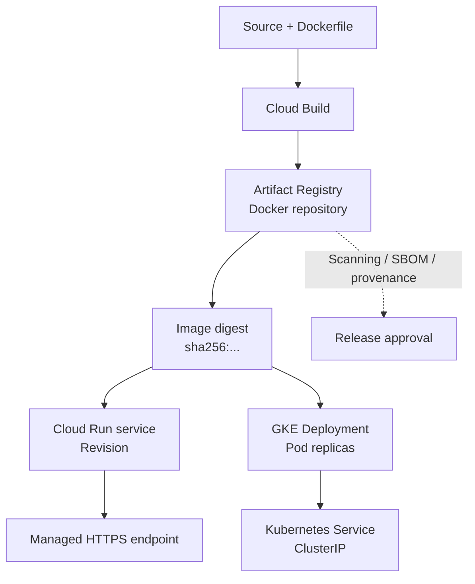
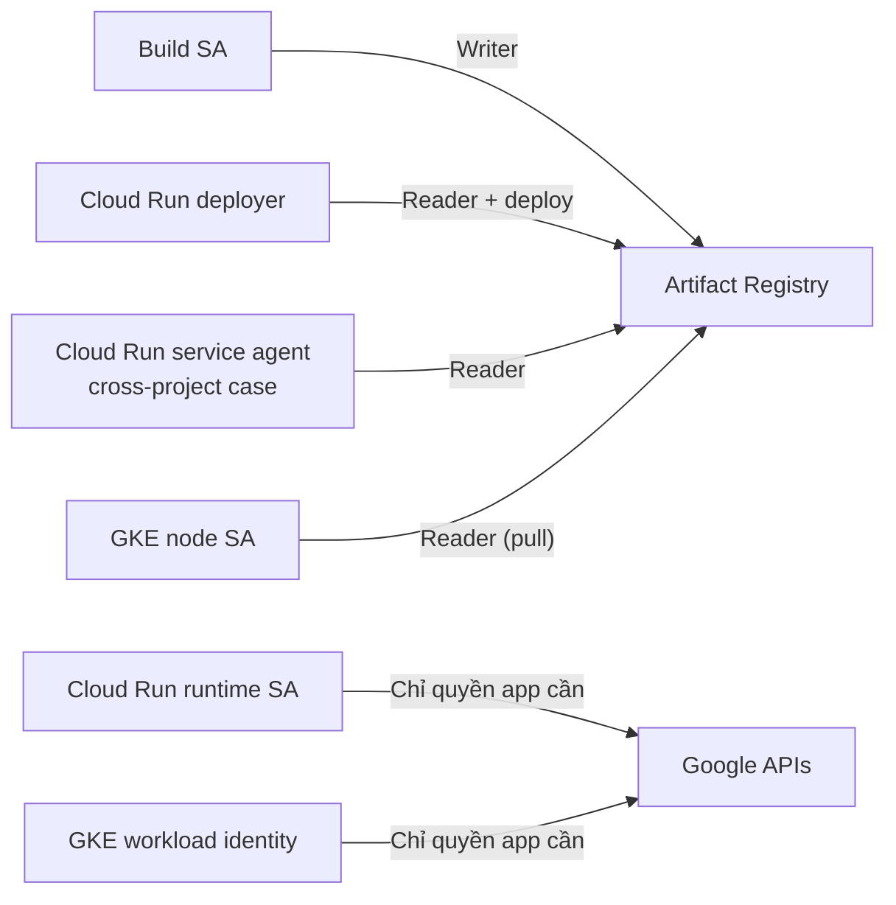
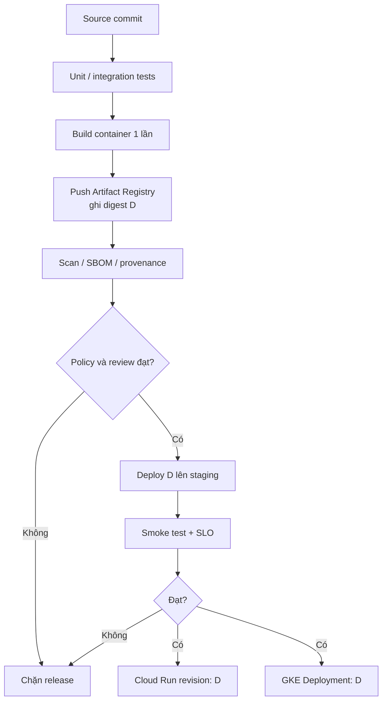
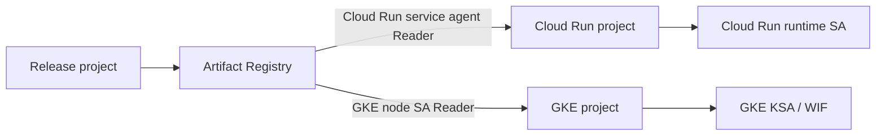

# Thực hành phát hành image dùng chung cho GKE và Cloud Run

Một đội backend muốn dùng cùng một ứng dụng HTTP trên **Google Kubernetes Engine (GKE)** và **Cloud Run**. Nếu mỗi môi trường build container riêng từ source, hai bản deploy có thể dùng dependency, base image hoặc bản mã khác nhau. Khi xuất hiện lỗi, đội phát triển sẽ khó trả lời: *hai nơi có thực sự chạy cùng artifact đã được kiểm thử hay không?*

Giải pháp của bài thực hành này là **build một lần, lưu vào Artifact Registry, lấy digest bất biến, rồi triển khai cùng digest lên Cloud Run và GKE**. Cả hai môi trường có mô hình vận hành khác nhau, nhưng phần container image được kiểm soát và truy vết giống nhau.

Bài thuộc chương **Container và Artifact Registry** của mô-đun `CLOUD_PROVIDERS_GCP`, trong hành trình học Google Cloud từ project, IAM, VPC đến Compute Engine, GKE, Cloud Run, lưu trữ, cơ sở dữ liệu, tự động hóa phát hành và theo dõi độ tin cậy cùng chi phí. Mọi ví dụ thực hành được giới hạn vào một project lab đã được phép sử dụng.

## 1. Mục tiêu học tập

Hoàn thành bài, bạn có thể:

1. Phân biệt **source code**, **container image**, **Docker repository**, **tag**, **digest** và **OCI image manifest**.
2. Dùng **Artifact Registry** làm kho phát hành, thiết lập quyền build, push và pull đúng principal.
3. Build/push image bằng **Cloud Build** hoặc Docker với cấu hình xác thực phù hợp.
4. Chọn một **image digest `sha256:...`** và gắn đúng digest vào Cloud Run revision và Kubernetes Deployment.
5. Thiết kế ứng dụng có thể chạy trên cả hai nền tảng: `0.0.0.0`, `PORT`, health endpoint, không phụ thuộc ổ đĩa cục bộ hoặc quyền root.
6. Phân biệt quyền **image pull** của GKE node với quyền Google Cloud API của workload qua Kubernetes ServiceAccount/Workload Identity Federation.
7. Kiểm tra Cloud Run revision, GKE Pods/Service, response và version thực tế; thực hành rollout/rollback.
8. Biết cách bổ sung image scanning, SBOM, provenance, Binary Authorization, IAM và retention.
9. Đánh giá chi phí và dọn lab mà không xóa artifact đang được hệ thống khác sử dụng.

**Phạm vi an toàn:** các lệnh ghi chỉ dành cho **project lab** và **GKE cluster thử nghiệm đã tồn tại**. Bài không tạo cluster GKE mới và không chạy lệnh trên production. Những giá trị `YOUR_LAB_PROJECT_ID` và `YOUR_LAB_CLUSTER` phải được thay bằng tài nguyên thực tế đã được ủy quyền.

## 2. Kiến trúc: một artifact, hai runtime



Cloud Run và GKE không dùng chung **một tiến trình đang chạy**, mà dùng chung **artifact image**.

| Lớp | Cloud Run | GKE |
| --- | --- | --- |
| Đơn vị triển khai | Service/revision | Deployment/ReplicaSet/Pod |
| HTTP ingress | Managed URL, HTTPS và xác thực dịch vụ | Service, Ingress/Gateway, load balancer tùy thiết kế |
| Scaling | Cloud Run autoscaling | Replica count, HPA, node autoscaler |
| Identity runtime | Cloud Run service identity | KSA/Workload Identity Federation for GKE |
| Image lấy từ registry | Image được Cloud Run import khi deploy | GKE node/container runtime pull khi cần |
| Health | Revision startup/readiness và quan sát request | Startup/readiness/liveness probes |
| Rollback | Chuyển traffic về revision cũ | Rollout undo hoặc set image digest cũ |
| Cấu hình môi trường | Revision environment, memory, CPU, secrets | Pod spec, ConfigMap, Secret, resources |

**Quan trọng:** dùng cùng image không có nghĩa các biến môi trường, quyền API, ingress, firewall hoặc dữ liệu database tự động giống nhau. Image là **đầu vào phát hành**; cấu hình runtime được quản lý độc lập.

## 3. Tag và digest: tại sao chỉ dùng `latest` là sai?

Artifact Registry lưu Docker/OCI images ở dạng:

```text
LOCATION-docker.pkg.dev/PROJECT_ID/REPOSITORY/IMAGE:TAG
LOCATION-docker.pkg.dev/PROJECT_ID/REPOSITORY/IMAGE@sha256:FULL_DIGEST
```

| Khái niệm | Ý nghĩa | Ví dụ |
| --- | --- | --- |
| **Tag** | Bí danh dễ đọc; có thể được gán lại nếu repo không bật tag immutability | `web-demo:lab-v1` |
| **Digest** | Hash của image manifest hoặc manifest index, trỏ bất biến tới artifact | `web-demo@sha256:...` |
| **OCI manifest** | Chỉ tới layers/config của một image | Biến thể `linux/amd64` |
| **OCI index** | Có thể chứa các image theo kiến trúc khác nhau | `linux/amd64` và `linux/arm64` |

Một pipeline build image A và image B đều gắn tag `latest` nhưng ở hai thời điểm khác nhau **không bảo đảm cùng artifact**. Khi GKE tạo Pod mới sau một ngày, tag có thể trỏ tới digest khác. Vì vậy **pin digest sau bước build/scan** và lưu giá trị ấy trong release record.

**Cloud Run** nhập container image tại lúc tạo revision và giữ bản nhập khi revision còn phục vụ; đổi tag trong registry **không tự cập nhật** revision cũ. **GKE** dùng Pod template và pull policy; pin `@sha256` giúp Pod luôn yêu cầu cùng artifact, miễn registry vẫn giữ artifact và node có quyền đọc.

Nếu image là **multi-platform index**, cùng index digest có thể chứa các binary khác nhau cho x86-64 và Arm64; cần kiểm tra runtime architecture. Cloud Run yêu cầu **Linux x86_64 ABI** và multi-arch index phải có `linux/amd64`. Lab này dùng GKE x86 nodes hoặc node pools tương thích `linux/amd64`.

## 4. Điều kiện và quyền cần có

Cần một Google Cloud project có billing, Artifact Registry/Cloud Build/Cloud Run APIs phù hợp, CLI đã xác thực và một **GKE cluster test có sẵn**. Máy thao tác cần `gcloud`, `kubectl` và kết nối tới control plane GKE được cho phép.

| Principal | Thao tác | Role/quyền tham khảo |
| --- | --- | --- |
| Người tạo registry | Tạo Docker repository | Artifact Registry admin hoặc quyền tạo repo tối thiểu |
| **Build service account** | Push image | `roles/artifactregistry.writer` tại repo |
| **Cloud Run deployer** | Deploy image và gắn runtime identity | Cloud Run Developer, Artifact Registry Reader, `iam.serviceAccounts.actAs` |
| **Cloud Run service agent** | Pull/import image từ project khác | Artifact Registry Reader tại repo nguồn nếu cross-project |
| **GKE node service account** | Pull image để tạo Pod | Artifact Registry Reader tại repo |
| **Người triển khai Kubernetes** | Tạo Deployment, Service, Namespace | Quyền truy cập cluster + Kubernetes RBAC |
| **Cloud Run runtime SA** | Gọi Google Cloud APIs khi app chạy | Chỉ quyền nghiệp vụ cần thiết |
| **KSA/WIF của GKE Pod** | Gọi Google Cloud APIs từ ứng dụng | Không đồng nhất với node image-pull identity |

**Không cấp Owner/Editor toàn project chỉ để sửa lỗi push/pull.** Đặc biệt, quyền Workload Identity Federation của Pod **không** thay thế quyền đọc image của **node service account**. Cloud Build default service account cũng có thể khác giữa các project; phải xác định principal trong build logs trước khi grant Writer.

### 4.1. Biến môi trường Bash

```bash
PROJECT_ID="YOUR_LAB_PROJECT_ID"
REGION="asia-southeast1"
REPO="shared-image-lab"
IMAGE_NAME="web-demo"
TAG="lab-v1"

RUN_SERVICE="shared-image-cloudrun"
RUN_SA_NAME="shared-image-run"
GKE_CLUSTER="YOUR_LAB_CLUSTER"
GKE_LOCATION="YOUR_CLUSTER_ZONE_OR_REGION"
NAMESPACE="shared-image-lab"

IMAGE_BASE="$REGION-docker.pkg.dev/$PROJECT_ID/$REPO/$IMAGE_NAME"
IMAGE_TAGGED="$IMAGE_BASE:$TAG"

gcloud --version
kubectl version --client
gcloud auth list
gcloud projects describe "$PROJECT_ID" \
  --format="yaml(projectId,projectNumber,lifecycleState)"
```

Bash và PowerShell khác cú pháp biến; ví dụ trong bài dùng **Bash**. Không chạy nguyên xi khi `PROJECT_ID` hay `GKE_CLUSTER` vẫn là placeholder.

### 4.2. Đọc tài nguyên trước khi ghi

```bash
gcloud artifacts repositories list \
  --project="$PROJECT_ID" --location="$REGION"

gcloud run services list \
  --project="$PROJECT_ID" --region="$REGION"

gcloud container clusters list \
  --project="$PROJECT_ID" \
  --format="table(name,location,status)"
```

Nếu repo/service đã tồn tại và được nhóm khác sở hữu, **không ghi đè hoặc xóa**. Dùng tên khác và cập nhật toàn bộ biến tương ứng. Nếu cluster thuộc project khác, cần quyền riêng; mô hình cross-project được giải thích ở phần sau.

## 5. Chuẩn bị ứng dụng HTTP dùng chung

Tạo một thư mục nguồn riêng **trên máy lab**. Bài này không thêm source code nào vào repository tài liệu.

### 5.1. `app.py`

```python
import json
import os
from http.server import BaseHTTPRequestHandler, ThreadingHTTPServer

RELEASE = "v1"
APP_NAME = "shared-image-demo"


class Handler(BaseHTTPRequestHandler):
    def do_GET(self):
        path = self.path.split("?", 1)[0]
        if path in ("/", "/version"):
            status = 200
            payload = {"app": APP_NAME, "release": RELEASE}
        elif path == "/healthz":
            status = 200
            payload = {"status": "ok"}
        else:
            status = 404
            payload = {"error": "not_found"}

        body = json.dumps(payload).encode("utf-8")
        self.send_response(status)
        self.send_header("Content-Type", "application/json; charset=utf-8")
        self.send_header("Cache-Control", "no-store")
        self.send_header("Content-Length", str(len(body)))
        self.end_headers()
        self.wfile.write(body)


if __name__ == "__main__":
    port = int(os.environ.get("PORT", "8080"))
    ThreadingHTTPServer(("0.0.0.0", port), Handler).serve_forever()
```

Ứng dụng có endpoint health không phụ thuộc database và trả version cố định. Nhờ vậy có thể đối chiếu kết quả giữa hai runtime. Với production, `/healthz` phải được thiết kế phù hợp startup/readiness/liveness và tránh phụ thuộc quá mức vào một dịch vụ ngoài.

### 5.2. `Dockerfile`

```dockerfile
FROM python:3.12-slim

ENV PYTHONDONTWRITEBYTECODE=1 \
    PYTHONUNBUFFERED=1

WORKDIR /app
COPY app.py /app/app.py

USER 65532:65532
EXPOSE 8080
CMD ["python", "/app/app.py"]
```

Image chạy bằng user không phải root, không chứa secret, không cần mount disk và nghe `0.0.0.0:$PORT`. Trong production nên pin base image bằng digest, cập nhật security patches, chạy dependency scanning và dùng multi-stage nếu build native code.

### 5.3. Test tại máy có Docker (tùy chọn)

```bash
docker build --platform linux/amd64 \
  -t shared-image-demo:local .

docker run --rm -p 8080:8080 shared-image-demo:local
```

Từ terminal khác:

```bash
curl -fsS http://127.0.0.1:8080/healthz
curl -fsS http://127.0.0.1:8080/version
```

Kỳ vọng lần lượt có `"status":"ok"` và `"release":"v1"`. Nếu local port 8080 bận, đổi mapping `-p 18080:8080`, không đổi cổng mà container nghe.

## 6. Chuẩn bị Artifact Registry Docker repository

Một **standard Docker repository** ở cùng region với build/Cloud Run giúp đơn giản hóa xác thực và kiểm soát nơi lưu image. Việc tạo repo mới có tác động cấu hình và có thể phát sinh chi phí khi lưu image.

```bash
# Chỉ trên project lab được phê duyệt; xác nhận tên repo chưa tồn tại.
gcloud artifacts repositories create "$REPO" \
  --project="$PROJECT_ID" \
  --repository-format=docker \
  --location="$REGION" \
  --description="One image for GKE and Cloud Run lab"

gcloud artifacts repositories describe "$REPO" \
  --project="$PROJECT_ID" \
  --location="$REGION"
```

Kiểm tra `format: DOCKER`, region và repo ownership. Đừng tạo remote/virtual repo nếu mục đích là push image build riêng. Nếu thiếu Artifact Registry API, quản trị viên có thể bật `artifactregistry.googleapis.com` trên project lab sau khi được phép.

**Repository security:** CI chỉ cần Writer, GKE node cần Reader, runtime SA của app không cần quyền registry khi app chỉ trả JSON. Có thể dùng **immutable tags** và cleanup policies ở môi trường thật sau khi đã xác nhận thời hạn rollback.

## 7. Build một lần và push image bằng Cloud Build

### 7.1. Chuẩn bị Cloud Build

Cloud Build API phải được bật và build service account phải có quyền `artifactregistry.writer` trên repository. Nếu tổ chức sử dụng custom worker pool hoặc build SA riêng, truyền những tùy chọn tương ứng theo quy trình của nhóm nền tảng. Bài lab dùng cấu hình mặc định có quyền phù hợp.

```bash
# Trong thư mục nguồn chỉ chứa app.py và Dockerfile.
IMAGE_BASE="$REGION-docker.pkg.dev/$PROJECT_ID/$REPO/$IMAGE_NAME"
IMAGE_TAGGED="$IMAGE_BASE:$TAG"

gcloud builds submit . \
  --project="$PROJECT_ID" \
  --region="$REGION" \
  --tag="$IMAGE_TAGGED"
```

**Lệnh ghi:** source được gửi tới build, builder tạo image và push lên Artifact Registry. Lưu **Cloud Build ID** từ output. Nếu build thất bại, kiểm tra quyền build SA/repository, Dockerfile, quota và build logs; không cấp Editor toàn project để bypass.

Nếu máy lab dùng Docker CLI thay vì Cloud Build:

```bash
gcloud auth configure-docker "$REGION-docker.pkg.dev"
docker build --platform linux/amd64 -t "$IMAGE_TAGGED" .
docker push "$IMAGE_TAGGED"
```

`configure-docker` chỉ thiết lập credential helper trên máy thao tác, **không cấp IAM**. Không dùng cả hai cách để push vào cùng tag trong một lần thực hành: hai builder có thể tạo digest khác nhau.

### 7.2. Readback registry

```bash
gcloud artifacts docker images list "$IMAGE_BASE" \
  --project="$PROJECT_ID" \
  --include-tags

gcloud artifacts docker images describe "$IMAGE_TAGGED" \
  --project="$PROJECT_ID"
```

Kỳ vọng tag `lab-v1` đã gắn với **digest thật**. Hãy lưu source commit/build ID, image URI, tag và digest vào release record. Không sao chép một digest rút gọn trong output rồi dùng làm đường dẫn deploy.

## 8. Pin đúng một image digest cho cả hai runtime

Lấy digest **đầy đủ** từ `gcloud artifacts docker images list ... --include-tags`, sau đó:

```bash
# Thay placeholder bằng 64 ký tự hex thật được Artifact Registry trả.
DIGEST="sha256:REPLACE_WITH_FULL_DIGEST"
IMAGE_PINNED="$IMAGE_BASE@$DIGEST"

printf 'TAG=%s\n' "$IMAGE_TAGGED"
printf 'PINNED=%s\n' "$IMAGE_PINNED"

# Bắt buộc xác minh URI tồn tại trước khi dùng ở deployment.
gcloud artifacts docker images describe "$IMAGE_PINNED" \
  --project="$PROJECT_ID"
```

**Không triển khai** khi `DIGEST` vẫn là placeholder, hoặc `describe` không tìm thấy image. Khi có Docker Buildx, dùng `docker buildx imagetools inspect "$IMAGE_PINNED"` để xem platform manifest; với Cloud Run, image phải tương thích `linux/amd64`.

Một image dùng chung có hai cấp xác minh: **digest image/index mà ta deploy** và **platform-specific image runtime thực tế**. Nếu GKE chạy trên node Arm64, cần manifest `linux/arm64` tương ứng; image demo được build mặc định theo x86 nên phải chọn node pool phù hợp.

## 9. Phân tách danh tính build, deploy, image pull và runtime



Ứng dụng `app.py` không gọi Google Cloud APIs, nên **Cloud Run runtime SA và GKE workload identity không cần được cấp quyền nghiệp vụ**. Quản trị viên GKE có thể xác nhận node service account được phép pull image từ Artifact Registry.

Đối với cross-project registry, người quản trị repo nguồn phải cấp Reader cho **Cloud Run service agent** của project Cloud Run đích và cho **GKE node service account** của project GKE. Deployer Cloud Run cũng cần role Reader/deployment permission riêng. Không dùng JSON service account keys làm giải pháp mặc định.

### 9.1. Tạo Cloud Run runtime service account

```bash
# Ghi: chỉ tạo trên project lab, khi chưa có SA trùng tên.
gcloud iam service-accounts create "$RUN_SA_NAME" \
  --project="$PROJECT_ID" \
  --display-name="Lab runtime identity"

RUN_SA_EMAIL="$RUN_SA_NAME@$PROJECT_ID.iam.gserviceaccount.com"

gcloud iam service-accounts describe "$RUN_SA_EMAIL" \
  --project="$PROJECT_ID"
```

Không gán `roles/editor` hay `roles/artifactregistry.writer` cho SA này. Deployer cần quyền `iam.serviceAccounts.actAs` trên runtime SA; chỉ người được ủy quyền mới cấp quyền ấy.

## 10. Triển khai digest lên Cloud Run

**Lệnh ghi tạo service/revision**, chỉ chạy trên project lab đã cho phép:

```bash
gcloud run deploy "$RUN_SERVICE" \
  --project="$PROJECT_ID" \
  --region="$REGION" \
  --image="$IMAGE_PINNED" \
  --service-account="$RUN_SA_EMAIL" \
  --port=8080 \
  --cpu=1 \
  --memory=256Mi \
  --min-instances=0 \
  --max-instances=2 \
  --no-allow-unauthenticated
```

Điểm cần nhớ:

- Image dùng **`@sha256:...`**, không phải `:latest`.
- Service đặt **private**; request phải có Cloud Run Invoker identity hợp lệ.
- Container nghe đúng `0.0.0.0` và `PORT`.
- Giới hạn instances chỉ giới hạn một thành phần của capacity, không phải trần cứng hóa đơn.
- Nếu organization policy yêu cầu Binary Authorization, chưa có attestation thì phải xử lý theo chính sách, **không tắt policy để đi tắt**.

Readback:

```bash
gcloud run services describe "$RUN_SERVICE" \
  --project="$PROJECT_ID" \
  --region="$REGION" \
  --format="yaml(metadata.name,status.url,status.latestReadyRevisionName,spec.template.spec.containers)"

gcloud run revisions list \
  --project="$PROJECT_ID" \
  --region="$REGION" \
  --service="$RUN_SERVICE"
```

### 10.1. Kiểm thử Cloud Run private endpoint

Người dùng phải có `roles/run.invoker` và identity token phù hợp.

```bash
RUN_URL="$(gcloud run services describe "$RUN_SERVICE" \
  --project="$PROJECT_ID" \
  --region="$REGION" \
  --format='value(status.url)')"

curl -fsS \
  -H "Authorization: Bearer $(gcloud auth print-identity-token)" \
  "$RUN_URL/version"

curl -fsS \
  -H "Authorization: Bearer $(gcloud auth print-identity-token)" \
  "$RUN_URL/healthz"
```

Nếu `403`, kiểm tra Cloud Run Invoker role, account đang đăng nhập, audience của token và ingress; **không** suy ngay image bị lỗi. Nếu service chưa Ready, xem Cloud Run revision logs và port trước.

## 11. Lấy credential GKE và xác nhận cluster/node

GKE cluster **đã phải tồn tại** và có node tương thích image. Không tự tạo cluster trong bài lab.

```bash
gcloud container clusters describe "$GKE_CLUSTER" \
  --project="$PROJECT_ID" \
  --location="$GKE_LOCATION"

gcloud container clusters get-credentials "$GKE_CLUSTER" \
  --project="$PROJECT_ID" \
  --location="$GKE_LOCATION"

kubectl config current-context
kubectl get nodes -L kubernetes.io/arch
```

`get-credentials` thay kubeconfig trên máy học viên. **Xác nhận đúng context** trước mọi `kubectl apply/delete`, vì lệnh Kubernetes thao tác vào cluster đang được chọn, không dựa trên `PROJECT_ID` của gcloud.

Nếu cluster chỉ có node Arm64 mà image là `linux/amd64`, phải chọn node pool x86 hoặc build multiarch, **không** deploy rồi trông chờ runtime tự dịch binary.

Kiểm tra namespace:

```bash
kubectl get namespace "$NAMESPACE"

# Chỉ khi namespace chưa có và được phép tạo:
kubectl create namespace "$NAMESPACE"
```

Không xóa namespace trùng tên của người khác. Nếu lệnh đọc trả NotFound thì đó có thể là trạng thái bình thường trước khi tạo.

## 12. Tạo Deployment và Service trên GKE bằng đúng digest

Dùng một **Kubernetes Deployment** với hai replicas, các probes và resource requests nhỏ. Dùng **ClusterIP** thay vì tạo LoadBalancer public (tránh IP công khai và phí không cần thiết).

### 12.1. File manifest `k8s.yaml` trong thư mục lab

Bash heredoc sau **chỉ tạo file trên máy người học**, không tạo thêm file trong repository module:

```bash
cat > k8s.yaml <<EOF
apiVersion: apps/v1
kind: Deployment
metadata:
  name: web-demo
  labels:
    app: web-demo
spec:
  replicas: 2
  strategy:
    type: RollingUpdate
    rollingUpdate:
      maxSurge: 1
      maxUnavailable: 0
  selector:
    matchLabels:
      app: web-demo
  template:
    metadata:
      labels:
        app: web-demo
    spec:
      containers:
        - name: web-demo
          image: $IMAGE_PINNED
          imagePullPolicy: IfNotPresent
          ports:
            - name: http
              containerPort: 8080
          securityContext:
            allowPrivilegeEscalation: false
            readOnlyRootFilesystem: true
            runAsNonRoot: true
            runAsUser: 65532
            capabilities:
              drop: ["ALL"]
          resources:
            requests:
              cpu: "100m"
              memory: "128Mi"
            limits:
              cpu: "500m"
              memory: "256Mi"
          startupProbe:
            httpGet:
              path: /healthz
              port: http
            periodSeconds: 5
            failureThreshold: 12
          readinessProbe:
            httpGet:
              path: /healthz
              port: http
            periodSeconds: 5
          livenessProbe:
            httpGet:
              path: /healthz
              port: http
            periodSeconds: 10
---
apiVersion: v1
kind: Service
metadata:
  name: web-demo
spec:
  type: ClusterIP
  selector:
    app: web-demo
  ports:
    - name: http
      port: 8080
      targetPort: http
EOF
```

Hãy kiểm tra trong file `image:` đã là URI thật dạng `...@sha256:...`; nếu biến `IMAGE_PINNED` rỗng, **không apply**. `readOnlyRootFilesystem` phù hợp app demo; ứng dụng khác cần ghi file tạm phải cấu hình volume riêng. GKE Autopilot có thể điều chỉnh requests/limits theo yêu cầu hệ thống.

### 12.2. Áp dụng và đọc lại

```bash
grep -n 'image:' k8s.yaml

kubectl apply \
  --namespace="$NAMESPACE" \
  -f k8s.yaml

kubectl rollout status \
  --namespace="$NAMESPACE" \
  deployment/web-demo \
  --timeout=180s

kubectl get deployments,replicasets,pods,services \
  --namespace="$NAMESPACE" -o wide

kubectl get deployment web-demo \
  --namespace="$NAMESPACE" \
  -o jsonpath='{.spec.template.spec.containers[0].image}'
```

**Bằng chứng đúng:** Deployment trỏ `IMAGE_PINNED`, Pods `Ready`, Service loại ClusterIP có endpoints. Nếu Pod chưa Ready, xem `kubectl describe pod`, `kubectl get events` và logs. `ImagePullBackOff` thường liên quan node SA/repo IAM/path/network; `CrashLoopBackOff` thường liên quan code/runtime; `Pending` có thể là resource quota hoặc scheduling.

## 13. Kiểm thử ứng dụng GKE bằng port-forward

Để không tạo public LoadBalancer cho lab, dùng `kubectl port-forward` từ máy đã có quyền kết nối Kubernetes API server.

Terminal thứ nhất:

```bash
kubectl port-forward \
  --namespace="$NAMESPACE" \
  service/web-demo \
  18080:8080
```

Terminal thứ hai:

```bash
curl -fsS http://127.0.0.1:18080/healthz
curl -fsS http://127.0.0.1:18080/version
```

Kỳ vọng response có `"status": "ok"` và `"release": "v1"`, trùng với app ở Cloud Run. Port-forward là **kết nối quản trị tạm thời** thông qua một Pod được chọn; nó không xác minh khả năng chịu lỗi hoặc public ingress của ứng dụng.

Nếu port 18080 đã được dùng, đổi phần **local port** thành `18081:8080`. Không cần sửa service port. Dừng port-forward bằng Ctrl+C sau khi thử.

Khi không thấy response:

```bash
kubectl get pods \
  --namespace="$NAMESPACE" \
  -l app=web-demo -o wide

kubectl get events \
  --namespace="$NAMESPACE" \
  --sort-by=.metadata.creationTimestamp

kubectl logs deployment/web-demo \
  --namespace="$NAMESPACE" \
  --tail=100
```

Nếu `Deployment Ready` nhưng Service không trả, kiểm tra selector `app: web-demo`, port/targetPort, container listener, readiness và network policy. Không mở IP công khai cho node chỉ để xử lý port-forward.

## 14. Xác minh hai runtime dùng chính xác cùng image

**Đây là bước quan trọng nhất của bài:** cùng JSON `"release": "v1"` chỉ chứng minh cùng giá trị string, **không chứng minh cùng artifact**. Muốn kết luận “one image”, cần lưu bằng chứng về digest.

| Nguồn | Kiểm tra | Kỳ vọng |
| --- | --- | --- |
| Artifact Registry | `docker images describe IMAGE@DIGEST` | Digest D tồn tại và metadata phù hợp |
| Cloud Run | Service/revision readback | Revision mới được deploy từ URI chứa D |
| GKE Deployment | Container image trong Pod template | URI `IMAGE_PINNED` với D |
| GKE Pods | Image ID, Ready/Running, logs | Pull và khởi động thành công |
| Cloud Run endpoint | Identity-token test | Trả `v1` và health `ok` |
| GKE Service | Port-forward test | Trả `v1` và health `ok` |

### 14.1. Kiểm tra từ CLI

```bash
printf 'Approved image: %s\n' "$IMAGE_PINNED"

gcloud artifacts docker images describe "$IMAGE_PINNED" \
  --project="$PROJECT_ID"

gcloud run services describe "$RUN_SERVICE" \
  --project="$PROJECT_ID" \
  --region="$REGION"

kubectl get deployment web-demo \
  --namespace="$NAMESPACE" \
  -o jsonpath='{.spec.template.spec.containers[0].image}'

kubectl get pods \
  --namespace="$NAMESPACE" \
  -l app=web-demo -o wide
```

So sánh cùng URI registry và digest trong build/release record với cấu hình hai runtime. Các trường hiển thị có thể được chuẩn hóa khác nhau giữa API, nhất là khi image dùng OCI index chứa nhiều kiến trúc, nhưng **artifact được chọn khi deploy phải có cùng digest D**.

### 14.2. “Cùng image” không phải “cùng cấu hình ứng dụng”

Cloud Run có revision settings, runtime SA và managed HTTPS. GKE có resource requests/limits, Kubernetes ServiceAccount, replicas và các networking policies. Hai môi trường có thể dùng database, secret hoặc config khác nhau và vẫn dùng cùng image.

Điều này đem lại lợi ích quản lý:

- Nếu cả hai runtime lỗi giống nhau với cùng input, cần xem app/image.
- Nếu chỉ GKE lỗi pull, cần xem node SA/registry permission.
- Nếu chỉ Cloud Run lỗi startup, cần xem container contract, PORT, service settings.
- Nếu khác latency, cần xem scaling, node type, database network path và load test; không mặc định lỗi là CPU của image.

## 15. Phân tách image, cấu hình và secrets

Một image nên chứa **code và dependencies**; không chứa mật khẩu, khóa riêng hay endpoint production cứng khi có thể cấu hình runtime.

| Loại thông tin | Đặt ở đâu | Lưu ý |
| --- | --- | --- |
| Code và thư viện | Image được build và scan | Pin digest ở mỗi release |
| Port và resource limit | Cloud Run service hoặc Pod spec | Cần phù hợp runtime contract |
| Config không nhạy cảm | Environment variables/ConfigMap hoặc hệ thống cấu hình | Có thể khác theo môi trường |
| Secrets | Secret Manager, Kubernetes Secret và cơ chế cấp quyền được duyệt | Không copy secret vào Dockerfile/image |
| Quyền Google Cloud API | Cloud Run runtime SA hoặc WIF for GKE | Không dùng static JSON keys làm mặc định |
| Storage/data | Cloud Storage, database, persistent volume phù hợp | Container writable layer không phải dữ liệu bền vững |

Một thay đổi env var có thể tạo Cloud Run revision mới hoặc Kubernetes Pod template rollout mà **không cần build image mới**. Vì vậy release record nên có cả **image digest** lẫn **configuration version**. Cùng digest nhưng config khác có thể cho hành vi khác; audit chỉ dựa vào image không đủ.

### 15.1. Workload Identity Federation for GKE

Khi Pod cần gọi Cloud Storage/Secret Manager:

1. Tạo Kubernetes ServiceAccount riêng cho workload.
2. Cấu hình Workload Identity Federation theo hướng dẫn GKE và IAM.
3. Cấp quyền trên đúng bucket/secret cho principal phù hợp.
4. Gắn KSA vào Pod spec và chạy thử với API thật.

Không tạo file JSON private key lưu trong Kubernetes Secret chỉ vì cần Google Cloud credentials. **Quyền GKE node pull image vẫn được xử lý độc lập**, không đi qua những role nghiệp vụ của KSA.

## 16. Phát hành phiên bản v2 từ cùng pipeline

Giả sử sau khi kiểm tra v1, bạn thay trong source:

```python
RELEASE = "v2"
```

Hãy tạo **image mới**, tag mới và digest mới; không sửa image đã có, không dùng lại tag `lab-v1`.

### 16.1. Build và ghi lại D2

```bash
TAG="lab-v2"
IMAGE_TAGGED="$IMAGE_BASE:$TAG"

gcloud builds submit . \
  --project="$PROJECT_ID" \
  --region="$REGION" \
  --tag="$IMAGE_TAGGED"

gcloud artifacts docker images list "$IMAGE_BASE" \
  --project="$PROJECT_ID" \
  --include-tags
```

Từ output, lấy digest D2 thật:

```bash
IMAGE_V2_PINNED="$IMAGE_BASE@sha256:REPLACE_WITH_V2_DIGEST"

gcloud artifacts docker images describe "$IMAGE_V2_PINNED" \
  --project="$PROJECT_ID"
```

Chỉ triển khai khi đã kiểm thử và hoàn tất phê duyệt bảo mật. **Giữ nguyên D1** trong registry đủ thời gian rollback.

### 16.2. Cloud Run: revision mới, triển khai chưa chuyển traffic

```bash
# CÓ TÁC ĐỘNG: tạo revision từ D2 nhưng chưa chuyển traffic.
gcloud run deploy "$RUN_SERVICE" \
  --project="$PROJECT_ID" \
  --region="$REGION" \
  --image="$IMAGE_V2_PINNED" \
  --service-account="$RUN_SA_EMAIL" \
  --no-traffic \
  --no-allow-unauthenticated

gcloud run revisions list \
  --project="$PROJECT_ID" \
  --region="$REGION" \
  --service="$RUN_SERVICE"
```

`--no-traffic` hữu ích khi muốn kiểm tra revision mới trước khi rollout. Để test riêng revision đó, người quản trị có thể cấu hình **traffic tag** và dùng URL tagged revision với xác thực phù hợp. Sau canary, chuyển traffic theo **tên revision thực tế**; không suy tên revision từ tag image.

Khi cần rollback, chuyển traffic về revision D1 đã được xác nhận hoặc deploy lại đúng URI D1. **Không rebuild source cũ rồi hy vọng digest mới tương đương D1.**

### 16.3. GKE: rolling update và rollback

```bash
kubectl set image \
  --namespace="$NAMESPACE" \
  deployment/web-demo \
  "web-demo=$IMAGE_V2_PINNED"

kubectl rollout status \
  --namespace="$NAMESPACE" \
  deployment/web-demo \
  --timeout=180s

kubectl rollout history \
  --namespace="$NAMESPACE" \
  deployment/web-demo
```

Với Deployment đã cấu hình `maxSurge=1` và `maxUnavailable=0`, Kubernetes cố thay Pods có kiểm soát; rollout vẫn có thể không hoàn thành nếu thiếu quota/CPU, lỗi image pull hoặc probes không ready.

Rollback:

```bash
kubectl rollout undo \
  --namespace="$NAMESPACE" \
  deployment/web-demo

kubectl rollout status \
  --namespace="$NAMESPACE" \
  deployment/web-demo
```

`rollout undo` dựa vào revision history/ReplicaSets còn được giữ. Nếu cần chính xác D1, có thể đặt lại image là URI D1 đã ghi trong release record. Sau rollback, xác minh image reference, Pods Ready và response application.

**Rollback container không rollback database.** Nếu v2 đã đổi schema hoặc state, cần kế hoạch data migration/compatibility riêng.

## 17. CI/CD production: build once, promote by digest

Lab dùng lệnh thủ công để dễ hiểu. Trong dự án thực tế nên có pipeline với các cổng kiểm soát:



### 17.1. Release record

```yaml
release:
  source_commit: GIT_COMMIT_SHA
  build_id: CLOUD_BUILD_ID
  image: asia-southeast1-docker.pkg.dev/PROJECT/REPO/web-demo
  tag: lab-v1
  digest: sha256:REPLACE_WITH_REAL_DIGEST
  scan_status: approved
targets:
  cloud_run: shared-image-cloudrun
  gke_namespace: shared-image-lab
  gke_deployment: web-demo
```

Đây là **mẫu manifest ghi nhận**, không phải định dạng YAML có thể apply trực tiếp vào GKE hoặc Cloud Run. Giá trị digest và build ID phải lấy từ hệ thống build thực, có quyền truy cập/audit và được gắn với người phê duyệt.

### 17.2. Vì sao không build riêng cho từng runtime?

Hai bản build từ cùng source commit có thể khác vì base image tag đổi, dependency tải bản mới, toolchain hoặc build timestamps khác nhau. Pin một digest sau scan làm giảm drift và giúp rollback dễ kiểm tra.

**Ngoại lệ:** nếu hai runtime cần các kiến trúc hoặc native dependencies không tương thích, có thể cần **multi-platform index** hoặc các image variant được quản lý rõ ràng. Hãy gọi đúng kiến trúc và thực hiện test từng variant, không tuyên bố “cùng binary” chỉ vì cùng tag.

### 17.3. Công cụ promotion

Cloud Deploy hoặc hệ thống CI/CD khác có thể quản lý approval, canary và phát hành sang các target được hỗ trợ. Hãy kiểm tra cấu hình sản phẩm và IAM hiện hành trước khi tích hợp. Dù dùng công cụ nào, tiêu chí chung vẫn là: **promote digest đã được kiểm thử**, không chạy lại Docker build ở từng stage.

## 18. Quản trị Artifact Registry và bảo mật chuỗi cung ứng

Một digest bất biến chứng minh **artifact được xác định**, không chứng minh artifact **không có lỗ hổng**.

| Lớp | Kiểm soát cần cân nhắc |
| --- | --- |
| **Source** | Code review, dependency lock, SAST/secrets scan |
| **Base image** | Publisher tin cậy, version/digest pinning, cập nhật CVE |
| **Build** | SA riêng, reproducibility, provenance, build log |
| **Registry** | Repository IAM, immutable tags, cleanup policy |
| **Image analysis** | Artifact Analysis scanning, SBOM, license và risk triage |
| **Release** | Chọn digest sau approval, policy kiểm chứng, audit |
| **Deployment** | Binary Authorization ở GKE/Cloud Run khi được yêu cầu |
| **Runtime** | Non-root, least privilege, network policy, không hard-code secrets |
| **Operations** | CVE mới, rebuild/redeploy, giữ artifact phục vụ rollback |

**Artifact Analysis** có thể tìm package vulnerabilities và tạo metadata, nhưng finding mới **không tự thay thế** image đang chạy. Một image v1 có digest D1 sẽ tiếp tục là D1; muốn nhận base image đã vá phải build image D2, scan/test và deploy lại có kiểm soát.

**Binary Authorization** có mô hình cấu hình riêng cho GKE và Cloud Run. Nếu một policy yêu cầu attestation, cả hai runtime cần release artifacts đáp ứng điều kiện tương ứng. Không bật `deny-all` trên production mà chưa có allowlist, attestor và quy trình kiểm thử.

**Cleanup policy** giúp giảm image retention cost nhưng không được xóa digest mà GKE đang tham chiếu hoặc team cần rollback. Cloud Run import image khi deploy; GKE vẫn cần registry khi Pod mới pull image trong tương lai.

## 19. Cross-project release: registry chung, runtime tách project

Trong tổ chức lớn, registry có thể thuộc project `release-artifacts` còn Cloud Run/GKE chạy ở các project ứng dụng khác.



Để deploy:

1. Deployer Cloud Run có quyền đọc image và quyền deploy tại project Cloud Run.
2. Cloud Run service agent của project đích cần **Artifact Registry Reader** trên repo nguồn nếu ảnh cross-project.
3. GKE node service account cần **Artifact Registry Reader** trên repo nguồn.
4. GKE user/deployer cần IAM và Kubernetes RBAC phù hợp.
5. VPC Service Controls, organization policies, scopes, network access và Binary Authorization không chặn.

**Không** cấp `roles/artifactregistry.writer` cho GKE node chỉ để pull và không đưa static JSON SA key vào Kubernetes Secret làm đường mặc định. Khi gặp `ImagePullBackOff`, điều tra node identity, image path, repository permissions và node networking.

## 20. Monitoring và vận hành

### 20.1. Cloud Run

Theo dõi revision readiness, traffic splitting, request count, p95/p99 latency, 4xx/5xx, instance count, startup time, CPU/memory và logs.

```bash
gcloud run services describe "$RUN_SERVICE" \
  --project="$PROJECT_ID" \
  --region="$REGION"

gcloud run revisions list \
  --project="$PROJECT_ID" \
  --region="$REGION" \
  --service="$RUN_SERVICE"
```

### 20.2. GKE

Theo dõi desired/ready replicas, rollout history, container restarts, node architecture, resource quotas, CPU/memory và Kubernetes events.

```bash
kubectl get deployment web-demo \
  --namespace="$NAMESPACE" -o wide

kubectl get pods \
  --namespace="$NAMESPACE" \
  -l app=web-demo -o wide

kubectl get events \
  --namespace="$NAMESPACE" \
  --sort-by=.metadata.creationTimestamp
```

Một image có thể chạy tốt trên Cloud Run nhưng **chưa phù hợp với memory limit, startup probes hoặc node capacity** của GKE. Nếu error rate khác nhau, kiểm tra runtime configuration, network/data path và tải trước khi quy lỗi cho code.

### 20.3. Mục tiêu vận hành

Một release cần:

- **Bằng chứng provenance:** source commit/build ID/digest.
- **Bằng chứng runtime:** Cloud Run revision Ready và GKE Pod Ready.
- **Bằng chứng chức năng:** smoke test thành công, không chỉ deploy command exit 0.
- **Bằng chứng an toàn:** không public service ngoài chủ đích; scan/policy đạt.
- **Bằng chứng chi phí:** resource quota/budget và cảnh báo cơ bản.
- **Đường rollback:** D1 và revision/manifest cũ được giữ đủ thời gian.

## 21. Troubleshooting: lỗi ở bước nào?

| Hiện tượng | Nguyên nhân thường gặp | Cách xác minh |
| --- | --- | --- |
| Build không thể push | Build SA thiếu Writer hoặc repo không tồn tại | Build logs, repo IAM, image path |
| Docker báo unauthorized | Credential helper chưa cấu hình hoặc thiếu IAM | `gcloud auth configure-docker`, role registry |
| Tag có nhưng digest không đúng | Tag bị ghi đè, chọn nhầm version | `docker images list --include-tags`, build ID |
| Cloud Run không pull image | Deployer/service agent thiếu Reader, URI sai | Repo describe, IAM và deploy logs |
| Cloud Run revision không Ready | Port/`0.0.0.0`, app startup lỗi, memory | Cloud Run logs, container contract |
| Cloud Run trả 403 | Service private hoặc identity token/Invoker không đúng | Cloud Run IAM, audience, ingress |
| GKE `ImagePullBackOff` | GKE node SA không đọc được registry; path/network | Pod events, node SA, repo IAM |
| GKE `CrashLoopBackOff` | Binary sai ISA, thiếu dependency hoặc code lỗi | `kubectl logs`, image manifest, node arch |
| GKE `Pending` | Thiếu CPU/RAM/quota/taints phù hợp | `kubectl describe pod`, node scheduling |
| Port-forward không truy cập được | Service selector/port không khớp, Pod chưa Ready | `kubectl describe service`, endpoints, probes |
| Cùng tag nhưng phản hồi khác nhau | Tag mutable, build riêng, runtime config khác | So digest và env/config records |
| Cloud Run vẫn chạy v1 sau khi push tag v2 | Revision đã import image | Deploy revision từ digest mới |
| GKE rollback lỗi sau xóa image | D1 không còn trong registry để node pull | Giữ digest D1, kiểm tra cleanup policy |
| CVE mới nhưng image không đổi | Scanning không tự vá artifact | Rebuild D2 từ base vá, test/redeploy |
| Cross-project deployment lỗi | Thiếu service agent/node Reader tại repo nguồn | IAM scope/source project, VPC SC |
| Cost tăng sau lab | Registry image, GKE nodes/Pods, Cloud Run, logs | Billing by SKU và cleanup checklist |

**Quy trình chuẩn:** xác minh URI/digest ở Artifact Registry → quyền build/push/pull → platform/architecture → service readiness → logs/events → auth/network → application behavior. Không sửa bằng cách cho `allUsers` quyền pull registry hoặc cấp Editor toàn project.

## 22. Chi phí và giới hạn tài nguyên

| Dịch vụ | Yếu tố tạo chi phí | Cách kiểm soát |
| --- | --- | --- |
| Artifact Registry | Dung lượng image/layers, network operations/egress | Cleanup policies sau thời gian rollback |
| Cloud Build | Build compute, worker pool, log/source staging | Build khi cần, cache hợp lý, budget |
| Cloud Run | CPU/memory/request/egress theo pricing mode | Max instances, runtime metrics |
| GKE | Cluster, node VMs, Persistent Disk, network | Chỉ dùng cluster lab sẵn có, Pod requests nhỏ |
| Security scanning | Artifact Analysis theo tính năng/bảng giá | Rà nhu cầu và chi phí |
| Logging/Monitoring | Ingestion/retention, alerts | Không log secrets; sampling/retention phù hợp |
| Cross-region | Network egress/cross-region data | Chọn registry/runtime locations hợp lý |

**Budget alert không tự chặn chi tiêu**. `max-instances` trên Cloud Run hoặc 2 replicas trên GKE chỉ giới hạn một phần tài nguyên, không phải hóa đơn tổng thể. Bài lab không tạo LoadBalancer public cho GKE để hạn chế tài nguyên và chi phí không cần thiết.

## 23. Tình huống thiết kế: API dùng cả GKE và Cloud Run

Một doanh nghiệp muốn GKE xử lý các API nội bộ cần Kubernetes networking, còn Cloud Run xử lý một endpoint phụ để phục vụ thử nghiệm.

| Câu hỏi | Cloud Run | GKE |
| --- | --- | --- |
| Image được duyệt | `web-demo@sha256:D1` | `web-demo@sha256:D1` |
| Runtime identity | Cloud Run SA | KSA + WIF khi cần |
| Ai pull image? | Deployer/service agent theo mô hình image project | GKE node SA |
| Deployment unit | Revision | Deployment/Pods |
| Health | Revision readiness và HTTP test | Probes + Pods Ready |
| Scale | Managed per request | Replicas/HPA/nodes |
| Network | Managed HTTPS, ingress/IAM | Service ClusterIP/Ingress/Gateway |
| Rollback | Traffic về revision D1 | Rollout undo hoặc set image D1 |
| Log | Cloud Run Logging | GKE container/cluster logs |

Đội release vẫn phải lập kế hoạch **database schema compatibility**, configuration drift và secret management. Một source commit/image chung không đảm bảo hai môi trường có cùng state, latency hoặc SLO.

## 24. Bài tập tự luyện

### Bài 1 — tag không bất biến

CI build A đẩy `:latest` vào Cloud Run, CI build B đẩy lại `:latest` trước khi GKE deploy.

*Đáp án định hướng:* Hai runtime có thể nhận hai digest khác nhau. Build một lần, lấy digest đầy đủ từ Artifact Registry, phê duyệt và pin `@sha256` ở cả hai.

### Bài 2 — Cloud Run chạy, GKE pull lỗi

Cloud Run deploy image trong Artifact Registry thành công nhưng GKE cluster khác project báo `ImagePullBackOff`.

*Đáp án định hướng:* Kiểm tra **GKE node service account** có Artifact Registry Reader tại repository nguồn hay không, scopes/egress và image path. KSA/WIF quyền nghiệp vụ không tự cấp image pull.

### Bài 3 — Cloud Run không nhận request

Image chạy trên GKE nhưng server chỉ bind `127.0.0.1:8080`.

*Đáp án định hướng:* Sửa app bind `0.0.0.0` và đọc `PORT`. Sau đó build **digest mới**, test và deploy; không thay đổi được một digest đã publish.

### Bài 4 — cùng digest, khác kết quả

Cloud Run trả HTTP 200 còn GKE trả 500 vì biến môi trường `DB_HOST` khác nhau.

*Đáp án định hướng:* Image chung chỉ loại bỏ drift ở layer artifact. Phải kiểm tra deployment config, secret, network và database; không rebuild image khi lỗi nằm ở config.

### Bài 5 — tại sao rollback không rebuild?

Sau v2 lỗi, nhóm định build lại v1 từ Git.

*Đáp án định hướng:* Rebuild có thể kéo base/dependency mới nên không tạo đúng D1. Giữ digest D1 đã duyệt; chuyển Cloud Run về revision D1 và GKE về image D1.

### Bài 6 — một index, hai platform

GKE dùng Arm64 nodes, Cloud Run chạy x86. Một OCI index có `linux/amd64` và `linux/arm64`.

*Đáp án định hướng:* Có thể dùng cùng index digest nhưng runtime chạy **hai platform-specific binary**. Cần test/scan cả hai biến thể và hiểu kiến trúc Cloud Run bắt buộc có amd64.

### Bài 7 — runtime SA có cần Writer?

App chỉ trả JSON, team định cấp Artifact Registry Writer cho Cloud Run runtime SA.

*Đáp án định hướng:* Không. Writer thuộc build/push identity. Cloud Run deployer/service agent và GKE node SA cần quyền đọc theo tình huống. Runtime SA chỉ cấp quyền Google APIs mà app thật sự gọi.

### Bài 8 — Pod Ready nhưng Service lỗi

Deployment chạy hai Pods Ready, `kubectl port-forward service/web-demo` trả connection refused.

*Đáp án định hướng:* Kiểm tra Service selector/endpoints/targetPort, listener của app, container port và probes. Không tạo LB công khai để che lỗi cấu hình nội bộ.

### Bài 9 — scanner báo CVE mới

Image D1 đã deploy và được scanner báo lỗ hổng mới trong base image.

*Đáp án định hướng:* Digest D1 không tự vá. Đánh giá rủi ro, cập nhật base image, build D2, scan/test và rollout có đường rollback. Binary Authorization/security gate xử lý policy deployment, không tự sửa image.

### Bài 10 — cleanup ảnh hưởng production

Artifact Registry repository lab trùng với repo sản xuất, D1 đang dùng bởi production GKE.

*Đáp án định hướng:* **Không xóa D1 hoặc repository**. Chỉ dọn Cloud Run service/namespace lab, sau đó phối hợp người sở hữu repo xác định artifact thật sự không còn dependency.

## 25. Checklist triển khai và phát hành

- [ ] Project, repo, region, cluster, namespace đều được xác minh là **lab** và được ủy quyền.
- [ ] Ứng dụng có `/healthz`, `/version`, bind `0.0.0.0:$PORT`.
- [ ] Image có `linux/amd64` cho Cloud Run và tương thích với GKE node architecture.
- [ ] Dockerfile không chứa secret, không chạy root, base image được quản lý.
- [ ] Cloud Build build một lần, có build ID và tag riêng cho release.
- [ ] Artifact Registry chứa digest D đầy đủ, `describe` xác nhận tồn tại.
- [ ] Phân biệt danh tính build Writer, Cloud Run deployer/service agent, GKE node Reader, runtime identity.
- [ ] Cloud Run deploy `IMAGE_PINNED` với xác thực phù hợp; revision Ready.
- [ ] GKE Deployment `image: IMAGE_PINNED`, Pods Ready và Service ClusterIP chạy.
- [ ] Hai endpoint trả version đúng; đã so sánh digest chứ không chỉ JSON.
- [ ] Có release record gồm commit, build ID, digest, security gate và người phê duyệt.
- [ ] Có hướng nâng v2, canary, rollout và rollback về D1.
- [ ] Có log/metrics lỗi, readiness, cache images, quota/cost.
- [ ] Không xóa digest cần cho GKE scale-out hoặc rollback.
- [ ] Không public GKE Service hoặc Cloud Run ngoài chủ đích.

## 26. Dọn lab không làm ảnh hưởng workload khác

**Chỉ xóa những tài nguyên do bài lab tạo** sau khi xác nhận không hệ thống nào còn phụ thuộc digest hoặc namespace. Lệnh sau **có tác động phá hủy**.

### 26.1. Preflight cleanup (chỉ đọc)

```bash
kubectl config current-context

kubectl get all --namespace="$NAMESPACE"

gcloud run services describe "$RUN_SERVICE" \
  --project="$PROJECT_ID" --region="$REGION"

gcloud artifacts repositories describe "$REPO" \
  --project="$PROJECT_ID" --location="$REGION"

gcloud artifacts docker images list "$IMAGE_BASE" \
  --project="$PROJECT_ID" --include-tags
```

Nếu namespace chứa workload người khác hoặc repo có image dùng chung, không xóa namespace/repository. Nếu `GKE_CLUSTER` là cluster production, **không chạy các lệnh xóa**.

### 26.2. Xóa Cloud Run service và namespace lab

```bash
# CÓ TÁC ĐỘNG: chỉ khi resource thuộc lab.
gcloud run services delete "$RUN_SERVICE" \
  --project="$PROJECT_ID" --region="$REGION"

kubectl delete namespace "$NAMESPACE"
```

Xóa Cloud Run service không tự xóa image trên registry. Xóa Kubernetes namespace không xóa GKE cluster, các node, image layers cached hoặc Cloud Logging.

### 26.3. Xóa repository chỉ khi độc quyền của lab

Nếu repo được tạo **riêng cho bài này**, không có artifact khác và không có deployment nào pull từ đó:

```bash
# PHÁ HỦY TOÀN BỘ repo: chỉ chạy với repository LAB ĐỘC QUYỀN.
gcloud artifacts repositories delete "$REPO" \
  --project="$PROJECT_ID" --location="$REGION"
```

**Không chạy** với repo dùng chung. Nếu muốn xóa một image cụ thể, xác minh đúng tag/digest, release history, cleanup policy và chủ sở hữu; không xóa D1 khi GKE còn có khả năng tạo Pod từ D1. Phí Cloud Build/source staging/logging có thể vẫn còn và cần kiểm kê riêng.

### 26.4. Runtime service account

Nếu `RUN_SA_EMAIL` chỉ được tạo cho lab, không có workload khác dùng và IAM bindings đã được rà:

```bash
gcloud iam service-accounts delete "$RUN_SA_EMAIL" \
  --project="$PROJECT_ID"
```

Tài khoản bị xóa có thể ảnh hưởng đến những cấu hình tham chiếu tới email đó; kiểm tra trước khi xóa. Dữ liệu Billing có độ trễ; sau cleanup cần quan sát thêm để xác minh chi phí.

## 27. Tài liệu Google Cloud chính thức

- [Artifact Registry — Docker repositories](https://cloud.google.com/artifact-registry/docs/docker/store-docker-container-images): tạo và cấu hình repository.
- [Push and pull container images](https://cloud.google.com/artifact-registry/docs/docker/pushing-and-pulling): image URI, tag, digest và Docker authentication.
- [Artifact Registry authentication](https://cloud.google.com/artifact-registry/docs/docker/authentication): `gcloud auth configure-docker` và quyền truy cập.
- [Build and push Docker images with Cloud Build](https://cloud.google.com/build/docs/build-push-docker-image): `gcloud builds submit --tag`.
- [Deploy container images to Cloud Run](https://cloud.google.com/run/docs/deploying): deploy theo URI và quyền yêu cầu.
- [Cloud Run container runtime contract](https://cloud.google.com/run/docs/container-contract): `PORT`, `0.0.0.0` và image architecture.
- [Artifact Registry integration with GKE](https://cloud.google.com/artifact-registry/docs/integrate-gke): GKE node service account và cross-project pull.
- [Artifact Registry integration with Cloud Run](https://cloud.google.com/artifact-registry/docs/integrate-cloud-run): deployer và service agent.
- [Deploy apps to GKE](https://cloud.google.com/kubernetes-engine/docs/how-to/deploying-a-container): Kubernetes Deployment/Service.
- [List container images and digests](https://cloud.google.com/sdk/gcloud/reference/artifacts/docker/images/list): xem tags và digest.
- [Describe Artifact Registry images](https://cloud.google.com/sdk/gcloud/reference/artifacts/docker/images/describe): tra image theo tag/digest.
- [Artifact Analysis scanning](https://cloud.google.com/artifact-analysis/docs/container-scanning-overview): phát hiện lỗ hổng và metadata.
- [Binary Authorization for GKE](https://cloud.google.com/binary-authorization/docs/setting-up): xác minh image theo policy trước deploy.
- [Binary Authorization for Cloud Run](https://cloud.google.com/binary-authorization/docs/run/enabling-binauthz-cloud-run): enforcement ở Cloud Run.
- [Manage container images and cleanup](https://cloud.google.com/artifact-registry/docs/docker/manage-images): retention/cleanup.
- [Artifact Registry pricing](https://cloud.google.com/artifact-registry/pricing), [Cloud Build pricing](https://cloud.google.com/build/pricing), [Cloud Run pricing](https://cloud.google.com/run/pricing) và [GKE pricing](https://cloud.google.com/kubernetes-engine/pricing).

**Kết luận:** phát hành image dùng chung giữa GKE và Cloud Run không chỉ là trỏ hai nơi tới cùng tag. Một quy trình đúng phải tạo **một artifact có digest bất biến**, ghi release record và phê duyệt, gắn **cùng digest** vào Cloud Run revision và GKE Deployment, tách biệt quyền build/pull/runtime, kiểm tra readiness/HTTP response và chuẩn bị rollback. Khi có thể trả lời rõ “source nào, digest nào, ai phê duyệt, đang chạy ở đâu và quay lại bản nào”, hoạt động phát hành đã trở nên có thể truy vết và kiểm soát.
